# 全托管订单下滑时，AI定制图如何帮卖家找到新增长
作者：龙哥

大家好，我是龙哥，目前主要在做 Temu、Shein 的普货和 POD 定制产品。

最近不少跨境卖家都在感叹：全托管越来越难做了。

关税政策变化、Temu美国全托业务调整、平台流量向半托模式倾斜、投放收缩等因素叠加，很多店铺的订单量都出现明显下滑。以我自己为例，去年Temu每天还能稳定出400—500单，今年已经减少到200—300单左右。

与此同时，行业里的铺货效率却越来越高。过去一个店铺靠人工制图、上架，几百到几千个产品已经不少；现在借助自动化工具，一天铺出上千款、单店积累几万款商品已经不稀奇。部分卖家甚至通过多店矩阵运营，几十到上百个店铺同时铺品，竞争强度可想而知。

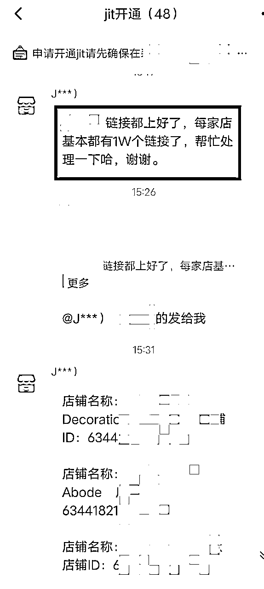

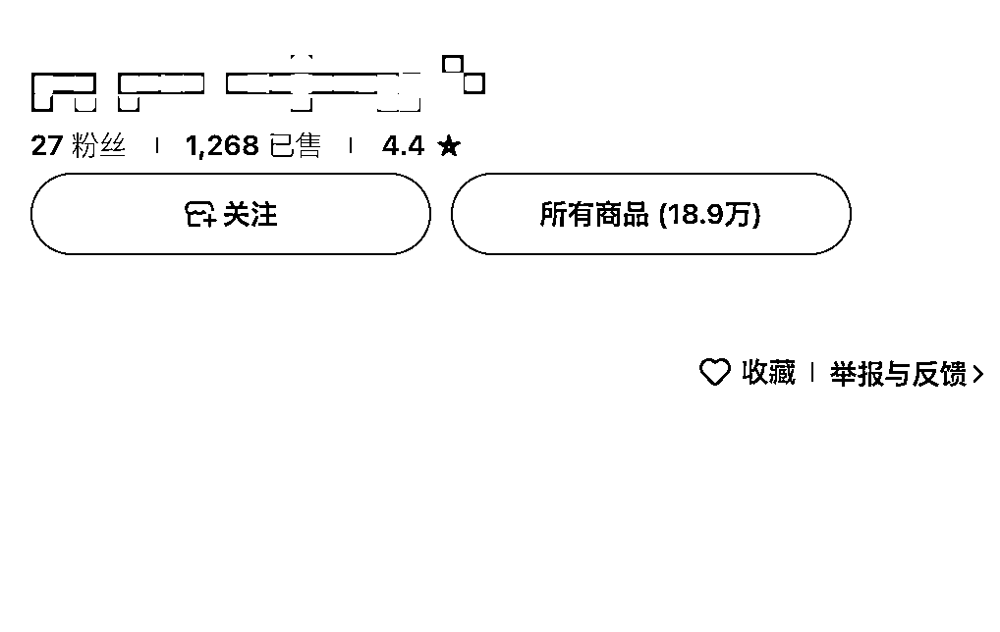

在这样的环境下，全托管还有没有机会？

我原本也开始怀疑，甚至把更多精力转到了Shein，Temu则基本处于“吃老本”的状态。直到最近观察到一个POD店铺，才重新认识了AI图像技术在定制电商中的价值。

## 一、一个借助AI快速增长的POD店铺

这个店铺主营照片定制产品：买家上传自己的照片，商家利用AI将其转换成皮克斯、吉卜力等卡通风格，再制作成海报。

以前，这类业务需要设计师逐张处理，人工费用高、交付速度慢，很难适应全托管平台的节奏。如今借助AI，制作成本大幅下降，效率也得到了提升，尤其是GPT-4o推出后，人物转绘的质量有了明显改善。

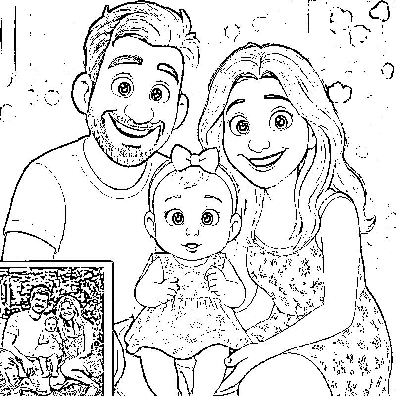

店铺于今年3月20日开设，约三个月时间累计售出2.3万件，平均每天约230单。由于店铺前期订单较少，目前实际日销已经达到350单以上。

其中一款爆品于4月27日前后上架，正好处在Temu美国站调整时期，但目前销量已经超过1万件，日均订单在160单以上。也就是说，美国站的变化并没有阻止这款产品继续增长。

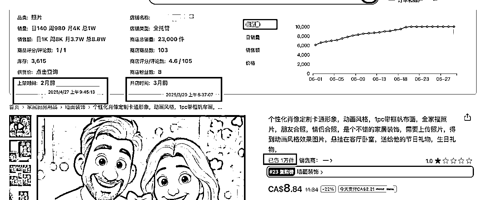

值得注意的是，这个店铺并没有铺很多产品，当前仅有103款左右。虽然覆盖了多种转绘风格，但真正贡献销量的，主要还是皮克斯风格。

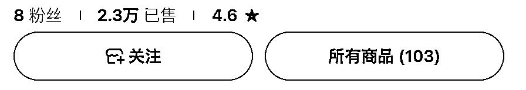

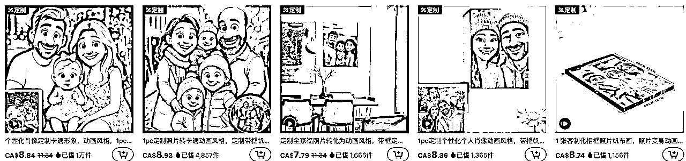

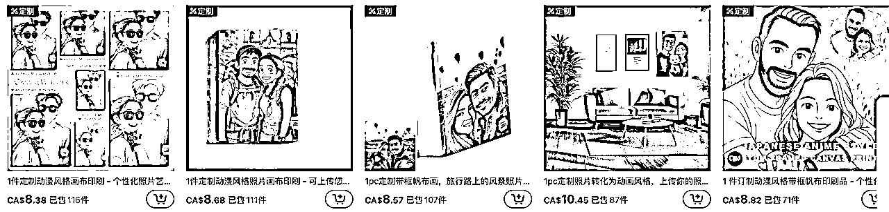

从平台核价情况看，它的价格普遍高于同类卖家。核心原因在于，店铺主图直接展示了“原照片”和“AI成品”的对比效果。

这种展示方式有三个优势：

- 图片原创度更高；
- 与同行常见产品图形成明显区隔；
- 买家能够直观看懂产品卖点。

因此，即使产品售价更高，也更容易获得平台较好的核价。

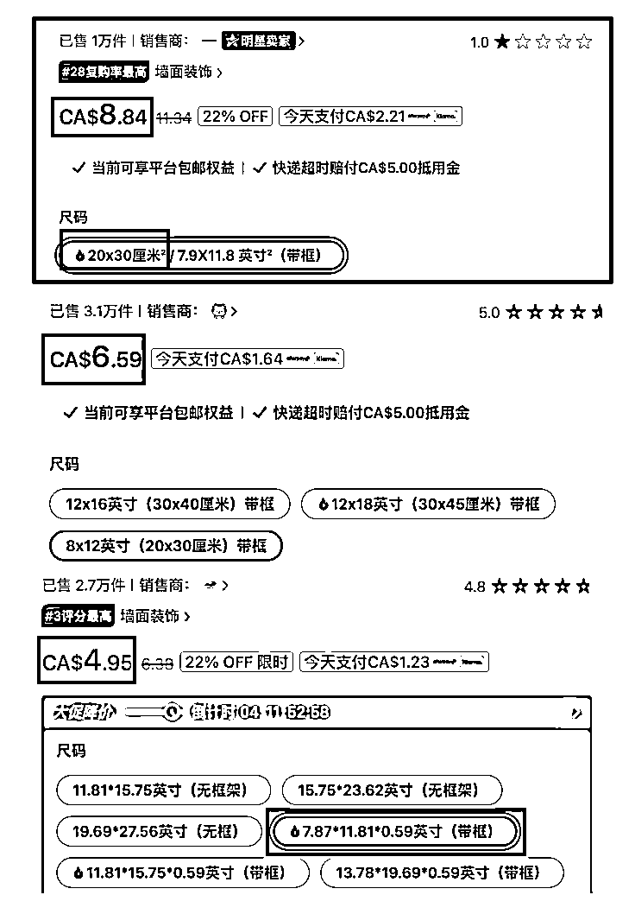

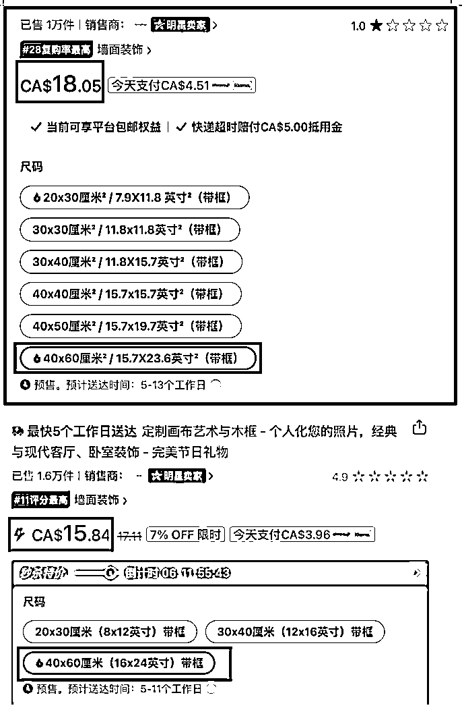

以店铺销量最高的产品为例，两个主力SKU在加拿大站的前端价格分别约为8.84加元和18.05加元。按较保守的1.6倍估算，对应核价约为14加元和28.9加元。

参考1688同类产品价格，两个SKU的成本大约为7.41元和19.87元，实际采购成本还有进一步下降空间。粗略计算，每单平均毛利按7.5元估算，日销350单时，每天毛利约2625元，一个月接近7.9万元。

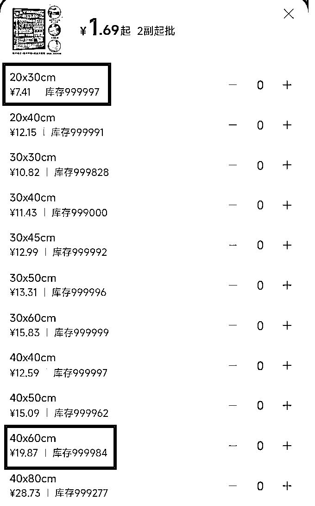

如果Temu后续恢复美国站全托业务，这类店铺还有机会获得额外增长。

而且，这并不是孤立案例。

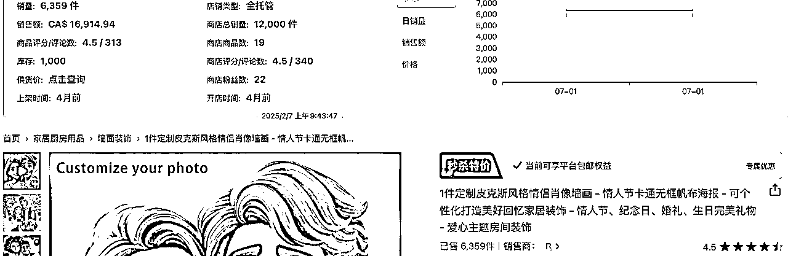

Temu上还有店铺开店不到五个月，仅凭19个产品卖出1.2万件，其中一款皮克斯风格产品上线四个月，销量达到6000件。

Shein同样出现了类似机会。有卖家推出辛普森风格定制品，上架两个月，美国站销量超过1100件，包含其他站点后，日均订单约100单。

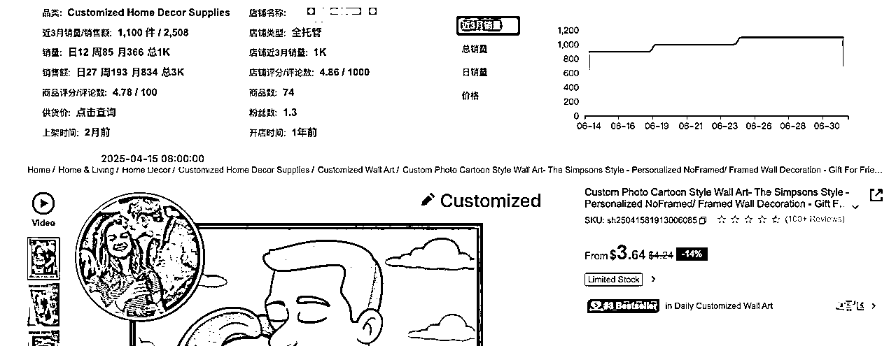

Etsy上也已经出现多个相关Bestseller产品。

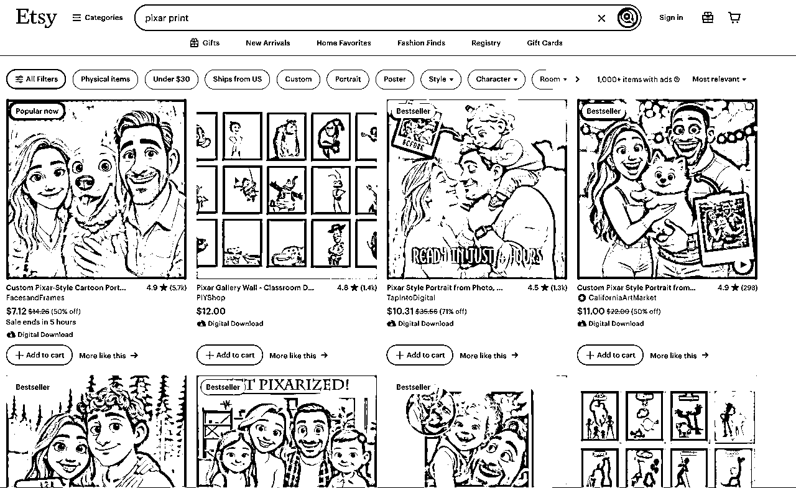

这些案例说明，AI图像定制并不局限于某一个平台，也不是单个卖家的偶然运气。

## 二、从0到1，怎样搭建一个AI定制产品店铺

下面以Temu为例，简单拆解一下整个流程。

### 1. 先解决成品图制作

POD的特点是“一单一图”。每个买家上传的照片不同，商家需要根据订单逐张生成成品。

在刚开始测试项目时，订单量不大，可以先人工操作。但当店铺进入稳定增长阶段后，批量处理能力就会变成关键，否则大量时间都会耗在制图上。

目前来看，GPT-4o在照片转绘方面的表现比较突出。很多时候，只需要输入类似“请将这张图片转换为皮克斯风格”的简单指令，就能得到质量不错的结果。

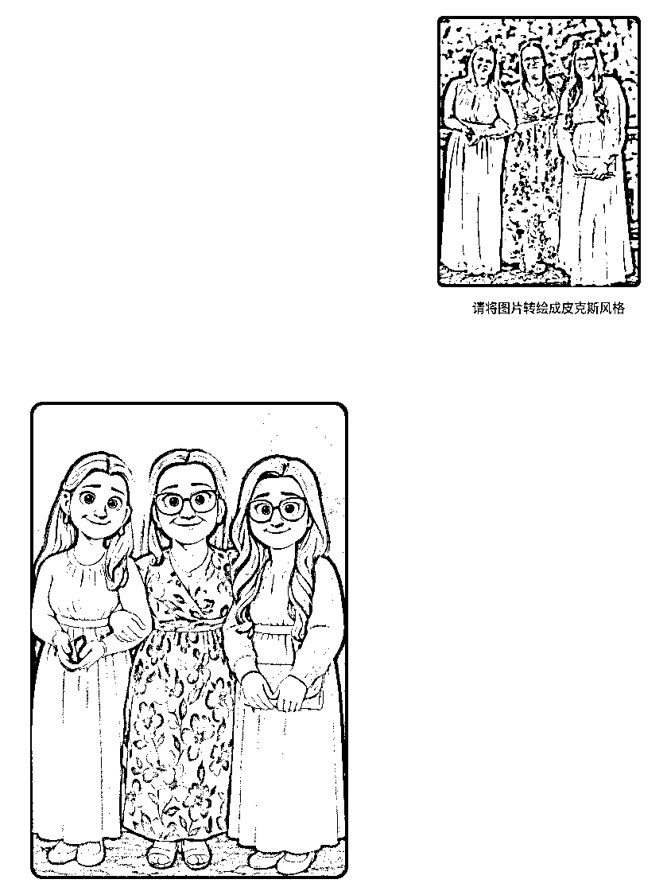

不过，直接使用ChatGPT官网也有两个限制：

第一，图片生成次数并非无限。免费用户限制更明显，即便是Plus用户，也存在使用上限。前期可以先用多个账号测试，基本能够满足小规模需求。

第二，生成速度不算快。网络状态不好时，一张图片可能需要等待几分钟，订单增加后效率会受到影响。

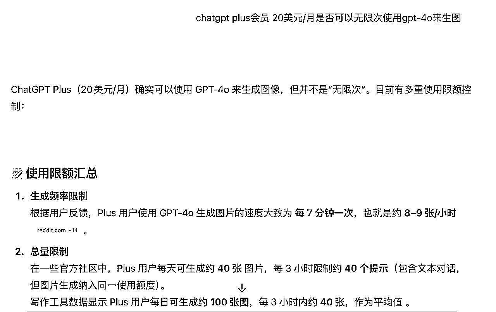

另一个选择是Flux-Kontext，或者使用接入相关模型的第三方网站。具体工具可以参考相关开源项目和教程。

不过从实际效果看，Flux-Kontext在皮克斯风格转绘上，暂时与GPT-4o仍有一定差距。

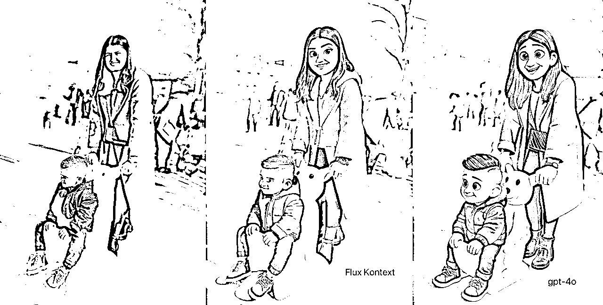

例如 Kie.ai 提供了在线生成入口，成本甚至比Flux-Kontext更低，单张图片约两毛钱，还支持🛰️支付。

可以使用下面这段英文提示词：

Create a high-quality Pixar-style 3D animated image for this photo with these specific requirements:

Use the characteristic bright, saturated colors of Pixar movies

Ensure soft, appealing lighting with gentle shadows

Create smooth, polished 3D surfaces typical of Pixar animation

Make characters friendly and expressive with large eyes

Use a warm, inviting color palette

Apply the high production quality of Pixar studios

Style references: Toy Story, Finding Nemo, The Incredibles, Coco, Soul

Quality: Photorealistic 3D animation quality

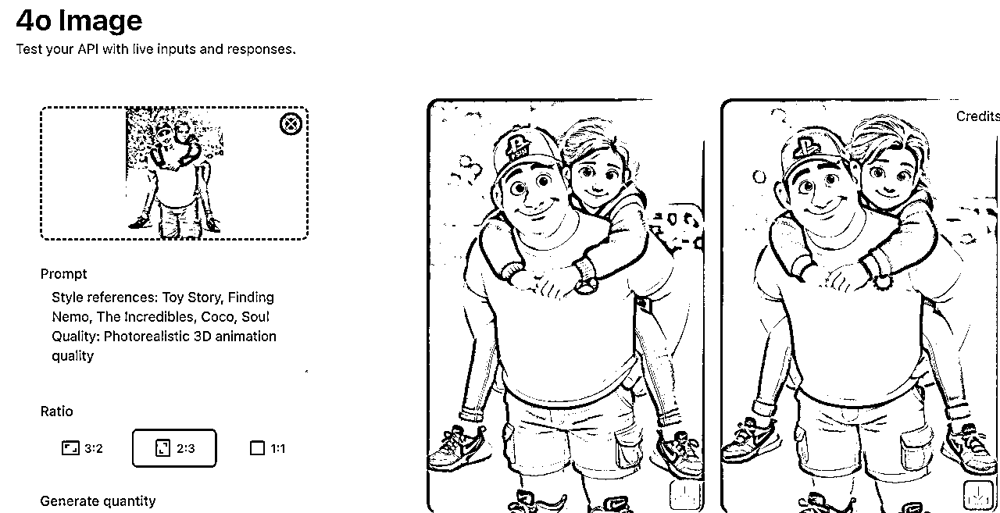

### 2. 发布Temu定制产品

Temu的开店流程这里不再展开，之前的相关航海手册可以作为参考。

店铺开通后，如果要销售定制商品，账户内需要准备2000元保证金。

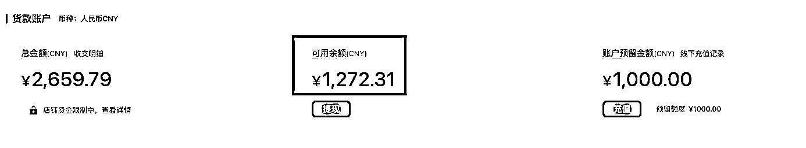

除了账户预留的1000元之外，可用余额也需要保持在1000元以上。

发布产品时，要勾选“定制品”选项，并选择对应工艺。如果产品属于印刷类，一般选择基础工艺即可。

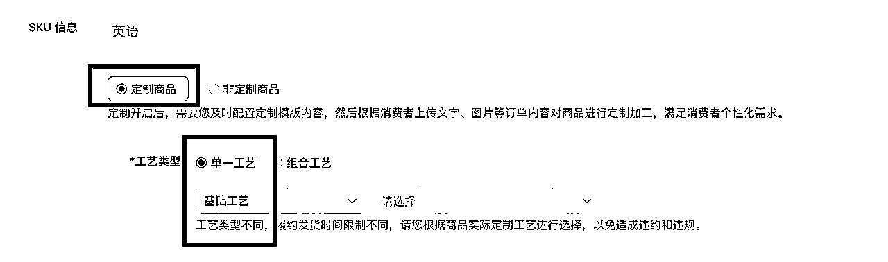

具体规则可以查看TEMU定制品相关说明。

### 3. 制作高点击率主图

这类定制产品的图片通常包括：

- 首图；
- 使用场景图；
- 尺寸图；
- 产品细节图；
- SKU展示图；
- 买家上传图片的规范说明。

其中最重要的是首图、场景图和尺寸图。

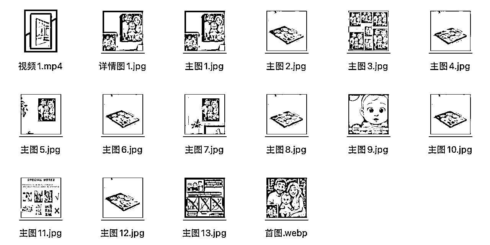

工具方面，Canva、创客贴、PPT、Photoshop都可以使用。没有必要过度追求工具，选择自己最熟悉的即可。

首图可以将AI生成后的成品效果放大展示，同时在旁边设置一个小窗口，放入买家原图或示例原图。这样能让消费者一眼看到“普通照片变成定制成品”的变化，增强点击意愿。

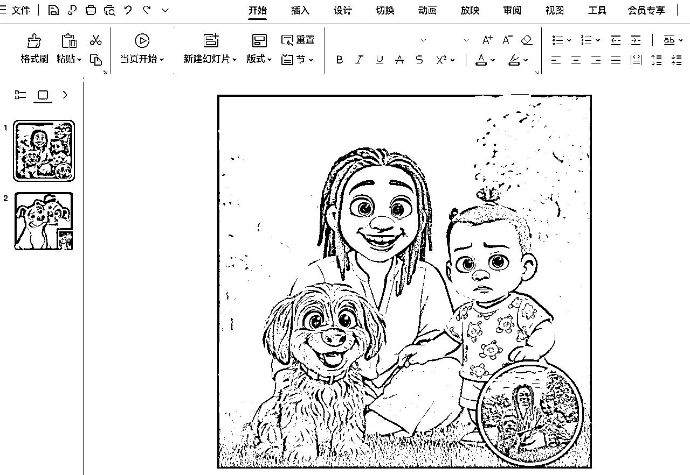

场景图则可以通过PS套版，也可以用PPT完成。比如在海报或产品所在区域绘制形状，再通过图片填充替换原有画面。

如果不熟悉设计软件，也可以使用一些POD选品平台提供的在线设计器，例如Hicustom。

主图尽量使用原创素材。原创图片不仅能降低侵权和同质化风险，也更有机会获得较好的平台核价。

### 4. 产品标题

如果追求效率，可以直接让AI辅助生成标题；如果希望做得更细，则需要认真研究同类商品的关键词组合、使用场景和表达方式。

案例中使用的是KIMI。

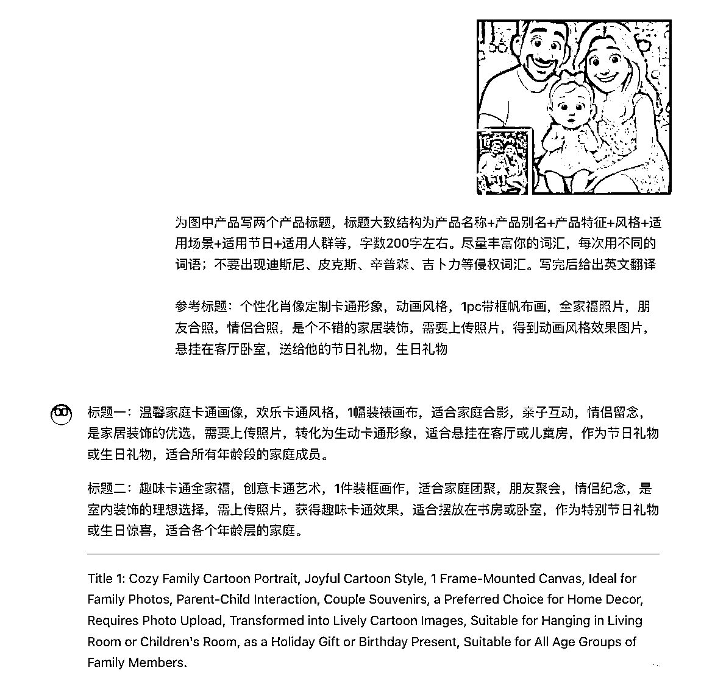

### 5. 产品定价

定价时，可以根据平台核价逻辑进行反推。

先用平台可能采用的倍率乘以前端售价，再参考估算结果进行申报，之后根据成本、竞争情况和利润空间进行小幅调整。

### 6. 配置定制模板

定制产品的基本流程通常是：

发布商品 → 审核 → 核价 → 配置定制模板 → 平台选品 → 确认上架。

产品核价通过后，还要完成定制模板配置，否则商品无法正式进入平台销售。

可以在商品列表中找到定制模板入口，签署相关协议，填写模板信息。模板结构可以参考同行的成熟做法，配置完成后再补充库存数量。

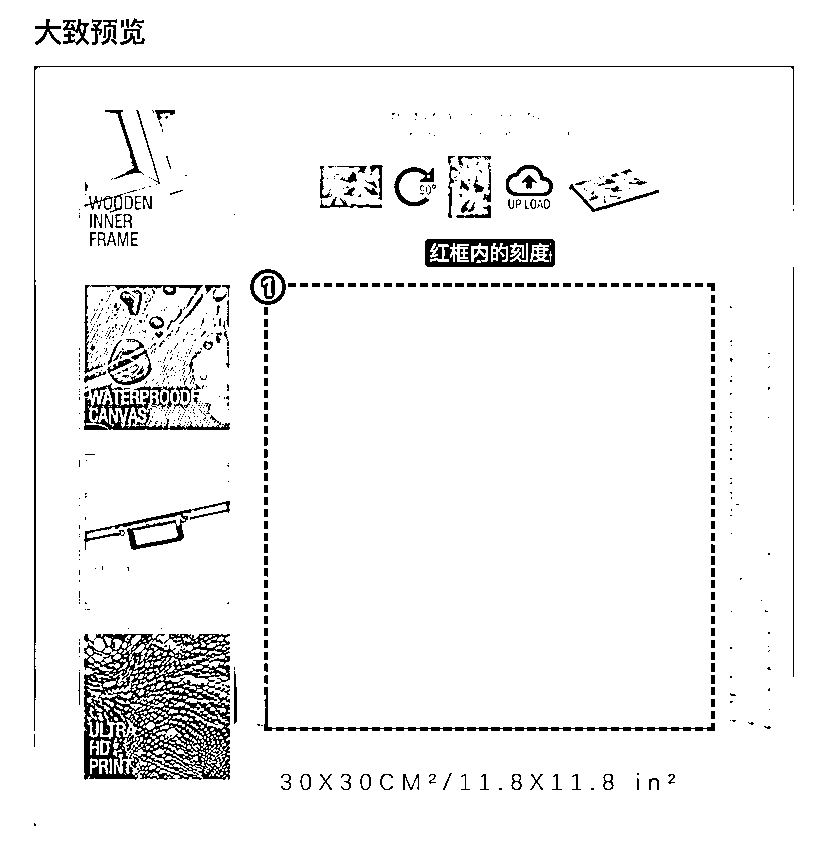

### 7. 供应链与发货

供应商寻找、生产、发货等环节涉及内容较多，这里暂不一一展开。

如果没有做过Temu，建议先把平台航海手册、高手分享和圈友经验多看几遍，熟悉定制品规则、履约流程和平台处罚机制，再开始实际操作。

## 三、从1到10，重点在效率和放大

当店铺开始稳定出单，接下来要解决的就不再是“能不能卖”，而是“能不能高效交付”。

### 1. 批量生成印刷图

订单量增长后，逐张手动制图会很快成为瓶颈。

比如每天只有50张图片，如果直接使用ChatGPT官网，在网络不稳定时，可能就需要耗费半天时间。

因此，最好尽早把批量处理流程搭建起来。

目前可以使用Python脚本，通过API接入Flux-Kontext。实测速度很快，一分钟内可以生成约7张图片，成功率也不错，只是最终画质暂时不如GPT-4o。

后续如果能够接入GPT-4o API，效果和效率还有进一步提升的空间，也可以通过Kie.ai完成相关接入。

### 2. 多店铺与风格矩阵

当第一个店铺跑通后，可以尝试复制到其他店铺。

不过平台对单一主体可开的全托店铺数量已经收紧，目前一个主体只能开设一个全托店铺，因此想做矩阵，需要根据平台规则寻找合规路径，不能简单照搬过去的玩法。

同一个店铺内，也可以测试不同风格，例如皮克斯、辛普森、吉卜力等。某个风格出现明显爆款后，再考虑建立更垂直的店铺。

批量制图、自动提取标题、批量上架等工具，都能显著提升运营效率。

### 3. 测试全托广告

如果产品核价较高、利润空间也比较充足，可以尝试投放全托广告。

尤其是在平台逐步扩大广告投放站点范围后，广告可能成为进一步放大销量的手段。

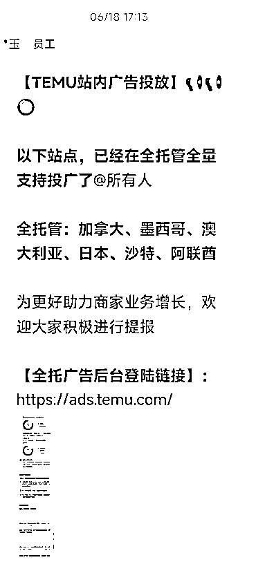

当然，广告测试需要控制预算，先观察投入产出，再决定是否扩大投放。

### 4. 扩充品类与平台

AI转绘不一定只能做海报。

还可以延伸到：

- 冰箱贴；
- 钥匙扣；
- 汽车挂件；
- 手机壳；
- 装饰画；
- 杯子；
- 其他个性化礼品。

但品类扩张的前提，是供应链能够稳定承接，尤其要关注生产时效、产品质量和定制准确率。

平台方面，除了Temu，还可以研究Shein、TikTok等全托或半托平台，以及Amazon、Shopee、Ozon等传统电商平台。

如果具备流量能力，也可以考虑独立站，甚至与AI图片生成网站合作：用户在线生成图片后，直接将数字作品转化成海报、摆件或其他实体商品。

对于AI图片站来说，这也是一种新的商业化路径。用户负责生成内容，供应链负责实物交付，双方可以形成互补。

## 四、这个项目有哪些风险

机会存在，但定制品并不是“生成图片后上传商品”这么简单。

### 1. 履约时效压力

定制品通常属于急采，平台对到货时间要求比较严格。

例如基础工艺产品，广东仓可能要求72小时内到货，义乌仓甚至要求48小时。只要供应链或物流稍有延误，就可能触发罚款。

去年春节期间，我就因为平台爆仓、物流人员不足等问题，出现过多笔延迟订单，后台累计罚款达到一两千元。后来通过申诉才得以解除。

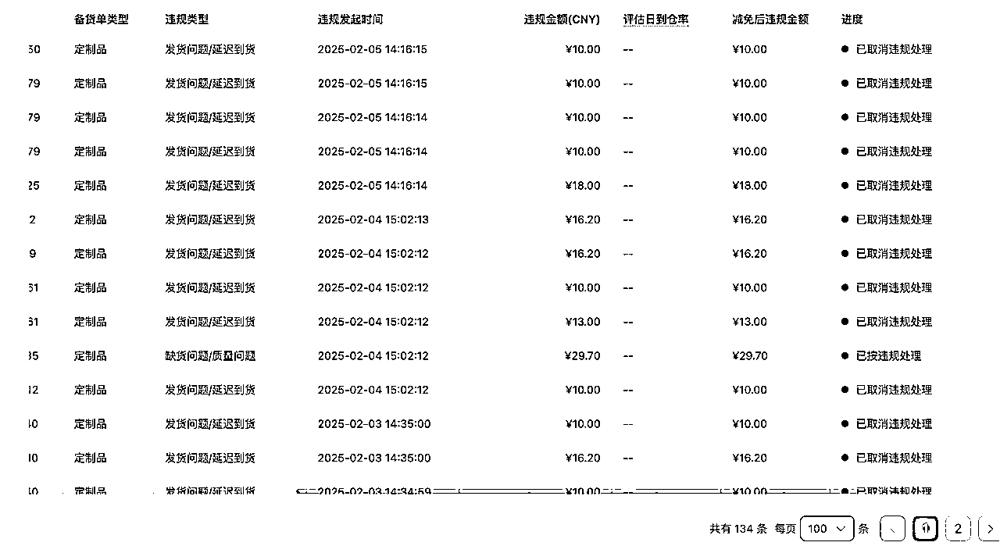

因此，供应商是否稳定、节假日是否有备用方案，必须提前确认。

### 2. 平台持续压价

全托平台的价格竞争不会停止。

特别是在Temu，后台经常会提示降价。产品上线时间越久，利润率往往越容易被压缩。

所以不能只看前期毛利，更要评估产品在未来降价后的生存空间。

### 3. 产品品质与转绘效果

质量问题也是定制品的重要风险。

如果品质评分低于60分，一旦发生售后，可能面临五倍处罚。与此同时，Temu的定制后台操作体验并不算理想，有些买家不清楚上传或编辑方式，最终收到的产品可能和预期不一致，从而产生差评。

因此需要尽可能优化：

- 上传图片说明；
- 定制流程提示；
- AI转绘效果；
- 打印清晰度；
- 成品与买家预期的匹配度。

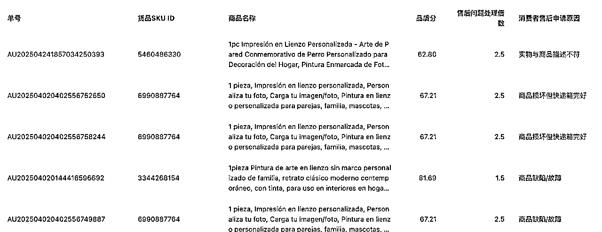

### 4. 合规标签

标签问题同样可能导致无法入库，并产生约为申报价三倍的罚款。

需要特别注意：

1. 工厂不能贴错标签；
2. 标签上的文字和批次信息要清晰；
3. 后台修改标签或生产批次后，实拍图、实物标签和系统信息必须保持一致。

### 5. 重复铺货

虽然不同买家上传的照片不同，但如果产品本质上都是同一种海报或同一种定制形式，平台仍可能将其识别为重复铺货。

目前看到的主要影响是单品下架，但对店铺整体是否会产生更大影响，还需要继续观察。

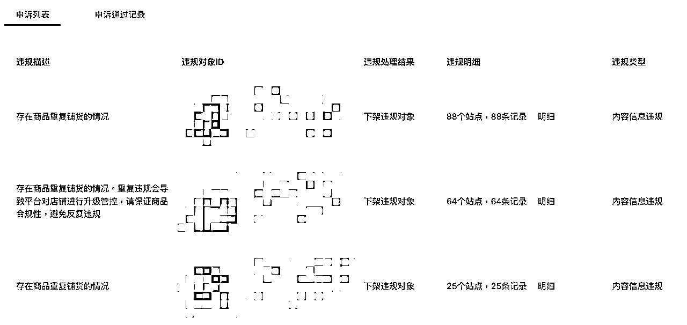

上架时，可以从风格、使用场景、产品形态和目标人群等角度做区分，尽量避免大量高度相似的商品同时出现。

## 五、最后的建议

小白能不能做？

理论上可以，但不建议没有任何跨境基础的人直接冲。

因为POD比普通备货型店铺复杂得多，除了选品和运营，还涉及图片生成、定制沟通、供应链、时效、标签、质量和售后等多个环节。

看到别人三个月卖出几万件，并不代表自己复制过去就能得到同样结果。案例店铺的成功，除了抓住AI图像趋势，也可能与主图质量、上架时间、产品定位和平台流量有关。

如果确实想尝试，建议：

- 先降低预期；
- 从少量产品开始测试；
- 优先验证供应链和履约能力；
- 先跑通一单，再考虑批量放大；
- 不要一开始就投入大量资金和店铺资源。

对于已经有跨境运营经验的卖家，这类AI定制产品值得在自己的平台上小规模验证。

AI正在降低设计门槛，也在重新定义个性化商品的生产方式。过去必须依赖设计师完成的服务，如今普通卖家也可以借助工具快速落地。真正的机会，不只是“用AI生成一张图”，而是把图片生成、产品设计、供应链和平台履约连接起来，完成从虚拟内容到实体商品的转化。