# 港机、港号、港银怎么办？一份亲身办理攻略

大家好，我是方馨，最近刚把港版手机、香港手机号以及香港银行卡都办妥了。

这次行动的起点，是我参加了6月的 AI-Web 航海活动。做 Web 产品的过程中，我越来越感受到创造带来的乐趣，也希望继续深耕下去。但如果想进一步开发订阅、支付等功能，仅靠现有条件还不够，因此我开始考虑去香港配置一套更适合海外业务的设备、手机号和银行账户。

原本我一直在犹豫：是不是要等 Web 开始产生广告收入，或者用户数量更多之后再去办理？恰好6月28日香港有一场 AI 分享活动招募志愿者，我便报名参加，也顺便把办理港机、港号提上了日程。

出发前一天，我还在群里纠结：

“我现在人在香港，今天到底要不要买港机、办港卡？总觉得现在是不是有点早……”

群里的朋友给了我不少建议。小熊建议我直接买，ZERO提醒我可以顺便看看汇丰和中银，后来小熊又补充了众安和天星。何冰曦也说自己已经办好了中银、汇丰和众安。

于是，我决定先解决手机和手机号，再去银行试试看。没想到办完前两项后才想起来，那天正好是周末，银行可能不开门。更何况，网上关于香港开户的说法五花八门：有人顺利办成，有人被拒，还有人说要往账户里存入20万到100万元才能保住银行卡。我当时也没底，不确定自己能不能成功。

最后真正让我行动起来的，是群友幻影的一句“这些应该都能在线办理，下载对应银行App就行”，以及何冰曦简单直接的“可以”。

事实证明，整个过程比想象中顺利。下面把我的办理经验整理出来，供有类似需求的朋友参考。

# 一、港机和港号怎么选、在哪里买？

## 1. 我为什么买港版 iPhone 16 Pro Max？

这次购买的是港版 iPhone 16 Pro Max，256GB。

选择它，主要有三个原因。

### 第一，我本身习惯苹果生态

我长期使用苹果设备，对它的系统、设备协同和应用生态比较依赖，因此没有考虑突然换到其他品牌。

### 第二，港版机型更适合后续海外使用

以后我可能会去东南亚、欧美等地区，也会使用更多海外服务。港版 iPhone 在应用下载、通信功能和全球网络适配方面更灵活，例如支持实体卡加 eSIM，也更方便切换不同国家和地区的手机卡。

### 第三，价格和功能之间比较划算

内地 iPhone 16 Pro Max 256GB 的官方价格是9999元，618期间叠加优惠和补贴后，最低大约7999元。

港版官方价格为10199港币，通过运营商购买后价格约为9699港币，折合人民币约8861.90元。相比内地原价少了1000多元，即便和补贴后的7999元相比，也只是多出不到1000元。

对我来说，用这部分差价换来更多海外使用的可能性，还是值得的。加上首月手机套餐费用，整体支出也没有超过9000元，所以目前对这次选择比较满意。

## 2. 为什么没有买 iPhone 16 Pro？

港版 iPhone 16 Pro 的官方价格是8599港币，通过运营商购买约8099港币，折合人民币大约7400元。

看起来比内地版本便宜，但内地 iPhone 16 Pro 通过优惠后的价格约为7999元，实际差距并不算特别大。另一方面，我更习惯 iPhone 16 Pro Max 的大屏幕，使用起来更舒服，整体体验也更符合我的需求。

如果你平时不习惯苹果手机，也可以根据自己的预算和实际需求，考察其他品牌与型号，不必完全照搬我的选择。

## 3. 手机卡为什么选 SmarTone？

我最终购买的是 SmarTone 的实名后付费手机卡。

我的需求比较明确：

- 能够注册海外平台和支付服务；
- 可以稳定接收 Stripe、PayPal、Wise、Revolut、AWS、Google、Apple 等平台的验证码；
- 尽量长期有效，不容易被封停；
- 在内地也能正常使用，不必长期待在香港；
- 可以持续接收海外服务发送的短信。

我把这些条件告诉 ChatGPT 后，它给出的候选运营商包括 CSL、3HK、SmarTone 和 CMHK（香港移动）。这些运营商整体上信号和短信接收能力较稳定，也不太容易被国际平台识别成虚拟号码。

在 3HK 和 SmarTone 之间进一步比较后，ChatGPT 更倾向于推荐 SmarTone。

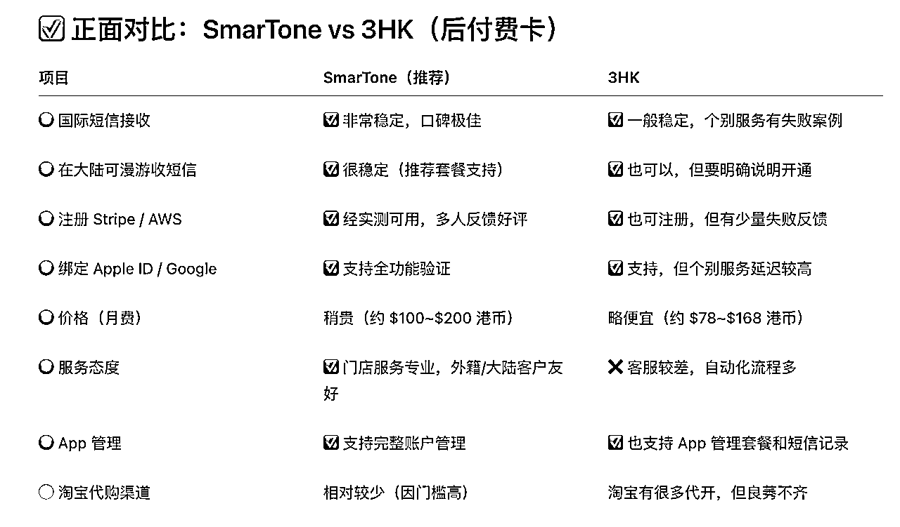

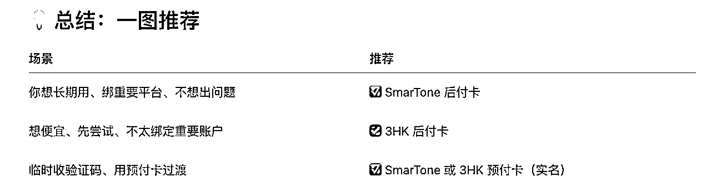

SmarTone 有多档国际漫游套餐，价格从129港币/月、179港币/月到更高档位都有。

但我直接告诉店员：自己不需要通话，也不追求大量流量，主要用途是在内地接收海外平台短信。最后选择了基础套餐，原价129港币/月，优惠后约99港币/月，属于我可以接受的支出。

办理港机和港号后，我的 iPhone 也拥有了不同于内地的 App Store，可以下载更多需要的应用，例如“BA”。

当然，如果你的需求只是旅游上网、临时测试网页，3HK、鸭聊佳等方案也可以了解。若涉及长期注册 Stripe、PayPal 等平台，并且需要实名、稳定接收验证码，建议优先考虑正规运营商的实名后付费号码。

## 4. 去哪里办理最方便？

我是在运营商门店一次性买手机、办手机号的，准备好港澳通行证即可。

申请香港手机号时，门店通常需要填写地址。如果没有香港住址，可以询问工作人员是否能填写门店地址，部分销售人员也会协助处理。毕竟他们有成交和提成需求，通常会尽量帮忙解决这些细节。

地点方面，我不太建议去客流很少的街边小店。此类门店接触内地用户和跨境办理的经验可能有限，遇到特殊情况时未必能灵活处理。

更推荐去中环等人流量大的商圈，选择品牌直营店或大型运营商门店。这些地方办理港机、港号的人比较多，工作人员经验更丰富，也更容易给出实际建议。

而且中环周边本身也适合游玩：附近有香港摩天轮，坐船可以前往维多利亚港、星光大道和李小龙铜像；往西有香港大学、太平山，往东还有金紫荆广场和铜锣湾。完全可以把旅游和办卡安排在同一天。

# 二、香港银行卡如何线上办理？

我办理的是汇丰香港、中银香港和众安银行的储蓄账户，全部通过手机 App 完成，没有在线下网点办理。

需要注意的是，储蓄账户和投资账户不是一回事。如果你想买港股、基金等投资产品，还要另外申请证券或投资账户。各家银行的审核标准也不完全一样，不能保证所有人都一定按照同样流程通过。

线上申请的好处是，不需要经历部分线下开户可能遇到的验资、提交香港住址水电费账单，或者当场存入20万至100万元等要求。一般来说，准备好正确的银行 App、身份证、港澳通行证、内地居住地址和出入境记录等资料即可。

## 第一步：下载正确的银行 App

### 汇丰香港

在 App Store 搜索“汇丰银行”或“汇丰香港”。

需要下载图标下方带有“HK”标识、名称为“HSBC”的应用，约有323k下载量。不要误下带有“CN”标识的内地版“汇丰银行”。

打开 App 后，点击“开户”，接着根据页面提示完成操作。

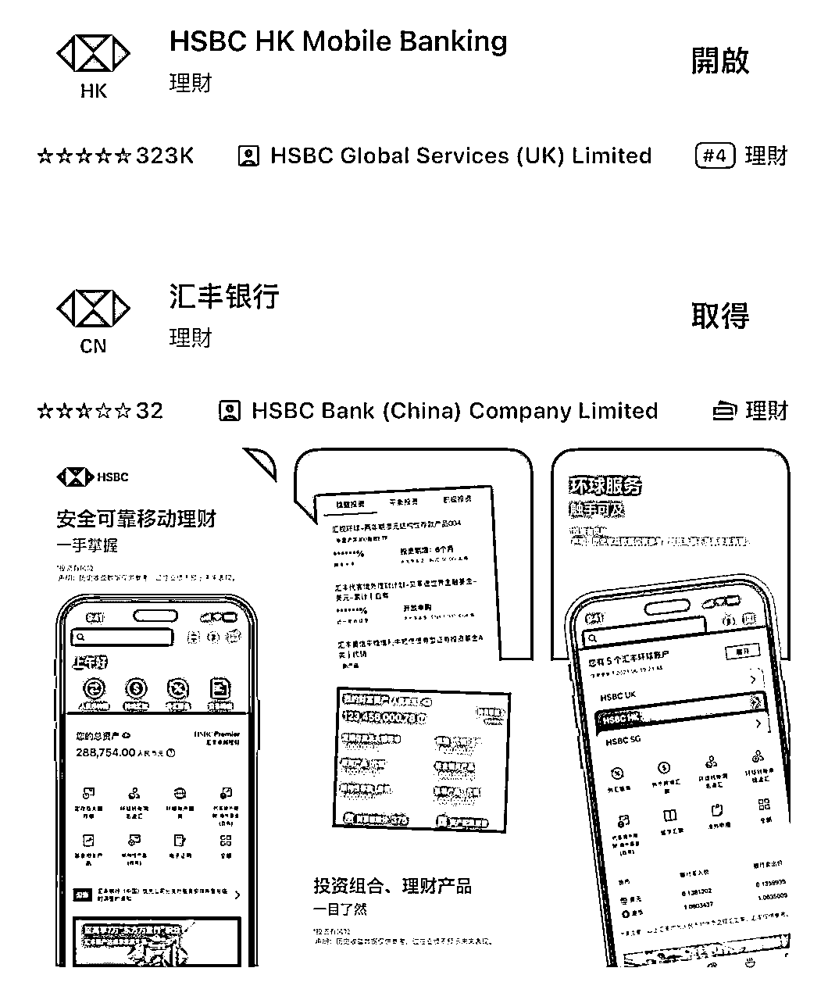

### 中银香港

搜索“中银”或“中银香港”。

正确的应用是白底红色印章图标，名称为“BOCHK”，约有158k下载量。不要把它和红底白字的“中国银行”App混淆。

安装完成后，点击页面中的红色按钮，按流程继续即可。

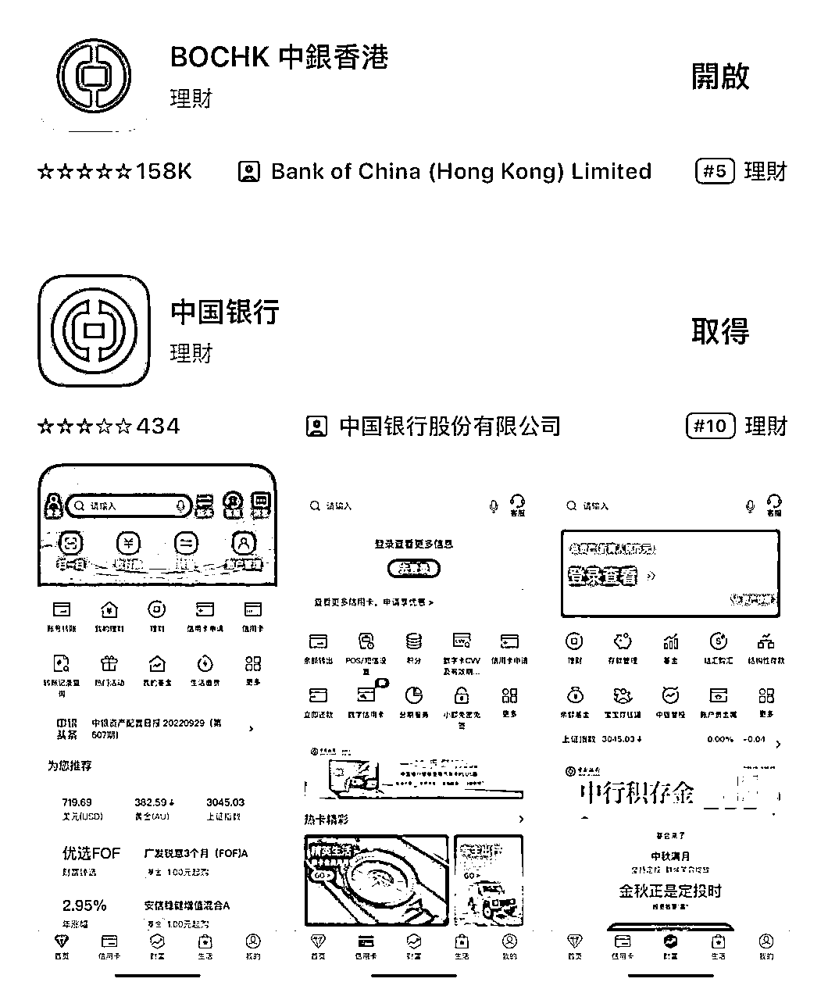

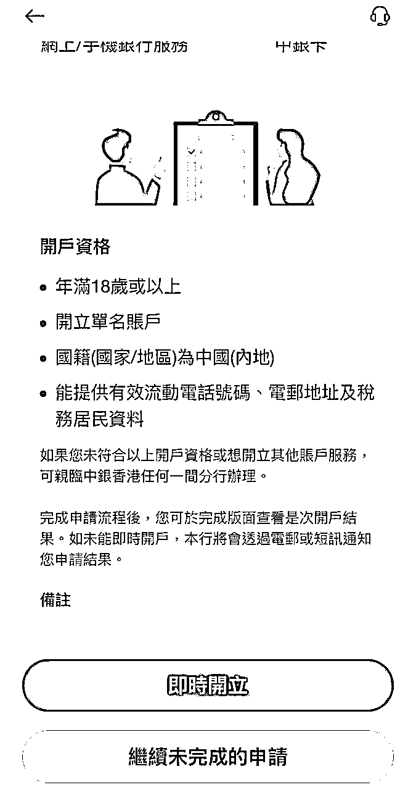

### 众安银行

搜索“众安”或“众安银行”。

需要下载浅绿色图标、名称为“ZA Bank”的应用。进入后点击“开户”，跟随系统提示操作。

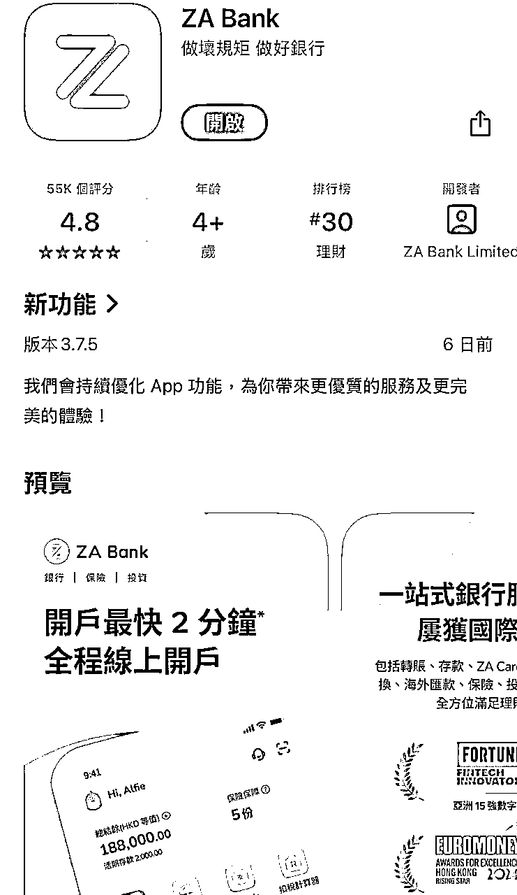

## 第二步：准备身份证

身份证可以提前拍照，也可以在开户过程中直接调用手机相机拍摄。

拍摄时要注意：

- 完整露出证件边缘；
- 不要遮挡照片和文字；
- 避免强光反射；
- 保证图片清楚，方便系统识别。

汇丰和众安通常可以使用提前拍好的照片。中银对证件识别更严格，一般需要在流程中现场读取，不能简单上传提前拍摄的图片。只要有反光、边缘缺失或角度不合适，就可能读取失败，需要反复调整手机位置和光线。

另外，流程中出现的“税务编号”，这里通常指身份证号码，并不是让你填写个人所得税或其他税务资料。

## 第三步：准备港澳通行证

港澳通行证的准备方式与身份证类似，可以提前拍摄，也可以在申请时现场拍照。

同样要保证：

- 证件完整入镜；
- 不遮挡头像和文字；
- 没有明显反光；
- 信息清晰可读。

中银对港澳通行证的识别要求也比汇丰和众安更严格，现场读取时需要多次调整角度，保持耐心即可。

## 第四步：填写内地居住地址

线上申请填写的内地地址，通常不是一整行输入，而是分成“地址1”和“地址2”。

一般可以这样填写：

- 地址1：省份、市、区、街道、道路等信息；
- 地址2：小区名称、楼栋、楼层、房号等详细信息。

汇丰会要求同时填写中文地址和英文地址。中银香港、众安银行通常只需要填写中文地址。

地址一定要认真核对，因为线上开户成功后，银行卡通常只能通过国际邮寄寄送，不能到香港网点直接领取。

## 第五步：获取出入境记录证明

汇丰和众安的线上开户流程中，通常需要上传近期出入境证明。不要以为完全不去香港也能完成整个流程，系统会要求提供实际入境香港的记录。

获取方式如下：

1. 在🛰️搜索“移民管理局”，进入官方小程序；
2. 选择“中国公民服务”；
3. 在“查询业务”中找到“出入境记录查询”；
4. 使用身份证登录并完成身份、人脸验证；
5. 查询近三个月的出入境记录；
6. 进入下一步后，核对护照和港澳通行证信息；
7. 点击“查询”，生成出入境证明；
8. 选择下载到本地，或发送至邮箱。

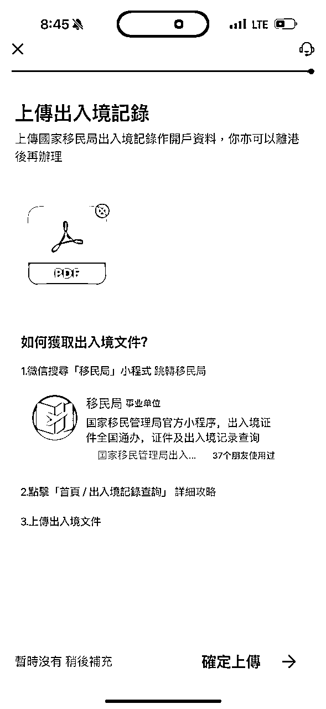

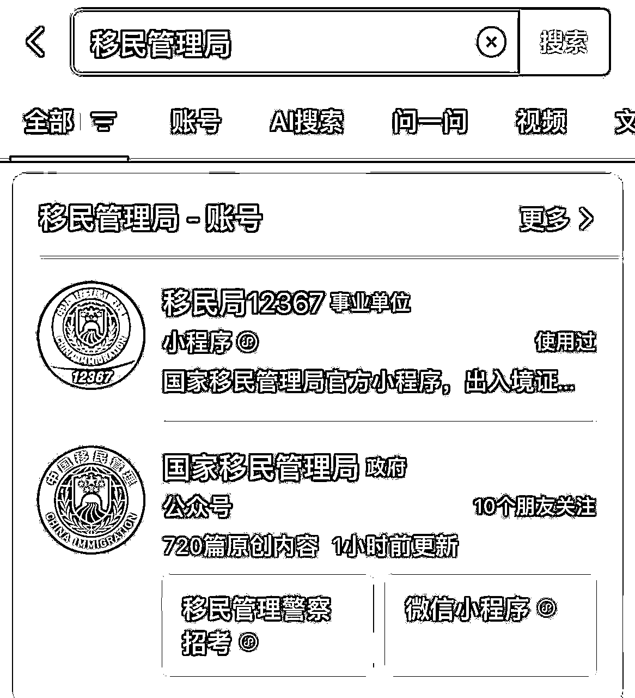

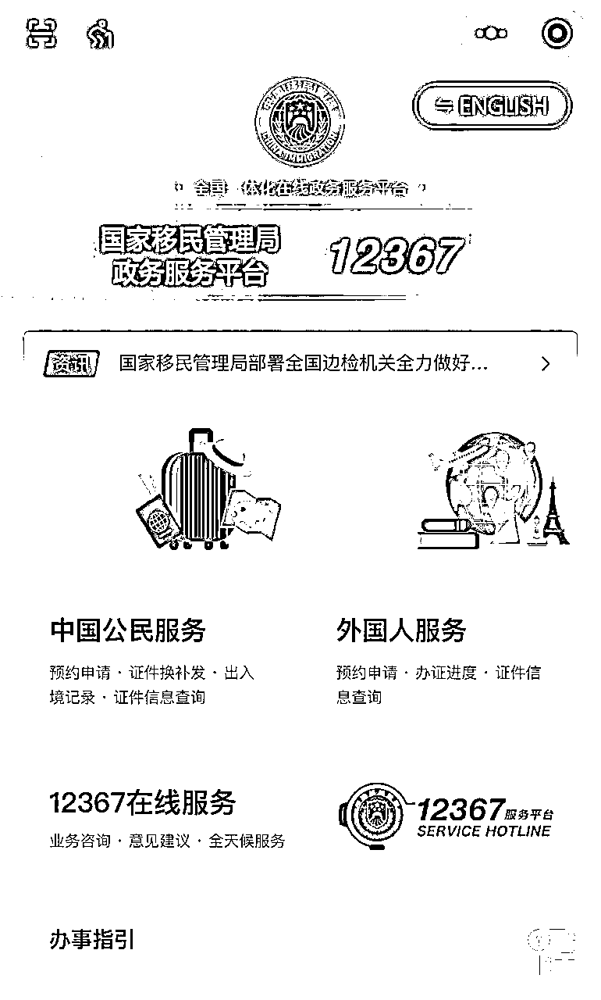

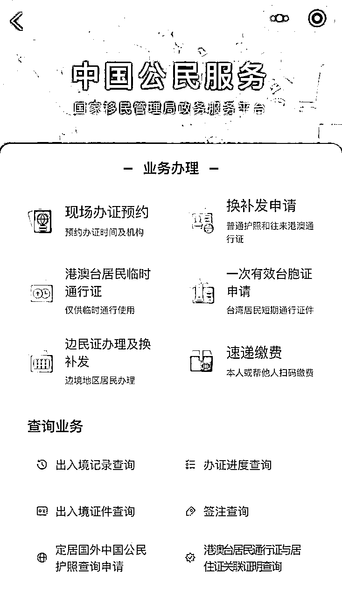

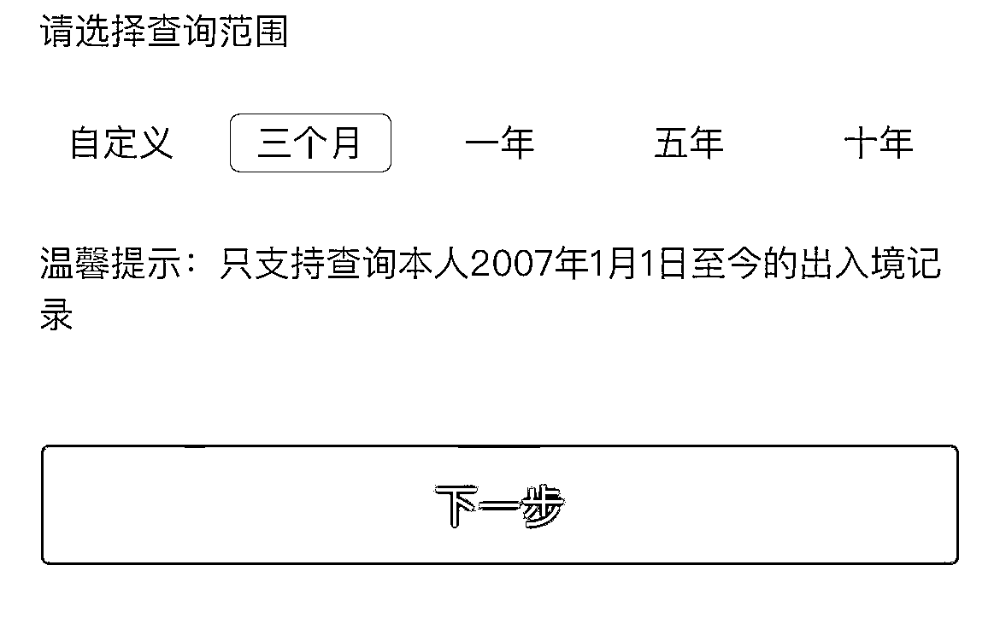

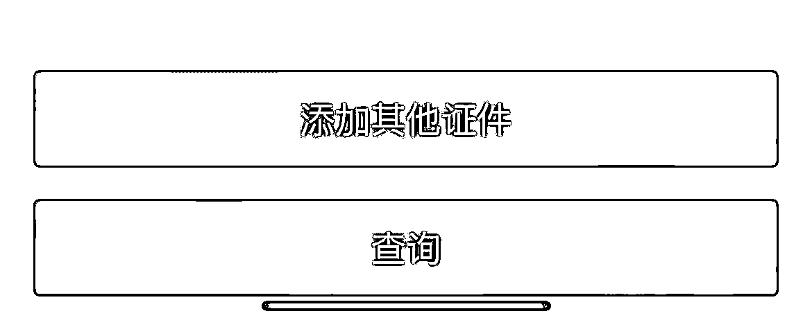

需要注意的是，开户时往往要求提供7日内有效的出入境证明。因此，更建议入境香港后再生成并下载。

苹果手机用户如果需要保存文件，可以点击“文件预览”右侧的“……”按钮。

接着选择“存储到‘文件’”，这样后续才能顺利从手机文件中上传给银行。

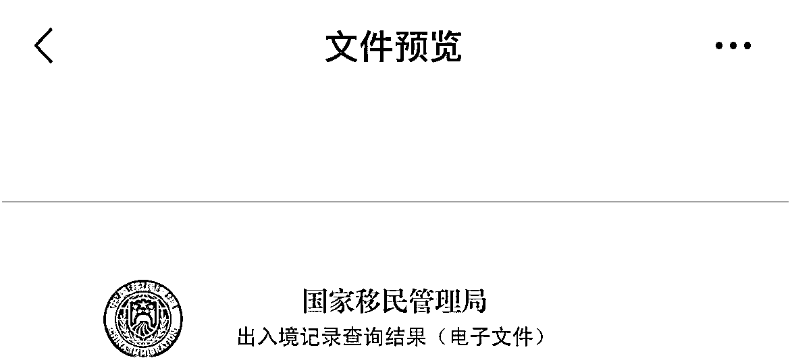

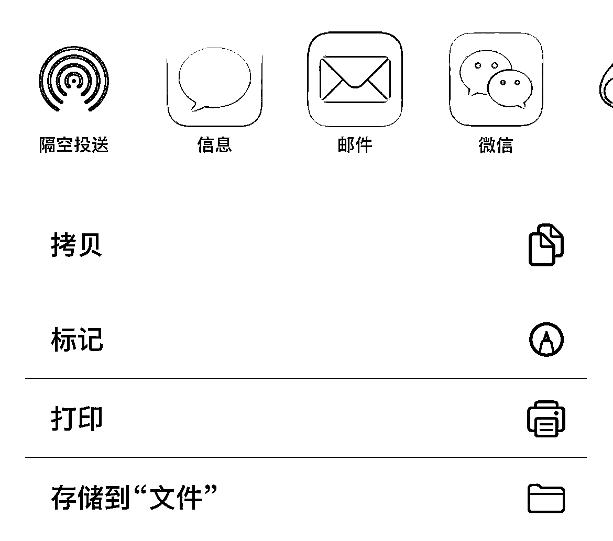

## 第六步：确认开户完成

完成证件上传、人脸识别、短信验证、邮箱验证和地址确认后，如果页面出现开户成功的提示，就说明线上银行账户已经开通，通常可以直接在 App 内进行转账。

汇丰香港线上开立的账户，银行工作人员确认不支持到网点线下领取实体卡，只能通过国际邮寄。中银香港和众安银行也类似，因此填写收件地址时一定要仔细，避免影响银行卡寄送。

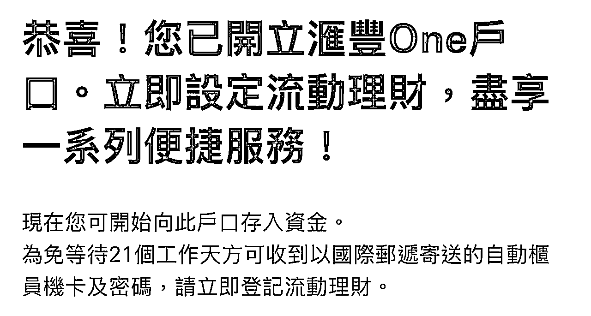

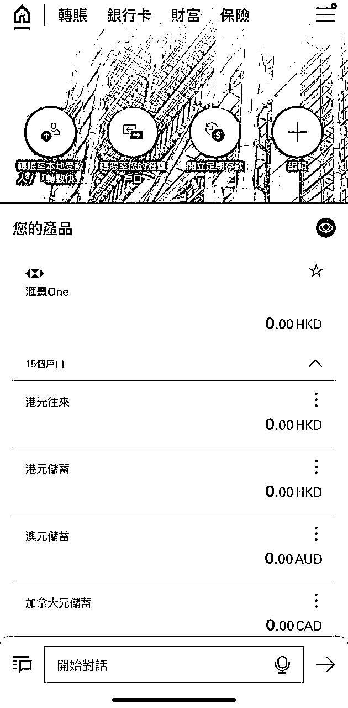

中银香港和众安开户完成后，也会显示类似的成功页面。

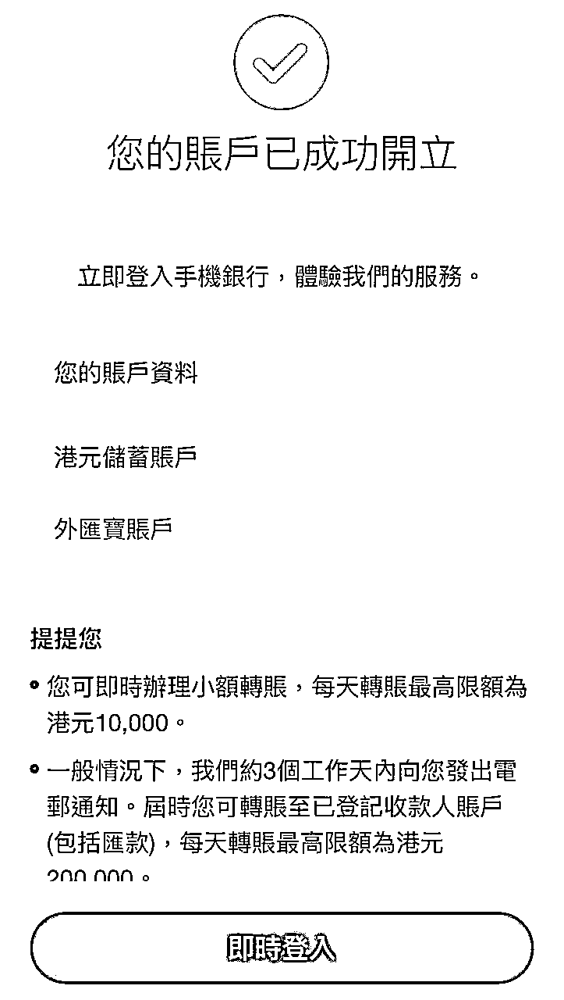

# 三、办理过程中的常见问题

## Q1：必须亲自去香港才能开户吗？

不需要进入银行柜台，但人需要在香港，并且最好使用香港网络，同时要有能够证明你入境香港的出入境记录。

## Q2：出入境证明需要说明入境原因吗？

不需要额外填写理由。只要实际入境香港，系统就会自动形成对应记录，之后可以在“移民管理局”小程序中查询和下载。

## Q3：刚到香港，需要先买临时手机号吗？

一般不需要。入境后可以直接使用内地运营商的国际漫游服务，不必专门购买临时号码。

也不建议随便用临时号码申请香港银行卡。如果使用香港号码开户，部分银行系统反而可能要求你提供香港住址、香港身份证或香港永久/非永久居民身份证明。

我之所以购买港版手机和香港手机号，主要是为了注册海外平台，以及使用不同于内地的 App Store，并不是为了单纯完成银行卡开户。

## Q4：怎样把内地资金转到香港账户？

线上银行开通后，可以在经过银行网点时咨询跨境汇款的具体操作。

众安银行不需要专门去网点，跨境汇款所需的信息可以直接在 App 内查看。像中银香港这样的传统银行，工作人员通常会提供一张包含收款信息的说明纸。

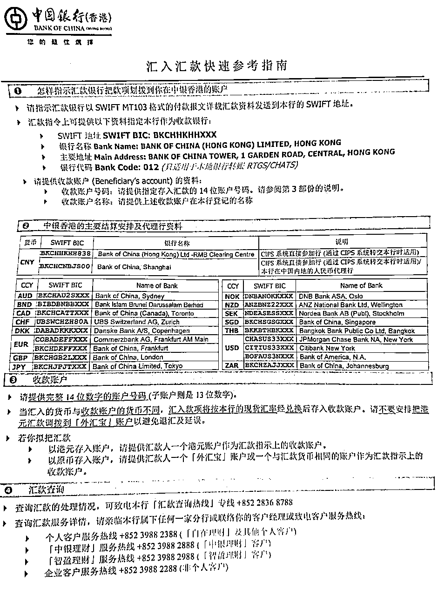

## Q5：任何时间都能线上申请吗？

根据我的体验：

- 中银香港的线上开户系统周末可能暂停服务；
- 汇丰香港和众安银行周末也可以正常提交申请。

# 四、一些补充观点

有朋友分享过自己的经验：如果只是满足基础需求，众安 ZA Bank 已经可以覆盖不少场景，而且申请过程相对顺畅，不需要排长队。香港手机号也不一定非要到香港办理，部分 eSIM 或其他方案在内地就能处理。

手机方面，也有人建议不要盲目购买最新款港版设备，可以比较加拿大版、澳版等版本。若追求性价比，iPhone 13 系列同时具备实体卡和 eSIM，可能更适合一部分用户；如果主要做海外业务，也可以研究早期带实体卡槽的美版机型。

不过，是否需要汇丰、中银等多个账户，还是取决于个人的资金管理方式。

我会把账户分成五类：

1. 收入账户；
2. 利润账户；
3. 所有者账户，包括自己和股东；
4. 税款账户；
5. 经营费用账户。

每月10日和25日，我会按照既定比例，把收入账户中的资金分配到利润、所有者、税款和经营费用账户，并尽量让收入账户保持清零。之后，再把利润和税款转移到另一家银行对应的账户里，减少自己随手动用这些资金的可能，让利润真正沉淀下来。

这些账户，本质上也是企业和个人的资金蓄水池，在遇到突发情况时能提供缓冲。因此，我把汇丰、中银和众安分别用于不同类型的资金管理。

至于鸭聊佳、3HK 等方案，很多人也会推荐，尤其适合旅游上网或临时测试网页。但如果你的目标是长期注册 Stripe、PayPal 等海外服务，需要稳定接收验证码并绑定实名身份，那么正规运营商的实名后付费港卡会更匹配。

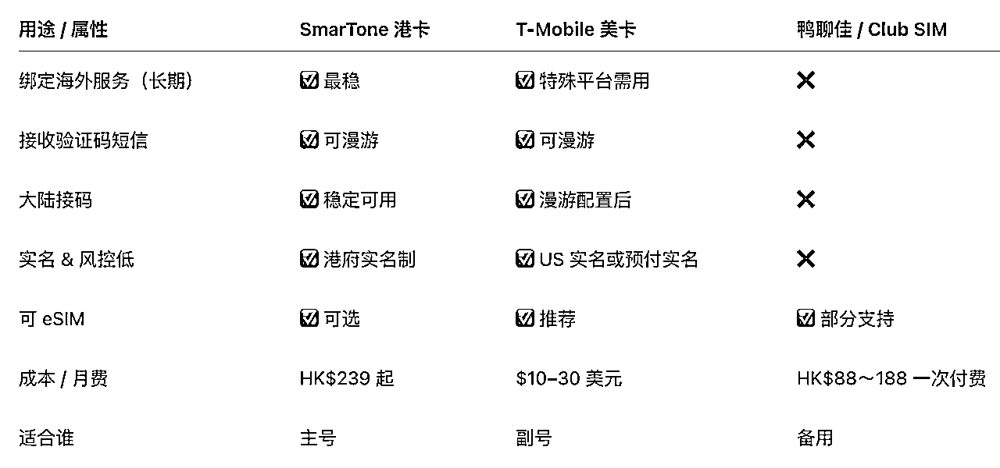

AI应用-Web航海老师-良辰美评论补充：感谢分享，很有帮助，这是我给chatgpt聊天对话答疑记录https://chatgpt.com/share/68633a40-0d44-8005-899c-34d89a943a43 可能对大家也有帮助

# 写在最后

以上内容都是我的个人办理经历，并不代表所有人的审核结果都会完全一致。银行政策、运营商套餐和设备价格也可能随时间调整，办理前最好再通过官方渠道确认最新要求。

希望这份经验能帮你少走一些弯路，在香港玩得开心，也能顺利办好自己需要的手机、号码和银行账户。

如果你有其他实用经验，欢迎在评论区交流；如果文中还有没讲清楚的地方，也可以通过🛰️「fx1230ni」联系我，我会继续补充更新。