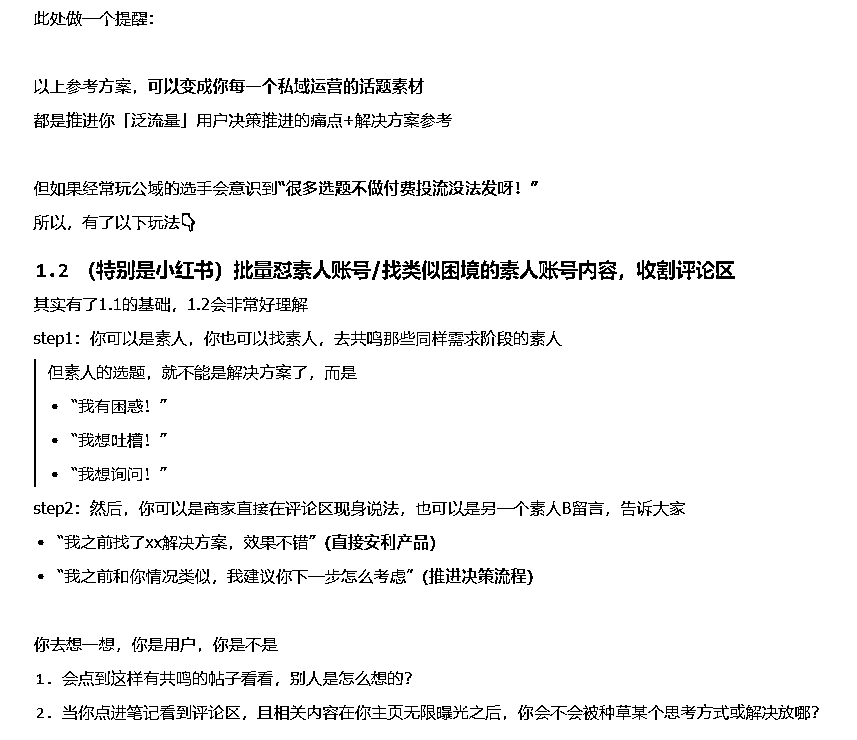
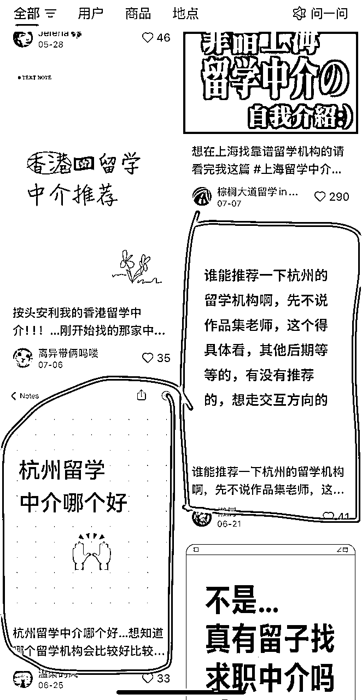

# 私域转化做不好？先别急着刷屏，可能是公域信任没铺垫到位

最近和一些做私域的朋友聊天，发现大家普遍有个困惑：明明每天都在发朋友圈、搞社群、做活动，为什么转化还是上不去？

其实问题可能不出在私域运营本身，而是更早的环节——**用户在公域认识你的时候，信任基础就没打好**。

很多人把公域和私域当成两个割裂的战场，觉得公域负责引流、私域负责成交就够了。但真正决定成交效率的，是用户在加你🛰️之前，心里已经对你形成了什么样的判断。

今天不聊虚的，直接拆解用户的决策链路和信任构建逻辑。

## 一、别纠结泛流量还是精准流量了，关键看用户走到哪一步

做私域的人，几乎都听过“泛流量”和“精准流量”的说法。大家默认精准流量更好转化，这没错。但你要是深究一下：

泛流量精准一点点，算精准吗？精准流量泛一点点，算泛吗？

你会发现这个划分其实很模糊。

与其纠结流量标签，不如看用户处于哪个决策阶段。我把用户从“完全没意识到问题”到“准备掏钱”这个过程，拆成**两大阶段、六个小环节**：

- **需求觉醒阶段** = 泛流量（用户刚意识到“我可能有这个问题”）
- **竞品比对阶段** = 精准流量（用户已经在看谁家更好了）

用户在比产品的时候，付费意愿天然比刚意识到问题时要高得多。所以核心工作就是：**把用户从需求觉醒，一步步推到竞品比对**。

## 二、需求觉醒阶段：六道关卡，卡住了就没下文

这个阶段的用户，脑子里其实在过六个“内心戏”。每一关没过，他都不会进入比较产品的环节。

### 第1关：他根本没意识到自己有问题

就像疫情期间有人觉得自己多喝热水就行，不用做核酸、不用备药。留学行业也一样，大二的小A觉得上课、考试、社团都挺正常，从不琢磨毕业后的竞争力问题。结果大三暑假突然说要留学，绩点履历全不够，只能GAP。

这种用户前期教育成本很高，但一旦觉醒，“病急乱投医”的概率也极高——好签，但也容易退费。

**解决办法：别教育，只揭露。**
- 给他看目标公司简历池里，80%都有海外背景
- 给他看海归和985/211毕业生在目标行业第一份工作的薪资对比

让他自己意识到：不是我在推销，是现实本来如此。

### 第2关：他能描述问题，但描述的是错的

你肚子疼拉稀，跟医生说自己前天吃坏了东西，是细菌感染。结果一查——着凉了。

用户也一样。一个普通一本学生小B，看网上说雅思出分很难，拼命备考雅思，却忽略了实习经历，最后申请时履历单薄，拿不到好offer。他的问题不是雅思不够，是规划失衡。

**解决办法：确认目标 + 专业评估。**
- 用户说电脑卡，一问才知道只是玩3A大作时卡。换个问题：一定要玩3A吗？
- 真要玩3A，那卡的原因也有好几种——外接显卡、清内存、清理硬盘，不一定非得换整机。

用户要么表达太宽泛，要么表达不准确。你的价值，是用全局评估帮他精准定位。

### 第3关：他觉得问题不严重

很多人觉得“熬一熬就过去了”，不值得花钱找咨询、买药。不是买不起，是没觉得这事有多重要。

大学生典型心态：
- “我大二学雅思太早了吧？”
- “我才大一，先玩一年再说啊，为什么急着规划？”

**解决办法：算账。**给用户算“如果不早做，损失是什么”——注意，不是算“做了能得多少”，而是算“不做会失去什么”。本可以拿到的东西没拿到，那种感觉才是真正驱动行动的。

### 第4关：他觉得这事没那么难

过度自信的人，适合“事教人”，不适合“人教人”。比如六级600分就觉得雅思随便考，中外合办就觉得雅思一学期搞定。

**两种办法：**
- 做一个低成本小测试，让他亲身体验一下难度
- 给他看一个跟他的背景、想法高度相似的案例，让他觉得“这说的就是我”，然后自己去碰壁，碰完了回来找你

### 第5关：他知道要找人了，但不知道怎么找

“我知道该找中介，但该从哪些渠道找？中介有没有擅长国家之分？有没有擅长专业之分？服务条款和退费政策怎么看？从业年限有什么影响？……”

用户这时候需要一个**决策框架**，而不是一个“我很专业”的卖家。商家自己说“选我吧”，没用，因为“无商不奸”这个坑是行业自己挖的。但学长学姐推荐、老师推荐有用，因为他们没有“卖瓜”的嫌疑。

所以你要做的：不是告诉他“我最好”，而是告诉他“**怎么判断谁好**”。

### 第6关：他有习惯性的做法，但那个做法是低效的

有人习惯先问AI、先上📕搜评价、先找学校附近的中介——这些习惯性动作，本身就可能成为你成交的阻力。

**解决办法：破除固有认知 + 解释为什么。**比如“为什么📕上全是好评的机构不一定靠谱”，“为什么学校附近的中介不一定最懂你们学校”。

---

六关全打通，用户算真正“准备好了”。你去看各种私域课程里说的“朋友圈要发什么、社群要放什么”，本质上推动的就是这六件事：揭示真相、重设目标、评估问题、量化损失、建立人设、构建决策模型。

## 三、竞品比对阶段：用户只关注四个字——投入产出比

用户开始比较产品了，这时候他在想什么？四个维度：

### 1. 你的动机是什么？

一个刚加🛰️的人给你推销，你第一反应一定是“他想赚我钱”。一个美女路边加你🛰️，你第一反应可能是“钓鱼执法？还是我老婆派来的？”

哪怕留学顾问说得再有道理，用户心里那根弦始终绷着：**你就是要赚我的钱。**

### 2. 你有没有这个能力？

人人都说自己好，被割过的韭菜已经不愿听嘴巴吹了。要逻辑论证，要能检验。“速干面料”得看看是不是聚酯纤维；看病要先确认医生水平；买电子产品要先看品牌——因为有些能力没法直接验证，只好信背书。

留学这种高度非标的行业更麻烦。“我们是行业最佳”，这种话谁都会说，用户没法验证，干脆就不信。

### 3. 你说的是做了，还是真做出来过？

所以电商要看评价，非标行业要看案例。但案例和好评都可以造假，所以用户还有一个反向心理——**他看差评**。发现一个产品“没有差评”，用户反而慌：是不是评价被删过？看差评，是在检验结果的真伪。

### 4. 万一最坏的情况，我兜不兜得住？

这也是“看差评”背后的深层逻辑：风险控制。
- 怕烂尾，所以认准央国企“保交付”
- 留学行业名声臭了，所以宁可多花钱选大机构，因为“不会太差”

这四个维度是一条完整链路：**动机合理 → 能力可信 → 成果可验 → 风险可控**，四关全过，“信任”才成立。

## 四、回到公域：怎么把“信任基础”在加🛰️之前就铺好？

用户加上你的那一刻，他在公域里对你的印象，跟你朋友圈里是什么样，必须是一致的。那么公域可以怎么布局？

**方向一：商家账号/品牌号/找KOC合作**

内容公式就一句话：**阶段痛点 + 解决方案**。

用户处于需求觉醒六环节中的哪一环，就出哪个环节对应的内容。之前说过，做私域的朋友圈素材、社群话题，一样可以反推回公域选题——因为这些内容本质上就是“推动用户决策”。

**方向二：素人账号矩阵（📕尤其好用）**

类似A种B收的打法：
- 素人账号发的是“我有困惑”“我想吐槽”——先引发共鸣，收割同阶段用户注意力
- 然后“素人B”或者你商家本体下场留言：
  - “我之前找了家xx，效果还不错”——直接安利
  - “我当初情况跟你很像，我建议你先想想xxx”——推进决策

你想想自己刷📕是不是这样：看到一条“有共鸣的吐槽”会点进去——然后发现评论区有“靠谱建议”——再然后相关内容反复出现在你的推荐页——最后你被种草了一种思路或者方案。

这就是从“需求觉醒”到“竞品比对”的完美转场。

## 五、关于信任的几条铁律

你说你好，我不信；但下游产业说你好，我信——因为下游没理由替上游吹牛。

你说你好，我不信；但离职员工的分享有好有坏，我信——因为有褒有贬才像真的。

你说你好，我不信；但真实用户的评价有好有坏，我信——因为真实世界就是不完美的。

你说你好，我不信；我只认第三方背书和你的交付逻辑，我信。

你私域全是成交喜报，我不信；但你拿出理由拒绝过几个不合适的客户，我信。

信任永远不是喊出来的，是用这些细节一层一层垒起来的。结合人设、结合用户需求阶段去运营，你的用户来了不信任你都难。

## 六、三个实操案例

### 案例1：截流 / A种B收（产品决策阶段）

先判断：发帖的人、看帖的人，处于哪个阶段？

比如有人直接问“留学中介怎么选”，这已经是在比对产品了，明显处于竞品决策阶段。

那你怎么回？千万不要上来就说“看看我们家”“姐妹我之前找的机构很不错，推你”。你用机构身份直接推荐，**动机就和用户冲突了**。这时候应该做的是展示你的能力、结果和风险控制：

- “你刚提到的退费问题，我们有一条xx条款，可以写进合同，建议你咨询时问清楚每家怎么处理”——这就是风险控制
- 如果用过来人身份，不要只说“很不错”，要给决策理由：“艺术留学选机构，xx部分非常重要；但市面上很多机构的做法其实是……我们后面靠xx背景申上了xx名校”——给了维度、给了对比、给了结果验证

这时候用户会觉得你眼光不一样，他会带着一个清晰的决策标准和一定的信任基础来找你。

### 案例2：截流 / A种B收（需求觉醒阶段）

再比如有人问“出国留学选哪个国家好”——这是典型的需求觉醒阶段，而且属于“刚刚意识到选国家也有讲究”这一步。

这个阶段你去推机构、推顾问，非常败好感。用户还没准备好，你越热情他越警惕。

正确做法：用过来人身份（哪怕是顾问也行），**推进他的决策链路**，而不是直接给答案。告诉他“选国家不能只看一个维度，要考虑费用、学制、就业政策、个人背景”……帮他建立思考框架。一个答案不可能适合所有人，但一个分析框架可以服务所有人。

此时你不需要证明自己能力多强、案例多好，你只要帮他在需求觉醒阶段往前走一步，他就已经记住你了。

### 案例3：IP内容输出 & 私域朋友圈素材

前面那张表格里的每个“用户痛点+解决方案”，都可以直接变成：
- 一篇📕选题
- 一条朋友圈文案
- 一次社群分享主题

对标同行是有限的，但用户决策链路的拆解是无限的——你有六个环节、四个维度，组合起来能产出无穷内容。

---

最后说一句：不要以为用户加了🛰️就开始听你说话了。他早在公域里，已经替你写好了“这个人是干啥的、靠不靠谱、我要不要通过他”的脚本。**公域信任薄一分，私域转化就难十分。**反过来说，公域的信任铺垫做到位，私域里哪怕不吆喝，用户也会主动找你下单。