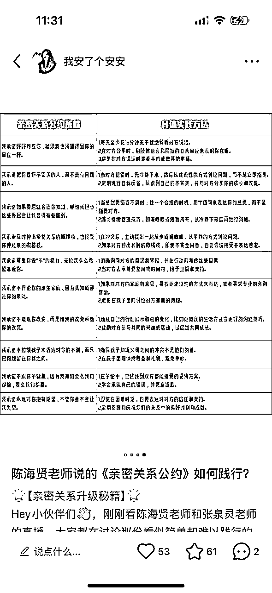
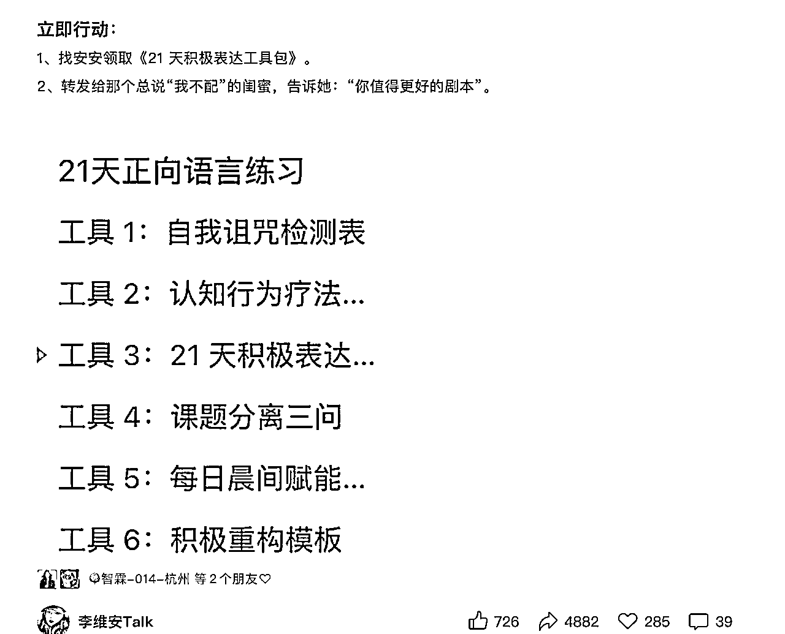
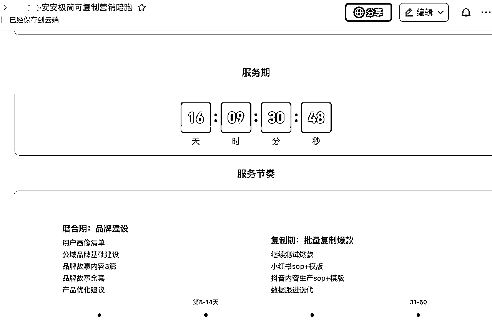

# 自媒体人的AI知识变现加速器：3分钟做一套能卖钱的表格工具
作者：龙哥

自媒体赛道越来越拥挤，内容焦虑几乎成了每个创业者的日常：资料整理到崩溃、专业度总被质疑、引流文案差最后一口气。与其继续被海量内容压垮，不如换个思路——把知识变成可复用的工具。今天这套“AI知识表格工具化”打法，能让你从0到1搭建自己的知识变现库，不需要懂技术，新手也能直接照做。

这套方法非常适合以下场景：
- 想做📕干货账号，快速产出可视化、原创的笔记；
- 需要给文章、笔记配套模板，让引流更高效；
- 想把交付标准化，用户拿来就能用，你也能更省心，效果也更落地。

用上这套方法，你能得到：
✅ 7天搭建个人IP知识库，零散经验变成标准化工具包
✅ 内容产出效率提升300%，用表格模板替代重复文案
✅ 结构化的工具展示让你显得更专业，用户信任感更强
✅ 表格可以直接做成付费产品，开辟被动收入新渠道

## 为什么说表格工具是自媒体人的破局利器？

现在图文内容同质化太严重，但一张结构化表格能打出三个差异化优势：

**1. 降维竞争**
把复杂知识拆解成一套“填空就能用”的实操手册，用户拿到手就能用，价值感立现。在内容难做的今天，这招能让你从同行里跳出来，给用户一个高性价比的选择。

**2. 强化记忆点**
表格比大段文字更直观，关键信息一眼扫到，既增强了干货感，也让用户记住你的品牌和风格。看的人能快速抓住重点，自然对你产生专业信任。

**3. 裂变传播性**
工具型内容天然自带分享属性。用户觉得好用，就会顺手转发到朋友圈或社群，等于你的人肉推广员，帮你带来更多潜在客户。

我自己有很深的体会：每写完一篇文章，再附上一张对应主题的练习模板，引流效率立刻不一样。

## 手把手：AI怎么帮你做出原创知识表格？

### 第一步：用Kimi生成初稿，关键是这组黄金提示词

我推荐先用Kimi搭框架，下面这组提示词是经过100多次优化打磨出来的：

请对以下文案做深度拆解：[粘贴原始内容]
先提炼可复用的方法论框架，再设计一张标准化表格，包含目标用户、执行步骤、注意事项，并为每个字段注明填写说明和参考案例，最后输出可直接使用的Markdown表格格式。

使用小技巧：
- 原始内容越具体（比如给出实际案例、数据），生成质量越高；
- 如果想要更强，可以追加“加入风险预判模块”或“补充行业特殊场景”等指令做二次优化。

### 第二步：把模板升级成智能体，实现自动化生产

如果你经常需要同类工具，建议在豆包里创建一个专属智能体。直接给它这个指令：

请根据我发你的文案内容，整理出方法论，并把它做成一份任何人照着填写就能落地执行的表格工具，准备好后请告诉我“把文案发给我”。

这个方法适合你已经有清晰底层逻辑、明确的场景和目标，而且能说清楚需求的情况。我还做了一个现成的智能体，想要的小伙伴可以私信找我。

### 第三步：把表格变成付费产品，做好这三层价值叠加

**功能层**：配一段使用说明视频或常见问题解答，让用户买回去不抓瞎；
**信任层**：放上你的成功案例截图和真实用户评价，让犹豫的人更放心；
**稀缺层**：设定限时领取、限期使用之类的机制，制造一点紧迫感，推高转化率。

## 新手最容易踩的3个坑，一定要避开

1. **版权问题**：AI生成的内容不能直接商用。记得做二次创作，加上自己的案例和独家观点，既安全又显专业。
2. **格式适配**：提前在手机、电脑上看看表格显示效果，避免在不同设备上变形、错位。
3. **持续迭代**：建立用户反馈渠道，每隔几个月就更新一版，让工具越用越顺手。

另外，交付表格的话，飞书是个很不错的载体。它支持实时修改、灵活配置权限，也能把交付过程变得可视化，省心又规范。

---

了解安安：