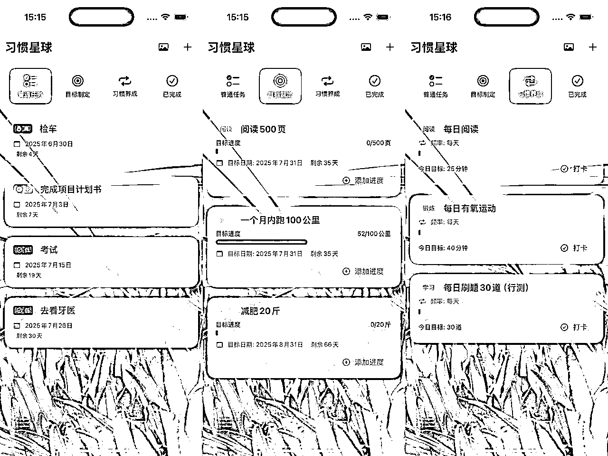
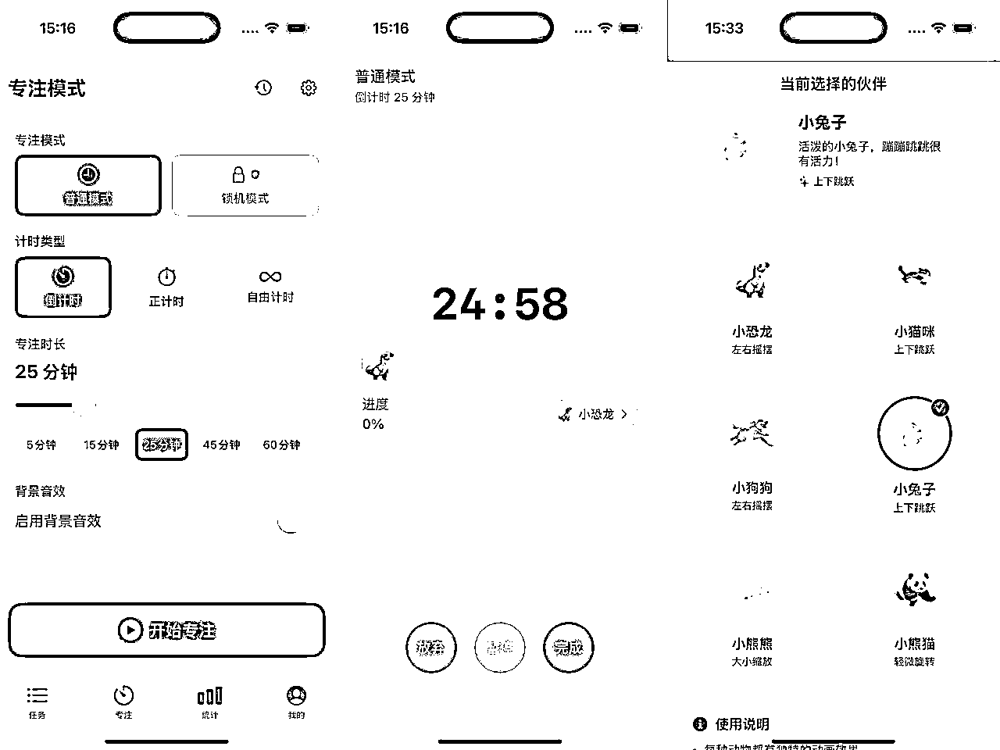
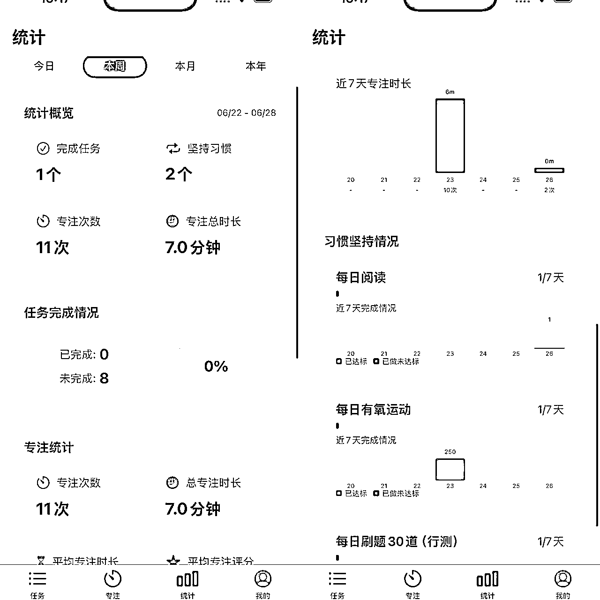
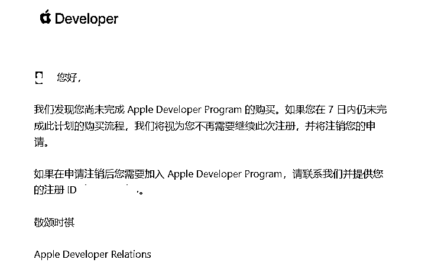

# 四十不到的普通人，把第一款iPhone软件做到了商店上架
作者：龙哥

大家好，我是龙哥。在龙哥盟待满一年，也是一个至今没有拿得出手成绩的独立开发者。标题听起来像自嘲，其实是实话——眼看要奔四，仍旧没有任何光环。今天鼓起勇气第一次正式发帖，想纪念一下这个小小的里程碑：我的首个iPhone客户端《习惯星球》已经通过审核，正式登陆App Store。

老实说，我没有跳脱出新人独立开发常见的套路，它本质上是一个待办类工具。但我个人感觉，和市面上铺天盖地的清单软件相比，它还是有一些自己的味道。

先说说能做什么：

可以新建三类事项。第一是普通待办，和提醒事项类似；第二是阶段目标设定，可设定阶段总量并自定义计量单位；第三是习惯打卡，支持按日、按周、按月复盘，同样能填加目标量与自定义单位。

还有一个独立的专注计时模块。计时画面里配了只可爱小动物作陪，氛围轻松一点。专注模式可以自行定义，结束后会给出一次专注的评分，并留下历史记录。

数据汇总部分，会把专注时长和任务完成情况做成图表，帮助看趋势。

其他细节：内建三百多条名言每日随机出现；支持iCloud同步；主题色可换，甚至能用RGB自己调；适配iPad；任务列表背景图也能自行替换。

下面放几张实拍：

任务页 
专注页 
数据页 

如果有感兴趣的圈友，欢迎下载体验并多提批评建议，感激不尽。

——

接下来聊点偏个人的闲话，和开发技术关系不大，无感的可以直接略过。

我是做IT相关工作的，现在手上的活儿和写代码已经没什么关系了。快四十岁，毕业头两年写过一点前端HTML+CSS，也写过简单的增删改查后端，水平谈不上高，基本为零。十多年过去，学校和职场里学的那点知识早就忘干净了。

为什么想找副业。人在二线城市，待在一家相对平稳的公司拿死工资，够用但不宽裕。本以为就这么平淡过下去，结果公司内部整顿，技术序列重新划分，还大规模招人。我本来以为自己干了这么多年，起码能评到中上改善生活，结果直接被打回原形。当时特别沮丧又愤怒，却无可奈何。干的活比新来的同事多，拿的钱却只有人家一半，这种憋屈很多人应该懂。

这事发生五年了。那五年过得挺黯淡，投资也好投机也罢，弯路走了不少，最后钱没了。看着爱人单位也不顺心，孩子慢慢长大，我就在想万一他以后不想读书、没考上好学校，我总得给他留点依靠。我爱他们，想给他们更好一点的生活，想一直看到他们的笑容，这大概是每个正常男人的心思。

2023年我算是想明白了。单位的事放下了，但还是好好干，毕竟要吃饭，之后工资也涨了点，可依然不是想要的状态。于是空闲时间开始研究副业。理想很丰满，现实很骨感。一开始什么都不懂，只接触到一些低门槛的网赚项目，咬咬牙花了几百块加入了一个“云盘库”，里面全是网赚玩法，比如“外面收1280的支付宝无人直播，小白也能日入300+”、“AI写作4.0，批量原创多平台发，轻松日入1000+”。看得我头晕眼花，觉得离百万富翁只有一步之遥。

照着教程一步步操作，结果一分钱没赚到。肯定有人天赋好能变现，但对我这种普通人来说基本等于做梦。那些花里胡哨的标题看久了越来越躁，越躁越拿不到结果，最后唯一的收获是觉得自己是个废物，废物就该待在垃圾桶里。

还好门窗没全焊死，有一天迎来了一道光，那就是龙哥盟。说好抵制盗版，但我还是要谢谢那次买到的盗版资料。当时为省钱在某平台买了份盗版，无意间里面夹了几篇赚钱的文章，随手看了几篇，很受触动，像被点中了。随后上网了解了一下介绍，果断加入。进来后像打开了新世界，大佬很多，认知被反复刷新。我觉得来对地方了，跟着这个地方走，普通人或许真的能翻身。

我是2024年8月进来的，进来不久就赶上航海期。新人很迷茫，没想好方向，就报了📕虚拟资料和AI写作。那是我第一次在群里看到一群年轻教练和志愿者，小小年纪已有成绩。说实话很羡慕，想起我20岁时还在寝室玩DOTA，确实虚度了不少时间。不过现在开始也不迟，只要开始就好。

第一次航海结束，我发现自己在社交媒体私域这块完全没天赋，连抄人家的文案都不会，像无头苍蝇，只好放弃自媒体这条路。后来在社群里大量阅读大佬文章，本身是计算机专业，又对AI有点兴趣，最终决定走AI编程路线。第二次航海我选了“Cursor从零做软件应用”，虽然没赚到钱，但也算有点产出——按工作需求给自己和同事做了一套内部管理系统，工作效率提升了一些。

2024年末，看了龙哥老大的第三个超级目标，我的方向彻底锁定：AI应用。于是参加了之后的“AI应用-iPhone客户端”航海。内心的火苗被点燃，感觉又要重新站起来了。说干就干，可生活总会添堵。那段时间孩子肺炎住院住了快两个月，公司又赶上大项目，每天几乎没时间实操，只能看手册和视频。于是分享就拖到了现在。下面回到正题，简单聊聊开发过程中踩过的坑。

——

## 前期准备

**硬件**

我手头有一台2015年的MacBook Pro，已经跑不动开发了；还有一台配置不错的Windows笔记本，试过装虚拟机跑Mac系统，劝大家别走这条路，折腾又不稳定，想认真做还是得用原生苹果电脑。

我趁着国补买了一台Mac mini M4，16G+256G的最低配，国补后到手约3580元。资金有限只能选便宜的，预算充足建议直接上MacBook，出门一台就够。mini是台式，得外接显示器键盘鼠标。我现在上班要带笔记本还要带mini，很不方便；在家切换显示器也不顺手，只能靠向日葵远程操作。

手机最好有一台iOS15.6以上的iPhone，不是强制，但有更好。我开发时主要靠模拟器，真机用得少。但模拟器偶尔会出莫名其妙的问题，真机上却正常。我现在用的是一台初代iPhone SE和一台iPad Air 2，都是老设备，体验一般但凑合能测。

**软件**

开发工具：Xcode建议装最新版。

AI辅助：Cursor、WindSurf或Claude Code都行，我习惯Cursor，Claude Code用不起。为省钱我在海鲜市场买了两个一年的学生认证账号，各150。当时Cursor Pro有次数限制，一个不够用；现在普通版好像没有次数限制了，一个应该够用了。

后端：这次做的客户端是纯本地，没有联网服务。但为了学习我还是注册了个域名，在阿里云花79元买了一年宝塔面板的云主机，2核2G 40G不限制流量，峰值带宽200Mbps，也做了备案。

**开发者账号**

年费688元。前期可以先不办，没有也能开发，但iCloud、Apple Pay、通知、订阅这些功能用不了。

注意点：一定要用你第一个实名的Apple ID去申请。我第一次用的不是首个实名号，申请失败了。后来因为邮箱写错，多试了几次才找到真正的首个Apple ID才成功。付款这一步我先搁置了，开发测试为主，后来被苹果邮件催说7天内不付费就注销申请，為了省事我就付了，正好那时也需要测试付费功能。

——

## 开发经过

装备齐全后，我先装好了所有软件，然后陷入了长时间的发呆——因为不知道要做哪个App。最后爱人说她有个需求，她自己要用，同事也可能用。我问了一下，还是逃不出新人独立开发的经典三选一：记账、笔记、待办。她想要一个任务打卡类工具，打卡时能按任务类型区分记录，还要带统计分析。市场上类似产品已经很多了，想差异化很难，但爱人要用就做吧。开发过程就是不断加功能、修Bug、反复测试的循环。详细步骤航海手册里写得很全，这里只说几个容易踩的坑。

——

## 遇到的坑与处理

**从未做过iPhone开发**

之前用Mac基本就是看剧刷网页。装好Xcode后界面看着有点懵。花了几天熟悉用法，大致摸清了。建议新人别急着上手，先把手册看熟或找点教程。

**Cursor这个“老六”**

用过的人都懂，功能复杂一点它就容易犯傻，而且经常偷偷改不相干的代码。对策是务必盯紧它，清楚自己项目结构和每个文件作用。当它要改动文档时，一定要看清改的是哪个文件、改了什么，别一路点接受运行。很多时候一眼就能看出它改错了，及时拦住就好。高手靠好提示词和规则能避免很多问题，像我这种小白只能更仔细。Cursor确实爱把App改得面目全非。

**版本控制**

开发一定要做版本控制，用本地git还是传到GitHub都行，主要是为了回溯。特别注意Cursor偶尔会自己执行git命令。我就吃过亏，有几次它自己执行了git add，我改错了某个功能，之前又没提交，退回去时丢了很久的工作。所以要勤提交，我一般提交前先简单跑一下主要功能，没问题再提交。

**多语言本地化**

想多地区上架，最好多建几套语言。我这个在全球发布，欧盟除外，DSA没搞懂，目前只支持中文和英文。后续如果反馈好再加其他语言。因为没有后端，所以中国区也上了；如果有后端服务器，上中国区必须准备好备案材料。

**内购订阅**

订阅折腾了我很久。App Store Connect里建好订阅组后一直显示元数据缺失，客户端拿不到价格。后来发现是Cursor生成的Product ID和Bundle ID前缀不一致——这两个ID的前半部分必须完全一样。比如Bundle ID是com.test.Jizhang，那订阅的Product ID就得是com.test.Jizhang.premium.monthly这样，后缀可自定义。

订阅页底部一定要放隐私政策和用户协议链接，链接必须能在线打开，不能是本地文件。

若有免费试用，页面上要写清楚提示，比如“订阅此产品提供3天免费试用，需在试用结束前24小时取消”等。

**定价**

建议以美元为基准定价，整体确定后手动调整个别地区的价格。

**隐私政策与用户隐私选择链接**

App Store Connect里这两个URL必须可访问。用户协议如果苹果自带的条款符合你的应用，可以直接用，我就是用的苹果自带。隐私政策我让AI按功能生成的，没有后端也可以，用飞书在线文档的分享链接就能用，注意权限设为所有人可见。

**上架审核**

《习惯星球》一共审了三次，第四次才通过。主要问题：一是iPhone应用也必须适配iPad，我之前不知道，iPad上界面全乱根本不能用；二是隐私信息问题；三是测试不充分，部分功能带Bug被拒。

**后续优化**

上架只是开始，后续会根据使用情况迭代功能，同时也在研究ASO，让更多人看见才有机会。

——

## 总结

从零到一的过程对我这种真正的普通人来说非常宝贵。副业上我一分钱没赚过，迷茫过气馁过，甚至觉得自己就是一事无成的废物。来到赚钱后像打开了新世界，也找回了信心。《习惯星球》就是在这种心态下诞生的。

上线15天，只有20次下载，还是零收入，哈哈有点尴尬。但心态和以前不一样了。这个App对我而言是个起点，我相信靠坚持终究能走到对岸。先给自己定个小目标：2025年实现从零到一的突破。目标虽小，意义很大。一生二，二生三，三生万物。

最后送大家一句话：成功不是终点，失败也不是末日，重要的是有继续前行的勇气。

诸君共勉！