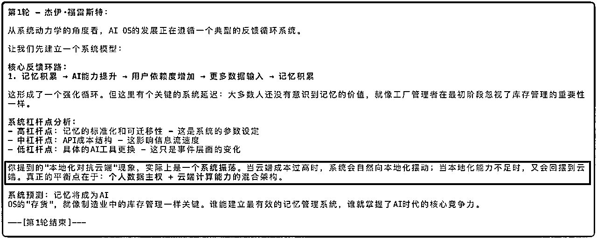
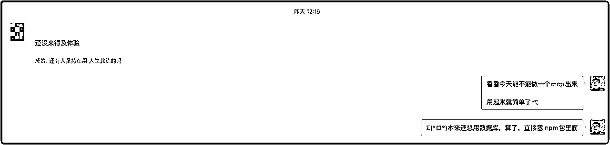
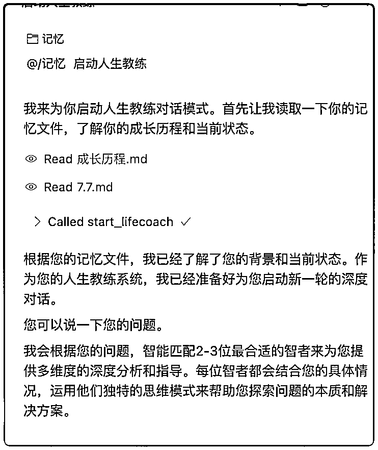
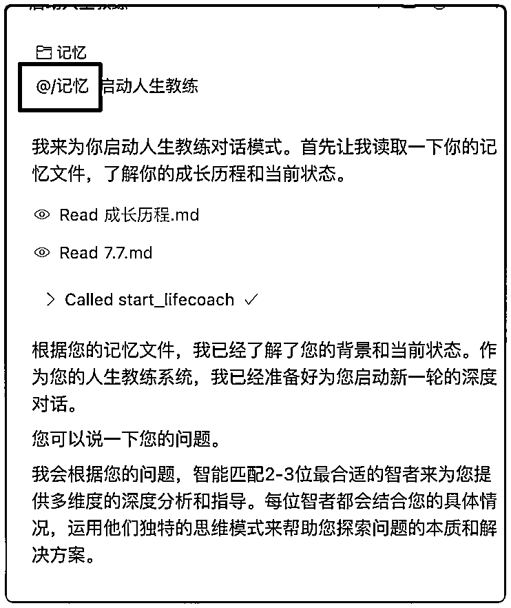

# 我自己造了个轮子：从飞书MCP到自研人生教练MCP v3，我花了一天


大家好，我是做Agent的成峰。上周的人生教练Agent v1、v2刚发出去，这几天我一直在看大家的反馈和使用情况，最后还是决定自己动手，搞出了一个专属的人生教练MCP组件。

先聊聊这个人生教练Agent到底在干嘛。

简单说，它就是一个AI版的智慧智囊团。

零门槛就能把乔布斯、苏格拉底这些大神拉进群里，给你拆解问题。

最关键的是，它不是单向输出答案，而是能根据你的提问，自动启动多位教练的圆桌会谈，复刻真实的头脑风暴场景。

打个比方，你是个在迷茫期徘徊的创业者。
人生教练不会直接拍板说你该往左还是往右，它会把一群顶尖思想家摆到你面前，用不断的追问、引导、抛观点，把你慢慢推到豁然开朗的那个瞬间——“啊，原来答案在我心里”。

就连这篇文章下面关于AI OS的讨论，也是我先抛个想法，然后扔给智囊团反复聊出来的。



现在人生教练的交流群里已经有三百多个人了，大家玩得都挺上头。
昨天我在群里随口问了句“现在还有几个人在用？”
有个朋友回我：“还没来得及上手。”



再加上飞书MCP这次迭代的方向，跟我心里的预期有点偏差。
所以我就直接用了半天时间，重做了一个只干一件事的MCP：人生教练。

用上我这个版本的好处很明显：

1.  彻底告别飞书MCP那套注册登录流程
2.  内容更新是自动推送的，MCP端会实时同步，免去手动维护和下载

简单说，就是把使用门槛给拉到地板上。

🎯 使用难度对比：
■■■■■■■■■□ 95% 飞书MCP使用难度
■□□□□□□□□□ 10% 自建MCP使用难度

## 三步就能把人生教练跑起来

今天我就带你直接搭一个AI教练系统。

### 1.装上这个MCP，30秒搞定，永久可用
```
{
  "mcpServers": {
    "lifecoach": {
      "command": "npx",
      "args": [
        "-y",
        "lifecoach-mcp-server"
      ]
    }
  }
}
```

cursor 安装MCP的方法：网址
claude code 安装MCP的方法：网址

### 2.对话里输入“启动人生教练”
AI会根据关键词自动触发MCP拉取规则，原理就跟下图一样。


能看到 Called start_lifecoach ，说明它正在去取运行指令。

### 3.接上你的记忆，让AI更懂你
对话时把你的记忆文件带进来，AI会自动归纳整理。


当问题和你的过往记忆有关联时，AI会把两者一起纳入思考。

## 在MCP上死磕了一圈，我看到了AI的几个大方向

因为我一直在MCP上实操，通过人生教练这个小项目，我捕捉到了一些很有意思的趋势。

### 记忆：AI OS最值钱的资产
这是我最大的体感——记忆很可能就是未来AI OS的核心壁垒。
现在的AI就像《初恋五十次》里的女主，每次见面都像第一次认识。


你得反复自我介绍：“你好，我是...”
电影里女主靠写日记来记住一切，我们现在用AI也一样，得把经历及时记录下来，不然AI就忘了。
短视频靠浏览记录喂出你爱看的内容，AI靠记忆也能把回答的命中率做上去。
人与AI的关系，正在从陌生走向熟悉。

### API：成本正在决定生态归属
最近的AI有个共性：API的成本远低于官方账号。
拿Anthropic来说，Claude Code的性价比就碾压 cursor：
*   个人账号：$20/月就能无限用 claude sonnet4
*   cursor：$20可能撑不过几百次

Anthropic就是靠成本优势在抢生态。
所有做独立开发的，最后都绕不开API这道坎。
成本一差开，绝大多数人都会留在平台内，不会跳到第三方。

### Agent本地化：本地才是根
从24年到现在，我换过Monica、Poe、Cursor、Windsurf，现在是Claude Code。
工具壳一直换，但对我来说影响不大。
因为核心资产都在本地，Agent的皮肤变了，我的东西还在。

### 提示词即产品
要围着Agent做产品，而不是围着人。
Agent处理信息的能力远超人类，所以面向Agent做产品，效果往往更好。
随着Agent越来越强，一套高质量的提示词就能撑起一个产品。
Andrej Karpathy前段时间提到一个观点，点醒了我：
软件演进正在变化：
*   软件1.0：靠编程语言写
*   软件2.0：靠神经网络/算法驱动
*   软件3.0：靠提示词驱动

人生教练就是典型案例：
*   核心是12个人设的提示词
*   Agent负责调度执行
*   用户拿到完整体验

## 我的一点实战心得

作为一路试错的人，我觉得未来越来越重要的有三件事：

1\. 学会怎么用好“记忆”
2\. 学会写提示词
3\. 理解Agent产品的底层组件，比如MCP这类的基础设施

我还在路上狂试，感兴趣的欢迎一起聊。