# 从大厂HR到AI写作接单：我的0到1实操复盘
作者：龙哥

认识一下，我是龙哥。曾经在大厂做HR，现在是一名在路上持续试错的自由职业者。

上大学时我就开始摸索创业，月收入最高冲到过一万多。后来进入一家千亿级大厂做了四年HR，今年五月正式递交了离职申请，彻底开启了全职自由的状态。

其实我早在三年前就进入了龙哥盟。彼时我琢磨👸号写作，确实写出过几篇爆款，也尝试做过内容变现，但最终还是放弃了。因为当时我觉得太吃平台，波动大，不够踏实。

直到这次跟着AI写作项目走了一遍，我才发现：内容变现并不是只有一条路可以走。

我照着航海手册的步骤实打实去跑，直接下沉到淘宝村去接单，竟真的打通了第一笔收入——518元到账。虽然金额不大，却是我AI写作从零到一的标志。

现在回头梳理，过去那些被放弃的经历，反而成了我在这条新赛道上的底牌。

直接进入干货：

一、成交过程展示

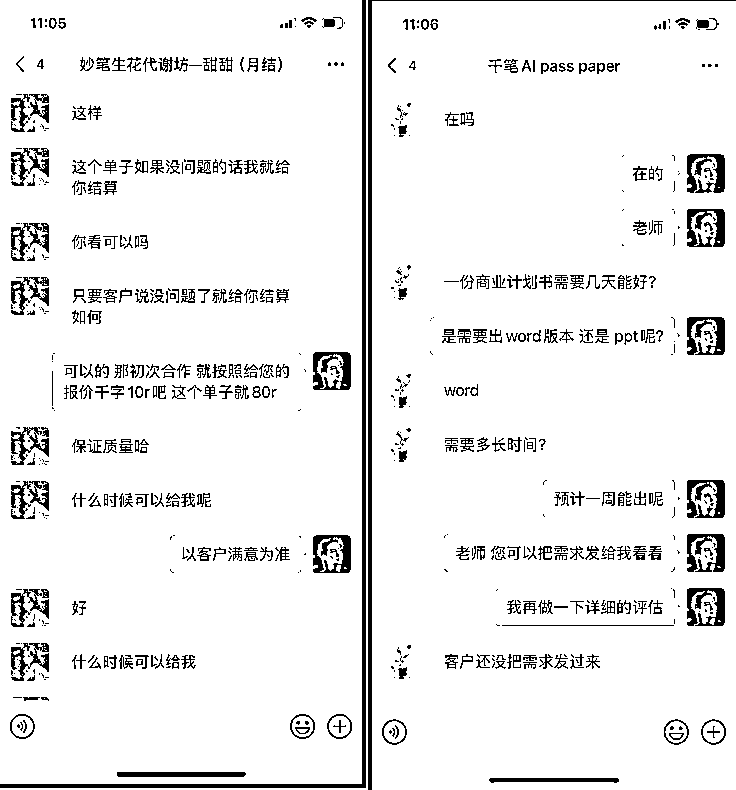

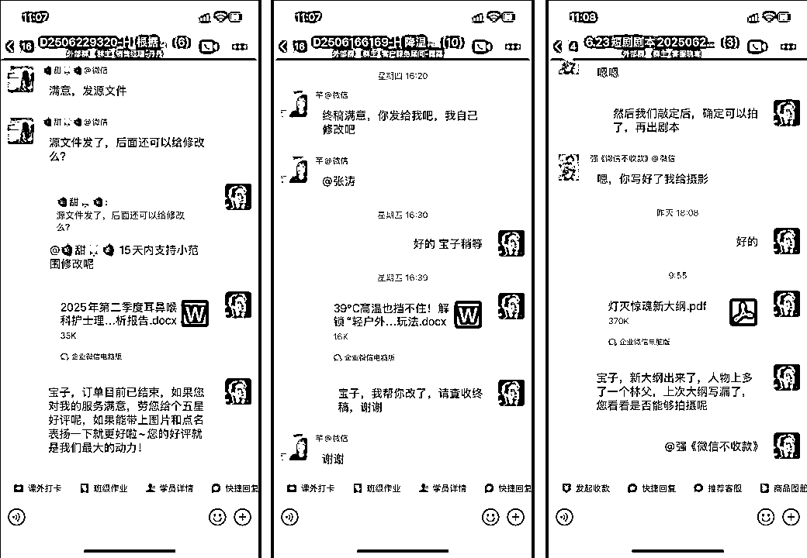

二、分享框架

1. 项目怎么选
2. 实操是怎么做的
3. 一点赠言

三、详细拆解

1. 项目怎么选

对新手来说，互联网项目里低成本、快回本、高上限这三点基本是不可兼得的。从启动角度思考，我们更需要的是能快速建立体感的项目，所以要优先看启动门槛低、变现是否顺滑。

在赚钱的盘子里，我先把启动成本低且容易变现的标的筛出来，比如AI代写、📕虚拟货等。翻看过往航海项目的反馈，普通人上手后能短期看到钱的，AI代写明显更快。接着去测市场：第一种方法是查行业公开数据，第二种更直接，就是看店铺的真实销量。淘宝头部商家月销上万件，闲鱼上个人卖家也能稳定成交，抖音快手等平台的需求也充足，流量基本是没问题的。至于客单价，先参考赚钱帖子里的报价区间，看到高价位就带上这些类目去私聊商家，核实真实报价，同时完整体验一遍买家流程。

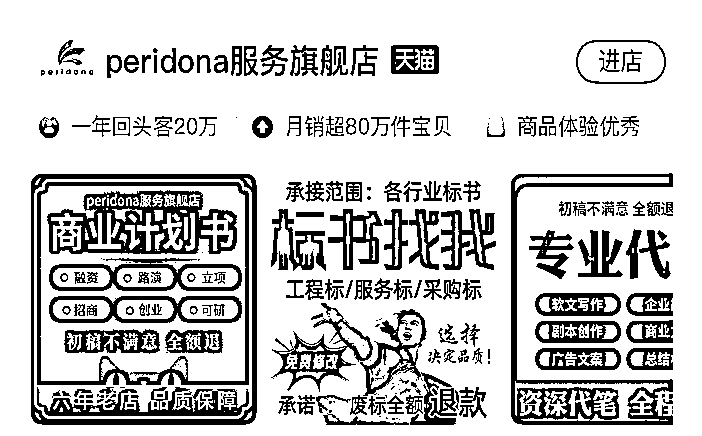

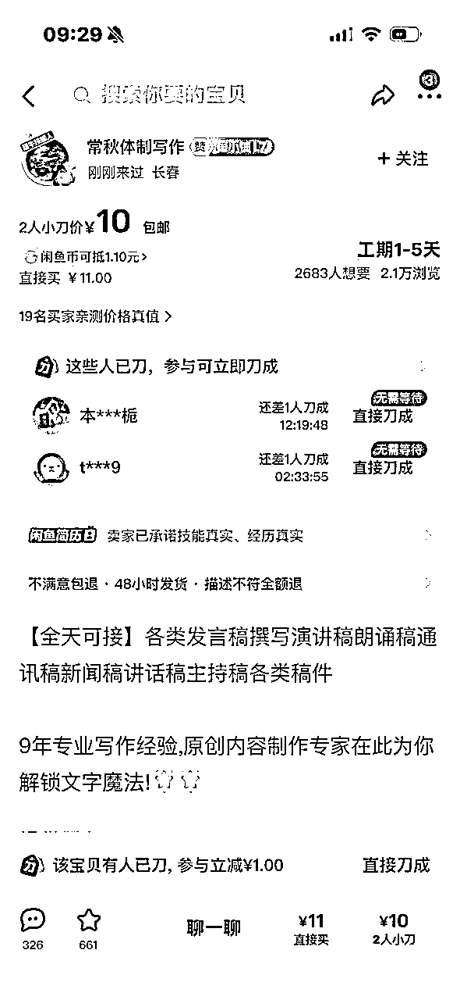

综合来看，AI代写的项目可以做矩阵扩量，客单价的天花板也足够高。只要肯沉淀，找高手带，能持续提升认知，这就是一个启动轻、变现快、上限也可观的方向。尤其文稿类业务，客单拉高意味着利润也更厚。

2. 项目实操

目前我处在写手体验阶段，0到1已经跑通。下面的拆解全部来自我亲身跑通的流程：

1. 严格按照手册走，先去体验不同类型的写作，基于教练给的提示词持续迭代优化。再次感谢赚钱和各位教练的付出。

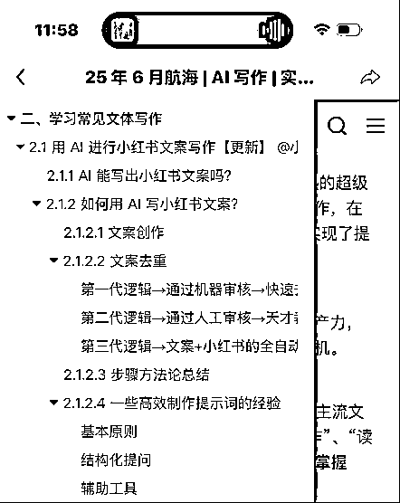

2. 沉淀作品集。边学边写，不同文体都存进自己的案例库，等手册学完，作品集自然就成型了。

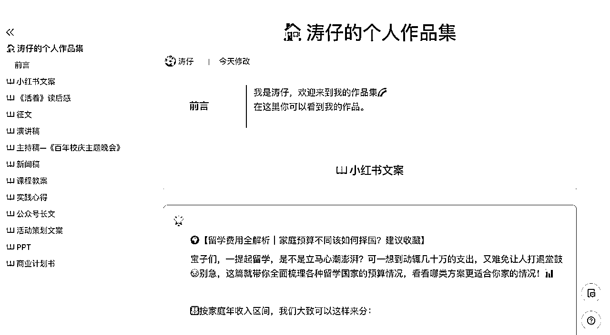

3. 开淘宝新手村练手。直接定目标投100家，全部做记录。打法是批量化：批量发送接单信息、批量下单、批量加好友、批量群发消息、批量进群。怕客户来消息没回？节奏由我控制，对方觉得不合适，直接换下一个就行。

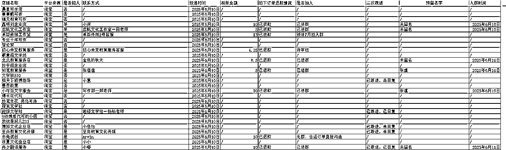

4. 进群抢单。先摸清各个群的抢单规则，一般是私聊接单或在群里回1抢单。抢不到单就继续扩群，抢到单后要多关心客服，留下好印象，后续会有主动派单的机会。

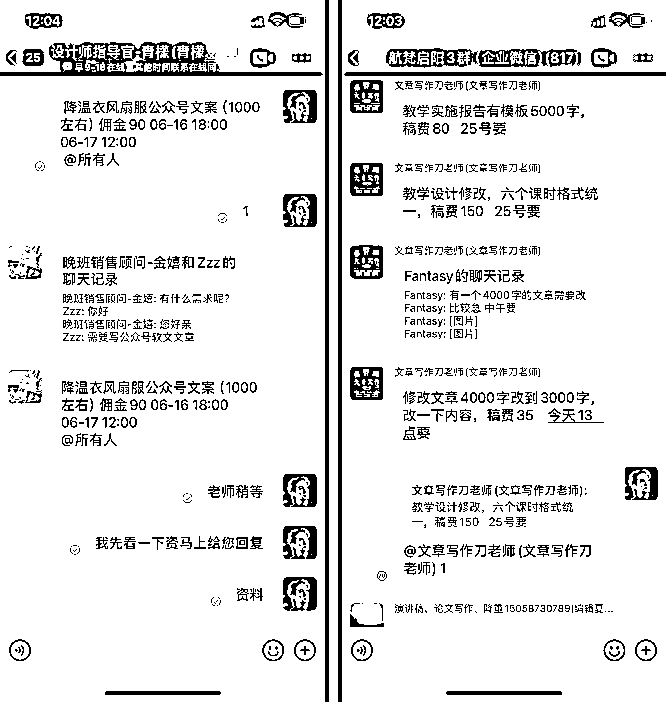

5. 抢单时觉得自己搞不定不敢接？我的建议是直接抢。抢下来你自然能做下来，我经济学出身都能把护理类文章写出来。如果真的没底感，按这个顺序救：先复盘海盐大大的AI+垂直领域方法论，基本就能解决大部分问题；不行就先问AI，培养万事问AI的习惯；AI搞不定再去群里问圈友；圈友也解决不了就付费请教练一对一咨询。

6. 交付SOP，最近总结的，用两个真实案例来说明：

1.  接单后先把客户需求和资料吃透，整理出需要向客户确认的关键点，比如客户身份、使用场景、写作中的细节要求、所需附件等。

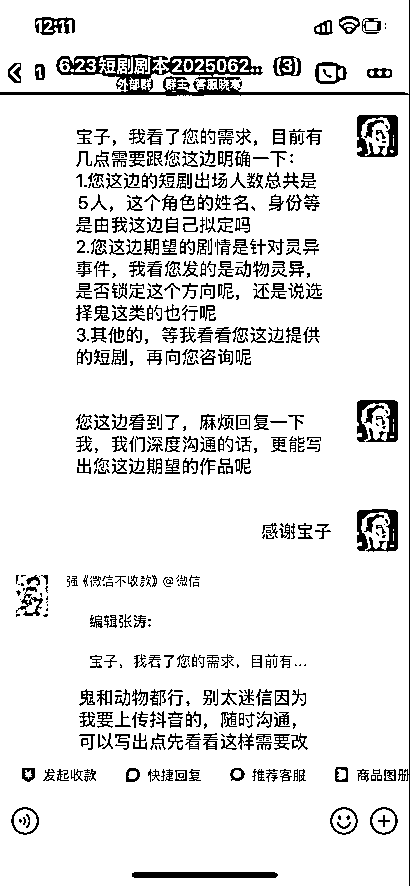

1.  用AI提示词生成初稿大纲并做人工润色，发给客户确认方向。

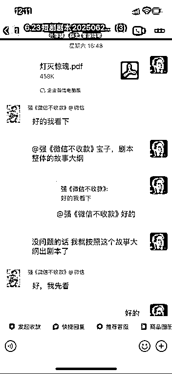

1.  出样稿，大概交付30%内容先确认。避免后期大返工，确认后如果要改动较大，就让客服去跟客户沟通加费。

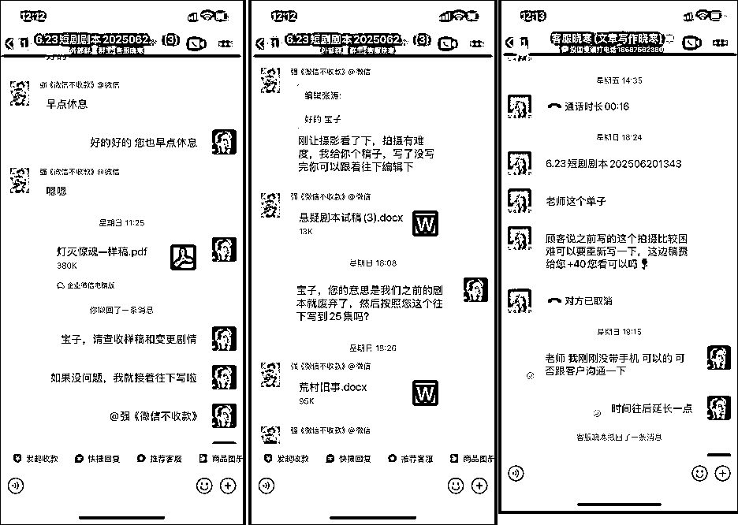

1.  出终稿，再次与客户确认无误后交付。这里附上另一个案例的剧本交付截图。

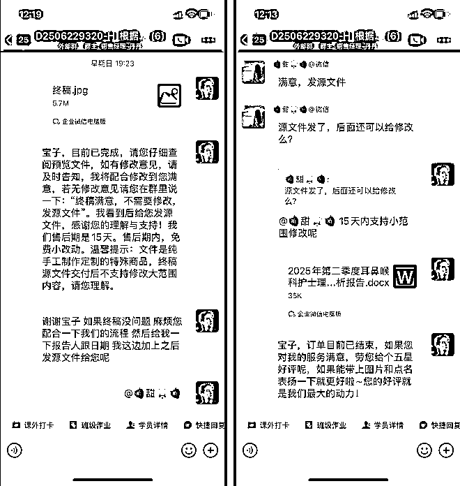

1.  项目关闭，复盘沉淀。

四、结语

在赚钱待久了，我越来越认可三件事：

1. 要做一米宽、一万米深。在一个赛道里持续滚雪球，才能长成参天大树。
2. 要做分享者。越分享，势能越强，越能吸引同频的人。帮助别人的同时也在成就自己。
3. 要坚持日拱一卒，像《士兵突击》里的许三多那样，每天一点点往前挪。

能在这儿认识大家我很幸运，也很开心能和你们一起扛同一个项目。感谢赚钱官方和教练团队。想说的很多，但我更希望最后能和各位圈友在山顶碰面。坚持下去，你一定会成功的。这句话送给所有人，也送给我自己。