京东家电代下到底能不能赚钱？别急着下结论，先看一个真实操作：

有位客户在京东看上标价6013元的电视，你通过内部渠道帮他代下单，实际只花4463元，一进一出1550元差价到手。这还只是一单的利润。

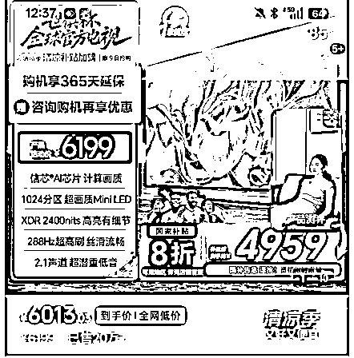

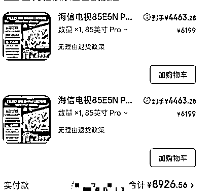

这个项目不是新花样，但有个团队用三年时间，从日化新人券一路做到了千万级家电供应链。2019到2021年是摸索期，靠京东新人券玩日化，一单赚15到30元；2021年平台政策收紧后，果断转型家电赛道，打通了“货源-流量-交付”全链路，还搭建了23家京东短视频MCN矩阵，采集、剪辑、发布全是自动化操作。团队信条就一句话：没有永恒的渠道，只有持续的进化。跟着平台红利走，才能建立护城河。

想入门，先搞懂三种核心玩法：

第一种，抢购价。就是蹲秒杀、百亿补贴这类活动，盯着时间卡点下手，手速和网速缺一不可。

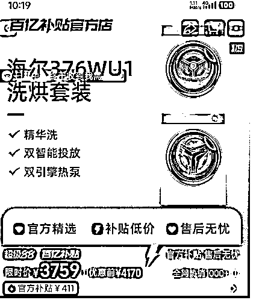

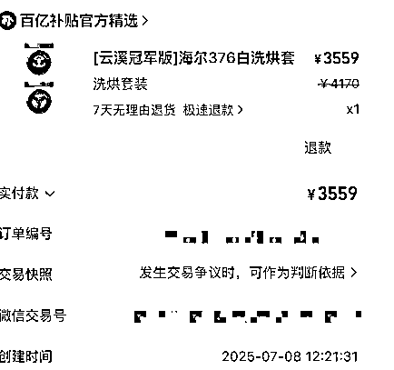

第二种，企业价。需要注册京东企业会员，上传营业执照，用企业采购账号批量下单，适合大批量订单。

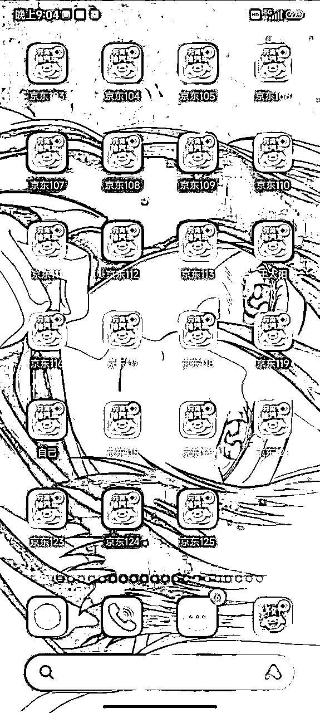

第三种，线报价（也叫区域价）。这是区域现货资源，个人玩家和小线报团队特别喜欢，操作灵活。

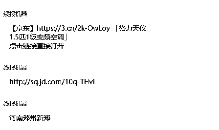

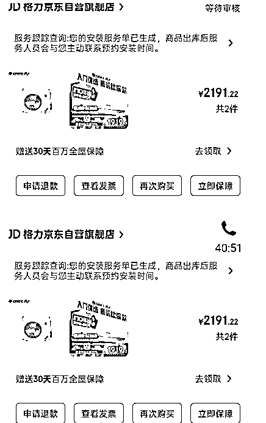

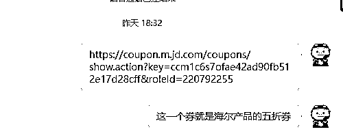

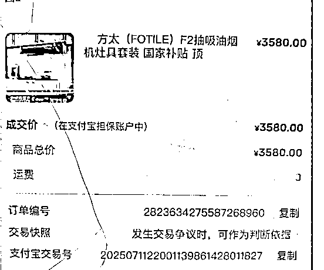

看案例就知道多简单：当天接单当天出货，不管是直收还是走平台，钱到手很快。

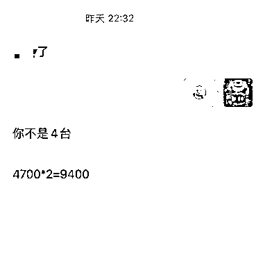

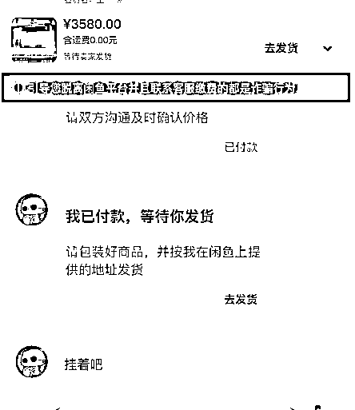

下面给新手一套完整的启动方案，照着做，24小时就能开单。

第一步，搞定靠谱的代下渠道。现在没人用手工抢券了，失败率超过80%，百亿补贴库存秒空，比价监控太消耗精力。科技玩法是：用全自动抢券系统，实时同步京东秒杀和百亿补贴的库存变动，价格波动1元就触发抢券；一键绑定账号，优惠券、地址、发票信息自动填充，抢到立刻锁单，0秒付款防砍单；还能多线程并发，最多同时盯50个SKU，支持云端或本地模式，手机关机也不影响运行。

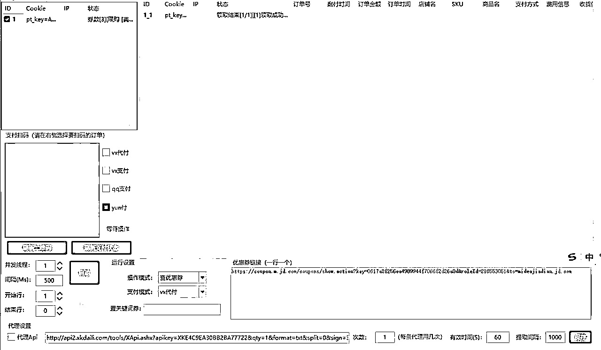

企业价就更简单了，一张营业执照就能搞定。注册入口在 https://u.jd.com/gGjBGiL ，点击“企业注册”，上传执照照片完成认证即可。常见问题：一个执照最多能认证3到5个企业号；审核失败先看执照是否模糊或过期，企业名称里别加逗号等特殊字符；个体户也可以升级，上传营业执照加法人身份证就行。新手选渠道，优先走平台或直收，避免代理跑路。验证渠道靠不靠谱，要求对方发当天的京东订单号和物流截图。

第二步，解决客源。闲鱼文案直接抄这个模板：“🔥京东内部价 XX家电 直省XXX元！官方价XXXX 我司直发XXXX，京东物流+电子发票+全国联保。注意：令牌订单不退换，确认需求再拍。下单流程：私信型号和地址→付定金→同步京东单号→签收后付尾款。”这个模板实测单日引流23人，转化5单。

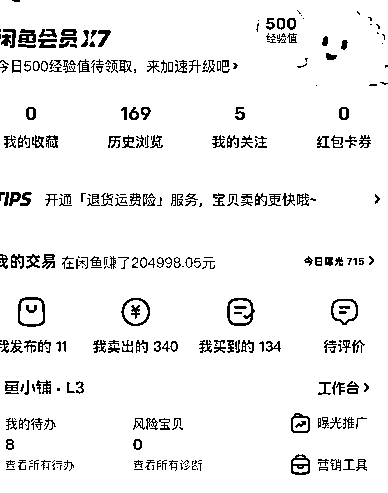

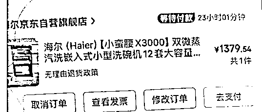

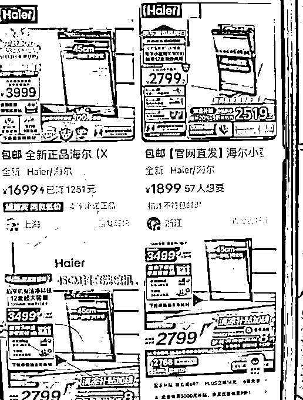

朋友圈也有固定节奏：每天三条，早上9点发价格对比图，中午1点发客户好评，晚上8点发爆款预告；配图用京东价格截图（红笔划掉）+收货小视频。线报渠道就直接联系靠谱的大团队对接，省心。

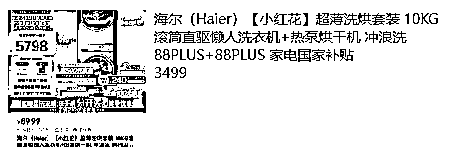

第三步，规范接单。客户发来商品链接，你在平台后台输入SKU编号查实时价。收20%定金防跑单，尾款等货到收。下单前务必让客户文字确认地址、型号、发票信息，避免扯皮。

客户问“是不是正品？”你就回：商品由京东仓库直发，带电子发票全国联保，支持官方验机。再甩一张京东物流截图和已成交客户的评价，信任感马上上来。

客户要退货？说实话很少发生。但规则要前置，下单前发协议：“特殊渠道货，无质量问题不退换，签收即认可。”如果客户不想要，扣来回运费；真遇到质量问题，引导走京东官方售后。

一天没订单怎么办？闲鱼可以多账号操作，用家人手机多注册几个号，覆盖不同关键词发布同类商品。小红书引流也很顶：标题写“新婚装修必看！省下一台空调钱的采购攻略”，正文附家电清单和节省金额，文末埋一句“需要渠道可私”。抖音直播也在测试中，跑通了就是新流量口。

最后给三个利润翻倍的进阶玩法：

捆绑销售：比如电视加冰箱套装，市场总价两万五，成本一万四，卖一万八，一单赚四千。

社区团购：找小区物业谈合作，打出“业主家电团购价，全网最低”的旗号，给物业10%佣金，订单自然源源不断。

二手翻新：闲鱼收旧家电，翻新后搭配新机卖。比如旧空调折价500元收进来，搭着新机加价800元卖出去，几乎零成本吃利润。

记住，这个项目核心是信息差和执行力，但也要防政策变化和渠道风险。有问题欢迎评论区交流，看到会回。