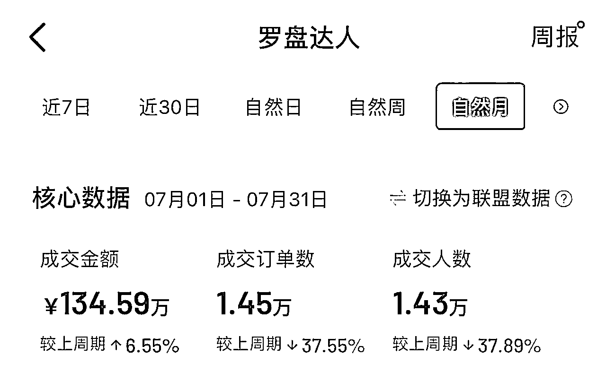
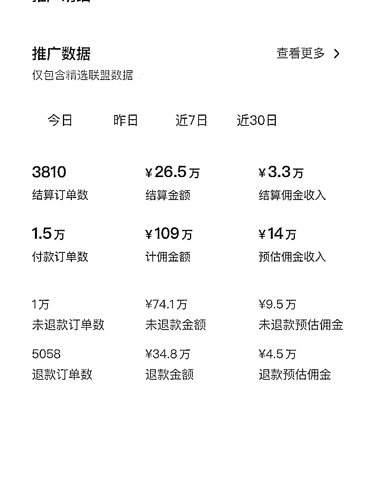
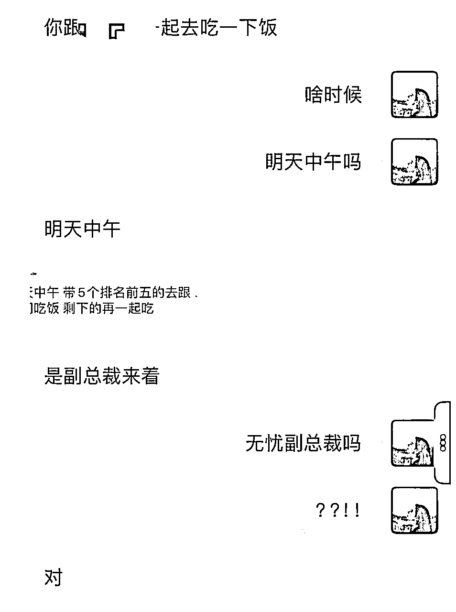
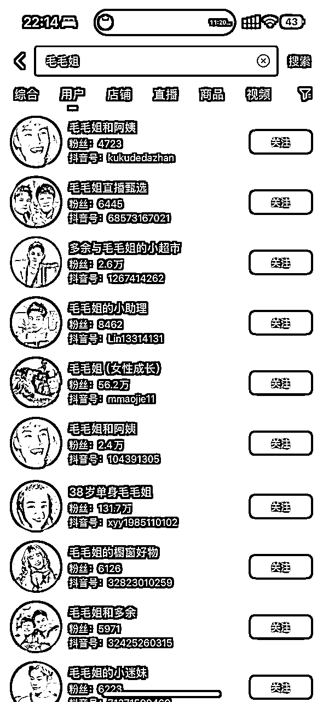
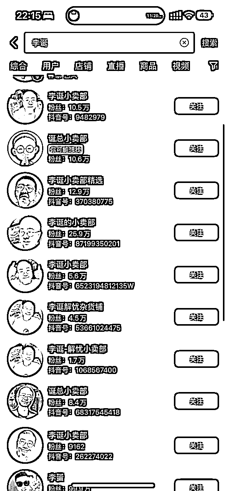
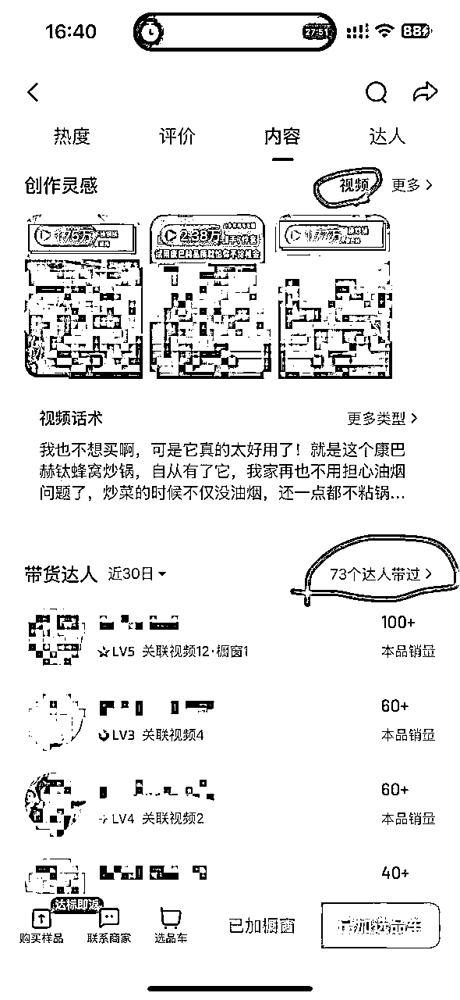
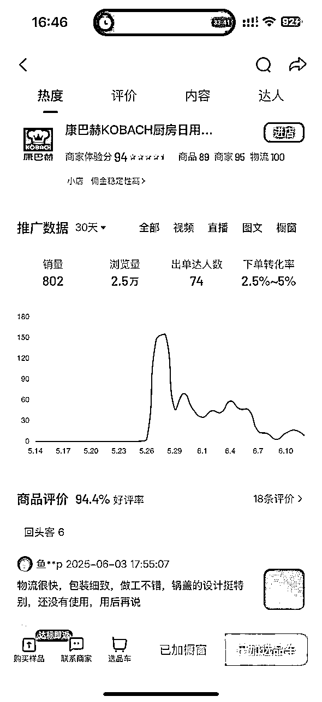
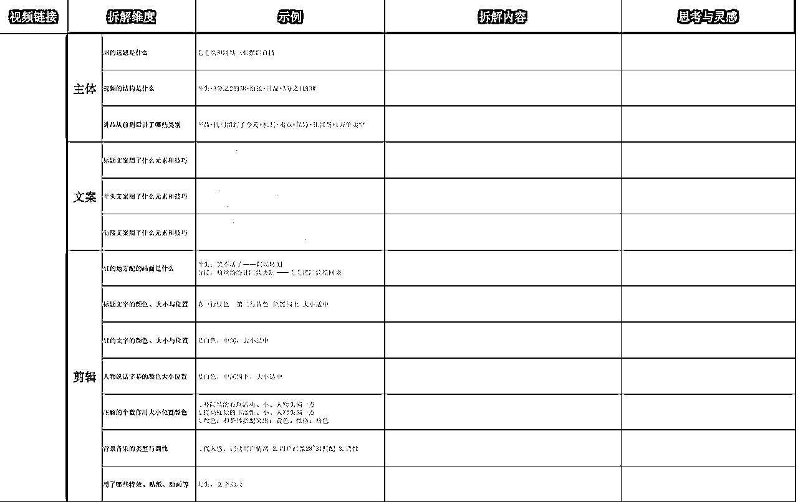
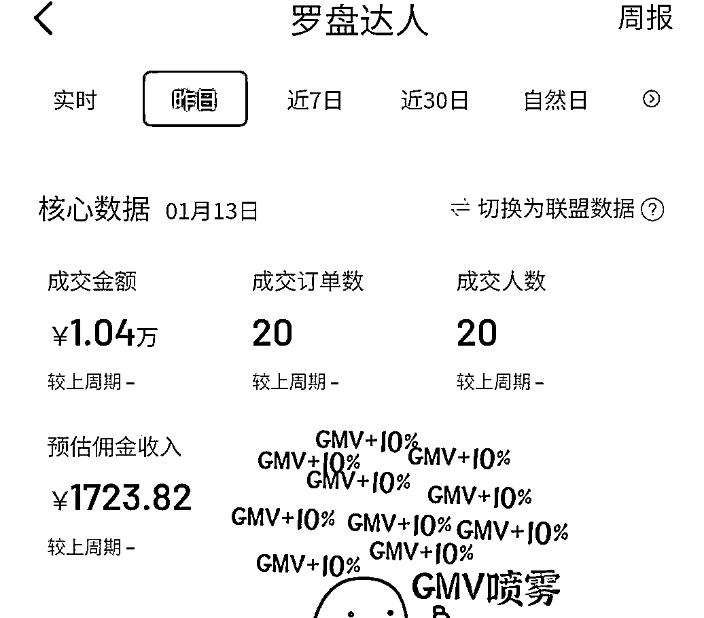
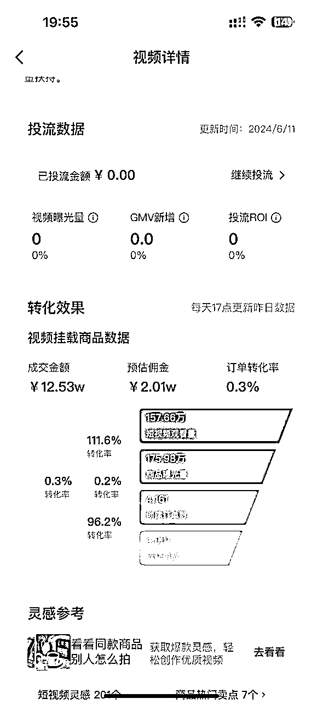

# 从0到月入10万：直播切片全流程实操指南（附避坑经验）

> 来源：[https://nmui3kskc0.feishu.cn/docx/Pc6iduTOPoLJeXx3DimcNfGOnUh](https://nmui3kskc0.feishu.cn/docx/Pc6iduTOPoLJeXx3DimcNfGOnUh)

# 00：我是谁

各位好，我是李子，一个95年的东北姑娘。

先郑重感谢我的领路人——当当姐，也是播客节目《搞钱高流量》的主理人。可以说，没有她的指引，就没有今天的我。

这篇内容算是我对直播切片这条赛道的完整复盘，也是头一回把自己走过的路摊开来写，欢迎评论区随时交流。

回看这几年，我陆续捣鼓过不少线上项目：做过博主、跑过中视频、跟过短剧风口，每一个都有成功变现的闭环。但最终，让我安心深耕的是直播切片，靠着它，单月营业额冲过100w，月利润稳定在六位数。

成绩最好时，我的账号成了领域里的头部，还被邀请参加无忧之夜，跟无忧传媒的副总裁同桌吃饭。

现在，我终于实现了自由职业的愿望，一边工作一边旅居，过上了理想中的生活。

下面，我会站在一个独立运营者的角度，把项目从0到1的全链路拆开，讲得尽量实在。

如果你觉得内容对你有价值，欢迎点赞转发，我们继续往下看。

# 1.项目认知

## 1.1 为什么是直播切片

我当时的处境很典型：资金少、不爱社交、又特别想抓住短视频红利翻身。所以在筛选项目时，我锁定了三条硬标准：

1.  投入低：最好零成本进场，但天花板要足够高；
2.  不碰社交短板：靠个人执行力就能推进，不用费心思搞关系；
3.  技能简单：不用会很多，专精一个点就能打；

最早我尝试过减肥类博主，但那个赛道对综合能力要求太高——内容、文案、拍摄、出镜样样都得会。虽然后来起号成功、小赚了几千块，但整个人被消耗得很厉害。

之后转向中视频，能力要求降低了，但红利期早已不在，单个账号的收入非常有限，而且持续创作的压力很大。

转了一圈，直播切片刚好能同时满足我的三条标准：

*   启动几乎零成本：多数达人给免费授权，平台收1000元保证金开通橱窗，不做了还能退；
*   执行简单：核心构成就是剪辑+运营，不用自己出镜拍，也不用管发货和售后；

除此之外，它还有几个让其他赛道眼馋的长处：

*   高杠杆：视频一旦爆了，单条就能撬动几万的收入，天花板比中视频高太多了；
*   有底仓：账号有了权重、打上电商标签之后，每条内容几乎都能出单，爆单概率也会涨；
*   吃复利：好的视频推送周期最长可达一年，一条内容躺赚几万是常有的事；

退一万步讲，就算最终没赚到钱，我在这套流程里学到的爆款逻辑、剪辑方法、选品思路和账号运营经验，对以后在互联网长期发展来说都算是必修课。

既然如此，没什么好犹豫的，干就完了。

## 1.2 直播切片是什么

简单说，就是把明星或主播的直播录像拿过来，进行二次创作，剪成短视频，然后靠带货或卖课赚佣金。全程不需要自己拍摄，也不需要建仓发货。

上图是我做的一组切片账号矩阵，供参考。

# 2.新手如何快速入门

我主阵地是抖音，以下内容以抖音为例，其他平台逻辑相通。

## 2.1 账号基础条件

*   完成实名认证；
*   粉丝数达到1000；
*   开通商品橱窗。

Q1：粉丝不够1000怎么办？
*   可以通过淘宝等第三方渠道购买，通常建议买千川投流粉；

Q2：买的粉丝会拉低账号画像吗？
*   影响微乎其微，可以忽略不计；
*   1000粉的量级远不足以影响账号的推流模型。

## 2.2 如何调研并选定达人

每个阶段市场上的热门达人都在变，选对了人，就等于事情成了一半。

方式一：向知情人士打听
*   初级：去搜市面上做切片陪跑的培训机构，假装想报名，问他们目前主力做哪个达人；
*   中级：应聘切片公司的岗位，面试时观察他们主推的是谁；
*   深入：直接联系切片公司的员工或负责人，花钱买经验和信息；

方式二：看达人的商品数据

如果你心里已有几个备选目标，直接看数据：

1. 看这个达人的切片账号数量，以及单账号的表现；
2. 在抖音后台看该达人热卖商品的销量数据；

切片号越多、单号数据越好、爆款销量越高，说明这个达人的流量盘子越稳。

要是实在选不出来，就先挑一个自己看好的达人直接上手做。所有达人的运营逻辑都是通的，先跑通一个，掌握规律后再换人，边做边调整才是最快的成长路径。

## 2.3 授权获取

*   官方路径：在抖音搜“XX达人切片授权”，一般能找到达人官方的授权账号，直接联系即可；
*   其他路径：找不到的话，去找在做该达人切片的同行，多问几个人就能挖到授权渠道。

# 3.对标学习与爆款追踪

## 3.1 为什么必须盯对标

带货视频要想爆，离不开四个要素：好选题+好产品+过关的剪辑+运营得当的评论区。

*   学习目的：快速掌握该达人的剪辑套路，做到像素级复刻；
*   跟进目的：掌握同行的爆款选题和热卖品，一旦哪条视频爆了，立刻跟上做同款。

## 3.2 查找对标号的方法

*   第一步，把选定达人的所有商品都挂到自己的橱窗和选品车；
*   第二步，在选品车里找到对应的爆款商品点进去；
*   第三步，就能看到该商品下的所有带货视频和创作者。

重点锁定这三类账号研究：
1. 该商品下面的爆款视频博主；
2. 等级L3以上的同行切片号；
3. 视频是爆款但等级还在L3以下的新账号；

这个界面还能看到商品的热度趋势，用来判断什么时候入手更合适。

## 3.3 对标账号看什么

*   运营侧：更新频次、发布时间、视频时长、评论区的引导话术；
*   内容侧：选品逻辑、选题方向、剪辑结构。

# 4.剪辑实操

实践出真知，模仿是速度最快的学习方式。

## 4.1 工具准备

用剪映就行，推荐电脑版。去官网或B站学一下基础操作界面就够用了。

## 4.2 拆解模仿

下载一个同行爆款视频，从结构开始一层层拆，然后照着剪一遍。这是最快知道自己和爆款差距在哪里的方法。

## 4.3 优化与提效

当你拆解过几个爆款视频后，对剪辑结构自然就有了感觉。这时候你会冒出新的问题：比如素材怎么快速找、剪辑速度怎么提上去。

这时候重点做三件事：①拆解自己的剪辑操作步骤 ②归纳卡点 ③针对性解决。

分享几个我的提速方法：
*   把重复步骤存成预设模板，减少无效操作；
*   每条视频改动30%左右即可达到去重效果；
*   把高频素材单独截取存档，做成自己的素材库（有工具可以快速建库）；
*   善用第三方切片搜索网站，能快速定位对应素材（部分需要付费）；

同时，多和其他同行保持交流，能第一时间拿到新玩法和行业信息，信息差就是钱。

# 5.发布文案要点

*   第一句话定生死，用户刷到的时候能看到的就那一行；
*   文案要么留悬念钩子（让人看到最后），要么直接砸产品卖点（提高转粉下单概率）；
*   最好和视频开头或标题形成互补，不要重复表达。

# 6.话题标签

抖音上限是5个标签，实际对流量影响不算大。

常规组合思路：达人名字+产品品类+人群关键词+品牌词+使用场景词，选择每个类别里热度最高的词即可。

# 7.发布时间与频次

发布时间跟着流量高峰走：早上7-8点、中午11-13点、晚上18点以后。

抖音单账号建议每天2-4条，超过4条会出现流量稀释。快手限制少，基本靠量砸，可以多铺。

最核心的逻辑：让单位时间的产出收益最大化。

# 8.评论区玩法

## 8.1 账号准备

评论区一定要好好经营，每条评论都得有使命，不然就是浪费资源。

渠道：自己注册小号（一个手机号最多3个）、找亲友帮忙（长期可付费）、找刷评平台（约4毛到1元一条）。

## 8.2 本账号自评1-3条

*   置顶评论：主打产品卖点+制造痛点+价格刺激+放对比图；
*   补充评论：把视频里没讲的卖点写在评论区，弥补信息盲区；
*   回复评论：回复小号留言增加真实感，回复真实买家促进转化。

## 8.3 其他账号评论3-5条

产品无关类——目的是拉完播和互动：
*   梗钩子：埋包袱让人忍不住看到最后；
*   争议钩子：抛出有争议的观点，刺激评论区吵起来；

产品相关类——目的是促进下单：
*   种草型：“@闺蜜 这个真的绝，你也买一件”
*   价格型：对比旗舰店价格凸显优势；
*   从众型：室友买完，全宿舍都跟着买了；
*   对比型：买了好几个牌子的都不行，最后就留了这个；
*   名人型：xx明星也在穿；
*   反馈型：刚收到货了，质感确实不错；

判断评论有没有效的标准：视频爆了之后，你埋的评论能不能成为热评。额外提醒：两个小号互相盖楼回复，可信度直接翻倍。

# 9.打造爆款视频的底层逻辑

挂车带货视频=内容属性+电商属性，本质是爆款选题+爆款商品。

## 9.1 爆款选题

自媒体圈有一句老话：爆过的选题还会再爆。为了省试错成本，直接做验证过的选题。

优先在同达人的切片账号里找，近期爆的优先级高于远期；其次去跨达人账号里找类似选题，挪过来复用。

可以做简单的同义换句，或者把两个爆款选题融合成一个新选题。

## 9.2 爆款选品

带货的核心在选品，短视频带货更在选品。

*   低客单福利品：不赚钱但容易拉爆视频，能快速给账号打上电商标签；
*   达人同期爆品：当红达人卖得最火的品，流量有保证，优先试；
*   高利润和季节性产品：适合成熟账号做增量。

很多达人旗下商品有投流扶持政策，如果运气好被商家选中投流，收益非常可观。比如图一20单利润就有1700，而图二4000单才赚2万，差距一目了然。

## 9.3 账号测试与数据分析

每个账号都有“体质差异”。即便是同样的爆款选题和爆款商品，不同账号跑出来的数据可能完全不同。

所以一定要做AB测试：比如A号发话题1数据好、话题2不行；B号恰好反过来。反复测试后，就能找到每个号最适配的“选题+品”组合，然后放大投入。

## 9.4 号的中后期运维

单账号模型：先用达人的流量型视频养活跃度（尽量跑破10万的池子），再通过带货内容逐步搭建电商权重，前期配合福利品+爆品快速起号。

单条视频的生命周期：非爆款大概2天左右，常规流量1000上下。

# 10.完整工作流总结

盯同行数据→锁定当下热门品和话题→拆解5条相关爆款视频（结构、话术、背景音乐、音效字幕、讲品结构）→下载对应素材（至少3场直播）→按讲品结构（好吃/价格/卖点1/卖点2…）建立品素材库→按开头画面/内容段落建立内容素材库→在剪映里搭内容原始稿→每次换开头画面和配音→在剪映里搭品的原始稿→每次替换1/3素材即成新视频→做去重处理（贴纸+关键帧+翻转+滤镜+特效+音乐）→发布（文案带钩子+达人相关话题）→点赞+评论（自评+他评，内容围绕品和视频，引导完播或购买）→复盘（根据该账号数据反馈，持续输出最适合它的内容组合）。

# 写在最后

新手面对五花八门的网赚项目，最容易陷入选择焦虑。

我的建议是：先找低投入、好上手的项目练手建立信心，在这个基础上再去博高杠杆变现的机会。

赚钱的路子永远轮不到等，钱是跟着能力走的。每一次尝试和试错都是在堆自己的能力，能力强了，钱自然就来了。

我是李子，专注挖掘低成本、高变现的实战型项目。希望这篇内容能给你带来启发，也欢迎大家来交流。

祝我们都能在赚钱的路上乘风破浪，满载而归。