# 抄作业！windows 版本Claude code保姆级安装手册，Claude API白嫖100刀

最近好多朋友在后台问我，Claude Code这货在Windows上到底能不能跑？答案是肯定的，但有个前提——别直接装在Windows文件系统里，得借WSL这个壳。今天我就把整个安装过程从头到尾捋一遍，从注册、装WSL、配环境，到生成一个俄罗斯方块游戏，全程图文路线，你照着走就行。顺便还能白嫖一波API额度，香不香？

**一、先搞个anyrouter账号，拿到“通行证”**

先打开注册页：https://anyrouter.top/register?aff=Kwp9

建议直接拿GitHub账号登录，省去一堆表单 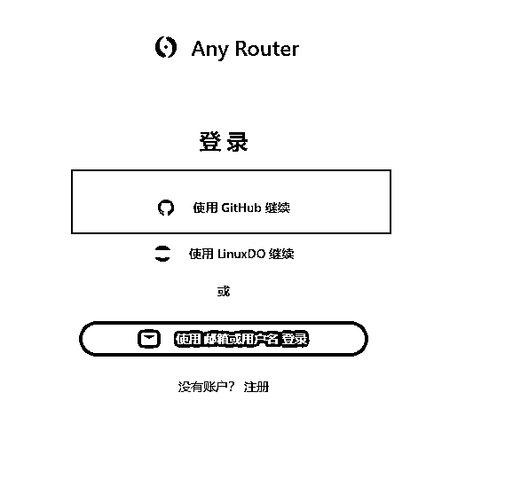

登录进去后，点左侧“钱包”，能看到余额就说明账户活了，可以开始耍了 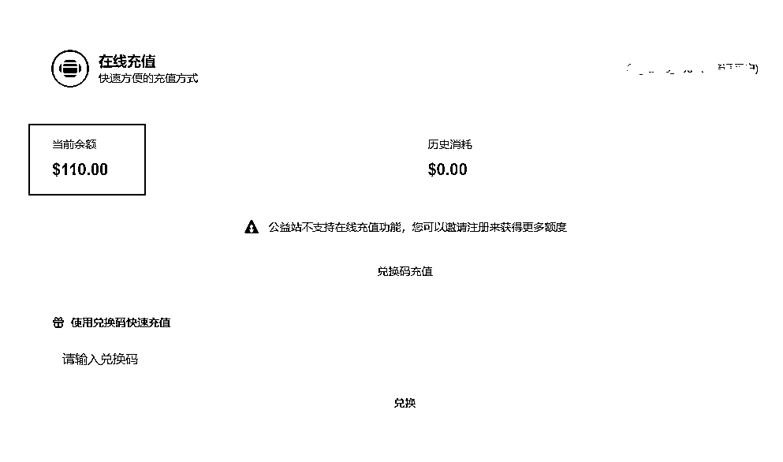

接下来这一步很关键：在左侧菜单栏找到“API令牌”，点进去后添加令牌。随便起个名字，额度建议选“无限”，其他保持默认，创建完会得到一串以 sk- 开头的Auth Token，也就是 `ANTHROPIC_AUTH_TOKEN`，先记下来 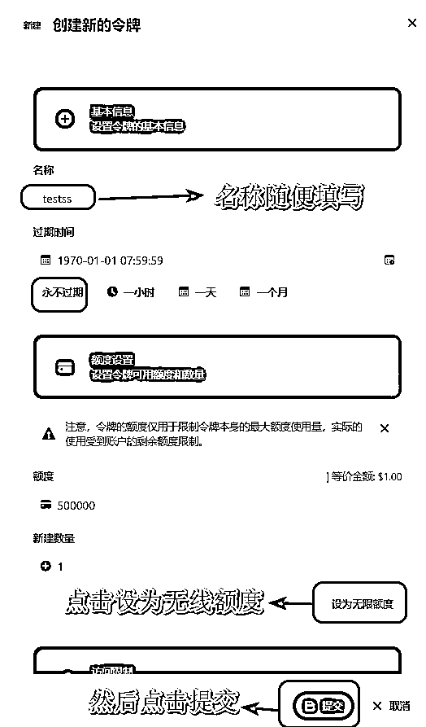

令牌在哪找？就是刚才那个令牌列表，点开就能看到 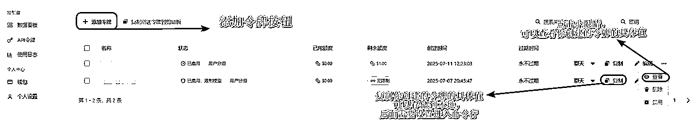

还要记住API地址：`https://anyrouter.top`，对应环境变量 `ANTHROPIC_BASE_URL`。这个地址后面命令行里会用到。

到这里，你的令牌和API地址都齐了，可以进入正题。

**二、为什么非得装WSL？**

因为Claude Code不支持Windows文件系统，所以没法直接在Windows里跑。但可以通过WSL（Windows Subsystem for Linux）在Windows上装一个Linux环境，Claude Code在Linux下跑得又稳又快。打个比方：做实验得用标准实验室，搞AI编程也需要一个合适的“操作台”。

不过，装WSL有两个硬性要求：

- 系统得是Windows 11或Windows 10 21H2以上的专业版/工作站版/企业版，家庭版不行（涉及Hyper-V）
- CPU必须支持虚拟化，并且在BIOS/UEFI里已经打开。不会开的话，百度一下或者问AI都能解决

**三、开装WSL和Ubuntu**

1. 按 `Win + R`，输入 `cmd`，回车 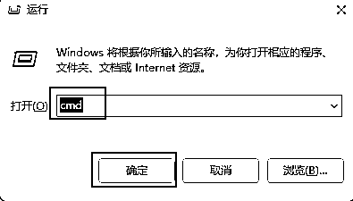 打开命令提示符 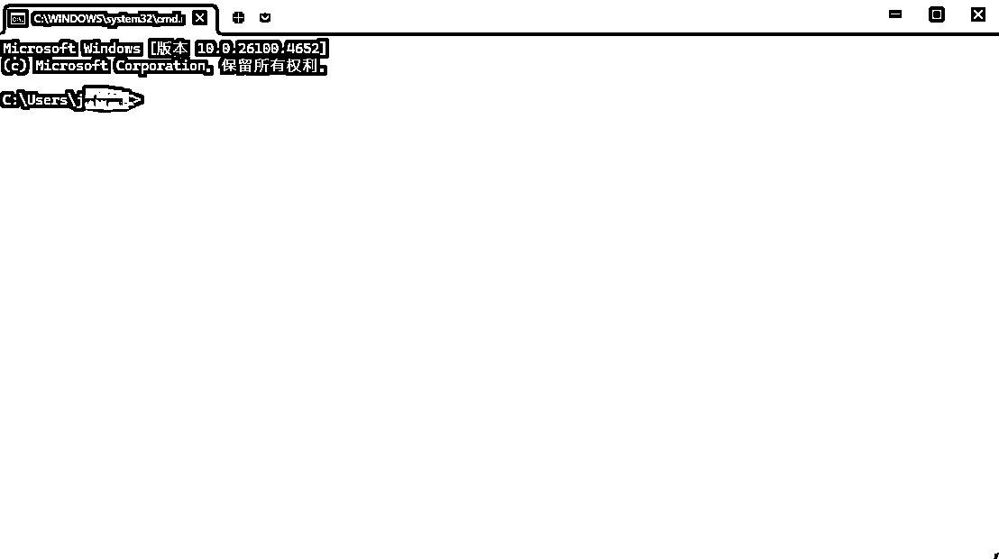
2. 在cmd里输入 `wsl --install` 回车 ```
wsl --install -d Ubuntu
```
3. 第一次安装时，系统会自己下载需要的组件 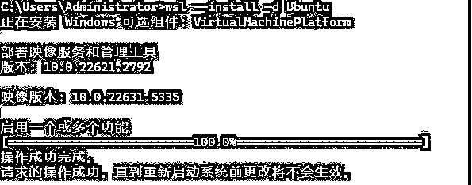
4. 如果没搞过，参考这篇教程：https://download.csdn.net/blog/column/12092261/140156953#WSL_5

注意！装这个的时候，把科学上网关掉，不然可能出幺蛾子。

如果你之前装过WSL，那这次会直接开始装Ubuntu。小白可能想问：Ubuntu是啥？其实它和Windows一样是操作系统，只是属于Linux家族。Linux是内核，Ubuntu是基于这个内核做的完整操作系统 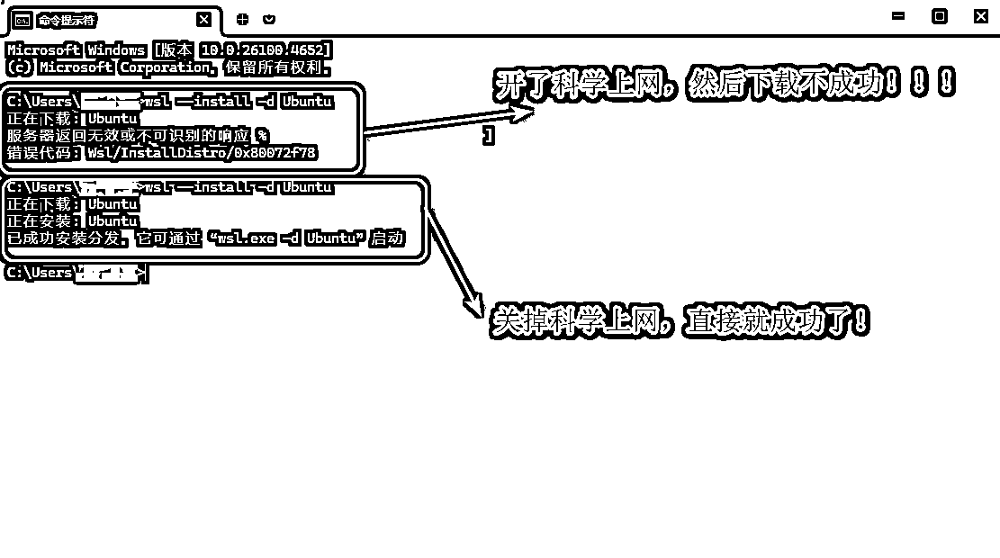

5. 装完先关掉当前cmd窗口 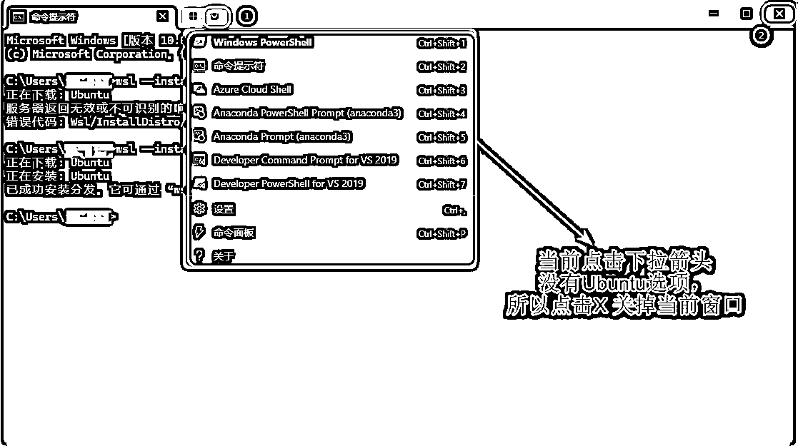
6. 重新打开cmd，你就能看到Ubuntu的图标了 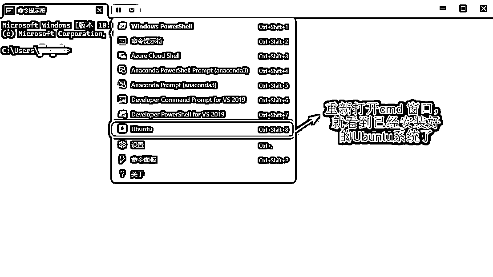
7. 点击进去，进行初始化设置 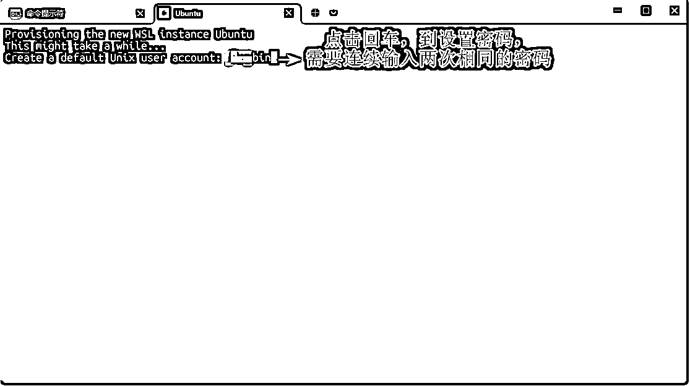
8. 设置用户名和密码，输密码时屏幕不显示，正常现象，输完回车即可 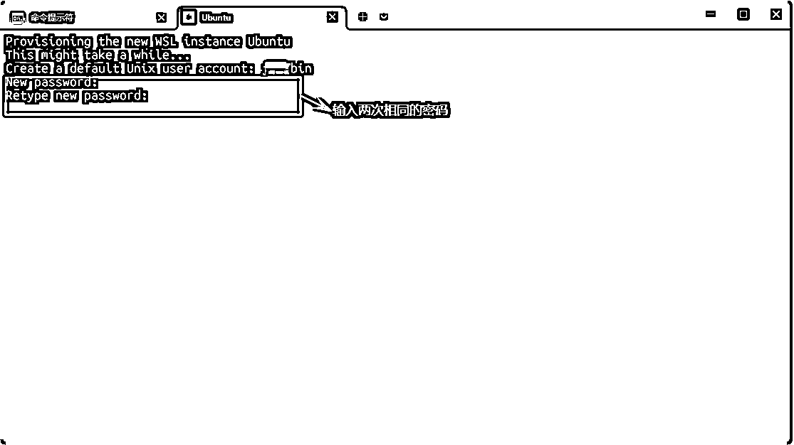
9. 出现普通的命令行提示符，说明Ubuntu已经就绪 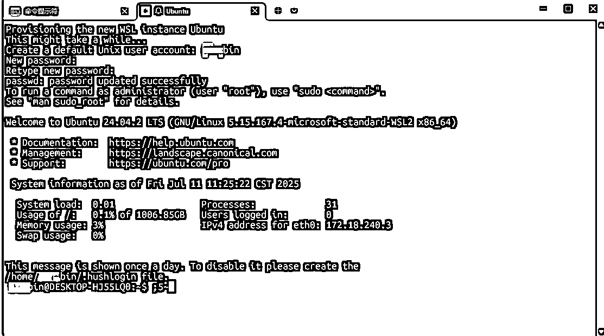

至此，WSL+Ubuntu安装成功。

**四、安装Node.js，给Claude Code铺路**

Claude Code需要Node.js作为底层支撑，它才能装各种扩展模块。你可以把它理解成游戏引擎，没有引擎，游戏跑不起来。

在Ubuntu终端里执行安装命令，以22.x版本为例 ```
curl -fsSL https://deb.nodesource.com/setup_22.x | sudo bash -

该命令用于在基于Debian或Ubuntu的Linux系统上自动安装或更新Node.js到指定版本（在这个例子中是22.x版本）
```   ```
sudo apt-get install -y nodejs

是一条在基于Debian或Ubuntu的Linux系统上安装Node.js的命令。
``` 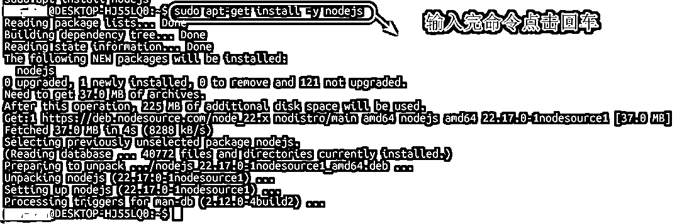 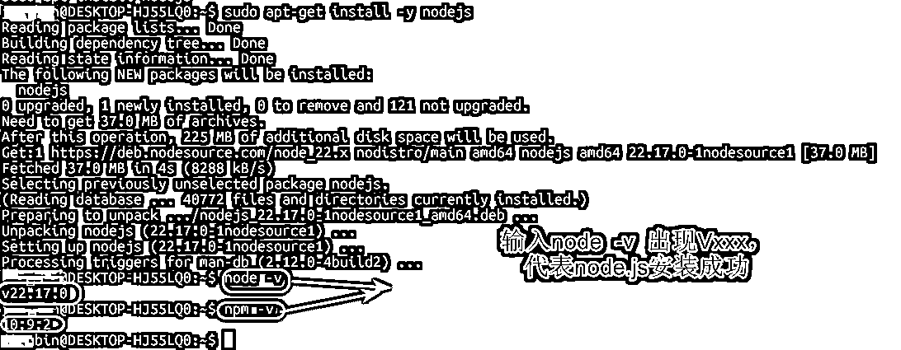

装完记得验证：输入 `node -v` 和 `npm -v`，有版本号就说明环境正常。Node.js必须18.0或更高版本，不然后面会卡住。

**五、安装Claude Code，科学上网可能是关键**

执行安装命令 ```
#复制这段命令到刚才的命令行，然后安装claude
sudo npm install -g @anthropic-ai/claude-code
```

如果报错 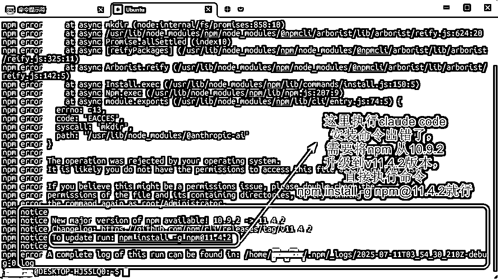，大概率是npm版本太旧。我遇到的是npm版本过低，需要升级到11.4.2。执行：

```
npm install -g npm@11.4.2
```

注意要在sudo模式下运行，否则没权限。输入密码后就会开始升级 ```
sodu npm install -g npm@11.4.2
``` 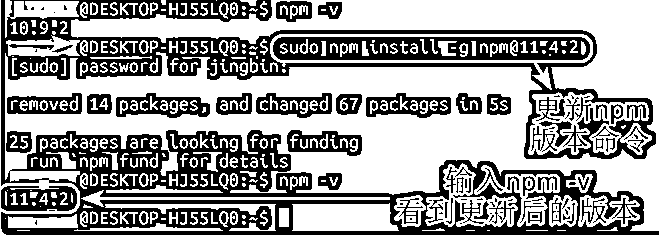

升级完npm，再装Claude Code，看到版本号就说明成了 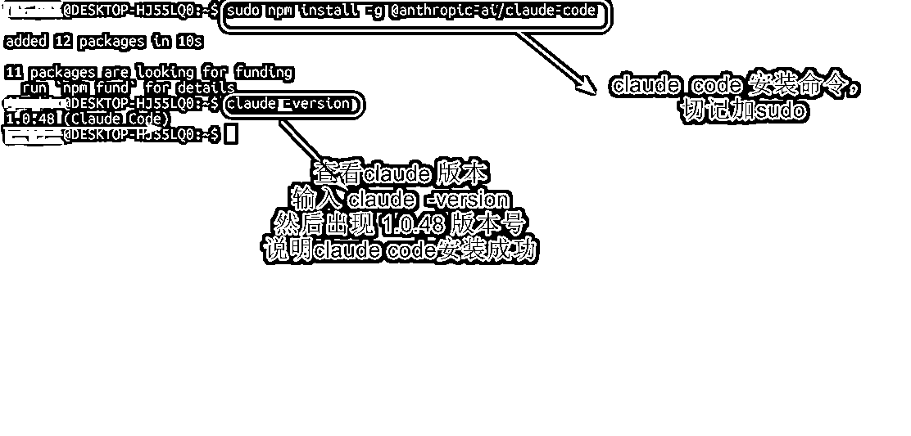

我实测：在不开科学上网的情况下装了很多次都没成功，一开科学上网就过了。所以，这一步建议你别省。至于无科学上网的环境，我还没试过，回头有机会再补。

**六、启动Claude Code，配置环境变量**

还记得前面让你保存的Auth Token和API地址吗？现在要用了。

先建一个项目目录 ```
#先创建一个项目文件夹，名称为testProject （这个自己可以随便设置）
mkdir testProject

#然后查看自己创建的目录 testProject，ls命令会列出当前目录下的所有的东西
ls 
``` 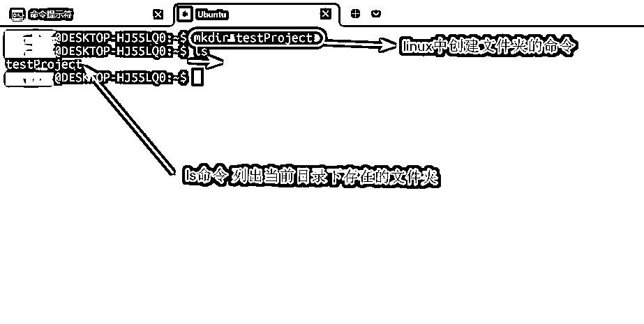

进入该目录，设置环境变量：`ANTHROPIC_AUTH_TOKEN` 和 `ANTHROPIC_BASE_URL` ```
cd your-project-folder                            ####  cd  后面 这个就是进入你刚才创建的文件夹
export ANTHROPIC_AUTH_TOKEN=sk-...                   #####（sk---也就是你刚才保存下来的令牌）
export ANTHROPIC_BASE_URL=https://anyrouter.top      ####（这个就是刚才的API 地址）        
claude                                              #### 然后执行 claude命令就进入claude code了
``` 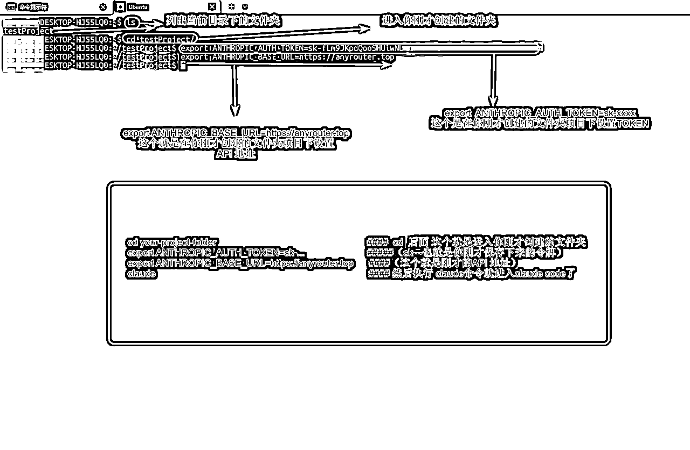

环境变量配好之后，输入 `claude` 命令，就能进入Claude Code界面。第一次进入还会让你设置：
- 选择喜欢的主题 + Enter
- 确认安全须知 + Enter
- 使用默认Terminal配置 + Enter
- 信任当前工作目录 + Enter

看到交互界面，就能在终端里跟你的AI编程搭子聊了。冲！🚀 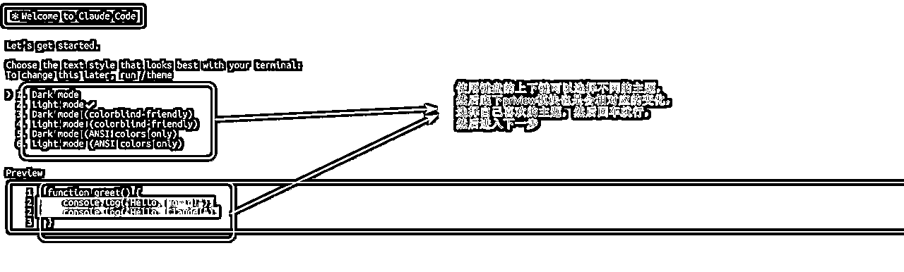 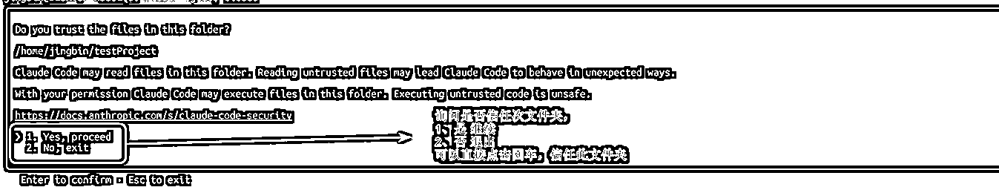 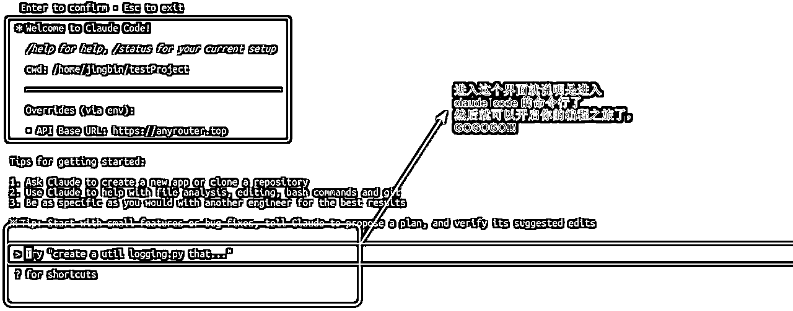

**七、踩坑提醒**

刚开始我用了几天前创建的令牌，怎么都登不进去。后来新建了一个令牌，并开了全局科学上网，才顺利进入。之后不挂科学上网也能直接进，但生成游戏时API又超时，再开科学上网又好使了。具体原因还在琢磨，等搞明白再更新。 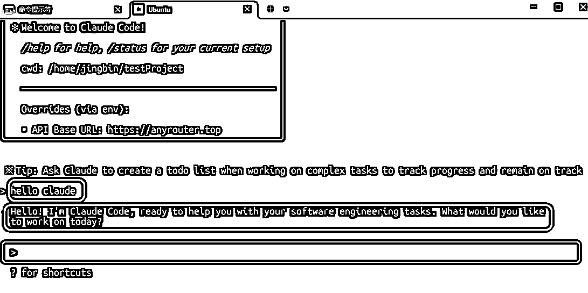

**八、实战：一句话生成俄罗斯方块**

我用Claude Code一句话生成了一个俄罗斯方块，能在浏览器里直接运行。不过还是有点小bug，比如暂停后空格键无法继续，最后几秒那行也不消除，整体不影响玩。

**九、Ubuntu里的文件，在Windows怎么找？**

第一种：`Win + R`，输入 `\\wsl$` 回车 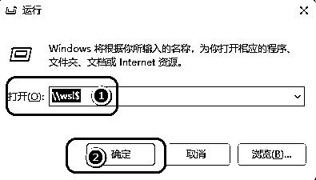 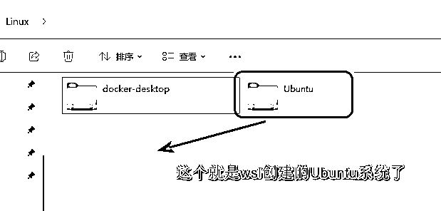

第二种：`Win + E` 打开文件管理器，在地址栏输入 `\\wsl$` 回车 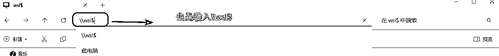

在Ubuntu终端里用 `ls` 查看文件，用 `pwd` 查看当前目录路径 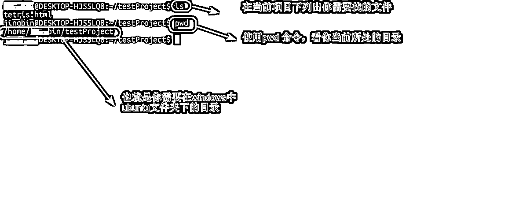 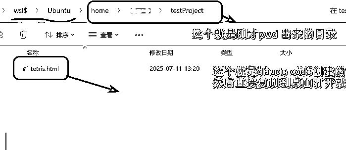

拿到路径后，直接到Windows文件管理器的对应位置找就行。

**十、一点小建议**

Claude Code装好后，强烈建议搭配“云舒的AI实践笔记”发布的Claude Code指令速查宝典，用起来更香。指令链接可以在原帖里找到。

至此，Claude Code安装成功，代码也跑通了。本人第一次写教程，有哪里不周到请多包涵，有问题也欢迎随时留言。