**【从6人到2人，年销300万还在涨：我的AI工作流实战复盘】**

先讲一个反差。

2023年，我的定制旅行团队还是6个人，一年做到300多万业绩。现在，团队精简到2个人，业绩不但没掉，反而还在往上走。很多人问我秘诀是什么，说白了，就是花了2到3个月时间，用RPA加上Coze，把整条业务流程重新做了一遍。

从330航海家AI大会到包子老师的第一次线下课，再到6月底，这段路说长不长，说短不短——但它真实地改变了我对AI落地这件事的认知。

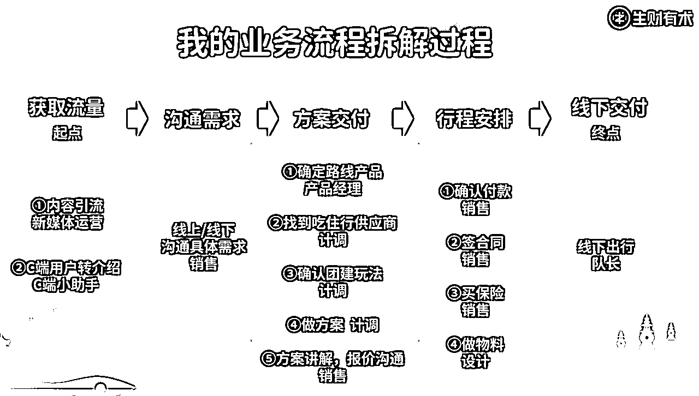

后来很荣幸做了第一次航海家《AI提效工作流》的教练。七天带船，我看到很多老板开始动手搭自己的流程，也有人已经完成了业务拆解，对AI怎么优化有了明确的方向。这些真实的变化让我很触动，所以想把一些观察和想法写下来，给同样在这条路上摸索的人一点参考。

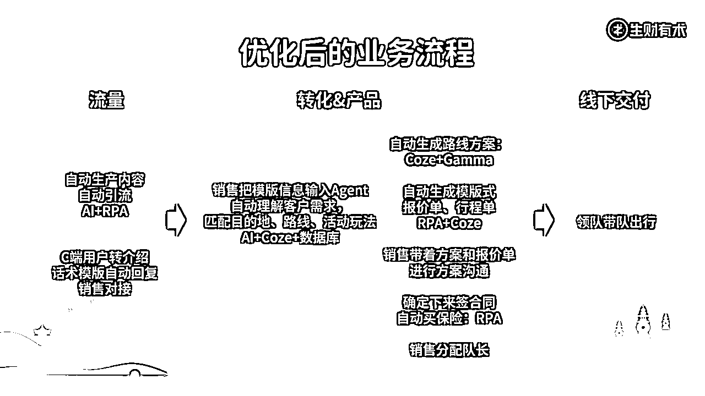

先看这次航海的成果：50位航海家老板上船，24位交齐了两次作业，七天里开了四场直播——涵盖AI工作流认知、业务拆解思路、Coze基础、RPA基础以及优秀作业点评。不少老板已经在几天之内跑出了实打实的小成果：

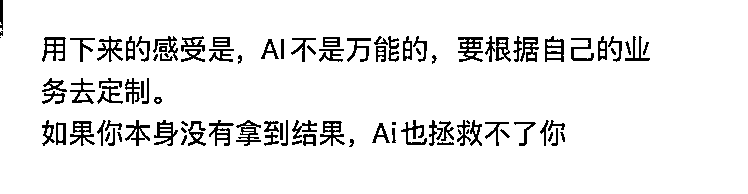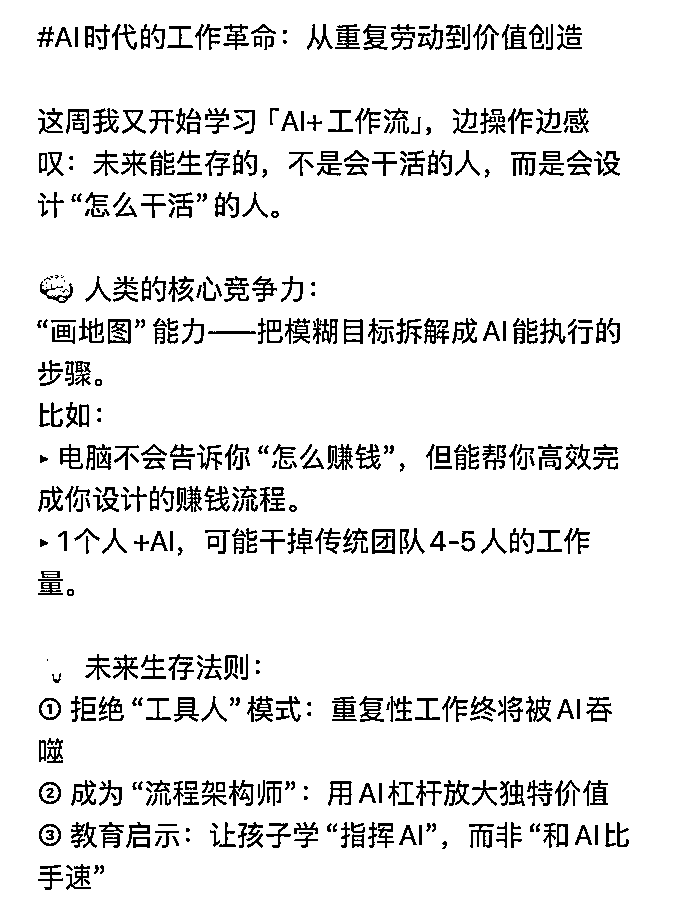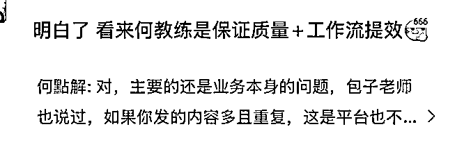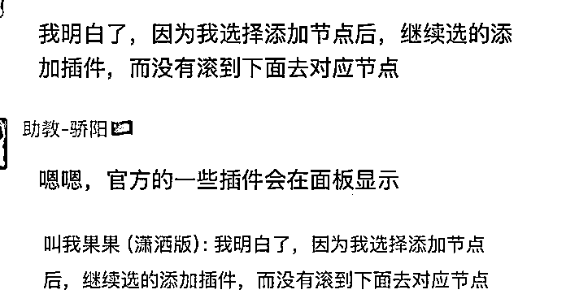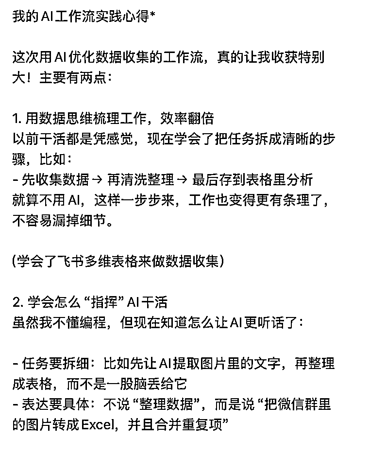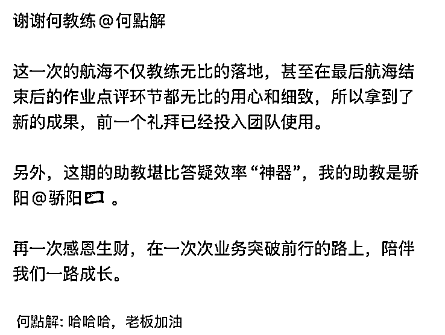

举三个让人印象深刻的案例：

@葫芦妈 做了一个图生图Coze，传一张展会照片进去，就能自动识别海报上的学校名称，再把这些信息整理成模板图输出。

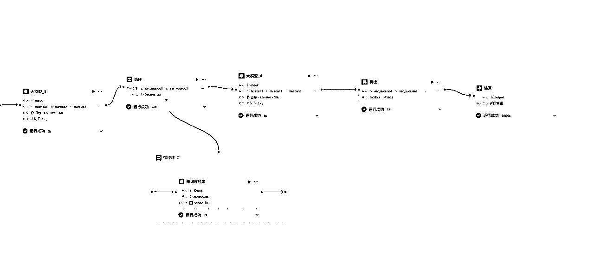

@柏松 做了个MBA课程分析报告写作工作流，系统自动抓取网络信息，原来1到2小时才能写完的报告，现在压缩到5到10分钟搞定，效率提升肉眼可见。

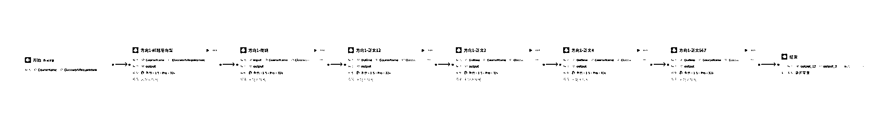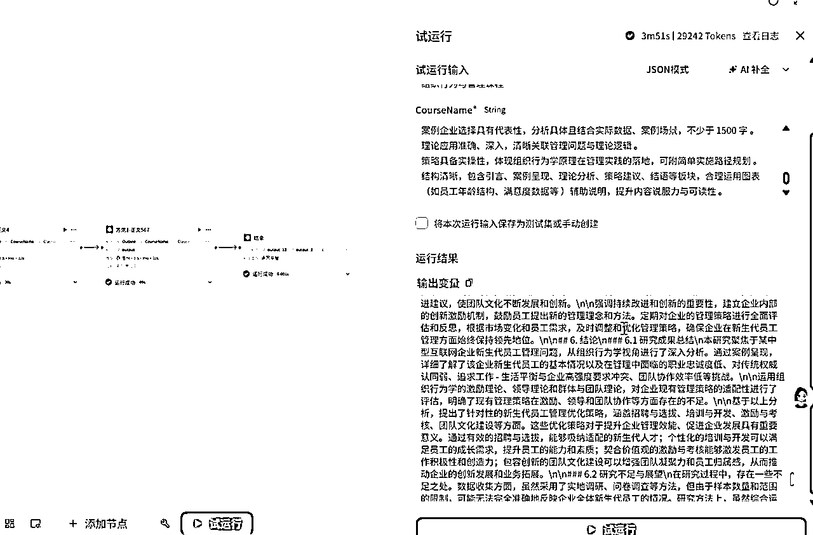

@多米杨 把视频生成工作流也完整跑通了。

七天观察下来，大家遇到的问题其实高度相似：业务拆解太粗糙；对某个工具不熟悉，卡在一个技术细节上就很容易放弃；搞不清AI到底能解决什么类型的问题，导致工具和业务匹配不上。这些共性卡点，估计很多圈友也经历过，我把自己怎么想的、怎么做的整理了一下。

**第一件事：拆解业务流，永远比研究工具重要。**

AI工作流想真正提效，起点不是工具，而是业务本身。你得先把原来的业务流程画出来——从商业模式到业务板块，从岗位职能到具体操作步骤，拆得越细越清晰，AI化的空间就越大。

每个工作模块都可以沉淀成SOP，而这个SOP本身就是一条清晰的AI工作流。只不过以前是人海战术，从招聘平台上找一个优秀的人来执行；现在是从AI工具池里挑一个合适的工具来执行。两者的成本，差距太大了。

所以如果你正在苦恼怎么让AI真正落到工作里，看到那些炫酷的"自动生成×××"视频，别急着买课、买工具，先静下心来把自己的业务拆明白。拆清楚了，你自然就知道这个东西适不适合你。

但有一个前提：

**如果你的业务还没跑通，先跑通MVP，别急着上AI工作流。**

AI工作流的价值，是给成熟的业务流程降本提效。连业务流程都画不出来，说明业务本身还不够清晰。这时候最好的做法，是先把最小业务闭环跑通。

比如亦仁老大最近发布的“外卖内容推客”机会，就可以先手动把流程走一遍——用Coze、n8n批量生成小红书封面，用RPA在饭点定时发布私域优惠券，用RPA定时抓取小红书关键词笔记丢给GPT分析。等这条路走通了，一个自动化的内容推客Agent就自然而然地成型了。

**第二件事：工具永远学不完，先用最简单的解决问题。**

每天刷AI传术师群，说实话是焦虑的。那群人太卷了，天天都有新工具、新玩法砸过来，我一度觉得自己必须追赶一切。但冷静下来发现一个事实：工具是永远学不完的。与其追逐最前沿，不如用最能落地的。

这次航海我只教了两个工具：Coze和RPA。它们的核心优势很简单——

一，**上线门槛极低**。对AI不敏感的执行同事来说，要做的就是点击开启，剩下的交给程序跑完。这就已经很了不起了。

二，**无需翻墙折腾**。我甚至可以把定制方案生成和自动报价的Coze插件直接发布到豆包里，同事收藏之后，发条消息给智能体，手机上就能收到完整方案或报价单。这种落地程度，对当下的职场环境来说非常友好了。

三，**开发生态成熟**。不管是自己动手还是找人定制，在生财或者小红书搜一下同类需求，基本就能判断能不能实现、大概要花多少钱。

四，**上手难度不高**。生财里的RPA、Coze航海手册和精华帖很多，认真读完再实操，做点实际能用的工作流真没有想象中难。特别是影刀自带的魔法指令，等于内置了一个Agent，自然对话就能解决很多问题。

这次航海接触了大量老板的作业和反馈之后，我形成了一个判断：**90%的业务工作都能被AI自动化，区别只在程度和形式。**

程度和形式的意思是——你在某个业务里积累了很多经验，AI做不到你这个水平，能做到60分、70分；这时候看这个环节在业务中的位置，如果它不重要，但必须有人做，六七十分完全可以接受。很多AI高手甚至能调到八九十分。

但它如果是核心关键环节，需要不断增长和迭代，那就更要想清楚：AI不是来替代人的，而是来辅助关键岗位的人变强的。

我在定制旅行项目就是这么做的：团队只留了两个人，一个是项目负责人，负责统筹管理和迭代AI工具；一个是销售，因为ToB业务里，真实感和沟通永远无法替代。但我给销售做了一个客户分析和促单切入点的Coze——通过一两次沟通快速摸清用户需求和购买卡点，再把每次成单或未成单的案例沉淀成数据库，持续反哺这个关键岗位的转化率。

所以与其在大量AI工具里迷失方向，不如先吃透一个，真正用起来。能降本增效的，才是属于你的好工具。

做完整个项目的AI化之后，我对招聘的思考也发生了一些变化。

现在看人，我会更在意两件事：

**第一，这个人会不会用AI，能不能借AI放大自己的能力，用更少的时间产出更高质量的成果。**

**第二，这个人有没有自驱力、适应力和跨学科思考的能力。** 这些软技能的权重，在我心里已经超过了硬技能。

为什么？因为在现有环境里，客观型技能——比如推理、逻辑、运算——AI已经比普通人强太多了。人真正难被替代的，反而是适应变化的能力，主动学习和创造的意愿。

举一个特别直观的例子：上个月我还需要一个实习生每个月花8天时间，守在保险网站上一单单买旅游保险；这个月自动买保险的RPA出来了，这件事彻底消失了。可以预见的是，重复性、低技术含量的岗位会被批量替代，这是趋势。

**那么问题来了：什么才是未来让人安身立命的能力？**

对个人而言，我给出的答案是：**建立属于你自己的、懂你的工作流、Agent和数据库。**

大胆预测一下：未来的招聘场景，可能不再是一张简历打天下，而是你带着自己打磨好的、适应各种职场场景的Agent和数据库去匹配公司。你拥有的这套系统，可以快速产出公司需要的产品内容，这本身就是你最有分量的竞争力。

对企业、对超级个体来说，则是**建立属于项目的、更懂目标群体的专属数据库和Agent**。

如果说对个人，公司会因为你有相关技能的Agent、工作流和数据库而聘用你；那么对用户来说，他们只会选择——谁的Agent更懂我的需求，就找谁。

像我们的定制旅行Agent，目标人群是年轻人，我们就会在文字表达、旅行产品命名、团建玩法设计上，刻意让Agent更贴近年轻人的审美和需求。

**对AI时代打工人的第二条建议：客观的事AI已经做得很好了，把精力花在主观的部分上。**

有了数据库和工作流，只是基础形态。最终能拉开差距的，是你对"我想做什么、我愿意为什么付出"的深度挖掘。不断研究、不断发现细微的差异，然后沉淀到你的工作流和审核标准里。

举个例子，你可以从"AI生成的这张图好不好看"开始练——这里"好看"的定义又取决于你的目的：是追求爆文？还是符合高端主流审美？这些主观判断没有标准答案，但它真实存在。你可以叫它体感，也可以叫它网感。

我们运营曾经拆解了同一个旅行目的地的近5000条笔记，相册里存了13000张同一个地方的图片。她拿到一张素材，一眼就能判断它会不会爆。所以她做工作流，做得永远比别人好，因为她心里装着"什么是好的内容"。

B站UP主"汤质看本质"把这种东西叫做"品味"——在AI时代，品味正在变成越来越稀缺也增值的能力。

对自己情绪和需求的觉察、对自己能力的了解、对潜在可能的挖掘，这些事情的优先级，一定会越来越高。

最后，如果你也在自己的企业或项目里落地AI工作流，或者对这块有更多探索的需求，欢迎随时来交流。我们一起生财有术！