# 40天冲进YPP，3天突破千万播放：印度故事频道的低成本起盘方法
作者：龙哥

> 以下内容整理自一位创作者的实战分享，记录了他如何从接触赛道，到完成频道冷启动、获得大量播放并开通YPP。

参考视频：

https://www.youtube.com/shorts/zS2UAjvmw2k

复刻版本：

频道累计播放量已经超过1亿，并获得YouTube银牌。

依靠印度故事内容，创作者在约一个半月内完成YPP开通，目前累计收入407美元。

单条内容RPM约为0.01—0.02美元。

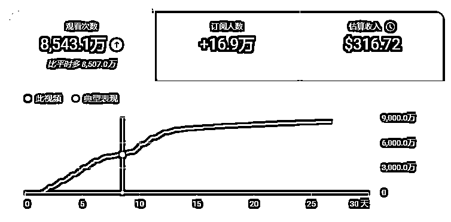

* * *

## 先说结论：印度故事仍然值得新人尝试

很多人听到“印度故事”，第一反应是：

“播放量或许不错，但单价太低，做起来是不是不划算？”

这种担忧并非没有道理。不过，如果你还是刚开始做YouTube，目标是先完成冷启动、积累订阅、拿到YPP资格，那么这个方向依然有明显价值。

它的优势不在于每次播放能带来多少收入，而在于：

- 用户规模庞大；
- 内容容易被快速理解；
- 情绪冲突强，适合短视频传播；
- 制作门槛相对较低；
- 新账号也有机会获得大量曝光。

换句话说，它更像是一条“启动跑道”，而不是最终的商业终点。

### 1. 先解决新人最难的流量问题

刚做频道时，最容易遇到的困境不是不会剪辑，而是发出去没人看。

印度故事天然拥有较大的潜在受众，题材通常围绕亲情、危机、动物、信仰、反转等元素展开，观众不需要复杂背景就能理解剧情。只要选题和节奏到位，新账号也有机会较快积累订阅和互动观看。

素材中的创作者从5月12日发布首条内容，到6月21日已经更新37条，并在40天左右完成了YPP基础目标。对于新人而言，先拿到资格，再考虑更高收益的方向，往往比一开始就追求高RPM更现实。

### 2. 用规模弥补单次收益不足

这个方向的RPM确实偏低，所以不能用普通长视频的思路来衡量它。

更适合的策略是：

1. 观察表现稳定的账号；
2. 找出近期正在上升的题材；
3. 复用已经被验证的叙事结构；
4. 加入自己的小幅变化；
5. 保持稳定更新。

只要播放规模足够大，低单价也可能被总播放量抵消。原分享中提到，相关账号依旧能够获得百万乃至千万级播放，甚至出现过亿级表现。

对标账号近期数据示例：

- 牛：7月1日至7月7日约1.2亿播放；
- 金毛：7月2日至7月7日约320万播放；
- 浣熊：7月5日至7月7日约677万播放。

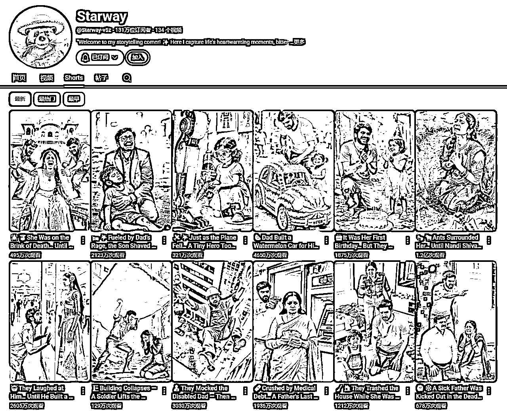

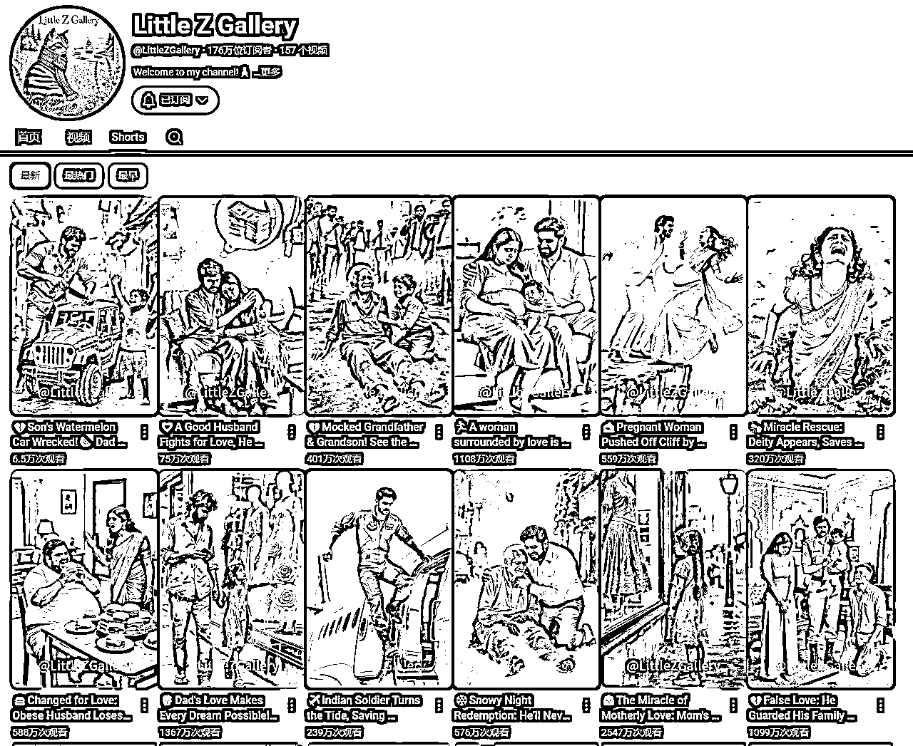

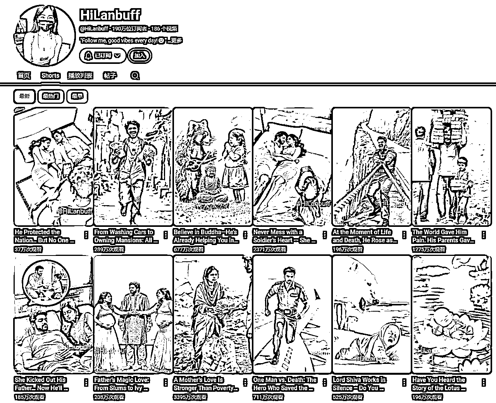

### 3. 制作要求没有想象中高

猫咪故事、科普解说等方向，往往需要更精细的画面、复杂的资料和成熟的剪辑能力。

印度故事则更看重：

- 冲突是否足够直接；
- 前几秒能否抓住注意力；
- 情绪是否持续升级；
- 结局是否让人获得释放；
- 更新是否足够稳定。

因此，初期不必追求电影级制作。只要画面能看、故事能懂、节奏不拖，配合合适的音乐和剪辑，就有机会获得不错的数据。

* * *

# 真实案例：从跟随风向，到3天破千万

创作者在5月8日加入深海圈新人营后，才第一次接触到印度故事方向。

他的目标很明确：先借助这个方向的流量，把第一个YPP做出来。

在持续更新期间，他尝试了成长、亲情、情感冲突、家庭矛盾等多个主题，其中有几条内容获得百万级播放。

6月14日参加深圳线下交流活动时，他进一步意识到，做短视频不能只埋头生产，还要持续观察平台正在放大的内容。

6月17日，Gary教练发布了新的选题风向。创作者快速跟进，制作了一条救援主题内容。

👆跟随风向后，数据迅速起飞

6月19日发布后，这条内容在3天内突破1000万播放；6月27日，频道成功开通第一个高级YPP。

它并没有使用什么复杂技巧，真正起作用的是“微创新”：

当大量账号都在制作家长里短时，他将“宝宝救妈妈”的救援结构引入印度故事，并根据受众文化完成了角色和神明设定的替换。

所以，问题不在于这个方向还能不能做，而在于你能否发现已经被验证的结构，并把它改造成属于自己的版本。

* * *

# 爆款拆解：不是发明新题材，而是重组有效元素

这条内容之所以能跑起来，主要依靠四层设计。

## 第一层：用不适感制造开场冲击

片头出现大量密集的蚂蚁和纹理，容易让部分观众产生明显的生理反应，同时也会激发好奇：

“这到底发生了什么？”

随后叠加女性痛苦的哭喊、惊恐的表情和异常环境，观众会自然产生连续疑问：

- 画面中的人是谁？
- 她为什么会陷入困境？
- 后面会不会有人来救她？

这类信息密度很高的开场，能够有效争取短视频最宝贵的前几秒。

## 第二层：把多种情绪线叠在一起

救援题材本身就容易激发观看欲，而这条内容并没有只使用一种救援关系，而是连续叠加了三层情绪。

### 1. 孩子拯救母亲

传统故事通常是成年人保护孩子，但这里将关系倒置：孩子成为主动求助、寻找办法的人。

无助、焦急和哭泣，让观众迅速产生怜惜感，也把前面的惊悚氛围转成了亲情叙事。

### 2. 动物成为行动者

狗狗不只是陪伴角色。

它会照料植物、倾听女孩的诉说，并在关键时刻承担起寻找帮助的任务。前面的拟人化行为，实际上是在为后面的英雄身份做铺垫。

它从普通宠物变成了故事中的行动核心，戏剧性自然增强。

### 3. 神圣力量完成终局

最后出现千手观音形象，以圣光驱散蚂蚁，将危机推向高潮。

这个设计并不是简单换一个角色，而是让故事与目标观众的文化认知产生连接。危机因此不只是一场意外，也被赋予了精神层面的解释。

## 第三层：连续制造身份倒置

这条内容最吸引人的地方之一，是它不断打破观众预期。

- 通常是大人救孩子，这里变成孩子试图救大人；
- 通常是人类保护宠物，这里变成动物保护人类；
- 通常是人向神明祈求，这里变成动物替人求助神明。

每完成一次角色关系倒置，观众都会获得一次新的意外感。

## 第四层：让结尾完成情绪释放

故事的情绪路线大致是：

恐惧 → 痛苦 → 求助 → 希望 → 神迹 → 重聚

如果故事一直停留在压抑状态，观众很难获得满足。最终让受困者脱险、家人重逢，可以把前面堆积的情绪一次释放出来，也更容易促成点赞、评论和分享。

这类内容的结构可以概括为：

**视觉不适感 + 危机事件 + 多重守护关系 + 角色倒置 + 释怀式结局**

所谓“微创新”，不是凭空创造一个从未出现过的题材，而是把已有的有效模块重新排列，再加入新的角色、文化符号或救援方式。

* * *

# 具体制作流程

## 1. 用文本模型梳理参考内容

可以把参考视频链接或本地文件交给文本模型，让它协助拆分剧情和画面。

使用时，重点交代以下要求：

- 将原有角色替换为印度女性和印度女孩；
- 将原本的宗教人物调整为千手观音；
- 明确每个角色的年龄、肤色、发型、服装和体型；
- 让同一角色在不同画面中保持一致；
- 每个画面都标注人物动作和环境；
- 分别生成静态画面和动态画面的中文描述；
- 控制描述长度，避免生成内容过度复杂。

角色设定越具体，后续返工越少。

## 2. 先批量查看整体，再单独修正局部

创作者使用豆包的套图功能，将整套分镜一次生成出来。

这样做的好处是，可以先观察：

- 故事是否连贯；
- 角色是否统一；
- 画面节奏是否合理；
- 是否存在构图断层；
- 哪些场景需要重做。

之后，再针对问题画面单独修改。

例如：

- 更换动物品种，避免与同类内容过于接近；
- 修正人物的动作和站位；
- 调整主体大小；
- 改变视线方向；
- 补充缺失道具；
- 重做不符合剧情的构图。

满意后，再把单张结果替换进整套画面中。

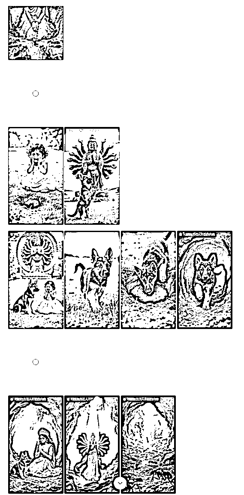

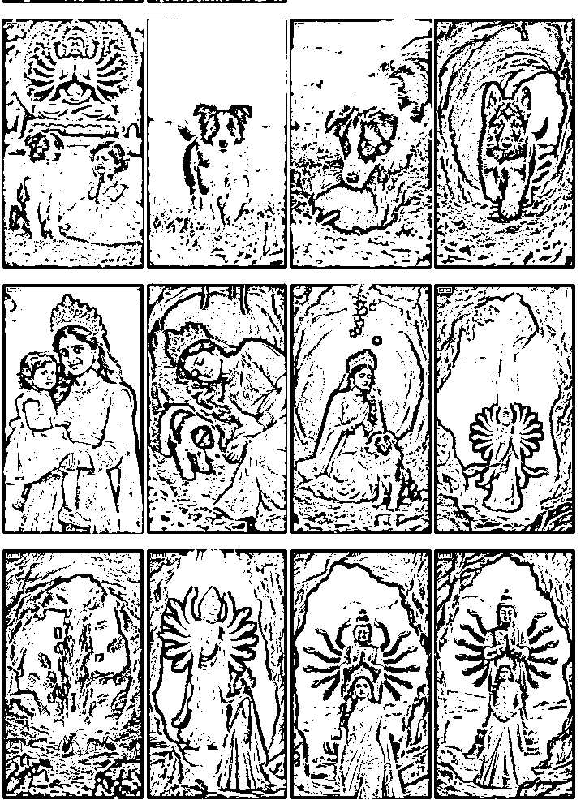

祈祷画面尤其容易出现主体错位：模型可能把“抬爪祈祷”错误地画到人物身上。

可以改成更明确的描述：

“画面中不出现人物，只拍摄狗的近景，狗抬起两只毛茸茸的前爪，呈祈祷姿态。”

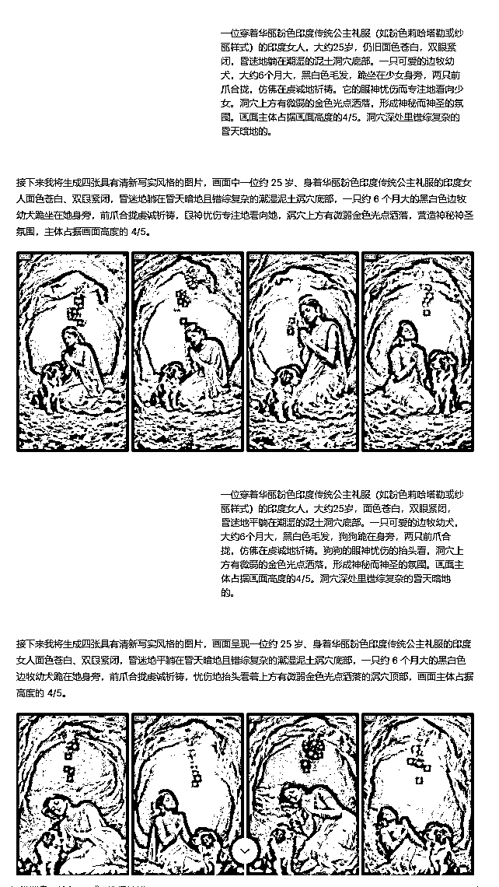

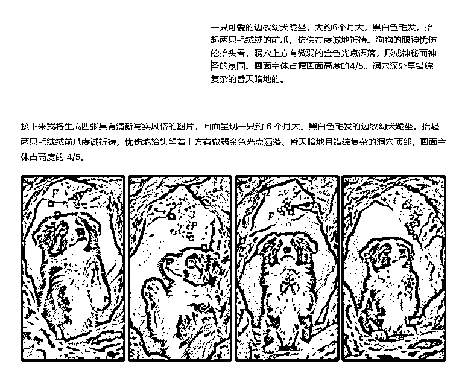

## 3. 处理素材和画面管理

完成画面后，再进行必要的清理和整理。

创作者使用Photoshop处理水印，同时用Eagle管理参考资料。Eagle支持收集图片、视频和GIF，也能保留原始链接，方便后续查找来源。

工具地址：

https://eagle.cool/

## 4. 图片转动态，再处理镜头连接

主体动态画面可以使用智谱、即梦等工具完成。

常用流程如下：

1. 先生成约5秒的短片段；
2. 按剧情顺序放入剪映；
3. 导出每段末尾画面；
4. 用首尾画面制作连接素材；
5. 根据画面风格选择Vidu、Runway或Pixverse完成过渡。

不同工具可以按照需求选择：

- Vidu：适合快速生成；
- Runway：适合批量测试；
- Pixverse：画面质感相对更好。

通过这种方式，既能减少逐段制作的时间，也能让相邻镜头之间更加自然。

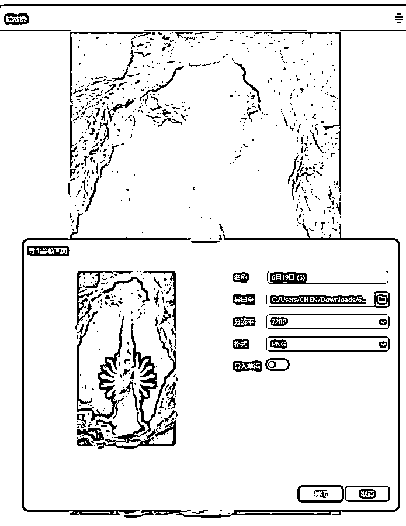

## 5. 剪辑重点：速度比堆效果更重要

这类短内容最怕节奏松散。

可以遵循以下原则：

1. 一旦信息已经表达完成，就不要继续停留；
2. 普通画面控制在2—4秒；
3. 动作简单的镜头可以更短；
4. 适当使用加速、裁切和快速切换；
5. 过渡素材不必完整播放，可以用更高速度带过；
6. 不要每段都强行加入转场，硬切、黑场或音效也能完成衔接。

尤其要重视开头的几个瞬间：画面必须尽快抛出异常、危险或强烈情绪，让观众马上知道“这里有事情发生”。

最后，创作者通过手机发布，并搭配印度方向近期表现较好的音乐。

# 这条内容还可以怎样改进？

## 1. 开头的蚂蚁数量和密度可以再提高

目前的视觉刺激还不够强，后续可以增加覆盖面积、移动速度和镜头距离，让观众在第一眼就感到明显不适。

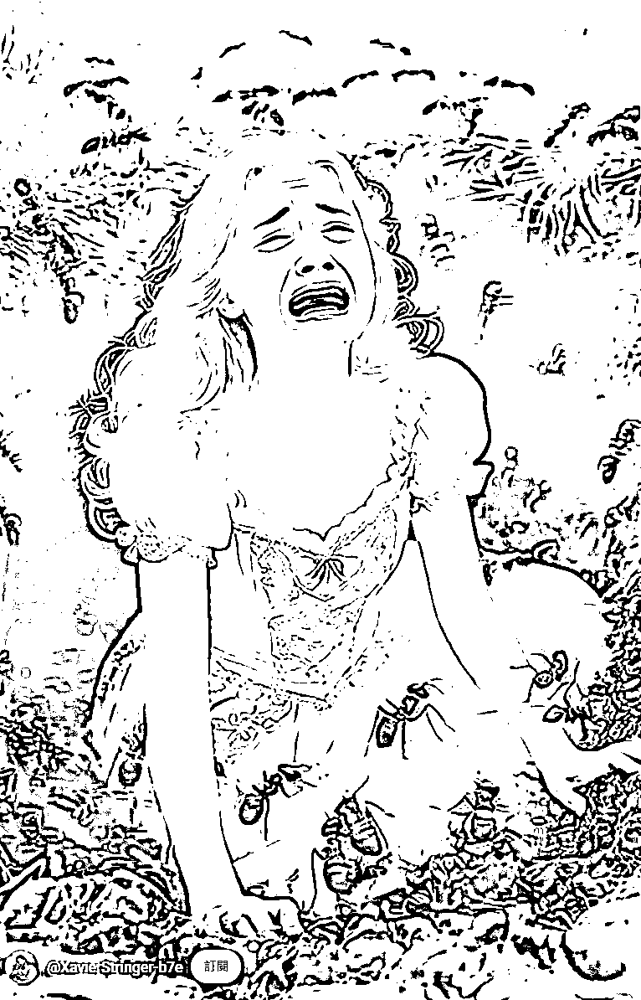

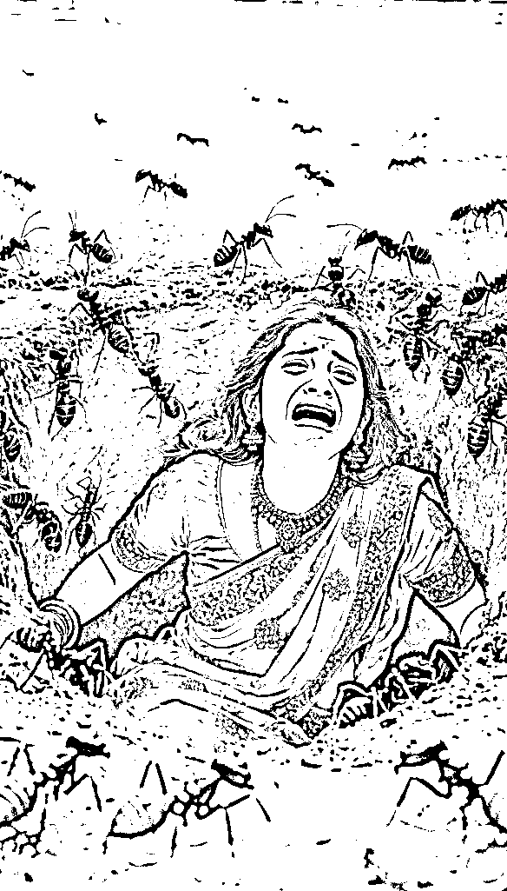

## 2. 延长受困者的痛苦过程

如果人物遭遇危机后立刻进入求助阶段，观众的情绪积累可能不足。

可以加入极短的挣扎、呼喊或再次受困镜头，让观众更充分地感受到危险。

## 3. 增加孩子奔跑和哭泣的近景

孩子边哭边寻找帮助，是强化亲情线的重要画面。

可以补充：

- 脚步特写；
- 回头张望；
- 眼泪和呼喊；
- 跑向动物时的急切动作。

## 4. 更换动物主角

除了狗，还可以测试更符合印度受众偏好的动物，例如：

- 小牛；
- 孔雀；
- 大象。

不同动物会带来不同的文化联想，也有助于降低账号内容的重复感。

* * *

# 后续创作：同一套结构还能怎么变化？

这类内容可以拆成一个基础模型：

**遭遇危机的角色 + 出乎意料的保护者 + 符合背景的解决方式**

只要替换其中一个模块，就能衍生出新的版本。

## 方向一：更换被帮助的对象

### 1. 保护野生动物

让雪豹、鲸鱼等珍稀动物陷入困境，再通过孩子、小动物或自然力量完成解围，可以顺带融入环保主题。

### 2. 保护老人

让老人遭遇跌倒、火灾等突发情况，再由过去受过老人善待的动物前来帮忙，故事会更具因果感。

### 3. 保护文化符号和流行角色

也可以选择大众熟悉的虚构人物、热门玩偶或网络角色，让内容直接触达特定粉丝群体。

## 方向二：更换保护者

### 1. 弱小生物逆袭

仓鼠、兔子等看似没有战斗力的角色挺身而出，反差会更明显。

### 2. 玩具获得生命

泰迪熊、机器人等孩子珍爱的物件突然活过来，能够承载童话感和幻想感。

### 3. 反面形象变成守护者

乌鸦、蛇、怪兽等通常被视为危险的存在，如果它们反过来保护人类，观众会产生更强的认知冲击。

## 方向三：更换解决危机的方式

### 1. 科技路线

让守护者启动隐藏装置，或者调用未来文明的力量，整体风格可以转向科幻。

### 2. 自然路线

利用暴雨、狂风、植物快速生长或特殊矿物等完成解围，但需要提前设计好视觉逻辑。

### 3. 现实路线

守护者通过某种方式引来消防人员、医护人员或搜救人员，使结局更接近现实。

### 4. 跨界路线

加入观众熟悉的超级英雄或其他热门形象，制造跨作品联动。

* * *

# 如果大家都在做同类救援，如何拉开距离？

## 1. 给故事增加因果

可以插入一两个非常短的回忆画面，说明角色为什么会遇险、为什么会被帮助。

这样，故事就不再只是偶然发生的一场事故，而会显得更完整。

## 2. 设计代价或反转

救援不一定要毫无代价。

例如：

- 守护者受伤；
- 神迹出现前必须完成某个考验；
- 获救后发现危机并没有彻底结束；
- 原本被认为是敌人的角色才是真正的帮助者。

适度增加代价和意外，会让内容更有回味。

## 3. 尝试开放式收尾

成功脱险之后，不必把所有信息解释干净。

可以通过角色的疑惑眼神、突然出现的线索，或者一个未解释的物件，为评论区留下讨论空间。

## 4. 形成固定视觉风格

除了真实场景，也可以尝试完整统一的风格：

- 霓虹未来都市；
- 阴暗古堡与神秘生物；
- 东方志怪和山野仙境。

只要视觉语言稳定，账号就更容易形成识别度。

## 5. 固定一个长期守护角色

例如一直使用同一只“英雄狗”，让它持续处理不同危机。

当观众开始记住角色，频道就不再只是发布单条内容，而是在逐渐建立系列化IP。

还可以把关键决策交给观众：

- 它应该向谁求助？
- 该使用哪件道具？
- 下一集救谁？
- 是否要让某个角色回归？

让观众参与剧情选择，有助于提升后续内容的期待感。

* * *

# 如果从动物第一视角来拍，会发生什么？

假设整条内容都从边牧的视角展开，画面语言会完全不同。

镜头可以压低，更多拍到草地、人的腿和地面上的蚂蚁。只有动物抬头时，观众才短暂看见孩子或主人的脸。

声音也需要重新设计：

- 人类语言变得遥远、模糊；
- 呼吸、嗅闻、脚爪摩擦地面的声音被放大；
- 焦躁的呜咽和坚定的叫声承担主要叙事功能。

### 这种方式的优点

1. 观众更容易进入动物的心理状态；
2. 忠诚、紧张和决意会更直接；
3. 低机位和有限视野能形成独特风格；
4. 与普通叙事方式相比，更容易制造新鲜感。

### 需要承担的风险

1. 交代背景会更困难；
2. 结尾难以展示所有角色；
3. 动物动作和主观运动更难稳定生成；
4. 部分观众可能觉得画面混乱。

因此，这种拍法适合用作阶段性测试，不建议一开始就完全替代常规叙事。

* * *

# 人脸和剧情反复，可以怎样处理？

## 人脸变化不够丰富

可以尝试：

1. 更换文本或图像模型；
2. 使用LoRA、人物参考等方式；
3. 通过发型、服饰、年龄、肤色和配饰做区分；
4. 把注意力放在动作、冲突和节奏上。

短视频里，观众首先关心的是“发生了什么”，不一定会仔细辨认每张脸。

如果未来要建立长期IP，再重点投入人物一致性会更划算。

## 故事越来越像怎么办？

可以采用两种方法：

1. 让模型一次生成多个故事方向，再挑选组合；
2. 把近期热门结构与印度文化元素结合，进行重新编排。

救援、亲情、动物、神迹、反转这些模块本身可以持续组合，关键是更换人物关系、危险来源和结局方式。

* * *

# 创作者目前的后续思考

## 1. 粉丝主要来自印度，是否应该转型？

可以先继续观察受众反馈，不必急着彻底改变方向。

一种做法是逐步隐藏旧内容，同时穿插测试新主题；另一种做法则是继续扩大当前频道，把已经验证的方向做深做大。

## 2. 如何和同类账号拉开距离？

可以有两条路径：

- 继续跟随表现稳定的账号，但在角色、画面和结局上做变化；
- 选择一个细分方向长期深耕，例如固定动物主角、固定神话体系或固定救援结构。

还可以采用“两个成熟题材搭配一个测试题材”的发布方式，用数据观察观众是否愿意接受新变化。

## 3. 想测试长内容，应该从哪里开始？

如果频道已经积累了较高权重，不建议突然跳到完全无关的方向。

更稳妥的办法，是先把表现较好的短内容重新整理成横屏版本，扩展到1—2分钟，测试长内容观众的接受程度。

这样既能利用已有素材，也能降低频道突然改变主题后出现的数据波动。

* * *

## 最后总结

印度故事的价值，不只是RPM，而是它能够帮助新人较快完成：

- 找到可复制的内容结构；
- 获得第一批订阅；
- 验证选题与制作流程；
- 建立稳定更新习惯；
- 完成频道的初始增长。

真正值得学习的，不是某一条视频的表面形式，而是它背后的方法：

**先找已经被验证的结构，再加入文化适配、角色倒置和情绪变化，最后用低成本工具快速测试。**

当你不再执着于“凭空发明新题材”，而是学会拆解、重组和迭代，内容生产就会从碰运气，逐渐变成一套可以重复执行的流程。