# 万字拆解：Youtube长视频从0到10的全链路打法
作者：龙哥

下面进入正文。这篇文章聚焦长视频的系统思路，聊到短视频的部分只是用来辅助说明，并不打算做成一套短视频教程。

建议先把目录过一遍，再按序阅读。受篇幅所限，有些点没有逐字铺开，但希望思路本身能给你带来启发。

如果决定读了，就请坚持读完，读到最后你会感受到我的诚意。

# 第一章　长视频的道

## 1.1　你想成为哪种长视频博主？

把这个话题放在最前面，是想先交代清楚我的频道目前处于什么位置，方便你按需索取；与此同时，也想给大家提供一个可以参考的坐标。无论做什么内容，最初的定位和目标设定永远是最重要的。

从长视频这个维度来看，我目前还属于小博主。为什么要强调这点？因为我确信头部博主的运营逻辑，可能会推翻我接下来提到的一部分结论。但对我们大多数人来说，小博主是通往大博主的必经之路。

所谓小博主阶段，用互联网黑话来说，就是已经完成长视频的0-1和1-10这两个里程碑。

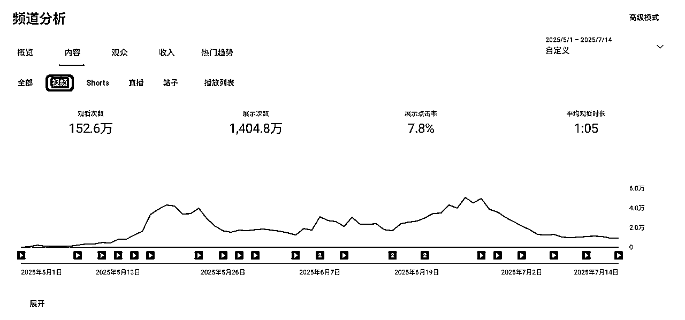

### 1.1.1　什么是0-1？怎么判断自己达标？

结论：自然推流的播放量稳定破千。

关键词有两个：自然推流、稳定。自然推流，是指没有依靠短视频引流带来的流量。如果短带长真的把流量带起来了，之后的长视频也会被系统识别为自然推流，所以这一点一定要盯紧。自然推流的来源主要是浏览功能和推荐视频两块，浏览功能对应首页推荐，推荐视频对应播放页右侧的相关推荐。等到粉丝量上来以后，频道页的推荐流量也会逐渐增加。

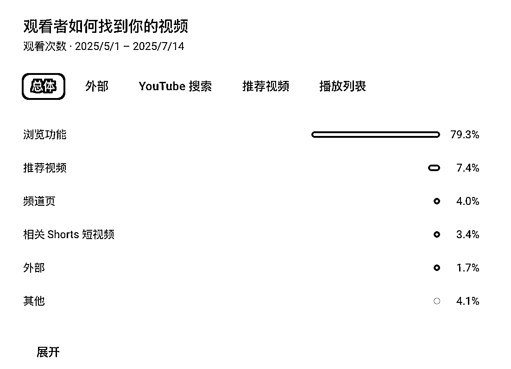

稳定，意味着不是偶尔冒出一支破千的视频，而是每部新发布的长视频，都能在赛道规定的推流窗口期内快速破千。要知道现在还属于0-1阶段，破千之后推流大概率就停了，哪怕各项数据看起来还可以，也就卡在五千以内上不去了。

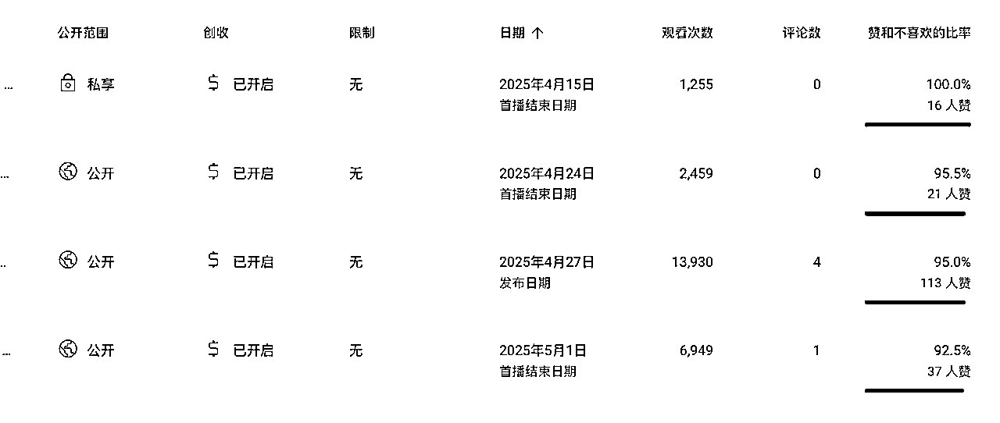

### 1.1.2　什么是1-10？怎么判断自己达标？

结论：自然推流的播放量稳定过万。

关键词没有变。区别在于，这个阶段可能会跑出十几万甚至几十万的爆款，但还没有出现百万级的内容。当然不同赛道之间有差异，但差距没有shorts那么大。

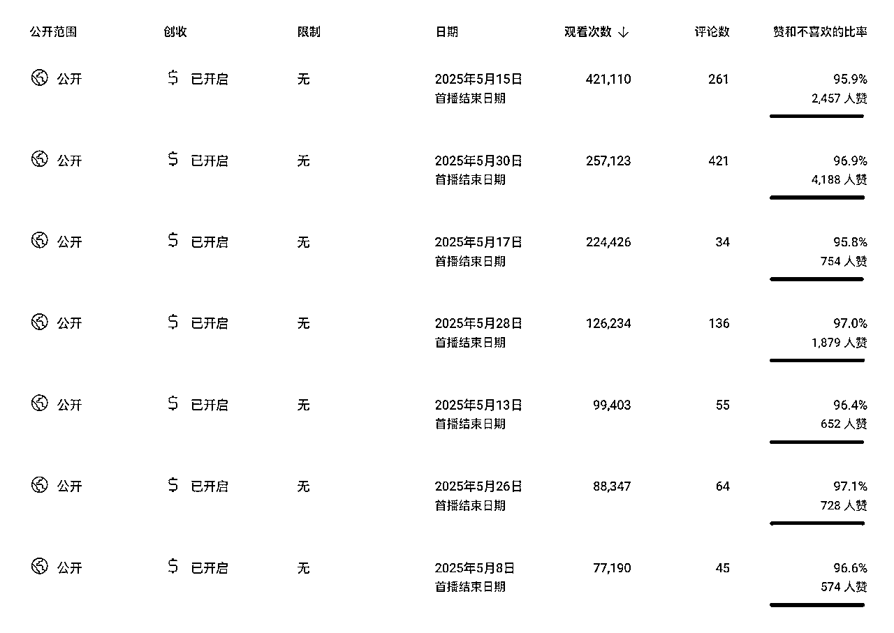

### 1.1.3　10-50、50-100又是怎样？

坦白讲，这是我还没抵达的远方。不过逻辑上可以推演：10-50阶段，应该手握多条百万爆款，新视频发布后大概率直接冲到十万以上。50-100阶段，应该已经是通过长视频运营出来的数十万到百万粉博主，带有明显IP属性，换创意、换内容形式都能稳得住，不能再单看播放量，而应该以粉丝规模和商业价值来丈量。

平台上大博主一抓一大把，头部效应显而易见。如果只看中长视频，抛开短视频的干扰，你可以从对标列表里再筛出一份新名单。现在就去做。

看到这里，我想问你：入行之前，想好要走多远了吗？

## 1.2　长视频能赚多少钱？

或许你的强项是短视频，爆款常出，长视频只是你行有余力时的额外动作。

或许你从一开始就瞄准了长视频，想求一个稳健的基本盘。

或许你正在做长短结合的双轨频道。

我属于第三种。下面是我5月和6月的长视频收入，基数不算大，但在稳步向好；6月比5月翻倍，主要原因是5月跑出了几条爆款，正好对应我上面提到的1-10阶段。

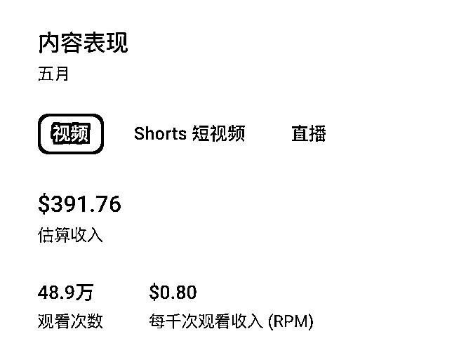

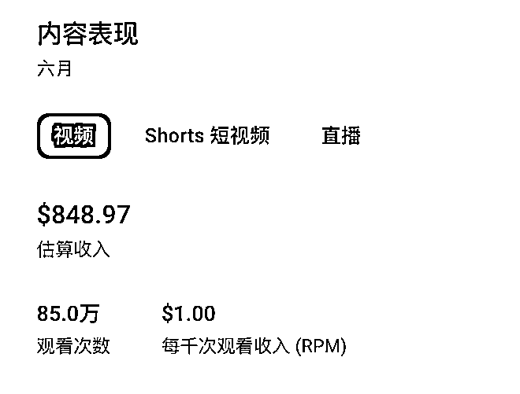

不管怎样，我们都要算一笔性价比的账，去量化金钱与精力的关系。为什么？因为时间是固定的，也是最公平的标尺。你完全可以用单位时间收入来衡量，然后优先选择那些投入小、产出大的内容规划。

准确地说，我算的不只是长视频的钱，而是整个频道的总账。

### 1.2.1　内容的收入对比

*   单价对比：长视频RPM ÷ 短视频RPM = 0.92 ÷ 0.06 = 15.33倍

*   假设一条内容想赚100美金：

*   长视频需要10万播放量

*   短视频需要166万互动播放量——注意这里说的是互动播放。如果按互动播放占总播放的1/3来估算，那就相当于要500万总播放量

*   那在长视频和短视频之间做选择时，真正的核心变量是什么？答案是难度。难度能不能判断？可以，但同样要放到时间维度上去衡量。

*   当下：做一条166万播放的短视频，跟做一条10万播放的长视频，哪个投入更大？哪个当下收益更多？

*   长期：持续产出多条166万短视频，跟持续产出多条10万长视频，哪个投入更大？哪边睡后收入更可观？

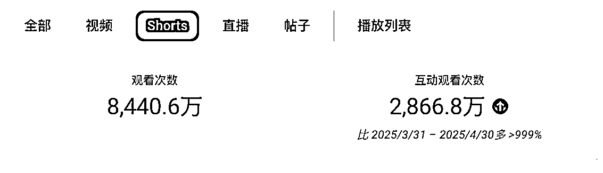

### 1.2.2　频道的收入规划

频道月收入 = 长视频月收入 + 短视频月收入
= 长视频总播放×RPM + 短视频总互动播放×RPM
= 长视频条数×平均播放×RPM + 短视频条数×平均互动播放×RPM

如果我们先定下一个合理的月收入目标，就可以反向推导需要产出多少条长短视频，以及它们的播放量需要达到什么水平。这里唯一的变量，就是所处赛道里长短视频的推流时长，也就是内容时效，最终比的还是时间跨度上的收益。

举例来说，如果目标月入千刀：

*   只做短视频：假设RPM为0.06、每月30条（每天1条），那每月需要约1667万互动播放，折算下来约5000万总播放，平均每条互动播放要达到55万，对应单条约165万的播放量。

*   只做长视频：假设RPM为1、每月12条（每周3条），那每月需要100万播放，平均每条8.3万。

*   如果长短结合，就按照上面的公式，结合自己的实际情况去估算，大概能算出个八九不离十。

### 1.2.3　时间维度上的收益怎么比？

细心的朋友可能已经发现，我前面提到要比较时间长度上的收益，而且长短视频的难度也和时间投入有关。但具体怎么衡量？

这是我播放量最高的四条长视频推流曲线，大家看出什么了吗？

*   第1条42万播放，发布至今61天，还在继续推流
*   第2条26万播放，发布至今46天，还在继续推流
*   第3条22万播放，发布至今59天，还在继续推流（注意：发布第21天和第33天经历了两次新的推流高峰，想知道为什么，去3.2.2看）
*   第4条13万播放，发布至今48天，还在继续推流

持续被推流的感觉是不是很棒？时间维度上的收益，你现在应该也有体感了吧。目前来看，只要做的是非时效性内容，长视频的推流周期理论上是没有上限的；而短视频这边大家都很熟悉了，推流期大概一周，基本不会超过一个月。

现在请回到自己的频道和赛道，你应该知道接下来怎么规划内容了。

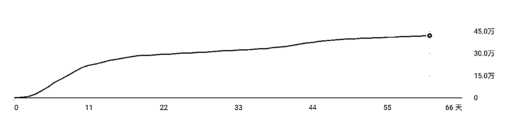

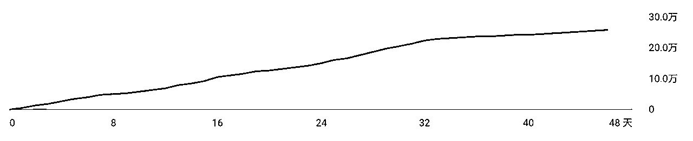

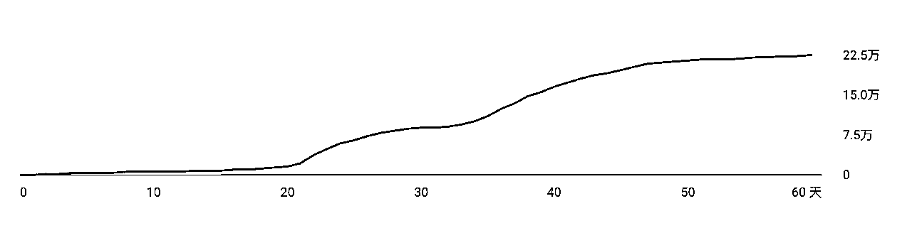

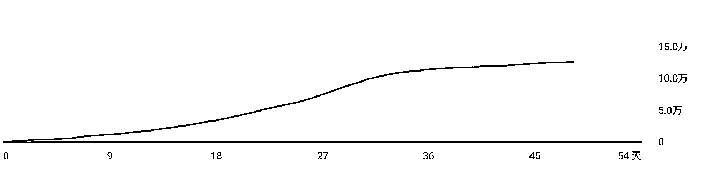

“道”的部分到此结束。希望长视频的目标和收入规划，已经在你们心里埋下一颗待办的种子。

# 第二章　长视频的法

## 2.1　赛道怎么选？

这一节想提醒大家，做长视频一开始就要有缜密的布局意识。长视频投入周期长、见效慢、试错成本高，等到你发现不知道做什么、赛道太窄、太卷、甚至快完了的时候，怎么办？

机会，永远留给有准备的人。

### 2.1.1　你适合什么赛道？

我问你10个问题：

*   你平时刷📕、抖音、快手、视频号，刷到的都是什么内容？打开你的订阅列表和点赞列表看看
*   抛开做视频赚钱这件事，你自己用来消遣的Youtube账号，订阅了谁？
*   你刷到的Youtube视频，哪一支会让你忍不住分享给朋友？
*   哪支Youtube视频让你一看就觉得牛逼，再一看觉得我也能做，再细看觉得自己能做得更好？
*   除了衣食住行这些日常开销，你在哪些爱好上长期投入了时间和金钱？把它们找出来
*   你想在Youtube上做出自己的个人风格吗？
*   你心里有感觉的赛道有哪些？这是个单选题还是问答题？
*   你准备坚持3个月、半年，还是更久？短、中、长期的规划分别是什么？
*   你以前做过什么工作？内容策划、带货、测评……走过的每条路都不会白走
*   最后借用一位大博主的简介来问：你是否想做自己想做的内容？

现在闭上眼睛扪心自问，答案是不是已经在你的《答案之书》里了？

### 2.1.2　你对赛道真的了解吗？

也许你心里已经有赛道了，但你真的摸透它了吗？拿名人搞笑来举例，这属于细分赛道。短视频如果达到大几千万播放基本就到顶了，几乎看不到上亿的；长视频的话，百万是天花板，几十万已经算很炸了。

但“名人搞笑”这个赛道真有这么小吗？我们把这两个词拆开来看：

*   名人

除了特朗普这类政治人物，体育圈的C罗、梅西是不是经常刷到？娱乐圈的小李子是不是也常刷到？科技圈的马斯克更是老熟人了。还有太多太多，可做的范围会小吗？

*   搞笑

搞笑，一个非常经典的娱乐赛道。想要打进海外文化圈，搞笑是一种桥梁，不然没法对那些梗会心一笑。生活已经够苦了，谁不想笑一笑？海量的搞笑内容都会成为你的灵感矿藏。而那些无语言的默剧式表达，更是拥有直抵人心的力量。

*   拓展方向

轻喜剧、语言类搞笑（比如宝宝播客、外国脱口秀）、MV式讽喻搞笑、名人搞笑电影、风格化戏仿……

说真的，可延展的方向太多了。现在拿起你的小本本，把赛道的每一种可能都画出来。我们最好不要打一枪换一个地方，先守住自己的村庄，你才有实力去包围城市。

### 2.1.3　万一……是不是该换赛道？

假如流量往下掉……

假如名人IP出了事……

假如这个赛道直接没了……

再要我想假如，我也想不出来了。

假如流量下滑，前面提到的那些拓展方向，是不是可以开始动手试了？假如名人IP翻车，保留名人的“刻板印象”，换成动漫形象再来演绎，大家一看就懂，是不是就绕开了问题？假如赛道没落，你现有的能力能不能迁移到新赛道，比如宝宝播客。

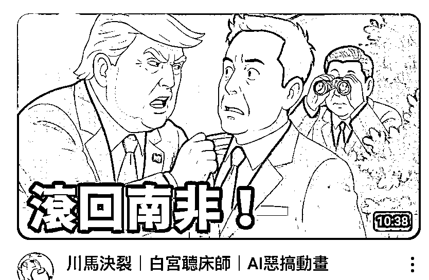

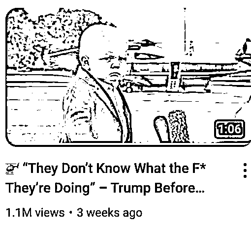

当然，我们不能保证每个问题都有完美解法，但兵来将挡、水来土掩。做长视频就注定会撞上无数复杂的麻烦，一遇到事就撤退，那还怎么往大博主进阶？所以我不建议你频繁切换赛道，你的第一直觉应该是正向迁移、向外延展。

## 2.2　有短视频频道，想转长视频怎么办？

### 2.2.1　短视频和长视频到底是什么关系？

你心里是不是早就盘旋过这些问题：

*   短视频有几条千万爆款甚至上亿，为什么我发长视频就没有流量？
*   短带长为什么带不起长视频的稳定流量？
*   短视频爆了到底对长视频有没有帮助？

我也是做名人搞笑内容的，但长视频观众和短视频观众完全是两拨人。没错，长短视频是分开推流的。等频道逐渐壮大后，它们唯一的重合点，就是发布时都会优先推给自己的频道粉丝，而粉丝的喜好甚至直接决定你的推流。所以粉丝才是根本，没有粉丝的时候，最该抓住的是目标观众，你的核心任务就是把这些目标观众转化成频道粉丝。

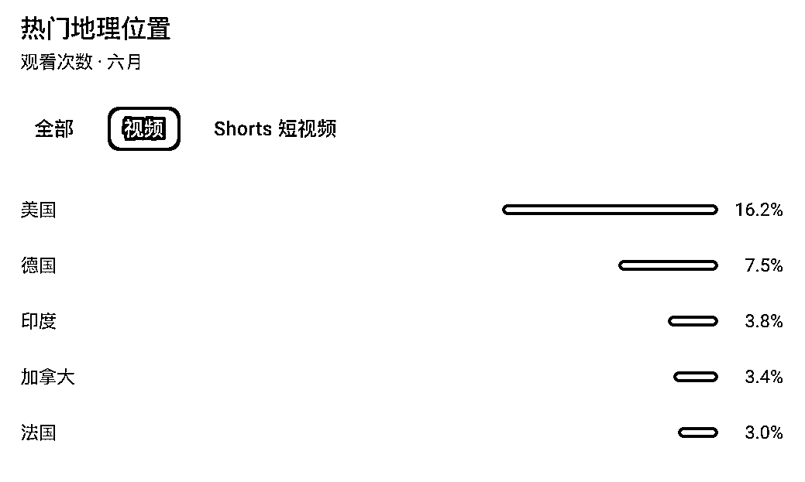

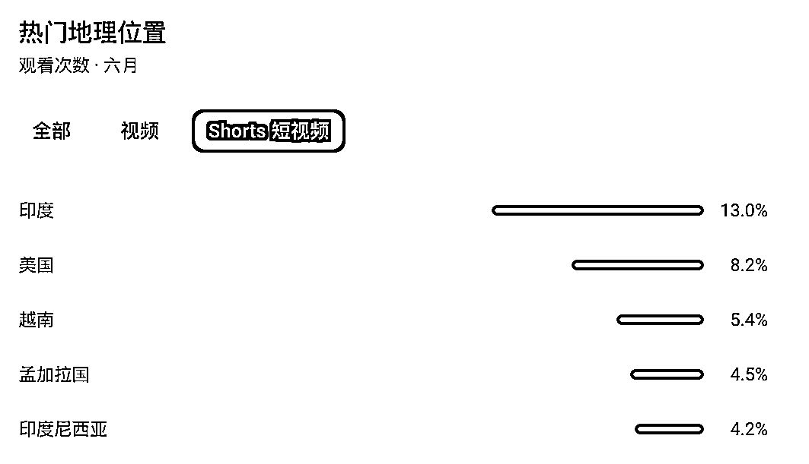

既然观众不一样，那长短视频的关系就很明确了。以这个为前提，我们可以做哪些事情？下面结合我的亲身实验来一个个说：

1.  把爆款短视频做成合集发长视频，可行吗？

答案：可行，而且建议你立刻去测，成本几乎为零。虽然长短视频的粉丝重合度不高，但只要内容能破圈，无论载体是什么，可能都有人看。下面这两条就是3分钟和8分钟的短视频合集版长视频。

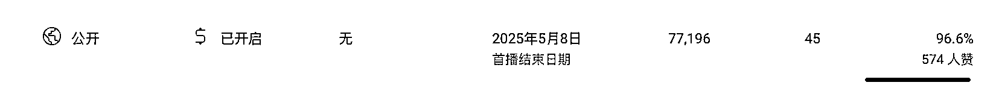

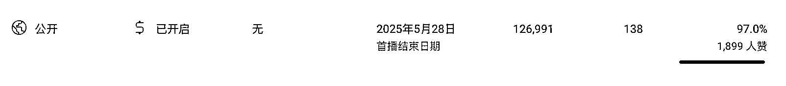

那条3分钟的合集，帮我完成了长视频观众的冷启动，你看它和前面展示的长视频粉丝画像是不是很接近？

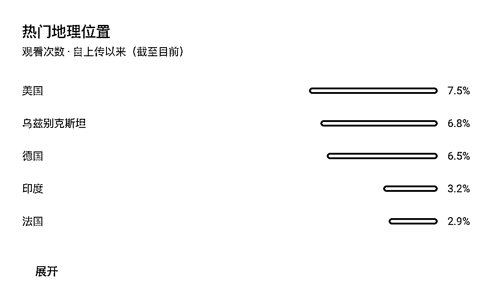

这个现象直接就回答了“短视频爆了到底对长视频有没有帮助”——肯定有，它不仅能拔高账号权重，还有机会帮你完成冷启。

2.  只靠拼凑爆款短视频，就算做长视频吗？

答案：不算。这种做法的意义，只是帮你去验证观众喜好，顺便评估这个赛道值不值得持续投入。它只是一个阶段性手段，而不是目标。真正要做长视频，还是得认真对待、长期执行。既然欧美观众已经被验证过喜欢这类内容，那是不是就可以直接做独立的长视频搞笑内容了？这正是我当时的想法。所以我没有继续做对标，而是跟我的大模型导师一起，朝着原创搞笑的方向开干。5月8日开跑，第三天（5月11日）做了一条印巴热点搞笑内容，顺利破千；之后保持两天一条的节奏输出，很快就迎来了爆款，基本每次发布都能预期破万。最近流量有点回落，一方面是我内容本身的问题，另一方面我发现之前短视频对标的大号，也开始做长视频了，并且直接复刻了我那条40万播放的内容。二十万粉的号都来抄我了，小号更不用说。看来又得卷起来做优化了，实惨。

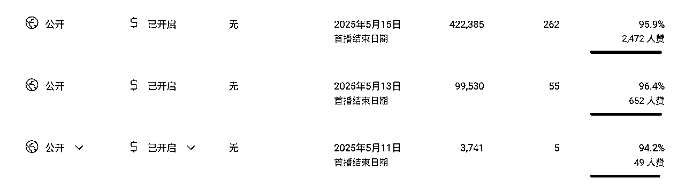

3.  长视频对内容质量和创意的要求更高

*   短视频有多条千万爆款甚至上亿，为什么我发长视频就没有流量？
*   短带长为什么带不起长视频的稳定流量？

这两个问题，其实上面已经回答了一半：因为观众不同。如果你做的是泛娱乐内容，那两块受众可能高度重合，值得多尝试几种玩法。如果尝试完还是起不来，那就很有可能是你的长视频质量在这个赛道里还不过关——到了这个节点，我们就不能再拿shorts的内容标准来衡量了。

### 2.2.2　用选择粉丝的思路来定位长视频赛道

我现在做的名人搞笑长视频，其实是在shorts积累了一波粉丝数据后，拉长时间做流量梯度观察，才总结出来的经验：

当时我做了一些百万爆款，发现这些内容的主力观众都在美国；而当视频突破千万播放后，印度观众迅速超越。这个时候我就开始琢磨：既然我想做高RPM的欧美粉丝（是不是真的高，做了才知道，事实证明也就1），而且我现在shorts做的东西恰好也是他们喜欢的，那么长视频如果做类似的内容，是不是也能把这些欧美目标观众留下来？有了这个判断，我很快就去试了，且很快就拿到了正反馈，就像前面说的那样。

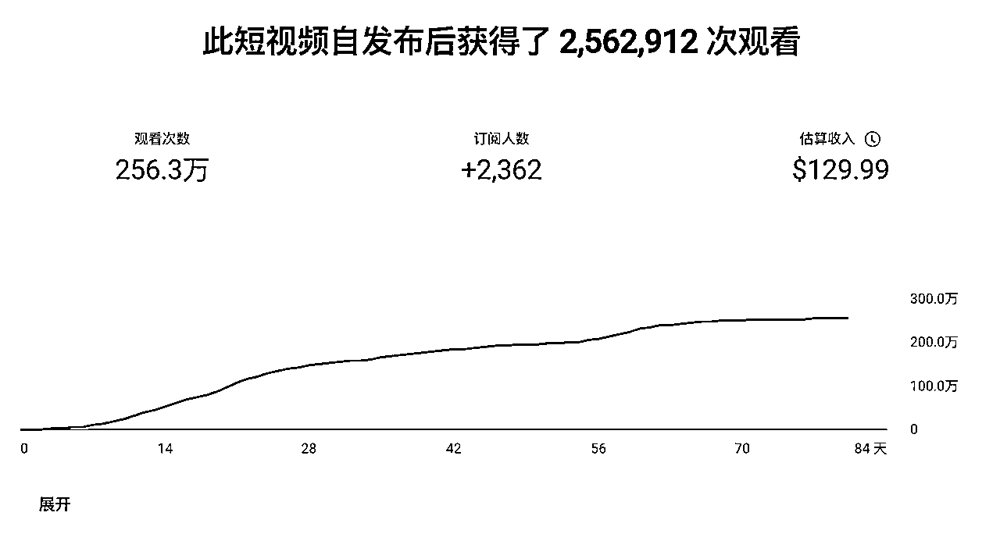

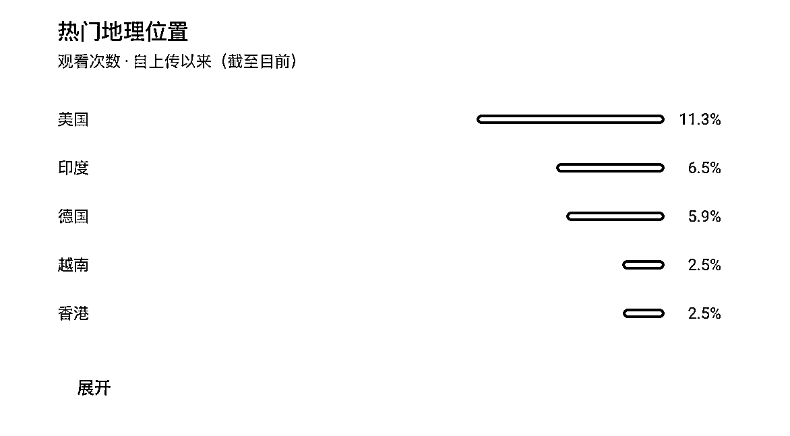

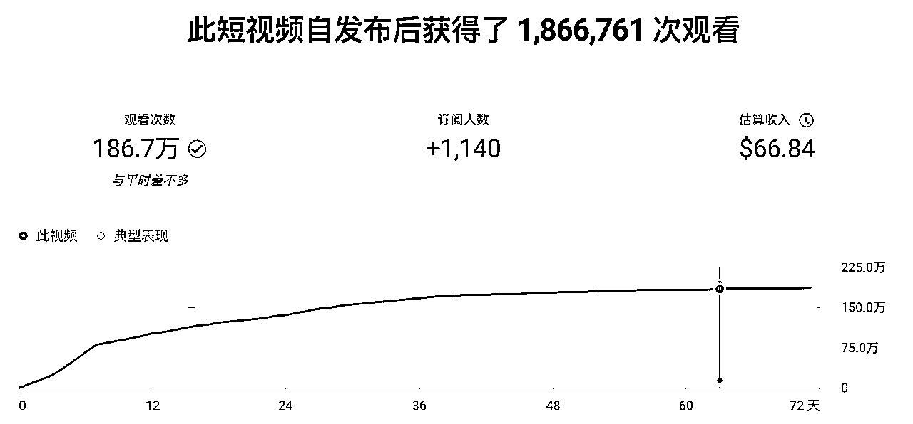

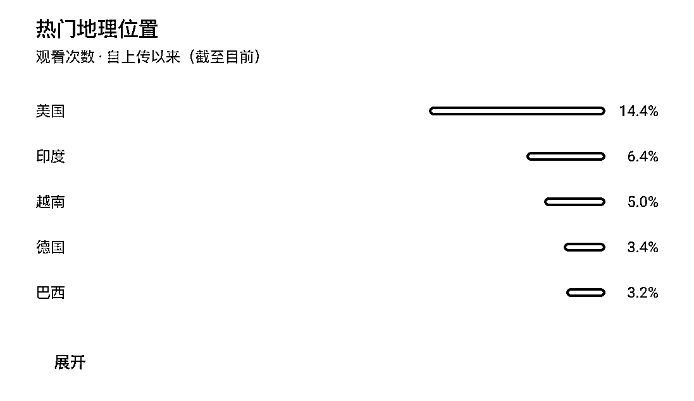

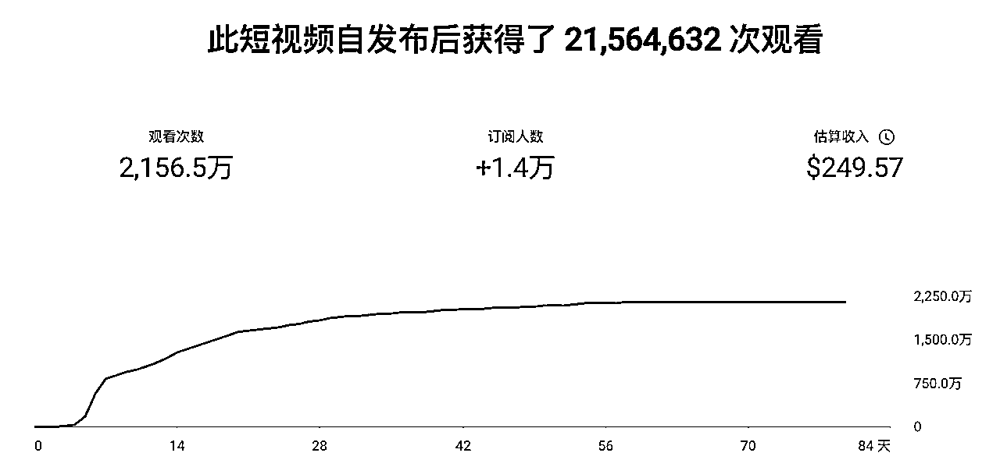

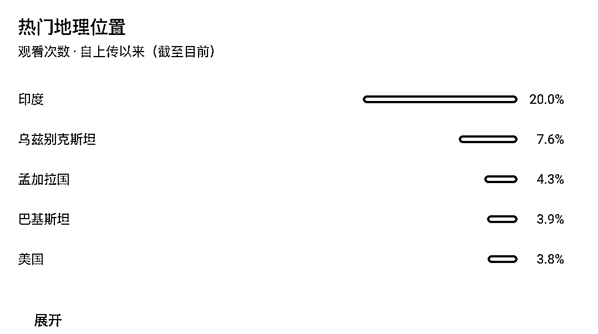

在这之前，我还试过下面几个长视频方向：

动物示警

天使宝宝

历史解说

GTA动起来、GTA转绘

这些失败经历反过来验证了一件事：

❌不是试图靠做爆款长视频内容来冷启动

✅而是依靠你要的目标观众来定义频道方向，长视频的粉丝是需要慢慢攒的

### 2.2.3　多久能达成小目标？

我现在这个频道，一万字的操作猛如虎，0到10只花了一个月。

但这一万字，加上前面那些乱七八糟的失败，加起来花了半年。

从现在开始，请做好半年的预期准备，把长视频的打法从头到尾走一遍，把精力放在自己擅长且愿意改变的地方，正面出击。

我们以前做绩效管理，表现差的都要提前半年做预期管理。你看，干什么事都得给足半年时间。

# 第三章　长视频的术

## 3.1　选题和明天，谁先来？

如果明天的选题还没定，那今晚就别睡了——你怎么睡得着？你必须让选题比明天先来报道。

### 3.1.1　选题和创意，不止来源于对标

#### 3.1.1.1　从X和Reddit找灵感

X上的内容也能直接变成创作素材。以特朗普的X为例子，我做过一条宝宝播客形式的长视频，这支也拿到了2000多播放，离冷启动是不是很近了？而且这还是一条彻头彻尾的原创脑洞内容。

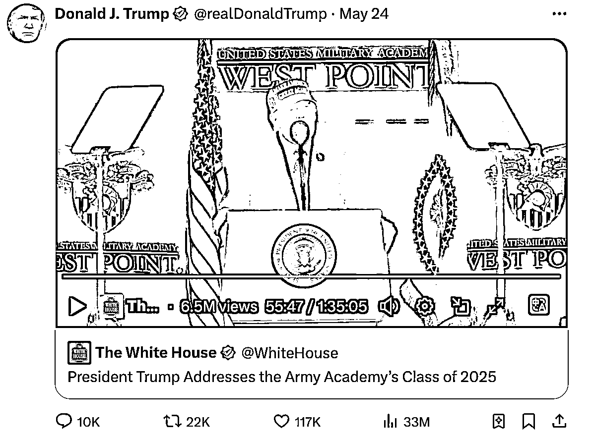

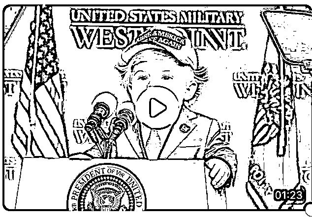

类似的，有一次我在Reddit刷到一条新闻，立刻决定拿它来做内容。那条本来是对标改编，但我在里面融入了自己的创意，随后发现评论区很多欧美观众都读懂了我的讽喻。

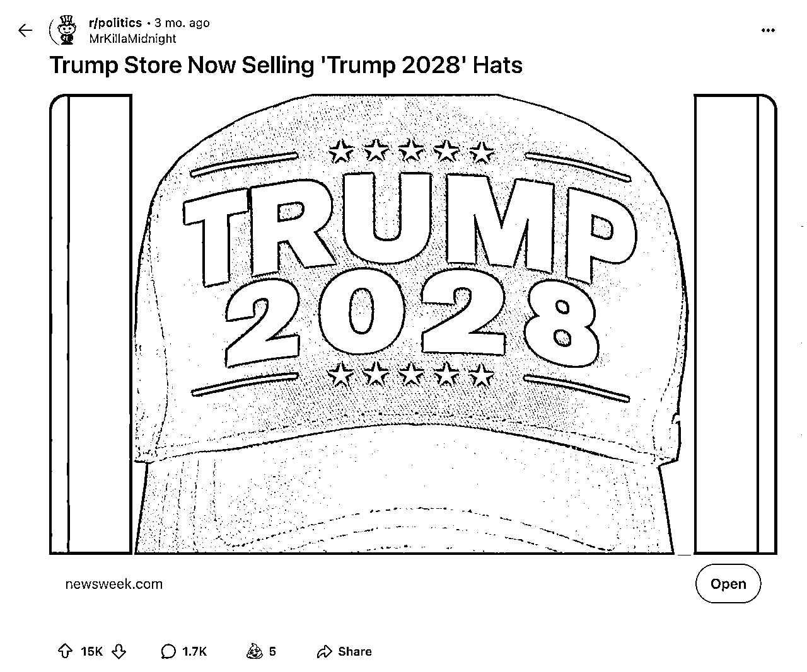

#### 3.1.1.2　从国内平台取素材

这是我刷到的📕话题。同样地，抖音、快手、视频号上也都有类似的内容。你可以关注赛道关键词去主动抓取信息。我之前也用过特朗普话题下的创意来做内容，这些都是送上门的子弹。

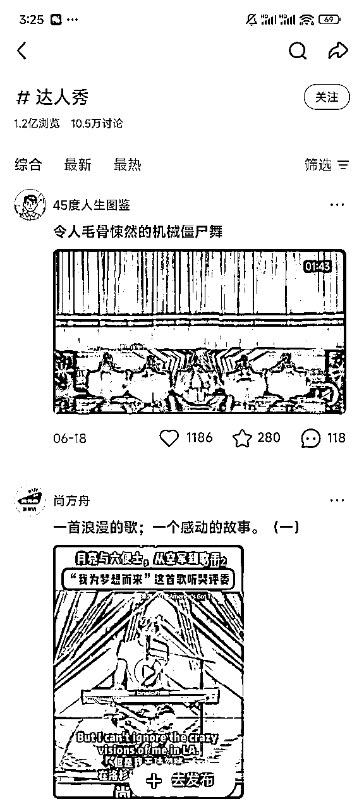

#### 3.1.1.3　让大模型当你的导师

我那条40万播放的长视频，就是跟大模型导师一起共创出来的。刚发布时流量并不算大，但当播放突破一万后，我就有种“这个可以做系列”的感觉。于是我把Gemini 2.5 Pro导师的创意温度调到2，在同一个对话窗口里前后又一起创作了5条以上的长视频，效果都相当不错。那一刻我好像找到了属于自己的路，也顺利让长视频突围进了1-10阶段。现在已经有越来越多的人在抄我了——朋友们，我也没赚到什么大钱，就已经被盯上了，哈哈。其实我想说的是，爆款就藏在你过去那些大大小小的AI资产里，尤其在你已经跑出过爆款的前提下，要学会挖掘，也要学会总结。

每天都要在耳边响起我的声音：你那条爆款视频，做到打满100万token了吗？回答我！

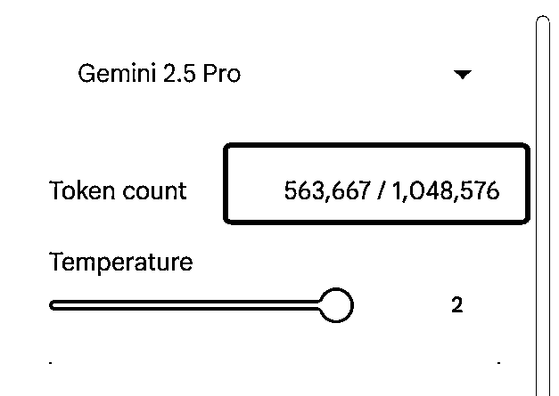

### 3.1.2 你真的读懂评论区了吗？

我曾经用 Cursor 做了一个评论采集工具。视频发布后，评论会自动整理成一份本地 CSV 文件。拿到这份数据后，就可以交给大模型导师，让它帮你进一步拆解观众反馈，寻找内容爆火的真正原因，并从中延伸出新的创作方向。

下面这份文件，记录的是一条播放量达到2600万的原创 Shorts 评论。

这条视频的灵感，其实来自我小区楼下的一架跷跷板。每天倒垃圾都会路过，偶尔也会上去玩一会儿。没想到，视频发布之后，跷跷板逐渐成了这个赛道里的一个固定梗，后来还出现了大量模仿作品。

现在我想把这条视频的评论交给你分析，帮我总结它为什么能够爆火，并进一步产出相关创意。请你先给出一个完整的分析框架。

Gemini 2.5 Pro Temperature 2

## 爆款视频拆解框架：从评论区还原病毒传播逻辑

### 一、结论先行

这条视频的核心公式，可以概括为：

**用孩童般的荒谬场景，包装现实世界中的高风险权力关系。**

视频把特朗普与金正恩这两位经常被视为对立面的政治人物，放进了一个极其日常、甚至有些幼稚的游戏场景——玩跷跷板；同时，故事发生在白宫这样的权力象征场所。

政治人物、儿童游戏、权力中心，这三种元素被放在同一个画面里，立刻制造出强烈的反差。观众无需字幕，也不需要了解复杂背景，仅凭画面就能理解其中的荒诞感。

与此同时，逼真的 AI 生成效果又让整个场景带上了“这到底是不是真的”的奇观色彩。于是，视频既好笑，又新鲜，还给人留下了关于权力关系的想象空间。

---

### 二、评论区的四层反馈

#### 维度一：把强权人物变成“幼稚的大人”

评论区最直接、最集中的情绪，就是笑。

😂、🤣、😅 等表情大量出现，说明观众首先被视频的肢体喜剧击中。原本高高在上的政治人物，被放进儿童游乐设施里，严肃身份与幼稚行为之间形成了极强的喜剧冲突。

一些评论直接把他们形容为“玩跷跷板的大宝宝”，也有人说：“他们明明已经八十岁了，却像孩子一样。”

视频中金正恩借助体重将特朗普弹起的瞬间，则是整个内容的动作高潮。类似“金正恩真聪明”这样的留言，本质上是在认可这个简单、直接、无需解释的肢体笑点。

这说明，观众喜欢的并不只是人物本身，而是看见权威人物被拉回普通人的状态：会玩闹，会失衡，也会因为一个简单动作而显得滑稽。

#### 维度二：视觉符号天然具备全球传播能力

这条视频几乎没有语言门槛。

跷跷板、冰淇淋、两位政治人物的脸，以及“一个被弹起、一个稳稳坐着”的画面关系，都是全球观众能够迅速理解的视觉信息。

评论区出现了英语、越南语、中文、俄语、法语、印尼语、泰语等多种语言，内容虽然各不相同，但表达的情绪高度一致：好笑、精彩、神奇、想继续看。

这类视频不依赖对白，也不需要复杂字幕。只要观众看懂“玩耍、对抗、失衡”这几个动作，就能理解笑点。视觉语言越简单，跨文化传播的阻力就越小。

#### 维度三：观众也在围观 AI 技术

评论区里，大家讨论的并不只是剧情，还包括视频是怎么做出来的。

有人夸 AI 效果惊人，有人询问制作方法，也有人不相信这不是 Photoshop。正是这种“看起来像真的，但又明显不太可能发生”的状态，进一步激发了评论、转发和讨论。

换句话说，视频同时满足了两种观看需求：

- 内容层面：人物行为荒诞，产生笑点；
- 技术层面：画面逼真，带来惊叹。

当观众既想笑，又想研究“这是怎么生成的”，内容就拥有了额外的互动动力。

#### 维度四：荒诞表面之下的政治隐喻

跷跷板不仅是一个游戏道具，也很适合用来表达权力关系。

一方升高、一方下沉，天然对应着力量变化、谈判博弈与地缘关系。特朗普被悬在空中，金正恩一边吃冰淇淋一边占据优势，随后特朗普被弹飞，这些画面都可以被观众解读成某种政治漫画。

有评论认为，普通人并不愿意被卷入领导人制造的冲突；也有人感叹，如果这些人物真的像孩子一样玩耍，而不是想着使用核武器，世界或许会更好。

白宫草坪的选择同样关键。荒诞事件并非发生在一个普通游乐场，而是被放置在现实政治权力的核心场景中。越是庄严的背景，越能放大前景中的幼稚与讽刺。

---

### 三、为什么它能快速传播？

综合评论反馈，这条视频的爆发主要来自五个方面：

1. **反差足够强**  
   强势政治人物与儿童游戏相遇，天然具备喜剧张力。

2. **观看门槛很低**  
   画面本身就能完成叙事，不依赖语言和文化背景。

3. **隐喻空间很大**  
   跷跷板可以被看作权力平衡、政治对抗和国际博弈的象征。

4. **技术效果具有吸引力**  
   AI 生成的逼真画面，让观众产生惊奇、质疑和探索欲。

5. **符合 Shorts 的传播节奏**  
   视频简短，动作明确，冲突集中，并且拥有一个容易被记住的视觉爆点。

---

### 四、可以继续复制的创意公式

已经验证过的结构，可以抽象为：

**知名人物 + 极其日常的荒诞活动 + 具有象征意义的地点**

接下来不需要照搬跷跷板，而是保留结构，替换其中的变量。

#### 创意一：沙滩上的“和平峰会”

- **人物**：拜登与普京  
- **活动**：在海滩上认真堆沙堡，并不断比较谁的作品更复杂  
- **地点**：阳光海滩，代表暂时脱离现实冲突的中立空间  
- **反转**：两人表面合作，实际上偷偷破坏对方的城堡。普京堆出一座克里姆林宫式堡垒，拜登则完成一组白宫建筑。最后，其中一人不小心把对方的作品踢塌，两人陷入一场极其严肃、又极其幼稚的对视。

#### 创意二：斗兽场外的三轮车竞速

- **人物**：马斯克与扎克伯格  
- **活动**：骑成人尺寸的儿童三轮车比赛  
- **地点**：罗马斗兽场外围  
- **反转**：马斯克偷偷给车辆安装微型火箭推进器；扎克伯格则拿着平板电脑，现场修改比赛规则。最终两人几乎同时抵达终点，却因为冠军归属争执不休。

#### 创意三：山顶上的终极棋局

- **人物**：习近平与莫迪  
- **活动**：进行一场融合围棋与大富翁规则的复杂桌游  
- **地点**：安静的山顶茶馆  
- **反转**：双方长时间僵持不动。镜头逐渐拉远，观众才发现棋盘其实是一张边境地区的微缩地图。两人一边喝茶，一边长久凝视棋局，把战略对峙拍成一场异常安静的喜剧。

#### 创意四：共同组装宜家书柜

- **人物**：G7 国家领导人  
- **活动**：合作安装一件结构复杂的宜家家具  
- **地点**：空旷房间，象征共同建设新的世界秩序  
- **反转**：每个人都拿着本国语言的说明书，却没有人真正理解整体结构。现场不断争吵，最后多出一颗没人知道用途的螺丝。家具虽然完成，却歪歪扭扭，完全无法使用。

如果你看到这里，应该已经能感受到：评论分析并不是单纯地统计“大家觉得好不好笑”，而是从观众的语言、情绪和解读中，重新发现内容的传播机制。

即使暂时没有马上做出下一条视频，这个过程也会帮助你建立内容体感，更清楚粉丝真正关心什么。

一份评论数据，同时可以用于：

- 总结爆款原因；
- 训练自己的内容判断力；
- 延展下一批创意。

这不就是一鱼三吃吗？回答我！

---

## 3.2 长视频如何做推广？

“如果还有明天，你想怎样装扮你的脸……”

### 3.2.1 一个容易被忽略的流量入口：首页帖子

你有没有留意过，YouTube 首页除了推荐视频，还专门留出了帖子展示区域？

有些帖子能获得数千点赞。结合后续数据来看，它们的展示量很可能已经超过百万。既然平台愿意提供这样的曝光入口，我们为什么不认真经营？

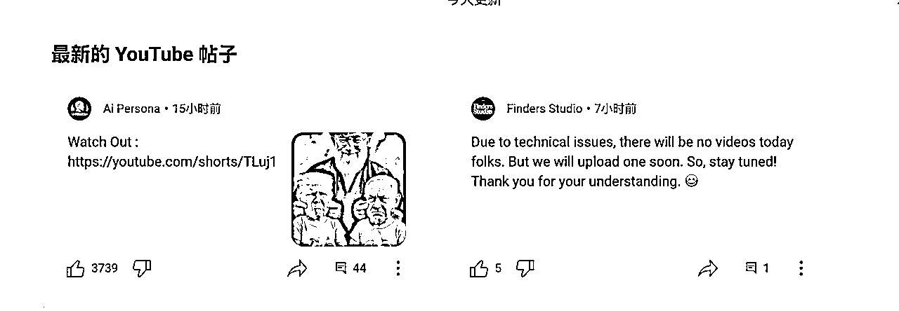

经过一段时间测试，我发现表现更好的形式往往不是直接发布视频，而是采用图片帖子。

假设你想推广刚刚上线的视频，可以采用：

**吸引人的文案 + 视频链接 + 一张冲击力最强的图片**

而不是直接把视频以视频帖的形式挂上去。很多时候，一张足够抓眼球的图片，反而更容易让用户停留、点击，也能顺带带来新的关注。

我一共发布了25条帖子，累计获得约110万次展示，收获3000多个赞，并新增365位粉丝。

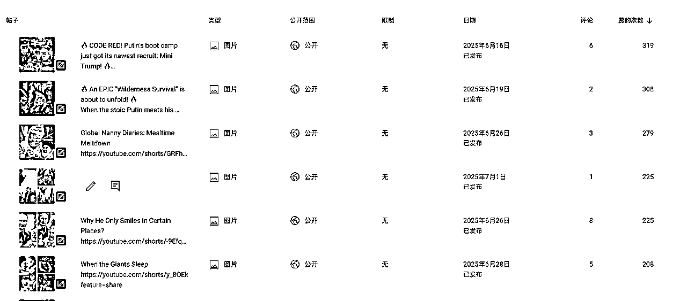

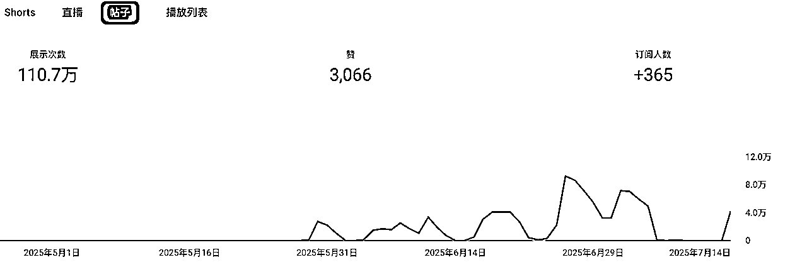

### 3.2.2 YouTube 首页的隐藏入口：官方合集

如果你用电脑打开 YouTube 首页持续浏览，可能会在页面上方或中间看到一个专门为你整理的推荐合集。

点进去之后，里面往往会聚集一批主题相近的视频。其他用户的首页也会出现类似内容，这说明 YouTube 正在根据用户兴趣，自动建立分类推荐。

这对创作者来说是一个很有价值的观察窗口。

你可以研究自己所在赛道的官方推荐合集，看看哪些视频被平台收录、哪些选题被放在一起、哪些内容结构反复出现。能够进入官方合集的作品，往往都值得作为创意和方向的参考。

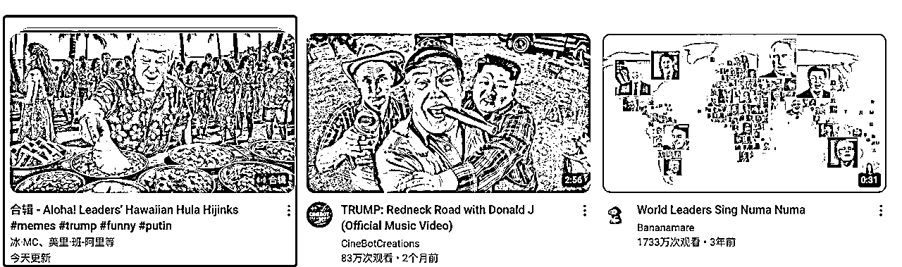

被平台编入合集之后，确实会让人感受到一种特别的成就感。

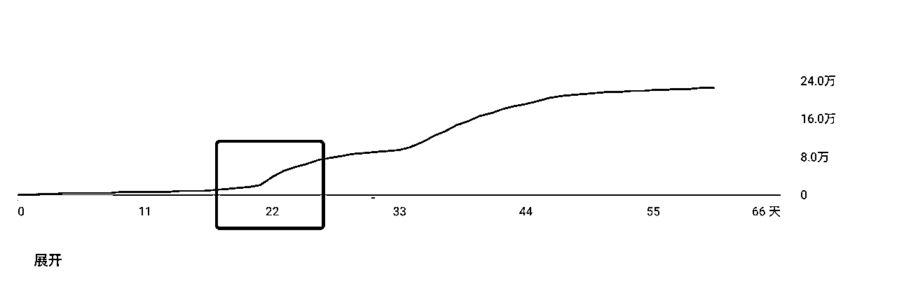

### 3.2.3 你的播放列表建立了吗？

很多人只关注单条视频，却忽略了播放列表。

当你搜索一个关键词时，结果页面里出现的不仅有视频，也会有播放列表。而且确实存在一批用户，习惯通过播放列表连续观看内容。

比如我在研究早期历史解说赛道时，就经常直接打开播放列表。历史内容本身具备连续性和体系性，如果不建立播放列表，整个频道看起来就很难形成完整结构。

如果频道里出现大爆款，播放列表的数据表现可能会更加明显，老高就是一个典型参考。

我想强调的是，这些工作看起来不刺激，也不一定会立刻带来结果，却都是频道运营中不可缺少的基础建设。

追逐短视频爆款时，很多人只盯着下一条能不能爆，却忽略了长期内容体系。而长视频和频道经营，往往会在未来某一天，让你庆幸自己当初把这些基础工作做好了。

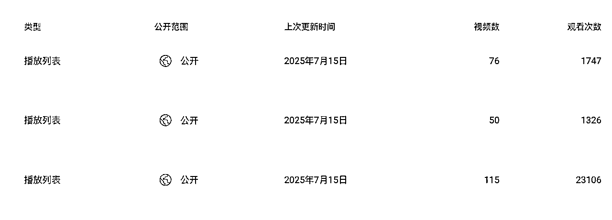

# 4 长视频的工具

## 4.1 GPT-O3：依然是那个强力选手

### 4.1.1 从频道监测到创意收集，一次完成

你平时如何追踪对标频道和视频？

Reddit 上的创意素材怎么收集？

X 平台上的内容又该怎样持续观察？

打开 GPT-O3，把它作为一个 Agent 使用，这些原本琐碎、重复的工作都可以交给它完成。

你不需要一开始就用一句话把所有要求讲得完美。更有效的方式，是和它进行多轮交流，逐步明确你的目标、字段、筛选条件和输出格式。

可以先讨论整体结构，再让它生成一个样本预览，确认样本符合预期后，再让它正式运行。比如：

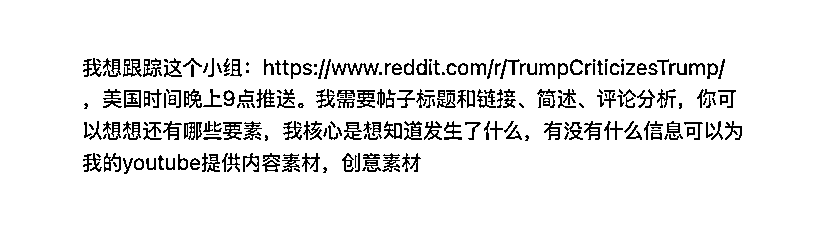

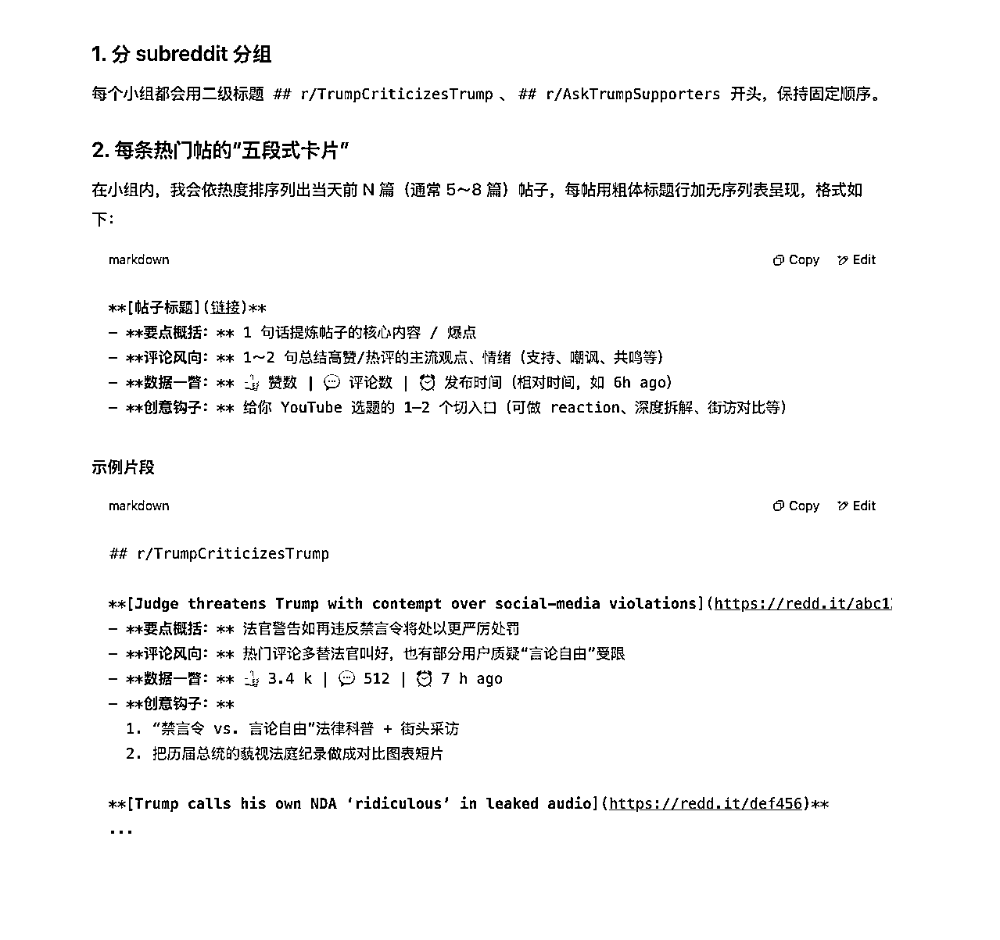

设置完成后，你可以收到 GPT 的推送，也可以同步接收邮件提醒。

至于还能延伸出哪些玩法，就留给大家继续挖掘了。

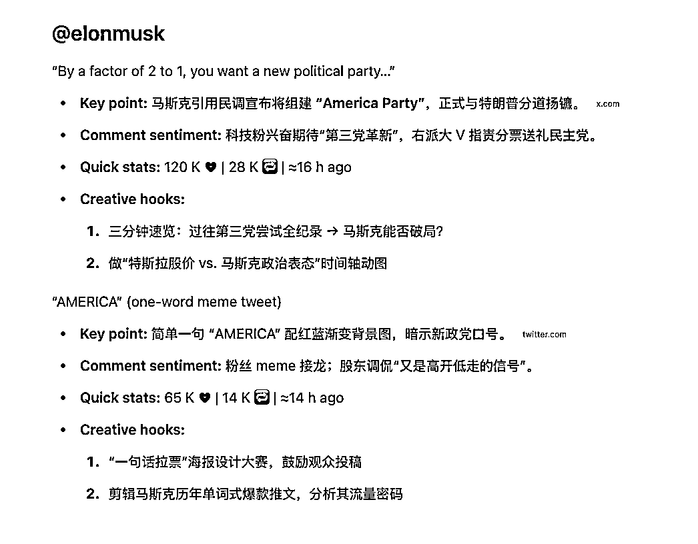

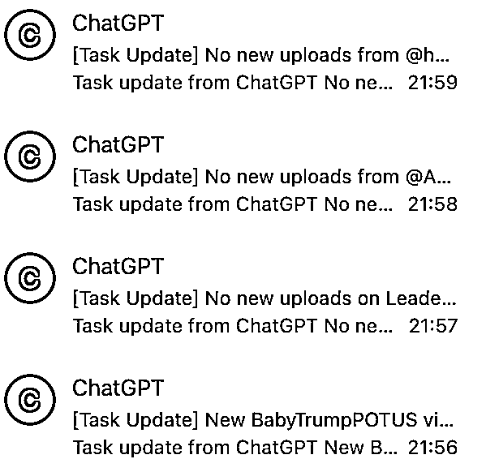

### 4.1.2 批量生成图片，真的用过吗？

很多人都有用 GPT 生图的需求，但也经常吐槽它的速度：确实不算快。

不过，如果你本来就在同时处理多项任务，那么等待时间就没有那么难以接受。更关键的是，GPT 支持批量生成图片，这一点非常适合内容生产。

我第一次发现这个功能时，兴奋到直接发了一条赚钱朋友圈。

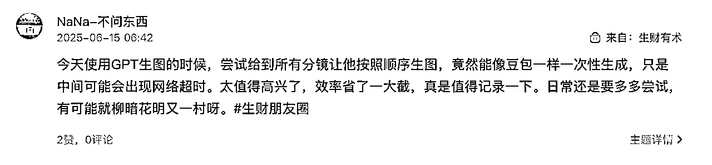

打开 O3 后，只要把任务交代清楚，就可以暂时去处理其他事情。当然也不能完全不管，中途仍然要回来确认，因为它可能会要求你做选择，也可能遇到网络超时。

可以这样下达任务：

**请根据下面的文生图指令词，按照顺序，依次生成指定尺寸比例的图片。**

指令词：xxxx

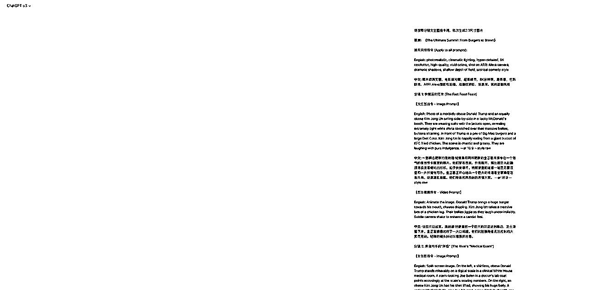

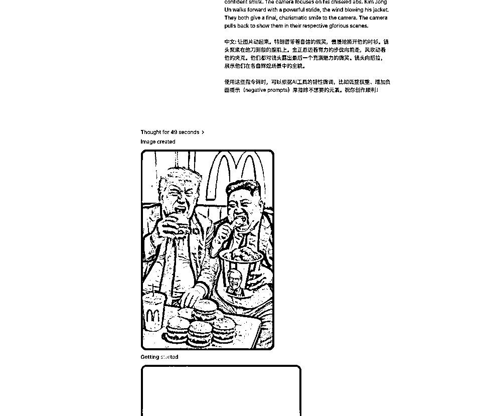

## 4.2 内容体感：大模型应该是教练，而不是打杂助手

先说几句可能有点“煽动性”的话：

如果你把大模型只当助手，它最多帮你提高执行速度。问题在于，你自己仍然是整个系统的上限。一个人怎么可能比得上读过海量资料、能够快速比较无数方案的大模型？

但如果你把它放在导师的位置上，情况就不同了。

你不再只是执行者，而是负责判断方向的决策者。模型负责提供分析、方案和反馈，你负责选择、修正和拍板。随着决策能力不断提升，最终得到的不只是效率，还有真正能传播的内容。

更何况，你还可以让 GPT-O3 和 Gemini Pro 组成“双导师”。再加上你自己，三个人一起讨论，岂不是也有“三人行，必有我师”的意思？

那么，导师真正应该做什么？

是替你翻译？

是不断生成通用提示词？

是帮你修改图片？

还是把所有事情都做完，最后生成一堆自己都看不下去的图片和视频？

如果只是这些，那就有点大材小用了。

### 导师应该承担的任务

#### 1. 让不同模型互相打磨脚本

可以让 GPT-O3 和 Gemini 分别评价、修改彼此的脚本，反复迭代到双方都认可，同时也符合你的判断。

内容脚本始终是最重要的环节。这个过程培养的，不只是模型使用能力，更是你的内容体感。

很多人觉得自己无论换什么提示词，都无法得到满意结果，原因往往不是模型不够强，而是输入方式过于机械：复制别人的提示词，却没有真正理解这个模型需要什么样的信息。

#### 2. 对每一次输出都给予反馈

文生图完成后，如果画面存在问题，不要直接放弃，也不要盲目重做。

把结果交还给导师，让它指出人物、构图、动作、背景或风格上具体不足的地方，然后你们再继续讨论。

导师不仅能帮助改提示词，也可以协助你挑选图片、比较视频版本、分析音乐差异，最终帮你完成多方案决策。

---

## 4.3 模型体感：真正重要的是修改指令的能力

即使经过多轮沟通，大模型也很难第一次就写出让你和生图模型都满意的指令词。

这不是例外，而是日常状态。

所以，真正需要训练的，是你最后一步的判断和修改能力。如果语言表达不够顺畅，也可以借助翻译工具，把不符合要求的词删掉，再把遗漏的细节补回去。

比如，有时图片无法生成，问题并不明显。你可能会选择把结果重新交给大模型，让它继续修改。但有些只是几个形容词触发了限制，反复修改反而会把原本清晰的画面结构打乱。

这类小问题，完全可以自己处理。

当你足够熟悉自己的赛道，很多调整几乎一眼就能完成。比如删掉“强烈”“敌对”“对峙”等带有冲突意味的表达，画面可能立刻就能顺利生成。

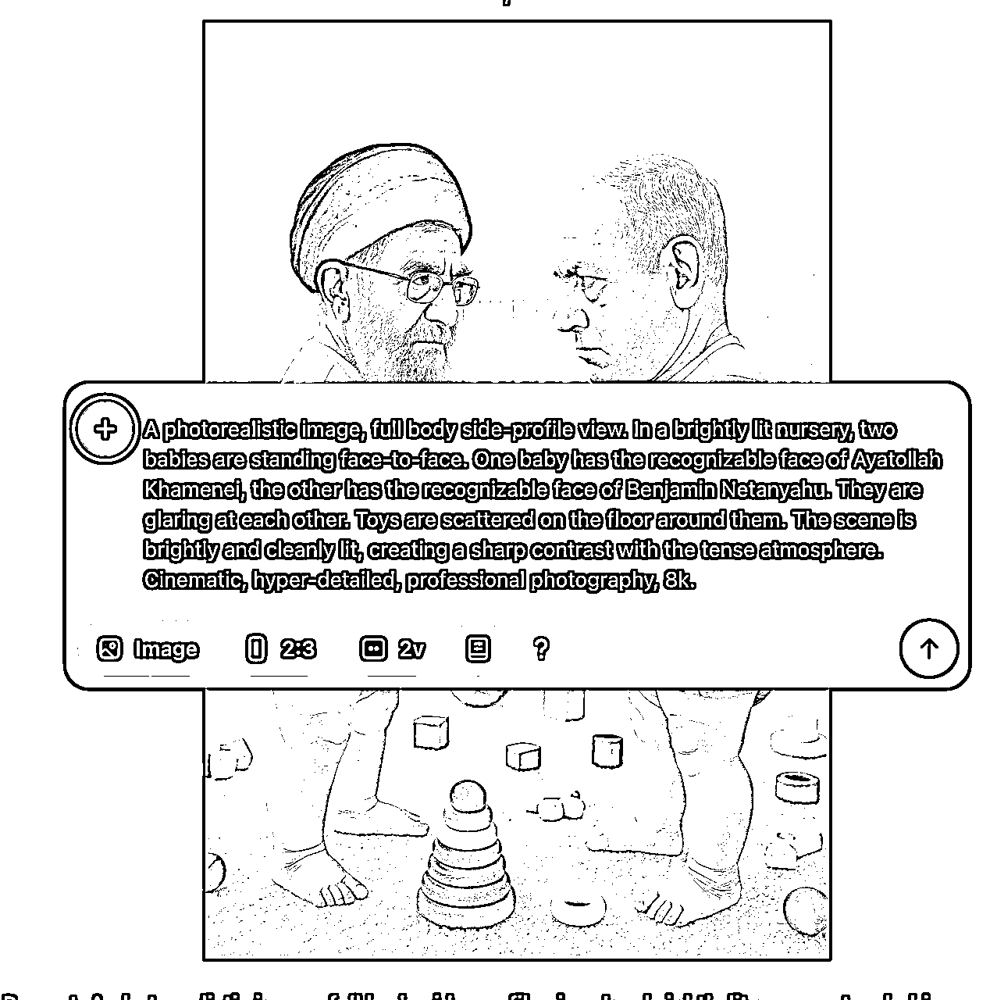

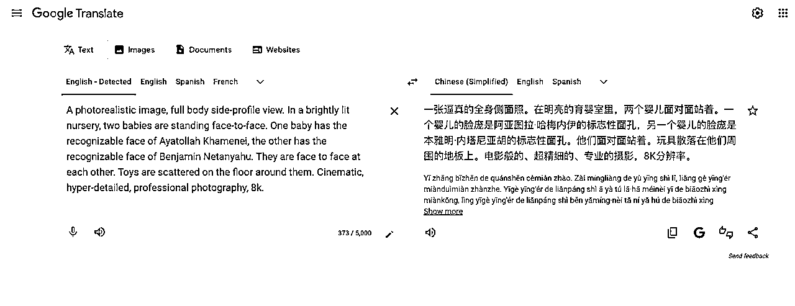

## 4.4 选择通用模板，还是建立自己的独特方法？

这里我想反过来问一个问题：

真的存在一套放之四海而皆准的通用指令词吗？

结合前面关于“模型体感”的讨论，相信答案已经很清楚了。

如果一套提示词真的可以适用于所有内容、稳定解决所有问题，并且还能持续帮助人赚到钱，那么我们现在应该做的，恐怕不是继续研究，而是直接去购买它。

通用引导语当然可以保留，但它们更适合作为工作流程中的基础工具，而不是一套能解决一切问题的万能钥匙。

例如：

- 请先逐帧分析画面，并总结它能够爆火的原因。
- 我有一个新的想法，我想要实现的是：xxxx。
- 请分别提供文生图和图生视频的中英文指令词。请重点设计人物的服装、造型与表情，以及环境中的关键元素。
- 请始终按照完整结构描述文生图指令：主体人物的穿着、外形、表情；正在进行的动作；是否手持物品；所在地点与背景细节；画面构图；镜头语言。为了保证人物和场景在不同画面中的一致性，每一帧都必须遵循这一结构。
- 图生视频时，图片已经呈现出的信息无需重复，重点描述动作变化和镜头运动。
- 我们来设计一组适合这个内容的配乐，请提供 Suno 中英文指令词。
- 镜头始终让两个人位于画面中心，并用手持摄影方式跟随他们移动。

我不会把所有过程都展开。实际创作时，就是利用这些基础引导语，再和导师进行持续沟通，逐步完成内容脚本与画面设计。

而且，每个赛道里都可能存在一些只有长期实践者才知道的“特殊词汇”。它们通常来自经验积累，而不是通用教程。

比如我发现，想让特朗普变成光头，最有效的表达是：

**A newly bald**

其他类似“光头”的说法，可能效果都不稳定；即便拿光头图片去 Remix，也未必能达到预期。

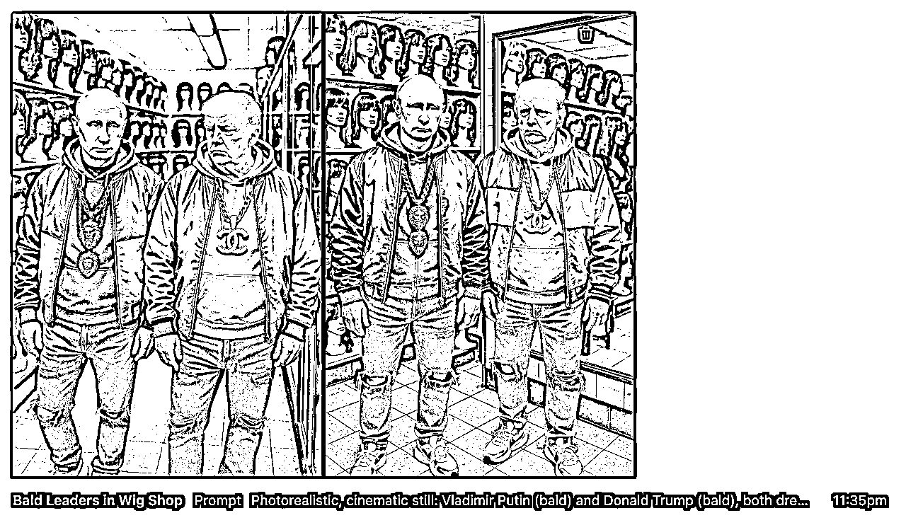

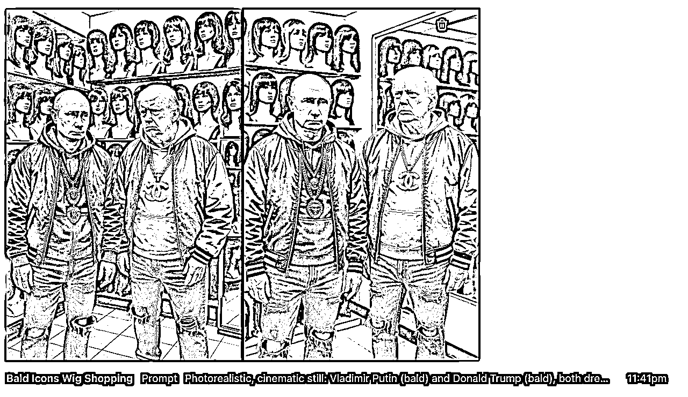

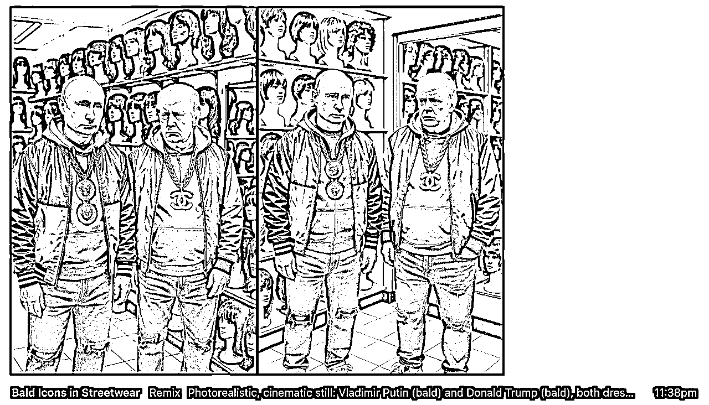

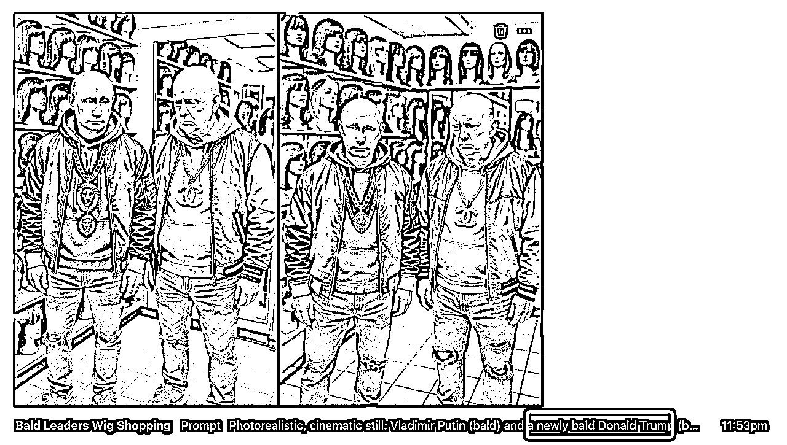

你在自己的赛道里，应该也会逐渐积累出类似的关键词。

这些只有你掌握、别人不容易复制的细节，最终会变成真正的内容壁垒。

所以，与其迷信万能提示词，不如不断积累属于自己的特殊经验。

放下“通用答案”，拥抱“独特方法”。

---

# 5 与君共勉

不知不觉，已经写了上万字。

最后，还是想和大家分享一点我一直很喜欢的内容。

我特别喜欢法国作家安德烈·纪德，《窄门》也是我非常喜欢的一本书。很多人都听过那句话：

**走宽门的人越来越多，路反而越来越窄；走窄门的人虽然少，路却会越走越宽。**

但真正长期激励我的，是书中另一段话。原文写的是“爱情”，但作为读者，我们完全可以把它理解成对理想、事业，或者更好的自己的追寻：

“我常常感到爱情是我身上最美好的东西，我的一切美德都由此而来。是爱情使我超过我自己。要是没有你，我会重新落到我那平庸天性的可怜的水平上。正由于我抱着与你相见的希望，我才永远认为最崎岖的路是最好的路。”

对我来说，它可以被改写成这样：

**正因为一直期待遇见更好的自己，所以我始终愿意相信，最崎岖的路，也许才是最值得走的路。**

如果你也愿意走一条人少一些、难一些，但可能越走越宽的路，欢迎关注我的📕：窄门的世界。

哈哈，铺垫了这么久，最后还是放了个广告。确实有点气人。

好了，我们下次见。