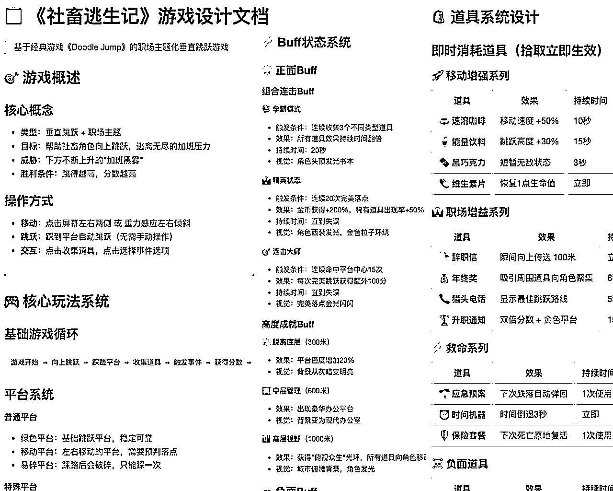
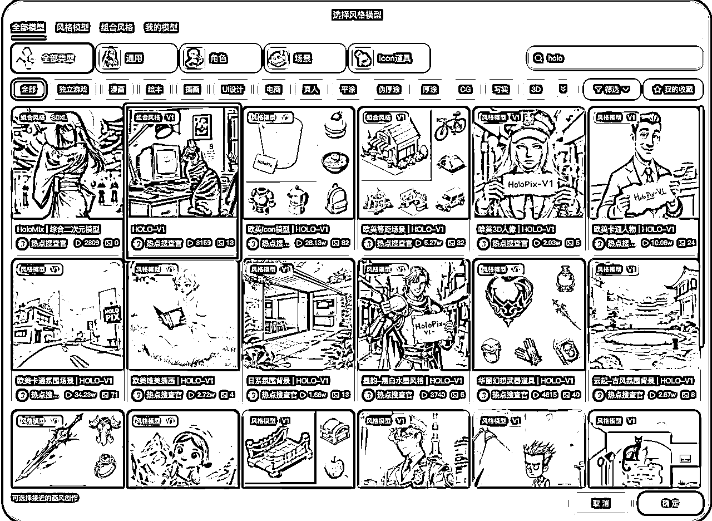
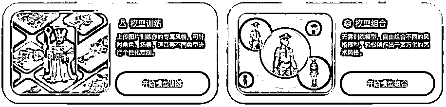
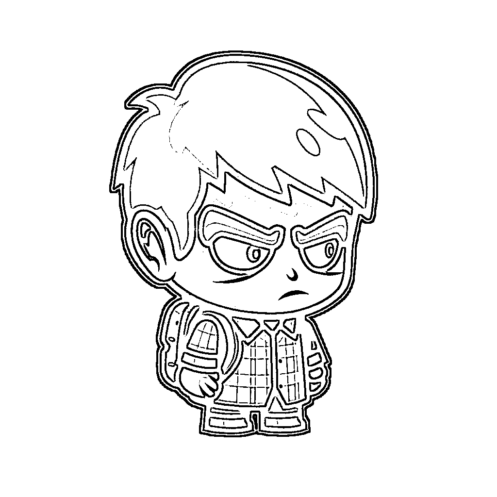
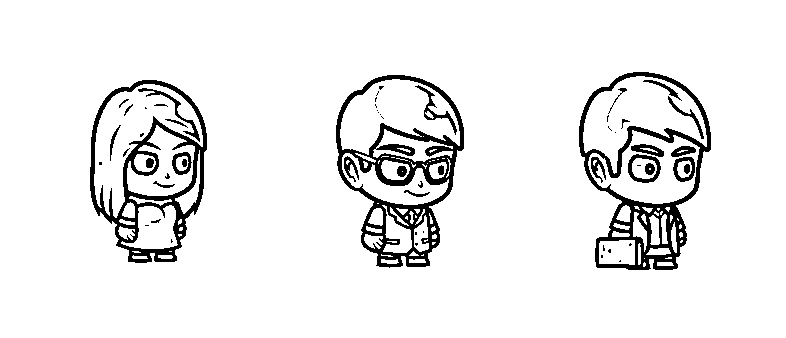
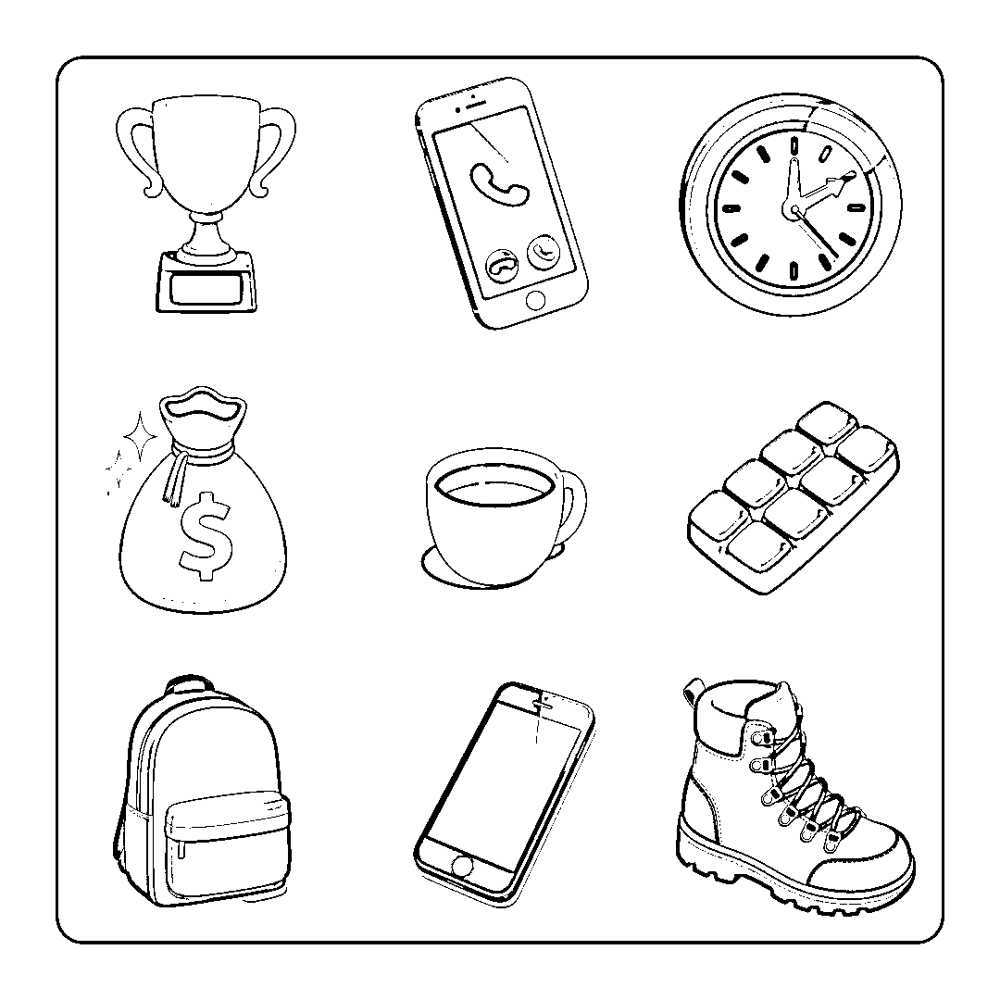
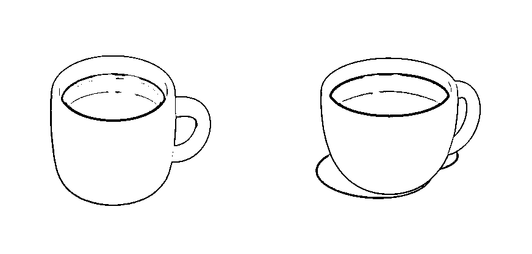
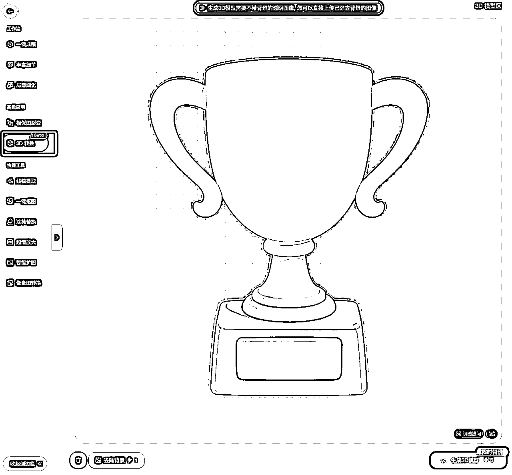
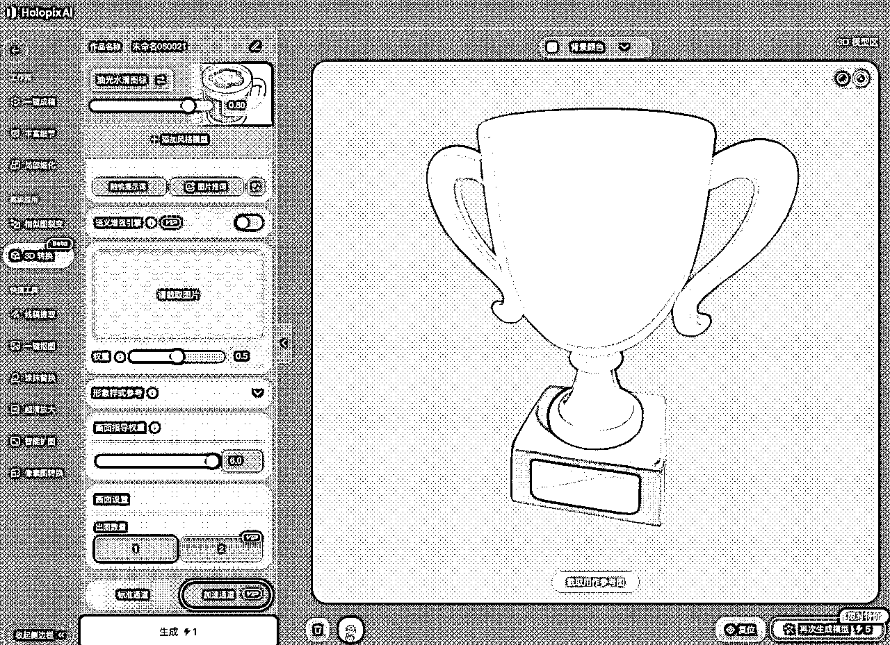
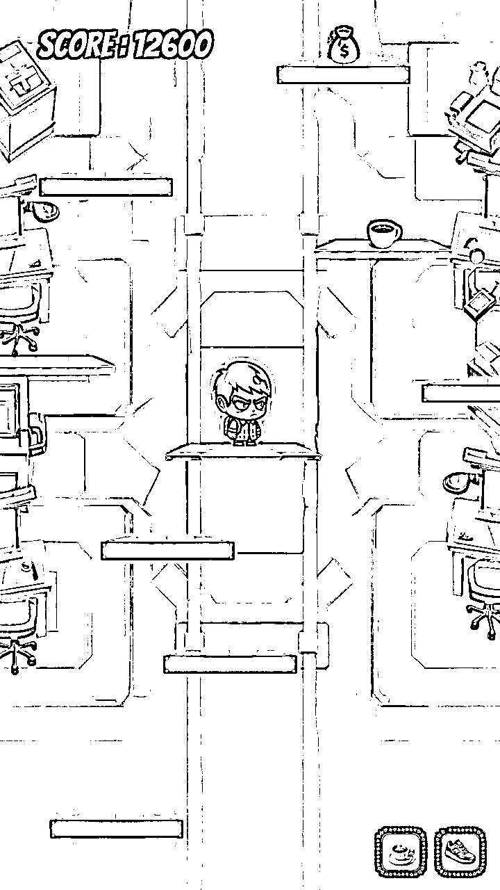

# 我把打工人的怨气做成了一款游戏

把“社畜怨气”一键变成游戏？我一个程序员做到了

又是凌晨三点，我盯着硬盘里那份名为《社畜逃生记》的策划文档，久久没有合眼。

我有不错的游戏创意，也有扎实的编程底子，甚至连配乐都能自己搞定。可偏偏就是美术资源，让这个游戏梦一年又一年地埋在固态硬盘的最深处。

外包？钱包首先抗议。自学？时间根本不答应。求朋友？人情债往往比钱更贵。

直到某个睡不着的夜晚，我偶然点开了 Holopix.cn……

几个小时后，这款游戏终于长出了自己的“脸”。

这款游戏讲的是“打工人”在永无止境的加班黑雾里拼命向上逃的故事，灵感说白了就来自你我都再熟悉不过的职场日常。但几十个角色、几十种道具的美术需求，对只会写代码的我来说，几乎等于一道天堑。今天我想认真记录一下，我是怎么借助 Holopix.cn 这个AI创意平台，把策划文档里的一行行文字，逐一变成可以真正上手的游戏资产。

为什么最终选它？

在试过好几款AI绘图工具后，我发现Holopix有几个点，简直像给游戏开发者量身准备的一样：

- 模型广场集合了各种风格调校好的模型，“卡通角色”那个正好长在我的审美上；
- 风格一致性可以让同一个项目里的素材，视觉语言高度统一，不再东一榔头西一棒子；
- 游戏素材模式自带针对角色、道具、场景的生成优化逻辑；
- 3D转换功能更是独一档，随便一张2D图都能一键“立”起来，视觉冲击力翻倍。

用过Stable Diffusion，或者其他在线AI工具的朋友应该不陌生，上手基本零门槛。因为Holopix本质就是把“游戏AI美术”这个垂直方向做深做透的绘图工具。

第一步：给游戏注入“社畜”之魂

美术创作首先要定风格。

考虑到《社畜逃生记》本身带点荒诞和戏谑，我最终锁定了“美式卡通扁平化”。颜色明快，线条干净，既能传递职场里的窒息感，又不失休闲游戏的轻松趣味。

为了控制成本，我没有自己训练模型，而是直接在平台挑了一个非常契合的“卡通角色”基础模型。这一步就是整个项目的视觉地基，后续所有素材都站在它上面。

顺便提一句，Holopix其实也支持自训练定制化模型。操作并不复杂：在训练界面调好几个必要参数，上传你想投喂的素材，就能得到专属模型。我这次图省事，没这么干。

第二步：从“打工人”到整个道具库

风格定了以后，最让人上头的创作环节就开始了。

先是主角团。

我给Holopix下了一条非常具体的指令：一个Q版卡通程序员，亚洲男性，穿着格子衫，背着双肩包，挂着黑眼圈，表情疲惫但坚定，正面全身像，干净白色背景，游戏角色设计，2D游戏素材。

看到结果的那一刻，我多少有点惊到。后来我微调了关键词，比如把“格子衫”换成“黑框眼镜”“西装”，设计师、老板、HR等角色也一个个像被吹出来似的，接连诞生。

这段经历也让我总结出几个实用经验：

第一，选定一个基础模型，全程不要换，风格才能稳定。  
第二，建一个项目专属关键词库，把风格描述词固化下来。  
第三，不满意就反复调prompt，AI其实非常“听话”。  

我的提示词写作套路大体是：[具体物体] + [风格定义] + [技术要求] + [背景设置]。

举个例子：一个疲惫的程序员 + 卡通扁平化风格 + 2D游戏角色设计 + 纯白背景。

接下来就是道具库的“批量生产”。《社畜逃生记》的GDD里躺着几十种五花八门的道具，这恰恰是AI生产力最抢眼的地方。以前想都不敢想的出图速度，现在像流水线一样滚滚而来。

当然，这条创作路也不是没翻过车。

比如生成“速溶咖啡”图标时，我起初只写了一句“一杯速溶咖啡”，出来的图倒也能看，但总感觉差了口气。后来我把提示词改成“大口径咖啡杯，咖啡热气”等关键词，画面才终于撞进我心里。

这件事让我彻底明白：用AI不是“一劳永逸”，而是一个不断沟通、修正、再优化的过程。我踩过的坑主要有三类：描述太笼统，AI理解就会跑偏；忘写“游戏素材”，生成的图根本没法直接用；风格词前后不一致，最终效果就是一团乱麻。

第三步：让重要道具“活”起来

在GDD里，我藏了不少史诗级道具，比如那张传说中的“升职通知”。对这种核心奖励，我当然希望它在游戏里更有存在感，最好能散发出强烈的“稀有”气场。

这时候，Holopix的“3D转换”功能正好派上用场。

流程特别简单：先让AI生成一张精致的2D“升职通知”图标。

然后一键把它转换成3D模型。

转完之后还能360度旋转展示，甚至可以直接导出到游戏引擎里使用。

这种“升维”形态的视觉体验，能让玩家拿到稀有道具的瞬间，仪式感直接拉满。最棒的是，整个过程完全不需要我碰任何3D建模软件。

当全部角色、道具、背景都齐活之后，我用图片处理工具把这些素材一块一块“拼接”起来。那一刻，我的《社畜逃生记》第一次真正拥有了自己的世界。

再回头看那份策划文档，屏幕里那个顶着黑眼圈的程序员，踩在象征deadline的平台上，躲避着步步逼近的加班黑雾……这一切，当初明明只差一步就被永久封存在硬盘里。

AI没有取代任何人，它只是替我老老实实地把创意执行了出来。

它把我从繁重的美术苦役里解放出来，让我有精力聚焦真正的游戏设计与玩法打磨。所有因为技术门槛而搁浅的想法，也终于找到了上岸的可能。

也许，你的硬盘里同样躺着这样一份文档。

不如趁现在就把它打开，讲给AI听。