# 「深海圈」海外 AI 产品：新网站上线后，如何查看访问数据
作者：龙哥

网站发布到线上，并不代表工作已经结束。

很多人完成建站后，就开始等流量，却没有持续观察网站的真实表现。实际上，新站上线后，更重要的是掌握每天有多少人访问、用户来自哪里、浏览了哪些页面，以及他们在网站上停留了多久。

本期就来介绍一种完全免费的方法：使用 Google Analytics 监测海外网站数据。

如果你的网站已经运行了几个月，也可以考虑使用更完善的分析工具，例如 AITDK 谷歌插件。

## 先看看最终效果

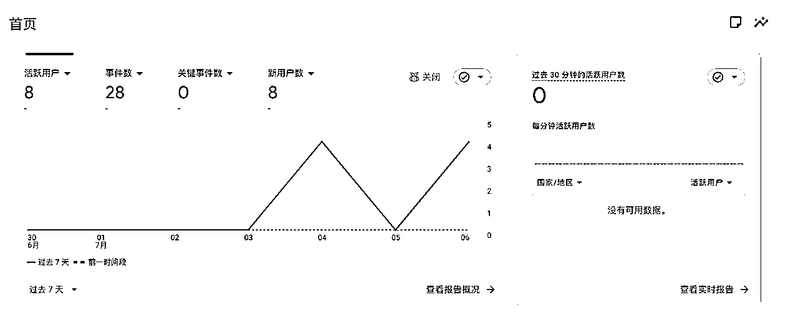

## Google Analytics 能做什么？

Google Analytics 虽然免费，但功能相当全面。对于新站来说，以下几类数据尤其值得关注。

### 1. 查看流量来源

你可以了解用户是通过什么方式进入网站的，例如：

- Google 自然搜索
- 广告投放
- 社交媒体
- 直接输入网址访问

常见报告包括用户获取、流量获取和着陆页报告。

通过这些数据，可以判断哪些渠道更有效，从而合理调整推广策略。

### 2. 观察用户行为

这部分主要用于分析用户进入网站后的动作，例如：

- 浏览了哪些页面
- 在页面停留了多长时间
- 点击了哪些按钮
- 是否下载文件或提交表单

常用功能有事件报告、网页与屏幕报告、互动度概览等。

这些数据能够帮助你发现页面内容和结构上的问题，进一步改善用户体验。

### 3. 分析转化效果

如果你的网站有注册、购买、下载等目标，就可以通过转化分析，判断用户是否完成了关键操作。

常见报告包括：

- 电商购买
- 结账流程
- 购买路径
- 自定义目标转化

借助转化漏斗，可以定位用户在哪一步离开，并针对性地优化转化流程。

### 4. 了解访问者特征

受众分析可以帮助你掌握访客的基本情况，例如：

- 所在国家或地区
- 使用的设备
- 操作系统和浏览器
- 兴趣与用户属性

这些信息有助于明确目标用户，制定更精准的内容和营销方案。

### 5. 使用实时数据

实时报告可以让你看到当前网站是否有人访问，以及他们：

- 来自哪个渠道
- 正在浏览什么页面
- 当前网站有多少活跃用户

在活动推广期间，实时数据尤其有用，也能帮助你及时发现异常流量。

### 6. 创建漏斗和自定义报告

如果你想研究用户从进入网站到完成目标的完整路径，可以使用：

- 自定义漏斗
- Explorations 探索功能
- 用户分群分析

这些功能适合分析复杂业务流程、进行 A/B 测试，以及追踪特定事件。

### 7. 导出和分享数据

分析结果可以导出为 PDF、Excel 等格式，也可以设置定期生成报告，并通过邮件发送给团队成员。

---

# Google Analytics 添加网站教程

## 第一步：打开 Google Analytics

访问：

https://analytics.google.com/analytics/

如果尚未登录，需要先使用 Google 账号登录。

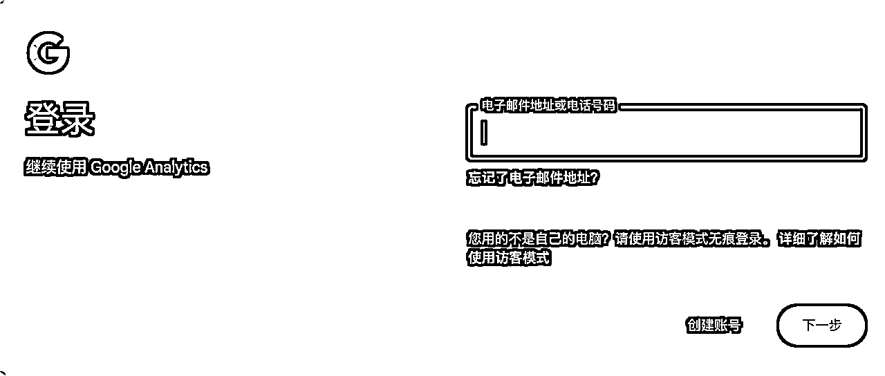

进入后台后，点击左下角的设置按钮，再点击设置页面中的“媒体资源”。

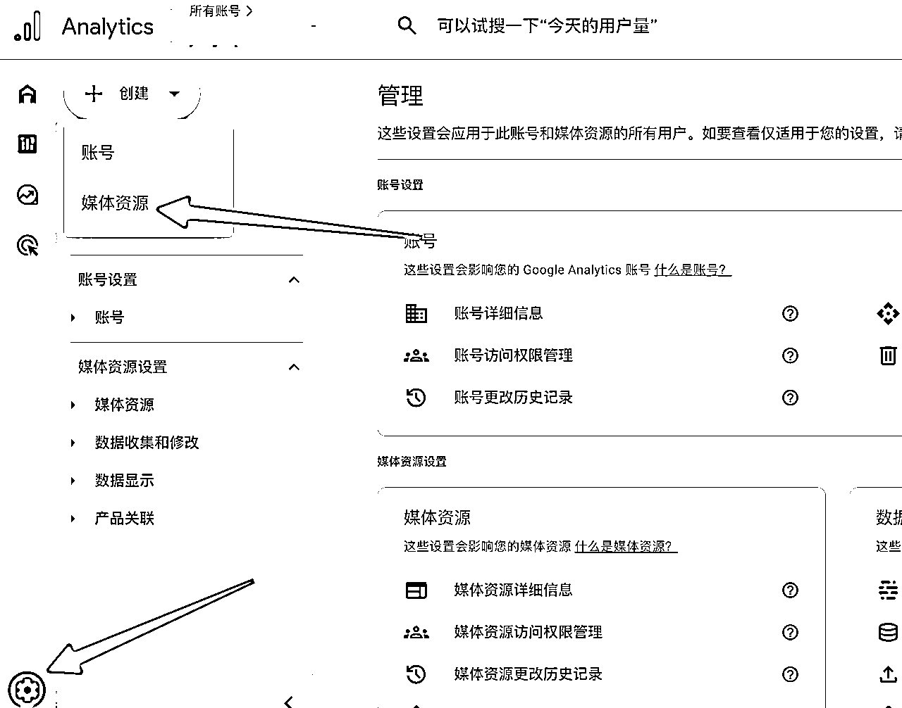

## 第二步：填写媒体资源名称

“媒体资源名称”可以理解为网站在 Google Analytics 里的备注名称，主要是方便你日后管理和识别。

不必过度纠结，填写一个自己看得懂的名称即可。

例如网站是 `labubu51.store`，可以填写：

- labubu51.store
- Labubu51 海外网站
- Labubu51 官网数据
- Labubu51 Store 数据统计

填写时注意：

1. 名称建议不少于 4 个字符，且不要超过 100 个字符。
2. 中文、英文或数字都可以。
3. 这个名称主要供自己查看，访客不会看到。

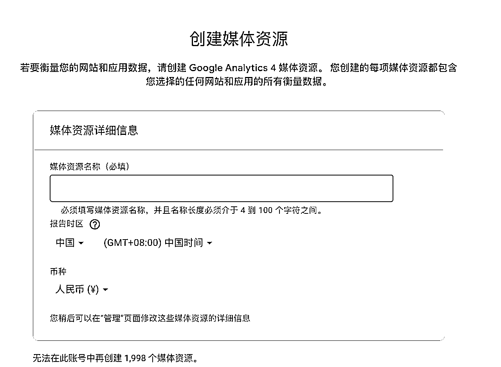

## 第三步：选择行业和业务规模

根据网站实际内容，选择最接近的行业类别。

常见选项包括：

- 艺术与娱乐：音乐、电影、画廊等
- 美容与健身：美妆、健身服务等
- 餐饮：餐厅、外卖平台等
- 健康：医院、诊所、健康资讯等
- 互联网与电信：网络服务、软件、技术产品等
- 求职与教育：招聘、学校、培训机构等
- 新闻：新闻媒体网站
- 旅游：旅行社、酒店、订票服务等
- 其他业务活动：没有合适分类时选择

例如，我的网站主要提供拉布布壁纸图片，可以选择“购物”。

如果你做的是 AI 绘画、AI 视频等内容，则可以考虑选择“艺术与娱乐”。

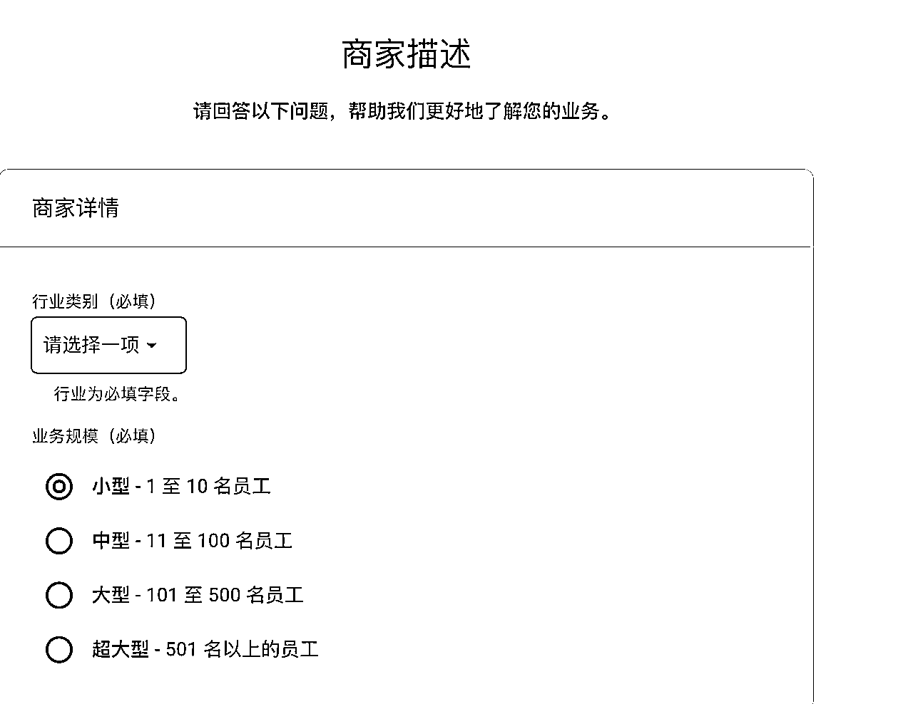

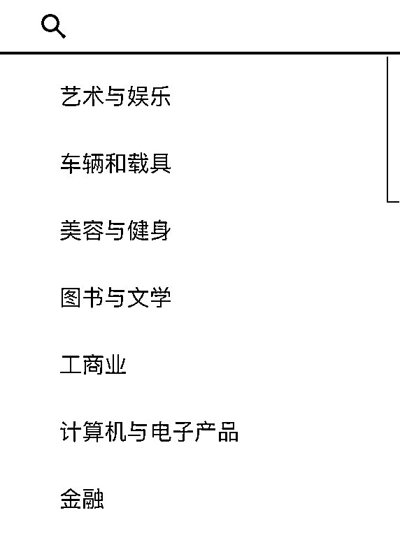

## 第四步：设置业务目标

接下来，系统会让你选择网站的业务目标。

这些选项基本都是按照字面理解即可。理论上可以全部勾选，但官方更建议选择 1—2 项，这样系统推荐的报告和分析方式会更加贴合你的实际需求。

官方说明可参考：

https://support.google.com/analytics/answer/12924488?hl=zh-Hans

也就是 GA4 中的“业务目标”设置。

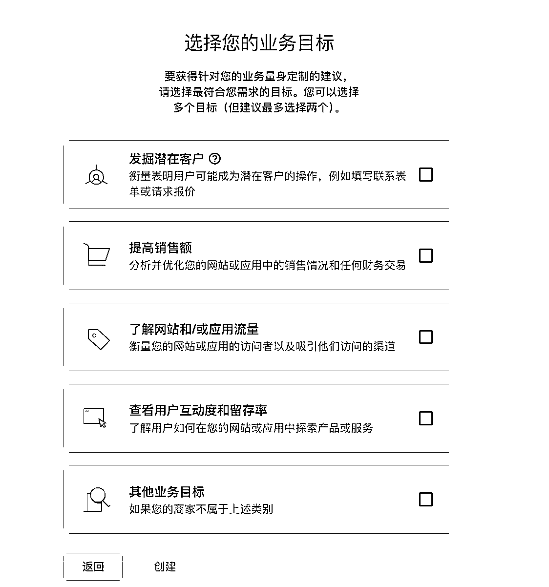

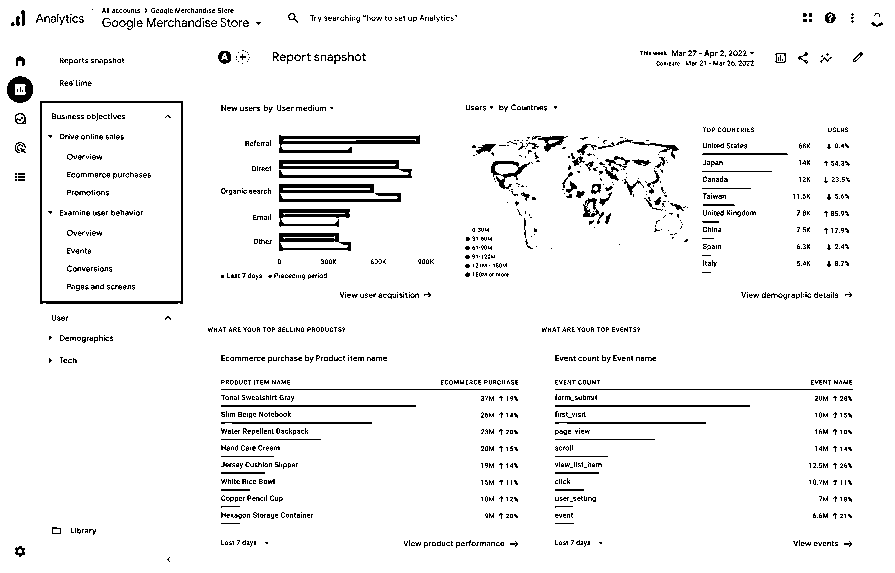

## 第五步：选择数据收集平台

因为我们搭建的是海外网站，所以这里选择“网站”。

随后填写网站地址，包括网站 URL 等信息，然后点击右上角的“创建并继续”。

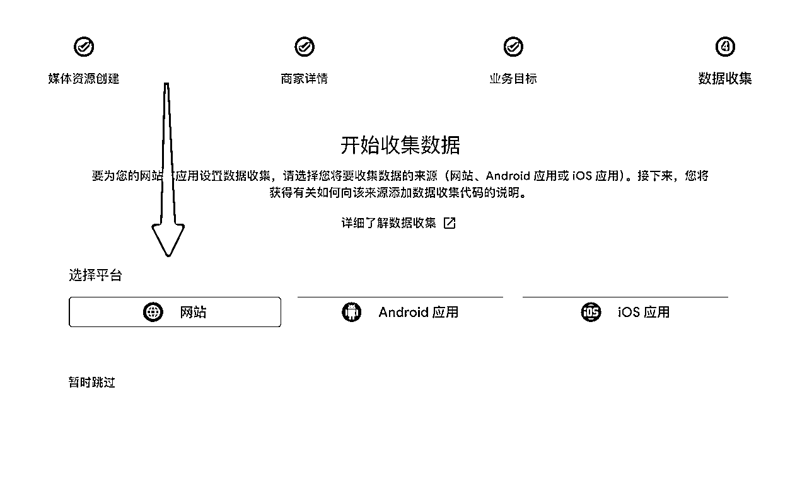

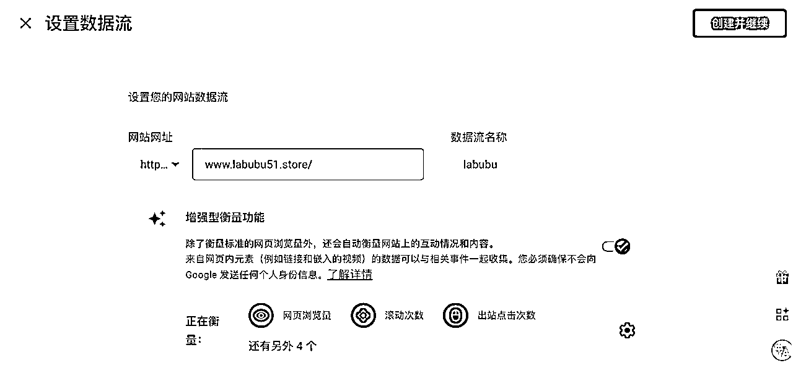

## 第六步：创建数据流

进入数据流设置页面后，继续添加网站数据流。

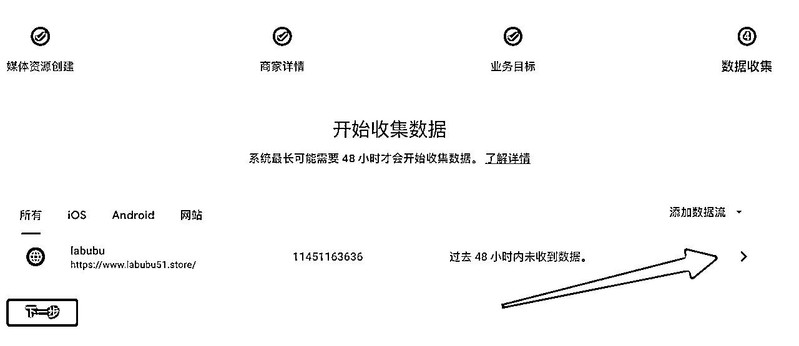

## 第七步：安装追踪代码

创建完成后，Google Analytics 会生成一段代码，需要放到网站中。

如果网站包含多个页面，就需要确保每个页面的 `head` 元素中都加入这段代码。

如果网站只有一个主页面，添加一次通常就可以。

不熟悉代码也没关系，可以直接让 Cursor 协助完成。

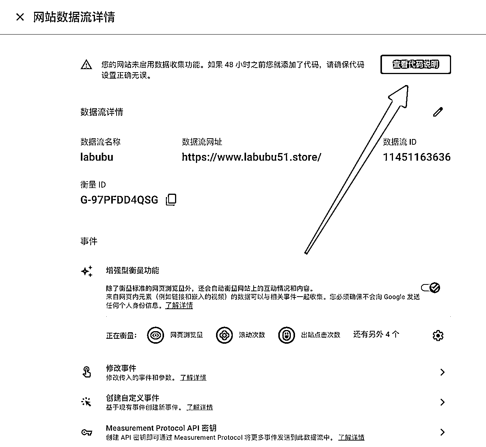

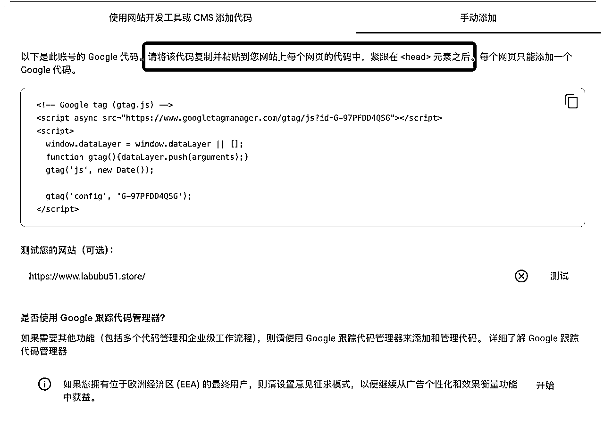

下面是让 Cursor 自动添加代码时可以使用的提示词。

```
请帮我把 Google Analytics 提供的追踪代码，添加到这个项目的所有页面中。具体要求如下：
 1\. 复制我提供的 Google Analytics 代码。
 2\. 在每个网页的 HTML 源码中，找到 ⁠⁠ 标签。
 3\. 将这段代码粘贴在 ⁠⁠ 标签后面（紧跟着），确保每个页面只添加一次。代码如下：

请确认操作完成后回复我，谢谢！
```

代码修改完成后，将内容提交到 GitHub，再由 Vercel 自动完成部署。

需要注意的是，代码部署后不会马上显示数据。一般要等待 1—2 天，很多情况下第二天就能看到结果。

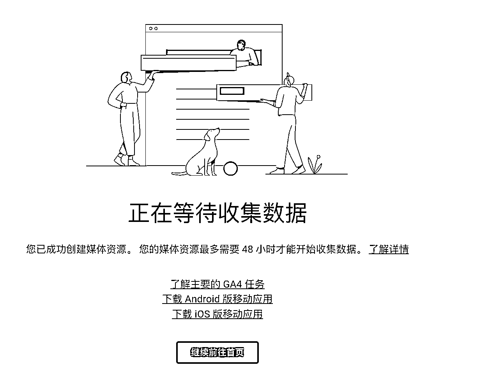

后续只需要定期进入 Google Analytics，观察网站的访问量、流量来源、热门页面和用户行为，就能逐步判断网站哪些地方表现不错，哪些地方还需要优化。

新站上线只是起点，持续看数据，才知道接下来应该往哪里发力。

祝大家早日迎来属于自己的“泼天流量”！

Good Luck！

# 送福利

这里送出几个 Claude Code 体验兑换码，可以免费体验一天，欢迎领取。

- 卡号：MC4KJMX5-CZIIH3
- 卡号：MC4KJMXA-P9XXWR
- 卡号：MC4KJMXE-95RTZ3
- 卡号：MC4KJMXI-NIDUNG
- 卡号：MC4KJMXM-OA3MCT

## 使用方法