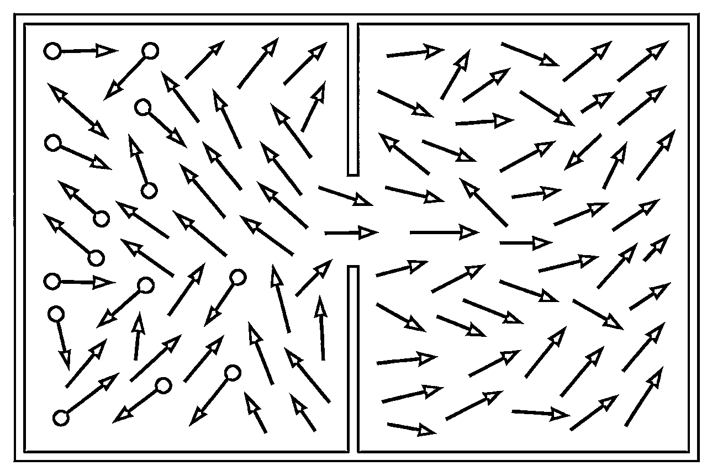
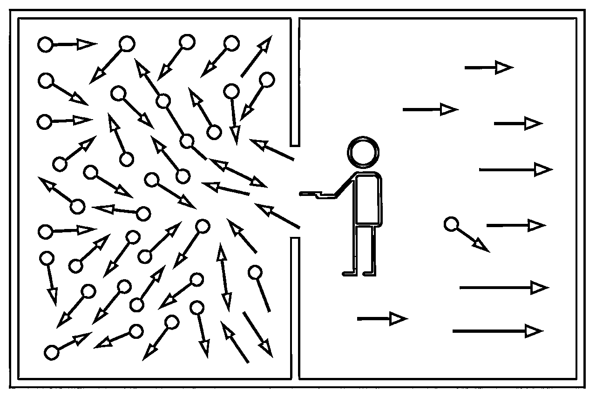
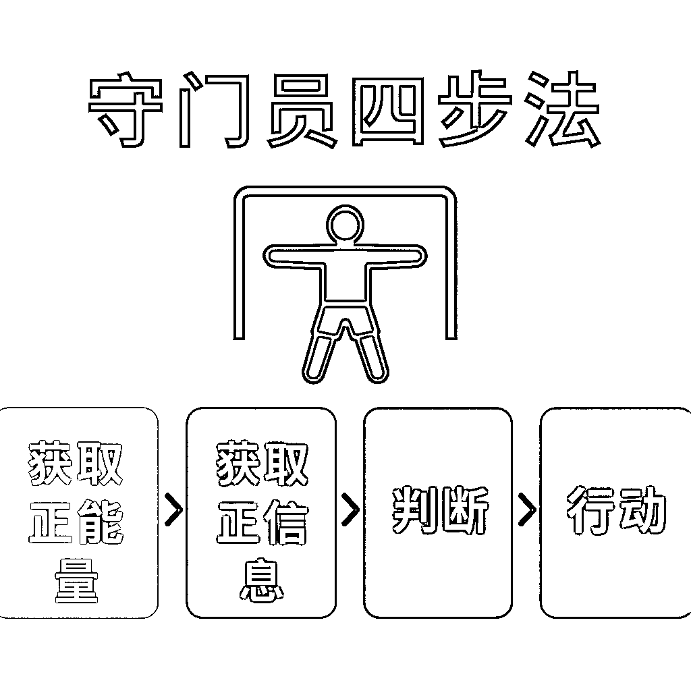
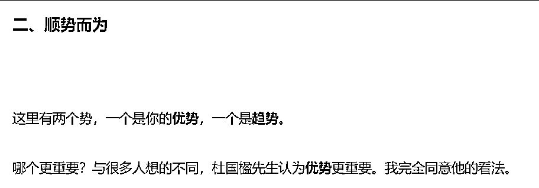
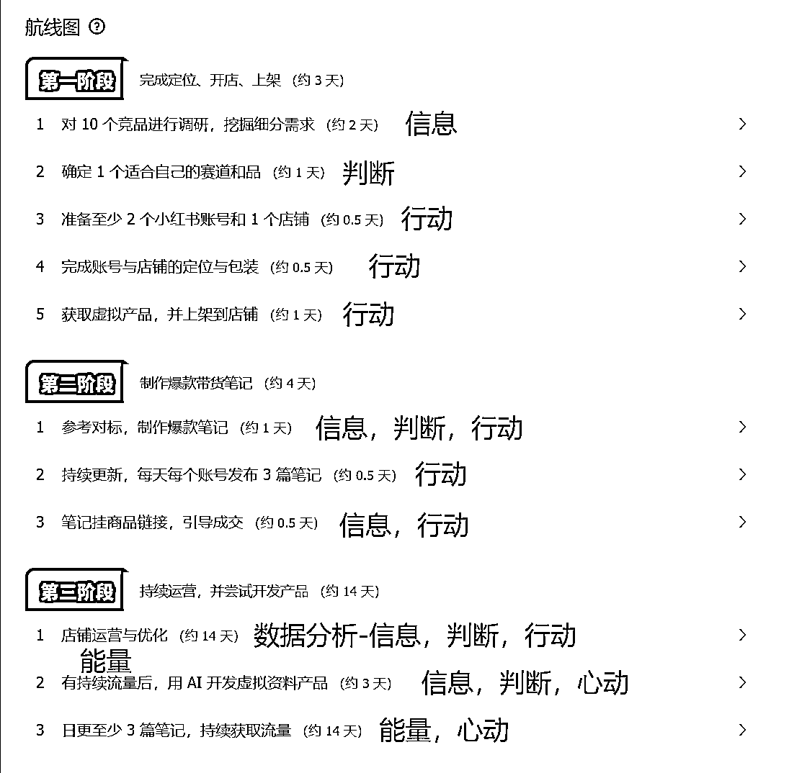
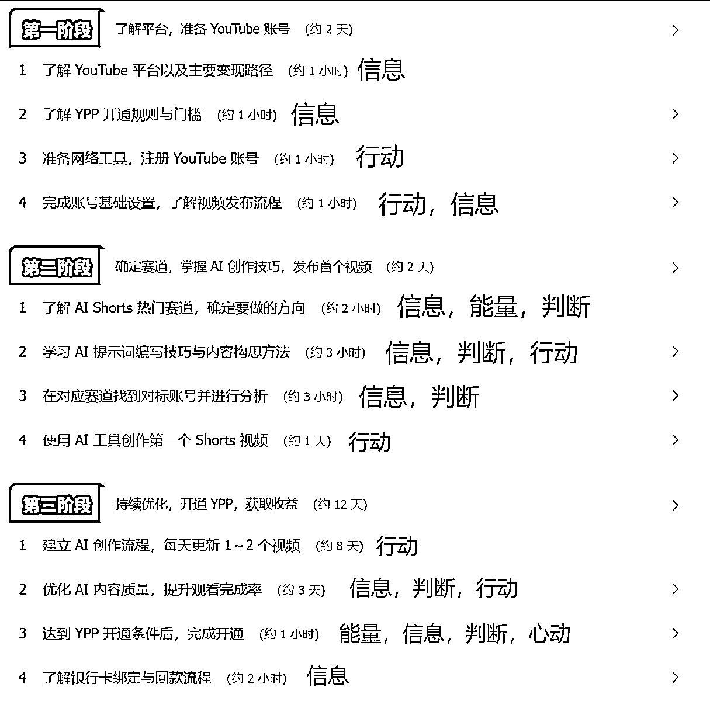
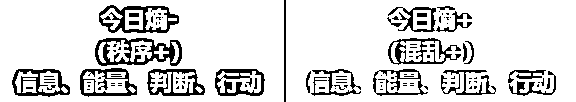

# 用一个物理公式，把创业的成败算清楚

有没有一套可以贯穿创业全流程的决策方法？

大家好，我是包子

两年多前我裸辞跳入一个完全陌生的赛道，独自在家把个人IP做到头部，心路历程可看赚钱向的这篇复盘

AI+IP，一人公司，如何狂奔到垂类赛道TOP10

https://mp.weixin.qq.com/s/C2DJG9WobnlPwM2eeTsncA

创业里最难的是选方向和扛住坚持，所以大家都说要快点拿到正反馈。可高考志愿这件事，一年就一次，填表也就几天，其余时间根本没有反馈回路。

剩下漫长的等待期，只能靠自己不断微调。所以怎么持续校准方向，怎么做合理决策？

作为理科生出身，我一直在找一个能覆盖创业全场景的模型。最后真的找到了，而且我已经把它迁移到生活各个角落，效果很稳定。

它就是基于【熵增定律】的麦克斯韦改良版。

# 系统要么变乱，要么变序

任何系统在缺乏外部干预时，都会滑向混乱，混乱等于衰败。

这个世界全是系统。“管好一个集团”“做出一桌好菜”“养成一个好习惯”，都是系统。

把自行车丢在户外，一年后车身锈蚀、轮胎瘪气。企业放任不管必然内耗、走向破产。孩子的学习没有干预会一路下滑。房间不打扫会越堆越乱……

这看着像物理常识，但反向同样成立。

任何系统在合适的干预下，都能走向有序，有序通向成功。

自行车推进屋里定期保养，能一直保持好骑。公司目标清晰、不断迭代SOP、上下同心，业绩大概率向上。亲子沟通顺畅、作业认真，成绩自然提升。定期整理，家里就会清爽。

我用这个视角看世界两年多，暂时没见过例外。这是基础物理规律，人类认知的顶峰。若你遇到例外，请务必告诉我。

创业本身就是一个系统，它的秩序程度越高，成功概率就越高。问题在于，系统自发会走向混乱，和我们想要的秩序是反的。该怎么避免衰败、走向有序？

从科学史里我找到了麦克斯韦的思想实验。这个实验对我的冲击非常大，过去两年一直是我的成事心法。

# 麦克斯韦的守门员

整个宇宙也是一个系统，熵增意味着热寂，物理学家无法接受。麦克斯韦提出了一个设想：

（下文是我加工过的通俗版，非原版表述）

* * *

这是一个混乱的系统，内部箭头方向各异、随机游走。

我们在中间加一道隔板，左为外部，右为内部系统。加了隔板后，两边都一样混乱。

如果只想在右侧保留向右的箭头，也就是让它有序，可以在隔板开个小洞，派一个人守门。

*   守门员看到左侧来的【向右箭头】想进入右侧，就放行。
*   守门员看到右侧的【非向右箭头】想出去，就放行。
*   其他情况一律拦截。

时间推移后，右侧的向右箭头会越来越密集，系统自然变得有序。

核心就是守门员。只要守门员工作正确，右侧就会持续变序。

守门员可以是创业者守护事业、父母守护孩子、自己守护健康。守门员不一定是真人，更像系统前的自动门禁。

守门员想工作正确，需要四个环节：

1.  获取正能量：没能量就干不动
薪资、流量、吃饱、好情绪都是正能量；坏情绪、生病是负能量
赚钱的运动航海，强烈建议参加
2.  获取正信息：知道什么是对的箭头、什么是错的
付费信息通常比免费信息靠谱，大佬的信息质量更高
3.  判断：识别眼前这个箭头属于哪类
创业里叫认知或决策，质量高度依赖前两步
4.  行动：放行或拦截
也就是执行计划

听起来简单，坑也不少。正能量带来动力，负能量让人躺平；正信息带来正确判断，负信息导致判断失误。

用案例说更清楚。

# 实战案例

## 做IP过程中如何做关键决策

一个人做IP，每天都在决策，如何套用这套框架？

### 视频如何做到行业标杆

自媒体都想做爆款，怎么让【做爆款视频】这个系统更有序？

*   系统：做爆款视频
*   补能量：涨粉、被认可、正反馈，动力就足
*   补信息：拆解头部IP的知识结构，拆解全平台优秀视频的表达方式
*   判断：哪些是我能做到的
*   行动：调研全专业、写30万字稿、做全专业讲解视频
重复这个循环，视频最终成了行业教材。调研、写稿、剪辑本身也是子系统。

### 直播起号要不要接机构带货

起号期有机构开百万年薪邀请带货，当时我收入为0，是否该接？

若为机构带货，【直播间做到头部】这个系统会更有序还是更混乱？

*   系统：直播间冲头部，是否接机构带货
*   能量判断：过早进入机构商业逻辑，会消耗直播热情，是负能量
*   信息判断：带货对直播间无正向信息输入
*   判断：对冲头部是负向作用
*   行动：婉拒邀约
结果我按自己的节奏做，三个月做到赛道头部，收入后来超过机构画的大饼。

### 是否和赚钱合作AI课程

今年3月30大会分享完，许老师当场邀我做线下AI课程。快速用框架过一遍，对【高报IP】主业的影响？

*   系统：高报IP，是否做AI课程
*   能量：做课程倒逼我把AI用更好，对超级个体是正能量；用费曼法教学会让我理解更深，也是正能量；若备课占用太多时间影响内容创作，则是负能量
*   信息：AI是趋势也是高校短板，家长高度关注，做课程能摄入大量AI正信息，对IP打造有利
*   判断：总体利大于弊，但要控制备课时长
*   行动：启动AI课程
两期线下课顺利完成，我也因此被家长视作AI高手，给IP叠了层buff。后续有家长想让我带孩子学AI，我判断时机不对，也拒绝了。

## 进赚钱后单干还是参加航海

航海手册公开了，为何还要付费参加？用麦克斯韦视角看哪个让系统更快变序？

*   系统：创业初期如何更快变序
*   能量对比
航海：有教练、有氛围、有鼓励，无正反馈也能坚持
单干：全靠自嗨，抗不住空窗期
结论：航海更优
*   信息对比
航海：群里信息密度高，有教练助教答疑，质量远高于只读手册
单干：闭门造车
结论：航海更优
小排老师《加入赚钱第一周，做什么最重要？》提的「全覆盖级阅读龙哥盟」本质就是信息饱和
https://scys.com/articleDetail/xq_topic/8852245214845522
*   判断对比
航海：有教练助教判断，有圈友对照
单干：行业小白判断偏差大
结论：航海更优
*   行动对比
航海：打卡交作业，划水难
单干：执行力靠自觉
结论：航海更优
所以新手应积极参加航海，而非单干。

## 按趋势干，还是按优势干

《如何提高做产品的成功率？》里小排已给出答案：
https://scys.com/articleDetail/xq_topic/8852488228128112

麦克斯韦视角：哪个方向能让系统更快有序，就选哪个。

优势=你在这个系统里已高度有序，成功概率高。贸然进陌生赛道，系统一片混乱，积累秩序慢。

趋势=该系统持续获得正能量输入，有序度自然提升。哪怕躺平也能跑赢平均值，但同体系内比不过有优势者。

大部分情况应按优势走。若按趋势走，需注意：行业有不可逆的正能量输入，按部就班也会变序，如2005年地产、2010年移动互联网、现在的自动化+AI。反之，若系统持续被负能量砸，就撤，如2018后地产、基建、教培，以及老龄化、低生育率对部分行业的长期负向输入。

## 如何让自己精力充沛

创业基本盘是精力，框架能很好提升状态。

*   系统：精力充沛
*   补能量：高纤维高蛋白、多蔬菜少碳水、运动、充足睡眠、保持好情绪。可各自拆成子系统
*   负能量：高糖高油、不规律作息、负面情绪、不运动
*   补信息：大佬健康方案、精力管理书籍、资深运动教练
*   负信息：咖啡续命、乱七八糟保健品
*   判断：据此制定精力管理计划
*   行动：坚持执行
按此循环，精力系统会持续变序。

## 新事业从0到1怎么做

从零到一最难。

*   系统：新事业0到1
*   补能量：进入赚钱圈子，看见别人赚钱会自带能量；参加航海先赚到1块钱，获得正反馈
*   补信息：通读赚钱内容，尤其官方精选；找到各赛道成果大佬，向其请教
*   判断：挑几个适合自己的项目
*   行动：多参加航海，躬身入局，把手弄脏
新事业=混乱，需长时间秩序化，所以见效慢。

## 线下课 vs 线上课

*   系统：系统学习，线下vs线上
*   能量：线下聚堆攻关更强，线上较弱
*   信息：线下可听老师、助教、同学提问，面对面获取快；线上滞后
*   判断：线下可让助教帮忙，线上靠自己
*   行动：线下必须到场，线上容易进收藏夹吃灰
结论：线下在秩序化速度上全面领先，想快速掌握选线下。

## 生活里的系统

很多时候我们只是系统一员，只需持续注入正能量和正信息。

### 家庭氛围
*   系统：家庭氛围
*   正能量注入：好好赚钱、好好说话、乐观、饮食健康、三观正
*   负能量：抱怨、消极、啃老
*   正信息注入：家庭分工、沟通方式、教育方法
*   负信息：打骂、独断
持续注入正的，系统守门员会让氛围变好。

### 公司运营
*   系统：公司成长
*   正能量：合理薪酬、好赛道、合伙人同心、团队融洽
*   负能量：发不出工资、赛道被压制、内斗
*   正信息：持续学习、迭代打法、拥抱新技术
*   负信息：故步自封、甩锅
为何很多公司只招985/211？他们在正能量投入和学习习惯上已被筛选过。

### 孩子教育
*   系统：孩子教育
*   正能量：父母沟通融洽、目标一致、理性引导、家庭和谐
*   负能量：父母互怼、情绪上头、目标冲突
*   正信息：学习教育大佬的方法、儿童心理学、年龄适配沟通、情绪引导、正面鼓励
*   负信息：凭感觉教育、打骂贬低
坚持两年，家里的教育矛盾极少，我女儿暑假无补习班，奥数自学、不会就问AI。

### 一个项目值不值得上
看它是否给你的系统注入正能量和正信息。哪怕短期无成果，若能提升表达、写作、沟通、剪辑、AI、运动、情绪、睡眠等底层能力，都是赚的。

评估时要算机会成本。

## 航海手册拆解

### 📕电商 - 虚拟产品

### YouTube AI Shorts

所以航海手册本质是帮你把创业系统快速秩序化。

# 行动建议

我用了两年，会定期记录各系统的秩序/混乱变化。

*   发现近期信息摄入不足，就主动补信息
*   想得多做得少，就立刻行动
*   能量不足，就调饮食、运动、睡眠、情绪
*   判断失误，多半是正信息不够，认知问题，多看

不愿记录也没关系。日常每个微小决策，都问一句：这是给我的系统注入正能量还是负能量？带来正信息还是负信息？

荣格说，潜意识没进入意识，就是命运。我的理解：生活由无数下意识行为构成，它们在持续给系统输入能量与信息，命运的车轮就这样被推动。

感谢阅读，有启发就更好了😄