# 《B站好物新手破局指南》：三天拿下首单，拆解五大变现流派助你省掉九成试错


大家好，我是AI德华。

写下这篇笔记时，我的B站好物项目已经进入稳定变现阶段。

坦白说，若非亲手跑通，我很难相信。

靠AI拼凑的简易短片，竟然真能在B站成交。

今天不止晒结果，更想把拿到第一笔佣金的思考框架、工具栈和完整路径毫无保留讲清楚，帮你少踩坑，多点执行底气。

文章导读：

本文复盘了B站好物三天成交的实战经验，梳理了多种变现打法与落地细节。关键信息如下：

*   五大主流流派：

*   极速信息流，如super好价君，主打信息硬核+高频更新吃精准搜索；
*   专业横评流，如机玩汇，以PPT形式输出深度测评；
*   人设亲和流，如蒙面it侠，靠真人出镜拉近信任；
*   真实体验流，如斤斤计较的包子，用实拍开箱营造沉浸感；
*   明星锐评流，如爱唱歌的信，凭主播个人魅力与专业度聚粉。

*   选品思路：紧跟联盟后台爆款榜单、导购社区热品以及对标UP主在推的货，优先选择大牌、近阶段有好价且销量陡增、卖点清晰、素材充足的商品。

*   剧本撰写：用通用Prompt模板让AI按需生成带货短视频文案，遵循痛点钩子等黄金结构，语言口语化且带数据佐证。

*   生产链路：从素材准备到封面交付实现标准化，单小时可批量产出，如剪映生成配音、配字幕与背景音乐。

作者建议先锁定与自身条件匹配的风格，再立刻开干，用AI卡住当下窗口。

### 首单到账的瞬间

看到龙哥发的B站好物超级标，我算是在圈里最坐不住的那波人之一。12年B站老粉，从追番到关注UP，我的青春伴着这个平台成长。

可“B站做带货”？心里难免打问号，真的可行吗？

赚钱的逻辑就是先干再说。我没等没拖，直接实测。

视频发出第三天，首单就来了。


后台收益数字跳出来的那一刻，震惊到说不出话。

一个AI生成的简陋视频，居然有人照着买？这份正反馈瞬间消解了所有怀疑，也给了我强烈的信心。

### 一、第一步不是开拍，而是先做功课

这里的功课，是动手拆解，不是空想也不是去群里问。

下面这张表格，是我耗费数日，把数十个账号逐个拆解后提炼出的核心，它能帮你节省大量摸索成本。

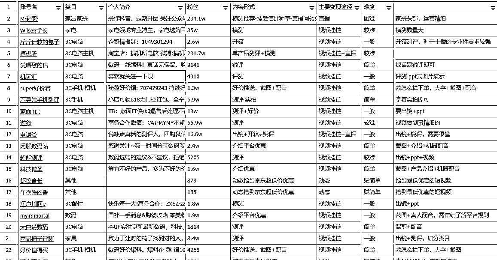

这张表本质上是我的作战地图，解决的核心疑问有：

*   选什么赛道？数码、家电还是其他？
*   内容形态如何？真人出镜？横评？或纯数据配音？
*   门槛高不高？新人能否复制？

通过梳理，我发现不少已跑通的号并不需要真人，制作门槛很低，核心在于把商品卖点和优惠讲透。

### 二、核心乾货：B站好物五大主流风格拆解

就像超级标里说的，“思路不清就先从数码入手”。调研后发现数码赛道账号密度最高，低粉也能变现，内容也相对好做，于是我对数码类创作者做了更细的拆分。


深入后发现数码赛道大致可归纳为五种玩法。成功的关键不是照搬，而是风格适配，找到最贴合自己能力与性格的路。下面是对每个流派的对标拆解。

#### 流派一：极速派 信息流模式

*   对标账号： super好价君


*   账号定位：无需露脸，账号扮演信息分发工具。追求效率，可日更，但为控风险建议单日不超过3条。

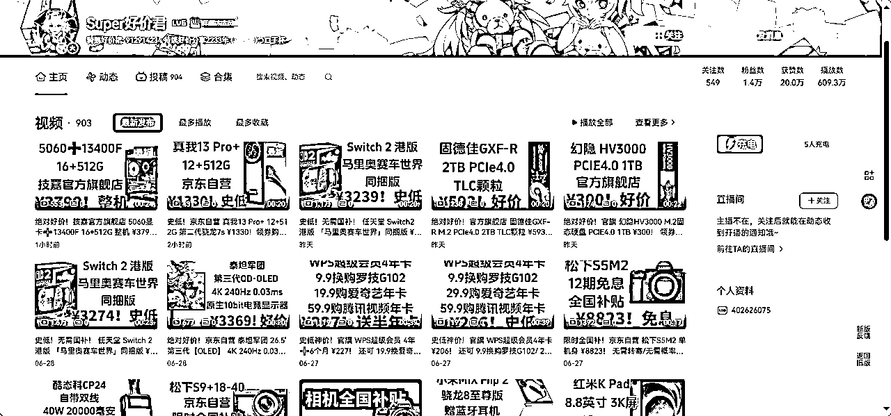

*   内容逻辑：

*   钩子：极度直接，如“史低！”、“直接抄作业！”、“XX型号降了！”。
*   结构：形式极简，通常是“商品截图+AI配音”。逻辑是：这是什么产品 -> 原价多少 -> 券后多少 -> 怎么下单。信息直给不拐弯。
*   转化话术：简洁粗暴，如“链接放评论区，券量有限手慢无！”。

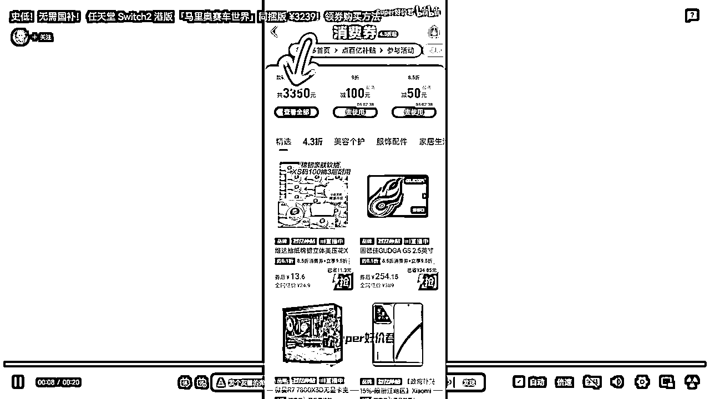

*   流量来源：几乎来自用户主动搜索型号或“XX推荐”等关键词，纯SEO打法，吸来的是强购买意向人群。
*   变现方式：蓝链CPS佣金，模式清晰。
*   账号表现：单条播放点赞普遍不高，但因流量精准转化尚可。最大风险是生命周期短，易被平台判定为低质营销而限流封禁。
*   新手复刻建议：最适合入门验证全链路，用最低成本跑通选品-制作-发布-挂链-收款。但不适合长期深耕。
*   同类账号还有 好价值得买


闲聊数码站 同步搬运平台活动信息


#### 流派二：专业派 PPT横评模式

*   对标账号： 机玩汇


*   账号定位：无需出镜，内容须结构化信息密度高。定位是“客观选品顾问”。建议周更，保证单期深度。
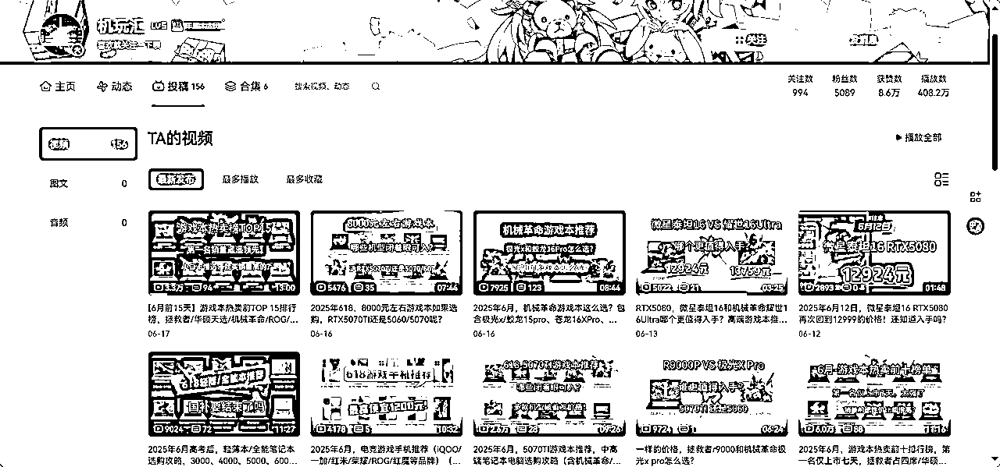

*   内容逻辑：

*   钩子：抛出用户常见选购困境，如“盘点游戏本热销榜前十大家买了哪些”、“8000价位哪些游戏本值得入”。
*   结构：典型PPT。1.提出痛点 -> 2.确定评测维度如性能外观价格续航 -> 3.多款竞品横向对比 -> 4.总结图表+购买建议。
*   转化：语气更专业客观，如“希望能帮助大家选到合适的机型”。

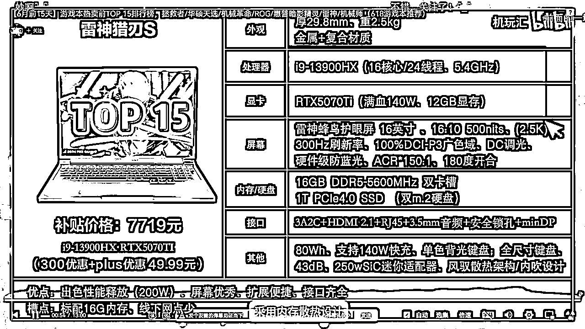

*   流量来源：搜索+推荐。内容有价值信息密度高，能解决实际问题，易获推荐及长尾搜索。
*   变现方式：蓝链佣金为主，成名后有品牌付费植入可能。
*   账号表现：播放与粉丝粘性高于极速派，评论区常有高质量技术讨论。
*   新手复刻建议：非常适合AI自动化规模化。剧本结构化，PPT模板化，配音AI化。能从搬运工转向内容创作者。
*   相似账号还有3C配件赛道江户川阿u

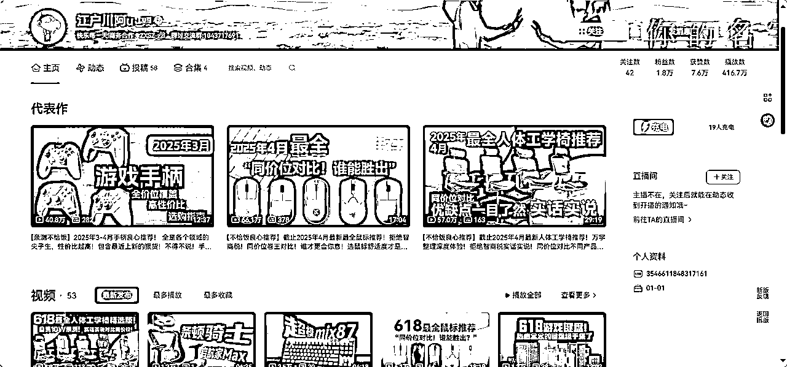

#### 流派三：亲和派 真人口播模式

*   对标账号： 蒙面it侠


*   账号定位：真人出镜，制作可相对简易。定位是“身边懂行的朋友”。以个人形象快速建立信任。
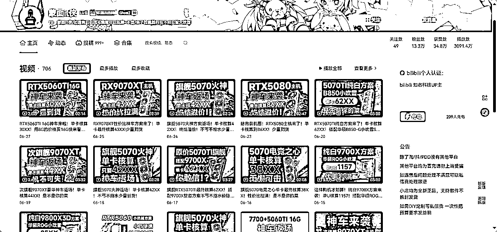

*   内容逻辑：

*   钩子：用朋友聊天口吻，如“关注性价比主机的你有没有注意到”。
*   结构：框架类似PPT，但载体为“一人+资料截图”真人讲解。相当于PPT的真人进阶版，增加了表情语气互动。
*   转化：话术口语化有人情味，“视频有用就去评论区链接”。

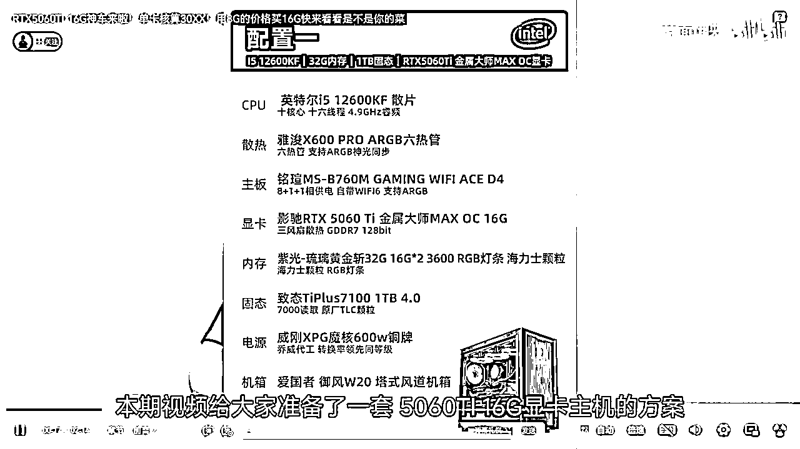

*   流量来源：推荐占比更高。人脸是最好的品牌，平台更倾向推有人设的视频，更易沉淀粉丝。
*   变现方式：蓝链佣金+商单
*   账号表现：粉丝忠诚度高，评论互动强
*   新手复刻建议：核心是克服镜头恐惧。不需复杂布景，一部手机一个支架即可，利于在AI号中脱颖而出。

#### 流派四：体验派 实拍开箱模式

*   对标账号： 斤斤计较的包子


*   账号定位：视频+直播结合，打造真实产品体验官人设。定位是“替粉丝花钱试坑的实在人”。
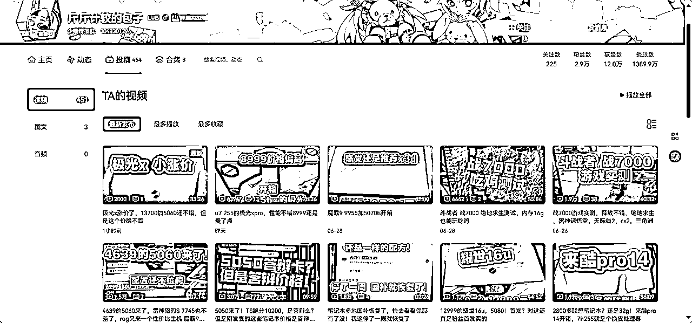

*   内容逻辑：

*   钩子：展示产品和价格激发好奇，如“我花XXX买的XX到底值不值”。
*   结构：1.真实开箱 -> 2.上手把玩 -> 3.场景化体验 -> 4.优缺点点评 -> 5.场景化购买建议。
*   转化：基于强信任，“测评有帮助可点置顶评论链接支持”。

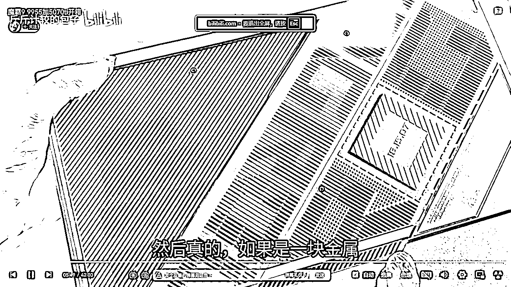

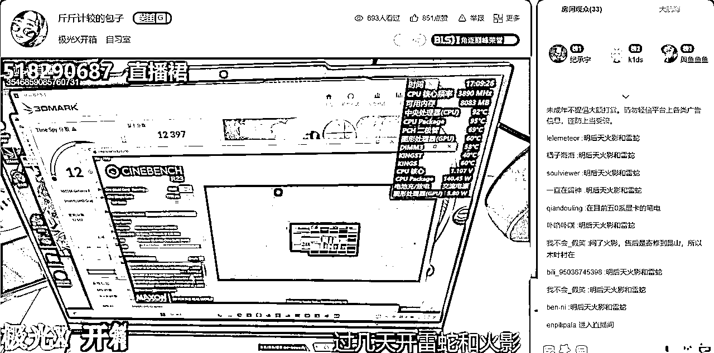

*   流量来源：推荐为主，粉丝为辅，搜索补充。是比较健康的流量结构。
*   变现方式：蓝链佣金+品牌定制商单+私域服务
*   账号表现：头部账号播放和GMV都很可观。
*   新手复刻建议：需自费购入产品。核心能力不是技术专家，而是“认真挑剔的消费者”。
*   相似账号还有不寻常手机测评、电锯爷、雨哥椅子测评等。

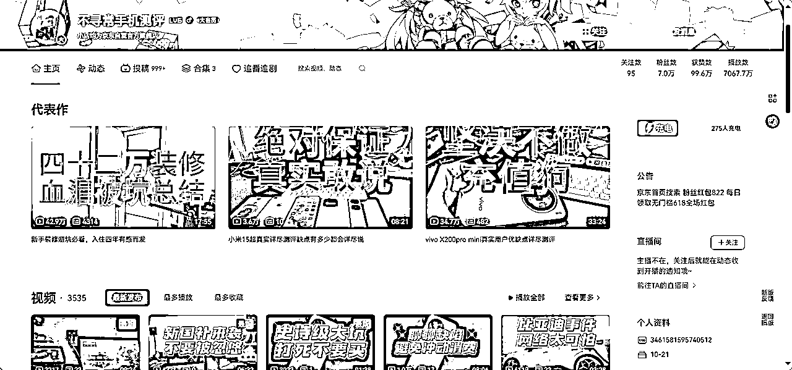

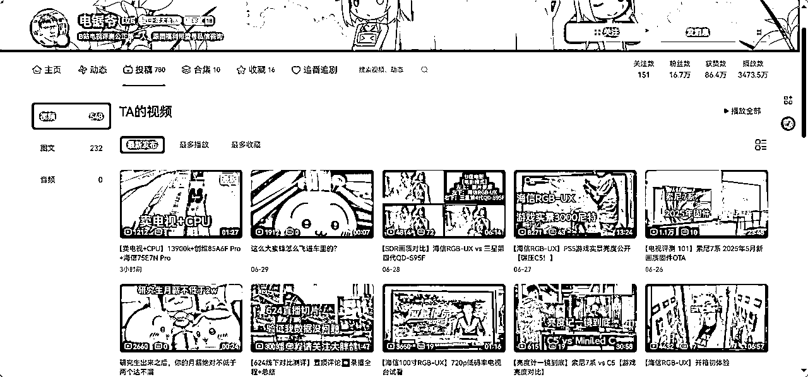

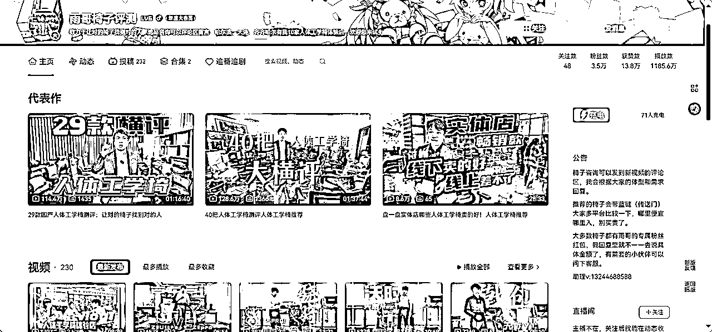

#### 流派五：偶像派 KOL锐评模式

*   对标账号： 爱唱歌的信


*   账号定位：以主播个人魅力和专业度为核心。视频多为截图锐评，直播多为答疑。定位是“说真话的意见领袖”。
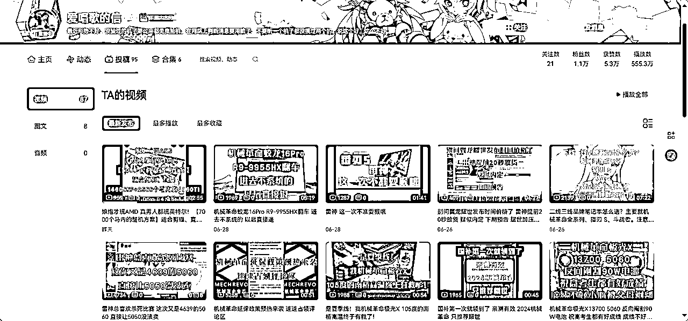

*   内容逻辑：

*   钩子：直播和视频中的金句暴论，如“XX这是疯了吗”、“XX直接终结比赛”。
*   结构：回答粉丝提问，提供一线信息，观点鲜明。通过“私域有官方售后”类信息建立强信任背书。
*   转化：基于IP信任转化率极高。

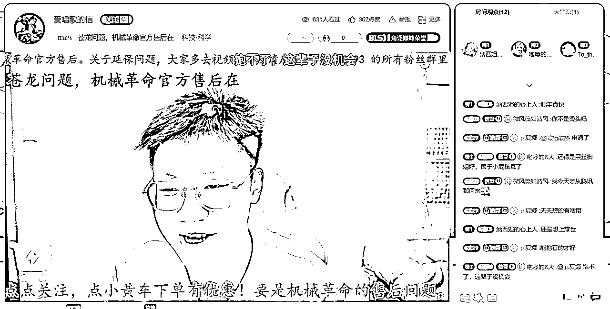

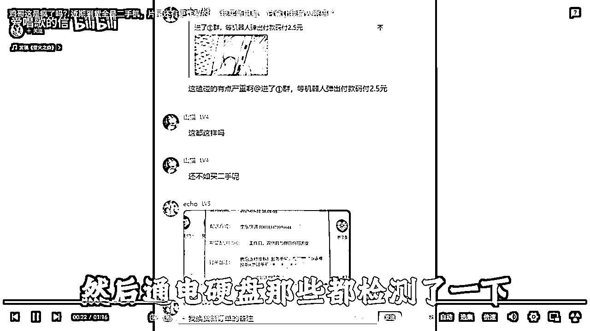

*   流量来源：锐评话题讨论+直播间核心粉丝粘性。
*   变现方式：蓝链佣金+私域服务+直播打赏
*   账号表现：话题性强，粉丝忠诚度高。
*   新手复刻建议：需要行业积累、强个人魅力和口才。

### 三、我的AI流水线：从选品到发布的生产链

风格定好后进入执行。我先选门槛最低的极速派起步，并围绕它搭建了一套AI驱动的批量工作流。逐步拆解如下。

#### 第一步 选品思路 选对决定80%成败

我的原则是“不创造需求，只顺应趋势”。不靠猜，让数据说话。

1. 数据来源：

*   联盟后台：重点看淘宝联盟/京东联盟官方爆款榜趋势榜，最真实。
*   导购社区：每天花10分钟逛什么值得买，看热品和评论区讨论。
*   对标账号：看B站头部带货号最近推什么，爆了说明有潜力。

2. 筛选标准：

标准一：大牌市场认可度高。用户会主动搜小米、Anker、倍思等，自带流量和信任。

标准二：近阶段有好价且销量快速攀升。关注大促或限时神券。联盟后台看近7天或24小时销量曲线，陡峭上涨即窗口期。

标准三：卖点清晰可视频化。方便提炼剧本。

标准四：官方素材充足。详情页高清图多，方便做画面。

#### 第二步 剧本撰写 AI是我的金牌写手

过去写文案费时，现在交给AI，关键是给好指令。

这是我常用的通用Prompt模板，可直接复制：

```
# 角色
你是一位B站数码区的UP主，风格专业、客观，同时又通俗易懂。

# 任务
请你为下面的产品，撰写一个时长约50秒的带货短视频脚本。

# 要求
1\. 脚本需要遵循“痛点钩子-产品展示-核心卖点-使用场景-价格优势-行动号召”的黄金结构。
2\. 开头必须有强烈的钩子，能瞬间抓住用户注意力。
3\. 语言风格要口语化、接地气，方便用于AI配音。
4\. 在讲解核心卖点时，要用数据和对比来支撑，显得更专业。
5\. 请直接输出可用于配音的口播文案，不要有多余的格式。

# 产品信息
【[在这里粘贴你从商品详情页复制的产品标题、核心卖点和参数]】
```

#### 第三步 生产流程 流水线化单小时产出多条

选品剧本到手后，制作变成体力活，目标是流水线化。

*   Step1 素材准备：根据链接录屏做下单流程视频
*   Step2 AI配音生成：把优化好的剧本放剪映配音，选喜欢的声音生成带字幕音频
*   Step3 视频剪辑：按配音节奏把下单流程画面铺上。可用关键帧给静态图加缓慢放大移动，或加教学插图提升完播。
*   Step4 字幕BGM：剪映识别字幕，选描边黑体。配一首科技类免费BGM，音量调到15%左右垫底。
*   Step5 封面制作：用Canva可画选视频封面模板，放产品图，用大字突出核心标题如“百元内最强充电宝？”或“产品名+配置+低价”。

整套流程实现低成本批量产出，极大解放生产力。核心就是淘客逻辑，好价推送。

目前我也在跑专业派PPT横测方向，可用Agent或工作流把选品-剧本-制作无人化，矩阵放大+SEO吃长尾。

### 四、实操卡点与解法

流程看起来顺，实操中我也卡了不少。把从0到1的坑分享出来，帮你少走弯路。

#### 卡点一 打破怀疑魔咒 这事真靠谱吗？

*   困难：看到超级标后又激动又怀疑，“这么简单的内容GMV能破千万？”
*   解决思路：用笨办法亲自验证。我把标里的账号一个个搜出来看主页，发现视频制作确实不高但带货数据是真的。瞬间从怀疑变兴奋，“这不就是有手就行？”

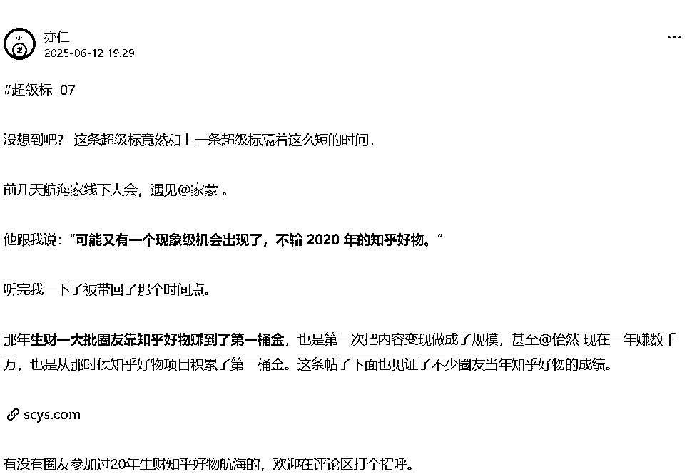

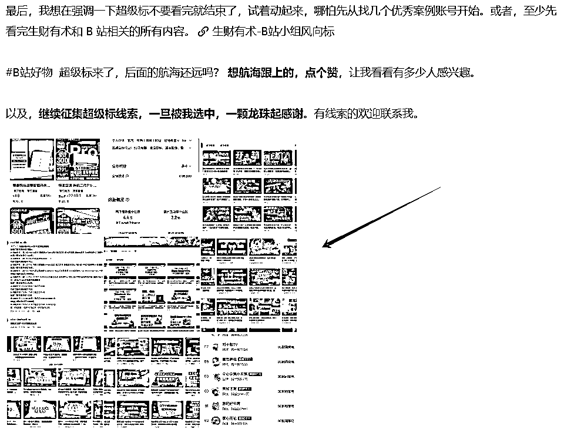

#### 卡点二 拿不到入场券 如何快速搞定1000粉？

（可刷粉、买号、互相关注等。——我亲自验证过）

*   卡点：B站悬赏带货的入门硬指标是粉丝过千。
*   这相当于把所有新人拦在门外的一道墙。
*   靠原创视频慢慢沉淀涨粉，节奏太慢，会拖慢项目验证的整体速度。
*   我的做法：以目标为先，手段务实。首要任务是“尽快判断这个项目能不能跑通”，而不是“经营一个慢慢成长的账号”。
*   做过电商的朋友都知道，拉新大概就几种路径：自然增长、互关、刷粉等。为了把效率拉满，我直接用了后者。
*   信息差就是这样，越是忌讳不问，越会成为你的盲区。
很多新手卡在这一环，本质是思路没打开。多做搜索就能找到解法，实在不想折腾也可以找人对接，我这边能推你认识鱼丸。

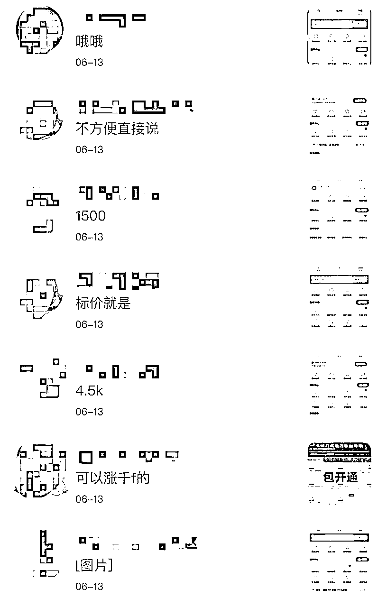

搜索的截图

#### 卡点三：内容方向迷茫——到底拍什么？

*   卡点：号有了，接下来做什么内容？横评、开箱、口播，看似都有人做，但门槛也都不低。
*   我的解法：
从带货榜单从上到下拆解，专门挑“制作成本低但转化高”的垂类。

*   我在带货排行榜里找那些“成品看起来很简陋，成交数据却很漂亮”的账号。总结下来，这类账号的制作套路惊人地统一：手机录屏+AI配音+AI字幕。
*   抓住这个规律就等于抓住可规模化生产的可能性，内容可以被流程化、可复制。
于是我果断跟进这个范式，切入数码赛道。


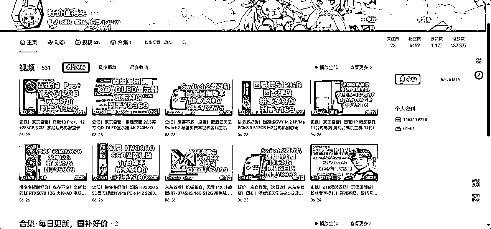

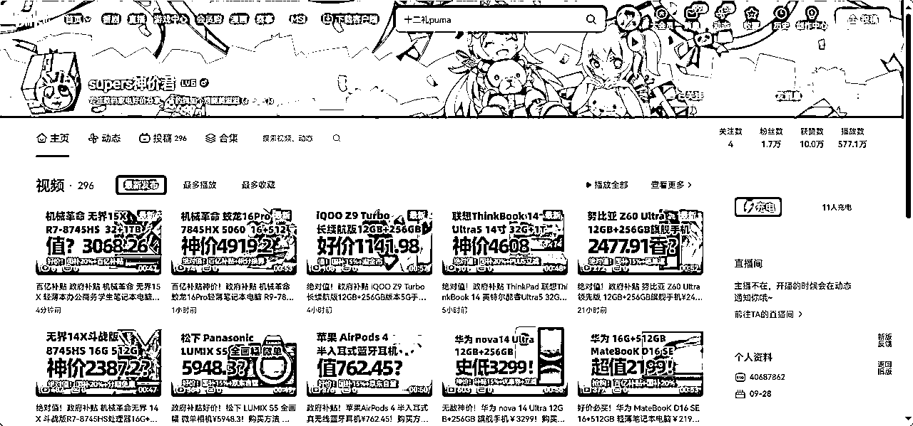

#### 卡点四：选品犯难——带什么商品？

*   卡点：选品是电商的命脉，也是最费脑子的环节。
*   我的解法：前期不做原创思考，直接像素级照搬。
*   启动阶段，最省时的选品就是抄作业。打开竞品的带货视频，他在推什么，我就跟进推什么。

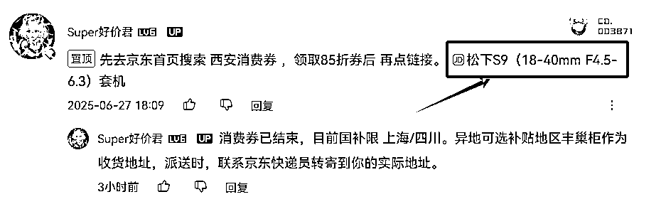

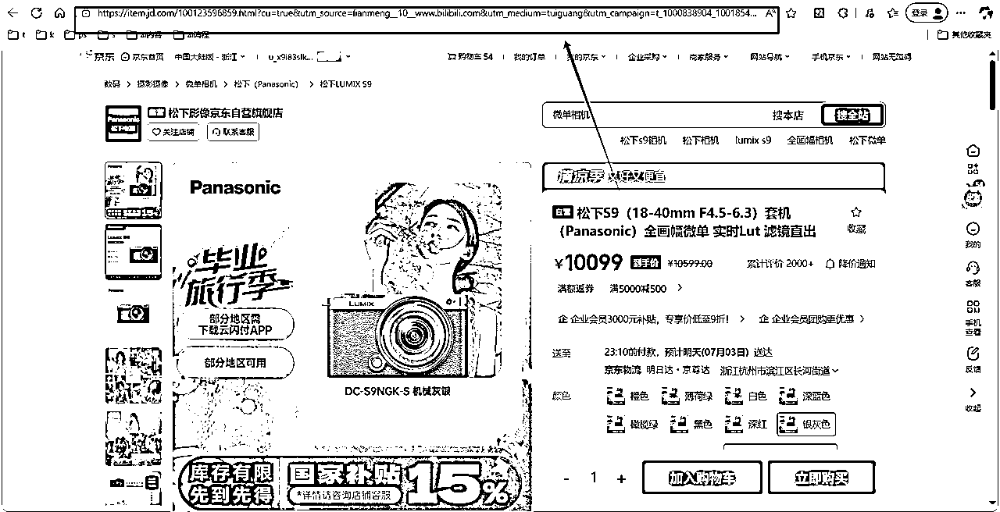

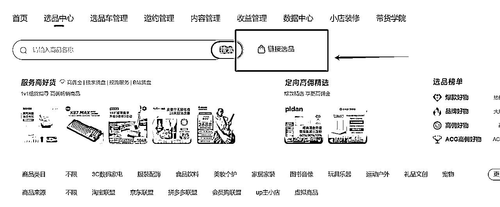

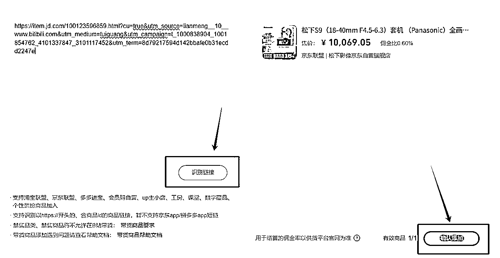

#### 卡点五：制作繁琐——视频怎么快速产出

*   卡点：对小白来说，拍片本身就是个麻烦事。
*   我的解法：流程化复用，套模板。
*   我参考的对标制作方式非常傻瓜。
*   用手机打开上一步锁定的商品页，完整走一遍用户浏览到下单的路径，全程录屏。把这段素材丢进之前搭建的AI自动化流水线里处理，很快就能生成一条成品。

#### 卡点六：点击率尴尬——封面标题为什么没人点

*   卡点：视频发布了，曝光和播放却只有个位数。
在B站，破圈的第一环是“曝光→点击率”，核心就是封面和标题的吸引力。——封标决定播放。
*   我的解法：继续借鉴，再做二次提炼成自己的模版。
*   封面：截取对标账号点击表现好的封面图存下来，用Canva抠图换文字处理，就变成我的版本。
*   标题：照搬竞品爆款标题，用AI或人工改写同义表达、调整语序，避免被系统判定为重复。

#### 卡点七：发布流量惨淡——批量发为什么更差

*   卡点：我曾以为多发就有用，一天连发十几条，结果流量更低，还被限流。
*   我的解法：降频、拉开间隔，或用矩阵分散。同一套方式高频轰炸很容易触发平台风控。后来我调整为相邻两条视频至少间隔1小时以上。

### 五、最关键的体会：行动先于完美

路上也没那么顺。

起初我也为怎样拿到千粉号、如何开通带货权限、怎么绑定PID这类琐碎事发愁，也因为发出去没流量而焦虑。

我的应对：先猛干再优化。

遇到阻碍就去B站、知乎、赚钱等渠道检索，把信息差一点点抹平。流量问题就靠批量测试，总有一条能跑通。

如果要提炼核心经验，分两步：

#### 第一步：先战略后执行，选对赛道。
动手做视频前，先花点时间理解我上面拆解的5种模式。诚实自问：你的性格、能力、资源，最匹配哪条路？是AI信息流的高效玩法，还是PPT横评的深度路线？是真人出镜的亲和感，还是实物开箱的硬核感？想清楚这一点，比学一个剪辑技巧重要太多。

#### 第二步，熟知的“先完成再迭代”。
风格确定后别再犹豫，立刻开始。别怕视频粗糙，别怕数据难看。在正确的方向上获得第一次正反馈——无论是破千播放，还是像我一样赚到第一笔钱——都会给你极强的信心，支撑你走得更远。

这个项目，我觉得是普通人借助AI，以极低成本验证商业闭环的一个好机会。

欢迎对B站好物感兴趣或已在实操的朋友一起交流，抓住眼前的红利窗口！