# 一个普通上班族的📕电商实战复盘：从试水到月销20万+

大家好，我是大雄，一名网络工程师。

去年8月，我开始尝试做📕电商，从完全不懂，到后来逐渐跑通从0到1的流程。最初只是把它当作副业探索，没想到后来月GMV稳定突破10万，上个月更是超过20万，目前累计通过📕电商实现变现40万+，利润率约40%。

这篇内容想分享给正在寻找副业机会、但又不知道从哪里开始的普通人。没有资源、没有团队，也可以通过正确的方法，把一件小事慢慢做出结果。

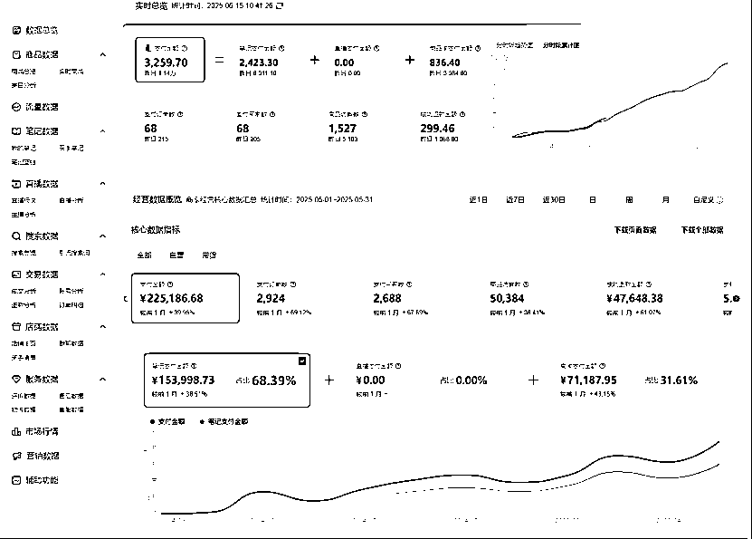

（利润40%）

## 一、很多看似绕远的路，后来都会派上用场

以前经常听到一句话：赚钱赚的是信息差。

但在真正接触到靠谱的信息之前，我一直没有找到适合自己的方向。今年3月，我偶然看到一篇关于普通人做副业的文章，抱着试试看的心态花6元体验了3天，之后便决定加入龙哥盟。

刚进入这个圈子时，我和很多新人一样，感觉像突然打开了一扇新门：

“原来这些事情真的有人能赚到钱？”

我2018年毕业后在深圳做网络相关工作，月收入只有5000元左右。那时候认为提升收入的主要方式就是考证，于是先后考了HCIE、RHCE等证书。证书确实提升了学习能力，但对收入的帮助并没有想象中那么大。

后来，我还陆续尝试过几种方向：

- 在知乎、CSDN发布技术文章，但因为写作能力一般，长期没有反馈，最后没有坚持下来；
- 做过资源类👸号，分享小工具、电子书、软件资源和IT视频；
- 为了给👸号引流，开通了📕账号，曾经有一篇资源分享笔记一周涨粉1000多；
- 后来账号被举报并受到限流，我一冲动把账号注销了。现在回头看，这其实是一个很大的损失，如果当时保留下来，完全可以转型做虚拟资料；
- 👸号目前还有2000多粉丝，但流量主每月只有几分钱，基本已经放弃。

现在回过头看，当时其实错过了不少机会：

- 没意识到虚拟资料本身就可以成为商品；
- 没想到📕后来会大力发展电商；
- 没有及时把原本积累的账号和内容能力转化为商业价值。

不过，过去的尝试也并没有完全浪费。

你写过的文章、做过的账号、踩过的坑、积累的经验，可能暂时看不到回报，但它们很可能会在未来某个阶段派上用场。

所以我越来越相信：只要认真做过一件事，即使结果不够理想，也不代表毫无价值。很多时候，失败只是暂时没有形成闭环。

而真正重要的，是持续接触新信息，逐渐提升自己的认知边界。因为一个人很难赚到自己完全不了解的钱。

## 二、我是如何开始做📕电商的

### 1. 从一篇文章开始尝试

在👸号长期没有收益之后，我并没有完全放弃副业探索。上班时只要有空，就会在抖音、知乎等平台搜索普通人还能做什么。

当时抖音和📕都在持续完善电商业务，我又刚好看到一篇关于无货源代发的内容，于是决定直接开始尝试。

之所以选择📕，一方面是平台当时处于发展阶段，另一方面是我之前做资源分享时，对平台内容生态已经有一些基础了解。

事实证明，很多事情不需要等到全部准备好再开始。先进入真实环境，再根据反馈调整，往往比一直研究更有效。

### 2. 新账号如何完成初步测试

我当时准备的东西非常简单：

- 一部淘汰下来的旧手机；
- 一张新的副卡；
- 一个确定好的商品方向。

注册账号以后，我没有马上大量发布商品内容，而是先进行几天垂直浏览。

每天刷与目标类目相关的笔记，适当点赞、收藏、评论，让平台逐步识别账号兴趣。持续一段时间后，系统会开始推荐更多同类内容。

我当时大约坚持了3天，随后发布了一篇与目标品类相关的测试笔记。

假如你准备做饰品手串，可以发布类似下面这种提问、征集或需求型内容：

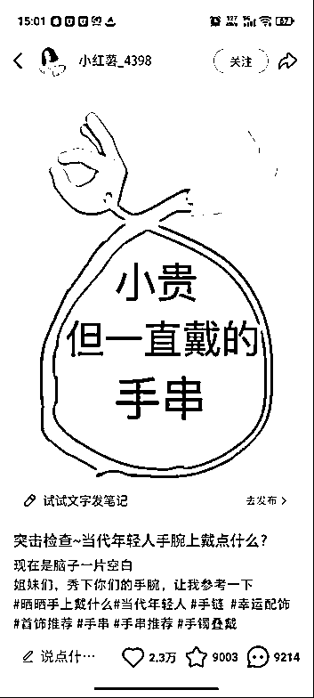

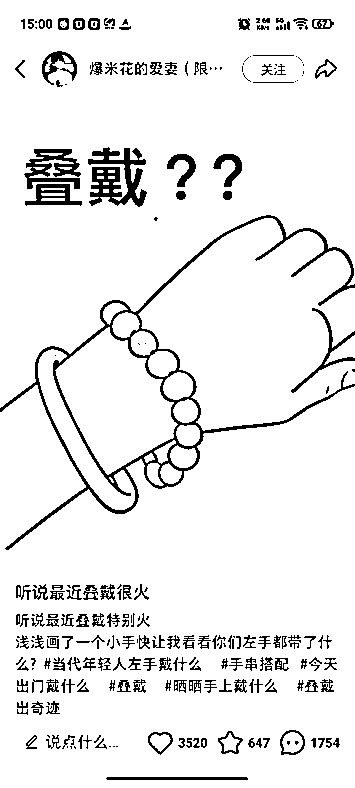

如果你准备做家居用品，也可以采用类似的方式：

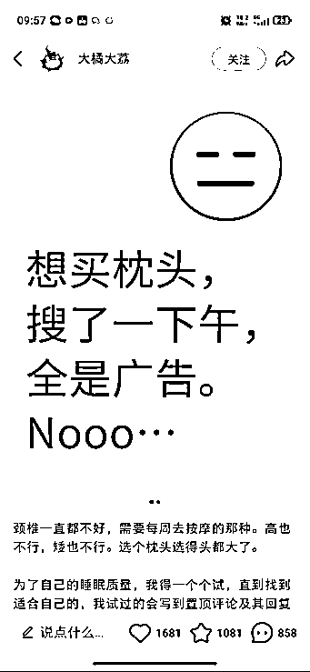

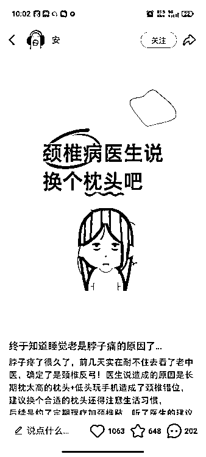

这类内容的优势是容易引发评论。用户愿意分享自己的喜好、需求和使用体验，互动数据通常会比普通商品展示更好。

测试笔记的主要目的，并不是立即卖货，而是判断账号本身有没有明显问题，例如是否存在违规记录、账号权重是否正常等。

如果发布后24小时阅读量能够达到200以上，基本可以视为初步通过，就可以继续开店和上架商品。

当然，测试结果不好，也不一定代表类目不行。有时候问题可能出在封面、图片或内容结构上。最简单的方法，就是找到同类已经验证过的测试笔记，按照它的形式重新制作一版。

不同新账号的基础权重并不完全相同。一个测试数据较好的账号，后续做内容和商品转化时，成功概率通常也会更高。

## 三、选品是电商最重要的起点

### 1. 我的核心选品标准

我一直采用的是📕站内选品，方法可以概括为：

> 低粉账号+近一个月出现爆文+评论区存在明确购买需求。

具体来看，通常会重点关注以下几类信号：

- 发布者粉丝量不高，通常在3000以内；
- 笔记发布时间较近，最好是一个月内；
- 点赞、收藏、评论数据明显高于账号平时水平；
- 评论区频繁出现“求链接”“在哪里买”“怎么购买”等内容。

这说明产品不仅被看到，而且已经有人产生了真实需求。

当你找到这样的内容后，再去寻找相同或相近货源，结合对标账号的内容方式进行测试，成功率会比完全凭感觉选品高得多。

对于新手来说，这是一种相对容易执行的方法。因为它不是凭空猜测什么会爆，而是先观察平台已经给出的反馈。

### 2. 通过系统推荐寻找潜力产品

在养号阶段，平台会持续向你推送同一领域的内容。

比如你选择家居用品，后续会不断刷到收纳、枕头、清洁用品等内容；如果选择饰品，也会看到水晶、手串、项链等相关笔记。

这时就可以重点观察低粉账号中的异常爆文。

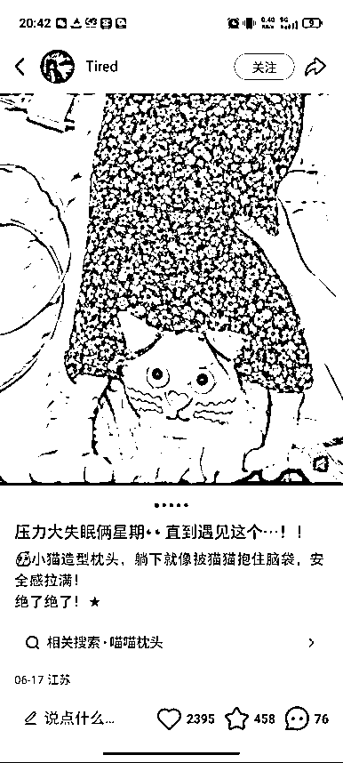

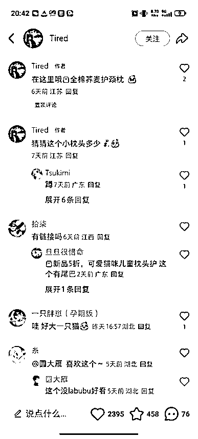

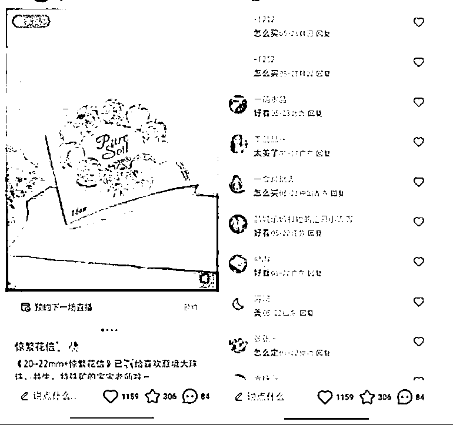

不过，看到爆款并不代表一定适合跟做，还要评估产品本身的操作难度。

例如水晶手串虽然近期热度很高，但它并不只是单纯卖商品。你需要了解水晶、风格和相关情绪价值，不同产品之间还存在明显差异，成本也可能较高，更适合通过直播或强展示型内容销售。

因此，新手最好优先选择：

- 容易拍摄；
- 规格比较标准；
- 不需要太多专业知识；
- 售后相对简单；
- 货源稳定的产品。

### 3. 从爆款内容反查货源

确定要做的产品后，可以把对标笔记的图片保存下来，再到1688使用“以图搜款”。

这样通常能够找到大量类似供应商。不过，1688上也存在不少中间商，需要注意筛选。

一般可以优先查看带有“实力商家”或“超级工厂”标识的店铺，这类供应商的稳定性通常更好。

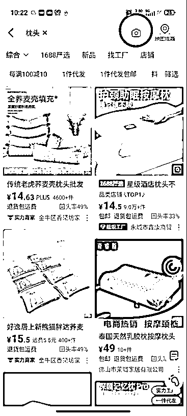

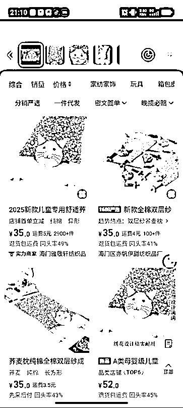

我自己的第一个产品，就是通过这种方式找到的。

在最初没有实拍素材时，可以先将对标笔记的图片与供应商详情页素材结合起来，完成商品上架，再发布相关商品笔记。

我大约在上架两周后迎来了第一笔订单。

虽然订单并不大，但它带来的反馈非常重要。对于新手来说，第一次成交往往比单纯学习更能增强行动力。

## 四、内容运营：先借鉴，再逐步形成自己的素材

### 1. 冷启动阶段：先解决“没有素材”的问题

刚开始做的时候，大多数人都没有产品照片、视频和成熟文案。

这时可以借助工具，对同类爆款内容进行拆解，再重新整理出自己的版本。

例如，可以使用Coze搭建工作流，复制📕笔记链接，通过插件提取原文和图片信息，再交给DeepSeek等大模型进行改写。

这样可以快速完成：

- 标题拆解；
- 内容结构分析；
- 图片顺序整理；
- 文案重新表达；
- 多版本内容生成。

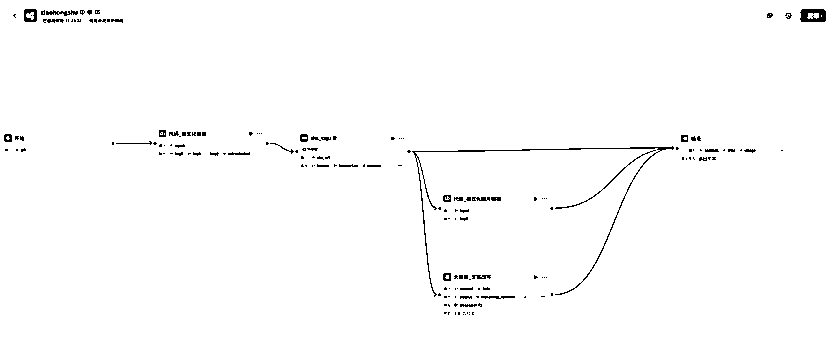

不过，二次创作并不等于简单复制。更稳妥的方式是研究爆款笔记的结构、表达节奏和用户关注点，再根据自己的产品重新组织内容。

对于自媒体和电商从业者来说，AI工具不一定替你完成全部工作，但可以显著减少重复劳动，把更多时间放在选品和数据分析上。

### 2. 有订单后，尽快获取真实样品

商品上架后，可以用自己的小号在店铺下单，再联系供应商发一份样品。

收到物流单号后，在平台完成发货流程。样品到手后，就可以进行真实拍摄，并根据实际体验留下评价。

这样做有几个好处：

- 获得属于自己的图片和视频；
- 了解产品真实质量；
- 发现潜在售后问题；
- 积累真实使用素材；
- 为后续内容持续更新做准备。

早期可以先解决“有没有内容”的问题，后期则要逐步提高素材的真实性和差异化。

### 3. 用AI优化文案表达

拿到样品后，可以参考对标账号的拍摄角度、标题形式和内容框架，再结合自己的产品重新创作。

我常用的一类提示词是：

“请以📕内容运营专家的身份，参考下面这篇笔记的结构和表达方式，在不改变核心意思的前提下，生成5篇新的📕笔记。目标人群为女大学生和都市上班族，保留原内容轻松自然的表达风格，并增加适合平台传播的标题和互动话术。”

具体提示词可以根据自己的类目进行调整。

AI生成的版本不一定能直接使用，但通常可以帮助你快速获得多个写作方向，再人工修改细节，效率会比完全从零开始高很多。

## 五、出单之后，如何把结果继续放大

商品有订单后，不能只盯着发货，还要持续优化评价、曝光和转化。

### 1. 让店铺尽快积累真实反馈

可以邀请身边朋友购买并进行真实体验，后续留下评价和晒单内容。

数量不需要特别多，但一定要有真实、清晰、可信的反馈。对于新店来说，评价和晒单会明显影响其他用户的购买决策。

### 2. 评论区提升互动氛围

当某篇笔记已经有一定流量时，可以在评论区围绕产品使用场景、购买体验等问题进行互动，引导用户继续讨论。

互动质量越高，笔记的内容活跃度通常越好，也更容易让新用户理解产品价值。

### 3. 与小博主进行低成本合作

可以寻找粉丝量几百到几千的小博主进行置换合作。

常见方式是：

- 博主在你的店铺购买产品；
- 你寄送样品；
- 对方收到后进行体验；
- 发布评价、晒单或种草内容。

这类合作成本相对可控，而且内容通常比纯广告更自然。

我自己一直在使用这种方式，曾经有一篇博主发布的晒单笔记获得了上千点赞，整体投入产出比不错。

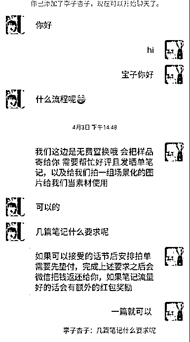

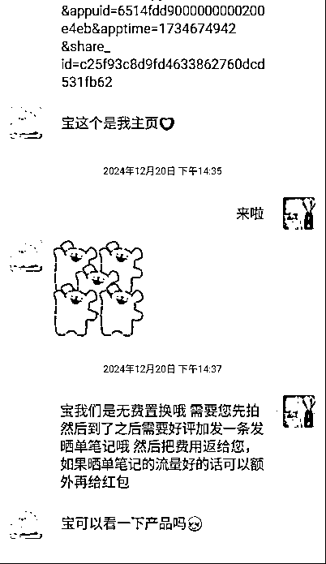

当然，合作前要判断博主的粉丝画像、内容风格和产品是否匹配。粉丝数量不是唯一标准，垂直度和互动质量同样重要。

### 4. 其他可尝试的放大方式

当产品已经能够稳定出单后，可以逐步测试以下方法：

1. **素人笔记合作**  
   成本较低，适合批量测试，但账号通常不够垂直，效果会有一定随机性。

2. **晒单激励活动**  
   通过置顶笔记说明晒单、点赞或分享可获得相应奖励，鼓励用户主动发布内容。

3. **垂直博主付费推广**  
   选择粉丝量较大的同领域博主进行投放，但要重点检查其粉丝群体和产品是否匹配。

4. **入驻选品中心**  
   个体户店铺可以考虑加入选品中心，让博主通过小清单挂载商品链接，以佣金换取更多曝光。

5. **子账号运营**  
   绑定多个子账号，形成基础内容矩阵，增加触达用户的机会。

6. **付费投流**  
   对已经验证过、曾经稳定出单的笔记，可以测试薯条或乘风投流，延长爆款内容的生命周期。

7. **搜索词布局**  
   在标题、正文和标签中自然加入用户会搜索的关键词。

其中，搜索流量对我的订单贡献非常大。去年很多旧笔记至今仍然能够持续成交，搜索支付金额占比约60%。

因此，发布内容时不要只关注首页推荐，也要思考用户会通过哪些词找到你的产品。

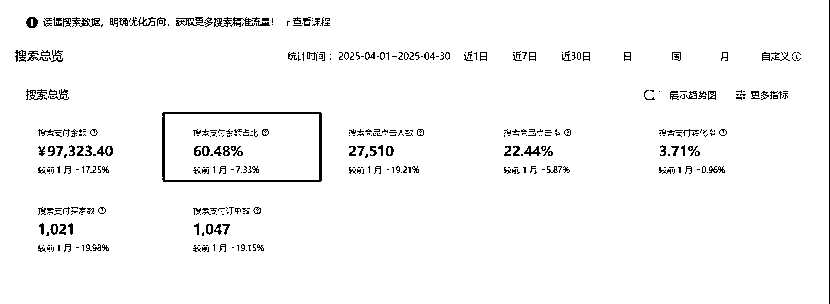

搜索词可以从几个地方获取：

- 📕搜索框中的下拉联想词；
- 千帆后台的搜索数据；
- 乘风推广后台中的行业词和同行购买词。

## 六、差评处理速度，决定店铺能走多远

店铺出现差评后，一定要尽快处理。

差评会影响店铺评分，评分下降后又可能影响流量和转化，形成连锁反应。

收到差评后，我通常会主动联系客户，了解具体问题，并根据情况提供补偿、补发或其他解决方案。

沟通时态度要尽量诚恳。即使你认为问题不完全在商家，也需要先把用户情绪稳定下来。

品质相关的负反馈也要重点关注，最好控制在行业平均水平以内。相关指标过高，平台可能会限制店铺流量。

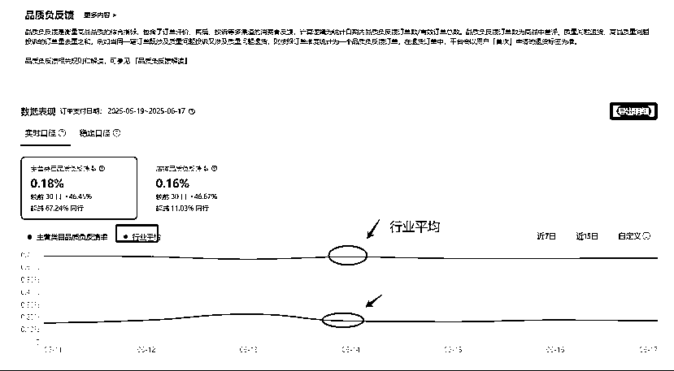

我过去处理差评时，通常会采用以下流程：

1. 先与客户沟通解决问题；
2. 如果客户愿意撤销评价，请客户回复“已与商家友好沟通，误会已经解决，同意撤销评论”等内容；
3. 截图后提交平台申诉，并说明双方已经协商处理完成。

申诉时可以这样表达：

“目前已与客户完成友好沟通，相关问题已经解决，客户也同意撤销评价，烦请平台协助审核，谢谢。”

这次参加航海时还了解到另一种方式：与客户协商后，通过小额打款或退款方式解决问题，再保留沟通和处理凭证，提交平台审核。

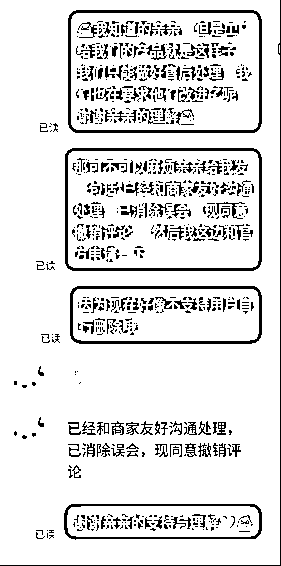

核心原则只有一个：不要放任差评发酵，也不要在情绪上头时与客户争论。

## 七、用数据复盘，而不是凭感觉经营

店铺稳定后，要定期查看千帆后台数据，重点关注：

- 哪些笔记点击率更高；
- 哪些内容转化率更好；
- 哪些关键词带来的订单更多；
- 用户从什么入口进入商品页；
- 不同素材、标题、封面对成交的影响。

把高点击、高转化笔记中的共同元素提炼出来，再运用到下一批内容中。

只有不断记录、分析、调整，内容质量才会逐步提升。

## 八、参加航海后，我获得了哪些新的提升

这次参加📕电商航海，最大的价值不是推翻原有方法，而是进一步验证了站内选品的可行性。

通过实践，我成功复制出了一个日销300单的新产品，也在三个方面获得了明显升级：

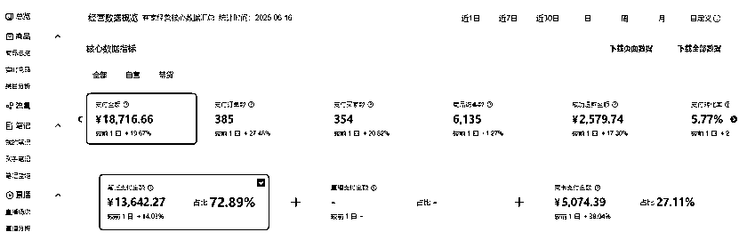

### 1. 选品范围更广

除了📕站内内容，还学会结合淘宝热榜、抖音飙升榜等平台，建立跨平台观察机制。

多个平台同时出现热度的产品，更值得重点研究。

### 2. 流量方法更加丰富

以前主要依赖自然流量，后来开始尝试“薯条+乘风”的组合投放，让已经验证过的内容获得更长的曝光周期。

### 3. 内容生产效率大幅提升

通过Coze与DeepSeek搭建AI工作流，素材整理、文案改写和内容生成速度明显提高。

这次经历也让我更加确定：付费学习的本质，是用金钱购买时间。

有些问题自己摸索可能需要一两个月，但有经验的人一句提醒，就可能帮你避开大量弯路。

更重要的是，同行圈子的质量会影响一个人的认知上限。和一群持续实践、持续拿结果的人交流，往往比单独闭门研究更容易获得突破。

## 九、给准备入场新手的几条建议

### 1. 先把精力放在选品上

电商不是单纯比谁更努力。

产品方向错了，内容越多，浪费的时间越多。选品的重要性往往高于单纯增加发布数量。

新手可以优先研究低粉账号的近期爆文，不要只凭个人喜好判断产品。

### 2. 先复刻，再创新

刚开始不需要急着建立所谓独特风格。

先把已经被验证过的标题结构、图片顺序、内容节奏和表达方式研究清楚，完成基础复刻，再慢慢加入自己的特色。

模仿不是终点，但通常是最快的起点。

### 3. 不要忽略搜索流量

搜索词相当于一类持续存在的免费入口。

可以把相关长尾词自然放进标题、正文和标签中，例如“小众高级感手串”“宿舍实用收纳”等。

用户会怎么搜索，决定了你的内容能不能被主动找到。

### 4. 差评必须快速处理

差评不是小问题。

出现后尽量在24小时内跟进，避免影响店铺评分和整体流量。

### 5. 有了稳定订单后，学会借助外部杠杆

当产品已经验证可行，就不要永远依赖自己一篇篇发布内容。

可以尝试博主合作、内容置换、选品中心和付费投流，把已经跑通的模型放大。

## 十、最后总结

我认为，普通人做📕电商，可以简单概括为：

> 信息差×执行力×迭代速度=最终结果。

没有资源和人脉，并不意味着没有机会。

只要能够：

- 找到有需求的产品；
- 观察平台已经验证过的内容；
- 快速完成测试；
- 根据数据持续优化；
- 在有效方法上不断放大；

就有可能在平台红利期中获得属于自己的机会。

不要一直等到“完全准备好”再开始。

先完成，再优化；先做出一个70分的版本，也比长期停留在0分强。

信息差一直存在，但真正能把信息变成收入的，永远是那些愿意下场执行的人。

希望这篇复盘，能给正在观望的小伙伴一点启发。