# 影刀RPA自动采集小红书对标店铺商品（保姆级教程-附源码）

做小红书电商的朋友，应该都遇到过这种纠结：刷到某家店铺的商品卖得不错，点进去一看，好像整个店都挺能打。这时候就会想，能不能把这家对标店的商品全都扒下来，按销量筛一遍，再持续盯着数据看？

大家好，我是黄大路，平时主要用 RPA 帮电商团队解决业务问题。目前已经基于影刀 RPA 搭了 150 多条自动化流程，也服务过不少小红书 MCN 和电商卖家。今天就把这个“自动采集对标店铺商品”的完整方案分享出来，需要源码的可以直接拿走。

之前我分享过低粉爆款的采集方法，这次是客户提的新需求：把对标店铺里销量达标的商品全部抓下来，然后对销量做持续监控。这样做主要是为了几个判断：第一，看商品的“3个月购买人数”和“24小时加购”，前者判断近期热度，后者判断跟品时机；第二，每天盯销量，如果某款商品销量稳步往上走，那大概率是潜力爆款，可以提前找货源；第三，看同行上新的频率和款式，摸清迭代方向；第四，结合每日销量和价格，大致算出对标店铺的日销售额和客单价。

先看效果。运行流程时，只需要填两个信息：对标店铺的小红书号，以及你想筛选的销量下限。支持同时填多个小红书号，用换行隔开，就能一次采集多家店铺。销量阈值填“0”的话，就是把全店商品都收下来。跑完之后，每个商品会拿到这些字段：标题、链接、销量、原价、到手价、3个月内购买人数、24小时加购。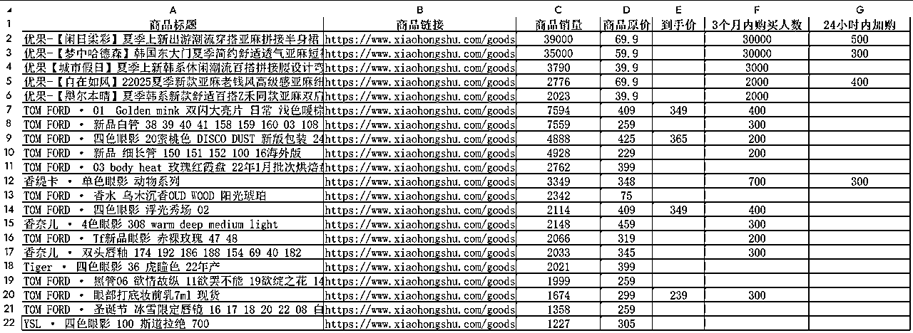

整个流程模拟真人操作：打开小红书首页，搜索小红书号，进入店铺主页，再按销量要求逐个抓取商品数据。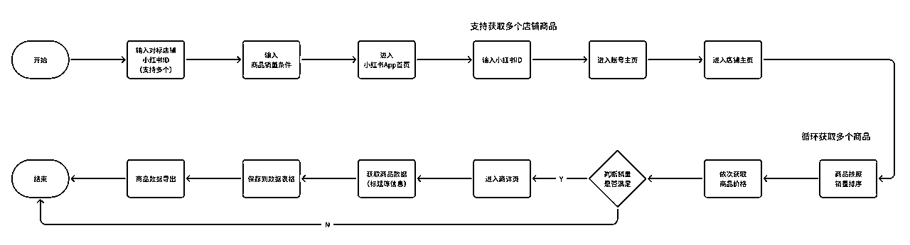 而且这个 RPA 工具没有任何数量限制，店铺数、商品数都可以放开跑。

再来说下运行环境。因为走的是手机自动化，所以需要 Windows 电脑加 Android 手机，没有手机也可以用模拟器。我自己测试用的版本是：影刀 RPA 5.28.34 创业版（32位），手机是 Redmi Note 10，MIUI 14.0.10，小红书 App 版本是 v.8.88.0.be5f430。这里要提醒一下，不同版本在界面细节上会有差别，具体位置可能需要你微调。连接手机和电脑的步骤，直接按影刀官方文档配置就行，实在搞不定可以找官方客服，也可以问我。连接成功后，手机画面会投屏到电脑上，就说明通了。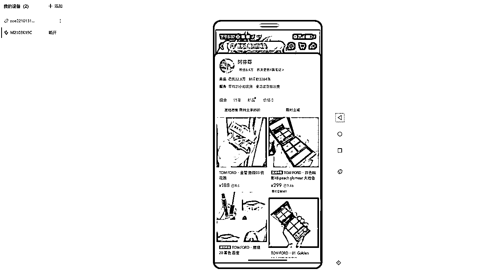

接下来是指令逻辑。主流程分这么几步：第一步初始化，连接手机，把表头写进数据表。```
["商品标题","商品链接","商品销量","商品原价","到手价","3个月内购买人数","24小时内加购"]
``` 然后用自定义对话框收集“小红书号”和“销量要求”，销量要求存成全局变量。 小红书号支持多个，所以用文本分割，按换行符拆开。 接着从首页开始，搜索框输入小红书号，循环处理。这里要注意异常情况：如果搜索不到账号，或者该账号没开店，就跳过这个号，继续下一个。```
# 搜索_按钮
//*[@content-desc='搜索']

# 搜索_输入框
//android.widget.EditText[@text="搜索, "]

# 搜索_输入框
//*[@text='搜索']
``` 从搜索结果页点进用户主页，再进店铺首页，这部分有固定的 xpath，可以参考截图里的元素路径。```
# 搜索结果_账号头像
//android.widget.FrameLayout[@resource-id='com.xingin.xhs:id/avatarLayout']

# 店铺_元素
//*[@text='店铺']
``` 为了让结构清晰，我把“获取店铺商品”单独拆成子流程，一个店抓完，自动进入下一个店的循环。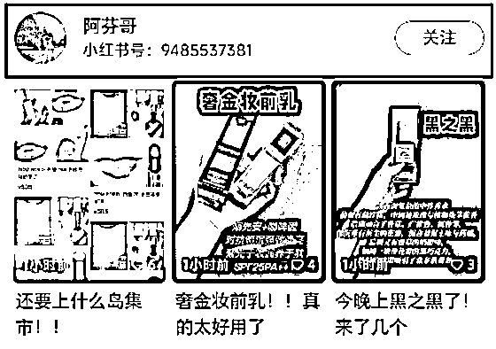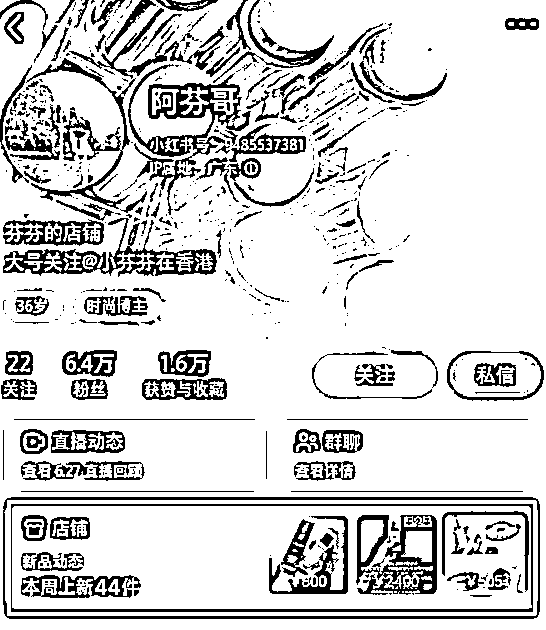

再说说“获取店铺商品”子流程。进入店铺后，先按销量排序。然后循环读取商品列表里的销量数据：如果销量达标，就点进商品详情页去抓详细内容；一旦遇到不达标的情况，直接退出循环，同时退出店铺页面，表示这个店已经抓完了。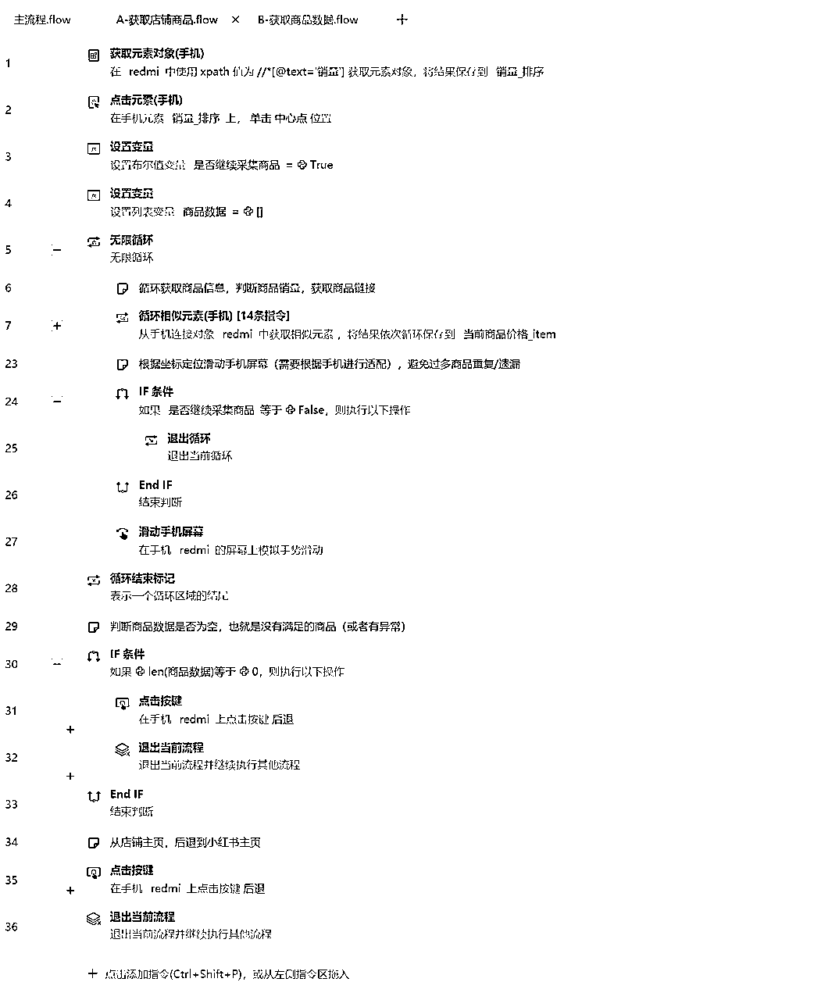```
# 销量
//*[@text='销量']
``` 有一个细节要注意：如果商品销量是 0，列表页根本不会显示销量数字，所以要做一次判断，否则会漏掉或报错。 销量数据处理我写了个小函数，你可以直接复制用。```
import re
def convert_chinese_number(text):
    # 定义中文数字单位映射
    units = {
        '十': 10,
        '百': 100,
        '千': 1000,
        '万': 10000,
        '亿': 100000000
    }

    # 正则表达式匹配数字和中文单位
    pattern = r'(\d*\.?\d+)([十百千万亿]?)'
    match = re.search(pattern, text)

    if not match:
        return 0

    number = float(match.group(1))
    unit = match.group(2)

    if unit:
        return int(number * units[unit])
    return int(number)

# 示例用法
# print(convert_chinese_number("1万"))    # 输出: 10000
# print(convert_chinese_number("2.5亿"))  # 输出: 250000000
# print(convert_chinese_number("点赞"))   # 输出: 0
# print(convert_chinese_number("3千5百")) # 输出: 3500
```

最后是“获取商品数据”子流程。分三步：先拿标题和价格。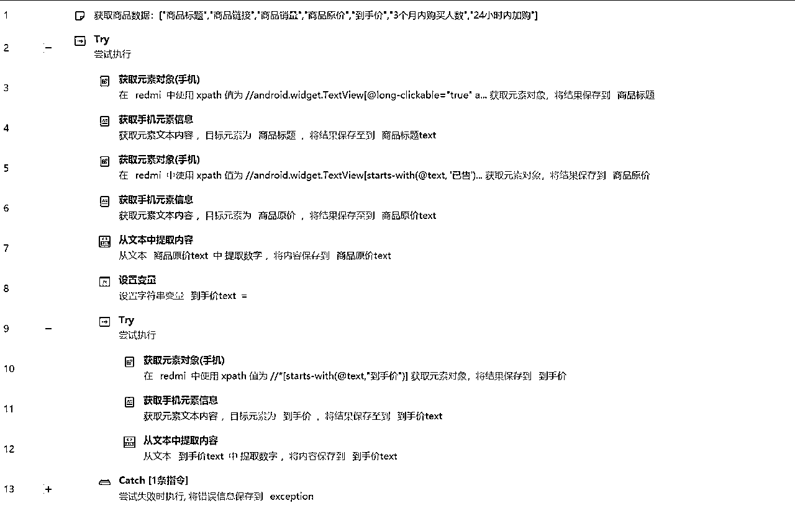```
# 商品标题
//android.widget.TextView[@long-clickable="true" and string-length(@text)>10]

# 商品原价
//android.widget.TextView[starts-with(@text, '已售')]/../../following-sibling::android.view.ViewGroup//android.widget.TextView[starts-with(@text, '¥')]

# 商品到手价
//*[starts-with(@text,"到手价")]
``` 再拿“3个月购买人数”和“24小时加购”，这两个字段有些商品没有，所以必须做异常保护。```
# 三个月购买_元素
//android.widget.TextView[contains(@text, '3个月内') and contains(@text, '人购买')]

# 加购_元素
//android.widget.TextView[contains(@text, '24小时内') and contains(@text, '人加购')]
``` 最后获取商品链接，并把所有数据写回表格。“复制链接”那个按钮，我是用图像捕获定位的，你也可以用元素捕获，看个人习惯。```
# 分享商品
//*[contains(@content-desc,"分享商品")]

# 弹窗_滑动容器
(//androidx.recyclerview.widget.RecyclerView)[3]

# 复制链接
//*[@content-desc='复制链接']
``` 所有字段写入后，表格里就是干干净净的结构化数据了。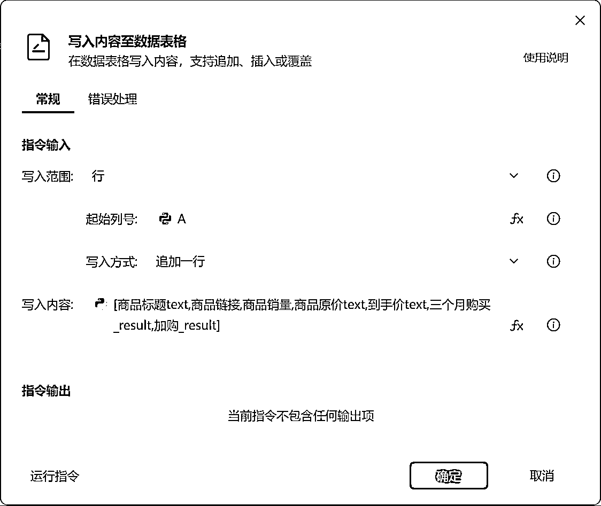 完整源码一共有三段：主流程、获取店铺商品、获取商品数据，都在下面。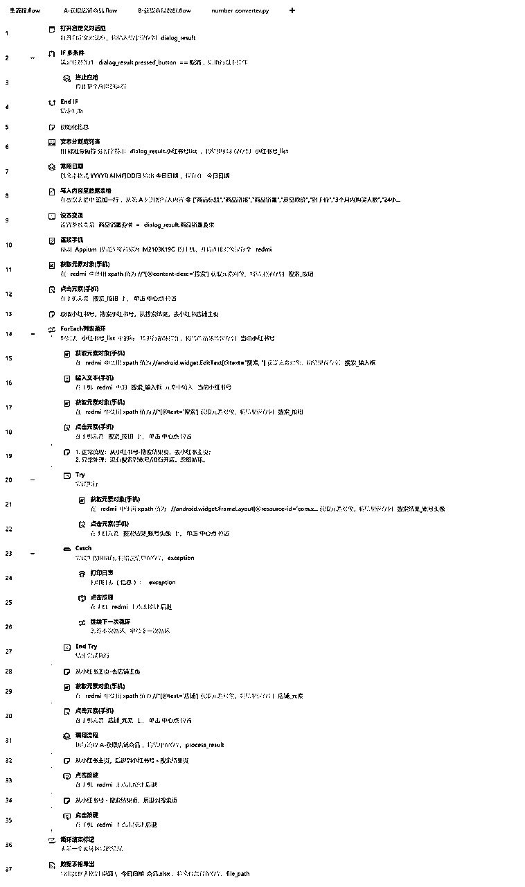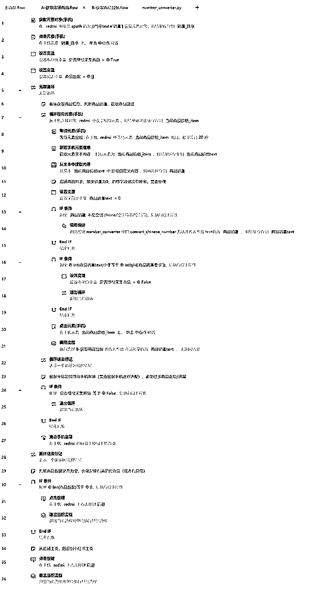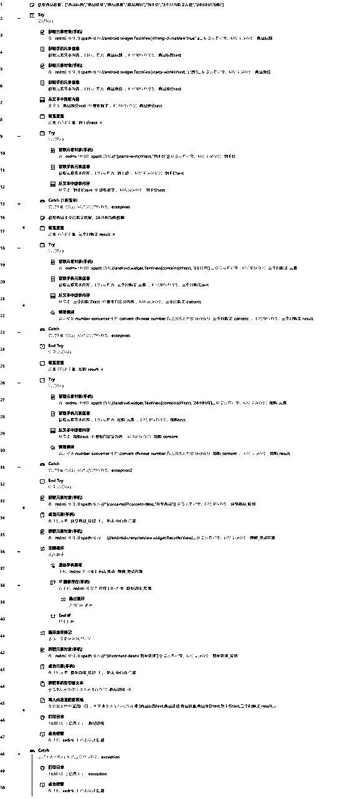

以上就是从零搭建小红书对标店铺商品自动采集的全过程。如果你正在做小红书电商，选品时也用得上这套方式，直接照做就能跑通。手机自动化受系统、硬件、App版本影响比较大，遇到细节问题就根据实际情况灵活调整。觉得有用的话，别忘了点个赞，后面我还会继续分享更多 RPA 实战教程。