# 从0到月入20万又果断离场，潮玩直播这波风口，我们是这样踩过来又放手的
作者：龙哥

各位好，我是赚钱圈子第9期的老成员阿莫。2018年入局抖音短视频带货，一条视频最高给我带来过40万的佣金收入；2020年转做女装直播，月销冲到200万。可到了2022年之后，整个人陷入了躺平状态，利润太低看不上眼，利润高的又怕麻烦不想碰。直到去年，我才重新收拾心情，认认真真再出发。

最近PPMT股价一路飙升，Labubu火遍全世界，潮玩的话题热度空前高涨。借着这波热度，我把去年亲自操盘的潮玩直播项目，从注册账号到放大运营，再到主动喊停的全过程，做一次完整的复盘。希望把那些走过的弯路和换来的教训都摊开来讲，给想进场或者在摸索中的朋友当个参照。

## 一、为什么看中潮玩这片蓝海

### 灵光一闪的起点

去年春节假期之后，媳妇天天刷潮玩直播间，还入手了一个温度SP车挂。我一个大老爷们对这些IP人物完全无感，可只要我开口问，她能滔滔不绝给我讲半小时。看她这么着迷，我就顺嘴问了句：“要不你自己也开个直播间卖这个？”

没想到她真的一口答应，于是我们俩开始认真调研这个赛道。

### 三个维度的判断逻辑

1\. 大趋势预判 我一直坚信一个逻辑：当中国人均GDP突破1万美元后，消费市场会出现结构性变化——本土品牌崛起、精神层面消费比重提升。潮玩正是典型的精神消费品，长期来看我相当看好。这里先卖个关子，之后有机会跟大家聊聊几个面向00后甚至05后的项目，年轻人市场大但好产品少，而且他们花钱意愿极强，机会其实不少。

2\. 变现空间测算 我们当时观察了📕一个头部直播间，估算下来月利润能到20万，这数字确实让人动心。

当时的分析思路大概是这样：

1.  选平台：我们俩在抖音泡了好几年，太清楚那儿有多卷了，所以先在📕落脚，新人起号相对友好。等模式跑通了，再考虑转战抖音。

1.  选对标：扫了一圈头部直播间，最终锁定一家，选择标准主要看几点：

1.  人家是头部玩家，在线人数、卖货速度和总销售额都挺能打（当时📕盲盒直播间数量不多，我们没用第三方数据工具，最好还是借助新红这类工具交叉验证销售数据，更稳妥）

1.  他们卖的东西我们拿得到货源

1.  人家的直播套路我们看得懂，也觉得自己能模仿（这一步我们踩了坑：选对标不能光看对方现在做起来的模式，要倒推验证他早期起号的核心逻辑）

1.  拆数据：

1.  翻遍📕各类帖子，判断盲盒品类的退货率处于低位。

1.  去1688查她主推款的进货成本，推算单件利润空间，再持续跟踪她一天和整月的出货量，算出毛利。

1.  最后再扣掉预估的房租和人力开支。

3\. 竞争壁垒 媳妇觉得那个对标主播的能力自己完全能复制。我在女装直播领域摸爬滚打过，看过她们的模式后，确实觉得门槛没想象中高。

去年4月那个对标的截屏找不到了，今天我重新找了个直播间当案例，大体讲讲我的拆解方式：

1.  找对标先从榜单下手：去第三方平台或者平台自带的榜单找，这个例子是从📕艺术潮玩榜淘出来的

1.  看对方做了多久：这个号5月才正式开播，到今天（6月29日）一共才播了25场。中间有断播，要么在试品换方向，要么就是某个团队孵化的小号

1.  估算收入：去1688看看类似的链子什么价位（大约10块），去千岛搜下同类萌粒的行情（大概8块），再加上包装和快递（3块上下），单笔订单利润在10块左右。播了25天，毛利五万多

1.  复制难度：判断对标在人、货、场三个层面自己能否搞定

1.  人：主播不用露脸，也不要求高颜值，招人成本低，或者自己直接上。重心放在话术打磨上，用get笔记把对标主播的话术录下来，整理成稿背熟。

1.  货：自己从1688下单几条看质量，千岛买点萌粒，再研究下打孔之类的技巧，基本就能搞定

1.  场：一张桌子就够，对场地要求极低，重点放在桌面搭配和灯光布置

1.  赛道拥挤度：盲盒底下分支非常多：手串、萌粒、盲盒、娃包、奶油胶，玩法更是五花八门：大转盘、猜颜色、对对碰。锁定一个对标后，要去看有没有同类直播间在跑，重点看这几组数据：同款对标有多少个、他们做了多久、销售额水平、走势是往上还是往下。判断竞争没那么激烈才适合杀进去。

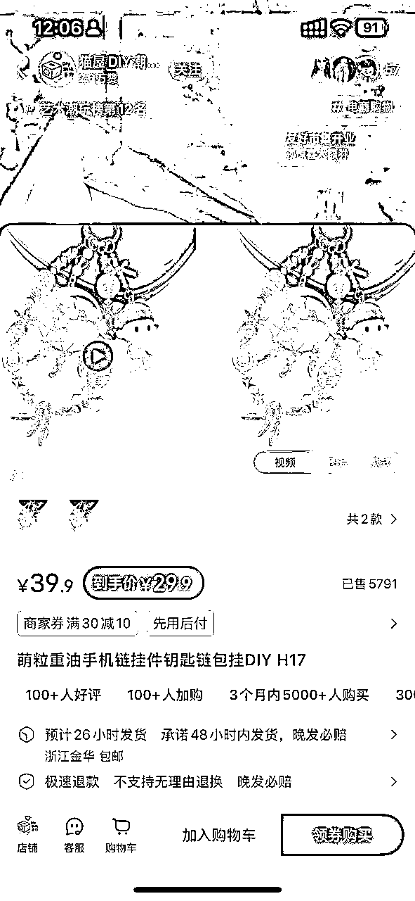

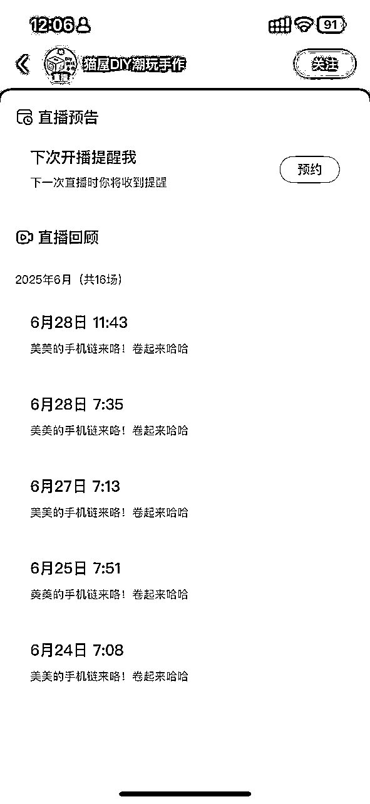

## 二、怎么做起来（0-1阶段）

### 公司化运作思维

之前创业六年基本都是单打独斗的模式，这次想换个思路，用公司化运作把自己从具体事务中解放出来。于是在良渚租了写字楼，4月开始招主播。

当时担心招人困难，选了良渚那边的写字楼。但后来发现现在就业市场不太景气，招人非常容易，BOSS直聘一打开全是主动打招呼的。完全可以选个更便宜的办公地点，创业前期能省则省。

### 首场直播翻车实录

人员配置：我、媳妇、主播

5月12号主播到岗，起号阶段我们选了手串盲盒这个品类，当时考虑主要有两点：一是这个品客单价低，试错成本小，二是媳妇能搭配出更好看的款式。下图是媳妇的手笔：

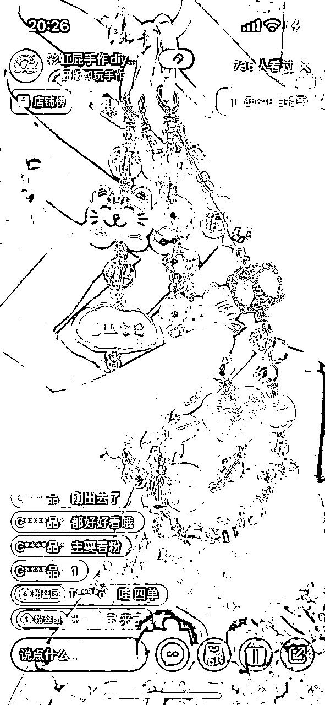

媳妇搭出来的款确实颜值在线，但真正开播后发现，对标直播间是靠刷假单把人气撑起来的，我们老老实实平播根本拉不动。

解释一下：当时手串盲盒的玩法是，一单39.9元，买家从10个颜色里猜2个颜色。保底拆两个手串盲盒，拆出来的手串颜色跟猜中的一致就加拆一串。这样算下来，平均每单拆2.5个盲盒。

遇到的问题：我们本本分分平播的时候，同行靠着假单操作，一个订单能加拆七八次（这种概率比万分之一还低）。一直拆盲盒看起来特别带感，把直播间在线人数稳住了；同时刺激了用户的赌博心理，围观的人觉得自己也能中，跟着下单转化率也上来了，人气就这样被顶起来。我们不愿意造假，老老实实平播，一天只有几十单的成交量。

这次踩到的坑：

1.  手链这个品类，做得好的直播间，买家根本不是图手链好看才掏钱的，是冲着连续猜中颜色的刺激感去的

1.  手链这个方向竞争者太多了，路子不够野根本跑不出来。创业初期适合选竞争小的切口

1.  盲盒直播，对选品的要求只是一部分，玩法设计同样至关重要

1.  前期调研不够细致，人货场三要素只看了个表面。市场调研越细，后期踩的坑越少，千万不能想当然

1.  实体创业选品要慎之又慎，手链产品换方向后，积压了一批库存，花了整整两个月才清完

破局思路：先找到自己的差异化优势，媳妇的优势是审美在线、做出来的款够精致。那我们去找竞争小、更看重选品能力的直播间来模仿。最终我们锁定了一个做娃包的直播间：

1.  月销量1000+，客单价138元，月销售额10万+，量级符合我们的期望值。

1.  毛利接近50%，利润空间还挺可观。而且这属于新品，背后还有更大的市场可以挖

1.  几乎没有直接竞品：媳妇经常泡盲盒直播间，对这个品类特别喜欢，而且在📕搜了一圈也没找到类似的直播间

1.  媳妇觉得自己能做得更好：包挑得更时髦，搭配的娃更火，娃和包的匹配度拿捏得更到位

1.  他们也是平播模式

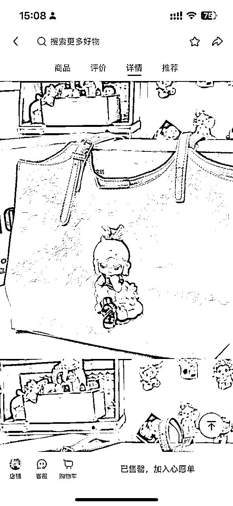

于是果断切换到这个品类。媳妇的审美确实能打，新品上线就开始出单了，5月场均销售额已经超过2000。

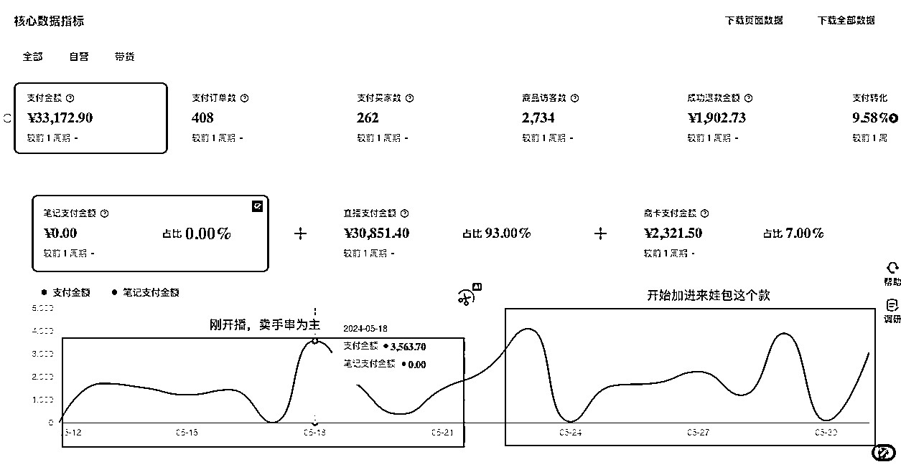

## 三、如何放大（1-10阶段）

人员配置：我、媳妇、主播、打包

### 爆款密码浮出水面

做娃包初期，我们优先考虑了实用性，大部分用了小娃。毕竟娃的体积小，挂在包上面不会显得太沉。

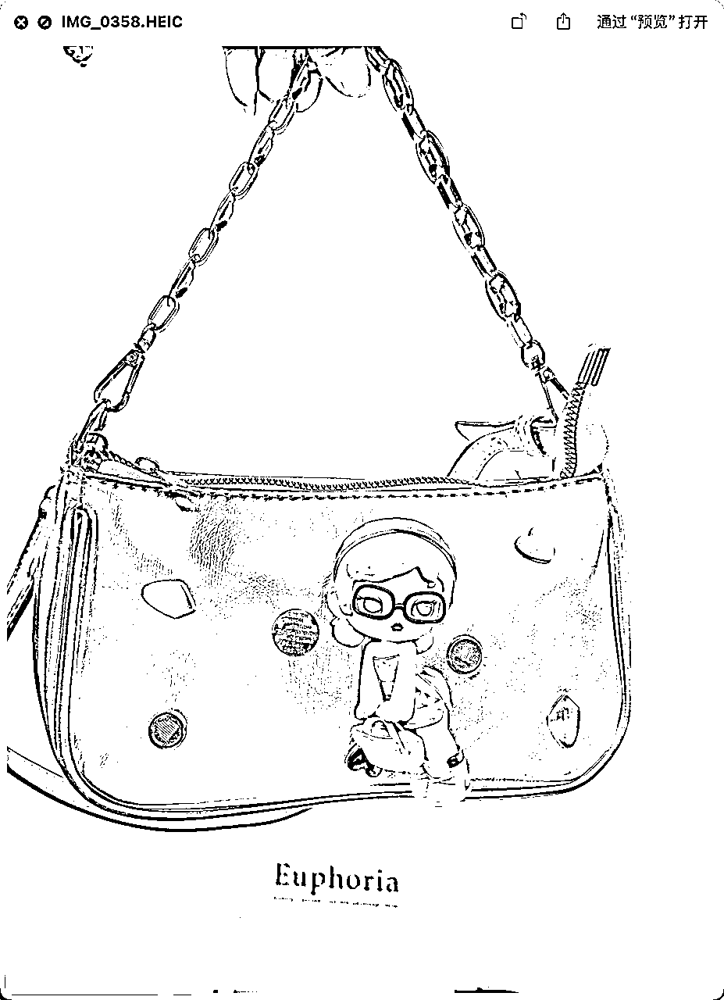

但到了6月初，根据实际销售数据和直播间粉丝的反馈，我们发现粉丝对单个IP的偏爱已经超过了对整体搭配美感以及实用性的需求。

1.  很多粉丝因为喜欢某个IP，会心甘情愿收集那一个IP的所有相关产品

1.  很多人买娃包根本不会背出门，下单那一刻的满足感就够了

1.  好看是硬道理，稍微重一点粉丝们也能接受

基于这些判断，我们开始增加娃包中IP的种类，根据销售数据不断调整各IP的占比，最后甚至细到某IP哪个具体款式卖得最好。当时发现Zoraa这个IP粉丝喜爱度特别高（粉丝会在直播间直接点名要这款，我们一上架果然被抢），我们就用她做的娃包做成惊喜款（一端4个娃包里只有一个是Zoraa款），再加上一位铁杆粉丝的鼎力支持，日销售额直接冲到八九千，开始见到利润了。

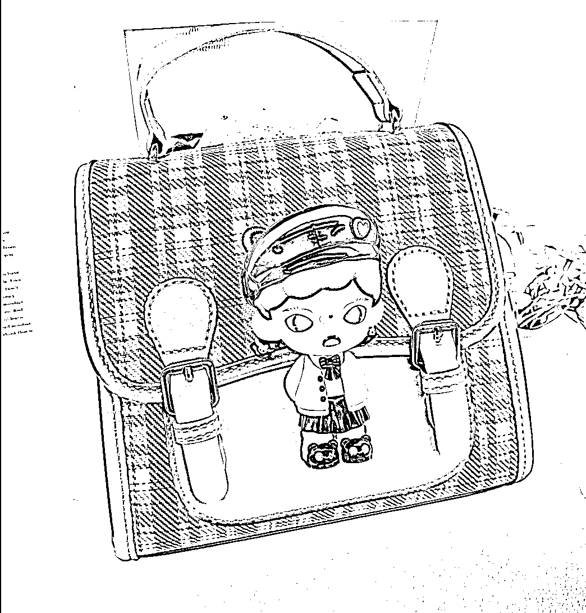

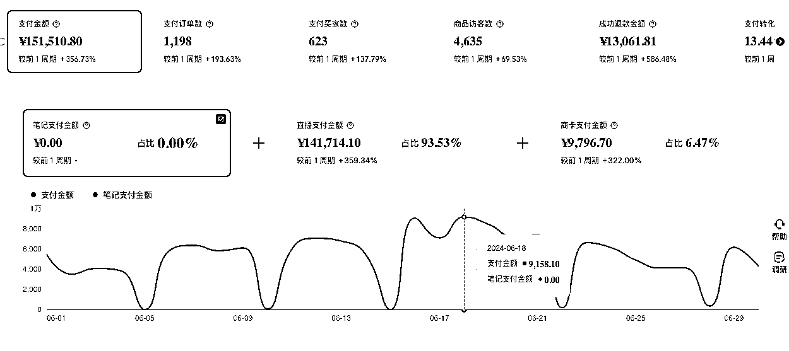

### 第一次业绩下滑

6月底，铁粉们的需求基本被消化完了，没有她们的带动，直播间靠平播拉不到新粉，数据开始往下掉。

应对策略：不断测试其他IP，丰富产品矩阵（从最初的只有Zoraa、爆米花、卓大王、安妮塔，到后来把Dora、SP、dimoo、拉布布等更多IP补了进来）。运营上娃包改成一端一个大惊喜加一个小惊喜（一端4个娃包，两个普通款，另外两个分别用大热款和小热款的娃）。到八月底数据恢复到八九千的水平。

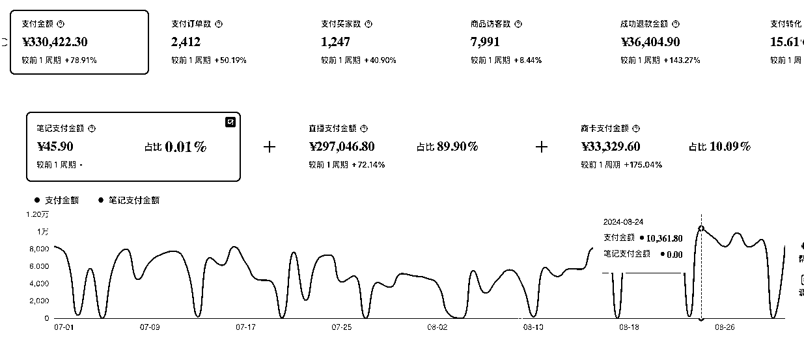

### 产能卡脖子

核心问题：七八月份，我们卡在了制作环节。因为是纯手工原创，自己买盲盒、买包、搭在一起、再制作。我还得兼顾带娃，每天订单根本做不过来。七八月份销量上不去，有一部分也是因为我们能做的量就那么点，基本是当天做完当天清空。

解决方案：

*   新招制作助理

*   增加奶油胶方向（把盲盒用奶油胶固定在生活用品上，杯子、音响、置物架、充电宝等等），一边招人一边找小工作室合作测试

*   我们的粉丝粘性非常高，只要新品出得好，她们就会蜂拥而上。拓奶油胶的品，能提高单个粉丝的产出价值

*   跟工作室合作能分担我们的制作压力，就算自家娃包产量跟不上，总销售额照样能涨

*   当时算了下，自己做奶油胶杯子利润能到50，外包给工作室合作，利润降到35。但想想不用自己动手，省了人工和囤货成本，利润也还是能接受的

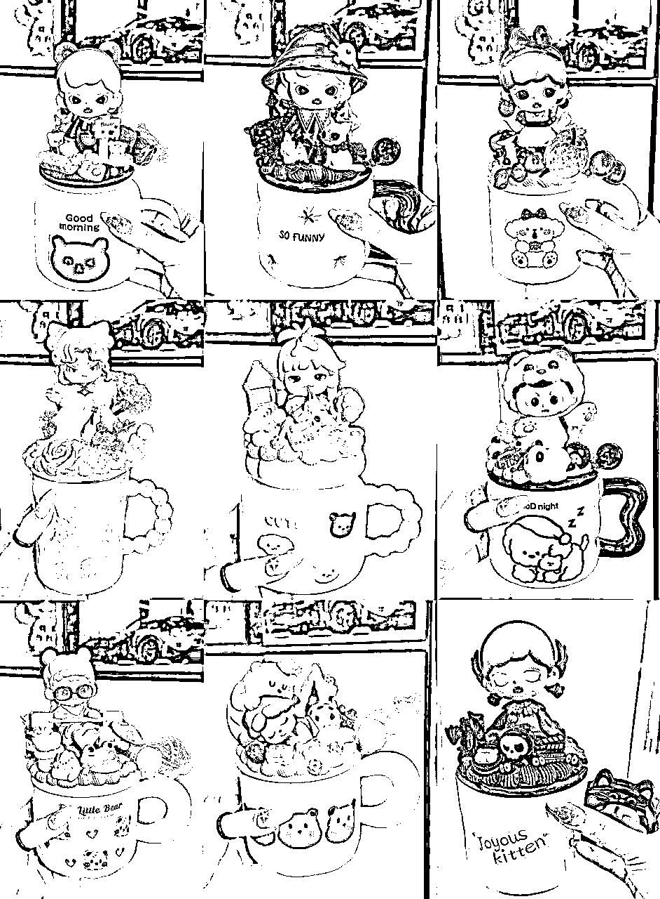

## 四、撞上瓶颈期

人员配置：我、媳妇、主播、打包、场控、直播助理、运营助理

### 流量天花板

10月份Zoraa新款的热度基本被消耗完了，业绩又被双11冲击得厉害，利润都被人员开支吃掉了。双11结束后业绩也没能回血。

盲盒是典型的兴趣电商，双11期间，粉丝们的预算都流向了囤日常必需品，平时也都在刷李佳琦和各类双11直播间。来看我们直播、买我们产品的人自然就少了。

双11期间，各平台大直播间都在疯狂加投流，我们这种靠自然流量的直播间流量被明显挤压了。

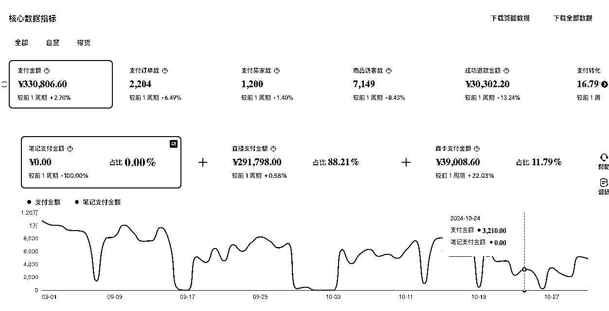

### 复盘与破局

坦诚讲，这个项目开局还算顺利，第一个月就做到了收支平衡，之后就开始有利润了。虽然单月盈利不算高，但业绩是持续向上的，还攒了一批忠诚铁粉。原本计划着招人、扩品类、复制直播间做大规模，没想到双11给我们当头浇了一盆冷水。我花了一周时间把所有头部直播间刷了个遍，认真逐帧拆解人货场，最终总结了潮玩直播的核心模式：

1.  持续的新鲜感是命脉 - 必须不断拆盲盒才能撑起场观（拉新粉）

1.  小直播间在那平播，停留数据上不去，怎么都做不大

1.  大直播间哐哐拆个不停，看着就过瘾，停留和转化都吊打

1.  那就得敢投入，要么备足货，没人拍就自己拆。要么品质好价格低把人气拉起来，直播间拆不起来这个号就废了

1.  新品更新速度 - 必须持续上新，老粉才会反复消费（老粉激活）

1.  只要产品做得好，会沉淀一批忠诚粉，她们是真舍得花钱

1.  我们有十几二十个在店里消费过万的粉丝，一个人能买几十个到几百个包

1.  6月发现奶油胶品类时，如果供应链能迅速搞定，业绩翻番根本不是问题，光靠老粉就能撑起这个量

1.  隐藏款的设置 - 不能卖明盒，要设计足够吸引人的隐藏款让人不停地抽

1.  越是小直播间，为了快速转化就卖明盒，越卖明盒吸引来的都是精打细算的用户（比如我这种，只买自己喜欢的）

1.  要做大生意，要的是冲盲盒的人，要的是上头，非要抽到不可

1.  玩法设计是灵魂 - 这是盲盒直播间和其他直播间的巨大差异点

1.  盲盒玩法本身就是盲盒产品的一部分

1.  有趣的玩法会吸引盲盒玩家，这批人天然爱玩

1.  上头的机制，有时候一个粉丝一晚就能贡献几千的销售额

### 模式大调整

基于这些复盘结论，我对直播间做了如下调整：

*   拉场观：从当天做多少卖多少，改成备300多件库存，直播间没人拍就自己拆，营造持续拆的氛围

*   上新品：奶油胶供应商不靠谱，手工师傅也招不到合适的。那就自己做简单的镜子、梳子、手机支架，开播先秒一波把人气顶上去

*   产品策略：一端4个，两个普通款（普通娃+包），一个大惊喜（热门娃+包），一个小惊喜（小热款娃+包）。大惊喜选更高价值的娃刺激粉丝消费，小惊喜适当压价保利润

*   效果：场观直接翻了两番，新模式上线第二天就破了一万五

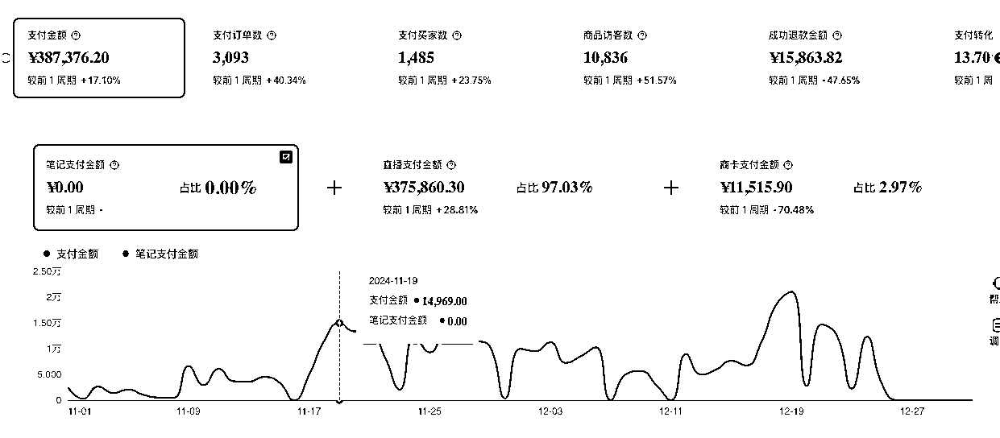

基于这个增长势头，我开始考虑开辟新直播间、增加直播时段、同时开拓抖音做放量。

但不到一周，我们决定停掉这个项目。

## 五、为什么果断退出

### 身体状况与家庭压力

新助理刚到岗，开始下午带晚上连播，又要尝试抖音直播，整体工作量骤增。再加上对业绩的焦虑、团队管理的压力，媳妇先撑不住了：

1.  长期熬夜、过度劳累导致媳妇咳嗽性哮喘发作

1.  家里没有老人帮忙带娃，一切全靠我们自己，精力跟不上，孩子的教育也没法保障

1.  项目变现能力达不到我们的预期线（当初做这项目的目标是月赚10万+，且团队可以自运行），但当时利润刚有起色，一扩编一换场地利润又被蚕食掉。如果只是一个月赚几万，我做短视频带货、媳妇做博主都能做到，而且轻松得多，这项目对我们来说属于食之无味弃之可惜

### 放大路径的推演

其实当时我们已经想明白了这个项目的放大逻辑：砍成本、增收入

具体路径：

*   月利润几十万的对标直播间都在二三线城市

*   他们的人工和房租成本比我们低一半还多

*   如果我们搬到三线城市，单个直播间的利润更高，可以复制更多的直播间，面对业绩波动抗风险能力更强。还可以培养几个管理层，把我俩从日常事务里解放出来

*   产销分离：一个产品团队服务多个直播间，边际成本大幅降低

*   再去开拓抖音，靠付费投流做增量

为什么不执行：不想为了这一个项目换城市生活，再加上前面说的三点顾虑，最终放弃了这个方案。

### 退场策略

知道我们要清仓，媳妇的闺蜜很感兴趣，跑过来学习了一圈成功被种草，帮我们清掉大部分库存后，她把剩下的货直接接手了。现在她自己在做，婆婆帮忙打包，播得比较佛系，每个月能赚一两万。

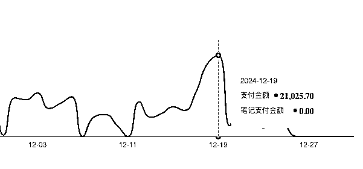

补充一个有意思的数据：项目业绩最高点，居然是主播已经走人、我一个i人被赶鸭子上架去清库存的时候🤣（上图）。

老板上播的效果完胜打工人主播。我自己知道直播间的推流规则，而且有决策权，可以根据直播间实时数据快速调整策略，拉高在线和成交转化。

1.  最简单的逻辑：平台根据一个直播间过去5分钟、半小时、一小时的人均停留时长和成交额来做推流

1.  货品分三类：

1.  秒杀款（限量、高转化、低利润）

1.  走量款（不限量、中高转化、中等利润）

1.  利润款（不限量、中低转化、高利润）

1.  直播的本质就是靠秒杀款拉人气、靠走量款冲成交、用利润款提利润。成交不够了就从利润款降级成走量款，人气不足了就从走量款变成秒杀款

现在，我又在忙一个新项目，每天亲自上播。创业的乐趣就在这，每天都是新惊喜。我一个i人做直播，真是从来没想过的路。

### 六、复盘总结

### 核心经验提炼

潮玩直播的三大内核：

1.  持续新鲜感 - 一直拆盲盒才能保住场观

1.  新品更新速度 - 盲盒玩家喜新厌旧，购买欲极强。持续上新品，新粉感兴趣，老粉无脑冲

1.  隐藏款机制 - 不能卖明盒，利用人性，用隐藏款驱动用户持续消费

运营要点：

*   备货比现做效果好，库存深度直接决定场观表现

*   老板上播效果优于主播，节奏把控更精准

*   成本控制是盈利的核心，地域成本落差巨大

再给大家看组数据：我们的铁粉一个人买了300多个娃包，在直播间消费过万的就有二三十个。这是一门复利效应极强的生意。

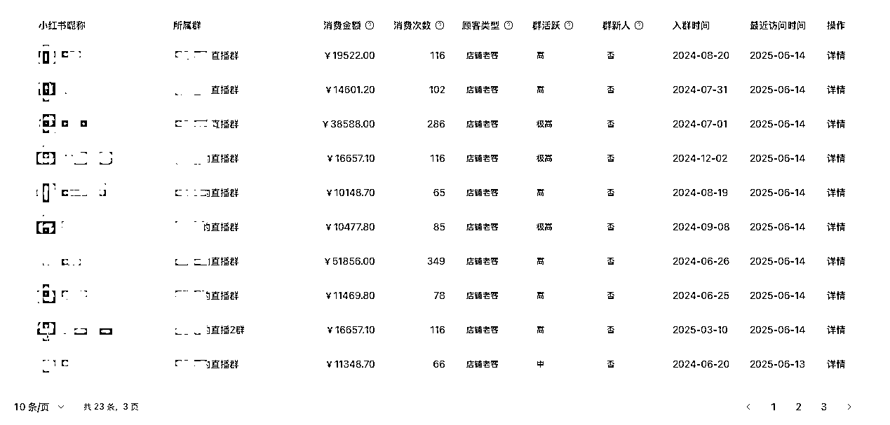

### 项目适配人群

个人/夫妻档：

*   成本控制能力强

*   目标收入1-2万/月

*   适合佛系播放模式

团队化运营：

*   多直播间复制

*   配合投流放大

*   需要在低成本城市运营

*   适合追求更高收入的团队

### 给准备进场朋友的建议

1.  选对城市 - 成本结构直接决定项目能不能做

1.  找准定位 - 个人副业和规模化运营完全是两条路

1.  身体是革命的本钱 - 直播强度极高，要考虑长期可持续性

## 写在最后

纯属个人判断：即使国内经济维持低增长态势，个别行业比如潮玩，依然会加速增长。小打小闹可以做潮玩直播，往大了做可以碰潮玩IP、潮玩公司。依托AI和新媒体，个人甚至都能孵化出一个IP来。看图理解：

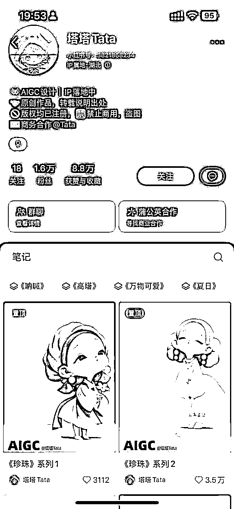

希望这套完整的实战分享能给正在摸索或者准备进场的朋友带来启发，避开我们踩过的那些坑。