# 用AI编程把📕做成自动化的方式

# 自我介绍

大家好，我是星河。这是赚钱的第一篇文章。我去年11月加入赚钱，今年刚毕业大四，从3月份开始上手📕，运气不错，连续三个月都做到了月入过万。跟群里的前辈比算不上什么，但对我自己而言已经是质变了。

这篇内容主要分享我是怎么借助AI编程把📕的日常操作做成自动化。目前这个工具还在持续迭代，但我已经沉淀出了一套完整的AI编程搭自动化工具的工作流，所以想赶紧记录下来分享给大家。

## 这篇文章想解决什么？

赚钱上讲自动化的帖子已经很多了，影刀、Coze这些都能跑通。

我这篇更想聊的是我用Cursor落地的实践。重点不是复刻一个自动化的具体做法，而是把我搭建自动化工具的思考方式交给你。工具会过时，思路不会。授人以鱼不如授人以渔，掌握AI编程的思路，你才能造出真正贴合自己业务的定制化工具。

## 关于AI编程的认知

写这篇时正好看到龙哥大佬鼓励大家去试AI编程。

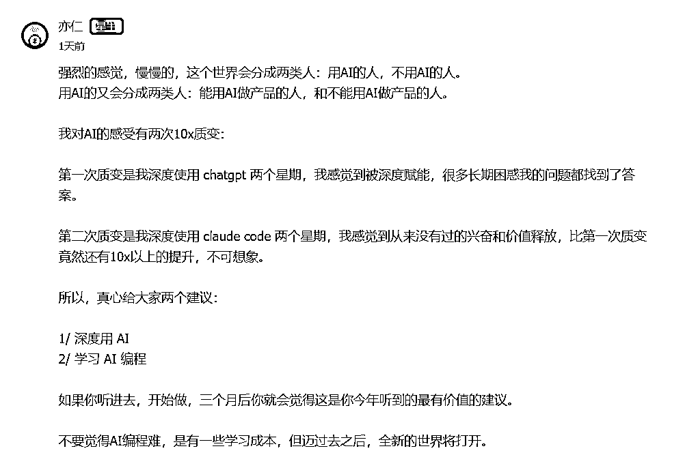

我的想法完全一致，强烈建议大家去上手。千万别觉得要懂代码才能玩AI编程。

我第一次碰Cursor时，代码一窍不通。大学专业是市场营销，跟编程八竿子打不着。那时单纯想做个小工具在📕上卖，觉得Cursor能帮我实现，就去试了。想法很简单，想都是问题，干就完了，不会就边做边学，这才是赚钱人该有的样子。

我第一次用Cursor是3月，当时基本是小白。跟着3月的Web航海和去年12月的Cursor航海手册一步步做出来的。第一个东西是纯前端的网页。

过程肯定有卡顿，但没关系，卡了就问。99%的问题都有解，问AI、问群友、翻航海手册。小白照着也能找到答案。

我的编程起点比多数人还低，所以别怕学不会。干就是了。有问题先问AI，大部分都能直接给解法。描述不清楚就优化描述，AI还不行就换一个。预算充足的话，买个GPT或Claude会员，频率高的话ROI非常可观。

编程过程会冒出一堆专业名词，别怕，直接问AI。听不懂就让它举生活化的例子，比如“请用生活化的例子解释xxxx”。不需要精妙的提示词，把需求讲清楚就行。

AI时代，能把问题说清楚，AI基本就能接住。说不清，大概率是需求不清晰。学习AI编程的过程中，要边用边积累专业词汇，这些词就是把需求翻译清楚的钥匙。

比如前端、后端、API各是干嘛的。进而会想清楚AI编程的技术边界在哪，能做什么、不能做什么，心里有谱才有底气。

我自动化工具的核心技术是Playwright。

这个技术是我从钱塘江鲤大佬的文章里看到的：

https://scys.com/articleDetail/xq_topic/2852585114521111

看了文章后我去问AI它能做什么，搞清楚边界后上手就更有信心。中途出问题，也不会一上来就否定技术，而是先定位是自己没做好哪一步。先在边界内做事，再去试探边界，最后再跨出去。

## 为什么我一定建议你学AI编程

学完最大的感受是：自由。

AI编程的自由，本质是把能力边界拓宽。想要什么工具，自己造一把趁手的武器；看到什么需求，直接造一个产品解决它并变现，我现在做的📕项目就是这么来的；想提效，自己做自动化工具。

感觉像从小河里漂到了大海，眼前全是可探索的资源。自己拥有选择权，想往哪个方向试都能试。

还有就是人机协同。

AGI到来前，AI读不懂你的心思，你得用自然语言把需求和问题描述清楚。在AI编程里一定会遇到bug，怎么描述才能让AI修好？怎么一起排查？怎么描述新增功能？怎么描述修改一个布局、一个按钮？

这些都是在锻炼需求描述能力。描述对了，事半功倍。这是做自动化工具时我最大的体会。

# 开始实操AI编程

## 先定技术栈

编程前先想清楚用什么技术栈。技术栈就是AI要用哪一套技术组合来实现功能，尽量选熟悉的。

不知道怎么选，别直接问AI。自己不懂，很难判断AI推荐的好不好。去看赚钱上大家实际在用的是什么。

对小白更友好的做法，是在Cursor里搜赚钱大佬@AI进化论-花生开发的插件，里面预设了很多场景的技术栈和规则。虽然我没用过，但对新手很友好。

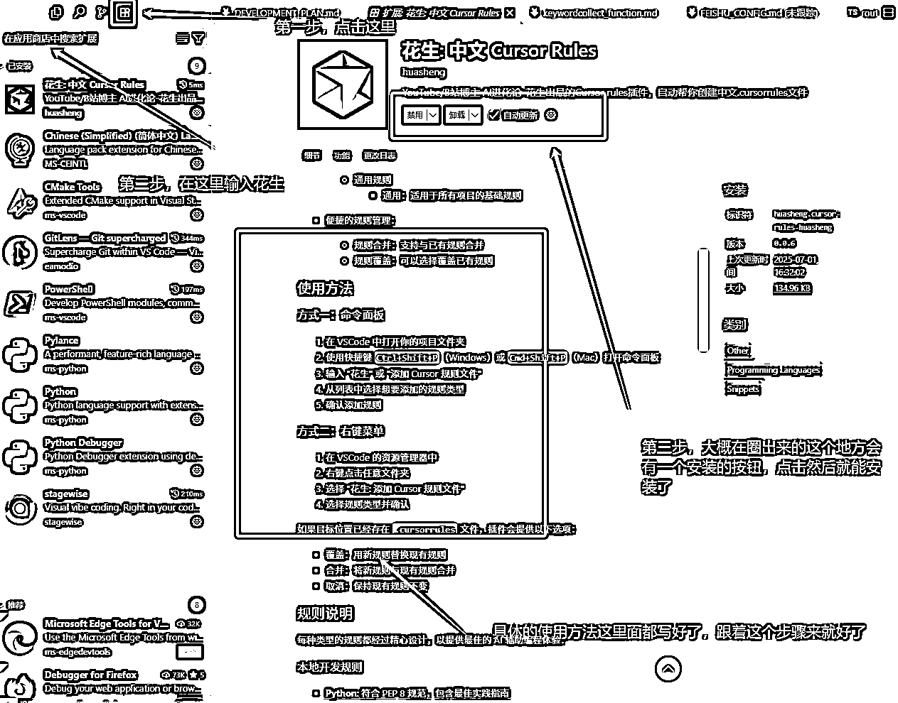

我最终选的是Next.js，前后端一体，更适合全栈。

不懂Next.js也没关系，直接问AI。

tips：不懂就问AI，是学新东西最快的方式。

我的技术栈：

前端：
框架：Next.js App Router模式
UI：Shadcn UI + Radix UI，Shadcn是基于Radix构建的
样式：Tailwind CSS
语言：TypeScript

后端：
运行时：Node.js，通过Next.js API路由实现
语言：TypeScript
自动化：Playwright

我还把飞书多维表格作为数据存储，通过飞书API实现自动化建表、增删改查。等于把网站和飞书打通了。

tips：为什么用多维表格？更简单，新手用数据库容易懵，而且多维表格的数据还能直接用AI分析再创作。

### 如何拿到飞书API

1. 打开飞书开放平台：https://open.feishu.cn/app
2. 创建企业自建应用，填应用名称和描述即可创建

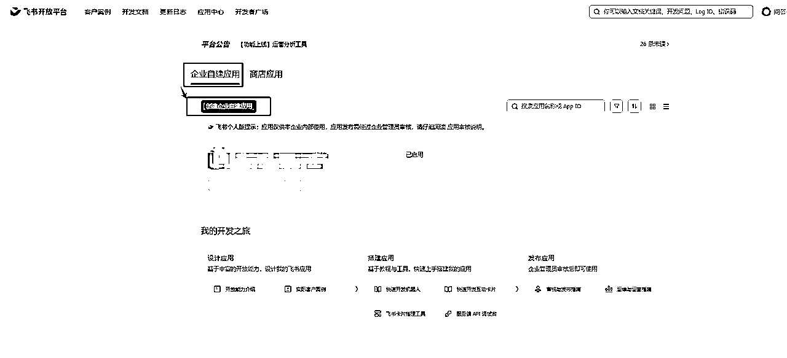

3. 需要的两个信息是“APP ID”和“APP Secret”

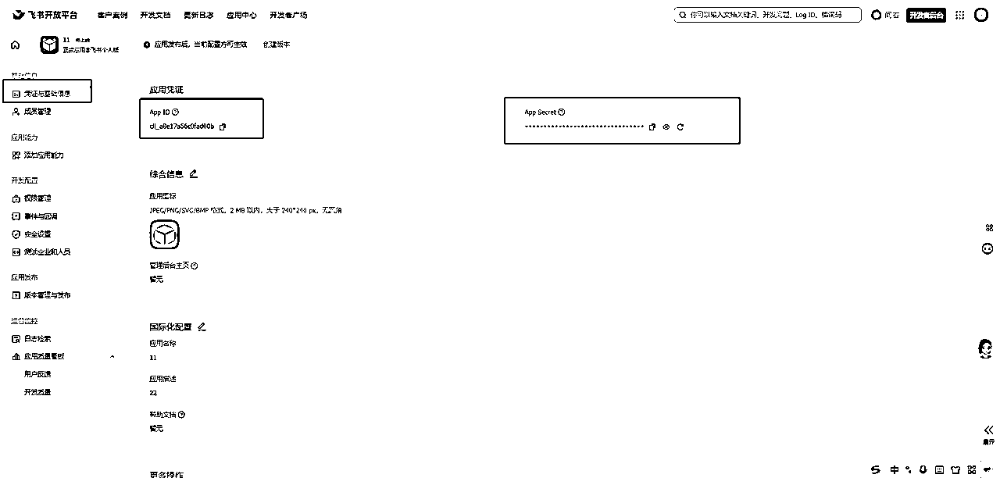

先记下来，后面要填到Cursor里。
4. 权限管理。调用飞书API必须先开通权限，否则调不通。在权限里找到多维表格相关权限，全部开启就行，开应用身份权限即可。

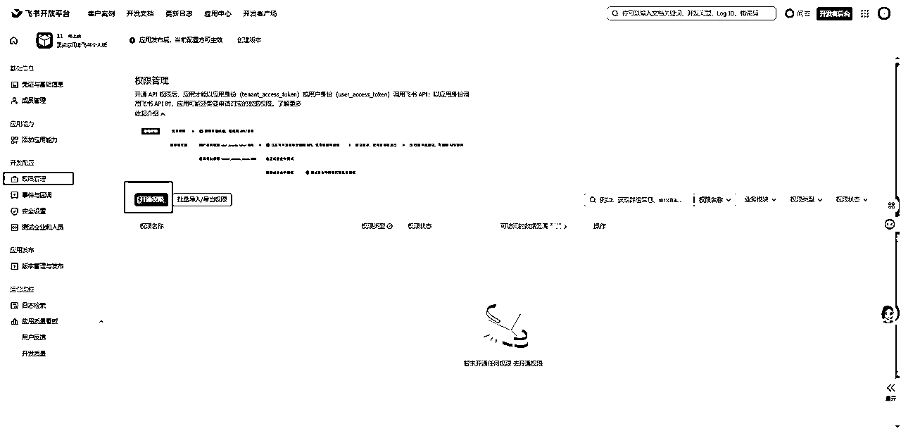

我开通的是这些，可按需参考

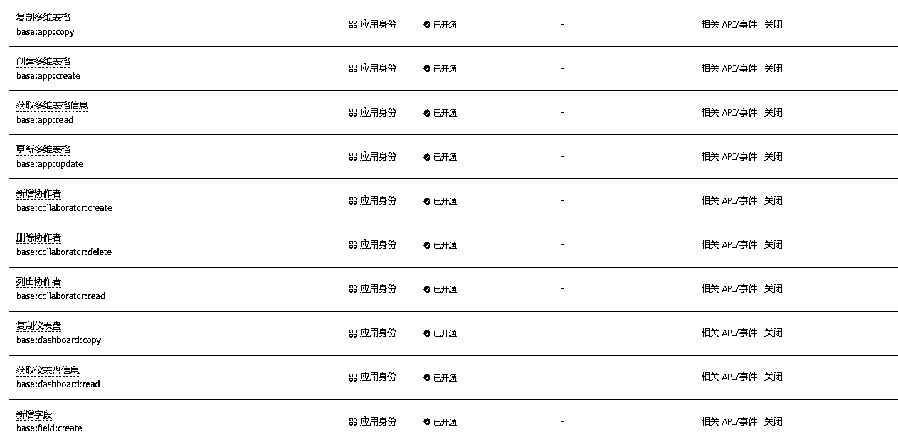

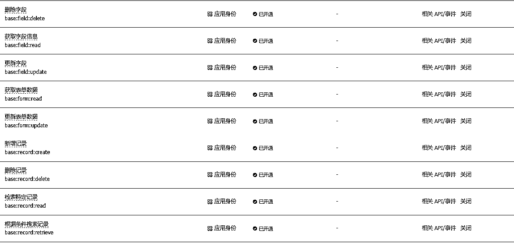

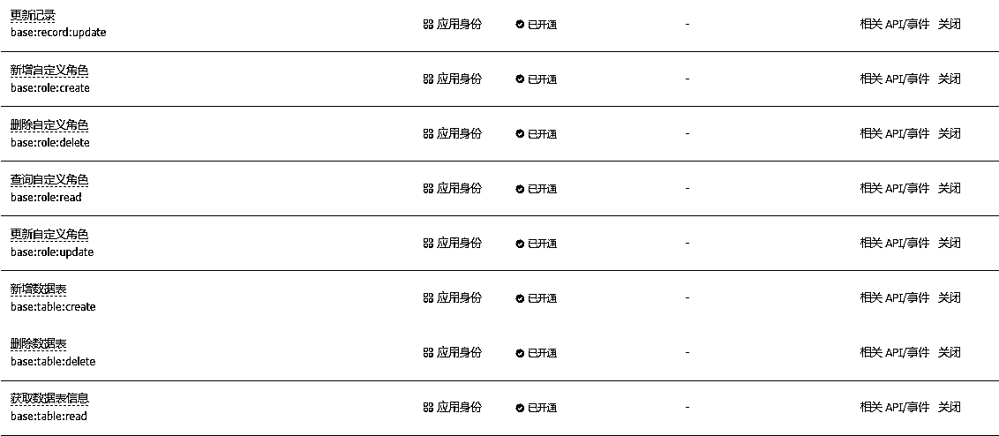

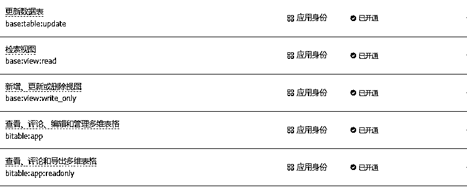

tips：权限列表里能看到的，理论上都能通过飞书API调用，按需探索。

完成上面两步后会拿到APPID和APPSecret，并开通多维表格权限。先记好。

5. 最后一步把企业自建应用上线，填点基础信息即可。

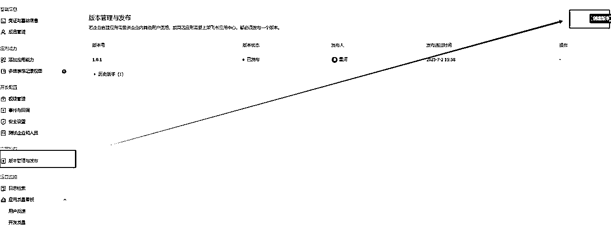

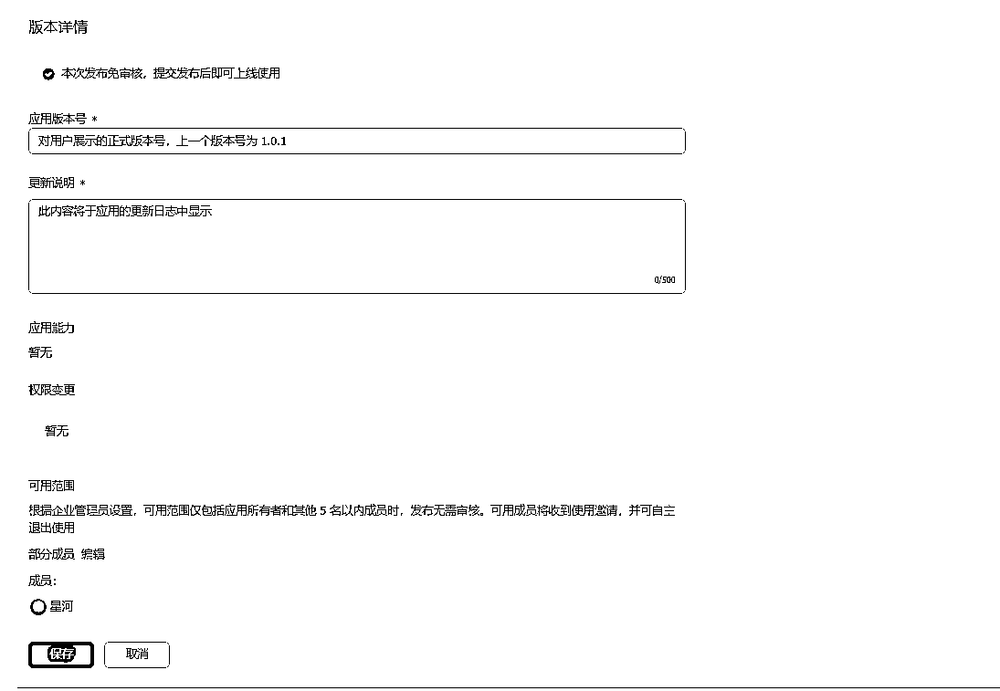

首页显示【已启用】就代表上线成功

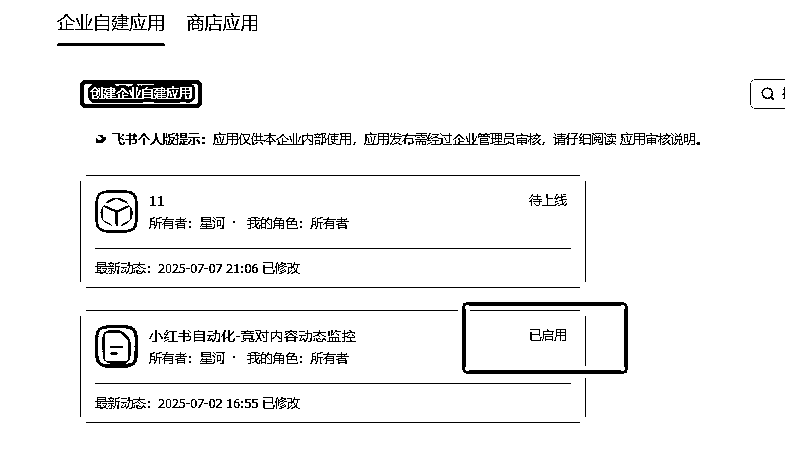

## 开始写功能

以📕自动化为例，我用一个很入门的功能来演示我的Cursor编程流程。

功能是账号管理：批量管理多个账号，保持长期登录，一次扫码长期可用。

### 第一步，先写需求文档

在让Cursor写代码前，先和AI对话把思路捋清楚。这是最关键的一步，也是思考的过程，想清楚工具要什么功能、达到什么效果、整体使用流程是怎样的。

这也是AI编程锻炼到的能力：和AI协作，找到边界并扩大边界，学会清晰描述需求，其他的让AI补充完善。

自动化需求文档大致分三块：
* 前端界面：交互、展示、操作触发
* 自动化脚本：浏览器自动化逻辑，执行具体任务
* 多维表格：存数据，非必须

沟通时可以分三块聊，最后整合成完整需求文档再丢给Cursor开发。

没会员想低成本写需求文档，可以用Cursor里的【gemini-2.5-flash】模型，免费且上下文够大。

模型列表没有就去设置里打开。

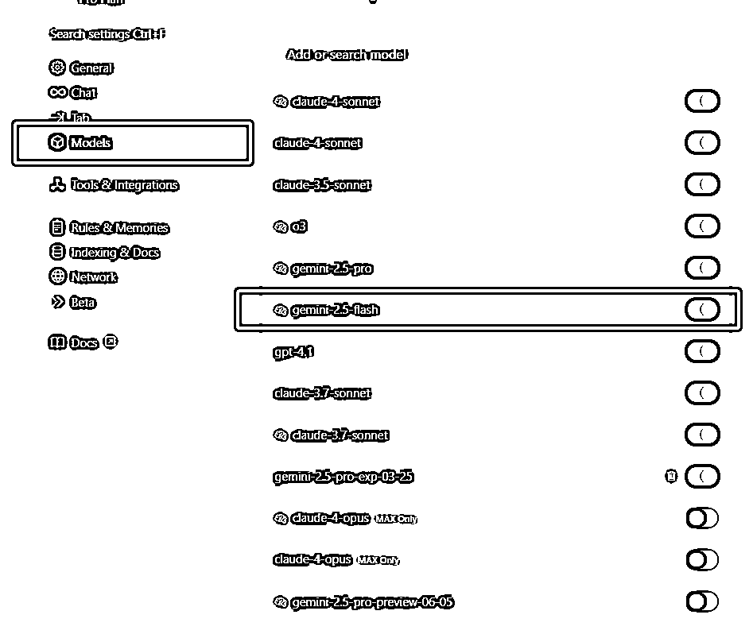

正式开始写需求文档，我的第一个功能是账号管理。

选它有两个原因：
* Playwright的核心就是模拟浏览器操作。想在📕上做事，第一步一定是登录，不登录很多功能受限。
* 功能相对简单，适合AI编程入门。第一个功能太难容易丧失信心。

tips：我在开发账号管理时失败了很多次，因为一直在测试技术栈和产品形态。账号管理也是我验证技术栈的试金石。虽然AI编程很强，但技术栈不对也会增加大量工作量。上面这套是我实测下来最顺手的。

#### 需求文档第一部分：前端界面

不会起步就把项目和AI说一下，让它先给个前端框架，你再补充。

提示词示例：
我现在要做一个📕自动化的网页工具，第一个功能是账号管理，用来管理多个📕账号，登录方式是二维码扫码，页面整体是左右布局，你给我设计一下前端界面

等AI回复后在脑子里过一下是否符合预期。

以下是我让Cursor给出的回复示例：【注意，我是新开窗口模拟对话，不同的人回复会不一样。跟AI聊需求是一个不断修正的过程，不满意就提出来让它改】

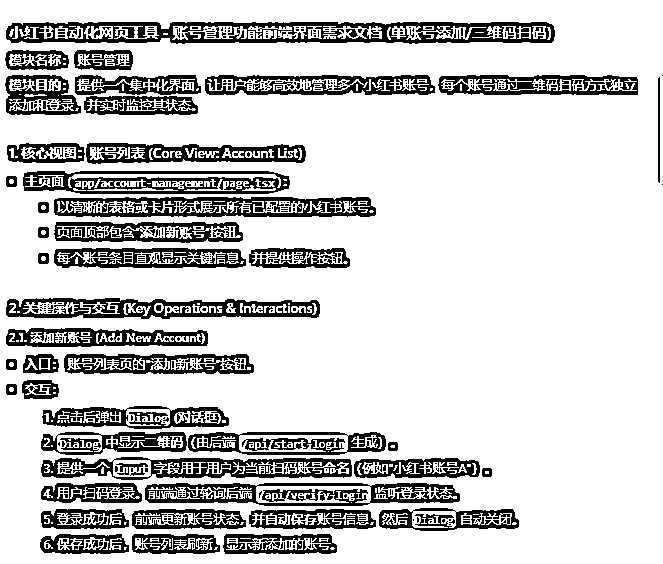

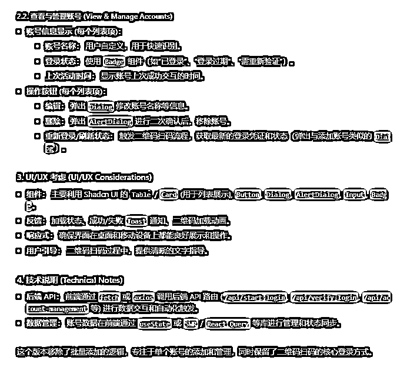

如果你是代码小白，看不懂专业术语，让它用更通俗的话复述：

提示词：
我是代码小白，完全看不懂专业术语，你用更简单的话把上面这段重新说一遍

想了解专业名词就让它解释。

想具象化布局，可以让它画草图：

提示词：
你能把上面描述的布局用草图横线的形式画出来吗，让我看到大概效果

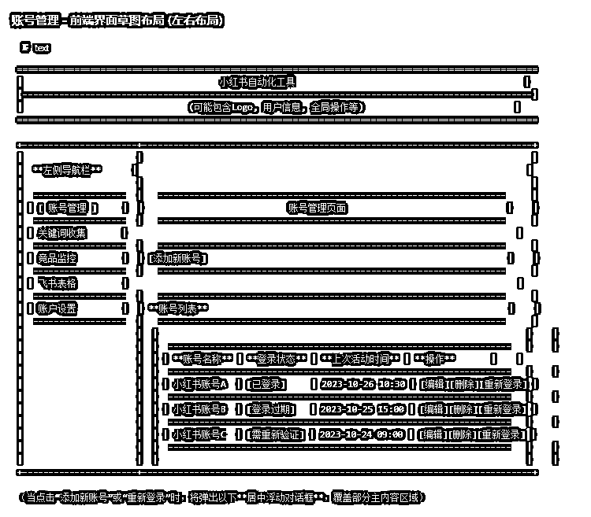

不满意就让它改。再不断追问，注意点和增项：

提示词：
你上面说的我觉得没问题，除了我们讨论的这些，实现账号管理还有什么需要注意的？需要增加什么功能？

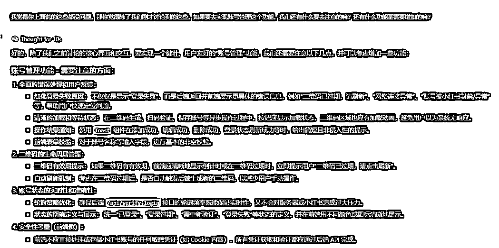

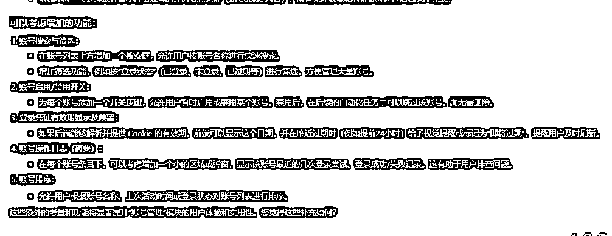

AI会列出一堆注意点和可加功能，你挑需要的，基础先搭起来，后续再完善。

有些问题遇到了再解决。比如我在登录时发现第一次能成功，下次打开登录状态就没了。我问AI：

为什么每次打开都要重新登录，不能一直保持登录吗？

AI回答：

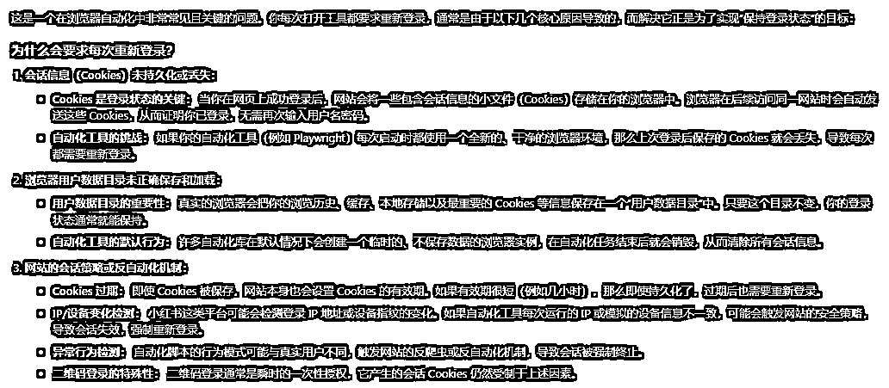

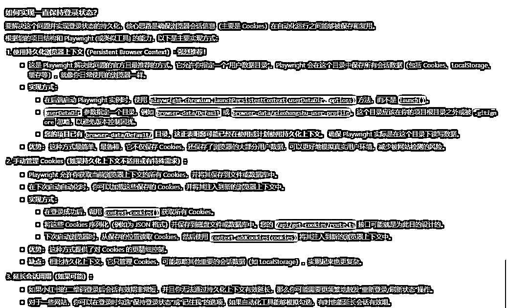

原来是cookies的问题。之前我对cookies只有模糊认知，真正用到才明白它的作用。

简单说，cookies就是网站给你的身份证，下次打开网页直接用它登录，不用重复输入账号密码，就能实现长久登录。

知识就是这样一点点扩的，这次不懂，下次遇到就懂了。

然后我把cookie相关功能加到网页里。

再举个例子，账号管理做完后，cookie也加了，但第二天重启电脑再打开，昨天的登录信息又没了。

我问AI：
我已经用保存cookies实现了长久登录，为什么重启后打开网页，昨天的账号又消失了？

AI给出的分析方向：

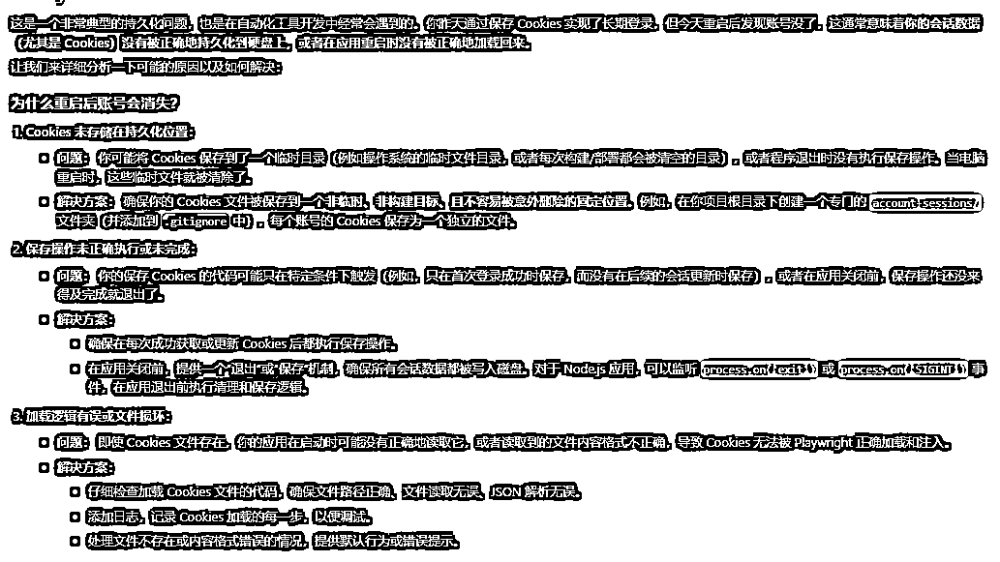

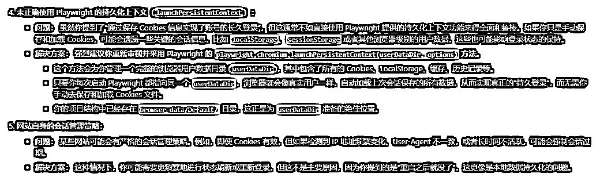

并给出了排查建议，按步骤排查直到解决。

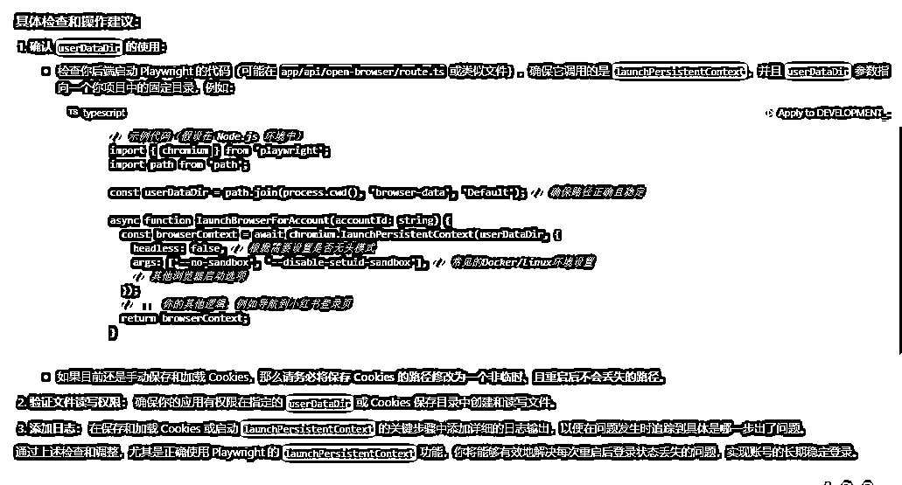

简单总结我的AI编程沟通思路：
1. 没思路就把基础想法丢给AI，让它先列大纲
2. 难以具象化就让它画草图
3. 对AI内容有疑问就指出，让它优化或解答
4. 遇到问题，按“我在哪个页面、做了什么、结果是什么、预期是什么、想问什么原因”描述，让AI初步排查
例如：我在账号管理界面扫码登录，发现弹窗里二维码不显示，我期望在xx位置看到二维码，帮我排查原因
5. 让AI给出明确排查步骤，逐一解决

AI编程最重要的两个能力我觉得是：

从构思到落地：我用大模型做工具的完整拆解

过去我摸索出一套借助大语言模型做小工具的打法：先把需求写成底稿，再分模块交给模型去编码，最后自己逐项验证修复。只要目标是一个常规形态的软件，这套打法基本都能复用。下面我把每个环节原原本本拆开讲。

## 一、先写出能交付的需求说明

想让模型做出可用的页面，重点不是让它凭空写码，而是你把意图讲明白。我习惯按这个结构组织：页面里有哪些控件；按下某个控件会触发什么动作；结果数据在什么位置呈现。然后让模型逐项确认，有出入就当场纠正。

### 程序脚本的两块基石

写自动执行程序之前，有两件事必须先做。

其一，把执行链路用文字梳理出来。可以用笔在纸上画，也可以用绘图工具把每个节点按顺序列清。其二，想清楚元素的定位方式。程序模拟人手操作时，得知道往哪儿点、往哪儿滑。最常用的定位手段是 CSS 定位符。

拿某社区 App 的站内输入框举例：

先打开浏览器的调试面板（F12 或右键菜单里的“检查”）：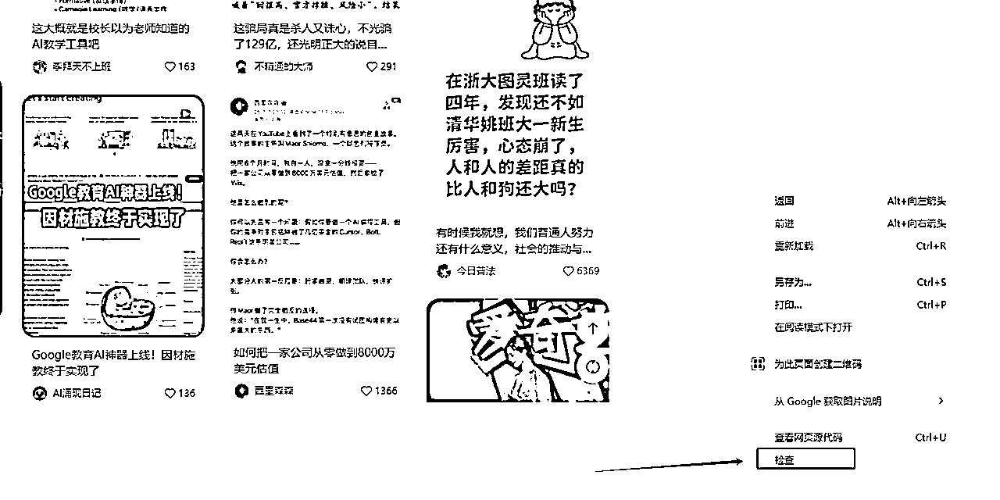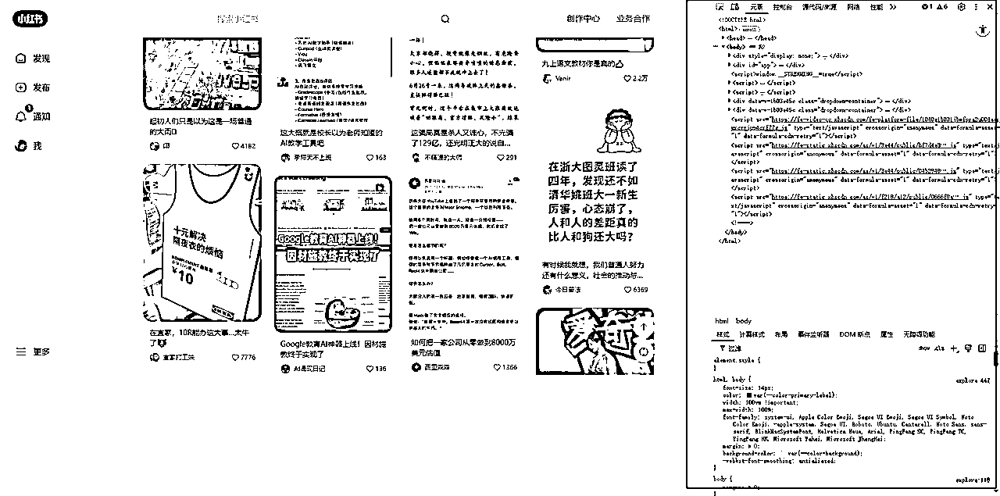

按下工具面板里的选取箭头，再回到网页中点选目标元素：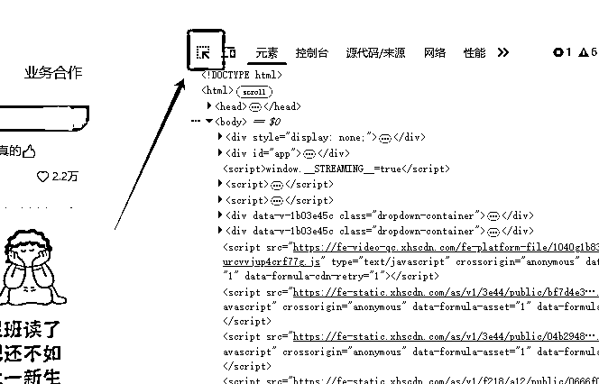

鼠标悬停在输入框上，它会呈现高亮状态：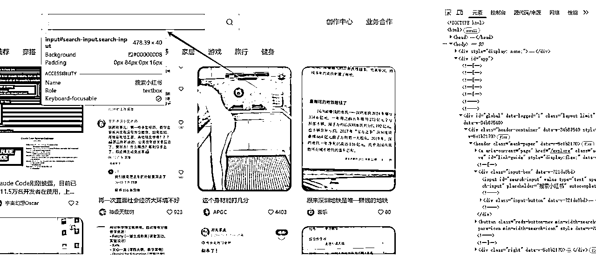

单击目标元素，右侧源码中对应的那一段会被标亮：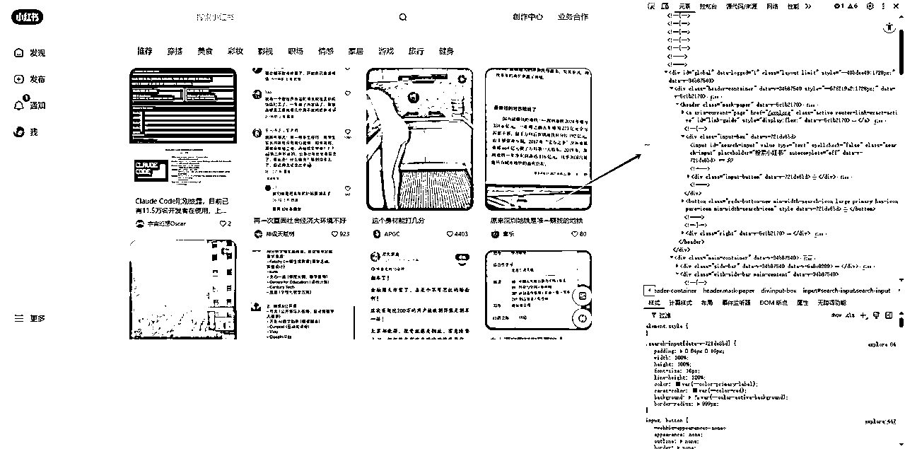

右键这段代码，在“复制”菜单里选择 Copy selector，即可得到类似 #search-input 的定位串：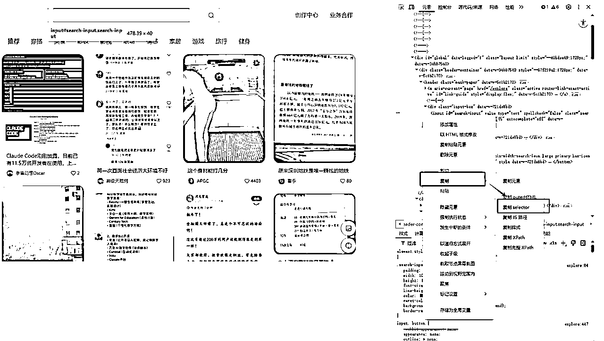

网页上绝大多数控件都能这样取得。万一遇到拿不准的，把截屏发给模型，请它给一个替代方案。

执行链路写好后，交代得越细越好。我过去在对话里描述扫码登录时是这样写的：

“当我按下『启动登录』按钮，触发如下动作：启动一个 Chrome 实例；进入某社区站点首页；等 5 秒；定位 QR 码位置并截屏；把画面呈现到界面；脚本暂停，直到我扫完码并按下『结束扫码』；随后校验面板顶部是否有头像；有则汇报成功，没有则返回失败原因；最后保存 cookie 以便长期免登录。”

这段草稿是以“人怎么操作”的视角写的，模型看来肯定有漏洞，但这不要紧。把草稿发给模型，请它帮忙补漏：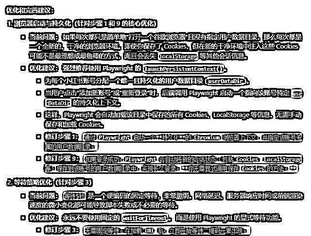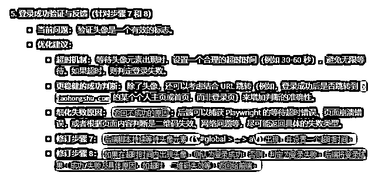

模型会回传一版它认为更稳妥的路径：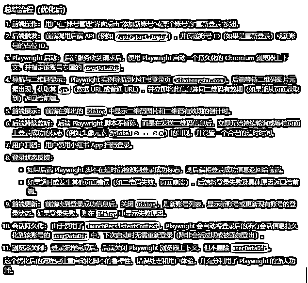

你只需要逐条核对，发现逻辑上不对的地方就提出来。如果暂时看不出毛病，先按它的版本推进，等实测后再做修正。

### 数据落位到飞书

数据存储我用的是飞书提供的工作表，充当轻量存储后端。想把数据写进去，需要准备四样东西：应用 ID、应用密钥、表格令牌、工作子表编号。前两个相当于访问飞书接口的账号与口令。表格令牌是整张工作表的唯一标识，从网页地址里就能读到，base/ 后面的那段字符即是：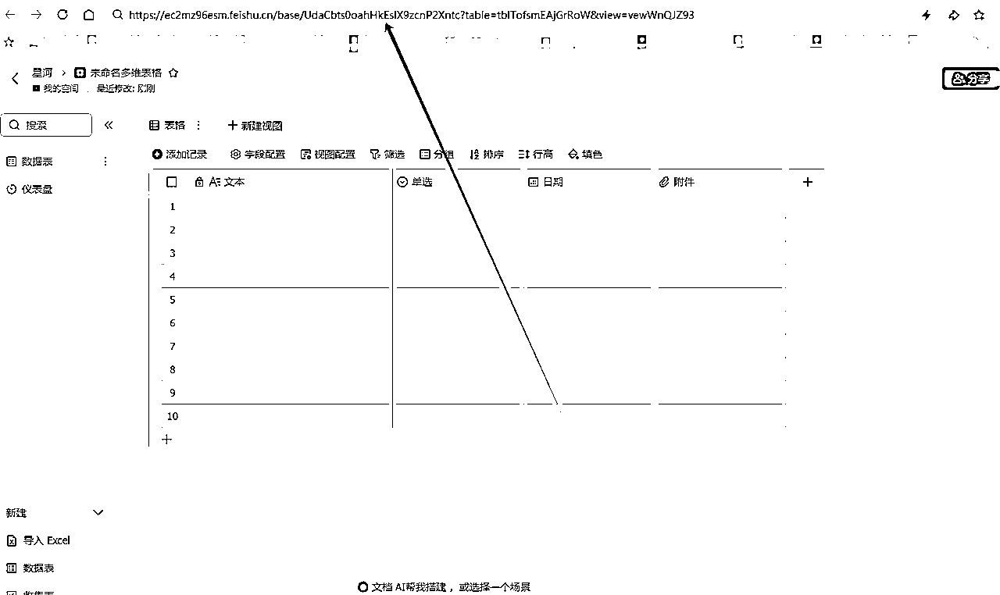

工作子表编号是具体某一分页的 ID，看地址栏 table= 参数后面的值即可：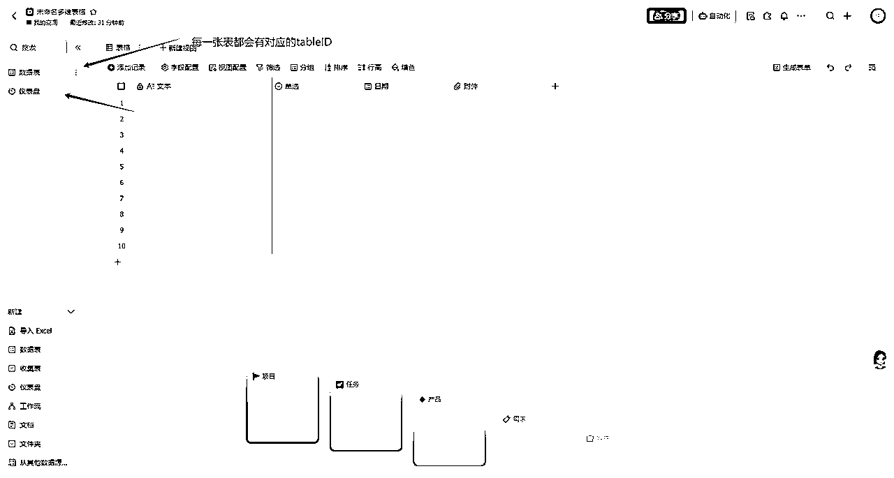

不清楚怎么设计字段时，直接把需求丢给模型，请它给出建议：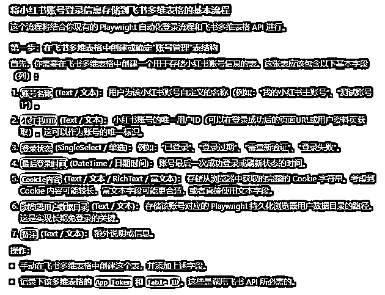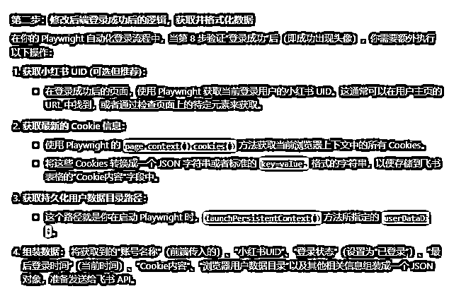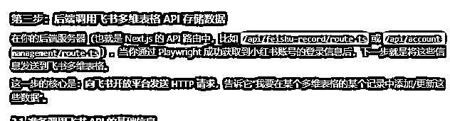

拿到字段建议后，最好自己手工把工作表建好，不要依赖模型代建字段，后者更容易出错。接下来把采集程序得到的记录整理成固定格式，再借助飞书接口写入。模型给出的实现代码如果读不懂，没关系。把难懂的部分用 A/B/C 代号替换，顺着读一遍：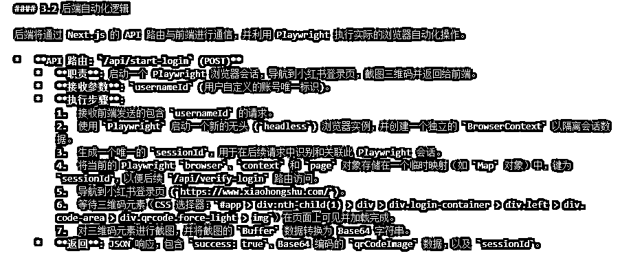 逻辑会清楚很多。

最后是密钥管理。应用 ID 和密钥等同你家里的钥匙，绝不能直接暴露在代码里。在项目最外层目录新建文件 .env.local，按“名称=值”的格式写入：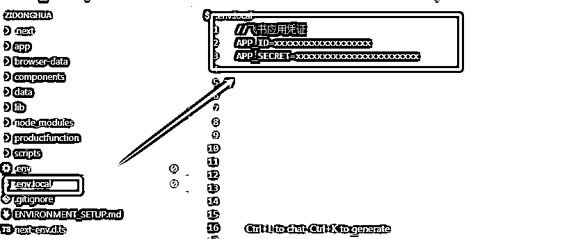 并在需求说明中注明：私有配置已放入 .env.local，变量名是 APP_ID 与 APP_SECRET，需要时从该文件读取。注意示例中的值只是占位符，不要把真实密钥填进文档。这一步务必亲手完成，别假手于人。

## 二、把文档交给模型，约法三章

需求说明定稿后，就可以让模型按图施工了。模型方面我推荐 Claude-4-Sonnet：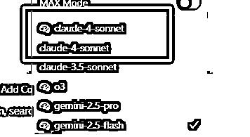

但别把整份文档一次性丢过去。任务过大时，模型容易丢三落四，产出缩水版本。我习惯把它拆成几个子模块，先做页面，再做脚本，最后接通数据。每轮只让模型负责一块，并在指令里写明：完完全全依照文档实现，不要额外发挥。

这样的节奏还有另一个好处：出故障时排查范围更小，不至于在大而全的代码堆里没头绪。

## 三、跑起来之后，怎么找出故障

模型完成后，进入验证阶段。先启动本地服务，拿到本地地址：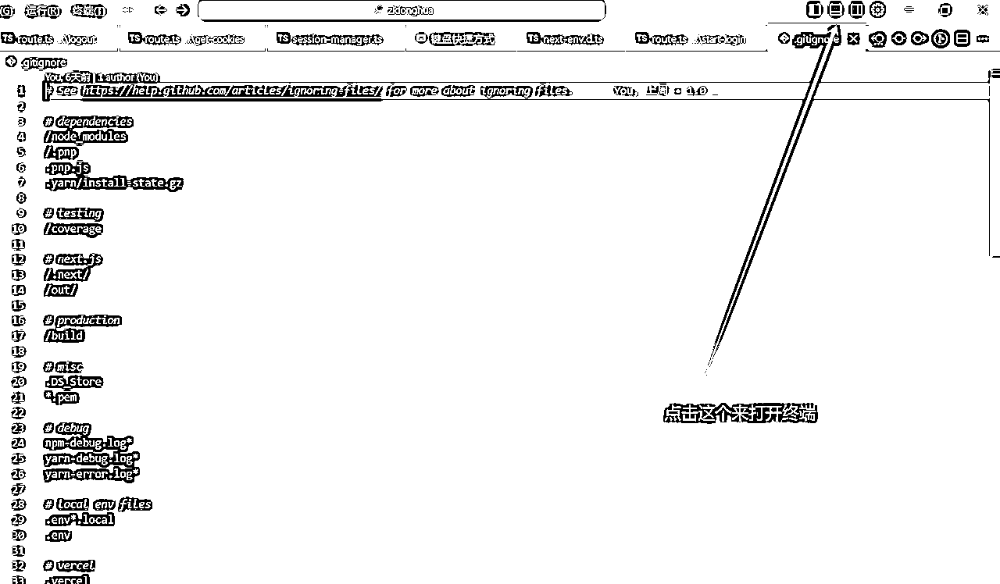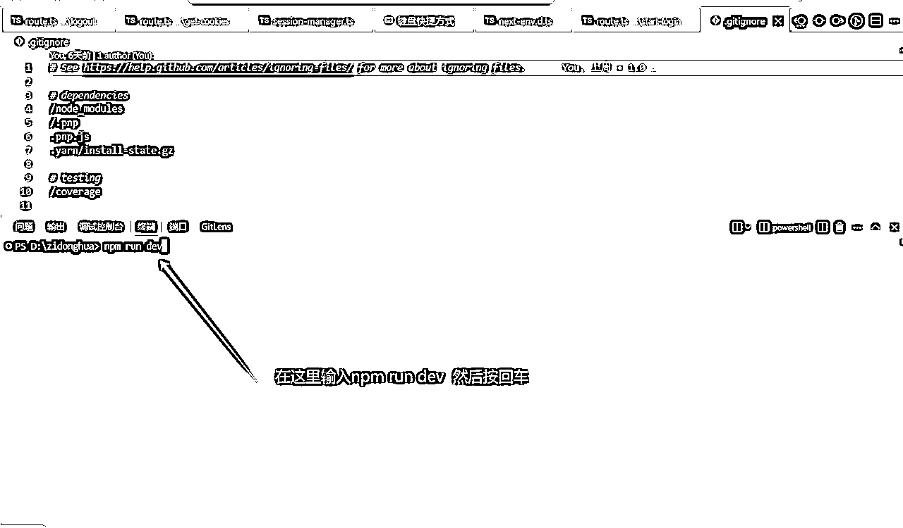 打开地址即可看到界面：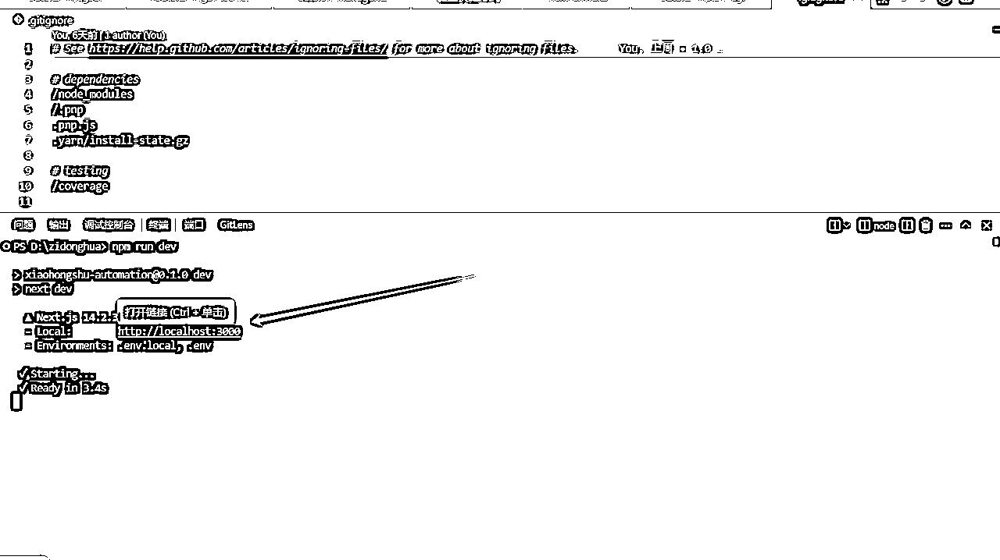

验证时我习惯这样做：

界面显示不对，直接截屏，手动圈出不对劲的区域。有报错信息，打开 F12，切到 Console 面板，把红色报错复制给模型：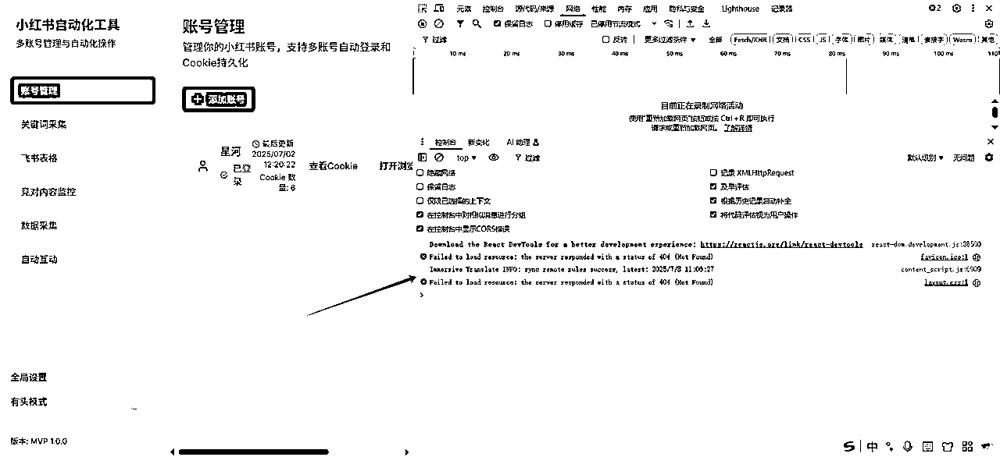 脚本执行异常，查看终端输出，即使读不懂，也把那一段选中发给模型：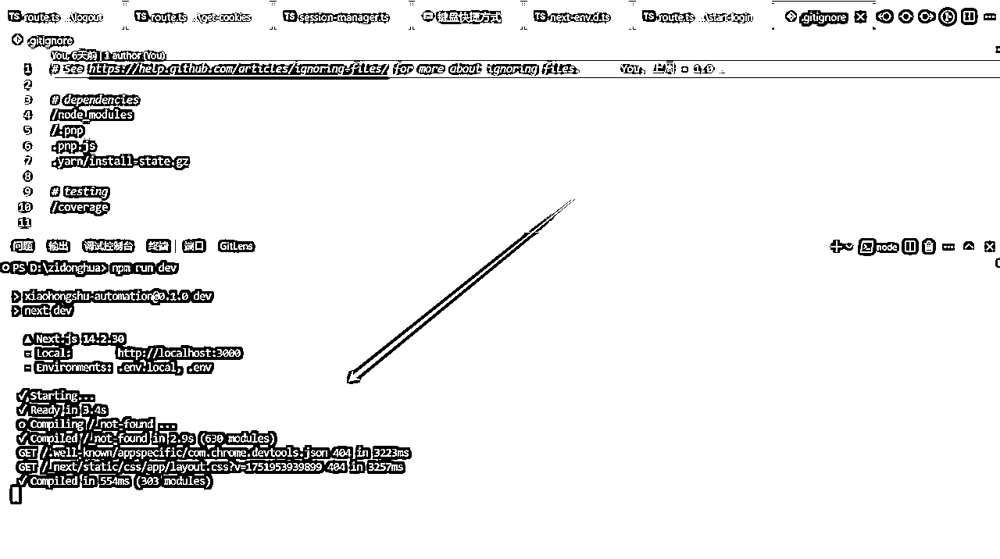 选中内容后，右上角会出现快捷按钮，点一下就能加进对话框：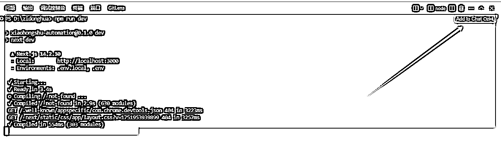

给模型反馈故障时，我常用一句话：我对某个按钮做了点击，但界面没有任何反应；我设想按下后应该弹出一个弹窗，麻烦帮忙定位偏差。

如果连方向都没有，就直接向模型要一份操作手册：我遇到了一个反复重现的故障，完全没有头绪从哪儿查起。请给出一份适合新手的定位手册，每一步都写明做什么、看什么。

## 四、几个让我少走弯路的体会

先把主线跑通，再去谈完美。我最初想把某个监控模块做成全自动，结果不断被边角情况绊住：同一时刻好几个定期进程冒出来怎么排队；短时间多次请求如何降低风控概率；手动与自动哪个优先；运行记录要合并还是分开展示。光是脑补这些情况就够折磨人，而且后端逻辑不像界面那样看得见，验证起来也很麻烦。后来我调整策略：先实现 90% 的自动执行，剩下 10% 交给人手点一点。功能堆得越多，精力消耗越大，真正有效的做法是克制地砍需求。

Less is more。一款做到 80 分的作品，和一款打磨到 100 分的作品，投入的时间成本可能相差十倍以上。

从真实的使用需求出发，不要为了堆功能而堆功能。动工前先回答自己：少了它对我有什么影响？它在什么场景下、多久被用一次？投入产出比是否划算——开发它所花的时间，与它为我省下的时间相比，值不值？这套自问自答能帮我砍掉不少伪需求。

把整套打法归纳起来：确定技术选型和交付载体（网页类项目优先考虑 Next.js）；写出需求说明；把需求拆成多个子模块，逐个和模型讨论定稿；碰见不了解的概念就向模型请教，几乎全部疑问模型都能给出方向；对于模型给出的方案，人工核对后再提优化意见，循环几轮补齐疏漏；然后按文档一个模块一个模块实现；最后自己验证，把故障找出来并处理。整个过程里，我不依赖花哨的指令模板，把情况写明白，比堆砌华丽词藻有用得多。

希望这套方法能帮你做出属于自己的首个作品。哪怕它只是一个很普通的页面，也可能带来看得见的回报。我在那个社区平台上赚到钱的小工具，至今也仍是完全在用户侧运行的小应用，价值并不取决于技术形态。能不能把问题问清楚，是一个人上限的分水岭。

很多人一遇到问题就急着写代码、堆功能，但有没有想过：还有没有更简单、更省钱的解法？其实开发功能跟做项目是同一套逻辑，都得有算账思维，先把ROI盘明白。

**别在一棵树上吊死，多试试不同模型**

模型其实分不出绝对的好与坏。如果一个模型怎么都解决不了你的问题，与其死磕，不如换一个试试。Claude 4 Sonnet、O3、Gemini 2.5 Pro在解决实际问题上的表现都挺不错，值得逐个体验。想免费和AI沟通需求，可以先用Gemini 2.5 Flash，等需求理得差不多了，再让付费模型帮你润色。一个小技巧：你打算用哪个模型来开发，最好也让哪个模型来润色需求文档，这样更对味。

如果你条件允许，Claude Code是目前我见过最好用的AI编程工具，但使用门槛确实比较高。前期只用Cursor也完全没问题，我自己现在就还在用Cursor。

**比做产品更重要的是：先搞清楚需求**

很多人容易一头扎进产品里，但产品说到底只是需求的一个落地方案。真正该做的是先调研，把下面几个问题想明白：

1. **你的目标用户到底是谁？** 一定要细分。比如“宝妈”这个词太宽泛了，不同类型的宝妈，需求可能天差地别。可以借用市场营销里常见的细分维度：地理（一线/二三线、城市/农村）、人口（年龄、性别、收入、职业、教育）、心理（生活方式是极简还是精致、兴趣爱好、个性）、行为（价格敏感度、品牌忠诚度、消费习惯等）。

举个我在📕看到的例子：有人靠剪辑山姆相关视频起号接广告，而且这类账号很容易接到广告。为什么？因为关注山姆视频的主要人群大概是20-35岁、一线城市的年轻女性，学历高、对价格不敏感、生活还比较精致，这些标签指向同一个结论：消费能力强。广告主当然愿意投。做产品也是一个道理，先研究用户，再提供对应方案。如果产品“货不对板”，用户接受度就会很低，变现也就很难。

2. **你的产品解决的是哪个场景下的需求？** 同一个用户在不同场景里，要解决的问题完全不一样。比如老师做成绩分析，面对家长时需要一个孩子的详细学习报告；在同事面前汇报时，更需要班级整体情况、年级整体情况这类宏观数据。场景不同，方案就得跟着变。

3. **你要解决的具体问题是什么？** 同样场景下，不同用户的需求也可能不同。还是成绩分析，同样是向其他老师汇报，有的老师只希望有个工具快速呈现数据，辅助分析；有的老师则希望一站式完成，甚至直接生成汇报PPT。

4. **用户愿意付多少钱？** 开发产品的核心目的是变现。如果产品确实有用，但没人愿意掏钱，从商业角度看就很难算成功。

5. **你的竞争对手怎么样？** 他们的产品是怎么解决同样问题的？知己知彼，百战百胜。想要胜出，靠两点：一是信息差，二是差异化。差异化不意味着你要搞一个100%不同的方案，只要在某个方面比对手有特点，就能吸引到人。

**飞书API这块，还有很多值得挖的地方**

写到这儿，正好赶上2025年7月9日的飞书无限大会。我去翻了翻官方文档，信息量很大，挑几个印象深的说说：

一是飞书多维表格的使用人数已经超过1000万，潜力可见一斑。二是多维表格在AI能力上明显加码：比如AI字段捷径，把AI能力放进了每一个单元格；还有AI Agent节点，可以在工作流里加入智能体了。另外飞书的apaas也让我很感兴趣，官方介绍是：

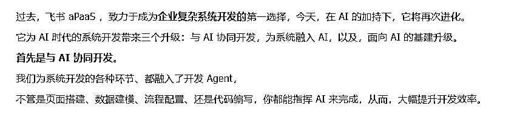

我的第一反应是：这不就是我这篇文章在做的事吗？用AI编程搭好自己的系统，然后通过飞书API把飞书接进来。小排老师说过，做AI产品，最好做那种能随大模型能力增强而变强的产品。我觉得很对——多维表格越强，我接入飞书API的系统也会越强。

**自动化网页，同样是一片潜力无限的领域**

把自动化工具做成网页版，还有一个隐藏优势：你可以随着需求变化，通过API接入大模型，把普通自动化升级成AI自动化。小排老师的课程上下来，你会发现网站内嵌大模型真的不难。

如果你想知道具体怎么做，点个赞、投个锚点支持下，下次我就开足马力来写！第一次发文章，写得不周到的地方，还请大家多多包涵。