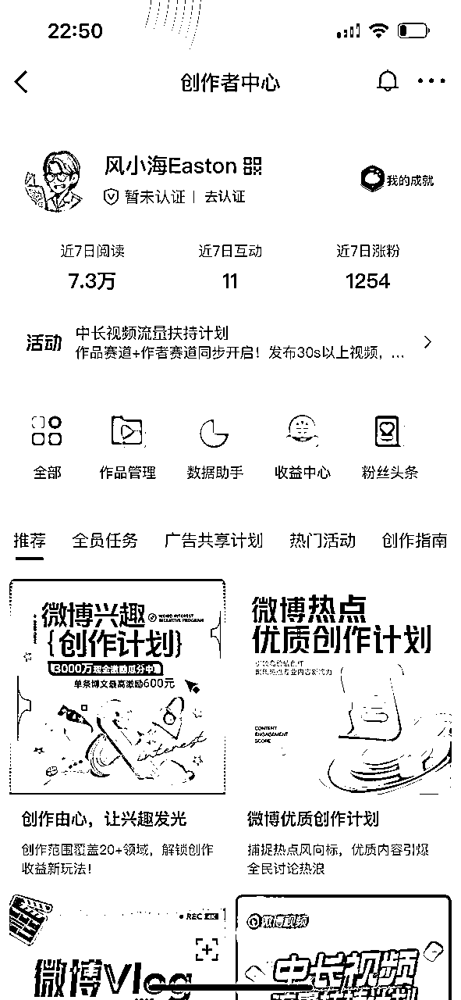
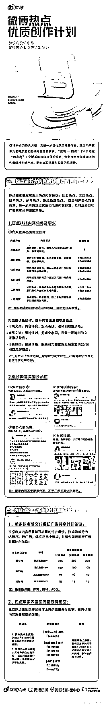
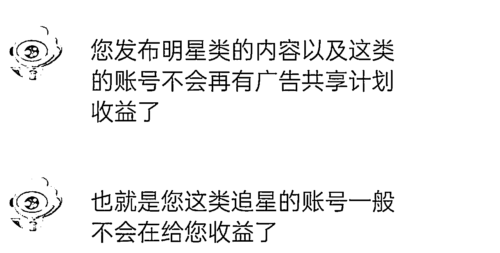
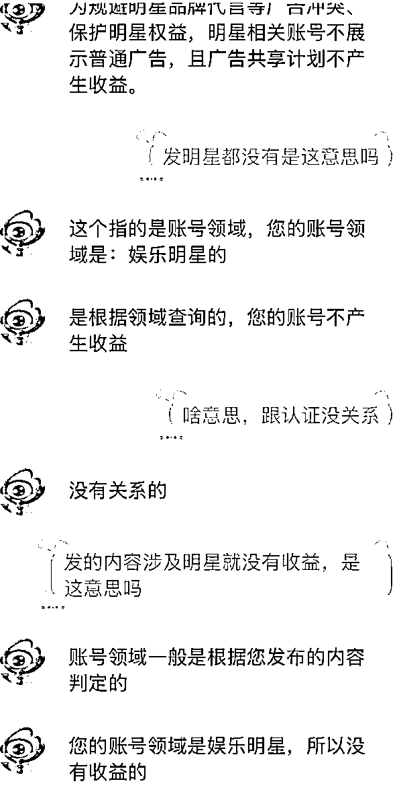

# 微博热点优质创作计划，手感新鲜的实测复盘

> 来源：[https://fi8jncah4ds.feishu.cn/docx/WDSodJB3OocHz7xd1SkcxxSOnJe](https://fi8jncah4ds.feishu.cn/docx/WDSodJB3OocHz7xd1SkcxxSOnJe)

# 先做个自我介绍

大家好，我是风小海，公号就叫这个名字。

坐标武汉，生财老圈子的三年老友，干的是服装这一行，亏过钱也赚过钱，如今时间挺自由了，财富自由嘛，还差一点亿。

过去一年，我靠风向标中了奖换到了一张生财年票。说实话我不是什么天赋型选手，就是弯路走得多，踩过的坑可能比你多那么一点。所以我打算把这些年亲手试过的变现项目，一件件扒开来讲。

我第一桶金的来路

前几天刷到圈友@陶美丽 发的关于微博那条精华帖，越看越有意思。而我本来就养成了发风向标的习惯，刚好能把创作欲和变现结合起来，这事太对我胃口了，当天就直接上手实操。

先说结果：3天时间发了20条微博，总阅读冲到7.3万。涨粉我没搞互关那一套，没那个时间细磨，直接花钱买量更省事，1000粉只要30块钱。

整个项目最费劲的地方其实是凑够100个铁粉，以及后期怎么养住这批铁粉。不过在我看来，靠圈友互相搭把手，这个门槛并不难跨。真要需求的人多，我可以试着让鱼丸牵头搞一次互关互铁，直接把橙V门槛给过了。

## 现在的微博到底是个什么样

我经常在想，微博现在进化成什么形态了？普通人还玩得动吗？还有没有价值去经营？

如果几年没打开过了再进去，会觉得陌生又嘈杂。那它到底长啥样？

来拆解一下当下的微博。

* * *

### 基本定位：社交外壳，媒体内核

微博起初是中国版的 Twitter，主打关注、发帖、转发的开放社交。

现在它更像个媒体集合场：传统媒体和机构账号高频发稿；明星、KOL、大V占据核心话语权；普通用户多是围观和消费内容，互动意愿偏弱；内容盘子集中在热点、娱乐、社会话题和八卦上。

总的说，微博是个以社会议题和名人为核心的开放信息场，不是个私密熟人社交地。

* * *

### 用户流失的真相

你会发现微博呈现两极化：活跃的一端是饭圈、Z世代和爱参与舆论的吃瓜群众，另一端是中老年群体、官方媒体和内容机构。

中间那批25-35岁的核心消费人群，正在慢慢消失。

为什么会被分流？

想看生活方式种草？去小红书

想看深度讲解？去B站

想做私域沉淀？去视频号

想认真讨论观点？去知乎

微博舆论密度太高、情绪戾气太重，不适合安心种草，也不适合慢工出细活的粉丝关系经营。

* * *

### 谁还在认真经营微博

主要还是这些群体：

明星团队：第一时间发声的阵地还在

政务媒体：舆情需要快速响应

营销机构：热搜可控、传播可推

追星吃瓜的人：信息密度全网最强的地方

少数坚守的专业大V：财经、心理、科普、历史等垂类还在输出

* * *

### 流量逻辑：热搜说了算，情绪在驱动

微博的推荐已经从时间线+兴趣，变成了热度驱动+话题算法。

热搜榜影响巨大，商业化明显，付费上榜和控评都很常见。

评论区情绪化严重，容易形成对立的舆论场。

话题是核心资源，但普通用户的参与度在下降。

所以发微博，要么蹭上热点、情绪、名人，要么就只能沉底。

* * *

### 整体使用感受

微博在中文互联网里依然不可替代，尤其是信息密度和热点时效上。

但它更像一个公共广场，可以围观、可以吵架、可以吃瓜、可以发声，却不是创作者的理想家园。

想借声量、蹭热度、放话题，微博依然是首选。但想要私密沟通、沉淀内容、积累用户关系，还是把重心放到小红书、B站或微信体系吧。

* * *

# 回到项目，普通人能不能玩

### 比较吃香的情形：

文字能力在线，敢于表达观点，有自己的角度。

能跟上热点，有表达欲，愿意对公共事件说两句。

对微博机制有感觉，熟悉节奏和互动方式。

### 不太建议的情形：

发文速度慢，对热搜不敏感。

想发生活随笔、慢内容，这在微博不吃香。

不愿意卷入争议，怕被网友怼。

* * *

## 怎么提升爆款概率

抓热点：社会事件、舆论撕扯、明星塌房、政策变动都是好素材。观点要有棱角，但别掉价。

立人设：别只复述新闻，要讲“我怎么看”。越能戳中大众情绪的痛点，越容易传播。

猛互动：在评论区抛问题、引导讨论，主动回评论、活跃气氛，也可以把旧帖翻出来多角度再讲一次同一事件。

* * *

# 要注意的红线

微博热点优质创作计划表面上鼓励百花齐放，实际上有不少隐性规则和雷区，踩了不仅没收益，还可能被限流。

### 推荐的选题方向：

社会观察类：情感故事、代际冲突、婚恋话题、城乡差异，带点洞察和观点。

真实体验类：日常吐槽、工作现状、租房买房经历、打工人日记。

消费观察类：比如瑞幸涨价为什么招人烦、拼多多职场文化解读。

职场洞察类：HR争议言论、领导PUA、内耗、35岁危机。

### 尽量别碰的

直接点名明星娱乐八卦

像“#杨幂恋情# #某某塌房#”这类，容易被判定成营销号或二手搬运，就没收益了。

带节奏的政治社会敏感内容

涉及敏感词、对抗性情绪、阴谋论，有被黄标、下架、账号观察的风险。

情绪攻击性强的批评内容

公开嘲讽官方、机构、明星本人，或带地域歧视、刻意煽动。

广告味太重、引导站外跳转

一旦被系统识别为商业推广或私域引流。

## 最后一句总结：

如果你本身就爱写作、爱发观点，那这个项目很值得试试，既有乐趣也有回报。但如果你想做长期沉淀型博主，微博就不太适合当主战场，可以作为分发渠道同步一下内容就好。

需要互铁的兄弟姐妹可以直接留言，人多的话我去让鱼丸组织一下。