# 我的YouTube中长视频中期复盘与实战心得

> 转自：一个航海圈友的深度分享，原文链接在飞书

## 写在前面

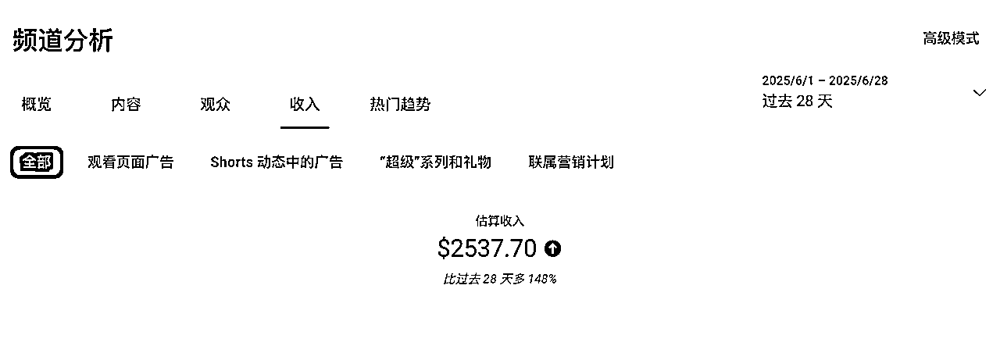

大家好，我是龙哥。最早是在第一次YouTube Shorts航海活动里入坑做油管的，后来加入了深海圈，特别感谢方波妮教练和Gary教练的指导。圈里不少朋友靠我分享的VPS教程低成本开通了YPP，今天再补一篇关于长视频的实操复盘，也汇报一下目前的进展：我现在手上已经有50多个YPP账号，前前后后做过上百个油管号，不敢说多精通，但也算积累了一些自己的理解。现在大部分账号都交给团队伙伴运营，我本人主要聚焦中长视频方向的研究。刚好碰上龙哥大佬的龙珠活动，就借这个机会把我在用的工具和方法系统梳理一遍。

开始之前先提醒一句：YouTube中长视频是个长期项目，变现周期不会像短视频那么快。你必须做好准备：

*   有足够的耐心 🕰️
*   选对方向 ✅
*   能快速试错和调整 🧐
*   善用AI工具 🤖
*   把每一块基础工作搭对 🧱
*   懂得举一反三、触类旁通 🍂
*   注意：以上只针对8分钟以上的视频，8分钟以下的不适用。

### 1. 先搞懂要盯哪些数据，心里有杆秤再动手

YouTube的推荐机制和国内平台不太一样。它的流量池非常大，Google本身就是全球最大的广告系统，既不缺流量，也不吝啬给流量。只要你的内容质量过关，平台会主动帮你找人看。下面给一个纯新号的案例：6月20号注册，只发了4条视频，一周内就有数据起色。大家可以拿这个当个初始参考标准。


关键指标就两块：

• **观看时长（Watch Time）**：用户在你视频里停留得越久，系统给的推荐权重就越高。这是最核心的一项。

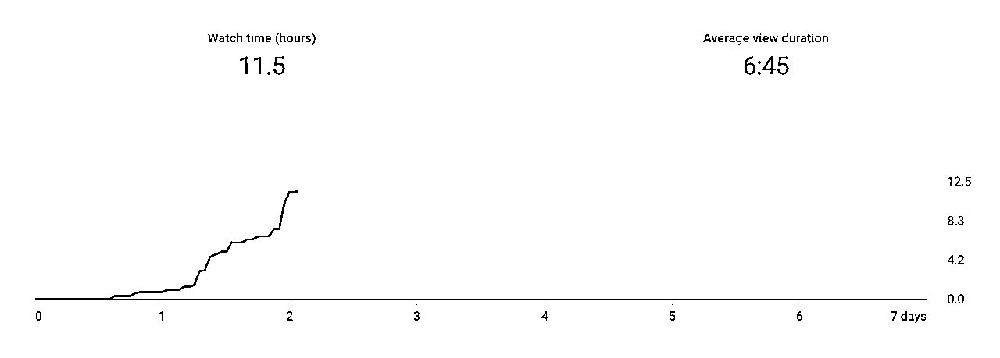

• **点击率（CTR）**：封面和标题够不够吸引人，直接决定有多少人愿意点进来。一般区间在2%–10%，如果低于2%就要考虑换封面了。你可以直接手动换，也可以利用YT的缩略图测试功能做验证。前期的话，4%–6%算是一个比较合理的判断区间。

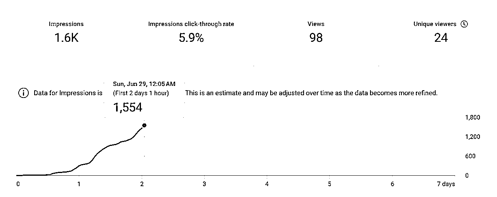

另外，YouTube算法是很带“用户标签”的，你需要给它一点时间，让它搞清楚你的视频该推给哪类人。长视频一般在发布后8到20天才会迎来真正的推流。下一步我就用一个频道来拆解。

### 2. 怎么找对标、挖爆款

#### ① 插件用 VidIQ

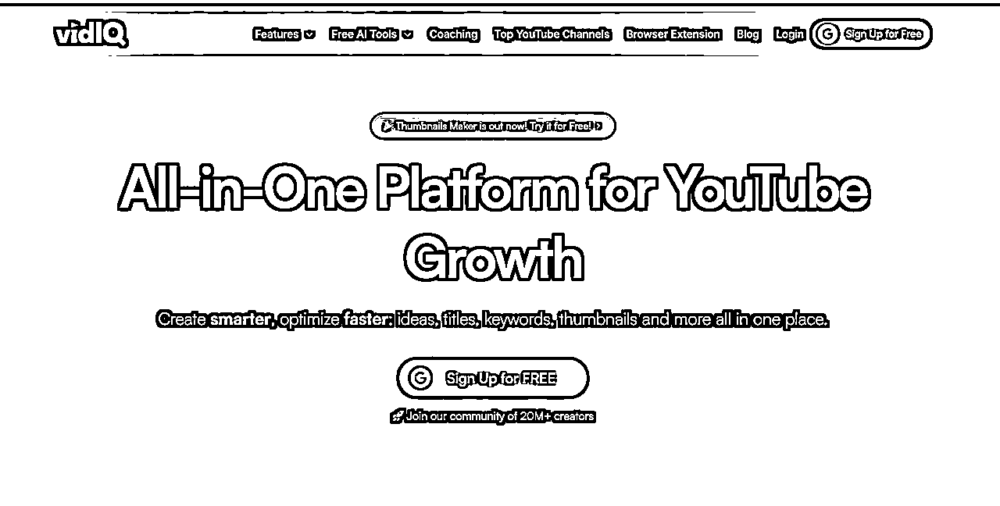

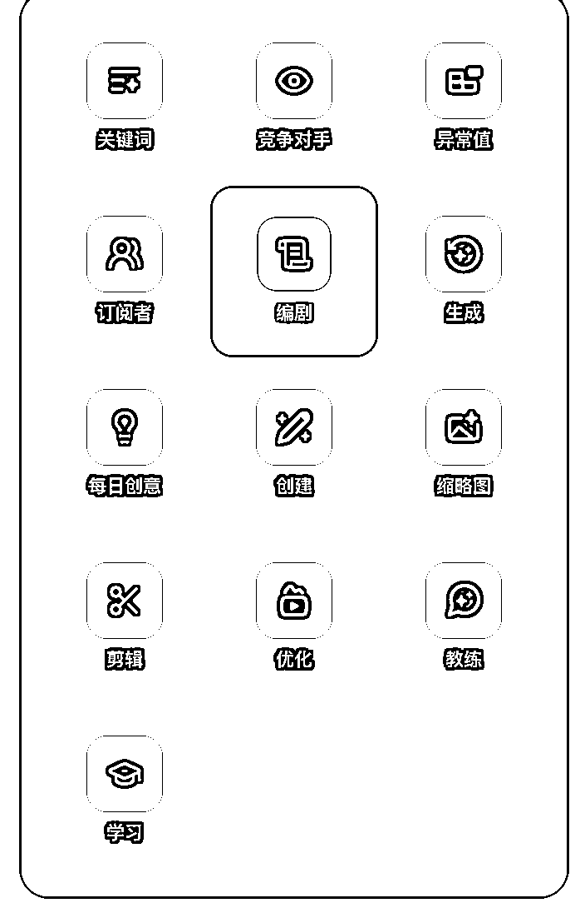

这是个老牌的数据分析插件，能帮你做SEO优化、起标题、找灵感。免费功能对我们来说已经够用了。先装好插件（后面做封面也会用到它的缩略图功能）：

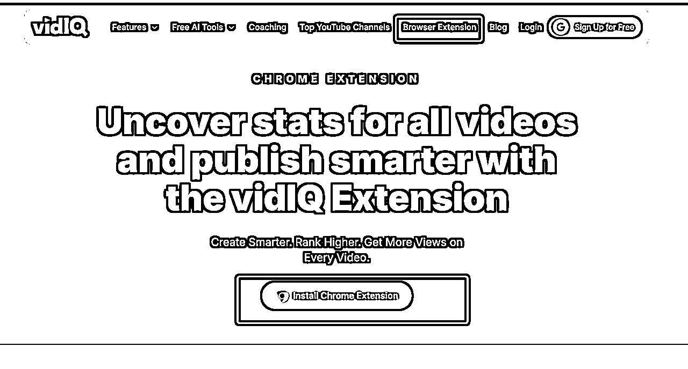

装完之后，回到YouTube页面，你会发现每个视频旁边都多了一些数据信息：

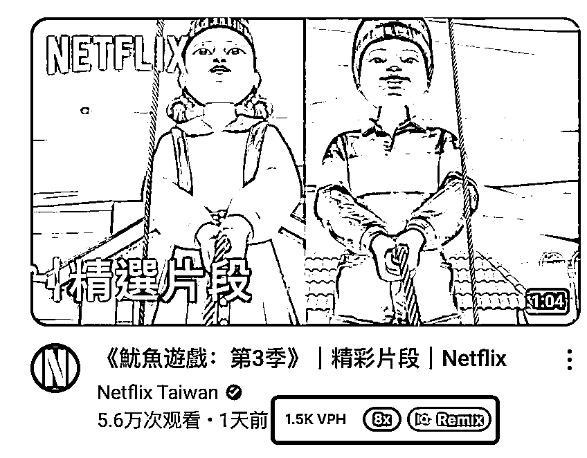

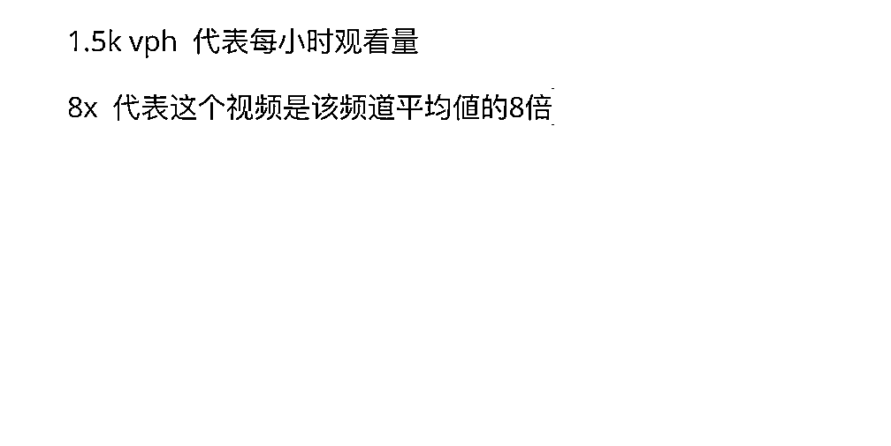

这样你每次滑动屏幕都能快速识别出哪些是正在爆的视频。当然，首页推荐内容受信息茧房影响，这就需要我们主动去搜索。

#### ② 关键词提取法（以疗愈赛道为例，长短视频都适用）

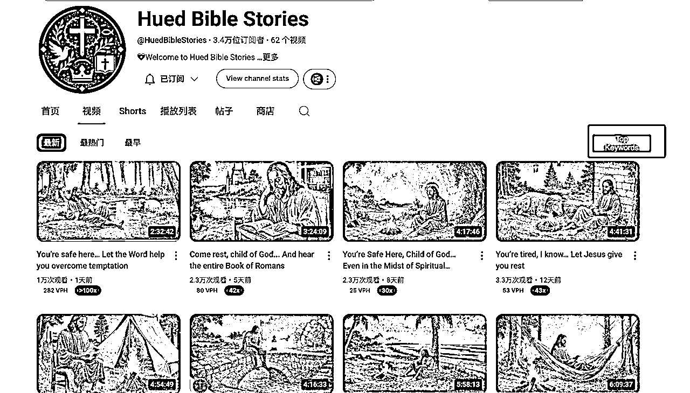

打开你想参考的频道首页，找到我截图标出的位置，把这些关键词提取出来，然后拿这些关键词反复去搜索结果页，专门找那些最近刚做起来的新号（逻辑跟📕的“低粉爆款”一样）。我当时就找到这样一个号：https://www.youtube.com/@HuedBibleStories/videos

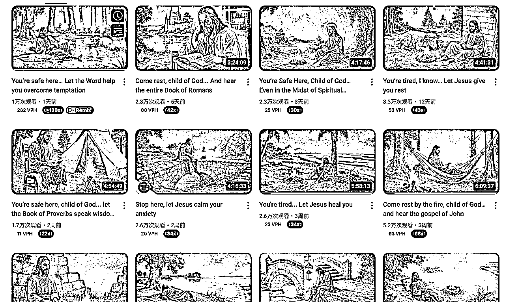

这频道播放量相当高。你拉到最底下翻一翻，会发现他其实换过赛道，而新赛道差不多只用一个月就起来了：

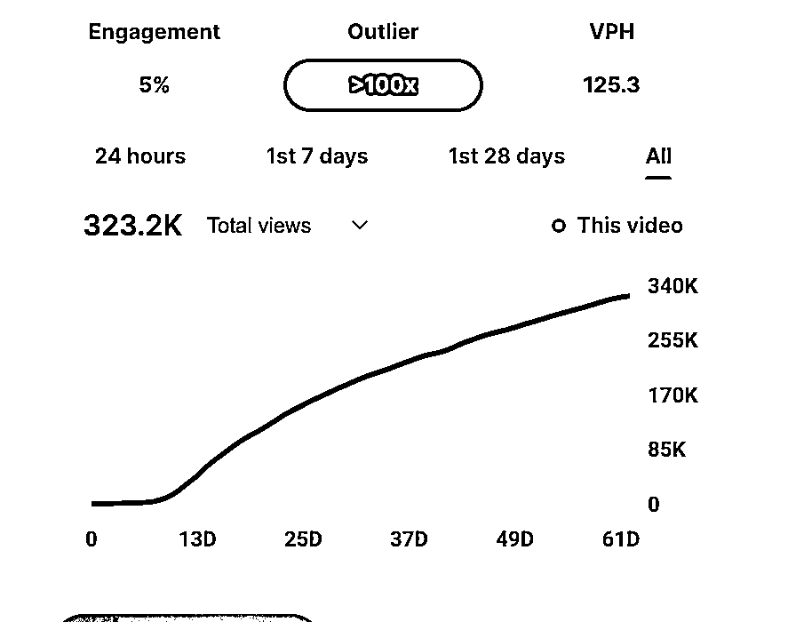

解释一下数据：基本到8—10天才开始起量，所以长视频真的要有耐心，它不会像短视频那样一上来就猛推。两者的池子不同，单价也不同。这个视频已经发了61天了还在持续获得推荐，而且每小时还能稳定涨125次观看。它是那种超长的睡眠视频，理论上能把广告收益吃满。接下来我们讲怎么“抄作业”。（这个逻辑也能用来分析短视频，刷Shorts时插件会在左侧显示数据。别光看播放量，记得留意它是几天前发的。）

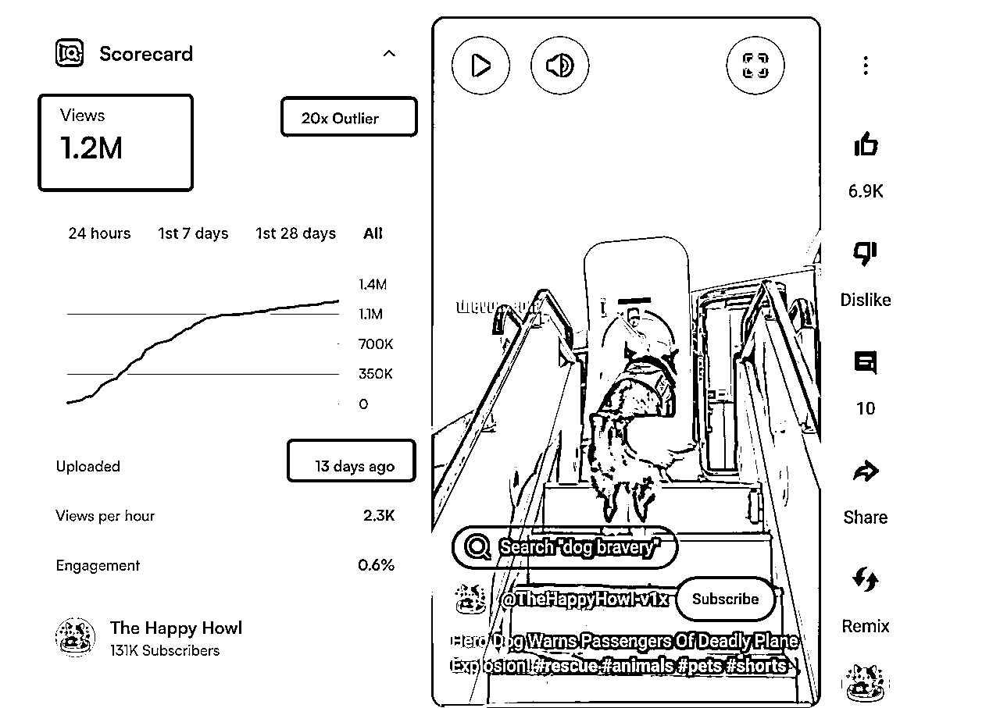

#### ③ 怎么判断收益值不值得做

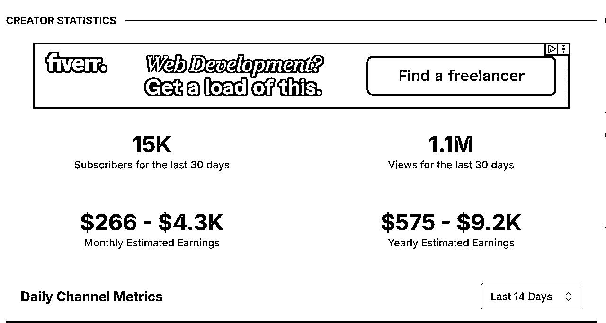

可以去 https://socialblade.com/ 看大概的收益区间，注意只是一个粗估范围。

按我的标准，主要看三条：能否达到单条千刀收益、能否模板化标准化、能否长期做。像这种固定画面+固定语音类型的疗愈视频，对我来说就是最优解——哪怕交给任何一个人来运营，成片质量都在我的掌控内，不会出现大偏差。这意味着我甚至可以把流程写进程序，做流水线，又快又省又标准。这个疗愈赛道的RPM大概在9左右（不同赛道差异大，一般2到12），平均观看时长35分钟。YouTube对超过8分钟的视频可以无限插播广告，像这种三小时以上的超长视频，观众基本已经睡着了，RPM反而更高。我在这个赛道实测的数据如下：

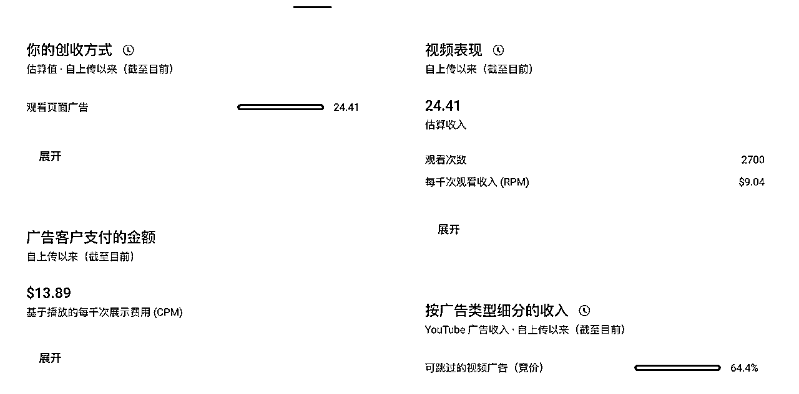

### 3. 拆解对标视频（连逐字稿都不放过）

1.  还是看这个频道，搞清楚它在讲什么、受众是谁。先把视频链接放到 https://www.youtube-transcript.io/ ，就能拿到完整字幕文本。如果你不怕麻烦，也可以把YouTube地址栏里链接中的“ube”去掉再回车，同样能发现隐藏字幕的提取方式（懂的都懂）。

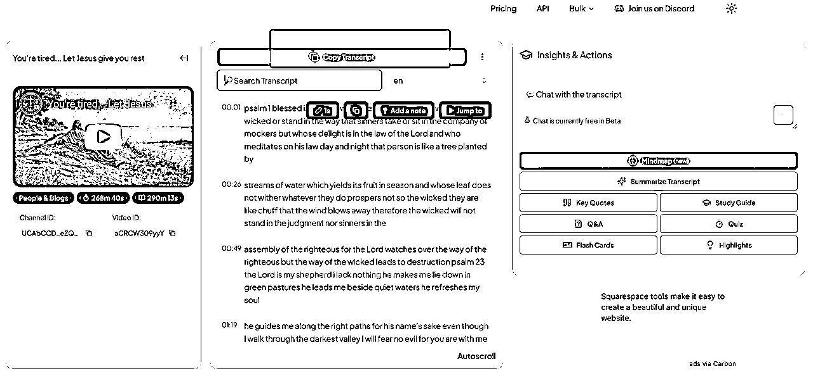

2.  把文本丢进你惯用的大模型里。我一般用Gemini 2.5 Pro，它百万级的上下文窗口，处理这种超长文稿的翻译、改写、润色毫无压力。因为不同赛道受众不一样，你要在这一步认真下功夫，让AI帮你分析内容的结构套路，慢慢形成你自己的创作公式。我的做法是让它按下面的模板出具报告：

```
### 角色
你是一位专业的内容赛道分析师和营销策略专家，具备深度的用户心理学洞察和数据分析能力，擅长从多维度解构内容的商业价值和传播潜力。

### 任务
基于用户提供的剧本内容，进行全方位的赛道分析，包括内容结构、钩子设计、目标受众、风格定位等核心要素的深度剖析，并给出具体的优化建议。

### 要求

**1\. 结构分析**
- 开头钩子：分析前3-15秒的吸引力设计（悬念、冲突、反转等）
- 中段发展：梳理情节推进逻辑、节奏控制、情绪曲线
- 结尾收束：评估结局的满足感、记忆点、分享驱动力
- 总体架构：判断是否符合目标平台的最佳实践

**2\. 钩子深度解析**
- 情感钩子：识别触发的核心情绪（愤怒、同情、好奇、恐惧等）
- 认知钩子：分析引发的思考点（价值观冲突、社会议题、人性探讨等）
- 视觉钩子：评估画面呈现的冲击力和记忆度
- 社交钩子：判断内容的讨论性和传播潜力

**3\. 受众画像分析**
- 核心受众：年龄段、性别比例、兴趣标签、消费习惯
- 心理需求：内容满足的深层心理需求（认同感、释放压力、学习成长等）
- 观看场景：预测主要观看时间、地点、设备
- 互动倾向：点赞、评论、分享、收藏的可能性分析

**4\. 风格定位**
- 叙事风格：第一人称/第三人称、严肃/轻松、纪实/戏剧化
- 语言特色：用词习惯、句式节奏、口语化程度
- 情感基调：整体情绪色彩和能量级别
- 差异化特征：与同类内容的区别点

**5\. 赛道竞争力评估**
- 市场饱和度：该类型内容的竞争激烈程度
- 创新点识别：内容的独特价值和差异化优势
- 商业潜力：变现可能性和商业模式适配度
- 风险评估：可能面临的平台限制或争议风险

**6\. 优化建议**
- 结构优化：具体的情节调整建议
- 钩子强化：开头和关键转折点的改进方案
- 受众扩展：如何吸引更广泛的目标群体
- 风格升级：提升内容质感和专业度的建议

**输出格式要求：**
- 使用清晰的分级标题组织内容
- 每个分析点都要有具体的例证和数据支撑
- 给出1-5分的评分和详细理由
- 提供3-5个可执行的改进建议
- 预测内容在目标平台的表现潜力

**示例模板：**
```

## 📊 赛道分析报告

### 🎯 内容概览

[剧本核心要素总结]

### 🏗️ 结构分析（评分：X/5）

**开头钩子：** [具体分析]

**中段发展：** [具体分析]

**结尾收束：** [具体分析]

### 🎪 钩子解析（评分：X/5）

**情感钩子：** [触发的核心情绪]

**认知钩子：** [引发的思考点]

**传播潜力：** [社交分享驱动力]

### 👥 受众画像（匹配度：X/5）

**核心受众：** [详细画像]

**心理需求：** [深层需求分析]

**观看场景：** [使用场景预测]

### 🎨 风格定位（独特性：X/5）

**叙事风格：** [风格特征]

**差异化：** [与竞品区别]

### 💡 优化建议

1\. [具体建议1]

2\. [具体建议2]

3\. [具体建议3]

### 📈 商业潜力预测

[市场表现预期和变现建议]

```

**要求用户输入需要分析的剧本内容：**
```

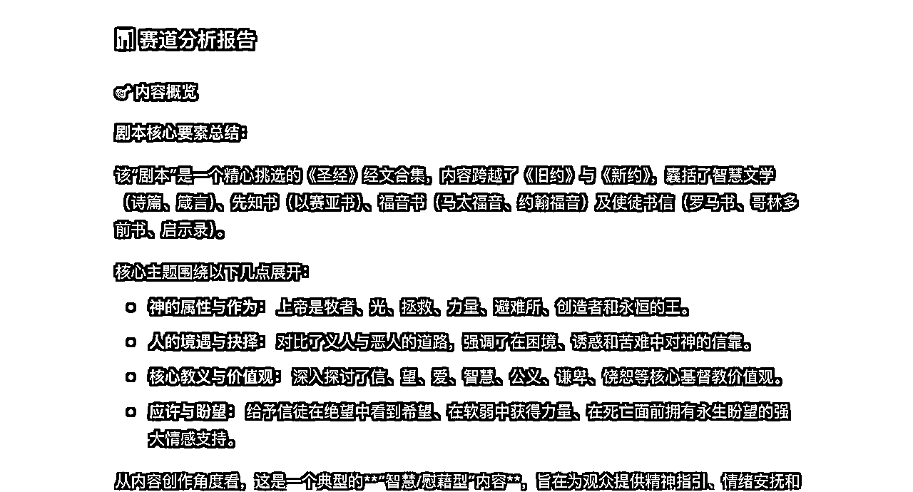

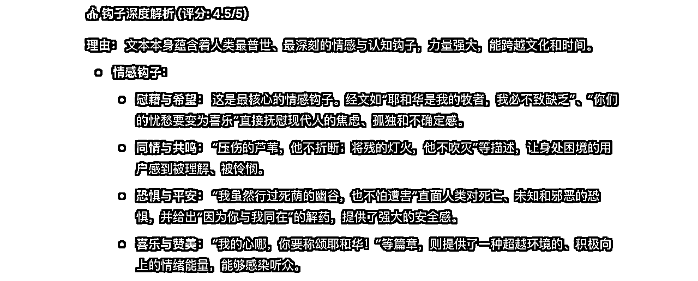

想细化到哪一块，就按这个模板里的问题一步步追问AI。励志故事类、解说类的视频基本都是这个拆法。这就是所谓的“一叶知秋”。

### 4. 制作环节怎么搞

做长视频最头疼的首先是语音。很多商用语音API把字符数限制在5000以内，可你要生成这么长的音频内容，文本量往往超过5万字符。解决办法有两种：一是分段拼接；二是看我之前那篇教程：https://scys.com/articleDetail/xq_topic/2852482418851551 ，具体细节不重复了。

画面这块大家都很在行，市面上的生成工具五花八门，随便选一个都能满足基本需求。实在不会做复杂的，用图生图总能搞定吧？

### 5. 点击率：封面和标题才是命门

长视频点击率的影响排序是：封面 > 标题 > 内容 > 描述。

举例说明：


长视频的推荐跟短视频逻辑完全不同。短视频用户没得选，平台瀑布流+预缓存机制，划到什么看什么；长视频首页一屏最多展示6个视频（以首页来源为例），观众必须自己决定点哪个。如果你的封面抓不住眼球，天然就没有点击。做自媒体本质就是洞察人性——人是惰性的，大部分人第一眼看到的绝对是图，然后才看标题。而标题更大的作用是拿来被搜索的，搜索本来就是一大块流量来源。

点击率受三个因素影响：推流人群是否精准、封面是否够吸引人、标题是否容易被搜到——也就是SEO优化。当下热点大概率是搜索量最大的。至于封面怎么做？如果自己不熟，可以用VidIQ，它支持直接丢对标视频链接，自动生成类似风格的缩略图。它会绑定你的账号，你上传视频时会帮你给标题和缩略图打分，分数低就换一个。大部分功能免费，但有使用次数限制。当然你不一定都听它的，AI本身只是工具，再好看图好过一堆没用的描述。做得多了手感自然就来了，慢慢提炼出适合你自己的爆款公式。AI生图有时不稳定，我更习惯直接用Canva这类工具一步到位。

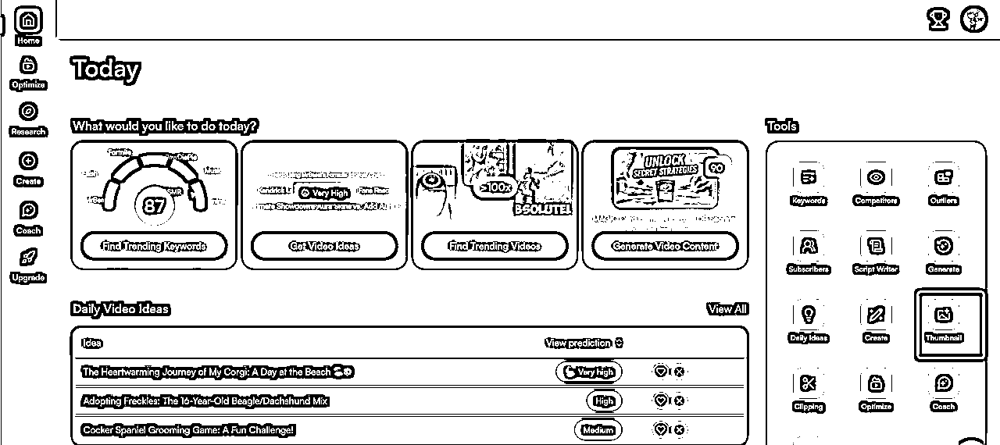


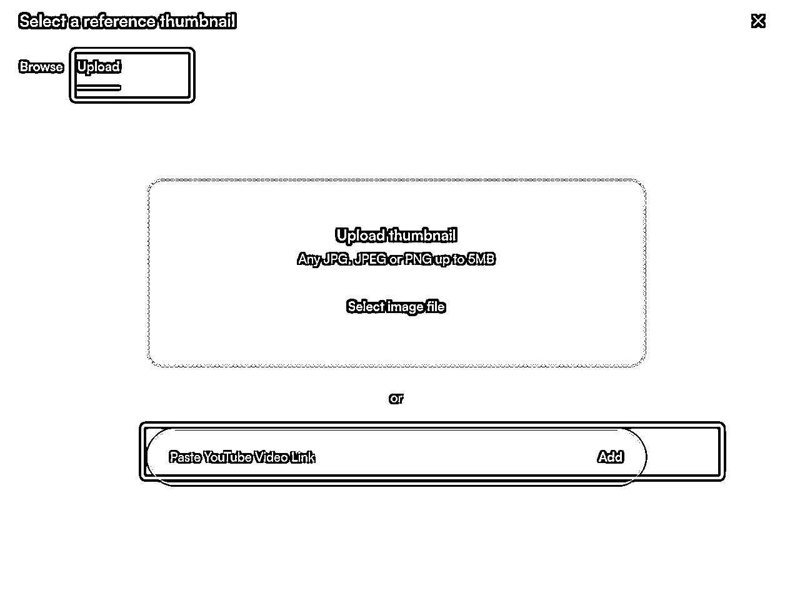

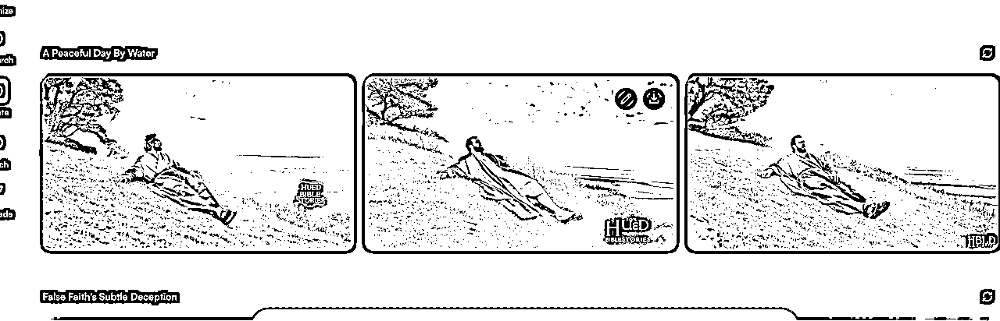

### 6. 发布频率和所谓“权重”

总听人提“权重”，那到底什么才是权重？咱们素不相识，你在平台那里根本不存在什么信任度。算法只讲规则，不讲感情。那信任怎么建立？靠的就是固定频率更新、持续稳定输出，慢慢让系统形成对你频道的稳定预期。我翻过大量一个月内起量的频道，发现一个普遍规律：前期发的几条视频十几二十天都没什么水花，中间某一天突然就来了大推流——前提是你内容质量真的达标，坚持才有意义，不然等来的只是失望。

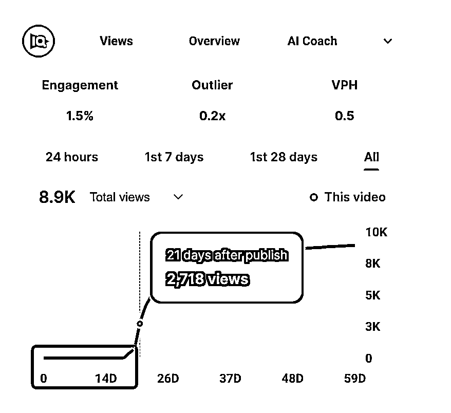

至于多久发一次，不如直接去看这个频道：

https://socialblade.com/youtube/channel/UCAbCCD_eZQfwktW7FLp1dMQ

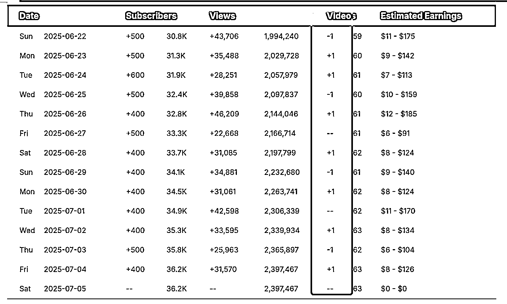

你不仅能看出它的发布节奏，还能发现它悄咪咪隐藏掉了数据不行的那几条视频。这也算是一种运营技巧吧。