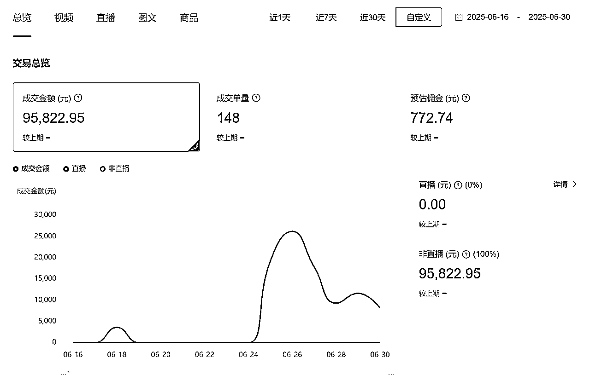
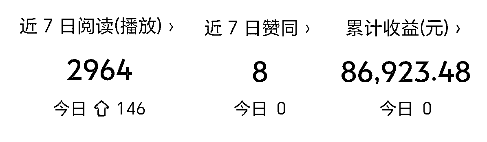
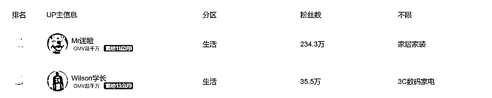
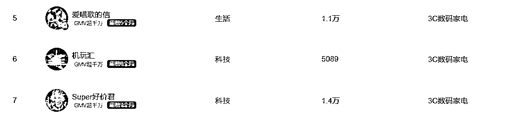
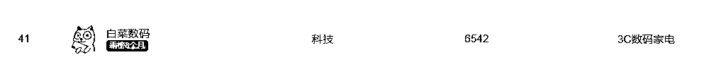
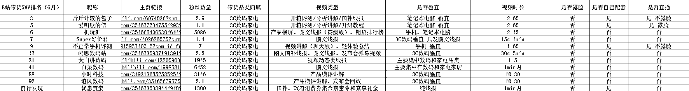
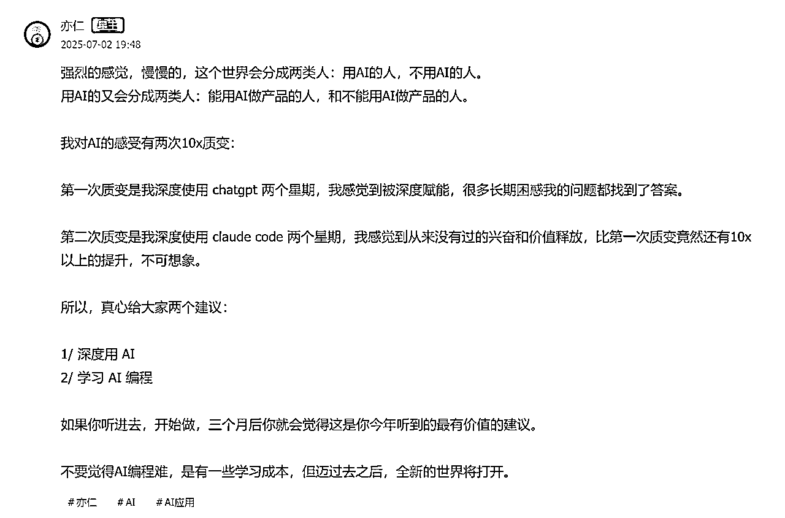

# 从零到初步验证：哔哩哔哩好物悬赏实战复盘与对标拆解

> 来源：[https://ebw2eafswx.feishu.cn/docx/WMqdds5YOo98k4x1LjdcR1Jon2e](https://ebw2eafswx.feishu.cn/docx/WMqdds5YOo98k4x1LjdcR1Jon2e)

# 开篇：为何称之为0到0.1的跨越

大家好，我是小源。这次想把自己对哔哩哔哩好物悬赏这条赛道的观察、拆解以及短周期实操的得失完整梳理，和大家共勉。

6月12日，星主亦仁将哔哩哔哩好物带货定义为超级机会。次日，叶凌尘老师发布了一套细到极致的好物悬赏实战攻略，对我而言就是明确的入场信号。我用三天时间反复研读该攻略，同时去寻找粉丝不多但成交体量高的账号做切片研究，确定方向后在6月15日开通橱窗，16日上线第一条带货内容。

截至6月30日，共发布60余条内容，累计成交销售额95822.95元，成交笔数148笔，预估分成772.74元。0到0.1的打通算是有了，正反馈出现，但距离目标还有很大差距。

接下来我会讲述从看到信息到决定All in，再到拿到一点成绩却产生焦虑并渴望进阶的心路，以及我对已取得显著结果账号的拆解逻辑。希望对你有启发，也欢迎大家批评指正。

# 1、如何完成起步期的初步验证

## 1.1 专业门槛是否必须

先交代背景，我并非完全的小白。过往做过知乎好物推荐，并把全流程跑通，对PID绑定、选品思路、对标复制有经验，只是载体由图文切换为短视频。

此次切入哔哩哔哩，优势与短板都很清晰：

*   优势：对3C数码、家电有一定认知，知乎时期接过手机、电脑、显示器等品类的商单，家电也略有涉猎，基本契合站内用户的内容偏好。
*   缺陷：剪辑能力薄弱，一条榜单向视频要花我4小时。

站内好物推荐的本质是替用户做购买决策，决策稳定成交才稳定。平台上还能做价格情报，这也是我起步快、回响快的重要原因。

我把对标账号的内容大致归为7类，归根到底两类：价讯情报和消费决策。

价讯情报类不需要深懂产品，只要价格足够香即可发布。难点在信息源，解法很简单，跟踪几位情报账号直接复用。

消费决策类则需要一点认知，但无需成为专家。只需把公开信息收集后做整合。想带空调，不懂型号怎么办？去看头部博主的推荐清单，把多份清单交叉验证后重新整理成自己的内容。文案过关，信息整合能力就够了。

新手入局3C赛道肯定需要学习期，我在知乎走的就是这条路。

建议：

*   跟踪哔哩哔哩品类头部UP主的科普和全价位推荐视频
*   阅读知乎头部博主的科普文章和横评
*   关注微博头部博主，保持对新品的敏感度

你不需要成为专家，只需会筛选与重组信息。整理完后，在新手眼里就是专业。

例如推空调，华凌二代神机基本不会错；笔记本推荐联想拯救者R9000P这类共识款；电视海信小墨EQ5 Pro，手机小米K系，都是安全选择。爆款不用自己创造。

我当年在知乎切入一个新品类，8月以爆款切入，10月产出品类科普被官方双十一专题收录。做的也只是搜集与整合。

总结：花点时间去头部处扒信息，整理成自己的表达输出即可。

## 1.2 十五天做到九万销售额，我抓住了什么

前面成绩背后是两段截然不同的走势。

6.16-6.24，9天仅2单。6.18当天赶上618尾巴出了两单，随后连6天无单。既有大促结束因素，也有思路偏差。

6.25-6.30，6天出单146单。差距本质是及时纠偏了策略。

起初我带着知乎思维想吃高佣金产品，上来就选佣金率高的品，比如洗碗机这类，在哔哩哔哩很难起量，尤其新号更吃力。

第6天我做了两件事：

1.  重新精读叶凌尘老师《哔哩哔哩好物实战手册》中关于用户画像的描述
2.  复盘已发视频数据，重点看点赞、评论、收藏、弹幕，看哪些被接受、哪些被冷落

反思后我把选品逻辑从佣金率高转向关注度高。同时思考，能否借热点实现流量跃迁。

热点追踪我不擅长指数，但知道3C家电的热点在知乎、哔哩哔哩、微博、IT之家都能找到。通过对比，我判断小米新品发布会和民航局充电宝新规是两条高概率爆点。

于是围绕小米新品做解读，围绕充电宝新规做充电宝相关内容。形式很简单，公开资料整理成图文PPT视频，封面和标题带话题关键词。话题自带讨论度，即使内容不深也有播放和转化。

能做好剪辑且符合站内审美的，效果至少是我的数倍。策略调整后反馈立竿见影，6.25单量起来，6.26销售额达峰，随后进入稳定期。能判断并抓住爆点，成功率会大幅提升。

# 2、为何All in哔哩哔哩好物悬赏

我6月6日进入生财有术，之前做小红书虚拟带货和公众号老年情感流量主，前者起步，3天4单；后者想钻监管空子未成。

进圈后按纪钟老师节奏走：先随机熏眼，再照方抓药。小红书虚拟产品在准备。但我一直惦记星主亦仁挂的超级标，尤其是iOS应用付费订阅这类长线机会。现阶段更需要能快速出结果的项目，且我对AI基本零基础还有抗拒。

2020年做过知乎好物，累计带货收入8W+，但2023年后基本归零。

我是哔哩哔哩的老用户，经常投币，但从未想过自己发内容，也未想过能在上面赚钱。信息差带来的冲击感很强。

星主亦仁的标和叶凌尘的全套教学一下打开了思路。这条赛道更适合普通人，原因明显：

*   知乎抽成30%，哔哩哔哩不抽成
*   知乎带货位有限，哔哩哔哩视频数量不限，我最高一天发8条
*   知乎看不到数据只能猜，哔哩哔哩有官方榜单，可找低粉高成交账号对标
*   知乎只能手写，哔哩哔哩现在可用AI提效，我也在慢慢克服恐惧上手
*   视频天生优于图文

所以我现在全力做哔哩哔哩好物悬赏，想完成0到1，目标是人生第一个100万，现在差距很大，但方向已定。

如果你还在纠结选什么项目，建议先从哔哩哔哩好物悬赏开始，门槛友好、见效快。

# 3、执行的核心：找对标

哔哩哔哩好物悬赏本质是发视频挂链接赚钱，核心是内容和商品。

*   带什么产品？
*   发什么类型的视频？

## 3.1 先选品

无论虚拟还是实物，选品决定生死。叶凌尘老师讲得很透，站内用户是Z世代，平均27岁左右，选品必须符合调性。

我没太多选品经验，但一个可复用的打法是：看官方带货榜，尤其低粉高成交账号带的都是什么。不确定可先从手机、电脑等3C入手，行动后再迭代。

## 3.2 再定视频类型

新手最怕不知道怎么剪。解法很简单：拆解对标账号。

他们已用这些形式做到百万千万成交，我们只需模仿、复制、坚持发。我就是这么做的，也完成了0到0.1。

所以核心动作是找对标账号做全盘拆解，品类参考他们卖什么，形式参考他们发什么，然后全面模仿。

# 4、我的对标拆解实践

我找对标只用一个标准：粉丝少成交高。

高粉账号可参考性低，他们有专业能力、粉丝池和权重，模仿难度地狱级。比如榜单前两位的Mr迷瞪和Wilson学长，一个是直播顶流，一个是多平台大佬，难复制。

低粉高成交账号则完全可以学。拆开看会发现，能带货的视频其实很简单。

下面是我参考的账号：

以上来自哔哩哔哩6月官方成交榜截图。若不小心对到圈友请联系我删除，抱歉。

我把这些账号汇总到表格，主要看是否垂直、视频类型、时长、是否露脸、是否自配音、是否直播等。

对比后总结如下：

表格我放到了多维表格里，这是第一次使用，数据应该正常，有问题请告知。

基于这些账号，我总结出八大视频类型。实际操作建议按我目前的工具和能力写的，新手可直接参考，剪辑达人或会用AI的会更快。

我不确定如何精确查看搜索与推荐占比，所以流量描述统一为推荐加搜索，关键词要布局到标题、话题、简介，做站内SEO。

## 4.1 情报类

制作成本最低，只要价格足够香即可发布。618、双十一等大促期间效果更好。

节奏：20s-40s，直奔主题。钩子用史低、最低价、超值等。转化靠评论区蓝链和口播引导。播放从几十到上万不等。

实操：手机截图商品页→剪映剪辑→AI合成音→美图秀秀做封面→上传。

话术示例：XX商品京东自营原价XX，现价XX，点击评论区蓝色链接领取优惠券+国补，最终到手XX。

可分为图文情报和视频情报。图文情报用静态图，简单但单调。视频情报加背景素材，观感更好但需找素材。

## 4.2 产品横评类

比情报更高级，通过多款横评给建议，信任度更高。

节奏：10min-20min，慢节奏对比。钩子是专业感。转化靠评论区蓝链和引导用户在评论区留需求做定制推荐，也适合接商单。

实操：开头总结→引导留需求→统一模板展示参数优缺点→再次引导留需求→做封面→上传。

## 4.3 国补政策、大促活动类

省钱主题自带流量。

常见形式：纯政策解读挂会场链接；政策+大促组合；叠加淘礼金、京享礼金锁定用户。

节奏：20s-10min。钩子是政策复杂、大家反感总结需求。流量靠SEO。转化靠会场和红包链接。

实操：截图官方公告和支持国补的商品信息→剪映剪辑→AI合成音→做封面→上传。

## 4.4 开箱评测、升级教程类

适合有专业技能和资金能拿到实物的博主。

节奏：3min以上。钩子是满足探索欲和求知欲。转化靠评论区蓝链。

实操：录制实拍→剪映剪辑→字幕生成。

在 B 站做好物悬赏带货，选对内容模型比猛发视频更重要。经过大量对标账号拆解，目前跑得通的玩法大致可以收敛成几类。

首先是聊天式的产品讲解，又叫轻体验向。有人拿着实物，有人纯靠页面演示。实物党可以自己下单拍，也可以去线下门店实拍；没有实物的，就用手机录屏淘宝京东的详情页，双机位录或电脑录屏都行。核心是把产品讲透：好在哪、槽点在哪、性价比够不够、值不值得下单。时长一般在 3 分钟以上，节奏快慢都行，关键是把信息讲明白。这种风格像聊天一样拉近距离，理中客的口吻降低种草感，带货很自然。流量靠推荐和搜索，标题、话题、简介里埋关键词做好站内 SEO。转化靠评论区挂好物关联，并在视频里引导点击。播放、点赞、评论高低受产品、讲解风格、文案影响较大，不必过度纠结。

再是销量排行榜向。这种内容自带验证感，用户会想查自己心仪的商品在不在榜上。一种是 1-2 分钟快速过榜，不讲解；另一种是榜单加讲解，深度讲产品特点，通常 10 分钟以上。钩子就是 TOP20、前十名这类榜单。同样依赖推荐和搜索，做好关键词布局。评论区挂链接并在视频中引导。互动量取决于品类和发布时间，3C 数码类普遍更高。

操作层面，榜单类我会先手机搜品类榜单，把排名、配置、价格等信息整理进 Excel，再用美图秀秀把榜单做成一张张图片。剪映做视频加关键帧和音乐，美图秀秀做封面后上传。第一次做榜单我花了 4 小时现学关键帧，相当崩溃，后来才意识到要拥抱 AI 自动化。

还有发布会回放和弹幕炸了向。热门发布会本身就有流量，完整回放也能吸睛；把价格公布等高潮弹幕剪出来配“弹幕炸了”封面，点击率很高。回放直接上传并做好章节划分即可；弹幕类需要看直播录下全屏弹幕的价格节点，封面做好就上传。流量同样靠推荐搜索，关键词要埋好。评论区挂链接并说明需求可点。表现看品类和品牌，米粉、华为系关注度更高。

轻直播带货是视频与直播的结合，用直播做信任背书顺带导流。可露脸聊天可只露屏幕聊产品，信任感更强。目前还没实测，但大概率可行。

对标清楚之后，核心就剩下选品和执行。做一千条分析都不如先发一条。

在实操这段时间里，困难是连环的。第一个是账号问题，B 站带货号需要 1000 粉丝+实名认证。解决办法是自建号养粉或直接买千粉号。我是通过知乎上的朋友解决的，也看到叶凌尘老师提供相关帮助。

第二个是配音问题。图文线报类上手门槛最低，不用出镜不用找素材，截图剪成图文即可。AI 配音我一开始不会，用了剪映自带的 AI 配音，输入文案就能出声，开了 1 个月 SVIP。注意文案要先存成文档，改动时需要重新配。

第三个是剪辑技巧。之前只会一点剪映混剪，Pr、达芬奇完全不会。想做榜单才现学关键帧，一个视频剪了 4 小时。后来看到郑王铭老师用 AI 编程做自动化生成榜单视频的工具，才意识到用 AI 提效的方向。建议大家也往 AI 编程自动化上走。

第四个是正反馈缺失。第 3 天出了 2 单，之后到第 7 天零单打击很大。复盘视频和对标后判断是选品问题，及时切向当下讨论度高的品类，表现才有所好转。建议同时关注知乎、微博的热度，直看评论区讨论，找灵感。短时间没反馈正常，快速诊断是选品还是内容问题并调整。

第五个是心力。6 月 16 日到 6 月底我发了 60 多条，平均每天 4 条，最多一天 8 条。下班回家就剪，下班不社交，甚至忘了吃饭。正是高频更新的试错期，虽成绩不理想但保持了正反馈。中间有一次带低价预约抢购视频，数据显示近 100 单预约，结果正式抢购链接不同，佣金为零。经验主义错误加上长期熬夜失眠，我在 6 月最后一天彻底绷断，外出吃饭喝酒、KTV 释放压力后才调整回来。下半年还有双十一、年货节、国补，机会仍然存在。

第六个是 AI 提效。我之前全是手工，AI 配音只用过一次。当前环境 AI 是主旋律，能一键生成图文和榜单的案例不少。Zero 老师把十小时工作量压缩到半小时。AI 会带来质变，必须学。

一点感悟。星主亦仁标记为超级标的机会值得相信，别人能做自己也能做。不想了就从 B 站好物悬赏开始，它是最容易入手的超级标。

要有赚大钱的野心。知乎好物带货家蒙老师起步赚到人生第一个 100 万，我起步晚了三个月，却没有野心放大结果。野心会驱动执行力和心力。

日拱一卒。普通人赚钱最快的方式是掌握信息差，信息差加执行差才能成功。亦仁已经帮我们打破信息差，执行看自己。等航海实战不如先行动。

相关经验总结：播放量高不等于转化高，播放量低也不等于转化低；SEO 至关重要，标题、标签、简介要布局关键词；评论及时回复能增权；抓住热点事件如 3C 认证、禁令等做带货；多看同行找灵感。

希望这篇记录能帮到正在路上的人，也欢迎指正交流。
