# 3个月4个App上架后，我才明白AI编程的真实门槛

> 来源：[https://chaojifeng.feishu.cn/docx/XLksdmemAoxjO8xhDOhcw8NPnCe](https://chaojifeng.feishu.cn/docx/XLksdmemAoxjO8xhDOhcw8NPnCe)

我至今都记得那个崩溃的深夜。鸭霸单词里一个看似简单的跳转，从单词书列表点进播放页，特定情况下就会直接闪退。

项目里文件已经快上百个了，各种AI生成的模块互相嵌套，要定位问题简直像在迷宫里找针。从曾经“Vibe Coding一天出一款App”的兴奋感，到现在为一个Bug连续熬三个通宵，那种落差感就是我的至暗时刻。

鸭霸单词从1月上线到3月底，表面上迭代了两个版本，但这俩版本彻底把我打醒——AI编程根本不是挥挥手就能变魔法的法杖。随着代码量膨胀、需求叠加，控制权和稳定性反而成了最大的挑战。

当产品越来越重，代码和文件像滚雪球一样变多时，问题就出来了：如何让AI编程在复杂项目里依然保持高效稳定，同时让创作者对项目依旧有绝对掌控。

下面这场分享，就是我围绕复杂项目AI编程的探索笔记，希望能给同样在路上的人一点参考。


## 一、一次群聊点醒了我

这次梳理的契机来自互助群里的一句话：“看了那么多AI编程教程，全是‘5分钟搞定’，真实落地哪有那么容易。”

一句话点中所有人的痛。能真正上线、能维护、能持续迭代的产品，和Demo完全是两回事。

因此有了这次输出。我是超级峰，过去3-4个月靠AI编程做了4个iOS应用：芝士相机、鸭霸单词、小圆角、小猫快读。心态也从最初的狂热信徒，慢慢变成了理性的使用者。

这次不讲一句话生成App的技巧，而是聊聊项目变复杂后，如何更聪明地驾驭AI工具。

整体会从四个维度展开，覆盖AI驱动的研发方式到实战提效技巧，帮助创作者真正拿捏复杂项目的AI编程管理能力：

1.  以AI为核心的素材设计流程
2.  离线数据存储的踩坑与对策
3.  用组件化思维拯救AI编程
4.  提升AI编程效率的实操窍门

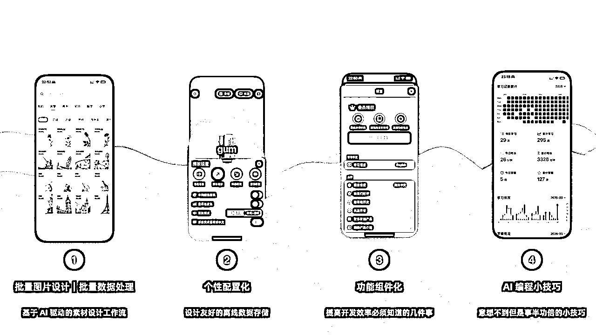

## 二、以AI驱动的素材设计工作流

### 2.1 如何批量产出同风格配图

做鸭霸单词时最头疼的就是视觉。作为独立开发者，没设计师、也不想高价外包，可一个背单词App不能只有干巴巴的文字。

AI绘画成了出路，但风格不统一又成了新麻烦。最后我用上了Recraft，群里之前也有人提过。它的优势是能自建风格库，用起来很顺手：

1.  建立风格模板：我在小红书找了一组citypop插画风，上传几张作为参考
2.  批量出图：固定风格模板，只改提示词就能生成不同画面
3.  保持统一：比如“挥棒的小男孩”“拔河的小女孩”，只改动作描述即可

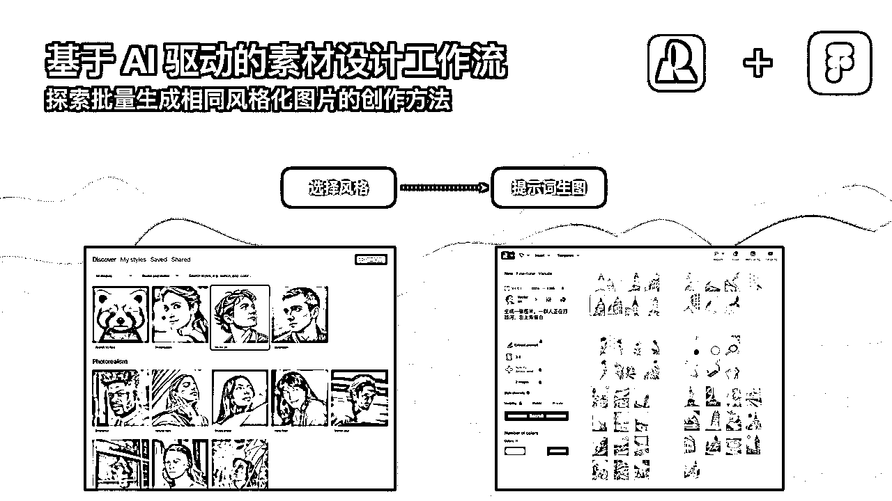

大致流程是：

*   确定或新建风格，我用的是自定义citypop
*   输入简短提示词，20-30字足够
*   设定尺寸比例，banner一般用16:9
*   一键生成，半分钟内拿到图

素材有了，还得做成卡片。我选择Figma做二次排版：

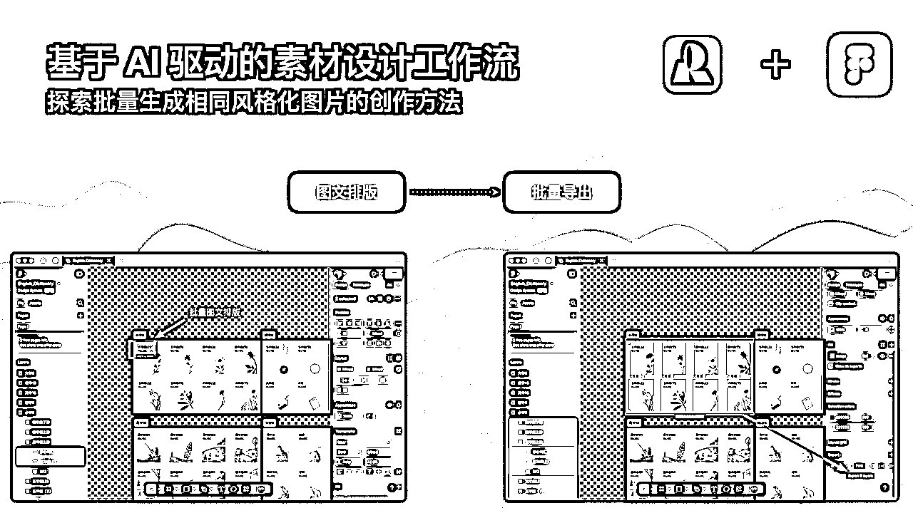

Figma很适合批量处理：

*   先把第一张图排好版，定好文字位置
*   批量复制，换文字即可
*   一次性导出全部卡片

这套组合拳让我没设计基础也能快速做出统一风格的UI素材。AI负责创意，我只做最后的排版微调。

### 2.2 从采集到清洗的数据全链路

解决了“面子”，再说“里子”。鸭霸单词上线后用户提需求：能不能导入四六级单词表？听起来 trivial，实操全是坑。

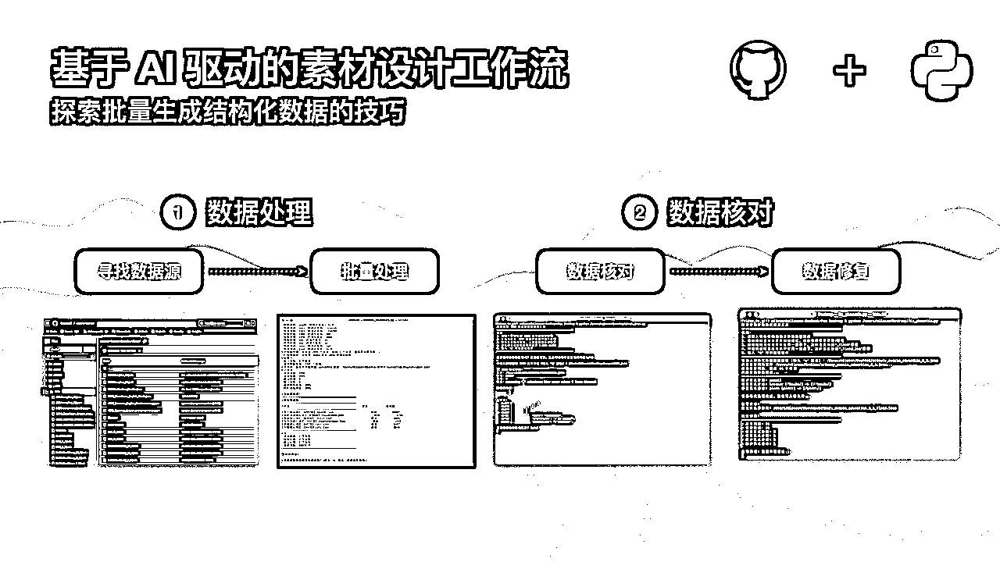

数据源不难在GitHub找到，开源的词汇库很多。但格式完全对不上。别人的字段是这样：

```
{
  "word": "abandon",
  "phonetic": "/əˈbændən/",
  "translation": "v. 放弃；抛弃"
}
```

我需要的是这样，字段更多更复杂：

```
{
  "word": "abandon",
  "phonetic_us": "/əˈbændən/",
  "phonetic_uk": "/əˈbændən/",
  "translation": "放弃；抛弃",
  "word_type": "verb",
  "difficulty": 3
}
```

12197条单词手工转换不可能，于是让AI写了Python脚本，分三步走：

#### 第一步：格式转换

```
# AI生成的转换脚本核心逻辑
def convert_word_data(old_data):
    new_data = {
        "word": old_data["word"],
        "phonetic_us": old_data.get("phonetic", ""),
        "phonetic_uk": old_data.get("phonetic", ""),
        "translation": clean_translation(old_data["translation"]),
        "word_type": extract_word_type(old_data["translation"]),
        "difficulty": calculate_difficulty(old_data["word"])
    }
    return new_data
```

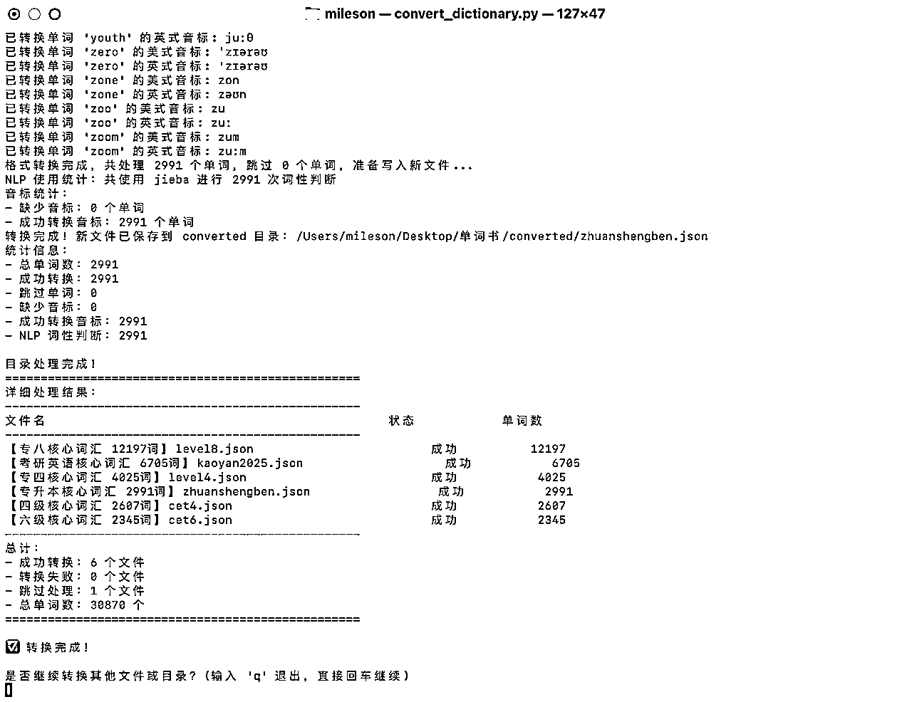

跑完发现问题：部分单词缺音标，词性标注错误。

#### 第二步：数据校验

```
# 检查JSON格式是否正确
def validate_json_format(file_path):
    errors = []
    with open(file_path, 'r') as f:
        data = json.load(f)
        for i, item in enumerate(data):
            if not item.get("phonetic_us"):
                errors.append(f"Line {i}: 缺少美式音标")
            # ... 其他校验逻辑
    return errors
```

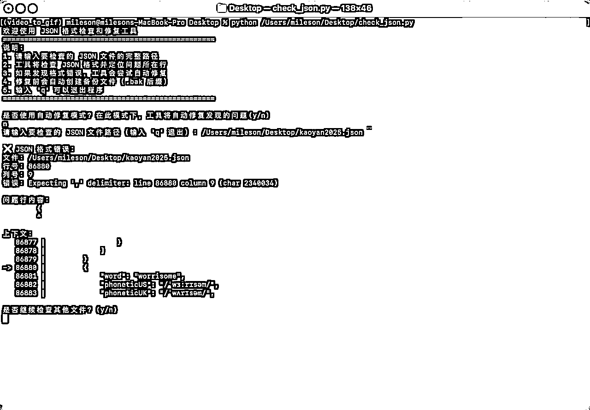

脚本很快揪出细节错误，比如第88680行少了个逗号，这类问题人眼根本抓不住。

#### 第三步：数据修复

```
# 自动修复常见问题
def fix_phonetic_format(phonetic):
    # 统一音标格式，确保左右都是斜杠
    if phonetic and not phonetic.startswith('/'):
        phonetic = '/' + phonetic
    if phonetic and not phonetic.endswith('/'):
        phonetic = phonetic + '/'
    return phonetic
```

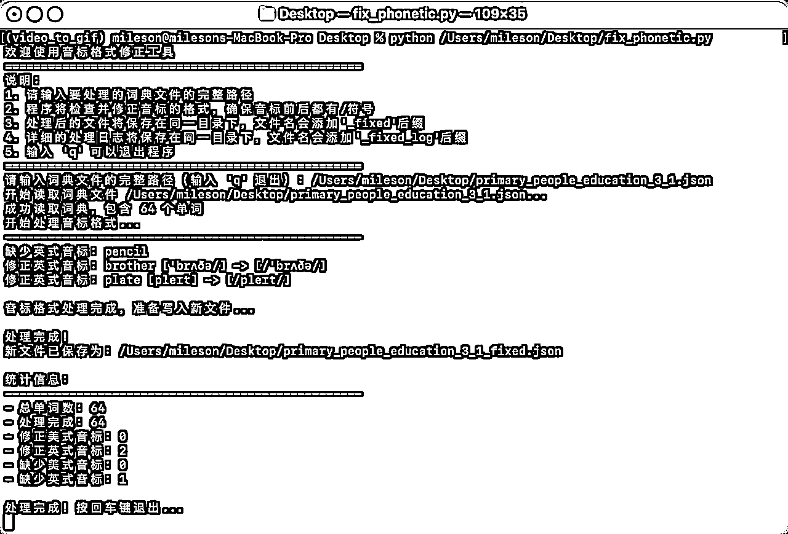

最终累计121975个词条，零丢失，格式完全统一。感悟是：AI编程不是让你不懂技术，而是把重复、低效的技术活交给AI去做。

## 三、离线存储的坑与解决方案

踩坑史必须提到离线存储。首个App芝士相机，AI建议我用UserDefaults存拍照模板。初期没事，用户多了模板多了后，某天直接存不下了！

UserDefaults上限大概1MB，且不支持iCloud同步。用户换设备后模板全丢，反馈炸锅。

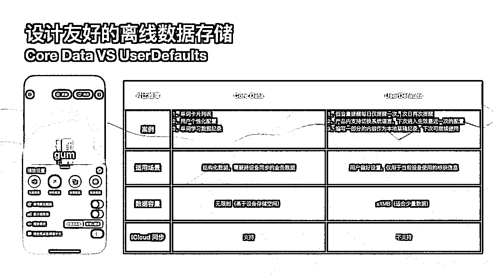

后来做鸭霸单词前，我先梳理了iOS存储方案：

| CoreData | UserDefaults |
| 支持海量结构化数据 | 仅支持少量数据<1MB |

在鸭霸单词里我的分配逻辑是：

*   单词卡片、学习记录 → CoreData，需要同步
*   音量、语言等设置 → UserDefaults，本地配置

教训很清晰：用AI编程不等于可以无视技术概念。至少要知道工具能干嘛、适合什么场景。

## 四、组件化思维是AI编程的救生圈

用个例子说明。假设做支付，有红包、转账、小程序购物三处都要用。

如果三处都重写，改一处要改三处，AI也会混乱。正确做法是做成可复用组件，到处调用即可。

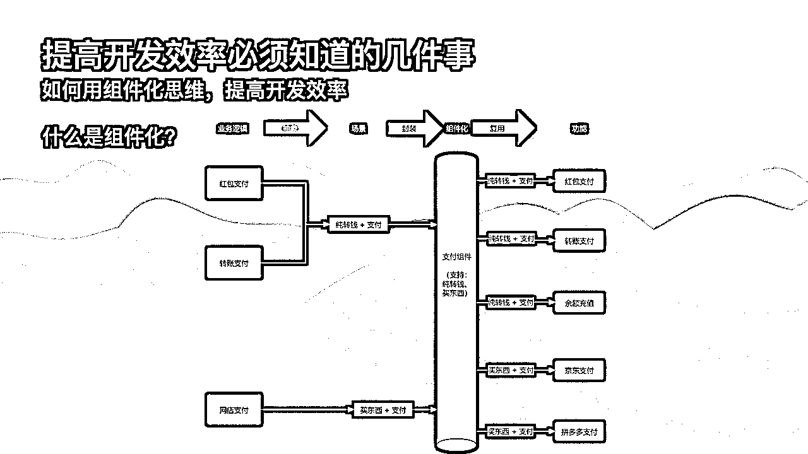

鸭霸单词开发中，我逐步沉淀了自己的组件体系：

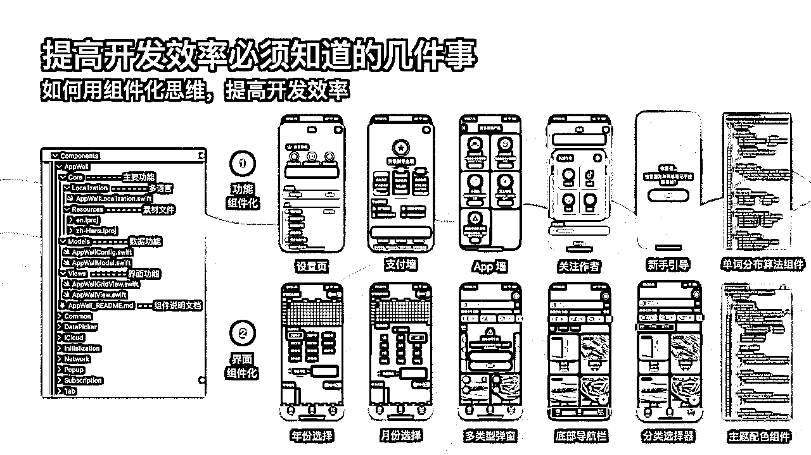

功能组件：

*   设置页组件：会员入口、好评引导、关于页
*   支付墙组件：订阅、价格展示、下单流程
*   App推广墙：导流其他作品

界面组件：

*   弹窗组件：统一样式与动效
*   导航栏组件：自定义顶部导航
*   主题配色组件：全局颜色管理

每个组件都遵循固定结构：

```
Components/
  └── AppWall/
      ├── AppWallView.swift      (主功能文件)
      ├── Resources/             (多语言等资源)
      ├── Models/                (数据模型)
      └── README.md              (组件说明文档)
```

最关键的是给AI看的README使用说明：

```
App墙组件使用说明

功能描述
展示开发者的其他作品，支持跳转App Store或其他平台

使用方法
将整个AppWall文件夹复制到项目中
在需要的地方import AppWall
调用 AppWallView() 即可

可配置项
apps: 要展示的App列表
columns: 每行显示几个App
spacing: 间距设置
```

有了说明，新项目接入就三步：

1. 复制文件夹
2. 让AI读README
3. 下指令“在设置页加入App墙”

AI就能精准集成，不会重复造轮子。

组件化的收益很直接：

*   新App开发时直接复用
*   一处修改，多处同步
*   AI任务变简单，出错率下降

这四个App里这些组件都在复用。App墙做一次就能常驻。算法组件更是共用——四个App都有独立可配置的算法逻辑，这也是iOS适合AI编程的原因。

多产品开发最大的痛点是：同一个功能在不同产品里被AI写成了多套逻辑，后续要改要统一就地狱难度。组件化就是统一规范，只改组件本体，然后复制到各项目即可生效。

所以本质上就是多说几句话给AI：“帮我做个支付功能，抽象成组件，后续要能跨项目复用。”这几句话能让代码更扎实、可迁移。

## 五、三个让效率翻倍的小技巧

### 技巧一：一句话造测试数据

做图表需要大量样例数据，直接让AI生成：

“生成一组学习记录模拟数据，要有层次和真实波动”

AI立刻给出几十条带规律的数据，截图标好看。

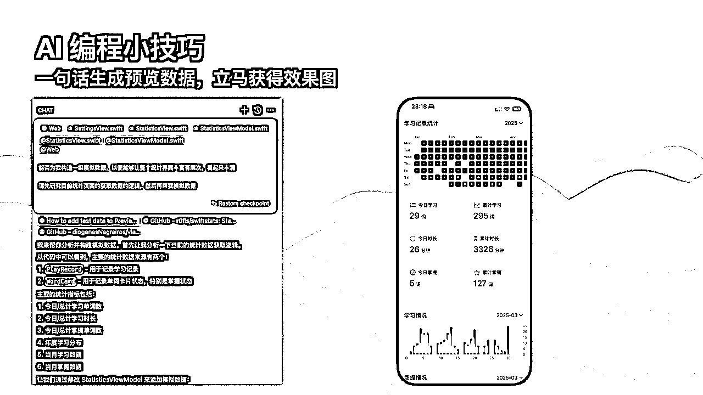

### 技巧二：截图中文标注，AI看得懂

有次我直接在截图上用中文标出不同入口，懒得打字。结果AI完全理解了路径差异。中文视觉理解能力超出预期。

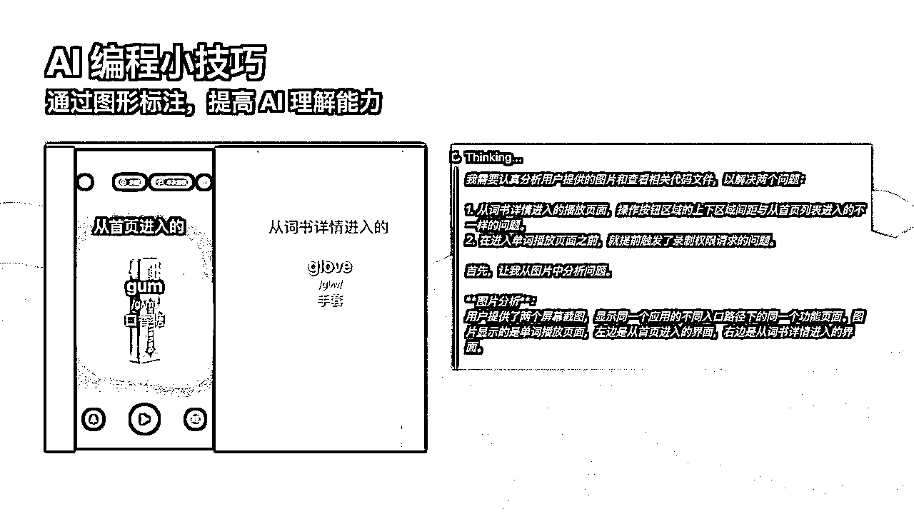

### 技巧三：用流程图理清复杂逻辑

开头那个Bug就是这么破的。我让AI用Mermaid画出整个调用流程，觉得不全就追问“还有别路径吗”，直到AI确认完善。

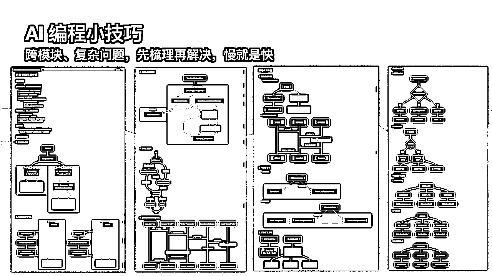

有了流程图，问题瞬间清晰：两个组件在特定场景下循环调用。把图给AI，它一次就定位并修复了。

## 六、AI编程的半自动驾驶时代

几个月下来我的认知是：AI编程是半自动驾驶，不是全自动。

像特斯拉辅助驾驶，大部分时间帮你开，但手不能离开方向盘。

在鸭霸单词里：

*   AI写了大量代码，架构仍需人把控
*   AI能快实现功能，组件规划需要人思考
*   AI解决80%，剩20%难题靠经验

组件化是AI时代的核心竞争力。组件库越丰厚，开发效率是指数级增长。下一个App，很可能一天就能完成，因为80%都是现成的。

AI编程的价值不在于取代开发者，而是让更多人能把想法变成产品。3个月前我还在被技术门槛困住，现在4个App已上架。

* * *

学AI编程，人人都能成为创造者，期待与你一起探索AI的边界。

如果你刚起步或卡在实战中，欢迎留言交流。关注我，下次分享更多AI编程落地经验。