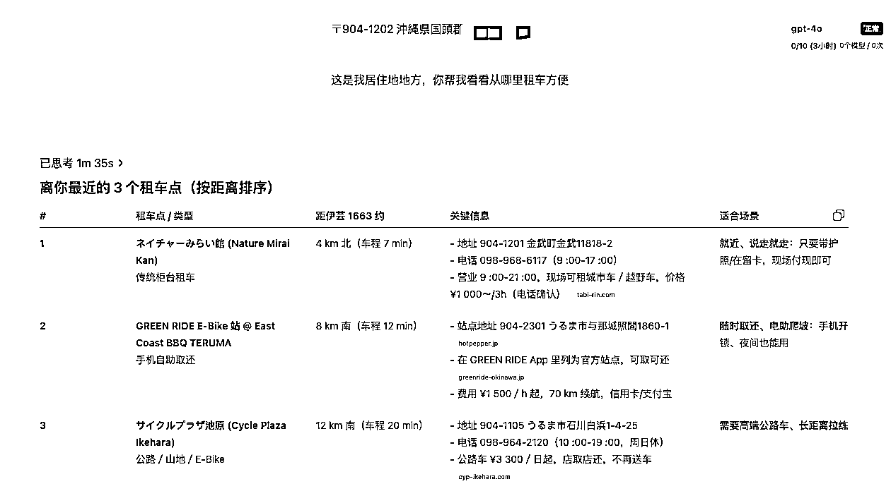
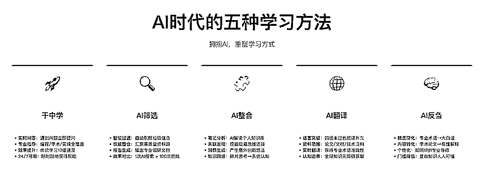
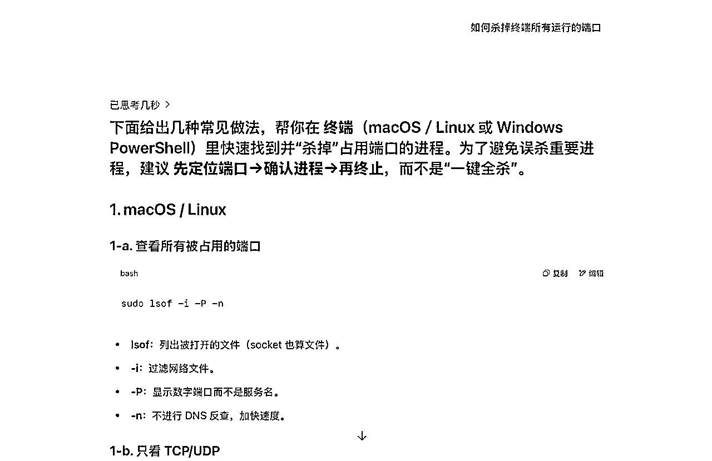
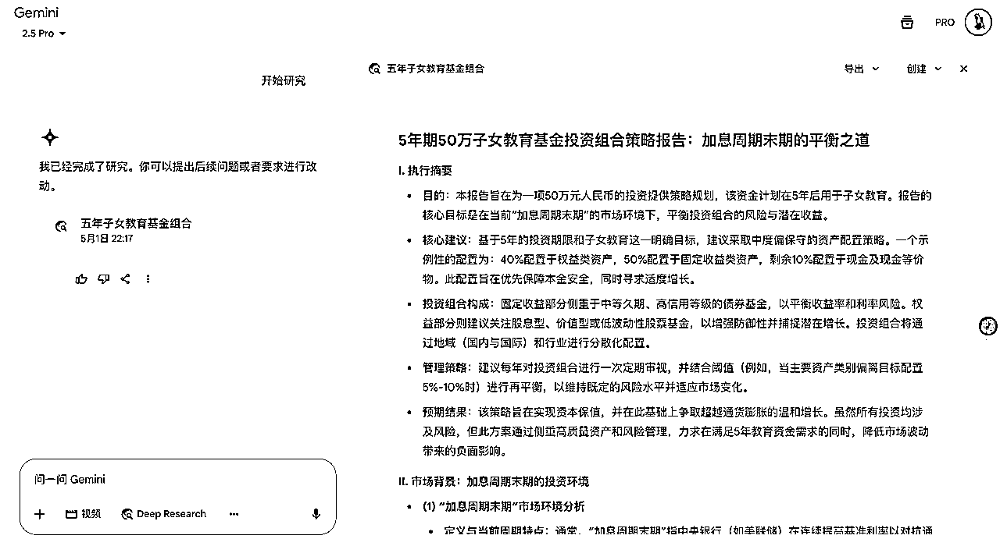
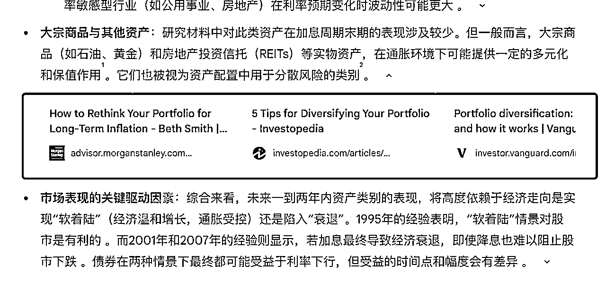
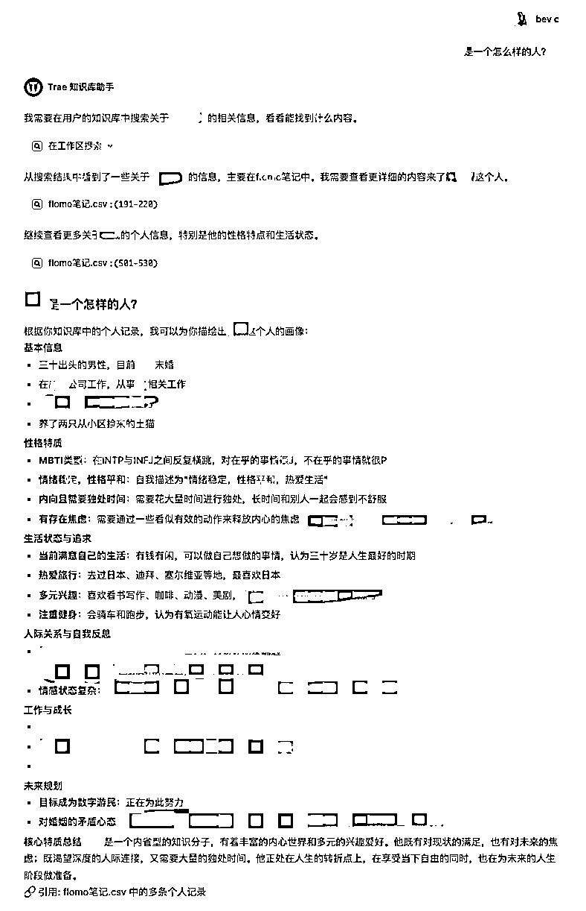
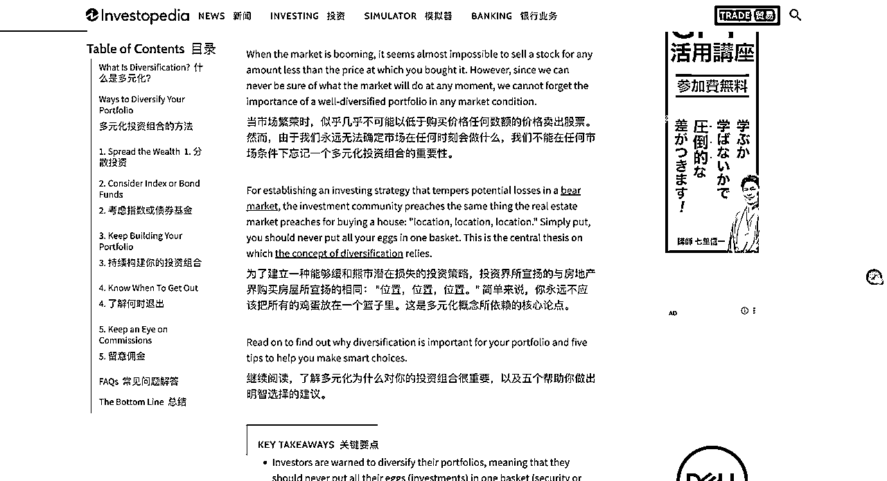
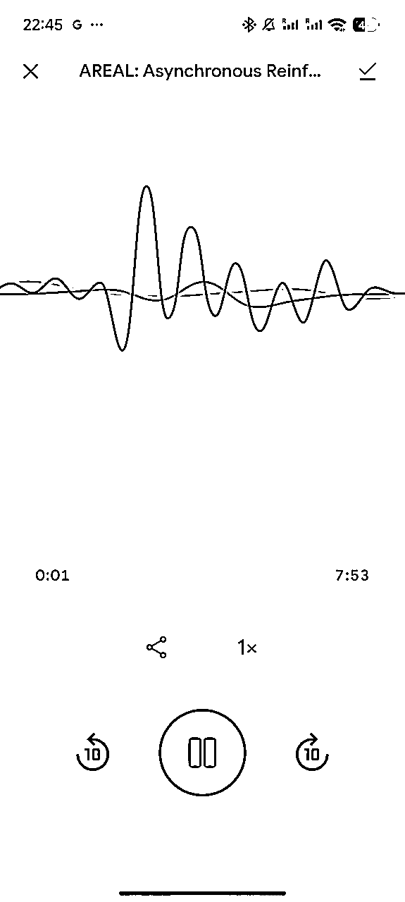

# 【公众号】AI时代，我们要如何学习？

在冲绳旅行时，有个小事让我意外：以前租自行车，我肯定先刷小红书找攻略。这次却下意识打开了AI。

我住的地方在中北部，小红书上几乎全是南部那霸的攻略，北部信息少得可怜。不想跑远路，只想要最近的租车点——小红书显然无能为力。于是试着把住址丢给AI，问它附近哪儿能租车。结果它不仅给了我三个选择，还附上了路线和挑选建议。最后骑行计划顺利落地，工具很好用。

这个例子看起来只是解决了一个具体问题，但学习这件事，本质上不就是在解决一个又一个问题吗？

先抛个观点：AI已经彻底改写了我们的学习方式。到了今天，应该没人会质疑这句话了。

我自己的日常学习，基本就是跟ChatGPT对话，让它帮我出方案。尤其是最强模型O3，整合能力惊人，几乎有问必答。结合这段时间的经验，整理五个我常用的高效学习法：

## 一、边做边学

“干中学”这个词前阵子特别火，但过来人都知道，它最大的毛病是效率低。没人带，卡住了就难前进，搜了半天也未必找得到靠谱答案。

但有了AI，情况完全不同。

冲绳租车那个例子就是最好的说明——ChatGPT活脱脱一个本地通。再比如我学编程，遇到任何卡点都直接问AI：“API怎么接？”“这个语法啥意思？”“这个功能怎么实现？”它全都讲得明明白白。

当然，用AI来学也是有讲究的。我常用的两个产品：ChatGPT O3和Dia浏览器。O3是OpenAI在2024年12月发布的最新推理模型，特点是几乎能答所有问题，哪怕再复杂也行。它在编程、数学等基准测试里表现出色，Arc AGI测试中准确率87.5%，首次超过了人类平均水平的85%。

Dia则是全球首个AI原生浏览器，把AI直接嵌进浏览器里。直接在地址栏问“帮我总结这篇文章”，它就能读懂网页内容并给答案；还能同时分析多个标签页，做产品对比或者信息整合。基本上，网页处理和数据整理都可以交给它。

## 二、用AI做筛选

早在AI出现前，信息就已经过载了。尤其是中文互联网，垃圾内容扎堆。AI又把内容门槛降得更低，垃圾就更多了。

想找到优质信息，我常用两种办法：

传统路子：靠熟人和靠谱社群。比如即刻关注的博主、知识星球里的优质圈子、付费微信群等。

赛博路子：用魔法打败魔法——让AI来筛。

现在ChatGPT、Gemini、Grok这些基本都有“深度研究”功能。它会自动整合网上资料，生成一份类似调研报告的详细内容。我现在查资料、学新东西，经常用这个功能。

需要深入的话，点一下AI引用的链接，就能直接看一手来源。比起以前在谷歌、百度上一页页翻文章，效率高太多了。

而且AI会自己联想关键词，能发现我根本没注意到的线索，很多靠人工搜不到的资料，反而被AI翻出来了。

## 三、用AI做整合

前两年读了《卡片笔记法》，书里那位作者靠这个办法成了高产学者。几十年攒下大量卡片，再把卡片串联起来，就冒出各种洞见，一本接一本地写书。

到了AI时代，卡片笔记法的价值被放大了。以前卡片得靠自己手工串联，现在AI能自动帮你连，还能找出你没想到的关联和洞察。

我做过一个试验：把自己在flomo上几年写的日记导出来，转成md格式喂给AI。结果它把我的兴趣、思维习惯、价值观全整理得清清楚楚，像凭空多了一份“我的人生笔记”。

同理，只要有足够的卡片笔记，AI就能从中提炼出有洞察的结论。

笔记的重要性，比以往任何一个时代都高。AI没法亲身跟世界沟通，也没法判断什么内容真正优质，但我们可以。我们的笔记，就是我们和世界互动的证据，是独特思考的沉淀。

当笔记攒得足够多，说不定未来靠AI，直接就能自动生成好内容。到那时，也许只靠自己的笔记，就能成为一个优秀创作者。

## 四、用AI做翻译

AI翻译已经不算新鲜，但它值得单独拿出来说——这可能是生成式AI最伟大的贡献之一。

巴别塔的传说里，上帝为了惩罚人类，让语言彼此不通。这个古老故事，说白了就是语言这东西，天生就是交流的墙。

生成式AI的出现，等于徒手拆了这堵墙，改变了语言游戏的规则。维特根斯坦说过：“语言的边界就是世界的边界。”有了AI，我们的认知边界被推得远远的。

哪怕是我这种四级都没过的英语菜鸟，也能靠AI无障碍读外文论文、追最新技术动态。

我日常最常用的翻译工具是沉浸式翻译，翻译得准，还能保留原文语境和专业术语。基本有它一个就够了。

## 五、用AI反刍

最后一个方法，是让AI帮我把难啃的内容嚼碎了喂过来。

学东西的时候，难免碰上专业论文和技术文档。传统学法得花大把时间去弄懂术语和复杂概念。

现在，拿到复杂的AI论文，我不再犯愁。直接把论文扔给AI，告诉它“我是个零基础小白，请用大白话讲清楚”。AI就会把内容拆解开，这也是我现在学得快的重要原因。

除了直接对话，我还会用专门工具。Google的NotebookLM就特别实用——把论文传上去，它自动转成对话形式，用特别易懂的话解释复杂概念，像有个老师一对一给我讲课。

这种对话式学习，把枯燥的学术内容变得活了起来，学习门槛一下子就降低了。

## 写在最后

回头看这五种AI学习实践，能真切感受到AI正在从底层重塑人的学习方式。从实时指导、智能筛选，到自动整理、语言翻译、复杂内容消化——每个环节都在被改变。

过去必须靠优质教育资源才能获得的学习支持，现在每个人都能拥有。不管英语水平如何、身在何处，AI都能提供个性化的帮助。

更重要的是，AI不只是改变了获取知识的方式，还让我们从信息消费者变成了知识创造者。当AI帮我们整理笔记、发现洞察时，每一次思考都有可能变成创作的原料。

AI时代，学会学习比学习知识本身更重要。

巴别塔的诅咒已经被打破，我们每个人都有机会，做自己人生的首席学习官。

如果你觉得这篇文章有启发，点个赞、收藏或转发给同样对AI感兴趣的朋友吧。每一次互动，都是我继续写下去的动力！