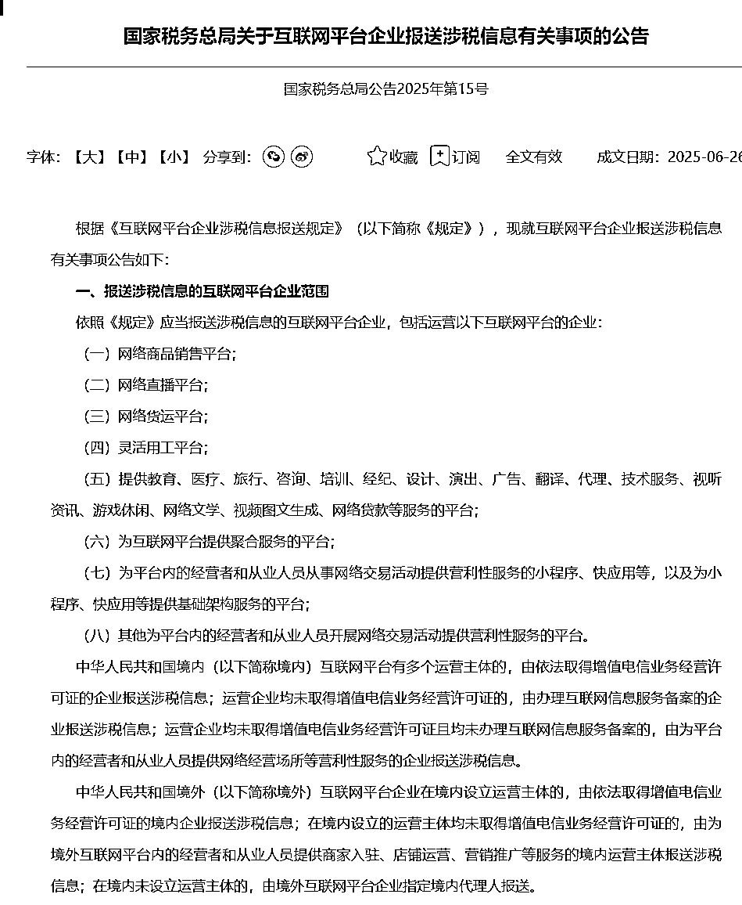
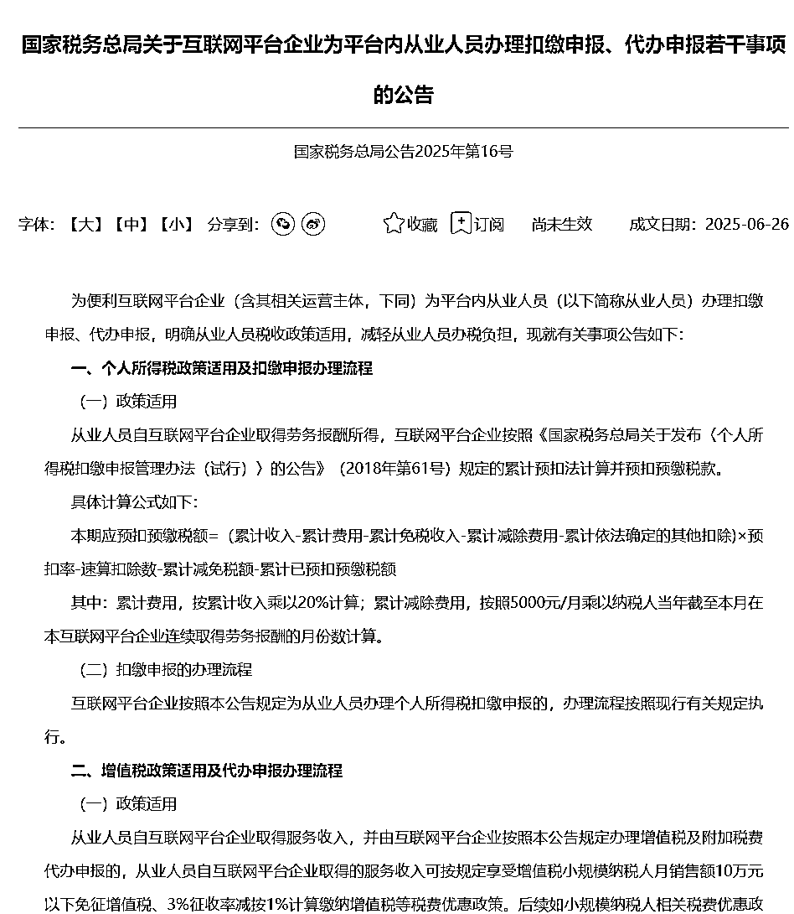
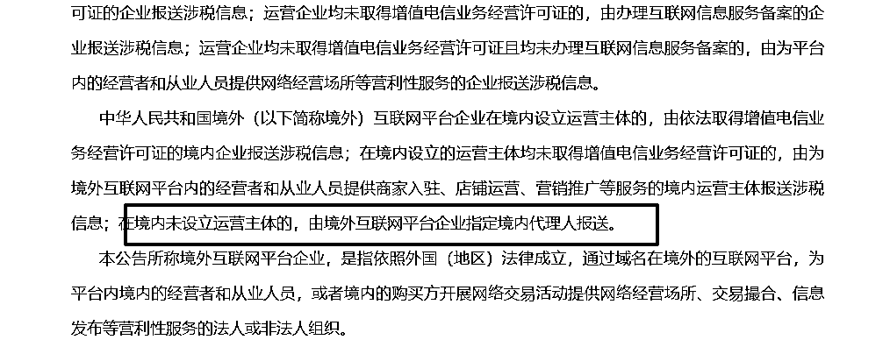

# ('新规全面解读+解决方案', (2, 13))

最近不少做电商、搞自媒体的朋友都在议论同一件事——7月新规落地后，互联网平台的税务合规风暴真的来了。

很多人可能只是隐约听到风声，但具体跟自己有什么关系、影响有多大、该怎么准备，其实心里没底。今天这篇文章，就把这事儿掰开揉碎，讲清楚来龙去脉，以及应对思路。

先说个重要的时间节点：2025年6月26日，国家税务总局连着发了两份公告，一是15号文，要求互联网平台企业报送涉税信息；二是16号文，要求平台为平台内从业人员办理扣缴申报、代办申报。两份文件都有官方解读，文末附链接，建议收藏细读。

说白了，这次监管的逻辑很清晰：先管平台，再管商家。平台必须把入驻商家的身份信息、所有线上收入数据，事无巨细地交给税务局；个人用户的话，平台还要代扣代缴个税。快递外卖这类线下场景不受影响，但凡是靠互联网平台赚钱的——不管是跨境电商、国内电商，还是做自媒体、知识付费的——都在这次合规范围之内。

那具体对你有啥影响？咱们分情况说。

如果你是个人实名入驻，比如你在抖音、小红书、B站上开了店或者接了广告，那影响主要在个税。平台发放收益时会先代扣个税，和工资申报的逻辑一样，公式是：当期应扣 =（累计收入－5000×月数－专项扣除－已预扣）×税率－速算扣除数－已预扣。到了次年汇算清缴，会把你的所有渠道收入加在一起重新计算。

这里有几个关键点要说透：

- 年收入12万以内的，基本没啥影响，甚至可能比以前更划算。以前劳务报酬超过800就按20%扣，现在有5000的免税额度，到手反而可能更多。
- 年收入超过14.4万，税率就跳到20%以上了，那就要认真想想怎么优化。
- 千万别拿别人的身份去开店，也别把自己的身份借给别人注册店铺。平台数据报上去之后，这些收入都会记在你名下，影响你下一年汇算清缴，到时候自己被坑了或者坑了别人，都是麻烦事。
- 还有个规定：个人收入累计12个月达到500万以上，必须在30天内办理营业执照。不过说实话，能到这个量级还不办执照，光是税就亏大了。

个人收入比较高的朋友，比如月均1.7万以上，建议直接注册公司。为什么？因为个人没法用发票抵扣成本，但公司可以——办公设备、餐饮票（有金额限制）、交通票、员工工资，都能作为成本抵扣，税务筹划的灵活性一下就上来了，而且监管力度相对宽松。

如果你是以企业身份入驻的，情况更复杂一些。

你的店铺交易数据直接和企业税号绑定了，开几个店、遍布几个平台，税务局一清二楚。以前怎么报税老板说了算，现在平台数据一上来，你就得老老实实自查了：

- 小规模纳税人，单季度增值税30万以内免征。注意，是“所有互联网平台交易金额累计”算的，不是按单个店铺算。超过30万就得全额按税点交增值税——开了票的按票面税额交，没开票的也要申报未开票收入。
- 以前只按开票情况报税的日子真的一去不复返了。
- 如果12个月累计销售额超过500万，会被强制认定为一般纳税人，增值税的计算方式完全变样，这个要提前心里有数。
- 特别提醒：有线上销售数据但还没做税务登记的企业，或者一直0申报的企业，再这么干就危险了。

应对建议也很直接：

- 算一笔账：是新注册一家公司划算，还是按30万以上销售额交税划算，哪个成本低选哪个。
- 有交易数据但还没税务登记的，赶紧去办。
- 跟公司经营相关的成本票，该开的一定要开。
- 如果你的上游能开13个点的专票，而你的年销售额在120万到500万之间，那要仔细算算，小规模和一般纳税人哪个更划算。
- 入驻企业信息和收款账户一定要用同一主体，别用私人卡收款。

再单独说下TEMU和跨境电商的情况。

TEMU以前是允许个人名义开店，而且没有代扣代缴个税这项操作。但这次新规明确把跨境电商平台纳入征管范围，TEMU、亚马逊在国内都有持证主体，这些主体就有义务配合合规。接下来TEMU大概率会出相应规定，有可能直接关闭大陆个人开店的通道，也可能有其他动作。顺带说一句，境外主体不在这次征管范围内。

个人在TEMU上开店风险很高。因为平台代扣个税的话，只能按劳务报酬来申报，你的销售额越高，被扣的比例越大，甚至可能亏本。出口性质的交易增值税是全免的——前提是符合条件，该办的证办了才能享受即征即退。

建议也很明确：个人名义开店风险太大，赶紧转成公司或者个体工商户。销售额高的，优先考虑公司。进项票是个历史难题，但法条摆在那里，谁也拗不过去，只能慢慢解决。在问题解决之前，所有能开的票——进项票、物流票、服务票——一律开，没有票的保留好证据，万一被查，完整的证据链能保命。

最后说一下时间线：

- 2025年7月1日到7月30日：平台完成第一次备案。这期间基本没你什么事，是平台先动。
- 2025年10月1日到10月31日：平台开始报送入驻商家信息，7月到9月的交易数据全部汇总上报。
- 之后每个季度结束的次月，平台都要定时报送上一季度的数据。
- 数据报完之后，就是一波集中整治了。

说白了，真正轮到商家头上去，至少是今年10月以后，甚至11月往后。但如果你不做准备，等Q3数据上去了，你的纳税申报和平台数据对不上，被系统标红的风险就来了。而且税务局查起来，往往不只是查这个季度，往年的陈年旧账都可能被连根拔起。

一定要未雨绸缪。赚钱不容易，守住钱更不容易。希望大家都不会被查，但万一查到了，也至少是问心无愧的那一个。

 公告全文：https://fgk.chinatax.gov.cn/zcfgk/c100012/c5241477/content.html  
官方解读：https://fgk.chinatax.gov.cn/zcfgk/c100015/c5241480/content.html

 公告全文：https://fgk.chinatax.gov.cn/zcfgk/c100012/c5241472/content.html  
官方解读：https://fgk.chinatax.gov.cn/zcfgk/c100015/c5241475/content.html

 具体细则以TEMU官方后续通知为准。