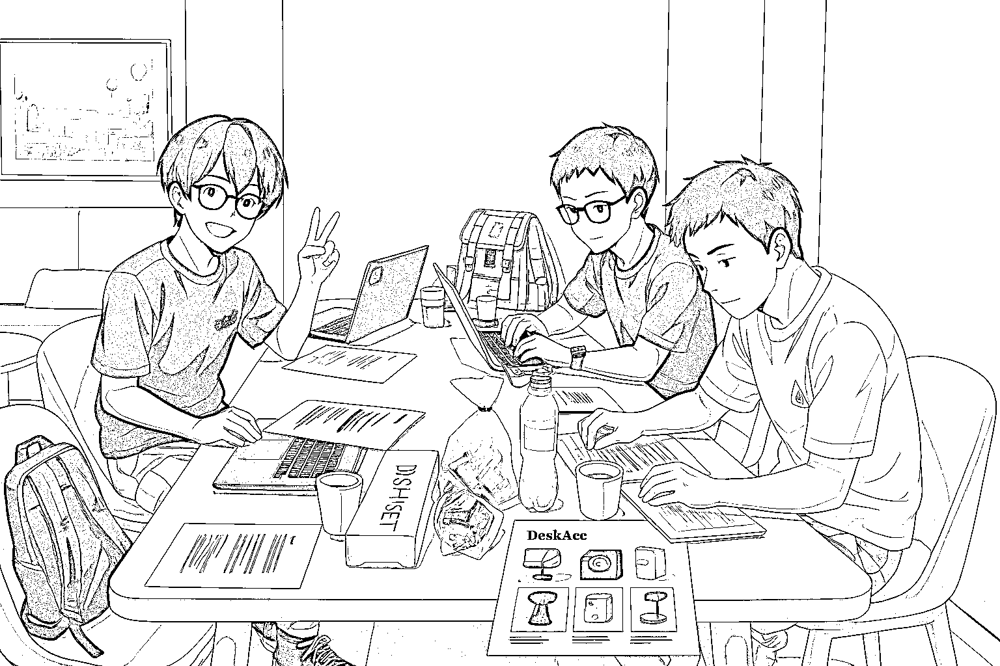

# ('(13 赞)共学 2.0 回顾、经验总结与 3.0 预告', (2, 30))

共学2.0复盘：12小时又拼出一个产品，这次还攒了几条硬核经验

上次我们用7小时把产品从0到1送上了线，这次2.0版继续加码，场地还是选在广州，从上午10点一直鏖战到晚上10点，整整12个小时。核心口号依然没变——“何以赚钱，唯有实战”，用真打实干来验证需求、推动上线。

这次到场一共6个人，配置很紧凑：1位产品经理、1位交互设计师、3位技术大牛、1位流量运营。每个人都是带着自己的idea来的，现场一番碰撞后，最终敲定：围绕之前挖出来的游戏站相关关键词——比如冷门好游戏、游戏导航站等，做一个导航类产品。

不过现场讨论也确实消耗了不少时间，这一点我们已经记下了：下次先在群里投票把产品方向定好，让大家把线下时间都用在开发和实操上，而不是花在“想做什么”。

真正进入落地环节后，效率直接拉满。全员现场装好Claude code，开发环境迅速就位，从买域名、初始化代码，到用Vercel部署上线，一气呵成。同时沿用1.0版的热词调研成果，用Google Trends、Google Ads Keyword Planner、SimilarWeb、Semrush、Ahrefs进一步拆分关键词，快速验证了市场体量和用户兴趣。

为了节省时间，午饭晚饭基本就是面条+咖啡速战速决，哈哈。

这次共学，我们沉淀了3条经验：

第一，方向必须提前在线上锁死。下次product idea会提前在群内或飞书文档里确认，线下只解决技术难题和现场实操，不再把时间浪费在“做哪个”上。

第二，MVP要小、要快、敢上线。最直接的路子是：做出来 → 丢到市场上 → 让数据说话 → 再迭代、再推广。

第三，把“一时组局”升级为“长期战队”。每次活动都认真复盘，让团队在开发、设计、运营、产品调研等维度持续进化。产品和运营同学能近距离补上技术视角，技术大牛也能真正看到市场调研和需求验证这些“非技术工作”到底有多重要。

3.0的预告也来了：
- 主题和产品方向提前确定，现场只做开发与功能迭代；
- 产品上线后立刻启动推广和运营，争取真实用户反馈和市场正向反馈；
- 依据新问题，为4.0组局进一步明确主题与需求；
- 下次目标会更硬核、挑战更大，前期准备也会更扎实，效率和成果再冲高一个台阶。

特别感谢两位分享官@加加林 和@八两。加加林的技术实操记录已放到飞书：https://mhjvdevgc5.feishu.cn/minutes/obcnhr9sl3351222x7257hm3 目前只有后半段，前半段没录保存好；如果大家需要，反馈够多的话后续会再补一个完整版。

顺手把这次用过的高效工具也整理给大家：Google Trends、Google Ads Keyword Planner、SimilarWeb、Semrush、Ahrefs。

这次线下收获很大，也特别开心。好了，继续去搞产品，回见！ images.zsxq.com/FtLtxpahNHWq6ASSIsLKJvDnW0d6)

哦对了，之前有同学反馈飞书文档没有权限，现在已经放开了；想关注广州后续聚会海报，也可以找鱼丸加我。