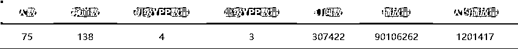

# ('(36 赞)YouTube 深海圈数月数据分享及三期报名信息', (2, 32))

三个月，三次数据，YouTube 深海圈的成绩单来了

各位圈友，我是 Gary 曹淦，目前和波妮一起负责 YouTube 赚钱深海圈的教练工作。

转眼间，深海圈从 3 月 12 日正式启动，到现在已经跑了三个多月。每一次做分享，我们都会带来一些新的变化。今天就不绕弯子了，直接上干货——三组数据，分别来自 1 月私教陪跑（也就是深海圈前身）启动时的摸底，以及 4 月底、6 月底两轮问卷调研。借这三组数据，和大家聊聊这段时间我们都做了哪些事，同时也有第三期报名的消息要告诉大家。

更舒适的阅读体验，可以移步飞书文档：[`ncnmu5q1eqm9.feishu.cn/wiki/XMvlwhoRIi4tiGkZSJCcnlxRnXf`](https://ncnmu5q1eqm9.feishu.cn/wiki/XMvlwhoRIi4tiGkZSJCcnlxRnXf)

三次数据如下：

1 月，私教陪跑刚刚启动时，我们先做了一次摸底调查：

4 月底，对深海圈成员进行了一次问卷调研：

6 月底，又做了新一轮的问卷调查：

关于第三期报名的具体细节，飞书文档里写得很清楚，欢迎感兴趣的伙伴关注。