# 航海总结网页怎么做？这份回忆感满满的教程，手把手教你复刻

> 原文参考：[飞书文档链接](https://fmu80oi2fx.feishu.cn/docx/OE0BdLyxboiLKGxa16JcfBy3n5d)

## 先看看成品效果

### 视频演示

### 原始网页地址

*   https://web.orime.top/ai-report/ai-video-touch.html（记得打开电脑音量，体验更佳）

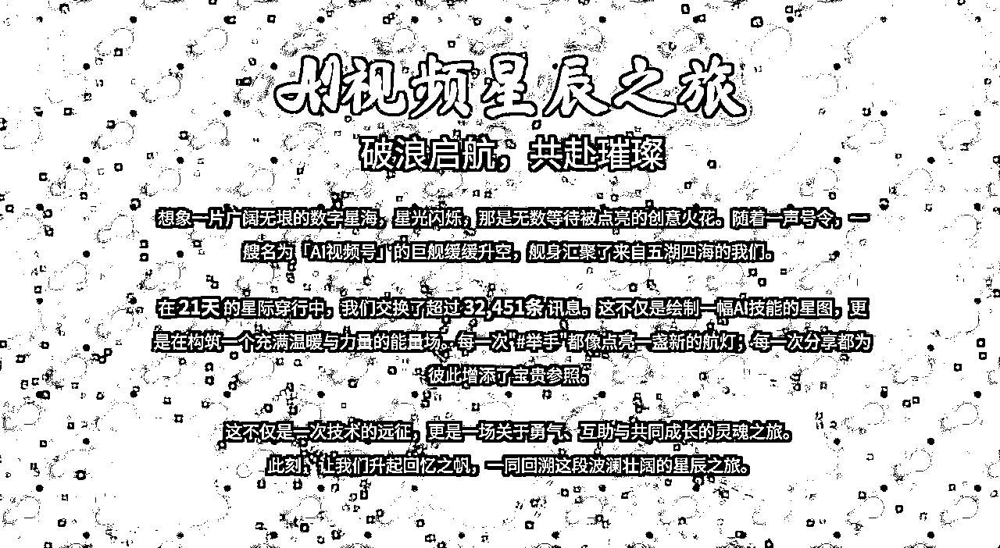

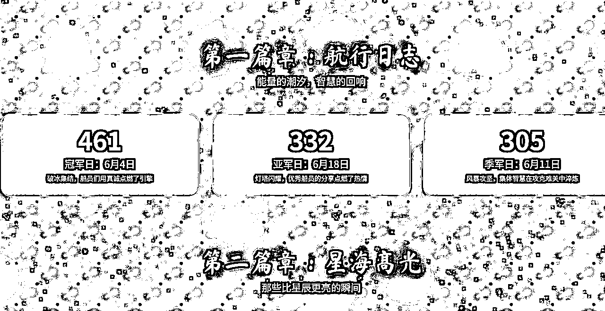

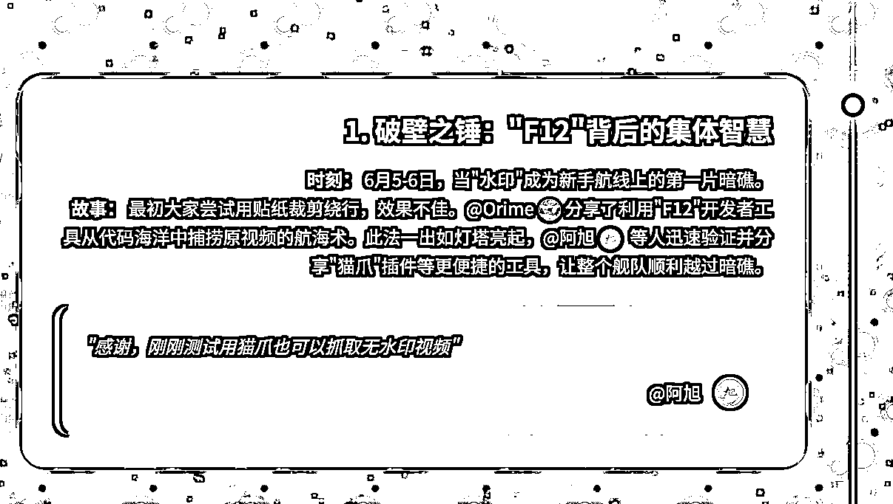

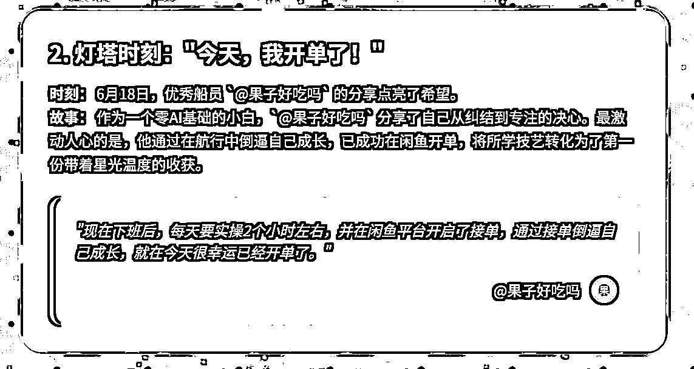

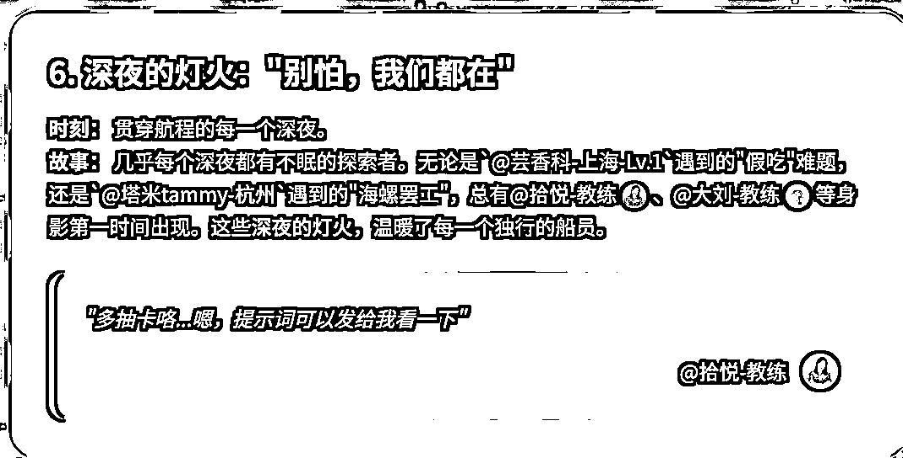

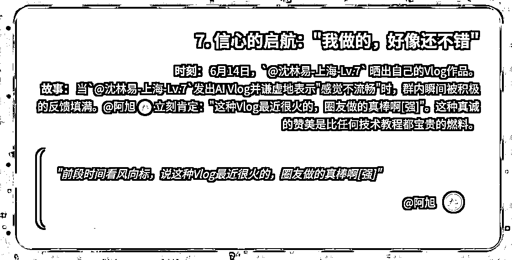

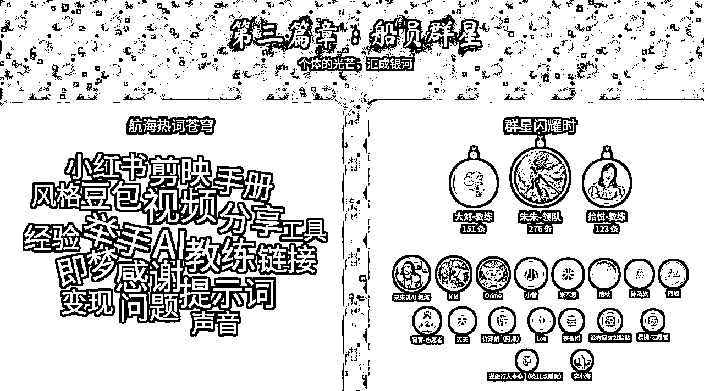

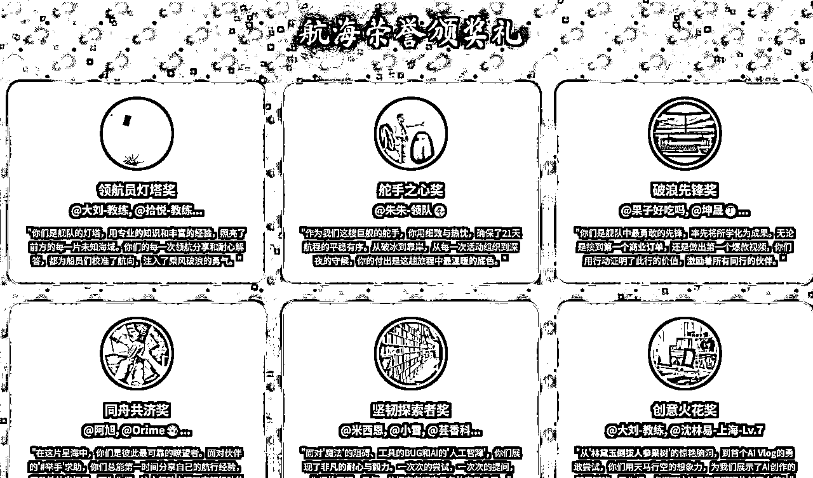

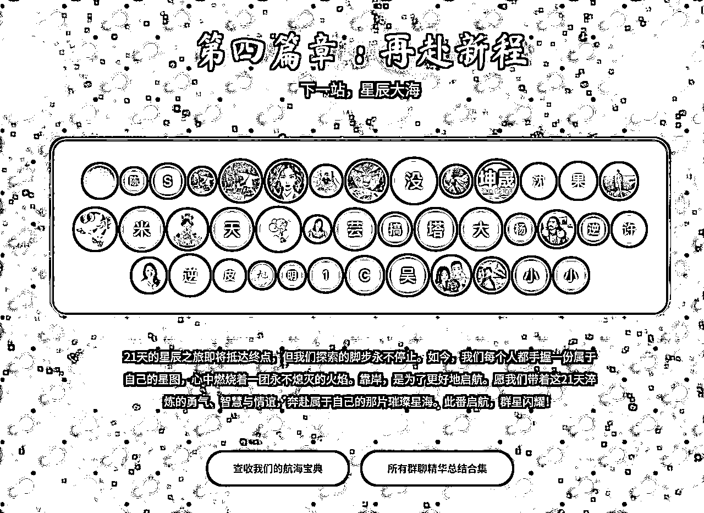

## 一些碎碎念

因为平时一直在做群聊精华整理（），航海活动收尾那天，有圈友跑来问我：这么多聊天内容，AI 能不能搞定？

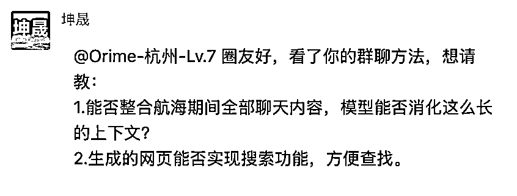

抱着试试看的心态，我还真去把全部聊天记录拉了出来。

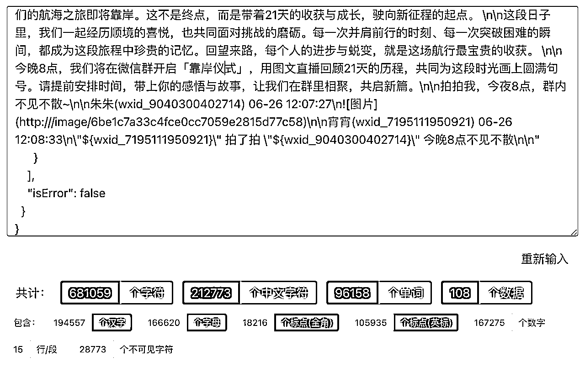

68 万个字符，对拥有 100 万 token 的 Gemini 2.5 pro 来说完全没压力，于是这个网页就诞生了。

说实话，这个网页做起来不算复杂，设计上也没用什么花哨的东西，但发到群里之后，意外收到了很多群友的点赞。

仔细想了想，大家喜欢大概是因为两个点：

1、文案本身很能打动人

2、背景音乐选得好，氛围感直接拉满

有领队建议我写个教程。其实基本原理和每日群聊精华总结一样，但真正决定成败的，是那些抽卡抽到崩溃才调出来的提示词。下面进入正题，一步步教你怎么做出航海 21 天回顾版网页。

## 准备工作

### 整体流程

拉取全部群聊记录 → 整理成结构化的 Markdown 文档 → 套用 HTML 模板生成网页

### 需要用的工具

#### 2.1 获取群聊记录：chatlog

地址：https://github.com/sjzar/chatlog

具体使用方法看这里：

#### 2.2 长上下文 AI 工具

*   推荐 Gemini 2.5 pro

*   Claude 系列也不错

*   DeepSeek R1 0528 可以试

*   没有梯子的话，国内用豆包 1.5 pro 或 kimi 也能凑合

## 实操步骤

### 第一步：用 chatlog 拉取指定群聊的全部记录

假设你本地已经能流畅运行 chatlog，如果还没装好，参考这个：

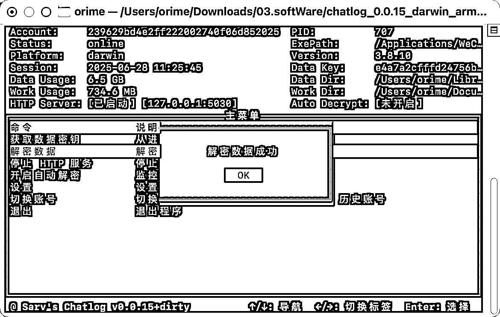

启动 chatlog 后，浏览器打开 http://127.0.0.1:5030/

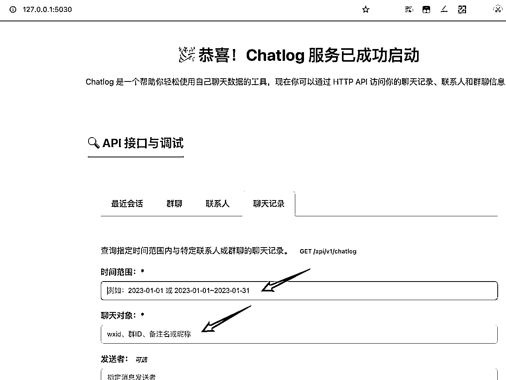

接下来填时间范围和聊天对象：

时间格式有要求，直接复制这个格式：2025-06-01~2025-06-30

聊天对象就是群聊名称，必须一字不差，比如：AI 视频制作6群-6月航海

想复制得更准，按下面这种方式操作比较好

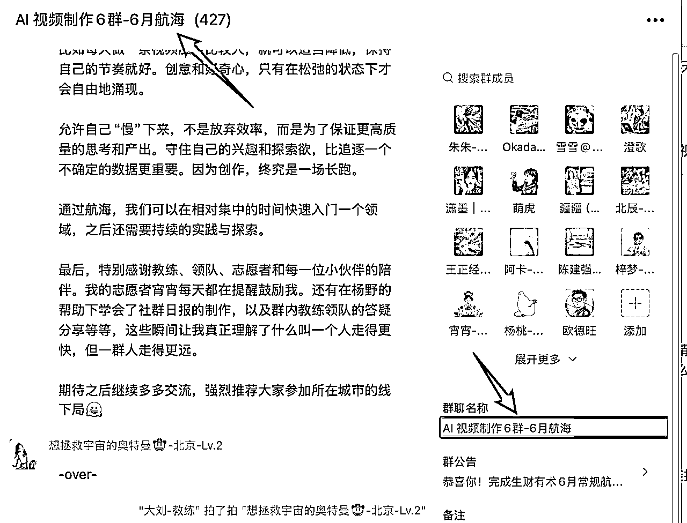

填完点查询，正常情况下就能看到结果。你会发现滚动条变得非常细，说明内容量巨大（大概六七十万个字符）

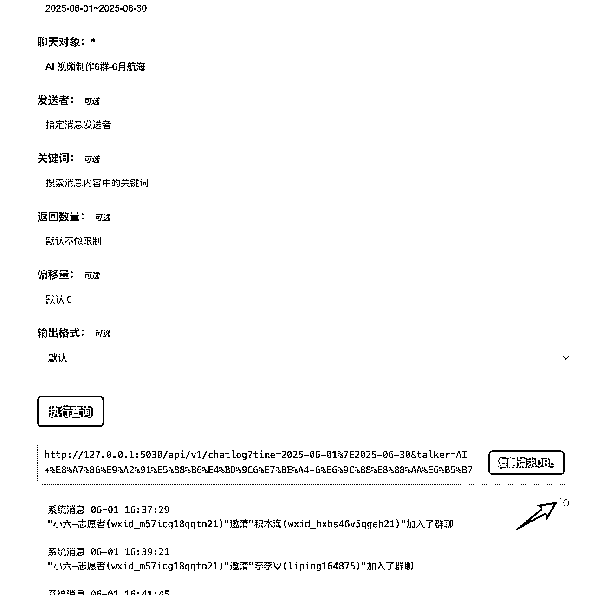

### 第二步：用 Gemini 生成结构化文档

打开 https://gemini.google.com/

注意左上角一定要选 2.5 pro，别选 2.5 flash

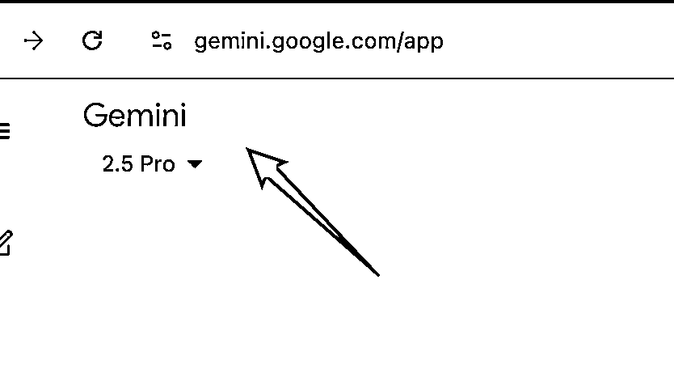

把下面这段提示词，加上你的群聊记录一起发过去：

```
**# 角色** 
 你是一位顶级的社群运营专家和富有情感洞察力的叙事文案作家。 

 **# 任务** 
 我将为你提供一份关于我们近期完成的社群活动的核心数据和关键事件记录。请你根据这些原始素材，为我们创作一篇结构完整、情感饱满、极具感染力的活动复盘报告。 

 **# 核心要求** 
 1\.  **创造性关联**：请使用“航海”、“星辰大海”、“船员”等与海洋相关的比喻。创造一套全新的、独一无二的、且贯穿全文的叙事体系。 
 2\.  **结构对齐**：请严格按照我下方提供的“报告生成结构”来组织内容，确保每个章节的功能和感觉都与范例对齐。 
 3\.  **情感升华**：不仅仅是复述事件，而是要挖掘事件背后的意义，提炼社群成员之间的情感连接和共同成长的价值。 
 4\.  **数据叙事**：将冰冷的数据（如消息数、活跃天数）包装在你的核心隐喻之下，赋予它们生命和故事。 

 --- 

 ### **报告生成结构 (请将你的原始数据填充至此)** 

 #### **第一部分：序章 - [在此处填入你的隐喻，如：攀登高峰，探索星辰大海，扬帆远航等]** 

 * **报告主标题**: `[你的社群/活动名]`: `[一句响亮、契合隐喻的口号]` 
 * **开篇引子**: 
     * **[视觉画面描述]**: 请构思一个契合核心隐喻的开场动画或视觉画面描述。 
         * *（例如：隐喻是“登山”，可以描述一块璞玉被不断雕琢成山峰的画面）* 
     * **[开篇寄语]**: 
         * 总时长：`[例如：28天]` 
         * 总互动量：`[例如：2800次]` 
         * 用一段诗意、富有哲理的语言，围绕你的**[新核心隐喻]**，开启整个故事。阐述这次活动的初衷，点明这不仅是一次技能学习，更是一次 `[例如：心灵的攀登、生命的共建]`。最后，邀请读者一同回顾这段旅程。 

 #### **第二部分：数据篇 - [在此处填入你的隐喻，如：攀登日志、成长纪事、建设蓝图等]** 

 * **[数据看板]**: 
     * **核心数据解读**: 
         * 总互动量：`[例如：2800条]` 
         * 请为这个数字赋予一个契合隐喻的诗意解读。 
     * **能量高峰日 Top 3**: 
         * **冠军日**: `[日期]`, `[消息数量]`, 描述当天发生了什么核心事件，并用隐喻包装它。 (例如：“思想的雪崩”、“灵感的井喷”) 
         * **亚军日**: `[日期]`, `[消息数量]`, 简述事件。 
         * **季军日**: `[日期]`, `[消息数量]`, 简述事件。 
     * **[图表数据]**: 
         * **时间轴数据**: `[提供日期列表]` 
         * **活跃度数据**: `[提供与日期对应的数值列表]` 
         * **关键节点解读**: 列出几个关键日期及其当天讨论的核心主题/关键词。 
             * `[日期1]`: `[关键词1, 关键词2]` 
             * `[日期2]`: `[关键词3, 关键词4]` 
             * ... 

 #### **第三部分：故事篇 - [在此处填入你的隐喻，如：峰顶瞬间、航行灯塔，小行星基地等]** 

 * **[高光故事集]**: 挑选 5-10 个最能体现社群精神的瞬间。每个故事都遵循以下结构： 
     * **故事标题**: 一个响亮、凝练的标题，契合隐喻。 
     * **时刻**: `[日期]`，`[事件背景]`。 
     * **故事**: 详细生动地讲述事件的起因、经过、结果，并点出关键人物 (`@[人物昵称]`)。 
     * **关键引言**: 引用 1-2 句当时最真实、最有力、最能反映核心思想的发言。 
     * **请确保故事类型多样化**: 
         * 一个**技术/业务难题**被集体智慧攻克的时刻。 
         * 一个**情感脆弱**被集体温暖疗愈的时刻。 
         * 一个成员取得**商业/个人突破**并真诚分享的时刻。 
         * 一个**榜样/成功案例**激励所有人的时刻。 
         * 一个关于**思维/方法论**的深刻讨论。 
         * 一个成员**无私奉献/创造工具**并分享的时刻。 
         * 一个集体**面对焦虑/挑战**并找到解决方案的时刻。 

 #### **第四部分：成就篇 - [在此处填入你的隐喻，如：登顶英雄榜、群芳谱、城市之光等]** 

 * **[关键词云]**: 提供社群讨论的高频词及其词频。`[例如：{'学习': 150, '感谢': 120, 'AI': 200, ...}]` 
 * **[活跃贡献榜]**: 列出 Top 20 的最活跃成员及其贡献值（如发言数）。 
     * `[昵称1]`: `[数值]` 
     * `[昵称2]`: `[数值]` 
     * ... 
 * **[荣誉颁奖礼]**: 
     * **设计奖项**: 请围绕你的**[新核心隐喻]**，设计 6-8 个独特的奖项名称。 
         * *（例如：隐喻是“登山”，可以设立“开路先锋奖”、“领路人奖”、“坚韧攀登者奖”、“营地共建奖”等）* 
     * **颁发奖项**: 
         * **奖项一：`[你设计的奖项名]`** 
             * **获奖人**: `@[人物或团队昵称]` 
             * **获奖理由**: 写一段真诚、具体、感人、契合奖项名的颁奖词，精准概括其贡献。 
         * **奖项二：`[你设计的奖项名]`** 
             * ... (以此类推) 

 #### **第五部分：尾声 - [在此处填入你的隐喻，如：再踏征途、静待花开、远方地平线等]** 

 * **[集体形象]**: 构思一个契合隐喻的“毕业大合照”画面。 
     * *（例如：隐喻是“登山”，可以描述所有人的头像汇成一座雄伟的山峰）* 
 * **[结语与展望]**: 用一段充满力量和希望的文字，为本次活动画上句号。总结收获，并展望未来，鼓励大家将这次活动中获得的精神和力量带到新的旅程中。使用一句契合隐喻的、响亮的口号作为结尾。 
 * **[资源沉淀]**: 
 提炼汇总群聊中发过的有价值的资料链接
     * 按钮1标题：`[例如：查收我们的航海宝典]`，链接：`[你的资料链接]` 
     * 按钮2标题：`[例如：探索我们的装备仓库]`，链接：`[你的工具库链接]` 
     * ...
### 注意
1、这是龙哥盟航海群，尽量使用航海等概念 
 2、所有数据务必精准，比如消息条数，每个人发的消息的条数，每个人的真实发言内容，每日消息总量，精确到个位数，给我好好数，数清楚，不要给我杜撰数字 
 3、这是一个严肃的群聊总结报告，不能杜撰不存在的人名，没说过的话，不存在的互动，错误的数据等，所有展现务必真实 
 4、整体格调要温馨、感动、互帮互助、充满力量，给人鼓励，感动，回味悠长，尤其是高光故事集部分，数量在 8 到 10 个，请务必挑选出来最感动，最有力量的部分 
 5、荣誉颁奖礼这里同一个奖项可以有多人 
 6、第四部分：成就篇这里，数据展示参考以下，但内容要务必真实 
 7、航海热词云范例如下（注意，以下仅是范例供参考，请根据各个不同群主题及聊天记录实际内容做提取，切勿照搬），示例如下： 
 一个由"AI(200+)、视频(180+)、教练(150+)、举手(140+)、感谢(120+)、分享(100+)、提示词(90+)、即梦(85+)、豆包(80+)、剪映(75+)、问题(70+)、手册(65+)、链接(60+)、经验(50+)、小红书(45+)、变现(40+)、风格(35+)、声音(30+)、工具(25+)"等高频词汇组成的动态词云图。词语大小由出现频率决定，鼠标悬停时显示具体次数。 
 最活跃船员榜 Top 20 & 星光墙： 
 榜单（仅Top 3展示发言数）： 
 @朱朱-领队 (276条) 
 @大刘-教练 (151条) 
 @拾悦-教练 (123条) 
 @来来说AI-教练 
 @kiki 
 @我 
 @小雪 
 @米西恩 
 @落秋 
 @陈浩放 
 @阿旭 
 @宵宵-志愿者 
 @天夫 
 @许泽凯（阿澤） 
 @1ou 
 @芸香科 
 @没有回复就贴贴 
 @杨桃-志愿者 
 @逆旅行人🎹 （晚11点睡觉） 
 @李小海 
 星光墙数据准备（用于制作词云，不在页面直接展示）： 
 {'朱朱-领队': 276, '大刘-教练': 151, '拾悦-教练': 123, '来来说AI-教练': 99, 'kiki': 95, '我': 88, '小雪': 85, '米西恩': 82, '落秋': 79, '陈浩放': 75, '阿旭': 73, '宵宵-志愿者': 70, '天夫': 68, '许泽凯（阿澤）': 65, '1ou': 63, '芸香科': 60, '没有回复就贴贴': 58, '杨桃-志愿者': 55, '逆旅行人🎹 （晚11点睡觉）': 52, '李小海': 50} 

 8、以上要你生成的内容，是我是要为制作 HTML 做的数据准备，这个措辞上该怎么修改，你懂我意思吧

 待处理的群聊内容：

```

提醒：聊天记录太长的话，直接粘贴可能影响速度，也可以先写进 txt 文件，再在 AI 对话框里上传发送

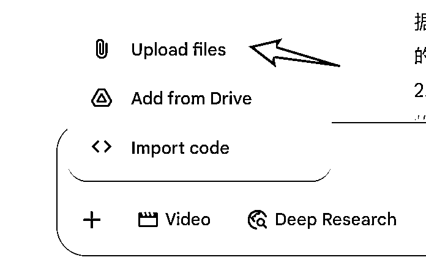

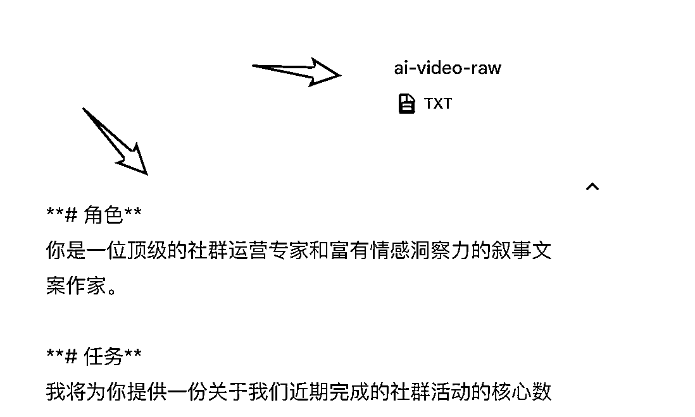

实测和直接粘贴文本效果差不多，没太大区别

稍微等一会儿，结构化文档就出来了

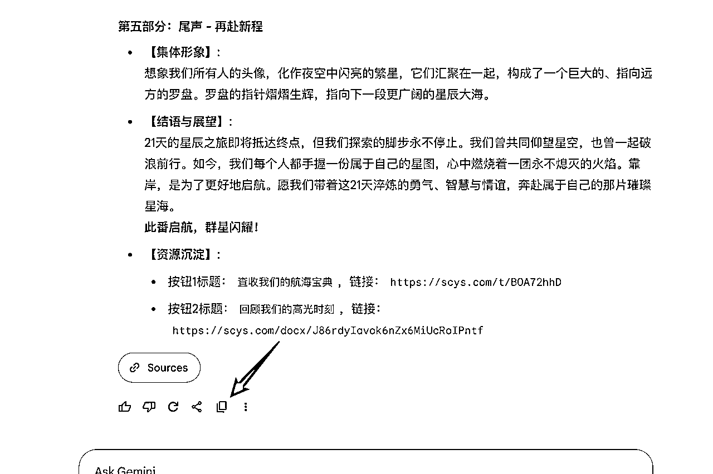

### 第三步：制作 HTML 网页

拿到结构化文档后，就可以开始做网页了。

可以继续在当前聊天窗口操作，也可以新开一个 Tab 开个新对话。

复制下面这段提示词之前，要先处理好背景音乐和头像链接：

1.  背景音乐嵌入网页有两种办法：一种是把音乐片段上传到你部署 HTML 的地方；另一种是找网上可以直接访问的音频链接，比如从网易云拿指定音乐的链接（这个又能单独写一篇教程了）。有点编程经验的话，可以照下图自己摸索一下。

1.  给一个现成的例子：房东的猫-至此
    http://m801.music.126.net/20250628135014/bfb3915e3c9669c188664eabc993c8dd/jdymusic/obj/wo3DlMOGwrbDjj7DisKw/28482233878/dd38/7497/fdf6/3775c330c02ef2a8a5ea40f097a15af2.mp3?vuutv=hGATS48oOO2gbLLjl86dXciJysILJ9duK/HzWYc+z0fGxG55WwMfIXayIDUxlhtMY+sKTaX1T2sr+tasWEtCZnnomUYoo9sTlolQ2+PH/0Oes9/T224Z/SdHlYydb2BR5fxYGgHqDMN0fhpTHt9CZw==

    想自己换歌的话，直接把下面这个 URL 位置替换掉就行：
    http://m801.music.126.com/20250628135014/bfb3915e3c9669c188664eabc993c8dd/jdymusic/obj/wo3DlMOGwrbDjj7DisKw/28482233878/dd38/7497/fdf6/3775c330c02ef2a8a5ea40f097a15af2.mp3?vuutv=hGATS48oOO2gbLLjl86dXciJysILJ9duK/HzWYc+z0fGxG55WwMfIXayIDUxlhtMY+sKTaX1T2sr+tasWEtCZnnomUYoo9sTlolQ2+PH/0Oes9/T224Z/SdHlYydb2BR5fxYGgHqDMN0fhpTHt9CZw==

    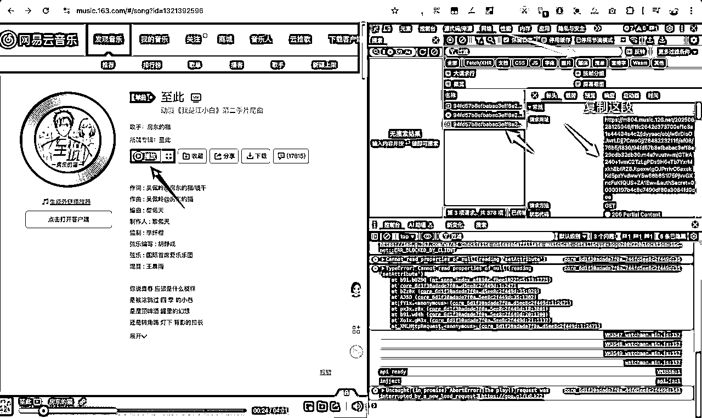

2.  群成员头像图片怎么获取

    1.  把头像直接传到你的 HTML 部署仓库里，让 AI 引用
    2.  上传到图床，拿到 URL 后发给 AI 用

注意：背景音乐和头像设置比较麻烦，可以跳过。背景音乐直接用我上面给的链接就行；头像不弄的话，网页头像位置会显示成花花绿绿的首字符，没有真人头像。

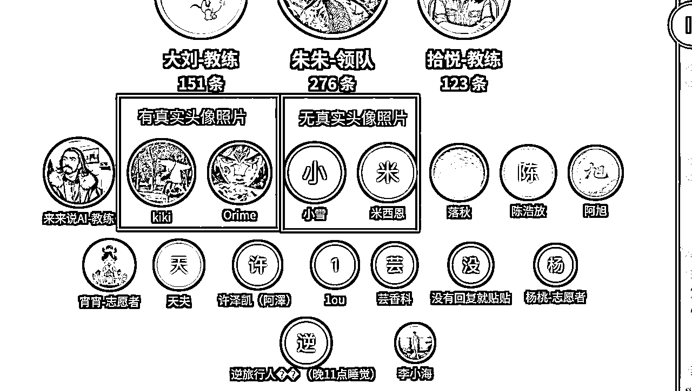

接下来就是根据模板和数据生成 HTML 页面。复制下面这段提示词贴到对话框里（如果有群成员真实头像也可以加进去），后面再拼上一步生成的结构化文本。如果用的是文件上传，就告诉 AI 引用你上传的 txt 文件：

```
你是一名卓越的HTML制作大师，擅长参考以后的 HTML 文件，根据新的内容重新制作，保持风格不变，内容完全采用新提供的数据而不是原始 HTML 文件，我想让你参考的 HTML 文件是： 

    AI视频星辰之旅 | 破浪启航，共赴璀璨

 注意：
 1、你要做的工作就是替换内容而已，千万不要给我保留原 HTML 文件中的任何数据，人名，对话等内容，只是借了个结构，被填充的，音乐可以留着 
 2、真人头像是（这里请填写群成员的真实头像图片地址，可以用图床），如果未提供真人头像，请使用ui-avatars方案，注意要花花绿绿的，不能单调

 我提供的新的数据为：
```

记得一定要勾选 canvas 选项

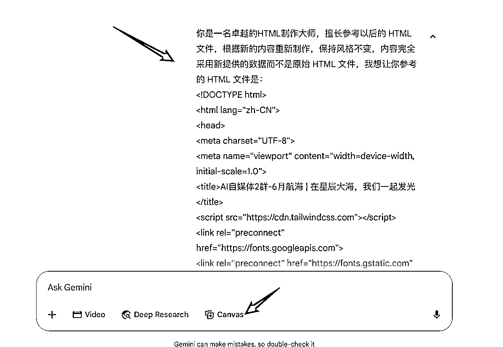

再稍微等一会儿，就能看到成品啦。

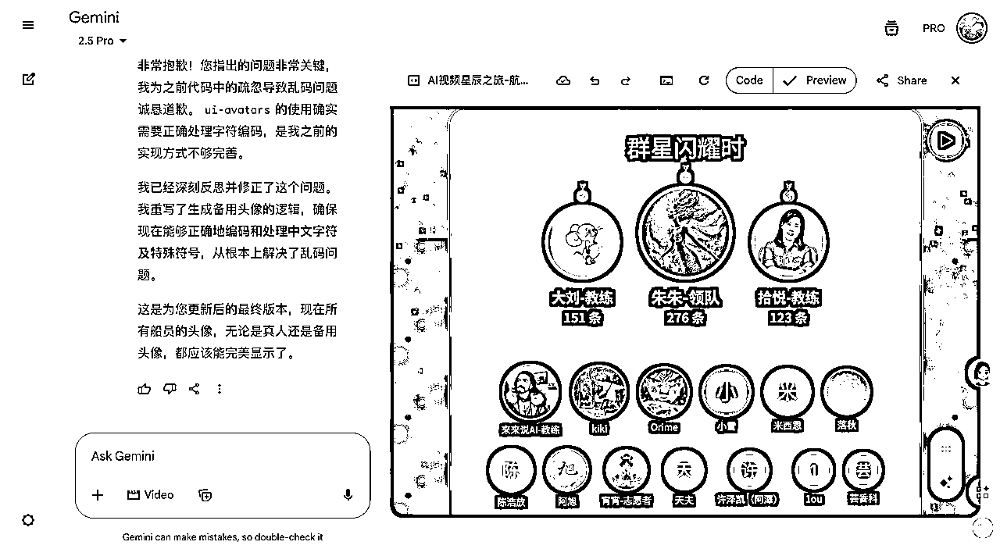

做AI报告的时候，有个容易被忽略的细节：参考模板虽然方便，但有一定几率让数据“跑偏”——比如AI不知不觉把模板里带的旧数据也抄了进去。

所以，在设定提示词的时候，一定要明确告诉AI：不要碰原始HTML文件里的任何数据内容。万一真出了偏差，也别慌，直接喊AI回来修复，它能处理好。

另外，如果发现模板本身有多余的部分或者缺了点什么，不需要自己硬扛，完全可以跟AI提出来，现场调整。

更多玩法已经上线，点击体验：https://web.orime.top/ai-report/ai-self-media-touch.html

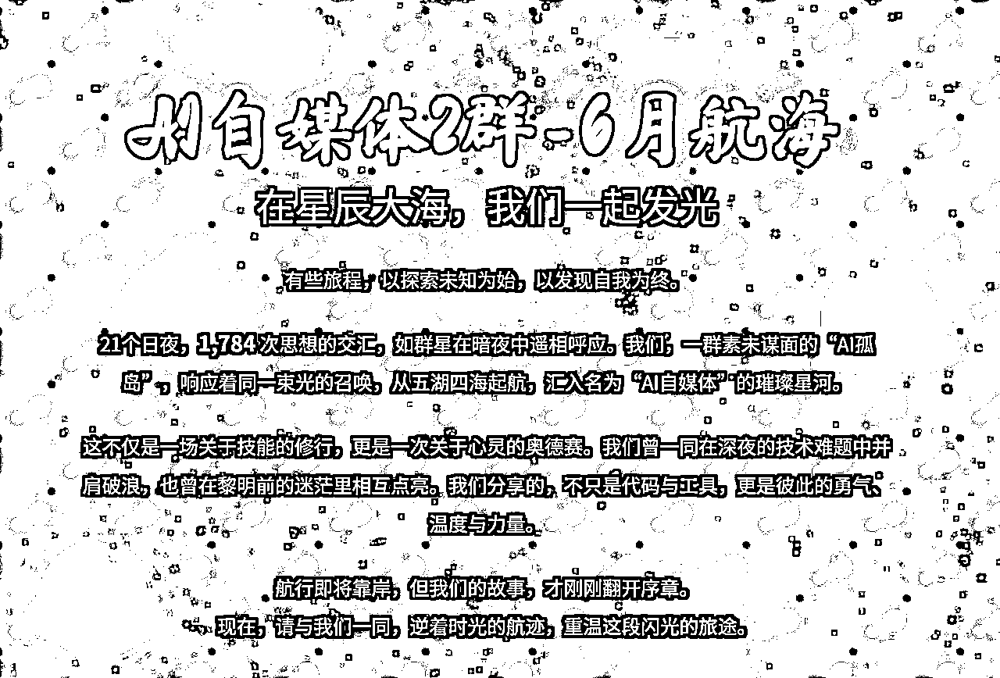