标题：爆肝5晚！我把AI代写项目的实战心得与百问百答整理好了，建议收藏

见字如面，我是飞掌柜，长期在AI赛道摸爬滚打，专注AI写作项目（尤其代写方向），也是6月航海AI赋能写作项目的教练。感谢赚钱平台，让我能在写文、交付、答疑中持续沉淀。这5个晚上，我把一线经历过的卡点、解法都整理出来，希望能帮你打通方向选择、工具应用、实操交付、引流转化、平台选择这些环节。

这份指南怎么用？
1. 先理思路。比如第一部分的经验，从新手到老手，写手端、流量端、团队搭建都讲透了。记住一句话：“认知越清晰，执行越坚定。”很多时候我们卡住，不是能力不行，是没想明白。
2. 再按需检索。我特意把内容分成了几个板块，你正处在哪个阶段，就直接看对应部分。
3. 灵活变通。实操中变化太多：原来用Claude写文章很顺手，最近它老是抽风，不如DeepSeek稳；有人喜欢闲鱼引流，有人嫌闲鱼太慢，觉得淘宝量更大；我习惯整段生成后自己改，有人却喜欢分段生成，说准确率更高。工具也好、平台也好，没有绝对对错，能交付客户满意的结果，就是好方法。

全文读完大约20分钟，下面上干货。

# 一、核心经验篇

## 1. 从新手到高手，AI代写要经历哪几个阶段？

我的结论是：从写手到操盘手，一共四个台阶。
第一个台阶：做写手端。靠接单交付赚钱，重点练不同类型文章的写作能力，以及各种AI工具的使用。
第二个台阶：写手端+流量端。此时既有自己的“一手流量”，也有别人转来的“二手流量”。一手流量优先从闲鱼起步，再逐步扩展到其他平台；二手流量主要是混接单群。
第三个台阶：专职做流量端。单子交给别人写，自己抽佣金。因为你已经有写手功底，核心任务就成了怎么搞来更多流量。
第四个台阶：做平台端。搭建自己的写手团队和流量团队，赚中间抽成。这一步往往需要注册工作室或公司，有了主体才方便融资，走资本化放大；以后体量大了，还能去投资别的团队，收分红。
这四个阶段，本质上是“体力→脑力→资本”的跃迁，也是“思维认知→人脉积累→资源盘活”的升级。

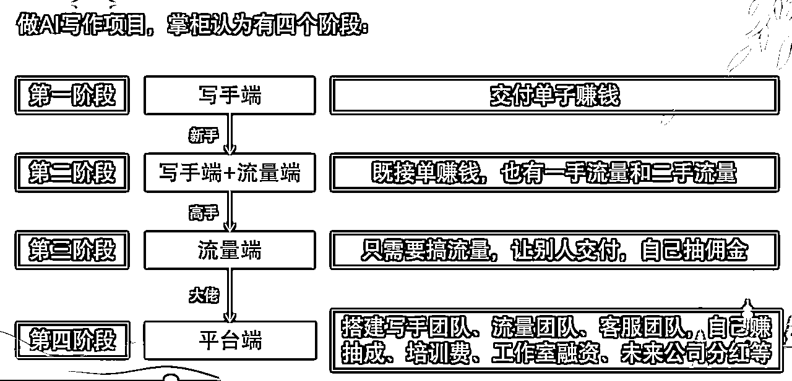

## 2. 怎么快速上手AI代写？要注意什么？

想少踩坑，按这四步走：
第一，把AI工具玩熟。要清楚面对不同文章类型，哪个工具出活最快。
第二，在“干”中学。别光想，去接单，很多问题只有实操才会暴露。
第三，遇到不会的就去学。接单时发现哪些单子写不了，再找高手请教。学一点就练一点，练完再学，这叫“目标式学习”。现在很多人学了一大堆，感觉很强，却赚不到钱，就是没把学和用串起来。
第四，学完继续接。不断挑战更有难度的单子，把ROI提上来。要么提高客单价，要么同样时间接更多单。一定要积累高客单价的议价能力，否则只会越干越累。

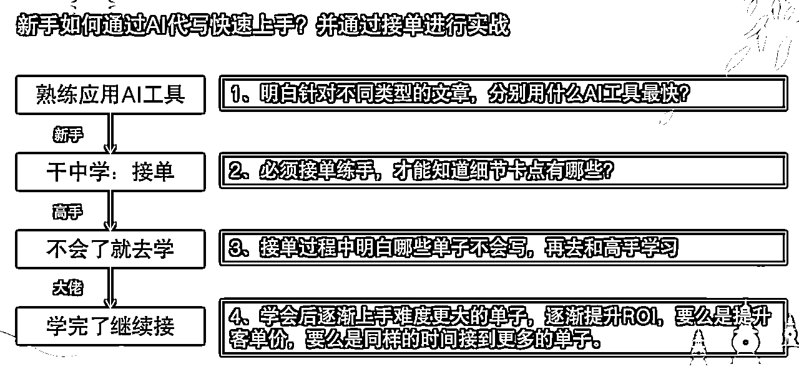

## 3. 写手端怎么做好？路径是什么？

我的经验分四步：
首先，自己去交付。自己写、自己交付，完整跑通流程，既帮客户解决问题，也赚到直接收入，这是带人的前提。
其次，去帮别人。很多伙伴喜欢看SOP，我就把产品、流量、运营、团队各环节的卡点总结成教程，写成帖子，帮大家少走弯路。这个阶段你会收获影响力。
再者，做知识付费。如果你想做知识型博主，除了自己写单子，还能通过社群、小鹅通、训练营、知识星球等收费。本质上是用知识变现，增加收入。
最后，搭建团队。0到1跑通后要1到N放大，就可以组建写手端团队，有单子一起创作，有流量后有团队做承接。

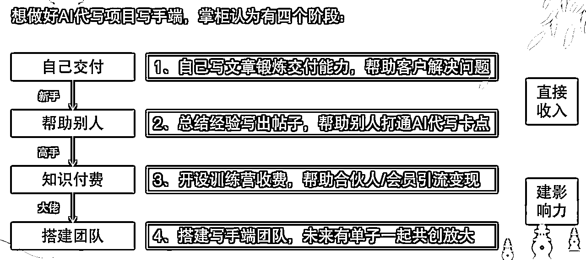

## 4. 流量端怎么做好？路径是什么？

同样四步：
第一步，做二手流量。去淘宝应聘“小黑奴”，接二手单。直接问客服招不招写手，客服会让你拍一个5到20块的链接，好评后全额返，然后拉你进写手群。接单群常见的有QQ群、企业微信群、微信群，少量钉钉群。
第二步，做一手流量。自己开闲鱼、淘宝、拼多多、小红书账号，自己引流、自己接单、自己交付，赚得更多，但很累，也花时间。
第三步，一手+二手流量并行。一方面多开账号，或带团队矩阵化操作，放大一手流量；另一方面多跟其他流量端合作，大家一起建群互相发单，单子自然就多了。
第四步，多渠道流量。组建流量团队，做多矩阵账号，以工作室或公司形式合作，有些人还会用投流。这时候角色会进一步拆分：流量端、运营端、客服端、写手端，拆不拆看工作量。

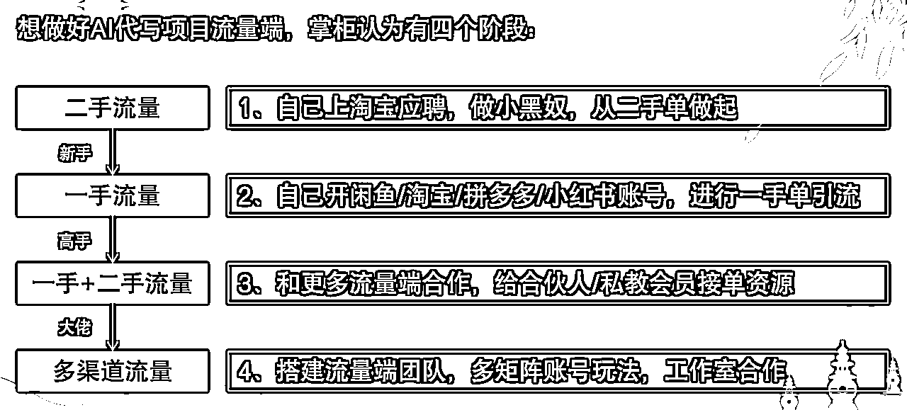

## 5. 怎么搭建写手团队和流量团队？

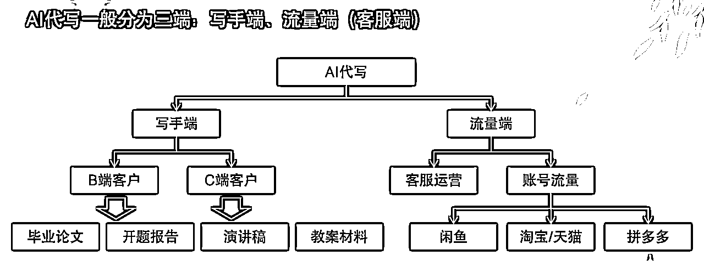

写手团队三步法：
第一步，自己从写手做起，能稳定交付B端和C端客户，积累案例后就能教别人。
第二步，教别人的过程中，要能出教程、出训练营、出标准化课程，让大家觉得跟着你学是系统的。
第三步，学员遇到代写问题，你能给出指导。不用解决所有问题，但大多数得有办法，这才能证明你的专业。

流量团队三步法：
第一步，自己先学会闲鱼开店、上架商品，然后教团队自己引流，因为一手流量利润更高。
第二步，和其他流量端团队合作，给写手团队稳定供单；加入接单群，能快速上手实操。
第三步，公域平台的引流放大技巧，私域引流的物料，都得准备好，方便团队随时取用。

另外，搭建团队要像老板招人一样，靠相处判断每个人的擅长点：内向的人适合写手，不适合跑流量；喜欢引流讨厌交付的，就让他专注流量；喜欢操盘但不想做具体执行的，可以负责运营。角色明确，配合才能顺畅。你也可以想想：在AI代写项目里，你适合什么角色？怎么跟团队互补？想清楚，才有放大的可能。

# 二、方向选择篇

这个板块主要聊项目选择、方向判断、接单对比。方向选对了，后面才省力。

1. AI写作领域这么大，很多方向都在做，怎么选？公众号爆文、代写好像都能做。
建议：
   - 新手多线操作没问题，但别一直摊大饼。以后精力有限，必须选一个主攻方向，重点突破，把壁垒越建越高。
   - 还要看清不同项目赚钱逻辑：公众号爆文赚的是流量主钱，重点研究阅读量；代写赚的是交付钱，重点研究如何放大写手端和流量端。

2. 能不能把商业计划书PPT当作AI代写方向？怎么入行？
建议：
   - 商业计划书比普通PPT难，内容多，客户以B端为主，确实有门槛。
   - 建议先从工作汇报、晋升汇报、年终总结、答辩总结、教案这类PPT练手，攒信心，拿小结果。
   - 每单情况都不一样，就算都是商业计划书，客户也有个性化需求。你要练的是谈单沟通、梳理需求、交付制作这套综合能力。

3. 自己的流量自己转化自己交付，利润高，但感觉很难，怎么上手？
建议：
   - 全链路自己干，听着爽，实际时间精力根本不够。后期要考虑合伙，把产品、流量、运营、转化等环节外包，或者搭团队分工。
   - 比如搭写手团队：你有单，别人交付，你赚佣金。
   - 比如搭流量团队、客服团队：一边接写手端，一边服务客户端，中间抽佣。
   - 每一步都有难度，慢慢啃。

4. 客户一上来就让我报价，怎么报？客服发群里的需求很模糊，也报不出来怎么办？
建议：
   - 别拍脑袋。先问清楚需求细节，越细越准，对双方都好。
   - 再问截止时间，急单可以报高点。
   - 侧面打探客户身份，判断付费意愿和付费能力。
   - 客户不主动提，千万别先干活，比如试做一两页、先写500字，毕竟押金还没收。

5. 已经跑通0-1，怎么1-N放大？
建议：
   - 学会筛高客单。接单超过10单，你就有感觉了。高客单不是绝对值，而是性价比：100块但需求简单，就是高客单；1000块要做一个月的，反而是低客单。
   - 放大路径不止一条：写手端搭团队、流量端搭团队、拓展平台端都可以。也不是非要流量端+写手端外包。以后开工作室，还得有自己的稳定写手，两方面可能都得有。

6. 想在闲鱼卖“阅读计划”，用AI快速生成，交付不重，能做吗？
建议：
   - 能做，但这类需求很少，客户自己说不定都能用AI生成，门槛低，你得做好上架后没人问的准备。
   - 从产品视角看，要学会换位思考：客户要什么，你上什么，而不是自己想做什么就做什么，小心“自嗨”。

7. 三五十的单做起来累，几百上千的又不会，怎么办？
建议：
   - 低转高：低价单只是练手，练完就积累经验，慢慢接更高客单价，低客单要么放弃，要么转包。
   - 干中学：不会就去学，学会了继续接，循环往复，慢慢就能啃下有门槛的单子。

8. 报价谈单怎么优化？
建议：
   - 看人下菜碟。同样的单子，给客户报价有浮动：学生党、职场人、国企客户、MBA高管都不一样。比如“LW”，学生党可以报低点，MBA高管就报高点。
   - 定好边界。一般是先看需求再报价。如果对方非要确认你能写才给细节，你就报一个中间价；看完需求觉得不划算，再说明理由，多数客户能接受，因为他也想要质量。

9. 工作量分配不合理，怎么调整？
建议：
   - 初级写手一开始确实要一个人干流量、运营、交付：自己开闲鱼引流，自己跟客户聊，自己写文章。
   - 后期要想办法通过合作、搭团队，让自己轻松点，专攻一块。比如你专搞流量，交单给伙伴；或者你专做交付，和流量端长期合作当稳定写手。

10. 做AI代写，怎么摆正心态？
建议：
   - 很多人沉不下心研究实操，比如提示词怎么写、智能体怎么调，总想要现成答案。就算给了现成，不满意也懒得改。
   - 但客户的个性化诉求千差万别，提示词往往要反复对话好几轮才能拿到好结果。中间那些绕不开的坎，一个个趟过去就行。
   - 别急，AI写作项目练的是综合能力：工具应用、项目实操、客户谈判，每一步都在涨本事。

11. 用AI帮同事写半年总结，收钱不好意思，不收又觉得亏，咋办？
建议：
   - 同事之间不好收钱，那就不收，让人欠个人情。人情有时候比钱还贵：一份总结最多一两百，但将来同事帮你一次，价值可能远超这个数。
   - 主业也别忽略：第一，老板一般不喜欢员工用AI写工作总结，你以为提效，他可能觉得你没认真写；第二，用不用公开大模型，要看公司规定，有些公司很在意数据安全。
   - 想靠接单赚钱，副业做就行，对外接单，别和主业搅在一起。

12. 怎么更好地“工具+实操”？
建议：
   - 坚持一段时间后，你的目标是：手里有多种方法，遇到客户需求时，能选出性价比最高的；或者学了新方法，能看出旧方法哪里不行，果断换掉。
   - 这不仅是思维升级，也是对抗惯性。很多固化套路会在实操中限制你，比如提示词、结构化内容的拼凑。别想一口吃成胖子，持续优化就好。

13. 新手直接接单练，还是等熟练了再接？没经验跟店铺聊天没底气。
建议：
   - 干中学：边学边接。客户要求满足不了，说明交付能力有短板，那就赶紧学；学一阵，再通过接单检验。
   - 跟店铺聊大胆点，最坏也就是这单不赚钱，又没其他损失。

14. 我擅长写提示词，但不擅长写文章，有专门找提示词的单吗？
建议：
   - 可以走prompt定制化，专门接这种活，遇到好的B端客户，变现也不差。
   - 但别只会写提示词。写文章单量更大，对你的变现放大更有帮助。

15. 用AI润色自己写的小说，适合第三方投稿吗？
建议：
   - 适合，只要编辑认可就行。我自己投过，稿费不多，但能过。
   - 现在很多小说其实都是AI写的，有些痕迹明显，但读者未必在意，只要不太离谱就行。重点是读起来爽。

16. 加了很多写手群，群里发一堆文档，占空间吗？接单群的客单价一般什么样？在哪里接单好？
建议：
   - 文档不下到本地，基本不占空间。
   - 接单群主要是QQ群、企业微信群、微信群、钉钉群。客单价看单子：LW、开题报告这些偏贵；演讲稿、发言稿偏便宜。
   - 新人别挑，在哪接单不重要，能交付赚钱才重要。相对而言，微信群的佣金比其他群多一点，然后是企业微信群、QQ群。

17. 以后做AI写作项目，买苹果电脑是不是更好？
建议：
   - 真不一定。电脑配置只是基础，关键在熟练应用和接单经验。重点是把经验沉淀下来，实现变现。
   - 不过我也发现，AI工具对配置的要求确实在变高，比如豆包AI有桌面端，配置太低，多软件一起跑容易卡死。
   - 总之，配置按需买，丰俭由人。

18. AI写作细分方向太多，哪个都耗时间，怎么选？
建议：
   - 永远用ROI筛选：哪个项目对自己性价比最高，就留下；其他项目通过合作、分包解决。
   - 有舍才有得，时间、精力、资源都有限。

19. 新手一定得按四个阶段走吗？
建议：
   - 四个阶段是我自己的路径，因为我是写手出身，不一定适合所有人。
   - 你本身是做流量的，大可以流量切入，走CPS或投流；
   - 你是做客服出身、擅长搭客服团队，就从客服视角走。
最后一句：从你最擅长的地方下手，反而更容易拿到结果。

# 三、工具应用篇

这个部分讲交付时怎么选工具、怎么提效、怎么控成本。

1. 英文博客翻成中文，哪个大模型好用？试了GPT和Gemini都不太理想，提示词要怎么写？
建议：
   - 可以试WPS自带翻译，效果不错，还有免费页数。
   - 也可以用网易有道、谷歌翻译这些专业翻译工具。
   - 大模型翻译的话，国外工具整体上会比国内工具稍微好一些。

2. AI平台太多，感觉能力都差不多，是不是国外首推GPT、国内首推DeepSeek？
建议：
   - 可以这么理解。没有哪个工具全能，不同需求各有擅长。
   - 个人使用习惯也会影响判断：有人觉得DeepSeek结构感太强、容易编造，有人却认为它就是国内最强。
   - 选那个交付效果最好的，你自己用着最顺手的就行。

3. 经常用多个AI工具或反复生成同一内容，到定稿时怎么选？这个看着也不错，那个也挺好，很内耗。
建议：
   - 别纠结，先随便拿一个发给客户。满意就收款，不满意再发另一个。
   - 有时候你觉得写得好，客户偏不满意；你觉得一般，客户却直接验收。标准只有一个：客户认不认可。

4. GPT需要科学上网，而且好像是指令型，DeepSeek是推理型，是不是DeepSeek更厉害？只要把我的要求表达清楚，它就能干活。
建议：
   - GPT要科学上网，纯粹是因为它是国外产品。
   - GPT虽然偏指令式，但它也是生成式AI；DeepSeek号称推理型，但你也可以不走深度思考，那样它推理的痕迹就很少。

以上，是我目前总结的核心经验。希望能帮你少走一点弯路，也欢迎你有新问题再一起交流。收藏起来，需要时翻一翻。我们下篇见。

AI代写接单，别急着闷头干。很多新手最头疼的不是文案本身，而是从提示词到工具选择，再到交付验收，处处都有坑。这里整理了一份实战问答精华，全是过来人的经验，建议收藏。

**一、文章交给谁写？GPT还是DeepSeek？**

不同任务得分开看。整体交付质量上，GPT的综合表现更稳；但要是面向国内读者，DeepSeek更懂中文语境。所以别盲目跟风，先判断客户是谁、文章用在哪。

写长篇文章时，橙篇AI、豆包AI、讯飞星火这几个更顺手；做PPT就换成Gamma、AiPPT；要批量产出小红书爆款标题和文案，用AI智能体效率更高。

**二、提示词真的没那么玄乎**

很多人怕写提示词，总觉得要背什么角色扮演、任务拆解。其实完全不用慌，记住三个词：角色、风格、要求。比如你是资深文案，用轻松口语风，输出三段论。这就是基础提示词。

但如果你追求效率，也别从零开始编。目前网上有不少现成的提示词库，比如AI Short、explainthis（ChatGPT指令大全）、Prompt port，接到单子后搜一下关键词，把合适的模板改一改直接丢给大模型，比自己挠头快多了。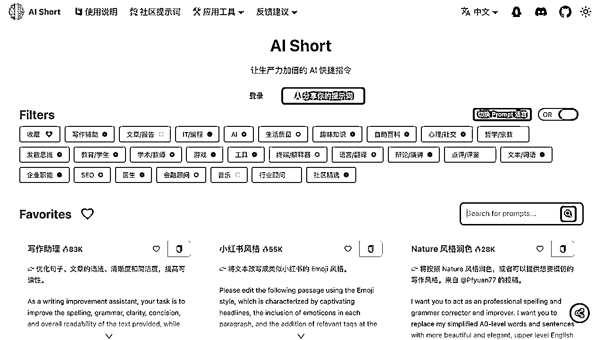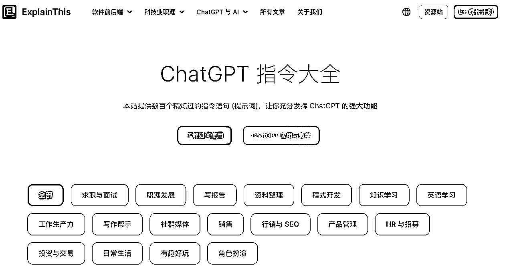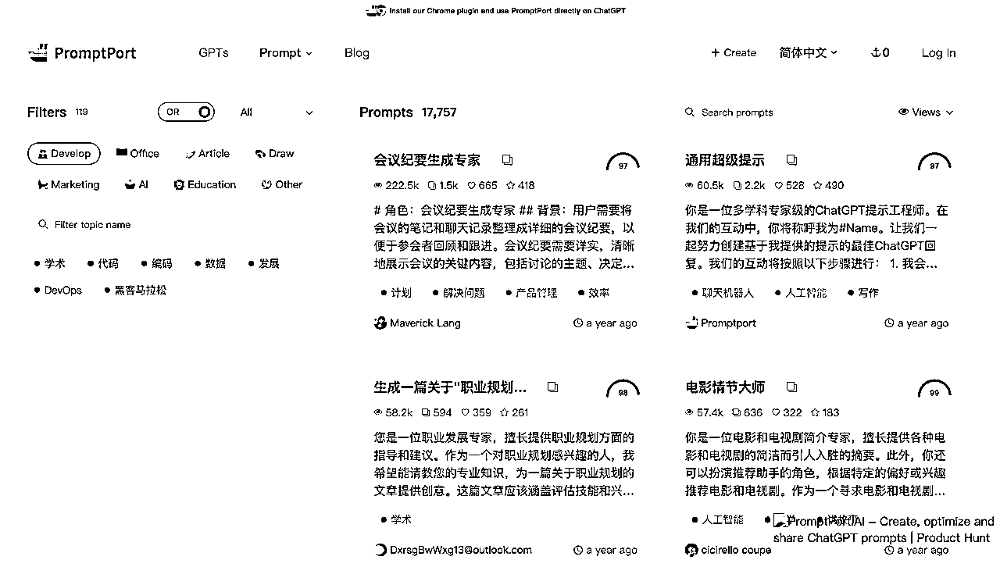

需要注意，打磨提示词别太较劲。与其花半小时调一个完美模板，不如先跑几个单子，在实战中磨合。另外，不想写提示词也可以去coze、文心一言智能体广场、智谱清言、讯飞星火、Kimi这些平台搜现成的智能体，比如接“发言稿”的单子，搜一下就能找到别人配置好的，直接拿来用，把省下的时间花在内容审核上。

**三、喂链接、找模板，这些技巧要知道**

客户直接甩来一个公众号链接或B站视频，让你参考？纳米AI可以搞定，支持批量导入公众号链接，还能分析B站内容。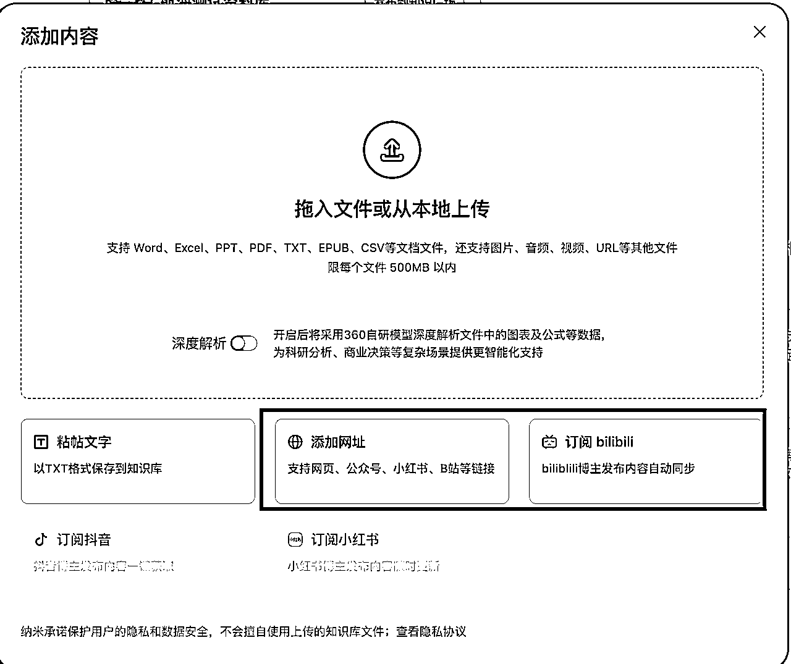

体制内或央国企的专业报告模板，不用发愁。WPS的稻壳模板里搜关键词就有很多，其他平台也大同小异。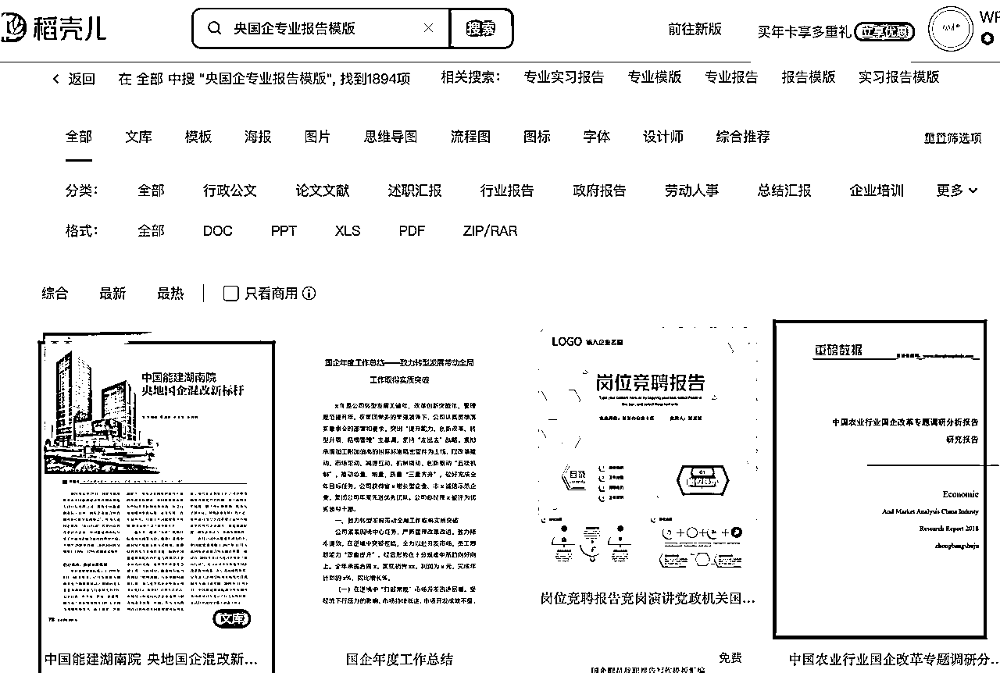

至于公众号文章的加粗、换行，投喂给AI后往往看不见了。这很正常，因为公众号排版本来就是排版工具做的，别指望AI保留。你只要让AI把大标题、小标题、正文写好，排版环节手动操作一下，或者用排版工具帮忙。像小墨鹰编辑器、96编辑器AI排版、壹伴一键排版都可以，但审美细节还是人工把关更靠谱。

**四、PPT工具红黑榜与接单策略**

做PPT代做，优先试用免费的。推荐Gamma、AiPPT、讯飞智文、Kimi PPT助手、清言PPT、博思AiPPT、ChatPPT、MindShow、闪击、ProcessOn、iSlide、爱设计等，WPS AI要会员。里面免费功能基本能满足日常需求，不够再考虑付费。

如果你手里有一份现成的PPT，想直接丢给AI修改，Gamma和AIPPT支持导入后优化，其他的通常只能选模板重新生成。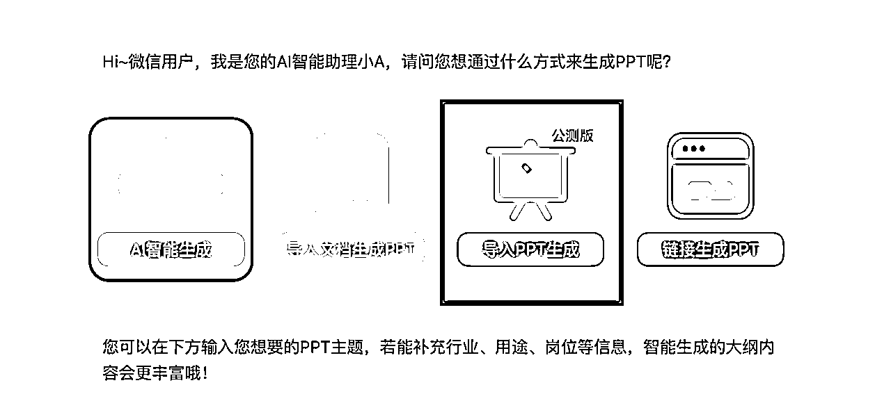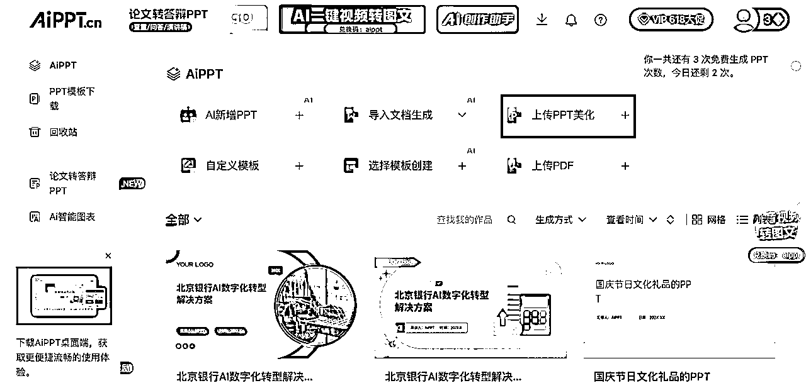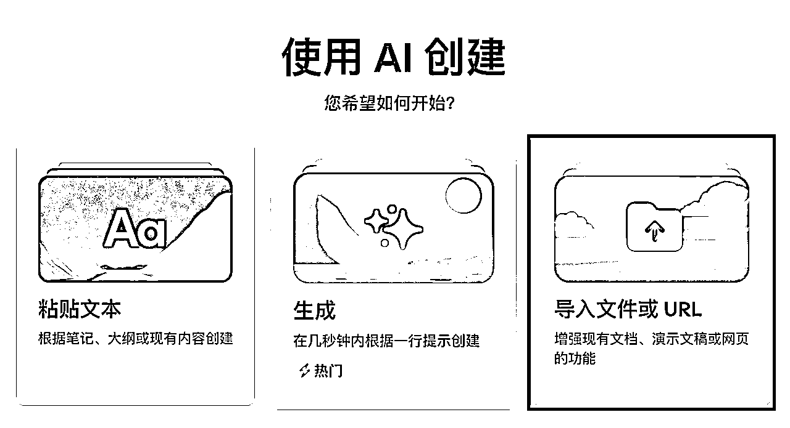

不同AI做PPT效果差异不小，我个人觉得Gamma、AIPPT、WPS灵犀都够用，至少内部讨论没问题。关键是看客户需求：

- 只有主题方向，没内容没模板：先用AI生成文案，发给客户确认，再进入PPT制作。
- 有主题、有内容、没模板：找3-5个模板让客户选，然后AI或手动做。内部讨论型的可以上AI，给领导汇报的就别偷懒了。
- 有主题、有内容、有模板：手动做反而快，因为AI调细节太费劲，最终效率低。

另外，参赛类PPT如果客单价高但定制要求高，先拆解大纲、素材、内容来源。客户要求越低越能用AI，一旦指定模板、字体、结构这些硬要求，还是手搓吧。想接高客单价，多留意B端企业单，比如客户有模板且定制化要求多、有内容没模板、或者只有主题方向，这些单子定价空间往往更大。

**五、查重、降重与升重**

客户没指定查重网站，就用PaperPass这类免费平台，每天有一两次免费额度。检测结果准不准，不同人有不同看法。如果客户不认，就让他指定知网、万方等官方渠道，费用客户出，或者提前包进报价里。

英文论文升重？简单得很，从参考文献里复制两三段进去，重复率立刻上去。接单经验告诉我，升重比降重容易太多了。

**六、长文写作与上下文连贯**

写三四千字的文章，是分段生成再拼，还是一次生成？两个办法都行。注意分段后前后逻辑是否顺，如果一次生成，想要4000字，提示词里最好报5000字，给自己留修改空间。

上下文不连贯是常见问题，不只有ChatGPT会这样。解决思路：提问时把前面提到的关键信息再贴一遍，提供背景；或者先整段生成，再逐段精修，这样上下文是连续的。

DeepSeek提示“超出深度思考长度”是新对话也解决不了？其实是这一段时间问太多了，等一会儿再用就正常。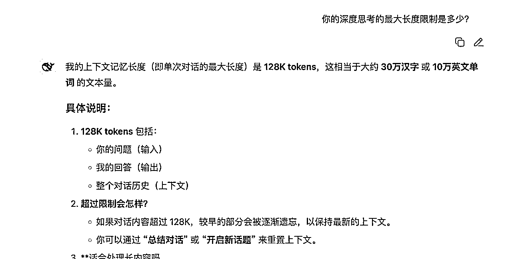

另外，DeepSeek输出经常一个小标题一行，层级感太强？你可以在提示词里明确要求“整段输出，不要结构化、不要散点式”，或者直接用豆包AI、橙篇AI这类默认整段输出的工具。

**七、格式转换与音视频提取**

PDF转Word、图片转PDF，WPS自带功能就够用，迅捷PDF也可以，免费版完全hold住，不用急着开会员。

AI生图的话，豆包AI、讯飞星火大模型里都有相关功能，但配图质量一般。客户对图片有要求时，用即梦AI、可灵AI、豆包单独生图更靠谱。

B站视频想转文字？B站自带的AI总结功能直接给出文字版；飞书多维表格也有字段捷径能提取；get笔记、飞书妙记、通义听悟都支持导入音频或视频提取内容。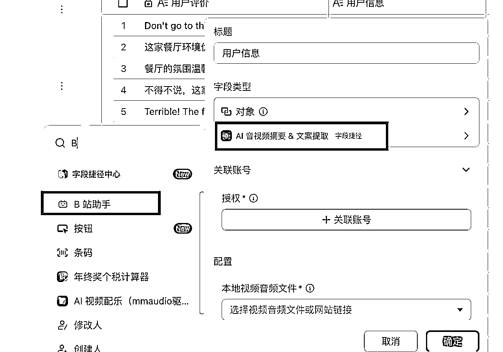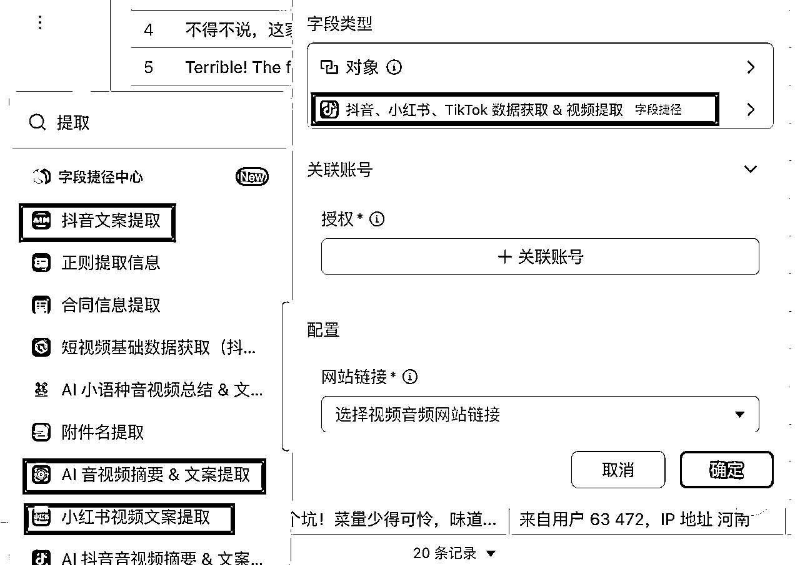

会议纪要的话，腾讯会议和飞书会议自带AI纪要，最不容易漏。如果是语音识别稿，可以用多个大模型同时整理，然后人工合并。

**八、那些容易被忽略的交付细节**

给客户发初稿记得加水印，防止对方直接拿去用。最好先把PPT转成图片，再生成PDF，或者遮住部分内容。水印内容写“XX初稿”就行，目的是让客户知道活干完了，该结算尾款了。是否实名看你个人，客户没要求就不用。

AI生成表格后导出到Word会乱？因为网页渲染和本地排版不一样。可以复制到飞书文档，自动变成表格；或者先粘到Excel，再复制到Word。平时建议别在飞书、Word、WPS之间来回切换，格式兼容性容易出问题，选一个用到底。

做好的PPT用苹果电脑发过去，客户Windows打开乱码？大概率是WPS和Office不兼容，或者两端PPT解析细节不一样。让对方也用同一款软件打开，一般问题不大。

接单心态很重要，别嫌单小，也别怕单难。AI能力正好可以补足你专业上的陌生领域，大胆尝试，实在耗时太长、收益不划算就放弃，赶紧接下一单。

**九、抖音视频脚本怎么做**

客户想让你用AI做“项目制作脚本及规划”？可以。先找3-5个对标账号，把脚本文案扒下来，喂给ChatGPT或DeepSeek学习模仿。然后按IP设计做分镜头：不出镜就整理素材，出镜就口播加实操演示。做IP要真实，这样才涨粉引流，过程中不断迭代就好。

工具千千万，适合自己的才好。AI写作接单的核心不是会用某个工具，而是理解客户需求，知道什么场景用什么方案。这些经验，建议你先收藏，下次接单再翻出来看看。

不同业务场景下，报价逻辑是完全不一样的。手工量比较大的那类活，价格自然要往上走；能用AI+PPT工具先出初稿再细化的单子，成本就会低很多，价格也就不同。

16、新手阶段的订单有时候截稿时间只剩两三天了，客户一直催怎么应对？
【解决方案】
1、提前把交付时间线和工作范围跟客服对齐写清楚，避免后期扯皮。
2、两三天就要交的属于加急单，报价要适当上浮。
3、客服催得急不一定客户就急，很多时候是客服怕你做不出来，后面还要重新找人。

17、国内AI直接就能打开公众号链接阅读，国外AI说识别不了，我只能拷贝到txt再喂给它，多了不少步骤，怎么办？
【解决方案】
1、国外工具对公众号、小红书、知乎这类国内平台的内容存在访问限制，本来就打不开。
2、直接换国内模型用，比如豆包、Kimi、DeepSeek这类。
3、再配合批量下载公众号文章的工具，效率会高很多。

18、淘宝接单一定要放简历吗？
【解决方案】
1、看客服要不要，不主动问就别主动递。
2、但长远看准备一份是必要的，核心是案例库，用来证明手里做过的单子和经验积累。

19、DeepSeek 生成的理工类内容层级特别多，复制到Word后格式全乱，有什么高效处理办法？
【解决方案】
1、先复制到微信里过渡一下，能去掉大部分多余格式。
2、不要点复制按钮，用鼠标选中手动复制。
3、先原格式粘贴到WPS再用工具刷格式。
4、复制到飞书也能保留层级的同时去掉冗余样式。
5、几种方式可以组合着用。

20、大模型让它写5000字结果只有3000字，让它写500字反而出来1000多字，怎么控？
【解决方案】
1、字数失控跟模型架构、训练数据、token参数、Prompt隐性引导、工具默认设置、算法对字数的理解都有关系，不同模型表现不一。
2、别纠结精确字数，直接多生一点，自己删掉就行。删总比写容易，而且反正都要人工审核，字数刚好反而还要自己补。

21、我觉得AI生成的文章不像AI，为什么别人一看就觉得是AI写的？
【解决方案】
1、关键词暴露：口语化不足，连接词堆砌，比如首先、其次、然后，第一、第二、第三之类，适当删改就能降AI味。
2、网感判断：经常用AI的人凭感觉也能辨认，但这很主观，《劳动法》这种专业文本和鲁迅文章AI率也高，无法完全作为标准。

22、感觉AI做PPT很鸡肋，改的时间比做的时间还长怎么办？
【解决方案】
1、如果是内部讨论、分享这类简单PPT，核心是内容，用网上的模板，AI+PPT工具秒出，人工介入少。
2、如果是售前方案、立项汇报、结项汇报、定制教案PPT这类复杂需求，AI只负责出大纲和初稿，人工大幅调整再做成PPT，AI占比小人工占比大。
3、场景判断清楚了，用AI的方式也就清楚了，效率自然上去。

23、和客服沟通是群里回还是私聊？群里经常没人回，好像都是私聊
【解决方案】
1、基本都是私聊，很多话术不适合公开。
2、客服通常也希望私聊，同时向几个写手报价后选性价比最高的。
3、写手多、好单子少，还是得提升能力。

24、对不熟悉的领域比如课件设计、微课制作，直接放弃还是现学现卖？
【解决方案】
1、不会就先找会的人学，学成再接单。
2、干中学也不错，AI代写思路是可以迁移的，做着做着不懂就问，卡点就解决。

25、Kimi做PPT能投喂模板吗？找不到位置
【解决方案】
1、Kimi不支持PPT模板投喂。
2、换WPS、AIPPT、Gamma这类支持模板的工具。

26、自己写完的稿子能让AI检查吗？比如新闻稿
【解决方案】
1、新闻稿细分很多，让AI自检理论可行，但最好还是让客户确认。
2、自己觉得OK不代表客户满意，自己觉得不够完美客户也可能通过。以客户认可为准。

27、怎么让AI写出不错的短视频脚本并提高利润？
【解决方案】
1、对标思维：参考头部博主的视频风格，让GPT模仿，目标更清晰，容易出爆款。
2、复用思维：一个方向爆了就批量做，飞书多维表格可以做批量管理，先堆数量再等爆款。
3、B端客户可以把单条脚本服务打磨成整套方案，团队型客户单量会比较稳定。

28、写读后感从素材投喂到大纲标题正文结尾，需要一直在一个对话框里吗？
【解决方案】
1、想让AI保持上下文记忆，就用同一个对话框。
2、章节关联不强时，分开多开对话也没问题。

29、标书制作算写作范畴吗？有哪些禁忌内容？
【解决方案】
1、标书在AI代写里属于高客单价B端业务。
2、禁忌看客户，有些客户为数据安全只外包部分内容。

30、客户要2023年天津北京河北各地级市医疗设备售后服务调研报告2万字一份，怎么谈单？
【解决方案】
1、先补需求细节：
1）河北十来个地级市都要写吗还是挑几个？
2）调研是否需要问卷数据？数据客户提供还是自己找？造假不行。
3）医疗设备范围多大？笼统写还是细分？这决定颗粒度。
2、客户是否提供基础材料？自己搜集的话数据整理量很大，AI幻觉风险高。
3、什么时候要？评估工作量。
4、2万字有没有模板？分几部分？会影响是一次性生成还是分段拼凑。
经验总结：
1）信息不清别急着报价，拍脑袋报价容易做不下去，报低了要加价客户会不认账。
2）前期沟通对双方都有好处。
3）对我们来说能判断工具、时长、工作量，报价更准。
4）对客户来说显得专业、靠谱。
5）避免后续扯皮，提升ROI。

# 五、引流转化篇
1、闲鱼在做资料网盘推广，再上架AI代写项目，需要下架旧商品吗？
【解决方案】
1、能另开一个号最好。
2、一个号就一起放，闲鱼本来就是混卖的，写作和虚拟资料同号影响不大。

2、用了十年的闲鱼老号，以前可能跟别人同WiFi用过，现在只有自己登录，还能做流量吗？
【解决方案】
1、可以先用着，跑一段时间看数据。
2、数据靠做而不是猜，市场会给出答案。

3、闲鱼点无需寄件已发货，客户不确认收货多久自动完成？我查到24小时但实际几天都没完结
【解决方案】
1、闲鱼自动收货是10天，想提前可以礼貌催一下。
2、规则问题直接问官方客服，别全信AI，AI在时间数字这类数据上容易出错。

4、接了10个教案+10个教学设计PPT+1个说课PPT，量很大，客户不满意要退款怎么办？
【解决方案】
1、提前把交付标准和审核红线说清楚。
2、提前收50%-80%押金，大单子这样能保本。

5、谈单时要不要让客户打字“初稿确认”防止不认账？
【解决方案】
1、可以约定修改次数并让客户发“样稿满意，请继续制作”，先收一半稿费。
2、记录留痕，闲鱼就闲鱼发，微信就微信发，小群就小群发，避免扯皮。

6、闲鱼客户需求说不清，还要报价怎么做？
【解决方案】
1、需求模糊就一定要问清楚，客户觉得详细不代表我们能做，模糊就是雷区。
2、可以引导到微信群沟通，建立信任，话术：方便移步私聊吗？这样细节沟通更顺，报价也更准。

7、稿子发过去被退回，自己觉得还行怎么办？
【解决方案】
1、摆正心态，有各种客户，先改再说。
2、提前预收押金、明确修改次数、说好截稿时间，减少损失。

8、客户不同意约定修改次数怎么办？
【解决方案】
1、限制次数是为了让客户一次性汇总问题，减少反复沟通。
2、可以这样说：以往案例一般改1次就OK，我送您3次大改，小改不计，您看行吗？客户一般会接受。

9、讲解稿怎么审稿？怕被白嫖
【解决方案】
1、截图或生成带水印PDF+密码。
2、多重防护防止转Word。
3、尾款结清后再发原版Word，讲解稿客单价也不高，风险可控。

10、三个闲鱼号每天几百曝光，这几天没单子，闲鱼流量够吗？要不要开淘宝？
【解决方案】
1、淘宝要1000押金，前期不一定有咨询，闲鱼更适合普通人起步。
2、闲鱼现在竞争大，没单子正常，同时加入接单群做二手流量。

11、一个店铺只发一个品类吗？
【解决方案】
可以多品类，甚至一个品类里接多种订单。

12、为什么很多店铺说8月是淡季？
【解决方案】
1、8月是开题季，开题报告单会多。
2、老师准备开学，教案类也会多。
具体看市场反馈，不必纠结，有单就接。

13、第一次进群错进专业群，要求做微课说课稿，不敢接，一直不接会不会被踢？
【解决方案】
1、看群规和群主，有些群要求一个月至少一单。
2、自己先积累经验，再去更合适的群。

14、接单群客服信息很少就要报价怎么办？
【解决方案】
1、报价需要评估工作量，工作量需要熟悉度。
2、多做多总结，多跟高手交流，形成常见单子的报价基准线。
3、不同客户需求差异大，报价要区分。
例如开题报告50-100，LW无数据300-600，有数据800-1500，难度高3000-4000，期末作业30-80，难的100-150。报给流量端的是抽成后的到手价，流量端抽20%-40%，要留利润空间。

15、接单时如何确认关键节点减少沟通？
【解决方案】
1、长文PPT类先确认大纲，改大纲等于重做，最好不退款。
2、初稿发水印版让客户回复“没问题”“可以继续”“样稿确认，请继续制作”等关键词，确认后再往下做。
3、确认环节约束客户，也提升沟通效率，客户会一次性汇总问题。

# 六、平台选择篇
1、公众号矩阵化能不能用同一个话题让不同工具生成内容发不同号？
【解决方案】
1、同一工具同一个话题生成不同文章可以发。
2、同一工具不同话题生成不同文章可以发。
3、不同工具同一话题生成不同文章可以发。
4、不同工具不同话题生成不同文章可以发。
流量好不好看是否具备爆文特点，选题爆炸、内容吸睛才行。

2、小红书种草文案客单价低，目前只能写这个，怎么多赚钱？
【解决方案】
1、要么提高量，多进接单群。要么提升客单价，学会写更高难度的稿件。
2、跳出新手村别在低客单红海竞争，提升能力接高客单。

3、淘宝前期说A要求，后期要加国家视角行业视角，20块1000字怎么处理？
【解决方案】
1、20块改需求不划算。
2、能接受就AI快速出稿修改交差。
3、不能接受就说需求改动太大，让客户另找。
看ROI，别纠结。

4、怎么判断各平台热门品类？
【解决方案】
1、2-3月LW火，要答辩。
2、9-11月开题报告火。
3、年末年初工作汇报项目总结火。
看接单群订单类型也能判断，市场真实反馈最准。

5、各平台接单都很耗时间，怎么优化？
【解决方案】
1、提前明确要求，能电话就电话，不能就用模板让客户填空。
2、减少一问一答，提升效率。
3、可以招助理运营闲鱼或当客服。

6、不同平台不同时间单子多少不一样怎么判断？
【解决方案】
看接单群里什么单子多。开题、期末多说明答辩季到了，年终总结多说明年末。问自己加入了多少群、有没有尝试第一单、是否完成交付闭环，执行比抱怨重要。

7、暑期快到了教案单多吗？可以准备吗？
【解决方案】
1、9月开学，教案有市场，Word教案和PPT教案都要会，PPT通常有学校模板个性化强。
2、暑期可以先接单边学边做积累经验。

8、淘宝应聘直接打语音过来要接吗？
【解决方案】
看情况，可能是沟通需求，也可能是核验身份防刷单。

9、闲鱼、天猫、淘宝接单有什么不同？
【解决方案】

刷到很多做文案接单的朋友，开口闭口就问闲鱼、天猫、淘宝的单子哪个更香。其实说句大实话，这些渠道本质上也就客户从哪儿来的区别而已，真正值得你死盯的，只有一件事——你到手的佣金比例到底有几成！

如果你的分成连60%～70%的及格线都没摸到，那可得赶紧清醒一下了，这不就是妥妥的“低价打工人”嘛？还不快琢磨琢磨怎么跳出这个坑，别让中间商把你赚得底裤都不剩。

但要是你已经达到了这个比例，那就要恭喜你了，从0到1的跑通环节你算是顺利毕业了。下一步的重心就该放在“放大”上——要么找人搭伙一起干，要么自己下场研究怎么搞流量，反正路子是越走越宽的。

有个兄弟问我个实战题：接了个大批量项目，给抖音写一分钟左右的视频脚本，一个月15条，这种单子怎么报价才稳？

我的建议是这样的——先别急着报数字，先让对方丢几份他们以前做过的脚本给你瞅瞅，这叫“看样定调”。你拿到这些参考样本，直接丢给AI大模型去模仿，提示词里就把客户抠的那些细节全写清楚，出来的东西基本八九不离十。

至于价格么，最省心的方式是先探探客户的预算。你这么一问，报价就有的放矢了，报太高容易把人吓跑，报太低又显得自己掉价，咱们得拿捏住分寸。

要是客户死活不肯亮底牌，说让你直接开价，那就只能靠经验硬扛了。举个例子，我以前给留学客户写短视频脚本文案，一条就收30到50块。记住一个原则——单子量大，价格就给点甜头；单子量小，单价就得往上提提。

再补充一点，如果你跟对方只合作一个月，那肯定得稍微报高点，毕竟不是长线生意嘛。反过来，要是对方一开口就是400条、500条的大批量，这种长期饭票，单价压低一点也划算，走量嘛。

今天的分享就到这儿了。希望能帮到各位在AI写作赚外快的路上少走弯路。如果觉得有收获，别忘了点个赞。祝大家AI写作项目单子源源不断，天天爆单，荷包赚得鼓鼓的！🎉