# 5 天 800+ 收益，外卖 CPS 新手从零起号实战复盘

> 来源：[https://pcndievlt02e.feishu.cn/docx/OK4ndaX2HoiE6lxVgoIc7YLUnpb](https://pcndievlt02e.feishu.cn/docx/OK4ndaX2HoiE6lxVgoIc7YLUnpb)

# 写在前面

跟圈友们汇报一波进展。7 月 8 日那天我刷到一则中标贴，当时兴奋点在于：用户只要点开视频下方链接，就能在打开外卖 App 的瞬间自动弹出优惠券。这个闭环太顺滑了，我立刻联想到几年前的流量风口，感觉挖到宝了。

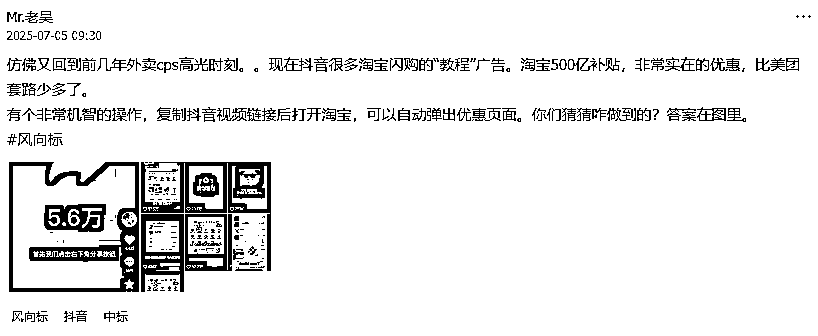

当晚我就动手了。用最简陋的剪辑做出第一支测试片直接发出去，很快就收到正反馈。首夜就成交 4 单，佣金才 1.42 元，但足以证明链路是通的。视频样式如下：

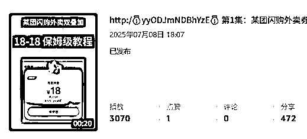

MVP 跑通不代表项目靠谱，毕竟我也玩过不少项目。做什么、能做多大、天花板在哪、适不适合自己、能持续多久，都得再验证。

于是第二天我立刻新开一号继续测：剪片、发片、看播放、看分享、看订单。同时在闲鱼、小红书、快手、视频号、抖音等平台搜集已出单的案例，研究官方推广链接，接入第三方分佣平台，和同行交流，争取快速吃透全貌。

也在这个时候，龙哥发了一个针对这个赛道的超级标，让我信心更足了。

经过几天实测和调研，我已经拿到初步数据：累计播放 3 万，订单破千，收益 800+，对这个赛道的认知也更立体了。

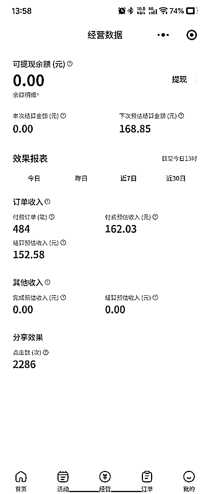

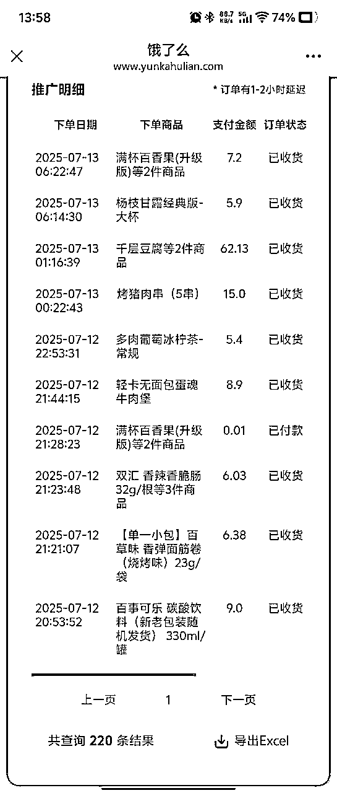

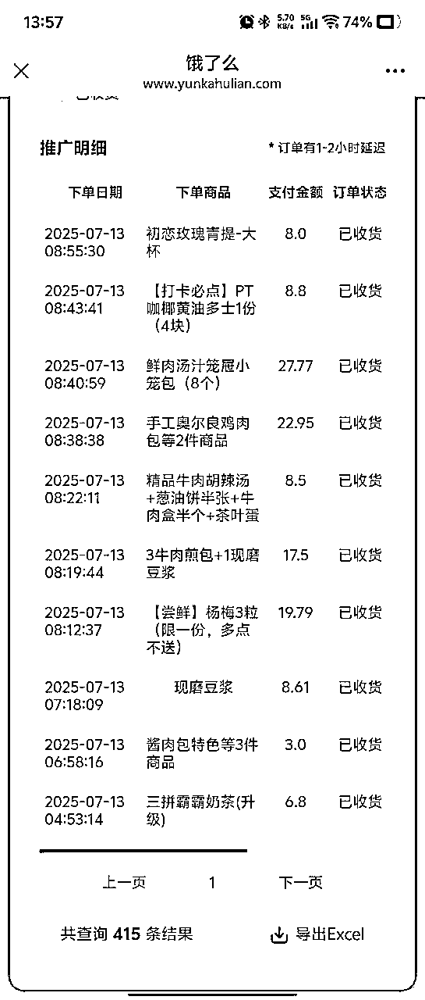

全文约 3000 字，重点是我对这个外卖 CPS 项目的可行性判断。如果你对外卖 CPS 感兴趣，或者是 CPS 新手想快起号变现，又或者是有剪辑能力想做批量放大的团队，完整看完应该会有所收获。核心框架如下：

# 一、项目值不值得做？从赛道、市场、时机看

### 赛道与平台机会：巨头在烧钱，窗口期正在打开

1. 风口信号：美团、淘宝、京东三大巨头正重金补贴外卖零售，这场补贴战才刚打响，短期内不会收敛。对我们推广者来说，这就是现成的红利。
2. 赛道聚焦：核心在于私域沉淀。只要补贴还在，消费习惯就会被养成，项目就有生命力。后期佣金或许会下调，但当下先解决流量问题，等量起来后再把流量导私域做长效收益。

### 市场体量与竞争：天花板很高，普通人仍能分一杯羹

1. 天花板：群里有人日均 3W 单。以周六冲锋日的淘宝闪购超级品牌日为例：平日淘宝闪购新客 0.8/单，老客 0.3/单，周六激励翻倍，再加每 2000 单奖励 188.8，综合到手能到 1.6/单。按此算，那位圈友一天入账近 4.8W，确实顶。
2. 竞争格局：目前还算分散的红海，头部没完全垄断。我的实测证明，只要执行，入场就能赚钱，差的是量级。对普通人很友好，配合矩阵、投流做杠杆，收益会更可观。
3. 细分赛道增速：美团外卖、淘宝闪送、京粉等都在发力，未来拼多多也可能加入。各平台活动类型多、补贴形式多，根本做不完。普遍做法是看哪家佣金高、规则熟就主推哪家。

### 时间窗口：现在入局，属于第一批吃螃蟹的人

市场目前处于分散期，头部尚未锁定新玩家。我的测试反复验证，新人只要执行到位就能出单，区别只是多寡。这对普通人非常利好。

# 二、这项目适合你吗？

### 资源与能力匹配：门槛低，执行力决定成败

1. 能力复用：我的小规模测试就已跑通，操作上没遇到卡点。和之前做矩阵、做投流的经验很契合，这是我后续重点发力的方向。
2. 学习迭代：模式粗暴直接，流量是溢出的，发就能有。稍作升级就能放大效果。市面上一天转发量过万的，绝大多数是投千川推出来的。

### MVP 可落地性：半小时上手，晚上就能见效

7 月 8 日晚上剪完第一条视频发到抖音，当晚就出 4 单。爆款公式很好套。

以这条为例：2.58 iCh:/ 12/31 Y@m.Qk http:/💰kxMjc3MTkxY2I💰 美团外卖优惠券领取入口 美团大额优惠劵最新教程 # 省钱技巧 # 外卖优惠券 # 美团外卖优惠券 # 薅羊毛 # 省钱攻略 https://v.douyin.com/9vVBnKo8kkc/ 复制此链接，打开 Dou 音搜索，直接观看视频！

文案结构拆解：

* 开场：美团外卖优惠券领取十八减十八保姆级教程来了。主播昨天已经把冰箱存满了奶茶，话不多说，教程开始。
* 步骤：点视频右下角分享复制，打开美团即可进入优惠券领取页，立即领取大额外卖券。美团首页搜八二五五，进内部折扣页。神券、特价券包都很划算，券到手后切大城市地址更容易领到十八无门槛券。
* 收尾：券领完就能实现奶茶外卖自由了。

核心是中间的“领取步骤”固定不变，只需不断更换开场白和结尾，就能批量产出原创视频。

### 多平台打法：做一鱼多吃

* 抖音直播间：可覆盖全平台，单粉价值更高。难点是需要有人在线答疑，后期可尝试无人直播。
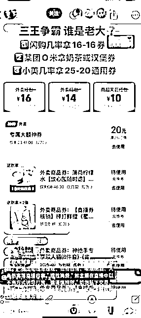

* 小红书：单图+笔记即可，无限重复发，比短视频更省事。一篇笔记还能同时吃透美团、淘宝等多个平台佣金，活动投产比不错。
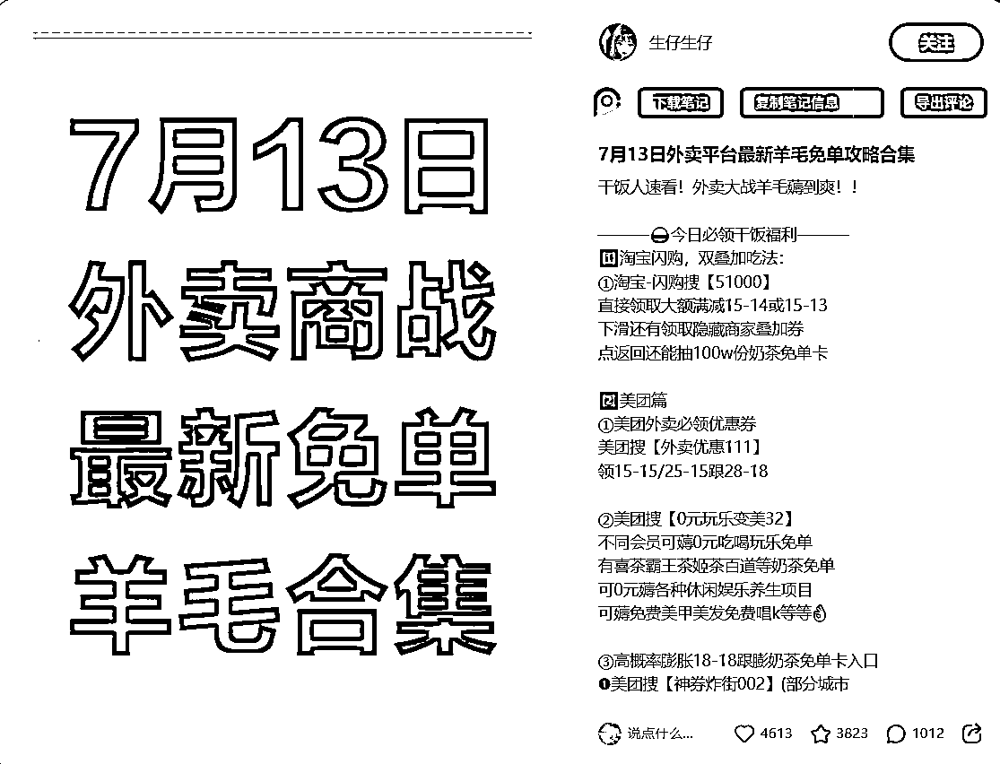

* 闲鱼：模板化发布，难度低。关键在于用擦亮功能获取持续曝光。
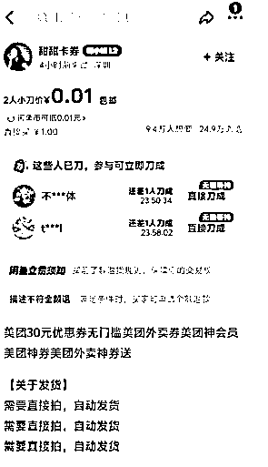

其他平台思路也差不多，操作都很粗放。

* 资金投入：基本零成本，除非做投放。
* 初步投产比：抖音自然流，平日万播放收益约 200-300，冲锋日可翻倍。视频和文案可一鱼多吃，同步发视频号、快手、抖音，图文发小红书、闲鱼，甚至在淘宝、拼多多以 0.01 元售卖，也只为赚佣金。
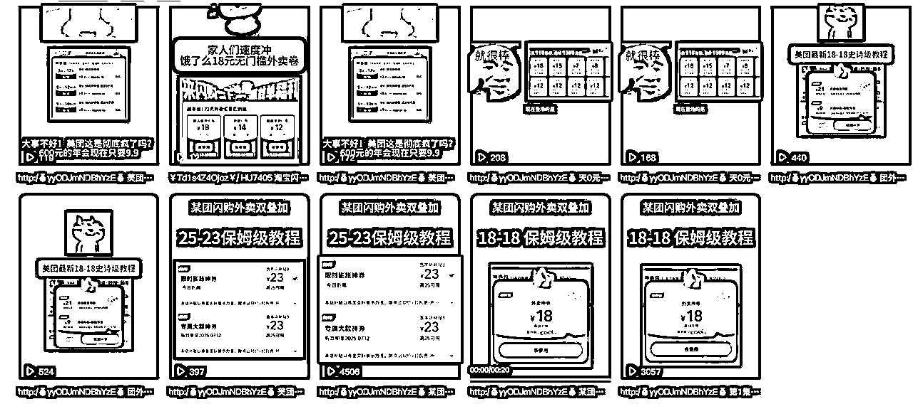

# 三、能做多久？值不值？

### 扩张性与护城河

我判断扩张空间很大：矩阵放大、多平台放大、投流放大、团队作业、工作流自动化。目前主流就是铺量+投流，投流门槛不高，学会就能上手。

我已搭建起快速剪辑工作流，可无限量生产。关于工作流放大可参考文锴的《一个人，一套自动化流程，如何玩转 100 个中老年书法视频号矩阵？》

矩阵、多平台、投流都是下一步重点。若能叠加私域沉淀，把公域流量导到微信群或企业微信，做成长期复利，抗风险能力会更强。

### 风险提示

任何项目都有风险。过度营销和内容同质化可能导致限流甚至封号。去重、控营销感是必须思考的。

# 四、总结

综合判断，目前这个项目机会很大，和龙哥说的完全一致。这条超级标对普通人极友好，技术含量不高，主要靠执行力。我剪辑这么粗糙都能快速变现，赚钱圈的伙伴能力在我之上，做出更大结果是大概率事件。

# 五、补充答疑

### 1. 官方链接 vs 第三方平台怎么选

目前基础活动官方就有，直接申请即可。美团搜美团联盟，淘宝闪购搜一起赚。如美团外卖节 3% 佣金是长期活动。

冲锋日、激励活动多在第三方。如周日淘宝闪购超级品牌日翻倍补贴。我在用的有两个：黄老板的云瞻平台和云众推客。

官方优点：系统稳定，资金安全。
第三方优点：活动多、结算快，通常 T+1，部分补贴力度大，有额外激励，客服响应快。缺点是系统偶尔不稳，订单同步不及官方。

想做分佣的学员也可以扫码对接。代理分佣通常只能拿达人佣金的 1%-2%，比例偏低，建议先自己做达人跑通再考虑代理。

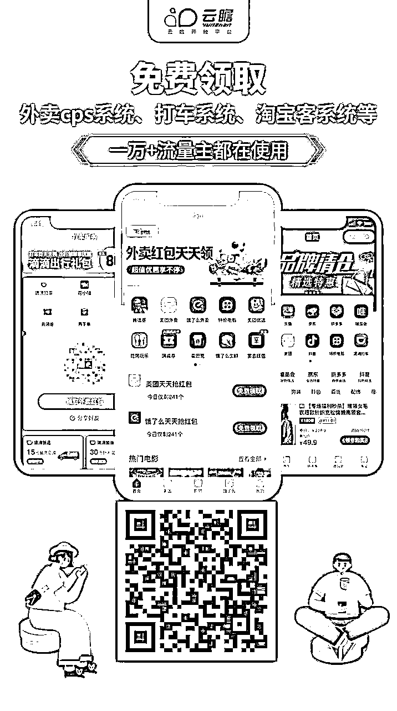

### 2. 各平台活动如何取舍

各大平台都在抢单。观察下来，有活动有激励就跟第三方走。平日无活动，佣金相近就用官方基础活动。一般平台会主推 1-2 个基础活动，平日先推这个。

不同第三方活动和激励差异大，多关注佣金高就推哪边。

### 3. 批量剪辑怎么做

抖音和小红书的优秀案例结构都很简单。配合剪大神等批量剪辑工具和批量上传工具，就能实现自动化生产。

### 4. 项目评估参考标准

以下是我结合赚钱有术文章总结的粗略评估框架，仅供参考，欢迎大家一起优化。

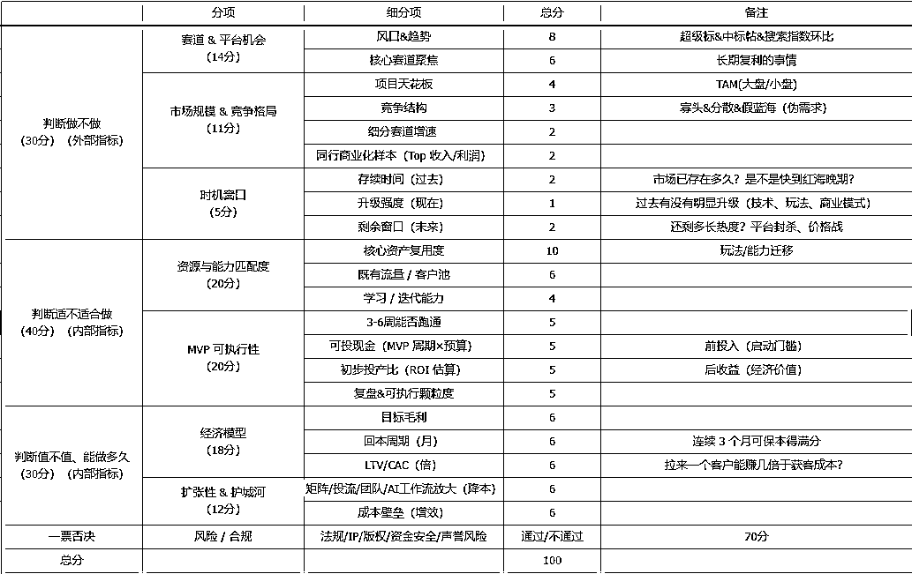

感谢龙哥的超级标。若内容对你有价值，点个赞、投个锚支持一下。

对外卖 CPS 感兴趣或正在跑的伙伴，欢迎交流，一起抓住这波红利！