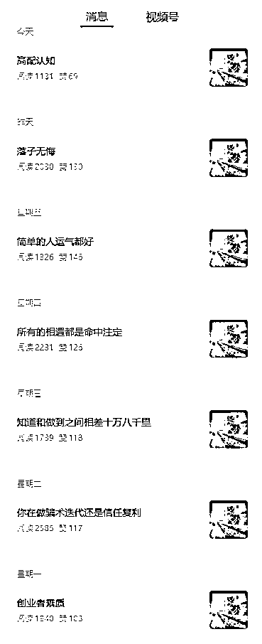
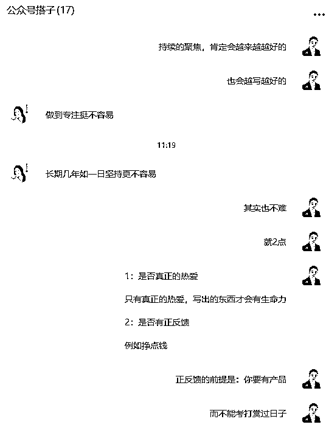
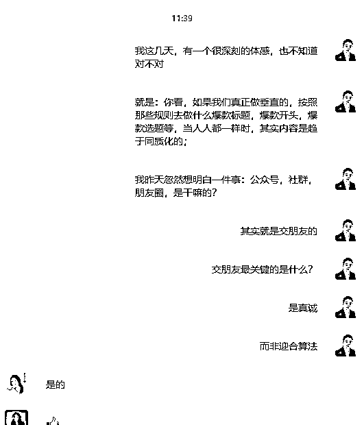

# 用文字交朋友，把一人公司做成一辈子的事业

> 在这个人人追逐流量的时代，有人却选择慢下来，用最朴素的方式写作、交友、经营自己的事业。

最近我一直在琢磨一件事：一个人创业，怎么通过公众号完成从流量到信任再到成交的完整闭环？

说实话，市面上的方法论我几乎都试了个遍——爆款选题、吸睛标题、黄金开场、排版优化，甚至有人说用手机发文章比电脑效果更好……这些“秘籍”我统统照做了。

结果如何？**差别真的不大。** 坦白讲，我心里挺失落的，感觉自己像在跟一个看不见的算法玩捉迷藏。

直到昨天，我带着孩子去了广州的南国书香节。现场听了几位作者分享，也淘了几本好书。我发现一个共同点：这些作者和他们的作品，本质上只是**在真诚地表达**而已。

回来的路上，我突然问自己：“你这么久拼命追着‘三秒注意力’的算法跑，有多久没有静下心来，写一句真正发自内心的话了？”

那一刻，我愣住了。

现在满屏都是“爆款公式”“流量密码”，所有人挤在同一条跑道上：一样的开篇钩子、一样的焦虑选题、一样的情绪套路。甚至很多人直接搬出 AI 批量生产内容。结果表面上热闹非凡，实际上内容早就没了温度。

可我们做内容的人，难道不应该是**通过作品，去和陌生人交朋友**吗？

想通这件事之后，我做了一个决定：把公众号从《东山聊AI自媒体获客》改名为【东山一人创业笔记】。名字变了，心也定了——我就要认认真真记录自己创业路上的所思所悟。

今天在社群分享时，我说了四个关键点：

## 01 别在流量迷宫里打转

公众号、朋友圈、社群，最初都是温暖的会客厅，是志同道合的人坐下来聊天的地方。

不知道从什么时候起，这些地方变成了数据战场。我们用阅读量、完播率、涨粉数去衡量内容价值，跟着算法的节拍机械舞动。

但今早我随手翻到一个作者的文章，突然被触动了：

他每天更新，每篇都用同一张蓝色风景图做封面，阅读量稳定在1000到2000。标题不夸张，排版不花哨，文字却非常真诚。

这个不按常理出牌的案例让我明白了一件事：**当内容的含金量足够高，形式根本不重要。真诚的分享，才是通向读者心里的唯一桥梁。**

## 02 真诚，才是交朋友的唯一路径

我一直觉得，一人公司的创业者，其实不需要太多流量，也不需要太多粉丝。

一年赚100万，好好服务一千几百个朋友就够了。

做内容和交朋友是一回事：刻意讨好让人反感，坦荡交流才走心。那些绞尽脑汁的套路，远不如朴实的“我手写我心”有力量。

所以我在群里说：真正热爱一个领域，那份热情会透过文字点燃读者的眼睛。志同道合的人，自然会找上门。

当然，光有热爱还不够。持续创作需要正反馈——不是那种虚的点赞，而是真实的价值交换：也许是付费产品，也许是深度服务。**商业不是真诚的反义词，合理的变现恰恰是价值的度量。**

如果能用高价值的产品和交付换取利润，我为什么非要去纠结流量主那点广告费？

如果不需要海量流量，我为什么还要挖空心思去讨好算法？

## 03 把一人公司当事业干，干到60岁，干到老

想通这些之后，我完全不羡慕那些靠煽情制造爆款的同行了。

我不把公众号当成一个“项目”去运作，**它是我要耕耘一辈子的事业。**

时间不只是我的朋友，还是我的搭档。

现在的我刚刚起步，写就是了。我对自己说：莫愁前路无知己，终有一天，天下谁人不识君？

我的一人公司理念很简单：打造三级产品体系，一年服务约1000个低客单客户和50到100个高客单客户，踏踏实实实现年赚百万。仔细想想，我真的不需要百万粉丝。

## 04 忘掉规则吧，不讨好算法，只讨好朋友

不再为选题发愁，不再为标题苦思冥想。

放下那些表面的东西，我发现写作变得特别简单：打开电脑，泡杯清茶，对着空白文档写下此刻真实的想法。就好像，屏幕那端坐着一群好朋友。

不做刻意的排版，偶尔加粗的句子不是技巧，而是思想本身的分量。

在这个追求即时刺激的时代，选择深耕文字公众号，我相信永远有一碗饭吃。因为已经有人走通了这条路，我们需要的只是足够的专注和耐心。

也许，这才是“垂直公众号”最真实的模样。

我写我想的，我分享我悟的——**我不用照亮整个世界，只要让朋友看见我的真诚，顺便通过我的分享，看清脚下的路。**

当喧嚣散尽，自然会有人循着光找过来，轻轻敲响我的门。

* * *

讨论区里很多人表示共鸣：

“活在算法里太累了。”

“我之前在这条路上反复摇摆，一度都写不下去了。后来想明白了，我只讨好读者朋友，不讨好算法。”

“一起加油，我们不需要千万粉丝，有一千个好朋友就够了。”

是的，用文字交朋友，做一辈子的一人公司。这条路虽然慢，但每一步都踏实。