**长视频洗稿全自动化：13天开通YouTube YPP，月入过万实操复盘**

原文链接：https://www.yuque.com/for_lazy/zhoubao/qweg9865wd6d2n8i
更好的阅读体验可参考飞书文档：https://rlwxa0zgke.feishu.cn/docx/NKA9dzov2o6rTnxW0FBcoD4Fnqh?from=from_copylink

承蒙Zero的无私分享，他的实操记录我愿称为年度最佳，如同远航船只需要灯塔引路，人在成长路上也需要贵人提灯。

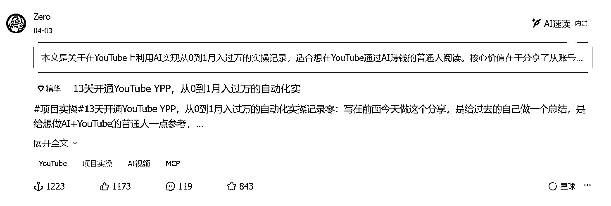

Zero是在2025年4月3日发布的原帖，我于5月12日回帖呼应他的观点，顺带点名了剪辑自动化背后的出处。

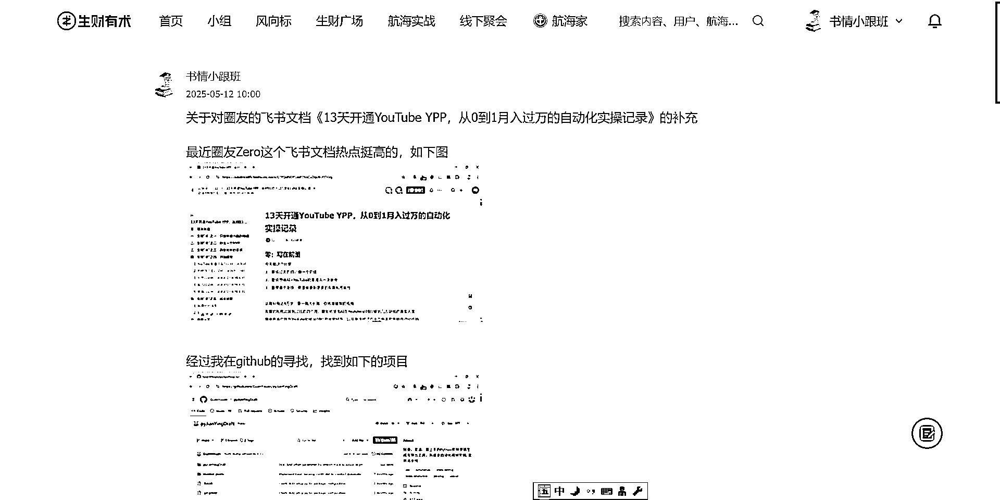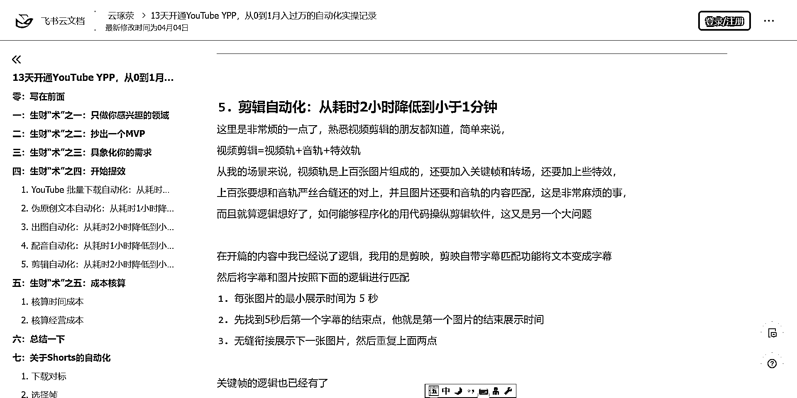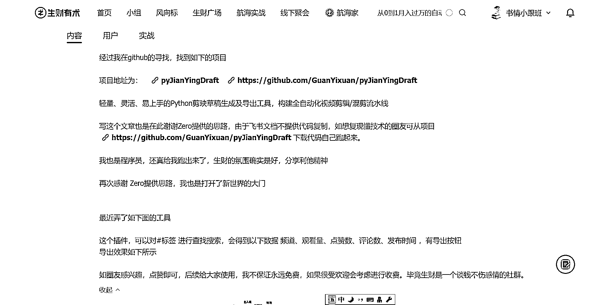

凭着程序员的直觉，我很快在GitHub上搜到一个小巧而灵活、上手门槛很低的Python库——pyJianYingDraft。它能生成和导出剪映草稿，非常适合搭建全自动化的视频剪辑/混剪流水线。项目地址：https://github.com/GuanYixuan/pyJianYingDraft ，CapCut版本正在 https://github.com/GuanYixuan/pyCapCut 开发中。

既然有现成的开源项目，那就直接落地。这个“视频自动化剪辑.exe”是从Zero的分享中获得启发后做成的第一个小工具，网盘链接：https://pan.baidu.com/s/1PbZc8RFD4dmL221O9wUgSw?pwd=assq 提取码：assq。严格讲这算不上从零开发，只是把GitHub的现成代码变成了可执行程序。

Zero原帖（https://avbdmra8fx.feishu.cn/docx/GTFQdNOFLosP3VxCuDqc6UOTnVg）虽然放了代码，但没有提供现成软件。对小白而言，光有代码根本没法直接用。毕竟花了不少心思把源码变成能用的程序，我也留了点私心：免费向生财圈友授权一年，5个软件共用一个机器码。需要申请的圈友请填问卷：https://wj.qq.com/s2/23534884/e782/

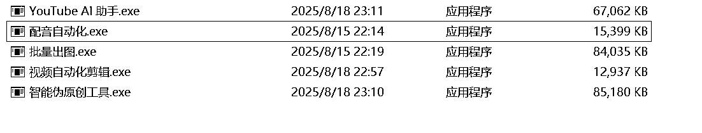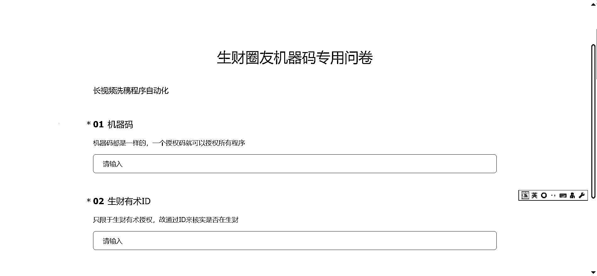

授权统一365天，最大使用次数设为-1即不限制使用。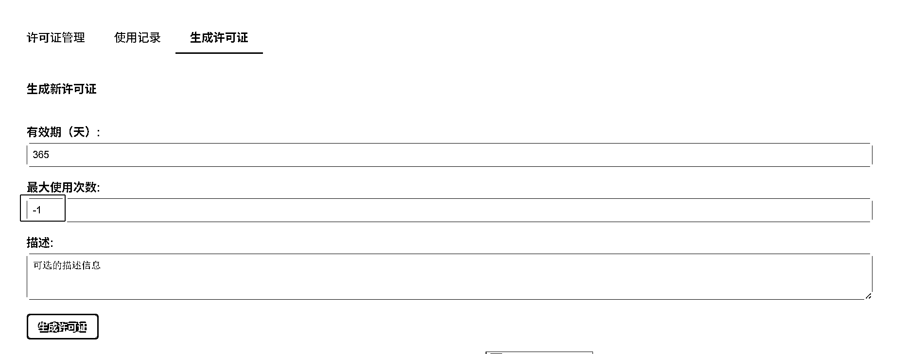 操作视频如下：

长视频处理好之后，接下来是“YouTube AI助手.exe”。网盘链接：https://pan.baidu.com/s/1a52CLPfH7tNfD6esPry6PQ?pwd=fx6i 提取码：fx6i，操作视频如下：

再分享长视频洗稿三件套：

- 智能伪原创工具.exe：https://pan.baidu.com/s/1_xpcWjeqOgK-cXkMKP2AcQ?pwd=w4eb 提取码：w4eb
- 配音自动化.exe：https://pan.baidu.com/s/1c_kMw8xp7KEqXGtR1f02Xw?pwd=9s4v 提取码：9s4v
- AI图片生成器.exe：https://pan.baidu.com/s/1ZTJnRVSUAK57DqBz82RMXw?pwd=2t2k 提取码：2t2k

以下是各自的使用说明。

**智能伪原创工具**：需要先购买ChatGPT API Key，入口：http://gptproto.com/?source=shuqing 。默认用gpt-4o-mini，统一走OpenAI模型。这里建议加入人工环节：先把原文或洗稿后的文章手动改一遍，再做一次伪原创，成片质量会更高。

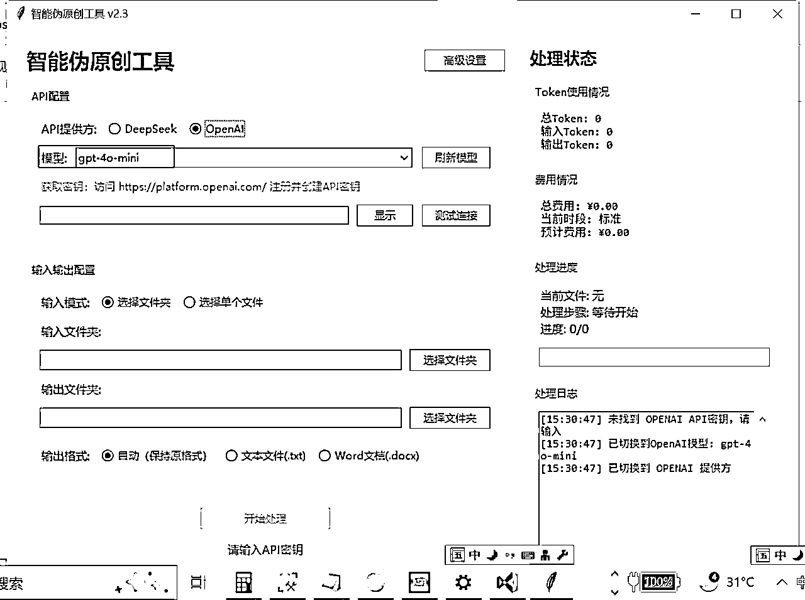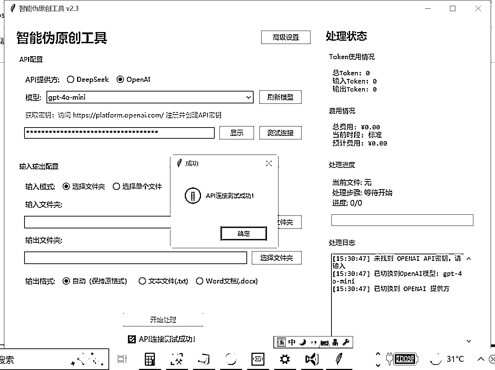

Zero大佬当时用的是Finetune Model，我还没完全搞明白，索性就用gpt-4o-mini来跑。

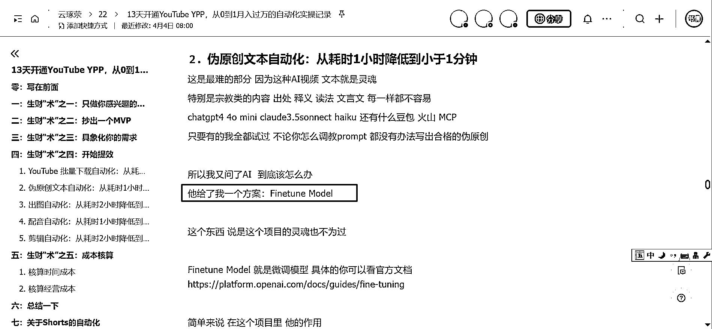

**配音自动化**：按图片提示先点链接进去。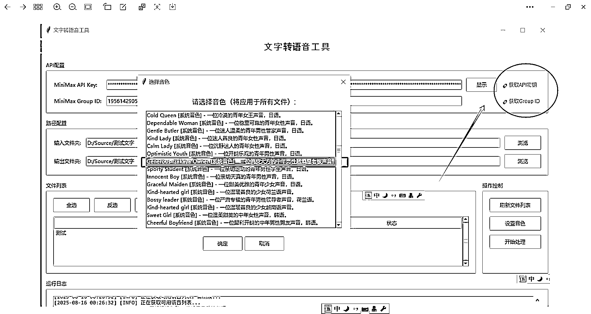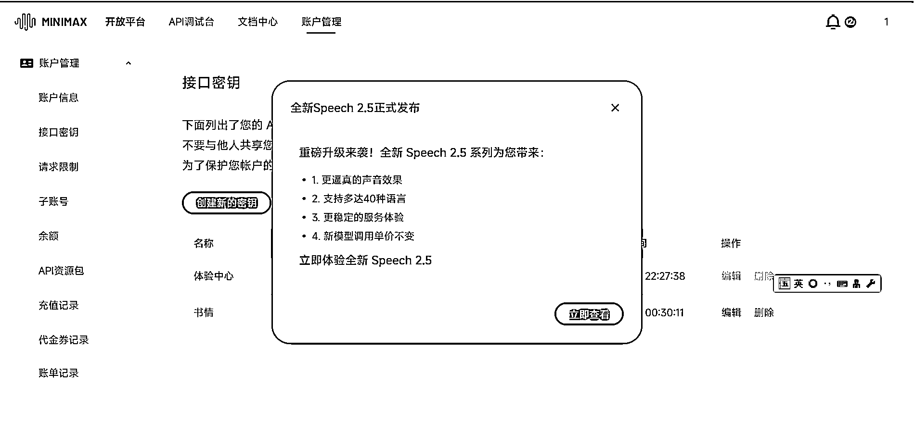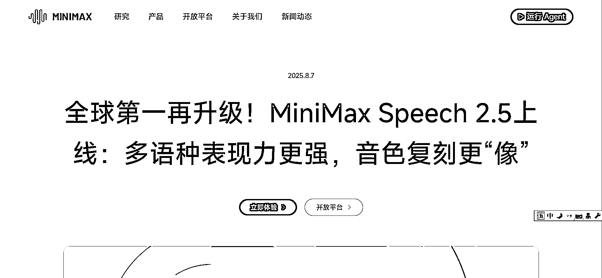 这一块直接借鉴了MiniMax，核心就是调用官方接口，照着文档调API，配音就能完成。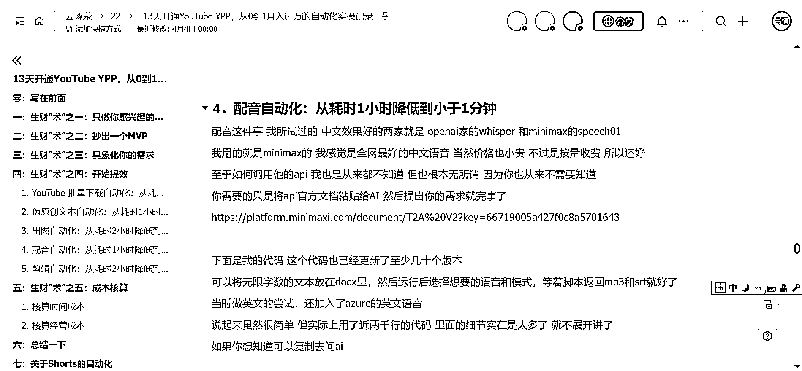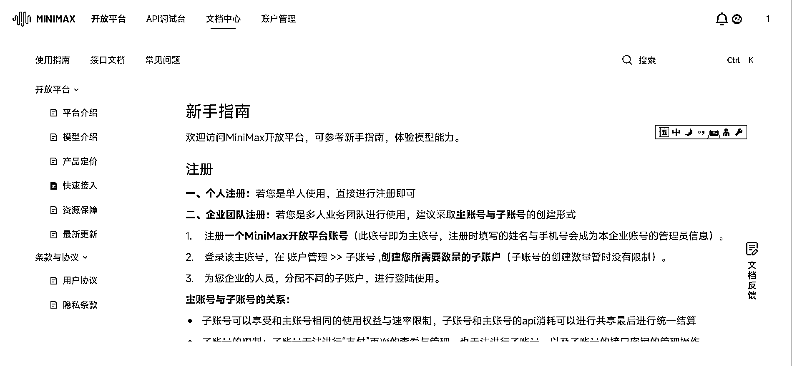

**AI图片生成器**：到 https://my.runware.ai/login 注册并充值，消耗的是API Key的费用。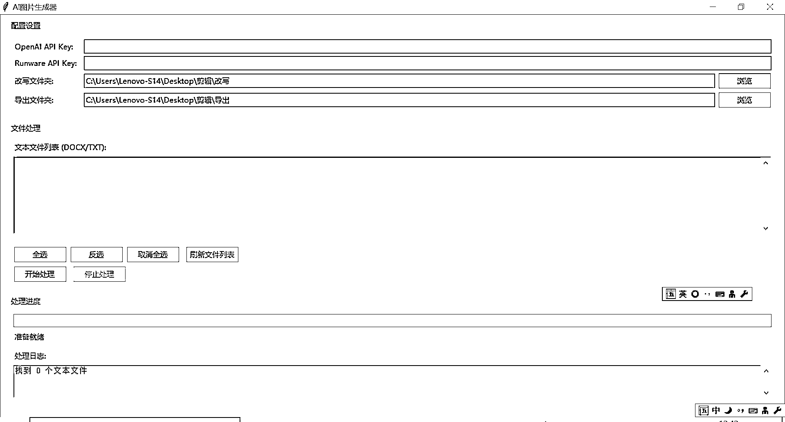 OpenAI Key的购买渠道前面已经说过。出图和配音一样，也是调用API接口就完事。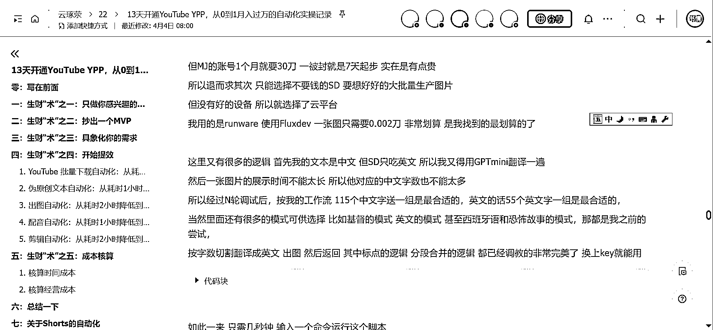

付费方面我实测过，用风向标发的那张卡可以正常支付。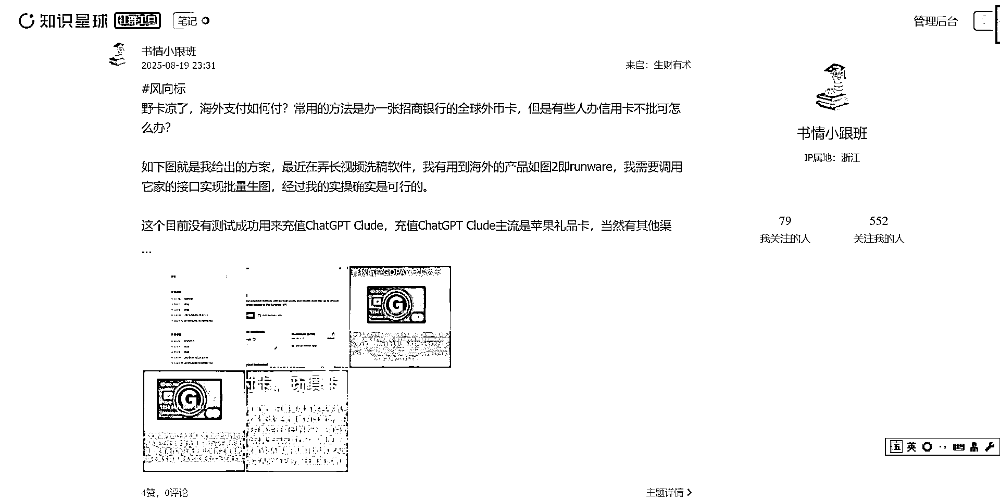

这里先给出一版示例，程序后续还会持续完善。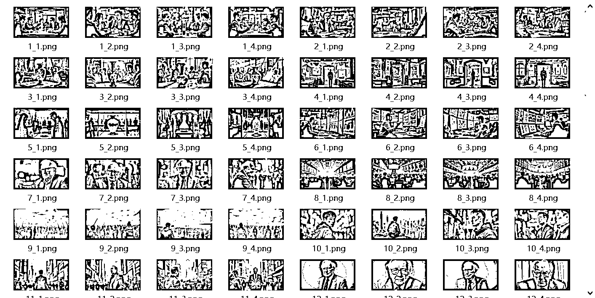

总而言之，事情一旦做出来就不难，难的是还没做出来的时候。感谢生财，再次感谢Zero的分享。最后不需要加我微信，授权码我会直接放在评论区。

生财圈友授权文档：https://rlwxa0zgke.feishu.cn/sheets/ElYUssl9dh71eCtVm2ycnR1un7g?from=from_copylink