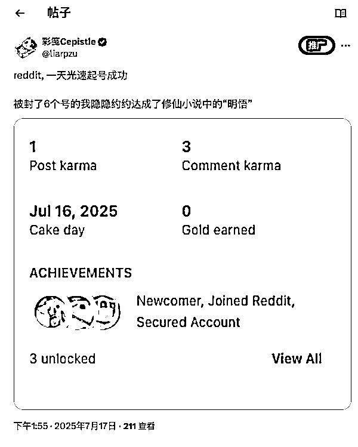

# 把 Reddit 当成一个游戏来玩，我的账号第 7 天就活下来了

> 原文：[`www.yuque.com/for_lazy/zhoubao/neet92be180zs5kp`](https://www.yuque.com/for_lazy/zhoubao/neet92be180zs5kp)

作者 彩笺，2025-08-22

**开场白：** 扛过 6 个号被封的我，这回终于摸到门道了。跟你们唠唠我最近在 Reddit 上上头到停不下来的经历。 本来想憋个大招，后来发现自己还有不少不懂的，就先抛出来了，有后续我再补。

如果只用一句话概括我在 Reddit 上怎么起号、怎么拿流量、怎么带产品，那就是：**先爱上这个社区本身**。

标题里的“玩”不是随便写写。能量都来自于好玩，你能不能把手头的事变成一件好玩的事？ 这点是小排老师给我的启发。

**这次分享会聊到：**

*   我是怎么做到注册一天就起号的
*   现在我认为靠谱的养号思路
*   Reddit 的账号分评价机制
*   适合新手混的友好区
*   我在 Reddit 上做的产品冷启动实操
*   我现在常逛、觉得上头的小众区
*   一个给你们的小礼物
*   参考清单和常见问题

## 一天起号的实拍

有图为证： 

之前我试过公众号搬运、X 平台引流、小报童付费专栏，成效都一般。养号套路也试遍了：

*   养 20 天攒徽章
*   先去 r/meme 发猫图刷 karma
*   ...

环境、设备都一样，这次新号刚建号当天，我就去一个中文区评论区逛逛，顺着热度聊几句，结果有人点赞，karma 就上来。几日后发帖阅读量也很正常。我觉得关键就一句：**用一个真用户的节奏去用**。

前几次号挂掉的时候，我太功利了，每天像打卡一样登录、划划、搜搜、攒徽章。这次能活下来，是因为我真的玩进去了。

很多板块都有隐形门槛，比如不同类型的 karma、账号注册时长、贡献质量分 CQS，还会检查你有没有验证邮箱。但绝大多数区不会公开规则，怕被薅羊毛。所以大区、敏感话题区、争议区通常限制最严。下面我会列一些新手友好区，基本不会踩雷。

## 我现在的起号打法

*   用苹果或 Google 的常规邮箱注册
*   像正常人一样逛，找你真正感兴趣、规模不算夸张的分区
*   挑时间线比较新的、你觉得能聊得起来的帖子互动，评论质量高一点，点赞来得自然
*   前 7 天，除了发帖，其他行为都保持自然用户状态
*   想发帖前先去查一下 CQS，中等以上基本没问题
*   别在任何地方刻意求赞
*   真诚，带着点敬畏心

这套方法不保证 100% 成功，但愿意交流细节，欢迎私聊补充更好的做法。

总结下来目的其实就是流量。在人家的地盘混圈子，尊重平台、尊重用户，大家自然会接纳你。

## Reddit 怎么评价一个账号

点赞扣赞决定 karma 的涨跌，之外还有贡献质量分 CQS。你可以在 [`www.reddit.com/r/WhatIsMyCQS/`](https://www.reddit.com/r/WhatIsMyCQS/) 发任意内容，机器人会自动回你当前分数。

## 新手友好分区清单

textjavascripttypescriptcsshtmlbashjsonmarkdownpythonjavaccpprubygorustphpsqlyaml

Copy

```
建议/寻求建议: r/Advice r/AmIOverreacting r/AmITheAsshole r/AskAcademico r/AskReddit r/AskTeenAdvice r/CatAdvice r/DogAdvice r/ExplainTheJoke r/NoStupidQuestions (低要求)  

爱好/兴趣: r/animeclouds r/AsianCinema r/bars_pubs_cantinas r/Circus r/CLI r/CSS r/Digital_Art r/distantsocializing (低限制) r/DnD r/DnDart r/drawin r/EuropeEats r/FavoriteCharacter r/FavoriteMedia r/FruitRevolution r/gaming r/HomeDecorating r/houseplants r/IReadABookAndAdoredIt /r/illusions /r/irl /r/IRLEasterEggs r/J_Horror r/Kirby r/language_exchange r/learntodraw r/LearnToReddit r/minimalistphotography r/multitools r/painting r/piercing r/pixelart r/Poetrywritingclub r/powerpopgirls r/PrettyLittleLiars r/readwithme r/Redditinthekitchen (低限制) r/RedditSessions (低限制) /r/SpaceNews r/StarWarsLore r/storms r/television /r/Thatsactuallyverycool r/TheGamerLounge (低限制) r/TheYouShow (低限制) r/Sims4Build r/TheSims4 r/TheTopicOfTheDay r/Thunderstorms r/TodayIlearned r/TruckStopBathroom r/Tunisian_Crochet r/Watercolor r/WaysToPBJ r/whereintheworld (低限制) r/wildart r/Windows, r/Windows10, r/Windows11, & r/WindowsHelp  
爱好/兴趣: r/animeclouds r/AsianCinema r/bars_pubs_cantinas r/Circus r/CLI r/CSS r/Digital_Art r/distantsocializing (低限制) r/DnD r/DnDart r/drawin r/EuropeEats r/FavoriteCharacter r/FavoriteMedia r/FruitRevolution r/gaming r/HomeDecorating r/houseplants r/IReadABookAndAdoredIt /r/幻觉 /r/现实生活 /r/现实生活彩蛋 r/J 恐怖 r/Kirby r/language_exchange r/learntodraw r/LearnToReddit r/minimalistphotography r/multitools r/painting r/piercing r/pixelart r/Poetrywritingclub r/powerpopgirls r/PrettyLittleLiars r/readwithme r/Redditinthekitchen (低限制) r/RedditSessions (低限制) /r/SpaceNews r/StarWarsLore r/storms r/television /r/Thatsactuallyverycool r/TheGamerLounge (低限制) r/TheYouShow (低限制) r/Sims4Build r/TheSims4 r/今日话题 r/雷雨 r/今日所学 r/卡车停靠站卫生间 r/Tunisian_Crochet r/Watercolor r/WaysToPBJ r/whereintheworld (低限制) r/wildart r/Windows, r/Windows10, r/Windows11, & r/WindowsHelp  

可爱的动物: r/AnimalsOnReddit (低限制) r/animalscrossingroads r/Awww r/CatsBeingAdorable r/catsvstechnology r/catswhocrochet r/catswithjobs r/puppies (低限制)  

寻找社区: r/FindAReddit  

趣闻/搞笑: r/confusing_perspective (低限制) r/fauxmoi r/LastThingYouBought r/MadeMeSmile r/Madlads r/me_irl r/mildlyinteresting r/mildyinteresting r/technicallythetruth r/unexpected r/WTFWish  

科技/开发者: r/BTechtards r/developersIndia (低要求) r/IndiaTech r/IndianEngineers  

其他: r/CasualConversation r/InterstellarArt r/KoalaOnesieGang r/MatchingPfps r/MiddleGenZ r/Sea r/JEE r/mht_cet  
其他: r/闲聊 r/星际艺术 r/考拉连体衣帮 r/MatchingPfps r/MiddleGenZ r/Sea r/JEE r/mht_cet  

非英语的低限制或无限制子版块  

葡萄牙语: r/brdev r/Conversas r/Gororoba r/Idiomas

```

## 冷启动是怎么做的

Reddit 对营销有一条不成文的潜规则，91 法则。内容 9 成，营销 1 成，别把用户体验搞崩。过度营销会被删帖，甚至被拉黑。我还没吃过亏，不敢作死。

账号活下来后，我能发帖了。冷启动我做的就是：相关评论区放链接引流，外加在常待的一个分区发带外链的正经帖，能带来泛流量，后续再慢慢筛选精准用户。这个操作大家应该都会。

案例参考：

[`www.reddit.com/r/aipromptprogramming/comments/1mc4f82/the_most_powerful_ai_image_generator_ive_seen/`](https://www.reddit.com/r/aipromptprogramming/comments/1mc4f82/the_most_powerful_ai_image_generator_ive_seen/)

[`www.reddit.com/r/InternetIsBeautiful/comments/1mpsvgo/i_built_a_tool_to_navigate_the_emerging_subreddit/`](https://www.reddit.com/r/InternetIsBeautiful/comments/1mpsvgo/i_built_a_tool_to_navigate_the_emerging_subreddit/)

目前就这两个营销帖，真诚分享。

我还在测试其他节奏，比如：

*   什么时间点发帖转化更好
*   哪些区可以真诚做调研：我有个想法想做点什么，大家怎么看？

数据需要发酵，不急。

## 我最近沉迷的分区

*   [`www.reddit.com/r/SideProject/`](https://www.reddit.com/r/SideProject/)
*   [`www.reddit.com/r/InternetIsBeautiful/`](https://www.reddit.com/r/InternetIsBeautiful/)
*   [`www.reddit.com/r/BenignExistence/`](https://www.reddit.com/r/BenignExistence/)
*   [`www.reddit.com/r/beermoney/`](https://www.reddit.com/r/beermoney/) 海外副业风向标，第一手情报源，颇有亦仁的味。

## 给你们的小礼物

我建了一个新区 [`www.reddit.com/r/ProductStudy/`](https://www.reddit.com/r/ProductStudy/)，面向想学做产品、做增长的人。

这里会分享：
• 产品研究与竞品分析
• 增长打法：SEO、ASO、渠道投放
• 用 AI 做产品研发与研究
• 创作者、独立开发者的案例、工具与方法论

新手老手都能来交流，互相学习。

社区刚起步，我会先发几篇种子内容，欢迎大家在下面**友好真诚地评论**，一起给彼此的号做冷启动。

**小工具赠送**

想看近期新开、人数涨得快的 sub 可以看： <[`reddflow.com/new-and-`](https://reddflow.com/new-and-) hot-subreddits>

每个区的 rules 都藏在下拉菜单里，我英语也看不全，就做了个查规则的小工具：

输入 subreddit 名字就能拉出全部 rules，配合你自己的翻译插件直接看。

:[`reddflow.com/subreddit-rules`](https://reddflow.com/subreddit-rules)

## 参考与常见问题

### 怎么练手发帖
[`www.reddit.com/r/LearnToReddit/`](https://www.reddit.com/r/LearnToReddit/)

### 新号去哪评论发帖
[`www.reddit.com/r/NewToReddit/wiki/index/newusersubs/`](https://www.reddit.com/r/NewToReddit/wiki/index/newusersubs/)

### 怎么判断帖子还在不在
看 New 时间线，或退出登录后查看。

### 求 karma 的收益不算入个人 karma

### 怎么检查是否被封
打开 [`www.reddit.com/appeals`](https://www.reddit.com/appeals)，没被封或影子封，你会看到顶部红色提示“您无法提交申诉”。

### 什么是影子 ban
[`www.reddit.com/r/NewToReddit/wiki/index/`](https://www.reddit.com/r/NewToReddit/wiki/index/)

### 新手友好合集
[`www.reddit.com/user/solariahues/m/newuser_friendly_subs/`](https://www.reddit.com/user/solariahues/m/newuser_friendly_subs/)
[`www.reddit.com/r/LearnToReddit/wiki/index/`](https://www.reddit.com/r/LearnToReddit/wiki/index/) 在 r/LearnToReddit 能做什么？

最后说句实话，Reddit 真的好玩。你们有什么觉得上头的小区、好玩的玩法、更狠的冷启动技巧，告诉我，我真的很饥渴。

**顺便问下，你们在 Reddit 上最想要什么功能或服务？评论区说说，说不定就是我的下一个产品方向。**

* * *

评论区：
谭铁铁 : 刚好不知道 reddit 怎么玩，学习了，感谢分享。
一生荣禄 : 教练出品，必属精品。感谢分享，已加收藏。
向上的塔皮 : 最近也在玩 Reddit，目前只敢发发评论，先熟悉熟悉 [呲牙]
刘小排 : 国内做 reddit 的 IP/产品/课程 一体化