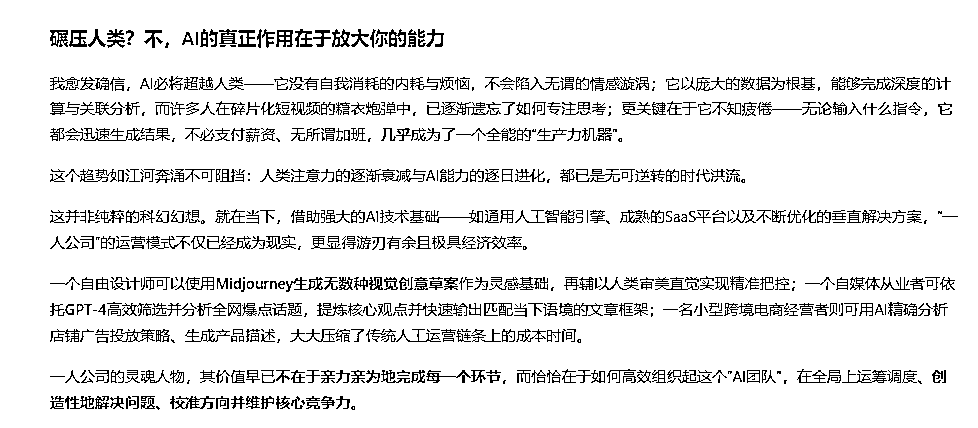

# (58 赞)借力 Ai，可以生产无数的内容（手把手教）

**别再为写什么发愁了！我用AI把3句聊天记录变成了一篇👸号文章，全程不到10分钟**

你是不是也常对着电脑发呆，半天憋不出一段文字？别急，今天我把一个刚实操过的方法分享出来，保证你看完就能用。

早上我在“航海家”社群里逛，无意间看到一段对话记录，不长，就三句话，但信息量还挺足。我灵机一动，把这个对话扔给了AI。

第一件事：让AI帮我把这段对话生成朋友圈文案。你猜怎么着？它几秒钟就交出成品，像模像样。

第二件事：我又把这条朋友圈文案原样转发给AI，请它扩写成一篇完整的文章。AI马上给出了初稿。

喏，这就是AI直接吐出来的内容：

说实话，初稿虽然结构完整，但“AI味”重得不行——一板一眼，缺少人味儿。于是我接着下指令，让它把文字改得口语化、有温度，像真人说话一样。AI倒也听话，重新来了一版。

改好之后，我把文字复制到👸号后台，一键配上图，一篇文章就这么轻松搞定了。

整个过程花了多久？也就十分钟上下吧！

更妙的是，这篇文章还能继续“一鱼多吃”：改成短视频口播脚本、变成📕图文、写成社群分享稿……一个题材能翻出无数种花样。

所以，你还担心没有内容更新吗？只要思路打开，AI就是你的内容弹药库，👸号推文多到发不完，根本发不完——哦不，是永远都发不完。