# (40 赞)用 cursor 开发了我的第一个微信小程序

被技术门槛劝退多年，我终于用Cursor做出了第一个微信小程序

以前一提到微信小程序，我脑子里跳出来的大多是一个词：劝退。要学的东西太多、门槛太高，所以一直没敢动手。但今年靠着AI，这事居然真让我做成了。最近好些圈友问我：小程序到底怎么做？怎么上架？Cursor该怎么用？干脆把自己的过程和经验整理一篇，顺便把踩过的坑也列出来。

一、让Cursor当我的主力开发工程师

装好Cursor之后，我先用了从赚钱学到的一个技巧：在项目代码目录里放一个 `.cursorrules` 文件，相当于提前给AI设定角色和工作规范。我在里面写清楚，它是一位非常擅长微信小程序开发的资深工程师，要遵循干净代码、健壮架构等原则。

具体来说，包括这些方面：

- 项目初始化时先读README，没有就主动创建，并记录功能模块、页面结构、数据流、依赖库；
- 理解需求时要站在用户角度，主动找缺漏，选择最简单的方案，避免过度设计；
- UI要符合微信小程序设计规范，可以用WeUI或自定义组件，并保证响应式；
- 技术栈要按需选择：原生框架、云开发或本地存储、wx.request或云函数等；
- 代码结构要模块化，WXML和WXSS分离，逻辑用JavaScript或TypeScript；
- 安全上要校验用户输入、防XSS，走HTTPS，敏感逻辑放云函数；
- 性能上要做分包加载、图片懒加载、缓存机制，别在onLoad和onShow里做耗时操作；
- 测试和文档方面，要写单元测试、中文注释和文档，方便后续维护；
- 解决问题时要通读相关代码、分析原因，并保持最小改动；
- 迭代中要和用户保持沟通，主动问清不确定的需求，并及时更新README；
- 思考方式上，要用系统2思维拆解问题，用思维树比较多种方案，再做迭代优化。

有了这份“说明书”，我并没有急着让它直接开写。而是先去GPT或Claude这类AI工具里聊一圈，把小程序的功能模块（MVP）梳理清楚。然后拿着这份MVP去问Cursor：“我想做一个小程序，功能模块设计如下……请按这个设计帮我写前端代码，并把文件建好。” 全程用大白话沟通就行，它基本都能听懂。

另外，微信小程序有云开发和前后端分离两条路线，我选的是后者。前端让Cursor帮我生成原生小程序代码，后端我告诉它“我想用C#语言写”，它就单独把后端也写好了。说实话，把Cursor当成一个能无限聊的朋友，多来回几轮，差不多80%想要的代码都能拿到。

二、注册和调试：几个绕不开的步骤

做小程序首先得注册账号。去微信公众平台完成小程序注册即可。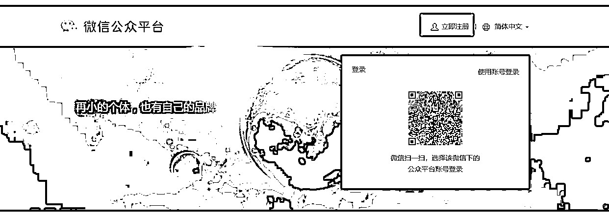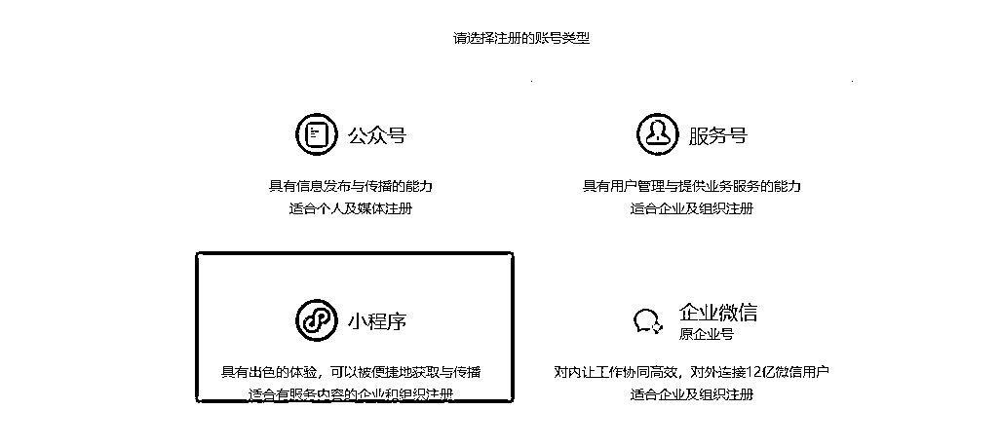 注册成功后，记得把各类资料都补完整。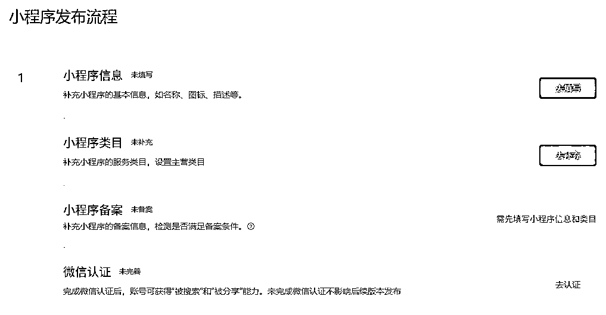 在“开发管理”里可以拿到小程序的AppID，这个稍后在微信开发者工具里要填。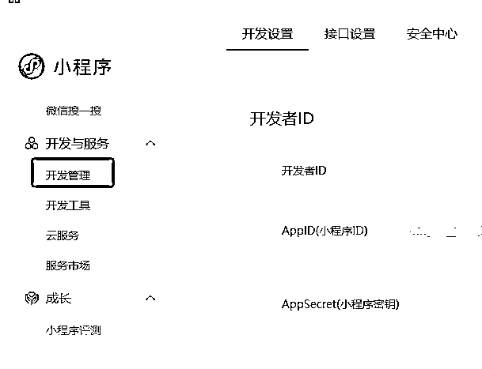

接着下载微信开发者工具。新建项目时，选择刚注册好的AppID，并把代码目录指向Cursor生成的那个文件夹；如果之后想改，也可以进“详情”里调整。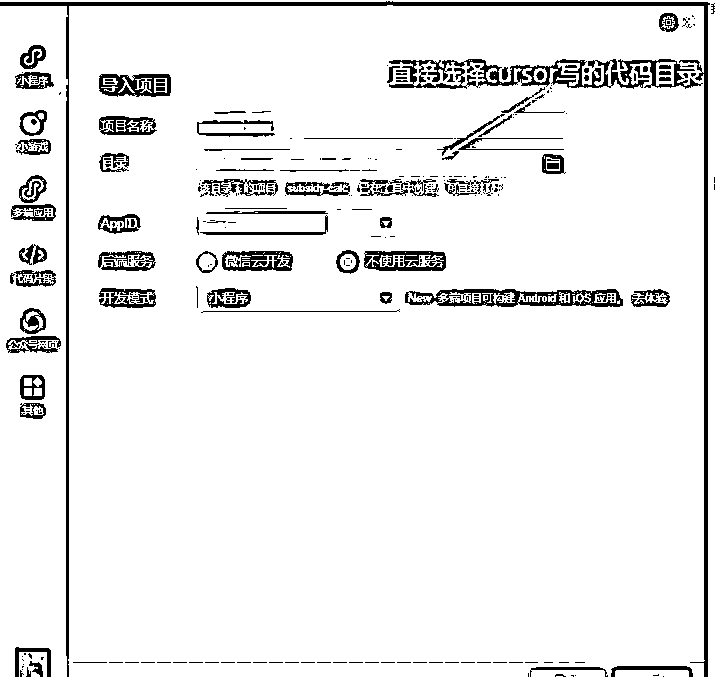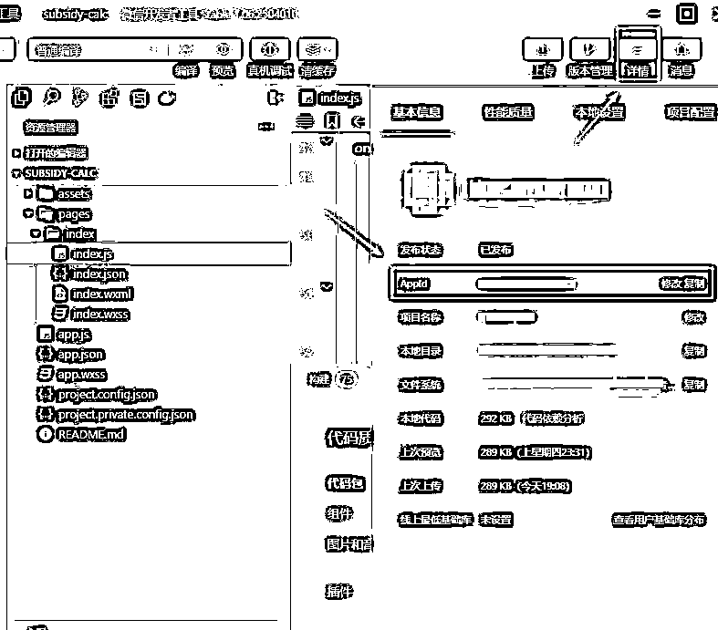

如果你的小程序和我一样要调后端接口，这里有一个容易卡人的大坑：调试阶段必须到“详情-本地设置”里，勾选“不校验合法域名、web-view（业务域名）、TLS版本以及HTTPS证书”，否则接口根本调不通。我第一次用这个开发工具时，就卡在这里很久才反应过来。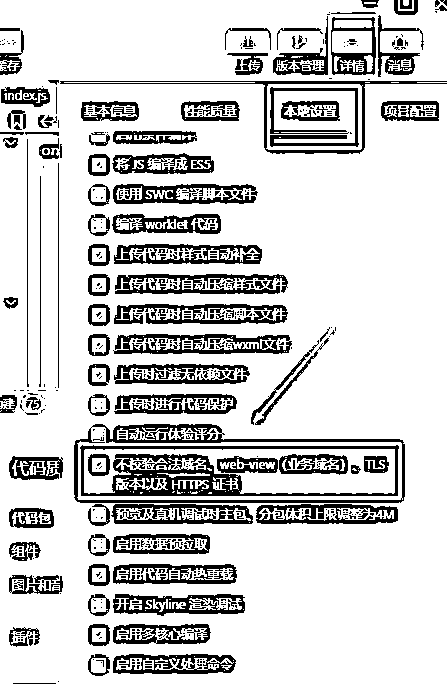

三、发布上线：怎么能让更多人搜到

由于小程序平台限制了网络请求，只要走后端接口，就必须要用HTTPS。所以还要登录小程序后台，在“开发管理”里把服务器域名配置好。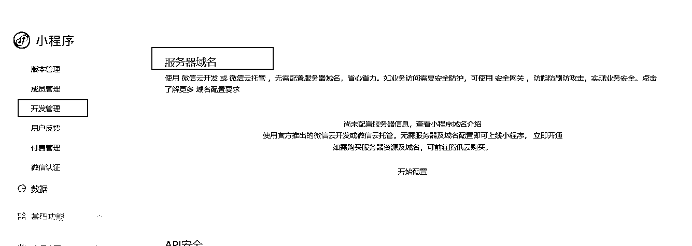

正式发布前，先用真机完整调试一遍，确认没问题后就可以上传代码。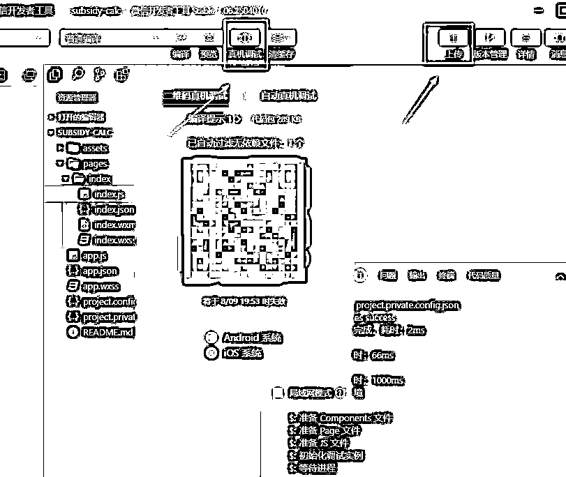 上传完成后，可以把版本设为体验版，拉几个朋友先帮你测一测。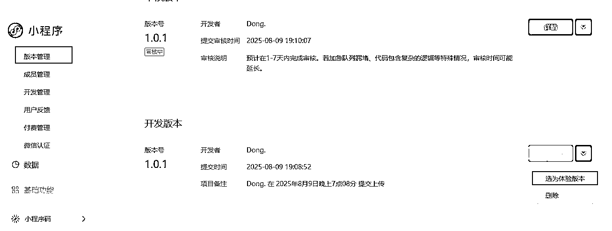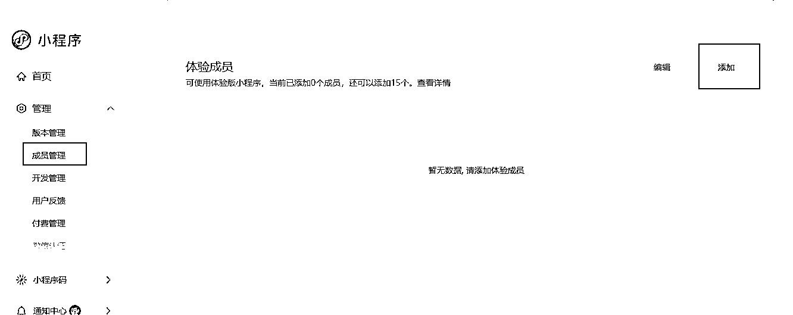

体验版验证通过，再提交官方审核。审核通过后点击发布，小程序就正式上线了。这里提醒一句：上线后通常要等1到3个工作日，才可能在微信搜一搜里搜到你的小程序名称。如果一直搜不到，先自查一下是否已经完成认证、备案，以及“允许被搜索”的开关是否打开。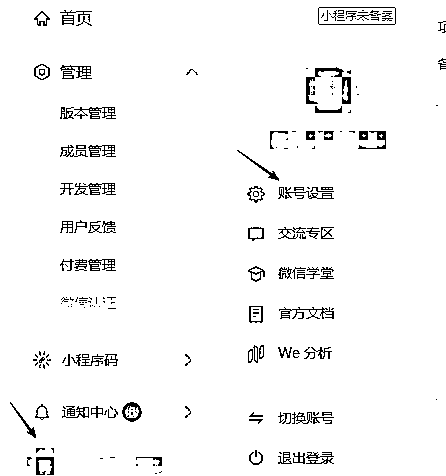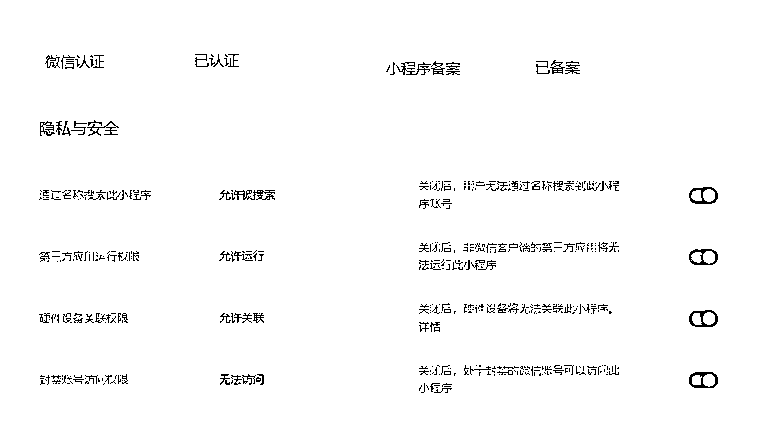

如果这些设置都没问题还是搜不到，可以去微信开放社区发帖求助，一般会有微信助手帮你处理。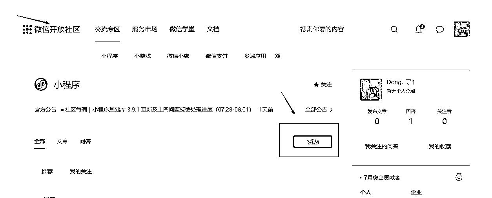

最后顺带回应一个圈友的问题：我的方案需要买服务器和域名，但不需要买云主机。这次做出来的成品叫“小红红一键去水印”，也算是我交付的第一份作业。以上只是个人操作经验，未必适用所有人，纯作参考，谢谢。