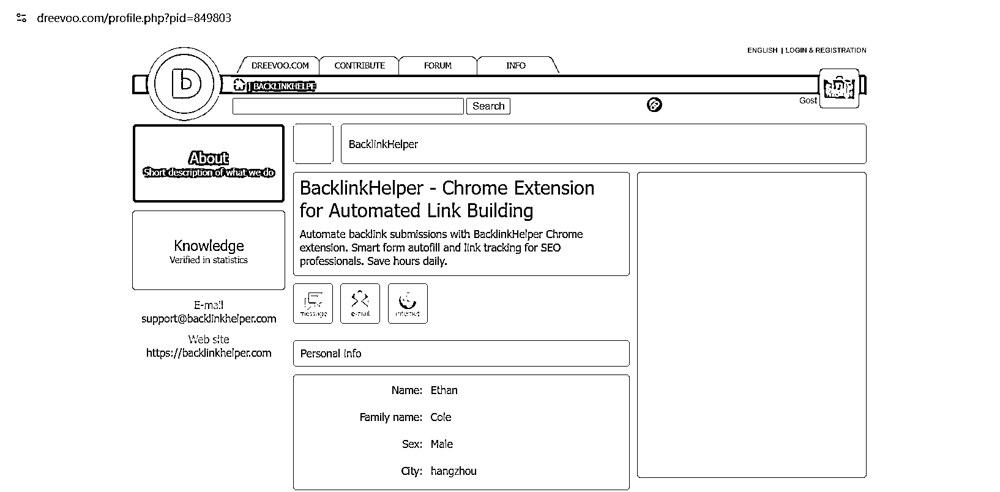
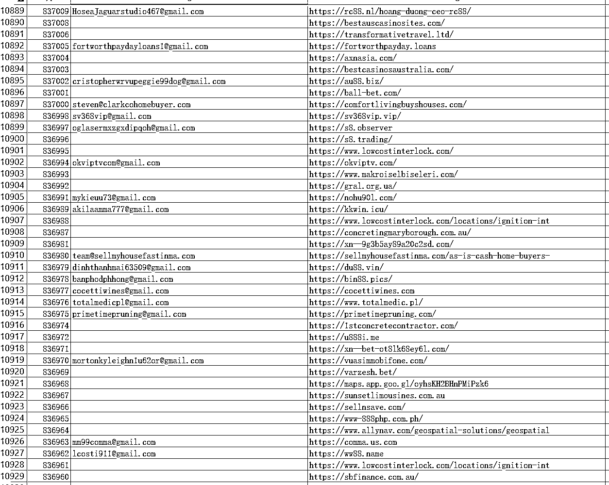
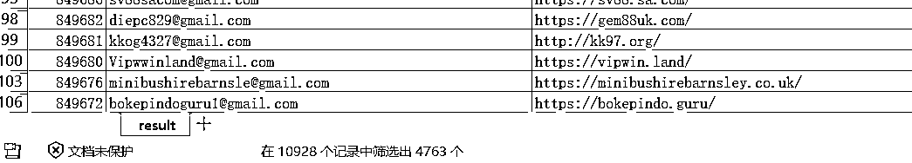

# (30 赞) 一次偶遇加十分钟脚本，我撬动了一个精准客户邮箱池

## 一场偶然的发现，让我用脚本拿到了上万潜在客户的联系方式

大家好，我是龙哥。分享一个很实操的经历：就花了不到十分钟写脚本，就把一批高度匹配我产品的潜在用户邮箱给批量收集起来了。

起因是我在推自己刚做的 Chrome 插件——智能外链提交助手。插件的核心场景就是帮新站快速做外链提交，提升收录效率。在每天大量提交的过程中，我顺手逛到一个工具站：

这个站的机制很有意思，个人主页是可以公开邮箱的，而且ID是顺序自增的。也就是说 URL 里把 pid 数字换一换，就能看到不同用户的主页。理论上只要跑一个循环就能把全站的用户信息全部扫一遍。

更关键的是，站内的用户画像和我的插件目标用户几乎完全重合。站长、SEO从业者、外链建设者，全都是我的精准人群。这不就是一座裸露在外的客户金矿吗？

我当下就开了 “vibe coding” 模式。没开 VS Code、没调 Cursor、更没搬出 Claude Code，就直接在 ChatGPT 里说需求，让它给我出一段能跑的爬虫。

我当时给的指令是：

帮我写个 python 脚本，[`dreevoo.com/profile.php?pid={id}`](https://dreevoo.com/profile.php?pid={id}) 读取这个 URL 地址，获取内容中的邮箱： 和 网站地址：，其中 id 从 1 遍历到 849803，输出结果到 csv 文件

它很快就返回了第一版代码，核心逻辑是 requests 拉取页面，BeautifulSoup 解析，抓取 mailto 链接里的邮箱和第一个 http 链接作为网站，写入 CSV，中间还加了 0.3 秒的休眠防封。

跑了一下才发现，正序从 1 开始有很多空号和僵尸账号，效率很低。于是我让模型改成倒序，从最新的活跃用户开始抓：

帮我把代码改成降序遍历

改完后脚本改用 HTTP 访问规避 SSL 问题，遍历范围从 849803 往 1 倒着走。部署到云服务器上挂着跑，大概 5 个小时左右就已经收获了一万多条原始记录：

当然原始记录里不全是有效邮箱，粗略在 Excel 里过滤一下，就筛出了 4763 个真实可用的地址：

当时任务进度才走到 ID=836960，剩下的 83 万条还没跑完。按这个趋势跑完，轻松就能破万。

这次小实验给我三点很实在的感受：

1. 日常工作里的一个小细节，往往藏着意想不到的机会。ID自增这种“设计疏忽”，对我就是精准获客的入口。
2. 别等完美方案，动手十几分钟就能验证。想法落地越快，回报越早。
3. 工具用对了就是杠杆。ChatGPT 这种生成式助手，写这种标准化脚本几乎是秒出。

等整批数据收完，我手上就会有一份非常干净的精准客户清单，对我插件的冷启动推广来说，直接就是加速器。

最后顺手推荐一下我的产品，如果你也在做 SEO、外链建设，可以试试我做的 Chrome 扩展：[`backlinkhelper.com`](https://backlinkhelper.com)。它能自动识别外链提交表单、智能填充信息、管理外链任务，能把重复劳动的效率拉高好几倍。