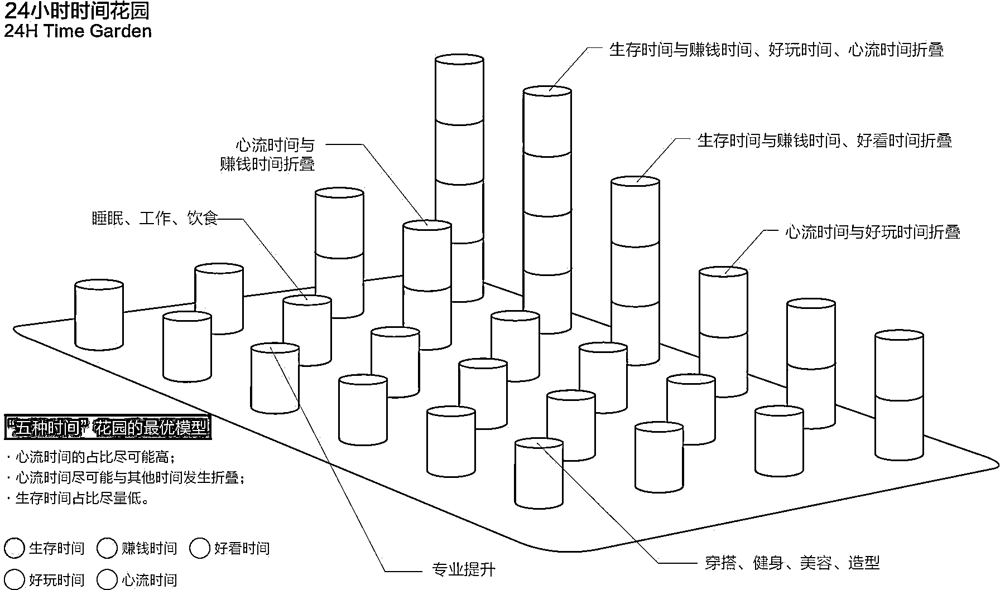

# (31 赞)3 天，20 万字对话，我把自己“扒光”喂给 AI 生成了一份 6 万字的个人剖析报告

3天聊了20万字，他让AI给自己做了一份6万字的“个人使用说明书”

这可能是你今年看过最“狠”的自我剖析方式：
不找咨询师、不套模板、不花冤枉钱，只靠AI——3天，20万字的深度对话，反复精简修改后，硬生生“扒”出一份6万字的自我剖析报告，外加一份专门为“发展报告”准备的避坑注意事项。

别误会，这绝不是什么花哨的性格测试。作者鸭先知说，他真正拿到的，是一套只属于自己的、可落地执行的人生操作系统。从学习方法到商业模式，全部重新梳理了一遍。

整件事最精彩的地方，是这两个核心打法：

🔹 战略上的“见路不走”
他拒绝了所有看起来安全又现成的路径，反手让AI为自己量身定制了一个“一个人公司”的商业模式——反脆弱，不依赖平台，不依赖组织。

🔹 效率上的“时间折叠”
从“一边学习一边变现”，到同一份成果被反复使用六次——“一鱼六吃”。听起来像魔术，其实是方法论在起作用。

这篇长文，就是这次自我认知重塑的全程实录。作者会毫无保留地拆解全过程：如何从20万字的对话里，提炼出真正适合自己的发展路径，而不是复制别人的答案。你还会学到三件事：
1. 怎么选对大模型？
2. 怎么让它像私人教练一样逼你思考？
3. 怎么找到那条地图上不存在的路？

文章已经有不少人抢先收藏，评论区有人说：“先收藏，这周我也做一份。”——也许，你离重新认识自己，只差一次这样的深度对话。
