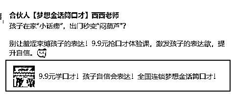

# 本地👸号真正赚钱的秘诀：一篇“销售信”吃到底，8个引流打法+7个转化心法，纯实操

如果你做本地👸号，每天盯着阅读量焦虑，我劝你先换个思路。

我见过太多号主，文章篇篇阅读过万，却赚不到什么钱；也见过有人一篇只有7000多阅读，却默默收了几十万。

差别在哪？不在流量，而在有没有把“变现文章”这把刀磨快。

我自己不擅长搞流量，但我擅长把有限的流量变成钱。这些年帮上百个客户做过👸号变现，不整虚头巴脑的玄学，全是能落地的土办法。

前阵子我顺手拉了个十来人的“👸号搭子”小群，从几位大佬身上挖了不少提升流量的路子，有的听起来还真挺玄学。但今天要讲的，全是我验证过、客户跑通了的实操。

**第一步，先别急着追爆款，你要用心写一篇“销售信”——卖一个让用户觉得不买就亏的前端引流品。**

举个例子，你感受一下。

红色框里那篇文章，是我当时硬压着一个合伙人写出来的。她做少儿口才培训，卖的是“9.9元上门体验1次”的引流课。这文章是两年前的4月发的，到现在就靠这一篇，给她带来了超过50万的收益。

听着像吹牛？她靠这篇文章招了200多个体验生，转化了100多个正价班学员，年费5000多块；后面还有1.88万/年的高价产品，也是我陪她一点点打磨的。你拿手机算算账就明白了。

关键点是什么？这篇文章阅读量才7000多，根本算不上爆款，但就是能持续赚钱。

所以，别总盼着篇篇10万+。把一篇好文章的价值榨干，比赌爆款靠谱多了。

具体怎么操作？下面8个方法，都是客户验证过的。

**方法一：朋友圈定点“出摊”，雷打不动。**

每天挑两个固定时间，把这篇文章往朋友圈发1-2次，别嫌烦。

口才那个合伙人就是这么干的：早上7点半发一次，正好是家长送娃上学刷手机的时间；晚上8点再发一次，家长刚忙完家务坐下来。她说每天都有人从朋友圈刷到这篇文章来报名，最多的时候一天能报5-10个。

真正有需求的人不会烦你，反而觉得你靠谱，就像小区门口天天准时出摊的包子铺，大家想买的时候知道去哪儿找。

但有个前提：文章得下功夫写，至少打磨一个礼拜，把产品好处说透，把用户顾虑打消。文章本身稀烂，天天发也没人理。

**方法二：用300篇文章给主文章“引路”。**

我有个做美术培训的客户，把这套玩得比口才合伙人还狠。她先精心打磨好那篇变现文，然后每天保持日更：写孩子案例、写学习前后对比、写有趣的小故事。不管写什么，每篇文章的开头和结尾都挂上变现文的超链接，比如“想知道孩子怎么变专注的？点这里看”。

每天写一篇，300篇堆下来，就相当于多出300个入口。哪怕每篇只有几十个流量，累积起来也相当吓人。她那300篇文章，硬生生给主文章导了2万多流量，最后成交300多个体验课学员。

更绝的是，她写孩子故事和前后对比，家长看了忍不住转发到朋友圈、小群里“晒娃”，又带来一波新的免费流量。这就好比你在三百个路口都放了指路牌，客人想不找到你都难。

**方法三：用500个人帮你“带路”。**

还有个做练字+美术的客户，她们那边少儿培训机构卷得要命，天天要出去地推。以前老师逮着家长就问“9.9元练字课报不报”，被拒绝到怀疑人生，老师也总离职，她自己内耗到不行。

后来我让她换了个思路：地推时不带课程宣传单，改带卡通贴纸、手抄报模板，还有《儿童练字姓名贴》打印版。跟家长说：“把这篇文章转发到本地宝妈群或朋友圈，这些免费领。”

家长一看，转发就能领点实用的东西，没啥负担，自然愿意配合。她每天下午带3个老师出去，一个老师一天能转2-3次，加起来就是6-9次，一个月能攒200多次转发。

一年下来，这篇文章给招了300多个学员，转化了120个正价学员，学费4800一年。这比硬推课强太多了，核心其实就是借老客户做转介绍。

**方法四：多写带“钩子”的裂变文章。**

除了那篇主力变现文，你还可以准备10-20篇带明确钩子的文章，让人忍不住主动转发。

比如我一个做幼小衔接的客户，写了篇《2024年XX市幼小衔接政策解读，附50套名校入学测试题》，内容全是干货，文末放了个钩子：“想要全套测试题？把文章转发到本地宝妈群或朋友圈，凭截图进群领取。”

真需要资料的家长，当然愿意转发。这个群后来进了500多人，全是精准学前家长。她每天在群里分享育儿知识，偶尔提一提自己的幼小衔接班，最后招了180多个学员。这就是裂变的力量。

不过要记住：第一波一定得撬动私域。先让朋友、老客户帮忙转发，把火点起来，后面才能滚雪球。100个老家长里能有40个愿意转，已经很了不起了。

故事型、人设感强的文章也一样，非常容易裂变，但前提还是先用私域点火。

**方法五：菜单栏和自动回复别浪费。**

把主文章放在👸号菜单栏最显眼的位置，名字可以直接叫“免费领”或“孩子练字”。用户一进来就能看到，想了解就点进去。

自动回复也别闲着：用户关注后，自动弹出主文章链接，再来一句：“新朋友点这里，看看怎么让4-8岁的孩子变XXX，错过了想改就难了。”

这两个位置是24小时营业的入口，很多人忽略了，其实就像饭店菜单上的第一道招牌菜，最容易被人点到。

**方法六：社群“软植入”。**

我让所有客户都想法子混进精准的家长社群，什么幼小衔接群、亲子徒步群都行。进群别急着丢广告，先聊聊天，分享一些有用的信息，等大家都觉得你靠谱了，再偶尔软植入那篇文章。

比如在宝妈群里用小号问：“暑假想给孩子报兴趣班，选哪个好？” 你就接话：“我之前写了篇文章，分析了好几种兴趣班的优缺点，还有很多家长的真实反馈，我发给你看看。”这样发，没人反感，反而觉得你在帮忙。

我有个做约读书房儿童阅读的客户，加了200多个本地宝妈群，每天分享绘本技巧、书单，有人问就顺势发文章。就靠这招，每个月能多招一二十个体验生。注意别在一个群里发太勤，容易被踢，多搞几个群轮着来。

**方法七：本地号互推。**

👸号互推是老玩法，但到今天依然有用。可以在社群互推、朋友圈互推、👸号互推。

在本地找定位相似、粉丝量级差不多的号主，互相推荐对方的文章。你推我的优质内容，我推你的变现文章，双方都能拿到新流量。就像两个小店老板互相吆喝，客人互串，双赢。

但找互推对象别只看粉丝量，要看粉丝质量。你卖儿童美术课，找个推老年保健品的号互推，那是白费力气。

**方法八：换标题、改开头，重新发。**

很多时候，文章本身没问题，问题出在标题不够扎眼。多准备几个标题，换着花样发。

书法班合伙人原来标题是“少儿书法体验课，9.9元抢”，效果一般。改成“6岁孩子学书法3节课，就能写自己名字，你信吗？”，报名的人立刻多了一截。

如果某篇文章转化率本身不错，那就天天换标题和第一段，内容稍微改改继续发。就像卖西瓜，“甜掉牙不甜不要钱”和“刚摘的新鲜瓜便宜卖”，吸引的是不同的买主。

---

方法讲完，很多人肯定会问：那怎么把转化率提上去？

答案是：严格按销售信的五步方程式来写，也就是AITDA模型——吸引注意力（Attention）、激发兴趣（Interest）、建立信任（Trust）、刺激欲望（Desire）、促成行动（Action）。你把这五个步骤拆开，一步一步往里填内容就行。

再送你7个提升转化的小技巧：

**1. 标题要抓眼球。** 7月杭州航海家大会上，程奕人亲口说：花2小时打磨一个标题，花20分钟想内容就行。标题的重要性，不用我多说了吧。

**2. 开头要戳痛点。** 别绕弯子，直接点。比如卖美术课，开头写：“你是不是试过各种办法，孩子还是坐不住5分钟？作业写不完，累到你只想打人……其实真不是孩子天生好动，是你的方法错了。”用户一看，这不就是在说我吗？

**3. 多讲故事，少讲道理。** 没人爱听干巴巴的说教。多讲成功案例、讲自己经历。别喊“我们课程好”，要说“有个二年级孩子，练了3个月字，字从鸡爪刨的变成了班主任传阅的范文”。

**4. 价值要讲透。** 让家长明白，买了体验课到底能得到什么。表面好处要讲，深层好处更要讲。比如少儿英语，表面好处是“成绩提高”，深层好处是“能读英文原著、和世界接轨”。

**5. 信任要做足。** 资质证书、客户评价、对比图、视频，能放都放。美术课放孩子前后对比照、家长表扬视频、获奖照片，说服力一下子就上来了。

**6. 行动指令要明确。** 文末直接告诉家长该干嘛：“点下面链接报名”“扫码加🛰️咨询”“现在报名前10名送XX”。尤其是低价产品，指令越简单直接，下单越不含糊。

**7. 限时优惠促单。** 人都有怕吃亏的心理。搞点“今天报名立减100，明天恢复原价”“仅限前20名送99元礼包”之类的紧迫感，犹豫的人就痛快下手了。

---

最后总结一句话：

如果你写不出10万+爆文，别死磕。爆文太赌运气，不确定性太大，可能写一百篇也爆不了一篇，白白搭上时间和精力。

不如踏踏实实打磨一篇高转化“销售文”，把它的价值榨干，让它替你赚回10万块。

这就是我一直在用的变现逻辑，所以我不为流量焦虑。

这套打法不局限于教培行业，你换成任何行当都适用。我以后想做的“一人公司”，也打算这么干。