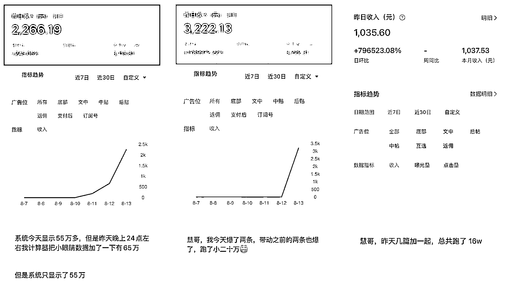
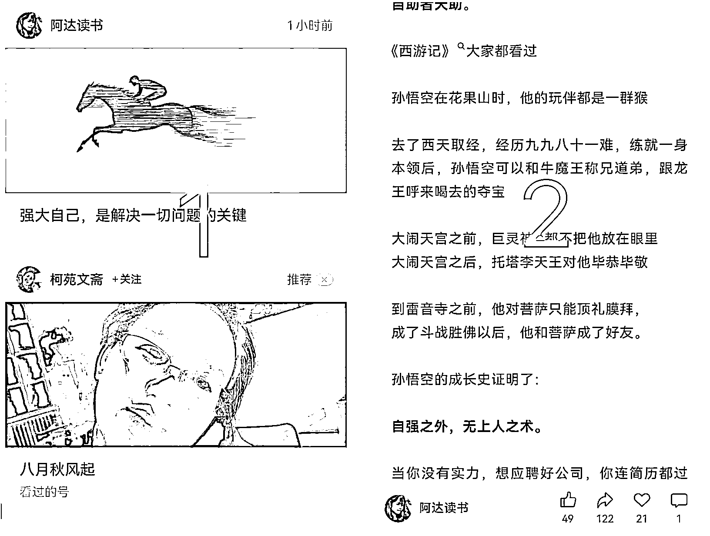
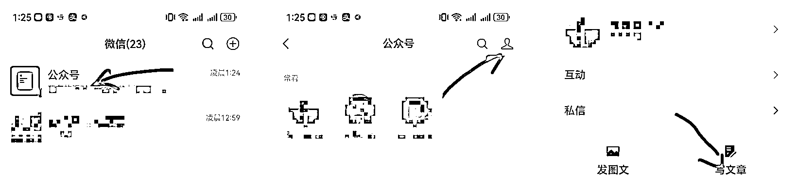

# (精华帖)(262 赞)做了 100 个垂直小号得到的经验：踩在风口，一周内新人也能 10w+,日入 1000

上个月龙哥抛出了“垂直小号”这个超级信号，我当时正好在深耕公众号赛道，看到机会第一反应是兴奋，第二反应却是茫然——我能写什么垂直内容？数了一圈，好像没什么拿得出手的特长。

但我这人比较轴，既然不知道写什么，那就拿 100 个号挨个试。文学、体育、情感、民生、职场……各种方向全铺开，哪个跑出来算哪个。结果，数据真的让我惊到了。

为了控制变量，这 100 个号全部是新注册的，注册、实名、刷粉、开通流量主、发文章，一天内全部搞定。下图是其中 14 号当天收益不错的几个账号。

为什么新号能在这么短时间内出爆文、拿到可观的收入？今天下午我在传术师俱乐部群里聊起这个话题，发现很多人对公众号推荐机制和写作方向的理解还停留在旧时代。我把聊的内容整理一下，讲透这件事。

**1、推荐机制彻底变了**

每次互联网平台的规则变动，都会砸出新机会。抖音的小黄车、知乎好物、昨天刚发布的深海圈-B站好物带货，全是这么来的。变动不可怕，真正可怕的是规则固化、阶层锁死。

如果不是公众号推荐机制变了，我绝对不会碰这个平台。我一个零粉小号，放到以前的体系下，面对几十万粉、几百万粉的大号，连口汤都喝不上。

现在不一样了。公众号的推荐逻辑从“粉丝订阅”转成了“内容分发”。以前你想有阅读，必须先涨粉。新人涨粉只能求爷爷告奶奶找人转发，好不容易攒几十个粉，发一篇个位数阅读，再发一篇还是个位数阅读，热情直接凉透。

那时候大家形成了两个铁律：**要涨粉，要垂直。**
涨粉才有阅读，垂直才能讨好粉丝，粉丝才会转发，你才有更多阅读。这套逻辑在粉丝时代没毛病。

但 23 年左右，这套玩法开始松动。字节系用实际成绩证明了：把内容扔进公域流量池，比死死推给粉丝更高效。腾讯被倒逼着转型，公众号从只推粉丝的类私域模式，变成了直接把内容扔进公域池子的模式。就算你是 0 粉，也能在公域池子里捞到阅读量。

接下来就是赛马机制：内容互动数据好，系统就一级级加推，几千、几万、几十万地给流量。这也是为什么很多大号干不过小号。大号还在拼命讨好老粉丝，内容对路人天然不友好；小号光脚不怕穿鞋的，想怎么写就怎么写，直接进公域池子捞几亿人的流量，比那几十万粉丝的池子大多了。

再说“垂直”。大家以前理解的垂直是内容垂直：写育儿就一直写育儿，写体育就不能换别的。因为粉丝模式下，粉丝就是因为你的内容关注你的，你一换内容他们就不看了。账号就是最小的标签颗粒度。

公域流量机制下，颗粒度从账号变成了单篇文章。内容垂直可以放宽到人物垂直。看育儿的宝妈也会看美食、看穿搭，这时候一个账号，完全可以多样化尝试。

**2、“吃到流量”靠什么**

机制变了，玩法就得跟着变。粉丝时代大家最看重转发，因为转发才能裂变。所以以前的内容总爱求关注、求转发——说白了，让用户帮你做数据。可用户又不是工具人，你让他转他就转？那不如直接留银行卡号让他打钱更省事。

推荐模式下，文章好不好不再由粉丝投票决定。你把内容扔进公域池，系统没法判断“内容好坏”这种主观的东西，它只能看参数化的客观数据。

这些数据怎么来？就是你扔进池子后，用户在你文章上的行为反馈。

内容会出现在公众号栏目里，用户第一眼看到的是封面图+标题。这一关，靠的就是视觉冲击力和标题钩子。点击率高了，第一步就赢了。所以现在标题宁可稍微“标题党”一点，也不能随便起。

用户点进来之后，考核的数据就多了：完播率、点赞、转发、在看、评论……这些互动行为都会被系统记录，组成一套客观的评判标准。把这些数据做上去，你就在赛马中胜出了，离爆文只差临门一脚。

怎么做好这些数据？文章能短就别长，长文完播率天然吃亏；能用小技巧挑起争论，就别写那种不得罪人的温吞话。写点有争议的内容，让评论区热闹起来，反而更容易跑出来。

啰嗦这么多，核心其实就一句话：**推荐机制变了，那些在旧时代积累的“经验”反而会成为负担。越努力，可能离成功越远。现在要让自己像个小白一样，从零开始感受公众号的新规则，重新规划内容方向。**

**3、隐藏的发布入口**

推荐机制改变只是利好的一半。微信为了让大家更好地用上新机制，直接在微信端开了一个公众号发布入口。这个入口藏着巨大的流量——我实测过，单篇文章封顶能到 5w+ 阅读。当然不是随便发什么都有，内容还是得过赛马。

这个入口有点像“新人大礼包”：从新功能入口写，系统就给你额外流量倾斜。相比公众号助手和网页版，对新人极其友好，起步阶段就能轻松拿到几千、几万甚至几十万的阅读量，等于赢在起跑线上。

**重点强调：这个流量倾斜只针对下面这个微信端的入口发布才有效。为了图方便用公众号助手或网页版发布，统统不算数，没这个待遇。**

怎么找到微信端的公众号入口？看下图：

这个功能更新没几个月，有的用户因为微信版本问题没收到入口。遇到这种情况，上滑退出微信，多退几次一般就会出来。实在不行就换个手机、换个微信再试。

以上就是我拿 100 个微信号测试出来的流量玩法。搞懂了推荐逻辑，认准微信端发布，成功率会大幅提升。希望一周后能在评论区看到你们来报喜，等你们好消息！