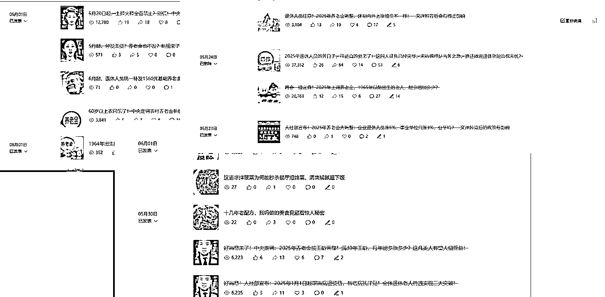
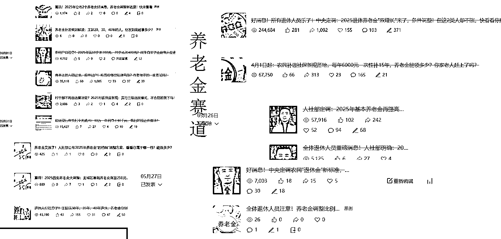

# 公众号流量主做民生向，小绿书冷启动再转爆款，万阅常态十万加频出，一次性出6-8条

作者：辰风
日期：2025-08-12

大家好，我是辰风，今天拆解一个在流量主赛道里很猛的起号打法——**先用小绿书做冷启动，再完成向公众号的迁移变现，特别适合民生、养老、时事热点这类赛道。**

**  **

这个路子我自己实操验证过，转化速度相当快。只要抓住流量主的收益机制，上手后短时间内就能看到收益回流。

需要说明的是，这套打法对资源和体系要求比较高，更吃香的是有成熟提示词支撑的矩阵团队，大佬批量操作会更顺手，单打独斗的个人号也能跑，但效果会打折。我今天主要聊的是对平台规则的理解、小绿书起号的具体做法，以及实战中踩过的坑和我总结出来的成套思路。

**  **

团队当时开了几十个号去验证，最终规模化变现没完全达标，但方法本身是跑得通的，单条收益过几千的案例有，累计也跑出了几十万阅读量的爆款。

下面这些数据是5月到6月左右的测试成果，最新账号的对标情况和这条赛道现在还能不能玩，请往下看：

正文内容详见：[`k874t2qh8w.feishu.cn/docx/UKEDdsTPZodQNnx17kpcEJcen7g`](https://k874t2qh8w.feishu.cn/docx/UKEDdsTPZodQNnx17kpcEJcen7g)

* * *

评论区互动：

金天 : 收获很大，思路很清晰。

poppy 杨 : 我现在也是这个玩法，小绿书有展现但搬到公众号阅读就掉没了。

辰风 : 核心还是长文的定位和调性没对上

喜东东 : 辰老师好，我的垂类小号定位一直不稳定，公众号注册半个月内有过一篇破万的，但后续很难持续，想请教一下方便加下您吗～

辰风 : 没问题，可以加

芷蓝 : 这个玩法很妙，素材基本都能从新闻网站和公众号里找，用AI重组信息就行，素材源源不断，太有参考价值了

辰风 : 谢谢芷蓝姐的认可