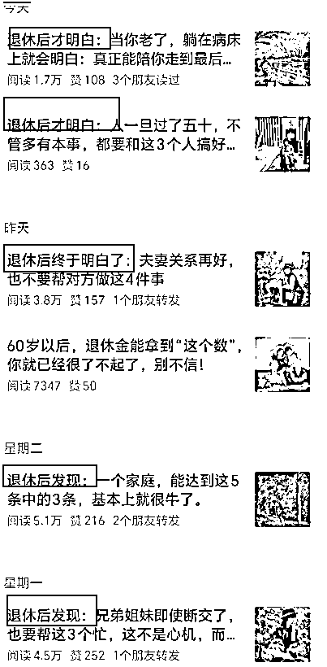

# 垂类👸号，真正的垂是“垂向一个人”

最近龙哥老师的那篇👸号超级标的讨论，把不少人又推回了👸号赛道。

一进去才发现，这东西的价值远不止眼前的流量和变现，它更像一面镜子，能逼着你沉淀思考。坚持下来的人，都慢慢尝到了甜头。

# 一、一个反常识的现象：越是头部的人，越舍不得放下👸号

现在开口闭口都是抖音、📕、视频号，线下大会里几乎听不到👸号的身影。

但现实是，真正忙得不可开交的那些人，反而在👸号上愈发活跃。

知识星球的吴鲁加老师，更新频率极高；山顶会的波波老师、群响的刘思毅、润宇老师、盗坤老师，以及赚钱的一众老师，几乎都在雷打不动地写。

他们手里能做的事成百上千，偏偏把时间留给了这条文字赛道，而且已经坚持了多年。这本身就说明了一个问题：即便外界有唱衰的声音，👸号依然是他们做业务、做思考的重要抓手。

# 二、小而美的垂类账号，商业机会藏在细分处

跑下来就会发现，垂类👸号是最容易做私域转化的载体之一。文章结尾放一个二维码，从公域到私域的衔接异常顺滑。

# 1. 减肥赛道，典型的引流私域打法

 images.zsxq.com/FooVITkzoA0V8yRFOPo8UEtZifSV) images.zsxq.com/Fuyc9sN6pZFHYlRLlY6YpN60DWFv)

 images.zsxq.com/FgJnAJcVLn24Ilyc11LxyHa7-wor) images.zsxq.com/FnbKHxZ-9qlVpTlFkimnsu4laj6D)

# 2. 心理学赛道，文末承接私域

 images.zsxq.com/FrA82-U7GFCTXnN4W4BJWvuGMUyz) images.zsxq.com/FhDboVSW5YuEk0DRlY6YpN60DWFv)

# 3. 情感赛道，以回避型人格为例

 images.zsxq.com/Fk9o4fLqEkhbhCmX774xjwwcuBxG) images.zsxq.com/Fi-IAGE5yry18pRPJQVUu4Do6sRf)

# 4. 关键词垂直打法

【先问自己：我的业务能不能用一个关键词去做测试验证】
 images.zsxq.com/FoYukjqsQDYSF4gc7LqtTGIgV_0B) images.zsxq.com/FuwxZbtixbwKl_9vLcyYpjaOgMop)

 IHQx)

# 5. 职业身份垂直打法

【你的业务能不能从一个身份标签出发去写内容】
 images.zsxq.com/Fph8q3VPTgW3aIP36w6J2XufkoJE) images.zsxq.com/Fg28OAgFacjC8PKi8Z1RVE1YSCS_)

 images.zsxq.com/FqMnL1N_BS_RD81r4f7X9Ibs4saM) images.zsxq.com/FqtY3UyVmFO5ZoFe5bniBCnmkrv3)

# 三、能写三年五年的号，都在围绕“人”来做

我自己做了四年👸号，也一直在经营个人IP，有一个结论越来越清晰：

**普通创作者最难受的点，不是起步慢，而是做不持久，流量断档。**

我们删过几百个号做测试，结论很残酷：很难有一个号能一直被系统持续推。哪怕很垂直的号，一不小心就掉出推荐池。二次推荐会来，但时间不可控，创作成本却在飙升。

有些号靠追爆款标题活下来了，粉丝和阅读看起来很漂亮，一旦失去系统推荐，阅读直接跌到个位数。没有流量就没有变现，号也就废了。

那什么样的号可能写到明年、后年、甚至十年后还在更新？

一定不是纯流量、纯标题党。写久了自己先腻了，业务稍有起色就去更新了。

真正能走远的，是把账号注册下来之后，就始终锚定“人”，做个人IP式的垂类号。

因为人是鲜活的，你可以写生活、写故事、写思考、写产品、写创业史和工作经历。文字自带个性，读者愿意跟随。

而且个人IP天然具备高客单成交能力，信任感一旦建立，转化率完全不是流量号能比的。

# 1. 阅读路径决定了👸号的优势

在抖音、📕做IP，很多人就算喜欢你，也懒得专门去搜你的视频。👸号不同，一推送，🛰️里就能看见。文字先一步抵达人。

# 2. 文字的影响是慢热但深刻的

你长期读一个人的文字，会不自觉吸收他的思维方式，慢慢拼凑出他是一个什么样的人。这种潜移默化的信任，是短视频很难实现的。

# 3. IP形态的迁移可能性

市场上有抖音IP、📕IP，👸号IP同样可以成为个人和企业赋能的核心阵地，影响力完全不输短视频和直播。

# 四、把业务和生活缝合在一起，才好写下去

如果你本身就有业务，👸号就是最好的信任放大器。

纯干货号太枯燥，纯生活碎碎念号难变现。最好的状态是把业务和生活结合起来写。

1. **先利己，再利他。**
能持续的号，都因为写作本身对作者也有价值。写完一篇最大的受益者是你自己，像在给自己做复盘，思考就此展开，这就是最直接的正反馈。

2. **有了私域，先用👸号解决信任，再去解决流量。**
很多号后期流量归零，阅读只有个位数，创作者就放弃了。但如果你把👸号定位成信任构建工具，局面会完全不同。
比如客户进到私域后，用朋友圈承接、用短视频承接，再用👸号的长文字承接，信任感会叠加到最高。长文字的信息量和温度，是成交的催化剂。

内容可以这样规划：

**1. 关于自己的生活。**
用大白话记录点滴小事，让读者大致感知你是怎样的一个人。人对别人的隐私和生活细节天然好奇。

**2. 关于业务和思考。**
写你在做什么、踩了什么坑、怎么想的。这样读者清楚你的专业边界，信任建立后，自然产生购买。

**3. 业务的广告与反馈。**
偶尔放一些项目进展、客户反馈、轻广告，变现就水到渠成。

以“人”为核心来构建内容，写着不累，还能赚钱。写一年，写两年，精准粉丝越积越多，可做的事就越多。

# 五、没有独立业务的人，也可以做垂类流量主

对于还在职场、没有完整业务的人，可以锁定一个垂直领域，只做流量主变现。

我们曾做美食养生赛道，两个普通人，运气加坚持，单号单月做到过8-10万的收益。未必人人都能复制，但机会是真实存在的。

👸号流量主逻辑极简：有阅读就有广告费。500粉即可开通，门槛极低。投入主要是时间，研究得当，一个月可能赚到一年的钱。

当然利弊并存，心态要稳，有时需要注销重来。但对于普通人来说，这依然是一条低成本、小生意的可行路径。

* * *

评论区：

辰风 : 向一来老师学习

金天 : 有启发

晨曲 : “垂直于人”实在是醍醐灌顶呀！ 谢谢🙏