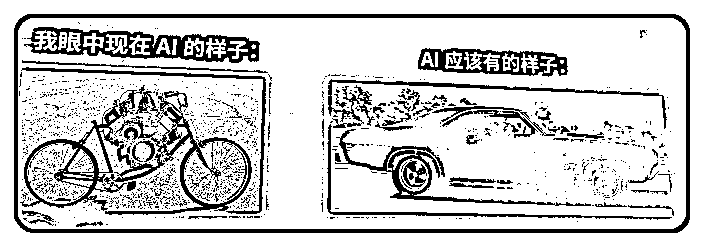

# AI 正在改写商业规则：真正的机会，不在“生成内容”，而在“重构系统”
作者：龙哥

作者：松  
日期：2025-07-28

这是我参加赚钱私域大会后，第一次认真整理自己的思考。

过去参加类似活动，往往是现场听得热血沸腾，回去之后却很难留下真正可复用的东西。这一次，国平老师关于 AI、商业、视野和战略的分享，让我产生了强烈的冲击。

为了方便理解，我把这次内容拆成三个部分：

- AI 到底应该怎么用
- 商业竞争的底层规律是什么
- AI 时代需要怎样的视野与战略

其中一些内容参考了希声、超人、白先生、LY🍒等伙伴的总结，也加入了我自己的理解，因此和其他分享可能存在部分重合。

---

# 一、重新理解 AI：它不是聊天框，而是一台新的商业引擎

## 1. AI 的真正价值：影响现实，而不只是生成内容

很多人今天谈 AI，第一反应还是：

- 写一篇文章
- 做一张图片
- 生成一条视频
- 用 AI 改改文案

但国平老师给出的判断是：这些都只是 AI 最浅层的能力。

他把 AI 比作两百多年前的蒸汽机。

蒸汽机刚出现时，人们并不知道它最终能应用到哪里。后来有人发现，矿井排水需要持续、强大的动力，于是蒸汽机找到了第一个真正有价值的使用场景。

蒸汽机的核心优势，不是“看起来新奇”，而是拥有巨大的力量，可以长时间持续工作。

今天的 AI 也一样。

它不应该只被当成一个对话工具，更不应该只用来完成一些小任务。它真正的价值，是把认知、决策和执行连接起来，直接改变现实世界中的业务流程。

## 2. AI 不止会写、会画，更能调度系统完成任务

如果 AI 只能返回文字、图片和视频，那它依然只是一个内容生产器。

真正重要的变化在于：AI 可以输出标准化的 JSON 数据，而 JSON 可以继续被程序、API、浏览器、App、手机和电脑识别并执行。

这意味着，AI 不再只是“告诉你答案”，而是可以直接推动后续动作：

- 自动操作网页
- 调用第三方服务
- 管理手机应用
- 执行办公流程
- 调度不同的软件与工具
- 完成原本需要人工操作的任务

未来的无人船、无人卡车、智能工厂，本质上都可以理解为：大模型负责判断和调度，机器负责执行。

所以，AI 时代最关键的问题，不是“我能不能用 AI 写东西”，而是：

> 如果我手里有一万名不会疲惫、能够持续工作的员工，我会让他们做什么？

这才是理解 AI 的正确方式。

## 3. AI 的底层作用，是让资源被更高效地使用

过去完成一件事，可能需要投入完整的人力、时间和注意力。

而 AI 的意义，在于通过自动化、推理和协同，把原本需要 100%资源才能完成的任务，压缩到只需要 10%的资源。

这也是 MCP 值得重视的地方。

它并不只是增加一个工具，而是让不同的能力能够被 AI 灵活组合。未来，真正的效率提升，不是单纯地让人工作得更快，而是让更少的资源完成过去大量资源才能完成的事。

---

# 二、为什么不建议把重点放在 AIGC 上

## 1. 内容生成的门槛正在快速消失

国平老师提出了一个很尖锐的观点：

> 不要把主要精力放在 AIGC 上。

原因很简单。

当下可能只有十万人在做 AI 内容，过一段时间，可能就会变成一百万人。文章、图片、视频的生产成本越来越低，参与者越来越多，竞争壁垒自然会不断下降。

当所有人都可以快速生成内容时，内容本身就会越来越廉价。

更重要的是，许多内容创作者看似在经营个人品牌，实际上只是不断为平台提供内容，让用户消费一次，然后继续寻找下一条内容。

这类模式往往缺少真正的商业闭环：

- 内容被平台分发
- 用户在平台上消费
- 创作者持续生产
- 商业价值却不一定沉淀到自己手里

因此，AI 内容生产可能越来越卷，但不一定越来越有价值。

## 2. 比生产内容更重要的，是建立持续关系

真正有价值的 AI 应用，不是每天制造更多信息，而是持续帮助用户解决问题。

国平老师分享了 AI 私域的案例。

比如舌诊、热量计算，这些不是用户只需要一次的服务，而是会反复发生的需求。用户每天可能都会遇到新的健康问题、饮食问题和生活问题。

AI 通过持续交流，不仅能够帮助用户解决当下的问题，还能慢慢了解他的习惯、偏好、状态和潜在需求。

更有意思的是，用户最初只是来做舌苔分析，后来却开始向 AI 倾诉情感问题，把它当成了一个不会评判自己的树洞。

很多人面对真人时，反而不愿意透露隐私；但当他们知道对方是 AI，就会放松很多。

如果 AI 能记得用户前几天提到的困扰，并在几天后主动给出经过思考的回应，用户感受到的就不只是“效率”，而是被关注、被理解。

这才是 AI 私域的价值：

- 它持续陪伴用户
- 它持续理解用户
- 它持续解决问题
- 它持续建立信任
- 它最终形成转化闭环

相比单纯制造内容，这种模式的商业价值更深。

## 3. 从“标签管理”升级到“终身记忆”

过去做私域，大家习惯给用户打标签：

- 宝妈
- 高净值
- 对某产品感兴趣
- 购买过某服务
- 来自某个渠道

但标签本质上是静态的，也比较僵化。

AI 时代，更有价值的不是给用户贴几个标签，而是建立一套持续更新的个人档案。

也可以说，每个用户都应该拥有自己的“终身记忆”。

AI 不只知道用户属于哪个群体，还能记住：

- 他过去说过什么
- 他现在遇到了什么问题
- 他长期关注什么
- 他购买过什么
- 他未来可能需要什么
- 他在不同阶段的情绪和变化

当一个用户进入这样的 AI 私域，他就不再是一次性交易对象，而是一个可以长期服务、持续理解和反复创造价值的人。

国平老师已经在实践类似的事情，构建了大量“贾维斯”式的智能助手，让用户进入之后，很难再离开。

## 4. 用 Agent 提供规模化的情绪价值

很多人认为 AI 只能处理理性任务，但国平老师特别强调：情绪价值同样可以被 AI 大规模完成。

他举了一个案例：让数百个 Agent 同时服务一个人。

当用户提到美食时，相关 Agent 负责处理餐饮需求；当用户提到穿搭时，另一个 Agent 负责提供服饰方面的支持。看似只是和一个 AI 聊天，实际上背后是多个智能角色协同工作。

这种能力也可以被用于 KOL 运营。

例如：

1. 找到某个博主最近发布的几十条内容；
2. 分析每条内容的数据表现；
3. 找出表现最好的一条；
4. 让 AI 围绕这条内容进行高度个性化的赞美和互动；
5. 让大量博主都获得被认真关注的感觉。

一天服务一万多个 KOL，并不一定需要一万名人工运营。

运营策略中有两条原则很关键：

- 尽量不要一上来谈钱；
- 不要直接要求对方帮你做什么。

真正有效的方式，是先理解对方、认可对方、满足对方的表达欲和成就感。

当情绪关系建立之后，合作反而会自然发生。

## 5. AI 私域的终点，是让用户感受到价值

国平老师提到一个标准：

> 如果不能让用户感动到流泪，就不应该轻易去打扰他。

这句话背后其实是一个非常重要的判断：

AI 不能只是为了替代人工客服，也不能只是为了节约成本。

它真正应该创造一种过去不存在的体验。

比如：

- 记住用户之前说过的话；
- 在合适的时间主动追踪；
- 针对用户的具体情况给出回应；
- 在用户没有明确提出需求时，提前发现问题；
- 让用户感觉自己被认真对待。

AI 私域的核心不是“自动发消息”，而是“持续创造价值”。

用户随口说一句“最近搬了新家”，背后可能就藏着很多需求：

- 甲醛检测
- 家具采购
- 家庭清洁
- 软装布置
- 家电购买
- 搬家服务

当 AI 长期和用户沟通，它会自然积累大量信息，也就有机会发现大量商业需求。

过去很多企业手里拥有庞大的私域资源，却因为人工成本太高，始终无法充分运营。

如果这些资源交给 AI 去持续理解和激活，就像一座原本无人开采的金矿，开始自动运转起来。

## 6. 新的竞争，不只是抢流量，而是抢用户时间

过去大家争夺用户，主要在抖音、📕、🛰️等平台上争曝光、争点击、争停留。

未来的竞争，可能转向另一个层面：

> 谁能成为用户在某个垂直领域中的第一入口？

例如做健康服务，不必一开始就覆盖全部健康问题，而是先从一个非常具体的场景切入。

当用户习惯通过你的 AI 了解某类健康问题之后，你就有机会逐渐延伸到：

- 饮食管理
- 运动建议
- 睡眠改善
- 体重管理
- 健康产品
- 长期服务

最终，用户遇到这类问题时，首先想到的不是搜索引擎，也不是其他平台，而是你的 AI。

这就是 AI 时代争夺用户时长的新战场。

## 7. MCP 可能让传统软件逐渐退到幕后

目前很多人依赖 Coze、n8n 等工具搭建固定工作流。

但这类工作流有一个共同局限：流程提前设定，变化空间有限。

一旦遇到非标准场景，系统就很难灵活处理。

MCP 的意义在于，它让 AI 可以直接调用外部能力。

可以把它想象成：你不需要亲自拿材料、搭积木，只需要告诉房间里的人你想建一座房子，里面的人会根据指令完成搭建。

未来，软件可能不再以“一个个 App”的形式存在于用户面前。

支付宝、地图、购物、支付、客服等能力，都可能以 MCP 服务的方式被 AI 调用。

用户不必打开一个个应用，而是直接告诉 AI：

- 帮我缴费
- 帮我订票
- 帮我查物流
- 帮我购买某件商品
- 帮我完成一项复杂操作

AI 成为统一入口，软件则逐渐变成隐藏在背后的服务。

---

# 三、商业竞争的核心：看谁能更高效地使用资源

## 1. 美团和饿了么的竞争，本质是效率之争

国平老师用美团和饿了么的竞争，解释了一个非常重要的指标：

> 流量资金的运转效率。

假设同样投入一块钱，美团能够比饿了么多创造 20%的收入，那么美团就拥有更强的资金效率。

这时，美团不一定需要在所有地方都和对手硬拼，而是可以利用这种效率优势，逐步抢占更多流量渠道。

例如某个平台原本每月有竞争对手投放 100 万，美团就出价 110 万拿下同样的位置。

表面上看，美团多花了 10 万，但因为投放效率高出 20%，最终依然能够把差价赚回来。

所以，真正决定胜负的，不是某一次投放，也不是某个战术动作，而是：

- 投入多少钱
- 能产生多少收入
- 资金周转速度有多快
- 同样的资源能否创造更多结果

哪怕只是一个很小的细分市场，只要拥有全行业最高的流量资金效率，最终也可能成长为真正的头部。

## 2. “窒息竞争”与竞合策略

王兴爬珠峰之后，曾经意识到一个问题：

很多商业竞争，本质上就像在水下憋气。

双方不断抬高价格、增加投入、互相攻击，最终比的不是谁的招式更漂亮，而是谁能坚持得更久。

但在某些阶段，最优策略并不是马上消灭对手。

因为竞争者的存在，也可能帮助整个行业完成用户教育和市场培养。

所以更聪明的方式是：

1. 先让对手继续存在；
2. 双方共同把市场做大；
3. 一起培养用户习惯；
4. 等市场成熟之后，再利用效率优势完成收割。

这就是“竞合”的含义：

- 在争夺份额上，双方是竞争者；
- 在教育市场、扩大蛋糕上，双方又是合作者。

有时候，留下对手，让对手帮你把市场养大，反而比立刻把对手打掉更划算。

## 3. 水滴筹的逆袭：找到真正的杠杆点

轻松筹早期占据了绝大多数市场份额，水滴筹却通过一个非常关键的策略实现反超。

轻松筹主要依靠筹款业务获取收入，而水滴筹选择暂时不从病人身上赚钱，甚至承担相关手续费，一年亏损数千万元。

真正的盈利点来自保险。

普通场景下，保险转化率可能只有几个百分点。但当一个人刚刚看到白血病患者需要筹集巨额治疗费用，并且亲自捐出几十元时，他对重大疾病风险的感知会突然变得非常强。

这时候再向他推荐重疾险，转化率可能达到 25%左右。

这和普通流量场景完全不是一个级别。

水滴筹正是通过这个特殊场景，把筹款和保险连接起来：

- 前端为患者提供筹款服务；
- 中间积累高意向用户；
- 后端通过保险实现盈利。

最终，它可以投入 2 亿元，产生 7 亿元收入。

这就是杠杆的力量。

商业上最怕的是所有地方平均用力，因为平均用力往往只能得到平均结果。

真正有效的策略，是先找到一个巨大的杠杆点，把资源集中砸进去，再把其他部分维持在合格水平。

## 4. 不要只盯着热门词，真正的机会藏在数据里

国平老师曾经通过数据和 AI 管理超过 150 万个关键词。

普通人可能只能想到几十个、几百个关键词，然后去抢那些最热门、最昂贵的词。

但热门词通常意味着：

- 竞争激烈
- 投放成本高
- 转化效率下降
- 所有人都在争夺

他的做法完全不同。

首先，把行业内各个平台、各类文章和内容尽可能收集下来，然后进行清洗、拆解和关键词提取。

接着，通过大量测试，筛选出：

- 搜索意图明确
- 竞争程度较低
- 转化率较高
- 投放价格便宜

的关键词。

别人可能在竞争一个 5 元的热门词，他却去寻找 3 毛钱但效果更好的词。

比如销售充电宝，不一定只投“手机充电”“电池容量”等直接词，也可以围绕：

- 圣诞节送礼
- 母亲节礼物
- 相机配件
- 出差用品

等场景进行投放。

普通人也能用类似方法开始。

例如从电商平台购买大量📕笔记或行业资料，哪怕花 10 元获得一万篇内容，再交给 AI 进行清洗和分析，也可以帮助自己发现那些被忽略的低价高效关键词。

不一定要做到 150 万个词，但只要能找到别人忽视的低成本流量，就可能获得远高于热门词的投入产出比。

国平老师团队的标准，是投产比至少达到 1:6，也就是投入一块钱，至少回收六块钱。

## 5. 爆款不是一次性消耗品

很多人做出一个爆款之后，第一反应是：

> 下一条爆款在哪里？

但更值得思考的问题是：

> 能不能让已经验证过的爆款持续产生价值？

做出新的爆款，往往比延长旧爆款的生命周期更难。

一个典型案例是《赢在中国》。

节目最初通过企业家点评和项目分析建立影响力，后来马云参加节目后，并没有把它只当作一次曝光，而是持续在节目中植入阿里相关内容。

从简单点评，到逐渐增加表达时间，再到将自己的商业理念自然融入节目，这类内容长期重复利用，很多年后依旧能够产生传播价值。

真正优秀的内容，不应该只火一次，而应该被反复拆解、改造、分发和延展，最终变成一棵持续结果的“常青树”。

---

# 四、视野决定上限：不要只在别人设置的牌桌上赢

## 1. 传统框架，可能正在限制你的思考

我们习惯用固定框架解决问题：

- 流量不够，就继续找流量；
- 转化不好，就优化转化；
- 私域效果差，就增加运营动作；
- 交付效率低，就继续优化流程。

这些方法不一定错，但它们往往默认你必须继续留在原来的游戏里。

国平老师提醒，很多时候，真正的突破并不是把旧框架做得更好，而是跳出框架本身。

如果一张牌桌本来就是为别人设计的，那么你在桌上赢几把，也可能仍然没有改变自己的处境。

所以，有些问题的答案不是“这张牌桌该怎么玩”，而是：

> 为什么一定要继续在这张牌桌上玩？

AI 可能只是整个商业闭环中的一环，而不是最终目的。

如果只是用 AI 写几篇文章、生成几个数字人、提升一点内容效率，依然是在原有规则里做局部优化。

更大的机会，是重新设计整个业务系统。

## 2. AI 时代最重要的两种能力

### 第一，真正理解 AI

不能把 AI 简单理解成一个会聊天的工具。

它更像一个推理引擎。

你提供的背景、上下文、数据和目标越完整，它能够完成的任务就越复杂。

AI 的上限，往往取决于你能否把问题描述清楚、把信息组织完整、把业务目标表达准确。

### 第二，找到真正值得投入的场景

有 AI 不等于有价值。

关键在于，你是否能把 AI 放进一个高频、刚需、持续发生、能够形成商业闭环的场景中。

好的 AI 应用通常具备几个特点：

- 用户会反复使用；
- 能持续积累用户信息；
- 能帮助用户解决真实问题；
- 能产生长期信任；
- 能连接后续服务和产品；
- 不只是为平台制造内容，而是直接创造用户价值。

---

# 结语：AI 的终点不是生产更多内容，而是重新定义商业关系

这次分享最让我震撼的，并不是某个具体工具，也不是某个单独案例，而是它改变了我对 AI 的理解。

过去，我们容易把 AI 当成：

- 文案助手
- 图片生成器
- 视频工具
- 客服替代品
- 效率插件

但更深一层看，AI 可能正在成为：

- 一套新的执行系统；
- 一个长期理解用户的智能伙伴；
- 一群可被调度的数字员工；
- 一个连接各种服务的统一入口；
- 一种重新组织商业资源的方式。

真正值得关注的，不是如何用 AI 生产更多内容，而是如何让 AI 持续服务用户、理解用户、解决问题，并最终形成稳定的商业闭环。

未来真正稀缺的，也许不是内容，而是：

- 用户的长期信任；
- 用户的持续时间；
- 用户的完整记忆；
- 用户在某个领域的第一选择。

谁能理解 AI 的本质，并把它放进正确的应用场景，谁才有机会在新的商业规则中获得优势。

第三个关键词：野心。

一个人如果只敢做确定性很高的事，往往很难走到更远。真正做成大事的人，首先得相信自己有机会做成大事。

国平老师曾提到，很多人最终没有做出成绩，并不一定是能力不够，而是从一开始就没敢把目标想大。成功有时确实带着某种不可解释的成分，但“敢不敢想”，往往会直接影响一个人的行动边界。

他接触过不少能够管理数万人的企业创始人。最初看上去，有些人并不比普通人特殊，甚至会让人疑惑：为什么这样的人也能做出这么大的公司？

但相处之后会发现，他们身上通常有几个共同特征：

有人意志坚定，认准方向就不轻易动摇；

有人抗压能力极强，能够长期坚持；

而且，他们往往还拥有不错的运气。

在不断观察这些创业者后，国平老师重新认识了“勇气”的价值。

他认为，勇气可能是人类最珍贵的品质，甚至排在智慧之前。因为真正的勇气，并不是看不见风险，而是清楚知道事情危险、成功概率极低，却依然愿意说：

“我还是想试一试。”

他也反思自己过去过度看重智慧。现在他更倾向于认为，智慧固然重要，但在很多关键时刻，敢于行动的勇气更重要。

一个创始人的性格和日常习惯，往往会深刻影响他所建立的平台。很多创业者并不擅长所有事情，甚至在能力结构上存在明显短板，但他们有一个共同优势：敢冲、敢试、敢承担后果。

有时候，正是这种看似“莽”的行动力，让他们在一次次试错中活下来，最终成为行业里的领头者。

因此，国平老师将创业者需要具备的能力归纳为三点：

理解力，决定你能否看清问题；

野心，决定你愿意把事业做到多大；

勇气，决定你能否在不确定中真正迈出第一步。

野心常常出现在那些试图打造大品牌、做长期事业的 CEO 身上，而勇气，则是几乎所有真正做出结果的人都绕不开的底层能力。

## 3.3 粉丝数量，可能只是表面繁荣

在流量行业里，有一个重要指标叫“触达率”，指的是你发布的内容最终有多少粉丝真正看到。

问题在于，创作者越来越多，用户总量却并没有同步增长。于是，单个创作者能够触达的用户比例会持续下滑。

这意味着，如果想让明年的成绩和今年持平，粉丝规模可能每年都要增长约 50%。

粉丝多，并不代表实际影响力一定更强。

比如，一个拥有 100 万粉丝的账号，触达率可能只有 1%；而另一个只有 10 万粉丝的账号，触达率却可能达到 10%。

表面看，前者规模远大于后者，但真正被内容覆盖的人数，未必有明显差距。

更关键的是，粉丝能不能看到你的内容，并不完全由创作者决定。平台拥有分发权，它可以决定是否把你的内容继续推送给粉丝。

所以，粉丝数并不等于真实用户，更不等于稳定的商业价值。只看粉丝规模，很容易把平台分发造成的虚假繁荣，当成真正的增长。

# AI 时代，需要重做商业逻辑

国平老师关于 AI 的分享，提供了一个非常不同的观察角度。

他关注的并不是如何用 AI 把原有流程做得更快、更省，而是思考：能不能借助 AI，直接重构商业模式？

从技术变化到商业决策，从用户需求到平台机制，他试图建立一套完整的 AI 时代商业思考框架。

在这个框架里，AI 不只是一个辅助办公的工具，也不只是一个可以聊天、写作、生成内容的软件。它更像是一台能够重新组织资源、重塑用户体验、创造新商业模式的发动机。

很多人对 AI 的理解，还停留在“打开一个对话框，输入一段指令”的层面。但 AI 更大的价值，恰恰在于它可以改变产品形态、服务方式和商业关系。

对个人和企业来说，真正重要的并不是盲目追逐每一个 AI 热点，而是找到一个具体领域：那里存在真实需求，也存在被 AI 重新改造的可能。

如果能够在这样的细分场景中建立壁垒，AI 才有机会从一个新工具，变成持续创造价值的商业基础设施。

这件事考验的当然不只是技术能力，还包括对市场的判断、对用户的理解、对战略方向的把握，以及面对不确定性时的执行勇气。

AI 时代，最后胜出的未必是最会使用工具的人，而是那些真正看懂 AI 运行逻辑，并能把它和商业机会准确结合起来的人。

* * *

评论区：

猫哥：很棒，学到了。