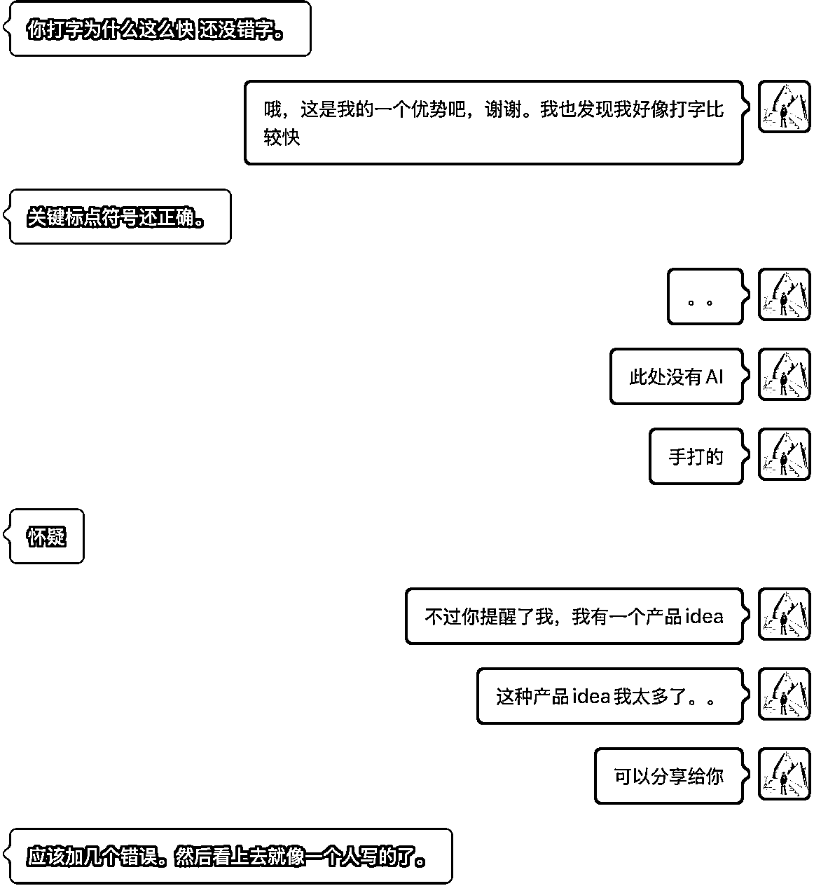
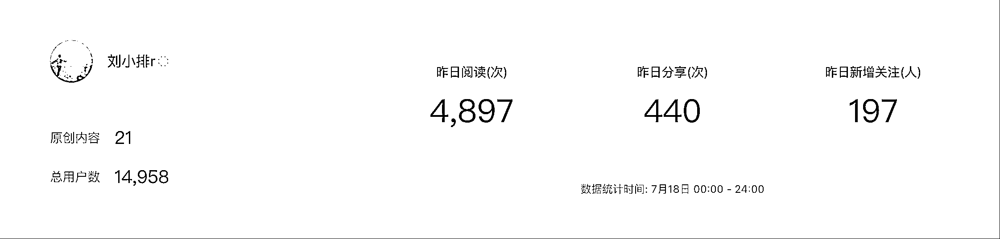
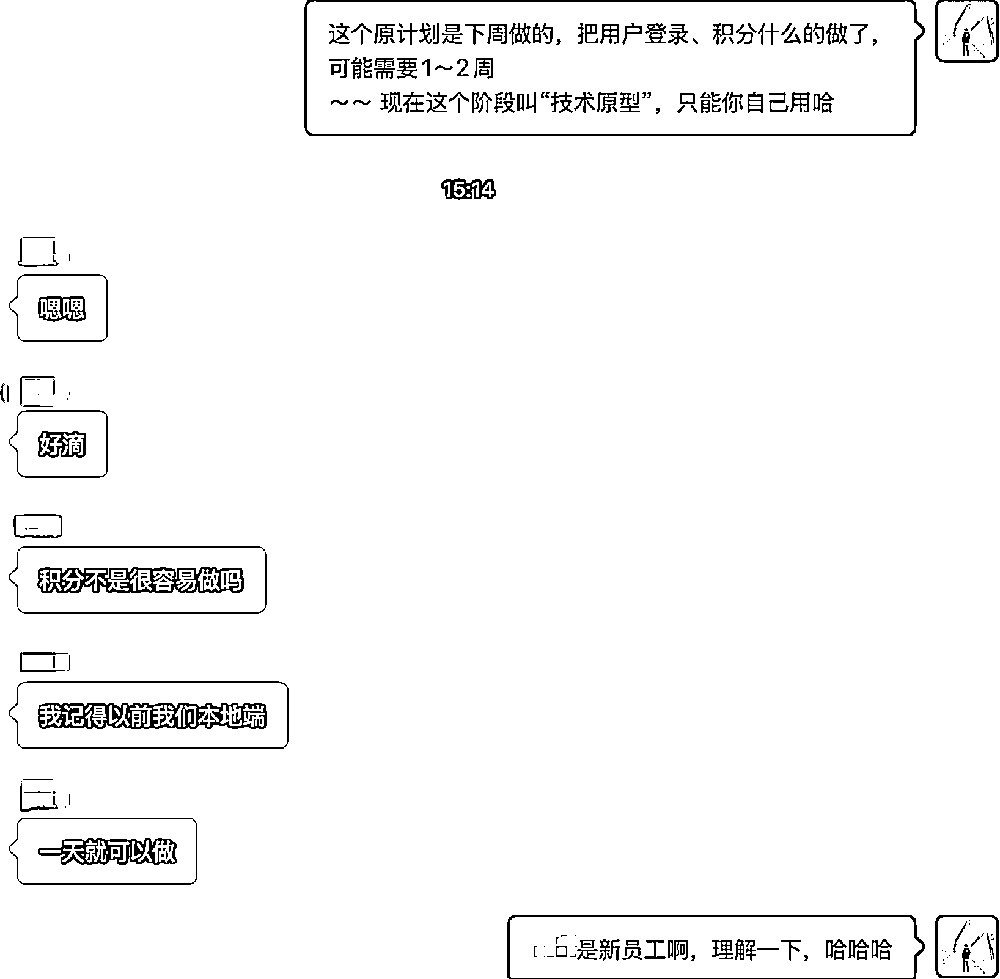

# 时间折叠：我在 AI 时代把一天活成三天的用法
作者：龙哥

作者：刘小排
日期：2025-07-19

经常有人私信我，说我效率离谱。也有人说我是龙哥，因为我看起来能同时把很多人照顾得很好。确实，我并没有变出更多小时，我只是学会了一种用法，叫做时间折叠。

这个概念是我从潇洒姐王潇的《五种时间》里get到的。她把一天拆成生存、赚钱、好看、好玩、心流五块。她的折叠精髓在于：同一段时间内，让不同需求一起被满足，而不是东一榔头西一棒子地切换注意力。

比如边做饭边做正念呼吸，既照料身体又经营状态；边家庭出游边拍视频剪辑，既放松又能变现，还进入心流。潇洒姐的美女分类里有“好看时间”，我这个糙汉子很难照搬，但方法论本身非常锋利。

放到今天的 AI 环境里，这套东西直接进化了。AI 把人 90% 的通用技能平价化了，只剩 10% 的核心能力会被指数级放大。时间折叠于是有了更强的操作空间。

# 先把时间掏出来，再谈折叠

折叠的前提是有可折叠的空闲。很多朋友卡在这里，所以先做三件基础改造：

1. 扔掉键盘，用嘴说话。手机🛰️自带语音转文字就够用，电脑上豆包客户端的语音输入目前最顺手。装上就会上瘾。
2. 把和 AI 的对话时长，做成你一天里最长的“社交”。我现在同时在用 ChatGPT Plus/Pro、Claude Max、Google AI Ultra，还配合豆包、Kimi。听圈子里朋友说，龙哥已经做到每天和 ChatGPT 聊的时间超过和🛰️聊的时间。
3. 把工作流程做成可外放的模板。我是做产品出身，工作基本靠 Cursor、Claude Code、AugmentCode、V0 这类编程助手就能闭环。做别的方向的同学，Coze、豆包、RPA 也能形成类似的解放注意力的流水线。

这三项缺一不可。没有这层基础，折叠就是空谈。没准备好的话，建议先去龙哥盟看看包子老师写的 AI 赋能实操帖。

PS：我的打字速度被 SCAI 实验室的一个创业者识破了。那次我语音喷字回复，速度快得离谱，连标点都对，一个字没错，直接露馅。

# 第一次升级：把硬性任务塞进兴趣轨道

上个月，SCAI 实验室的一个创业者找我聊困惑。他手里有个科技新闻类小产品，存量用户还不错，但又想all in AI Agent，时间怎么分很纠结。

我建议他：别分，直接合。用做 Agent 的方式迭代新闻产品，两件事并成一件事。

这就是被动式折叠：把不得不做的事，嵌进你本来就想做的事里。

对我而言，主线只有一个：做产品。它正好是我擅长、我喜欢、我赚钱、我有成就感的交集。

课程、SCAI 实验室、自己的项目，为什么能一起动？因为它们都被我压进了“做产品”这一个容器里。

做产品的草根都知道，数量决定概率。良辰美那种季度百站月入万刀的打法，是用数量淹没运气。我现在想做更扎实的东西，如何兼顾数量？把课程和 SCAI 折叠进来。

带课程能批量培养人，优秀的同学吸进 SCAI，再有缘分的同学一起孵化做产品。三件事，坍缩成一件事。

反过来，如果一件事情拆不开主线，我会直接砍掉。有人让我开写作课，有人让我接企业 AI 培训、做 AI 使用课，有人让我代卖 Claude Code 代理号躺赚。听起来都香，但它们都和“做产品”这个主线不兼容，所以全拒。

# 第二次升级：以主线为圆心，主动给它找燃料

被动折叠是防守，主动折叠是进攻。

举个例子，七月我的主线是上线 fast3d.io。现在 AI 写代码已经能自己卷几小时，我只需要定方向。AI 跑的时候，我的注意力空下来了，就主动给主线添柴。

第一层燃料：做👸号。👸号是发布我自己产品和 SCAI 学员产品的阵地。这个月我顺手更新了几个月，从 2000 粉涨到 1.5 万，单篇最高 4.7 万阅读。

写👸号对我不算负担，不用洗稿，只是把做产品时用的工具心得、截图顺手记录就发布了。当然，也免不了被别人洗稿，有时洗得比我原版还火。

而且我在文章里会自然预埋 fast3d 的信息，读者并不排斥，反而期待。国内大部分 AI 自媒体做不出能赚钱的真实产品，只能用几个 demo 骗流量。能用真产品来评测工具的人很少，这就成了差异化。

第二层燃料：带新人。团队现在七个人，没一个是专职程序员，都是信得过的朋友，代码全是现学。怎么带？让他们直接上手做产品。

虽然会慢一些，但能把人练出来，下一次产品迭代我就能更快。最近一个多年老友来问行业 AI 赋能的事，市场上工具都不合他需求，我就安排新员工直接接了他的需求。我只隔两天给一次思路，不亲自下场。进度一开始慢，客户也有点懵，但长期看是正向投资。

第三层燃料：持续输入。写代码的间隙，我会开一堆网页：论文、电子书、竞品。上午看论文和新技术，下午看别人的优秀 AI 产品，晚上有空就翻书。AI 写代码慢，正好给我留了阅读窗口。

第四层燃料：帮 SCAI 的创业者。帮他们，本质也在帮我。最近招了一个在奇绩创坛工作过的朋友，让她挨个和 SCAI 的同学聊，从投资人和市场角度给反馈。巧的是，其中一个同学刚拿到奇绩创坛的面试，两人聊了一小时，双方都觉得值。顺手又“海王”了一下。

第五层燃料：做一次公开分享。在龙哥盟发这篇文章，既能帮助到人，也能吸引更多有缘的创业者进入 SCAI，最后还能顺便提一嘴 Fast3D。你现在看到的就是这个结果。

# 总结一下

1. 时间折叠是当下提效的核心打法。
2. 折叠的前提是你先通过 AI 释放出时间，没有空闲就无从折叠。
3. AI 时代能力被极度放大，你可以容纳更多事并行。
4. 聚焦主线是底线。拧不进主线的事，果断放弃。
5. 原版逻辑：同一时间多线并行，而不是分心并用。
6. 第一层升级：被动升级，把硬性任务折叠进兴趣里。
7. 第二层升级：主动升级，以主线为中心，主动把能赋能的事都折叠进来。