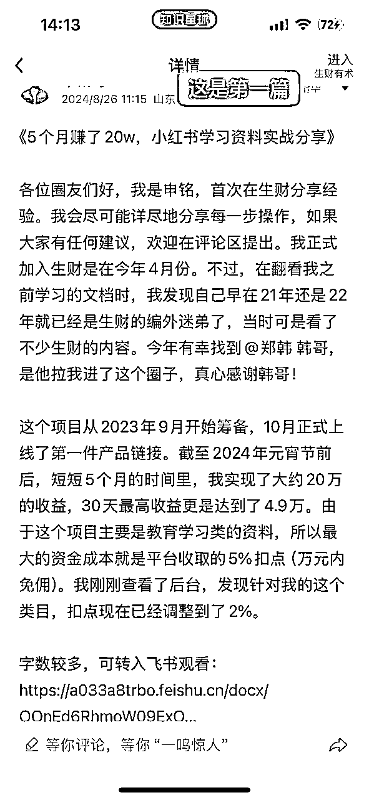
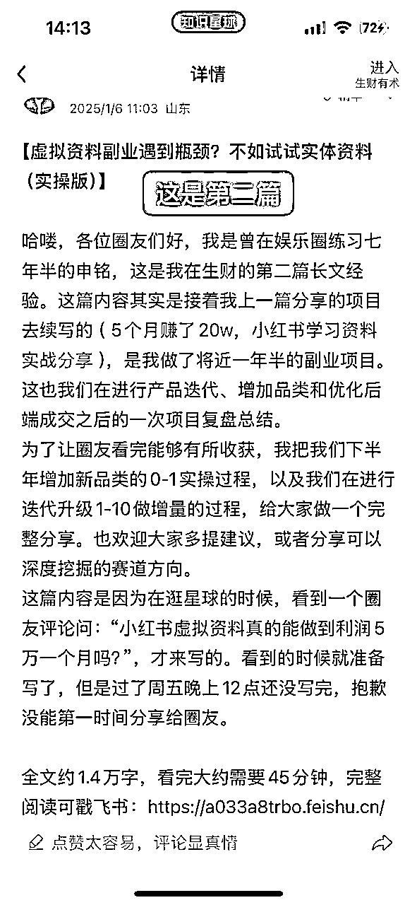
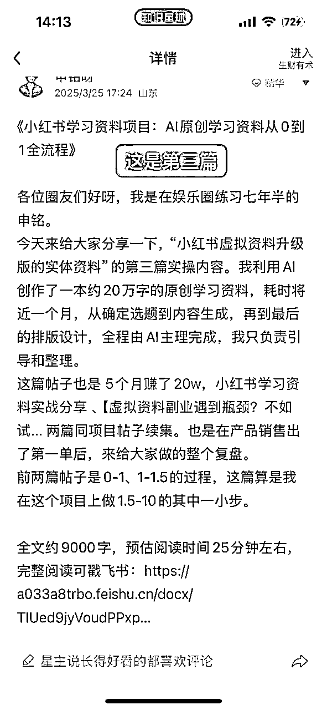
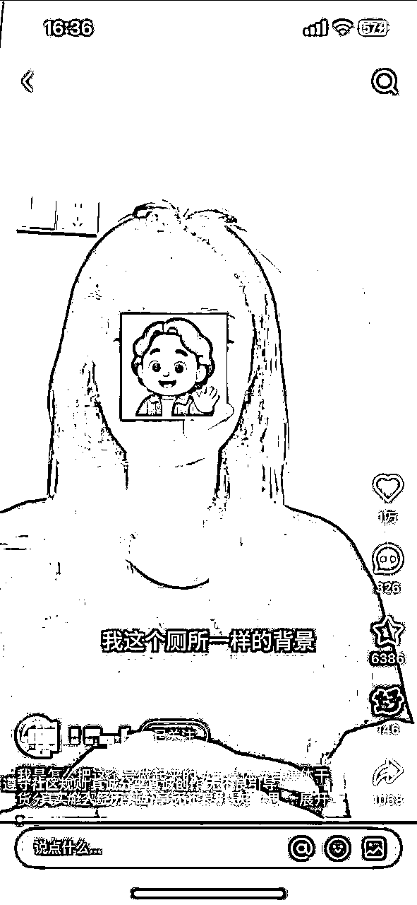
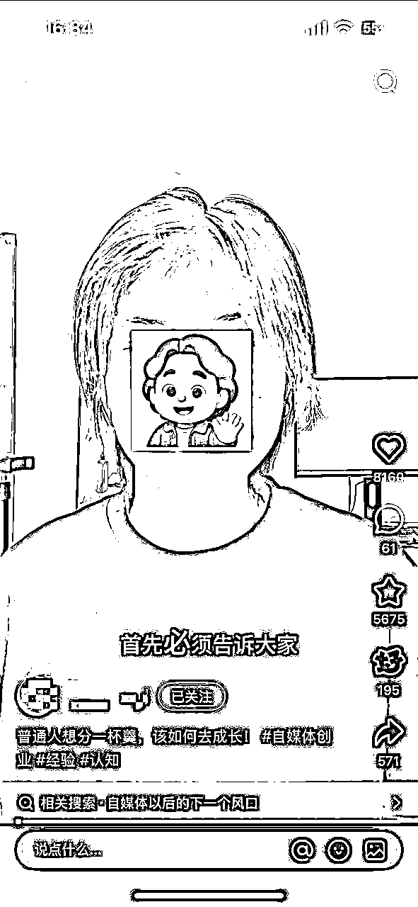

# 虚拟资料4.0复盘：把账号从货架变成活人，单店月销冲到20万+
作者：龙哥

大家好，我是龙哥，娱乐圈练舞七年半的“老练习生”。上次分享到现在隔了四个月，当时以为虚拟资料这条副业的复盘已经收尾，主业也挺忙。没想到一轮系统性重构后，项目又迎来二次爆发。这次迭代3月底就开始内部打磨，团队磨了近一周方案才上线执行，期间波折不少，但结果超出预期，赶在暑假前新打法账号起来了，目前单店月流水稳定在20万以上。

这一轮我们共动了3个号，现在能跑出相对稳定结果的只有1个，另外两个虽有上升但还未固化，我们还在持续试错。

这篇不讲从零起号，也不讲虚拟资料的基础起盘，主要想聊的是我们如何用“人设定位”去破开资料赛道的增长天花板。现阶段这正是我们碰到的最大卡点。

时间紧的朋友可直接跳过前言。这次仍是围绕📕学习资料的复盘，内部我们称之为学习资料或实体资料，也是《5个月赚了20w，📕学习资料实战分享-知识星球》《虚拟资料副业遇到瓶颈？不如试试实体资料（实操版）》《📕学习资料项目：AI原创学习资料从0到1全流程》的后续，建议按顺序阅读。

先说明为何我们必须走向重成本、重投入的真人感打法。因为撞上了三件绕不开的事：

一、分发规则变了，老套路失效。最初我们的笔记打法很直接：干货图+干货文案+干货实拍。那时在📕很吃香。现在平台逻辑已变。过去的爆款能吃半年，现在三个月前的爆款几乎不给量，必须持续造新品。搜索还能走量，但词位被压得很低。老模板还有数据，却很难成交。

二、同行低价+盗版泛滥，市场被搅乱。本以为复购率低和生命周期短是主因，结果最大冲击来自同行。资料在闲鱼、📕、淘宝、拼多多到处被搬运，同行一单不到十块，把价格体系打散。我们一级引流品正常客单在50到120，他们几块钱甩卖，且不做形象、不做品牌，只抄内容疯狂撒低价。做了三年资料，我见过各种抄作业：抄选题、抄标题、复制赠品结构，连前言都能一字不差搬走。正因如此，我更确信靠资料本身已无长期壁垒。只有做成IP人设，才有定价权、复购和护城河，这与我在主业做品牌的逻辑一致。

三、新号启动难度加大，稳定周期被拉长。图里是我们最近两个月起的新号之一，近期勉强稳住，但无法在一个月内快速破万，也做不到日销稳定，所以必须把人设融入起号。

3月底起我们用三个不同赛道的老号做人设改造尝试，结果分化明显，后面会展开。过去那套爆款粗暴打法能用但不可持续，必须转向更细腻、更有粘性的人格化玩法，对我们而言已是生存问题。

# 二、人设IP是长期答案

起步时我的想法简单：能赚钱就行。找爆款、发笔记、压选题，是典型的流量逻辑。品类成熟后会发现，流量不是核心，信任才是。

📕口号从你的生活指南变成你的生活兴趣社区，以前信息密度高的笔记，现在不如露脸带人的转化。内容越像一个真实可信的人，互动和曝光越好。

于是我们让几个号彻底转型，用IP人设绑定资料账号，把货架变成有专业、有温度、有辨识度的人。

有人问不露脸也能做，为什么要搞这么重？因为不做人设可以起量，但跑不长，也卖不出高价。

这次转向我们锁定三个目标：

信任背书：用户买的不是文件，是相信的人
我们很清楚，大多数人买资料并非立刻使用，他们买的是“我相信你整理的内容靠谱，你懂我现在的需求”。做人设的本质是把购买动作转化为“找个靠谱老师带我”的心理，如同直播带货的话术。举例，K12资料泛滥，若说是张雪峰团队精编版，转化完全不同。

差异化定位：内容可抄，人不可抄
最难盗版的永远是“你是谁”。赚钱上看到不少做考证、考研培训的伙伴跑出好结果，说明大厂已入场，他们的资源和产品力碾压个人团队，引流品更低，后端利润更高。我们只能做差异化。
多数同行的人设只是昵称+自我介绍，头像AI生成，毫无记忆点。
我们做的是“真人感IP”：露脸、讲经历、内容与定位匹配、带有风格化语气与个人观点。不是自恋型IP，而是📕流行的活人感，像身边的同事、老师、朋友，真实可信，甚至女生素颜口播。下面这张图不是我们的号，是我们参考的活人感案例。

情感链接与溢价：人设决定卖几次、卖多贵
虚拟资料本质是知识服务。能不能持续复购、能否抬价，全看能否建立情感连接。
没有连接，卖一次终结；有人设加持，小资料也能复购三次以上。
我们做过对照：在其他变量相同下，有露脸和人格表达的号，高客单转化明显更好，尤其89、99、129这个价位，用户几乎无议价。人设溢价价值很大。

人设配套我们做了两点强化：

内容层，保持一个号一人设一垂类，不混赛道。比如考公号整体围绕公务员教培老师构建；高考艺考号走“学姐+资料整合者”，穿搭也偏艺术生风格，因本人是艺术生更懂需求。我们甚至做号拆分，保证视觉、内容、角色统一。如考公可拆公文写作、行测两个号。
多号更累，但垂直度提升后转化率提高，停留时间变长，互动意愿增强。

形态层，视频为主、图文辅。视频人格感更强，这是结论而非建议。📕视频流量池远大于图文，上下滑机制给视频更多曝光，平台也更偏真人表达。我们直接把主形态从图文转为短视频：口播+故事+干货。

# 三、人设定位：找专属标签

人设容易空飘，内容与定位脱节。我们做资料账号人设时按“资料属性+用户需求”强绑定，分三步走。

第一步，拆解目标用户是谁
年龄职业：高中生、大学生、艺术生、待业者。
核心诉求：高中生要精准考点合集，大学生考教师资格证不懂知识点，艺术生要最新文艺常识，待业者想考公无方向。
痛点：渠道难找、懒、信息差、资料杂乱不会用。
假设目标是想考公的大学生或毕业几年者，痛点是没方向、不会规划、易丢分，想省钱自学不愿报课。

第二步，挖掘自身优势
经验：某考公机构服务五年以上、首考上岸、曾任公务员后离职等。
特长：擅长公文写作、面试、快速提炼时政要点。
价值观：拒绝割韭菜，只做有用内容。
注意，这一步可适度虚构，但要避免可查证的雷区。如说某年满分上岸某个岗位很容易被扒，人设崩塌。说在某大型机构待过多年则不易核实，机构人太多。但后续内容不要深挖机构内部，只做身份标签。
选品本身也很垂直，如考公只做公文、精读、面试。人设也必须与垂直资料对应。做知识付费，专精比全能转化高，站稳小市场即可，还能避免同质化。

第三步，确定关键词标签3-5个
如：前某考公一线讲师、专注公文写作、提分迅速。
可在简介里写，也可在口播中自然带入。如“我能让九成学生公文提分十分以上，靠的就是这套公式”。用户反复观看后，标签会逐渐沉淀。

# 四、视频落地怎么做

很多人以为做人设就是改名字、换封面，实际撑不起内容。我们第一阶段只在内容和视觉上改，纯口播效率高，转化已有明显提升。

内容主攻三类：

干货型：爆款选题+怎么看/怎么做的口播
先找历史爆款和同行半年爆款，在选题上加一个“如何看待/如何操作”的提问。侧面强化专业感。
如考公号近期“卤鹅哥”“labubu”“新闻联播”相关内容很火，可延展为“重庆卤鹅哥走红靠什么”“卤鹅哥给荣昌带来什么”，用于面试参考。
口播结构：提观点、拆逻辑、举例演示、引产品。例：这是典型X类问题，用A-B-C三段法答，套入卤鹅哥案例，最后告知最新时政已整理在资料里，由前一线老师整理。

故事型：用“我经历过”口吻讲干货
知识视频太干用户不爱看。传术师群里东山老师曾说：公域讲干货是做公益，过嘴瘾赚不到钱。人们要的不是干货，是被理解，是希望。用过来人语气讲同类内容，共鸣立刻起来。
如“我第一次考公失败的三个低级错误，别再踩坑”“上岸前我每天复习十二小时，真正提分的只有三件事”。核心仍是方法论，但加上人+情绪+经历，更易评论点赞，人设也更有人味。

共创型：从评论提选题
爆款评论区往往有几十上百条真实提问，是最好的选题库。做法：找点赞高的评论，提炼核心问题，用问答+人设口吻做视频。互动率高，用户会觉得你在陪他成长而非硬卖。

视觉层，赛道化改造
📕视觉包括封面、头像、服饰、场景，建议全改成赛道风格。如医考可穿白大褂，考公可穿体制内厅局风，目标用户会下意识信任。头像同步调整。可到相关场景拍摄，效果更好。风格需与人设统一，硬穿不搭反而违和。

# 五、产品落地怎么做

前面是呈现层的人设融合，这里讲如何把人设融进产品。别人卖干货，我们卖“带人的解决方案”。真实、有故事、有方法、有情绪，才是用户付费的真正理由。

资料设计本身就要体现人设
用户第一页就要感受到“是谁做的”“是否可信”。

前言/附录：400字左右人设故事+使用指南
资料首页加入人设故事，标准化两部分：
为什么做这份资料。如“这套资料原本为我弟整理”“我踩过坑不想你浪费时间”“我带过200多个考公学生，这是在点错题汇总”。打开即产生好感，觉得是为你好。
如何使用。不是简单目录，而是指导手册：先看哪章、怎么结合方法用，潜台词是“我在陪你学”。
放在首页，因含使用方法，大多数人会认真看完，后续浏览会带着滤镜。

赠品变人格化加餐
过去赠品无名无感。现在做成人设周边，提升分量。如“我还在用的XX复盘模板”“我整理的千条爆文标题清单”“人民时评七月最新精读分析”。用户会觉得是前辈的额外补充，而非附赠文件。

服务强化可信人设
我们现在很累，虚拟资料本应轻松，但为提升转化，一级产品都配服务。转化和复购明显提升，具体数值未统计。
服务包括：
售后保障：资料不满意可退款，退款不退货。用户需在私域🛰️申请，退款前完成线上签收并提供五星好评+评论。我们主动提供好评图文，大部分申请退款的都会留评。
免费一对一答疑：基本有问必答。现有两人专门回复消息，因非全行业精通会借助AI做中性回答，但核心业务由专业人士答，后端转化更好，人设更可靠。
这个售后虽然辛苦，但传递出极强的靠谱感，在当前市场非常稀缺。

总体而言，卖资料只是表象，真正卖的是人。希望这份4.0实战复盘能给你启发。

*   用户共创：像考公、高考这类资料本身带很强的时效性，必须常更。每次更新前我们都会在私域里发起征集——下一期你最希望补哪块？还缺什么内容？这种松散但持续的互动，让群里的人愿意常驻，也让单聊的复购和后链路产品的成交变得顺理成章。

# 六、结语

现在时间已经七点多了，我把结语写完，又把整篇从头翻了一遍。前面那部分是昨晚熬夜写的，读下来会发现，这篇内容并不像一份操作手册，更像是我个人的工作复盘在自言自语。为什么要做这样的调整，为什么从单纯卖资料转向经营人设，为什么现在开始要把IP打磨起来。

所以如果你是第一次接触我的分享，建议先回头去看我前三篇的笔记，再回来看这篇。人设这块单独拎出来看，很容易觉得我怎么一下子就开始谈定位、搭框架、做封面和口播了，跳跃感很强。

这些动作都不是脑子一热决定的，而是过去三年做虚拟资料副业沉淀下来的体感。

流量可以被平台算法带走，但信任带不走。

今天靠这个赛道、这个选题吃肉，明天就可能失效。账号短期可以靠爆款续命，长期想稳定，就必须有人设在兜底。普通电商要做长期生意靠的是品牌，我们这种小体量内容电商靠的就是人设。没有这层支撑，做得越久越累，成交越多越焦虑。更现实的是，我们这种副业小团队，根本没法跟那些十几几十人的团队、会做投放会做矩阵的大厂正面拼。唯一的穿透力，就是把人设、内容、商品三件事绑死。

补充一个之前没讲清楚的实操。团队现在在跑的三个露脸号，做法不一样。一个是用自己人出镜，两个是用演员。因为在青岛，影视资源比较多，演员一天800到1000就能请到，各年龄段都能找。想把状态拿出来，一天能出成果的量也就二十多条。

实操下来问题不少。演员镜头感是好，但表演味太重了，念词很假，有种AI配音感，用户完全代入不进去。还有一点更致命，演员到处接活，你今天在我们账号上看到他，明天可能就在信息流广告、短剧里看到他了。一旦目标用户对上号，信任感直接崩盘。所以我今天复盘，为什么那两个号数据是涨了，但涨得并不明显。

下一步思路比较清晰了。露脸IP还是回到自己人身上，真实，控制权也在自己手里。问题是账号一多，不可能每个号都养一个真人人设，这又带来新的资源分配矛盾。我们还在调整，等有结论会再复盘出来。