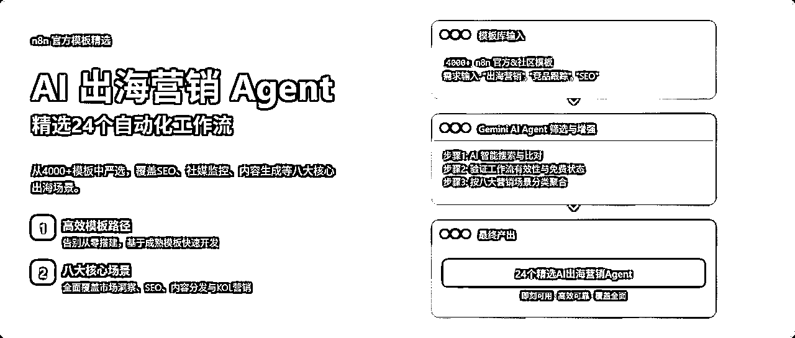
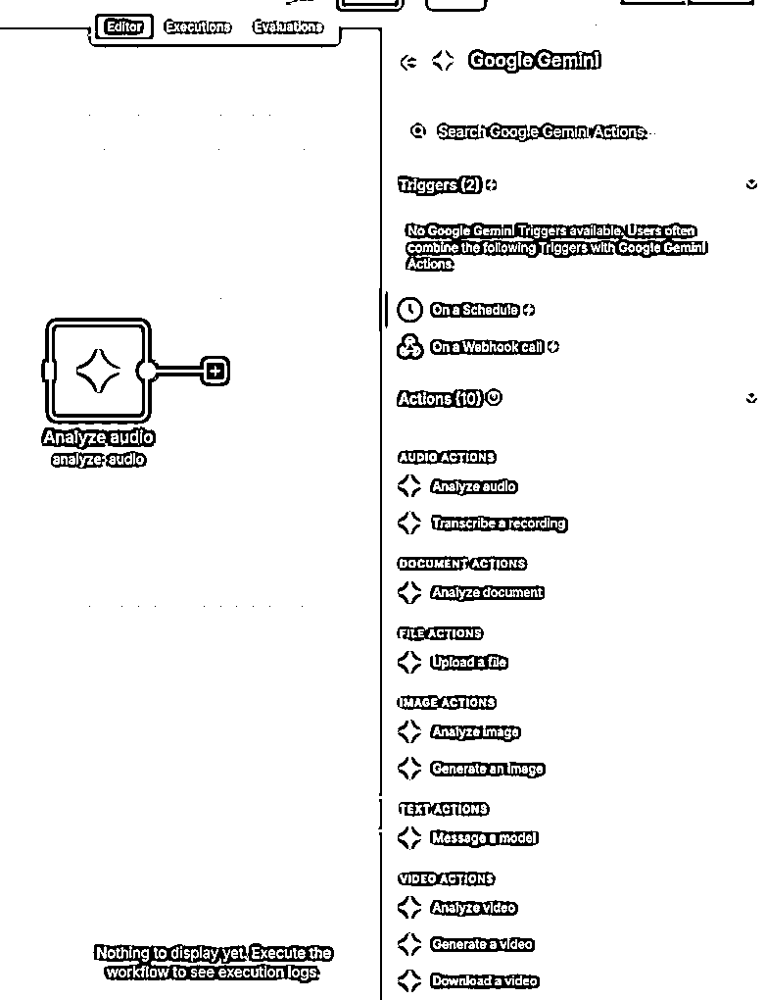
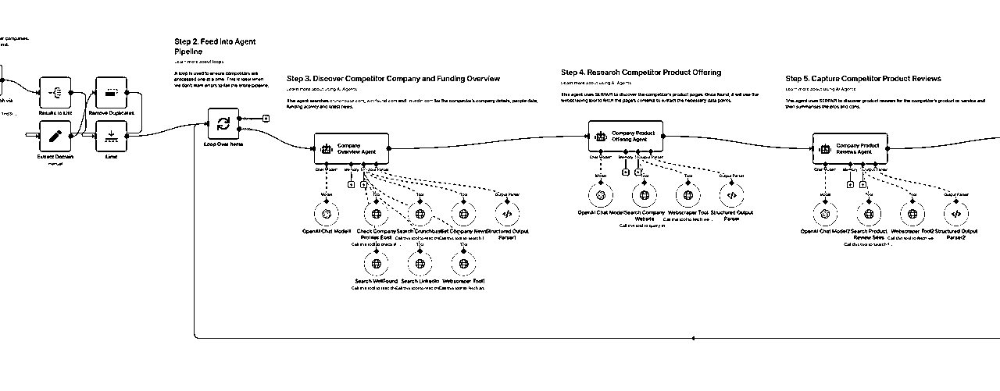
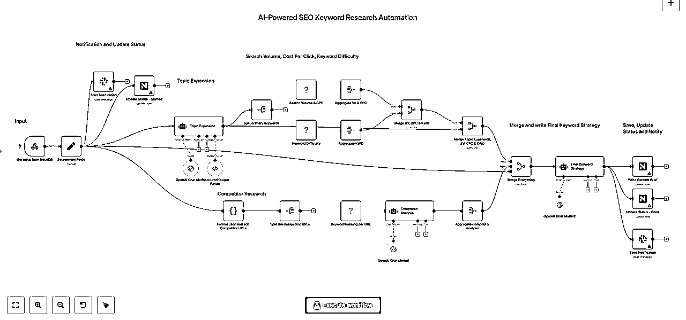
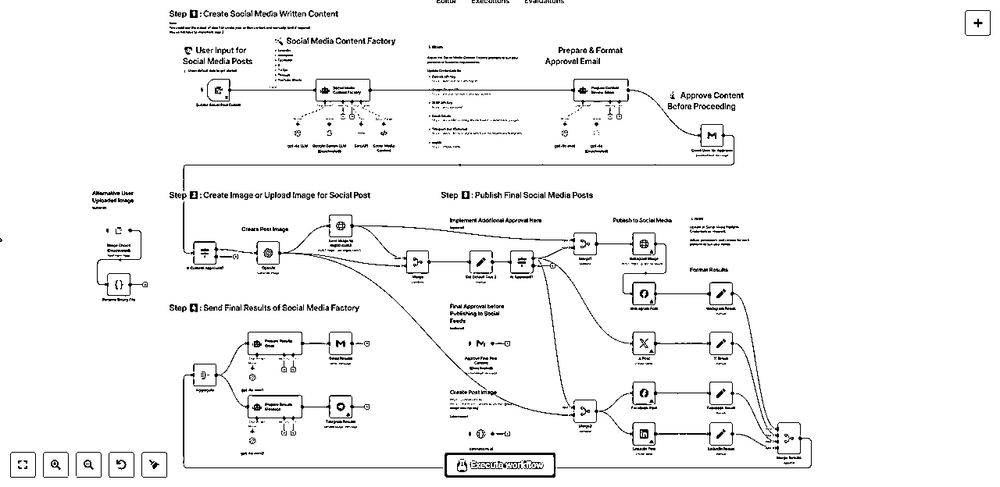

# 在 n8n 的数千个方案库里，我筛出24个海外营销智能体：覆盖SEO、竞品追踪、Reddit等八大方向
作者：龙哥

我最近在创业，帮国内团队做跨境增长。举个例子，之前为一个 DTC 品牌搭过一套监测体系：系统成天盯着竞品在社媒上的发言和价格波动，一旦有变化，模型会立刻作出解读并整理成简报，推到客户所在的飞书群。

支撑这套体系的，就是我经常提到的 n8n。和别的智能体工具相比，它的突出点是流程编排空间大，而且自带超过400个官方连接器，像 Reddit、Shopify、Google、Instagram 这类海外服务基本都能直接调用。最近它更新了 Gemini 模块，现在已经能够理解视频画面，甚至参与视频生成。

## 入门 n8n 的几个误区

很多朋友看完想亲自试试，但说实话，入门门槛不算低。我自己也吃过亏，最大的一个误区是想让模型直接“变”出一个能用的流程。到今天来看，这条路基本走不通。

你或许见过这类教程：让 Claude 写一句提示词，然后“一键生成”复杂流程。真去执行时你会发现差距很大——需求要讲得极其细致，产出的 JSON 还得反复修订，最后拿到的往往是一个极其简单的原型，有时根本执行不了。把那些时间花在手写一个，可能早就完成了。

痛定思痛后，我找到的最快路径是：拿别人已经验证过的成熟案例，站在它肩膀上改。这样可以迅速理解一个复杂方案的构造逻辑。

我常逛的两个地方：

*   n8n 官方模板库，目前有超过4000个可选方案：https://n8n.io/workflows/
*   awesome-n8n-templates，GitHub 网友收集了超过2000个案例：https://github.com/enescingoz/awesome-n8n-templates

方案一多，反而难挑。我的习惯是让 Gemini 的 DeepResearch 或 ChatGPT 的智能体先帮忙筛一轮：把需求描述清楚，它就能在库里搜索、横向比较，最终把最相关的几个推给我。

下面这一批就是按海外营销场景筛出来的，我已经验证过，无需付费即可直接用，大家可以放心拿去改。

### 1. 市场、竞品与需求洞察

1. 竞品调研方案（Exa.ai、Notion、智能体）
   - 给一个公司名，Exa.ai 会搜出它的竞争对手，然后由多个智能体分头深入分析，最后把报告归入 Notion。
   - https://n8n.io/workflows/2354-automate-competitor-research-with-exaai-notion-and-ai-agents/

2. 竞品网站改动监测（OpenAI、Firecrawl）
   - Firecrawl 每天造访目标站点并抓取内容，模型拿新旧版本做对比，如果改动有关键影响，就会通过 Gmail 发出提醒。
   - https://n8n.io/workflows/3101-monitor-competitors-websites-for-changes-with-openai-and-firecrawl/

3. 市场情报机器人（Firecrawl）
   - 定期去指定的新闻站抓资讯，模型按指定词筛选，提炼成三条核心信息，然后实时同步到团队的 Slack。
   - https://n8n.io/workflows/4588-firecrawl-ai-powered-market-intelligence-bot-automated-news-insights-delivery/

### 2. SEO场景

4. 关键词策略生成（OpenAI、DataForSEO）
   - 核心主题先丢给 OpenAI，让它扩展出长尾词和用户常问的问题；DataForSEO 负责给出检索量和竞争难度；最终由模型汇总，输出一份带竞品视角的完整策略。
   - https://n8n.io/workflows/3908-comprehensive-seo-keyword-research-with-openai-and-dataforseo-analytics-to-nocodb/

5. 外链机会挖掘（Bright Data、GPT-4o）
   - Bright Data 先把竞品的外链清单抓回来，GPT-4o 再逐条评估质量与匹配程度，筛选出的优质候选会存进 Google Sheets。
   - https://n8n.io/workflows/5958-track-and-analyze-backlink-opportunities-with-bright-data-mcp-and-gpt-4o/

6. WordPress 发文流程（Google Sheets、AI）
   - 从 Google Sheets 里读取选题，多个模型分工协作：一个写正文，一个生成配图，一个补充 SEO 信息，最后在 WordPress 后台完成建文并填好 Yoast 字段。
   - https://n8n.io/workflows/3085-automate-seo-optimized-wordpress-posts-with-ai-and-google-sheets/

### 3. 内容生产与分发

7. 跨渠道社媒内容创作与分发（Google Sheets、AI）
   - 表格里的创意会被改写成不同平台适用的文案和视觉，审核者通过邮件里的链接确认后，内容就会被推送出去。
   - https://n8n.io/workflows/3066-automate-multi-platform-social-media-content-creation-with-ai/

8. WordPress 博客批量生产（内容农场模式）
   - 这里像布置了一个虚拟编辑部：策划、作者、编辑等角色都由模型承担，从 RSS 源找素材开始，到写长文、制配图，再同步至外部站点，全程几乎无人介入。
   - https://n8n.io/workflows/5230-content-farming-ai-powered-blog-automation-for-wordpress/

9. 视频流水线生产与跨渠道分发（Google Sheets、AI）
   - 一个 Sheet 里的想法，会依次经过脚本、画面、配音等工序，最后由 Creatomate 拼成短视频，再被送往各大站点。
   - https://n8n.io/workflows/3442-fully-automated-ai-video-generation-and-multi-platform-publishing/

### 4. 网红/KOL

10. 网红活动统筹（智能打分、Gmail 外联）
    - 通过 API 找到达人后，模型会按照你设定的维度给出分数并排序，排在前面的人将收到定制邀约，后续的 ROI 也会被持续记录。
    - https://n8n.io/workflows/6073-manage-influencer-campaigns-across-social-media-with-ai-scoring-and-gmail-outreach/

11. TikTok 达人挖掘（Bright Data、Claude AI）
    - Bright Data 按目标词搜索 TikTok 创作者，Claude 负责评估他们与品牌的匹配度，并给出分数；之后流程会给高分者发送合作邮件。
    - https://n8n.io/workflows/4774-discover-and-analyze-tiktok-influencers-with-bright-data-claude-ai-and-email-outreach/

12. Instagram 网红内容监控（ScrapeGraphAI）
    - 每天定时运行，抓取合作达人新发布的帖子，模型继而分析互动情况、品牌提及量，并计算出投放的整体回报。
    - https://n8n.io/workflows/6641-instagram-influencer-content-monitor-with-scrapegraphai-analysis-and-roi-tracking/

### 5. LinkedIn

13. LinkedIn 好友邀请批量发送（Airtop）
    - Airtop 通过浏览器模拟真人操作，打开目标用户的页面，如果对方还不是好友，就代为点下“连接”。
    - https://n8n.io/workflows/4253-send-linkedin-connection-request-with-airtop/

14. LinkedIn 线索开发与沟通（AI）
    - 用自然语言描述理想客户是什么样的，智能体就能把它变成搜索条件，随后补全线索信息、打分，再向高分者发起好友邀请和后续跟进。
    - https://n8n.io/workflows/3490-automated-linkedin-lead-generation-scoring-and-communication-with-ai-agent/

15. LinkedIn 帖子编写（OpenAI、Google Sheets、邮件审批）
    - 从 Google Sheets 取一个想法，OpenAI 负责生成初稿，审阅者在邮件里点一下批准按钮，内容才会被公开。
    - https://n8n.io/workflows/4005-ai-generated-linkedin-posts-with-openai-google-sheets-and-email-approval-workflow/

### 6. TikTok

16. 模仿爆款 TikTok 并推广至 9 个渠道（Perplexity、Blotato）
    - 把一个热门视频链接放进去，流程会用模型重写脚本，再借助你的数字人形象制作新版本，最后由 Blotato 将成片分发给 9 个渠道。
    - https://n8n.io/workflows/4110-clone-viral-tiktoks-with-ai-avatars-and-auto-post-to-9-platforms-using-perplexity-and-blotato/

17. 病毒短视频生产与上传（Seedance 等）
    - 多个智能服务串联成一条生产线，先后完成创意、提示词、素材和音效，最终合成视频并送往 TikTok、YouTube 和 Instagram。
    - https://n8n.io/workflows/5338-generate-ai-viral-videos-with-seedance-and-upload-to-tiktok-youtube-and-instagram/

18. Veo3 + Blotato 的自动创作与分发
    - 每天先自动产出创意，再转化为适配 Google Veo3 的提示词，借它生成电影级画面，最后交给 Blotato 去跨网发布。
    - https://n8n.io/workflows/5035-generate-and-auto-post-ai-videos-to-social-media-with-veo3-and-blotato/

### 7. YouTube

19. YouTube 排期与元数据补充
    - 这套方案会先去提取频道里未公开视频的字幕，模型根据字幕内容写出标题、描述和标签，并设定好固定的发布时刻。
    - https://n8n.io/workflows/3900-automated-youtube-video-scheduling-and-ai-metadata-generation/

20. YouTube Shorts 生成助手
    - 在聊天窗口输入一个创意，系统会调用 OpenAI、ElevenLabs、Replicate 等工具，把脚本、配音和视觉素材一一准备好并合成短片。
    - https://n8n.io/workflows/2941-youtube-shorts-automation-tool/

21. 一体化视频生产与跨渠道发布（含 YouTube）
    - Google Sheets 里的创意经过一堆模型共同加工，会变成带配音和字幕的成片，随后出现在 YouTube 等站点。
    - https://n8n.io/workflows/3442-fully-automated-ai-video-generation-and-multi-platform-publishing/

### 8. Reddit场景

22. Reddit 讨论摘要
    - 根据某个词定时抓取帖子，模型过滤掉无关内容，再把有效讨论汇成一篇摘要，发送给团队。
    - https://n8n.io/workflows/1895-reddit-ai-digest/

23. 从 Reddit 发现商机
    - 持续关注某个社区的热门主题，GPT-4 会解读其中隐藏的用户痛点与商业切口，产出一份附有打分参考的洞察报告。
    - https://n8n.io/workflows/2978-analyze-reddit-posts-with-ai-to-identify-business-opportunities/

24. 文章链接转多平台社交帖（Gemini）
    - 粘贴一个网页链接，Gemini 会读取全文，并为 Reddit、X、LinkedIn 等渠道分别写出定制文案，配上网页截图后发出。
    - https://n8n.io/workflows/5128-auto-publish-web-articles-as-social-posts-for-x-linkedin-reddit-and-threads-with-gemini-ai/