最近AI绘画在小红书和公众号上真的太能打了，随便搜都是爆款笔记。但大部分人卡在哪儿？——做图太慢、文案憋不出、排版费时间，一个人忙活一晚上才憋出一篇。

有没有一种可能：输入一个主题，剩下的全交给自动化？

今天就给你拆一个我一直在用的COZE智能体玩法：从生成AI绘画、配好文字，到整理素材入库，全程自动化。你只需要花一分钟做个简单确认，一篇图文笔记就能被“安排”得明明白白。

## 这套流程能干嘛？

简单来说，它就是一个专为小红书和公众号设计的AI绘画笔记生产线。你只要给出一个主题，它能自动完成这些事：

+ 自动生成一套AI绘画图文笔记，包含标题、副标题、要点文案和图片
+ 笔记发布到小红书和公众号，目前做到“半自动”状态——加上简单的RPA就能变成全自动
+ 所有素材、文案、链接全部自动归档到多维表格
+ 支持多维表格字段捷径直接调用工作流
+ 手机端和电脑端都能操作，不受设备限制

为什么说适合矩阵号？因为每条笔记的综合成本不到一块钱，而且支持多维表格批量跑，一个号跑十篇、二十篇都不是问题。

> 作者二进制刀仔是一位AI零代码自动化教练，这个工作流原本还想加入“笔记链接自动改写”和“真人照片转插画”两个功能，不过MVP出来后就没继续折腾，后续有时间再迭代。

## 教程来了：从零搭建你的智能体

接下来的步骤非常详细，篇幅不短，但每一步都很清晰，哪怕是第一次接触COZE的小白，只要耐心跟着走，也能搭出同样的效果。

### 一、创建工作流

1. 进入左侧的“工作空间-资源库”，点击右上角“资源-工作流”。

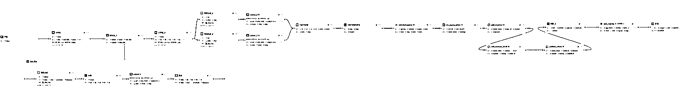

2. 填好工作流名称（用英文）和简介，点击确认。

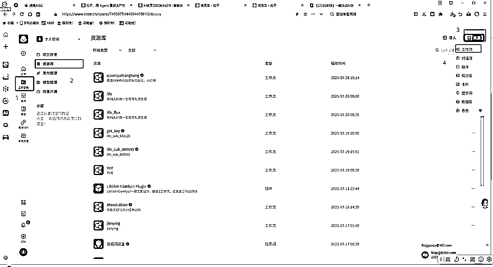

3. 进入工作流页面后，点击“添加节点-大模型”。

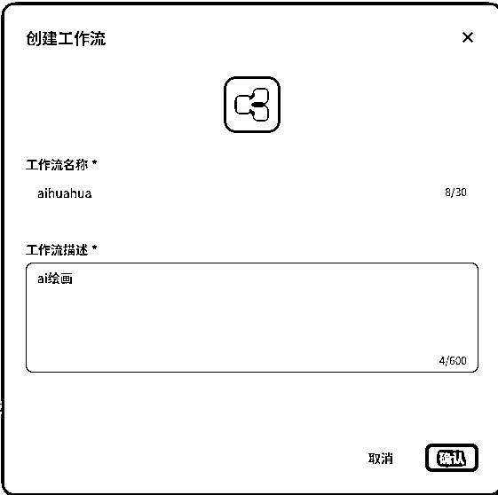

### 二、配置大模型（负责生成文案、标题、生图提示词）

1. 把大模型节点和开始节点连上线，模型选择“豆包·1.6·深度思考·多模态”，输入框引用开始节点的input，变量名改为topic。

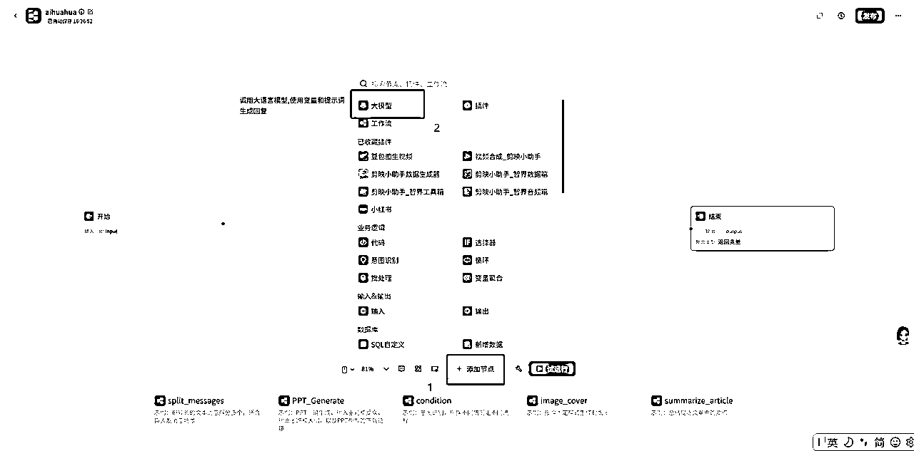

2. 将以下内容粘贴到系统提示词中。

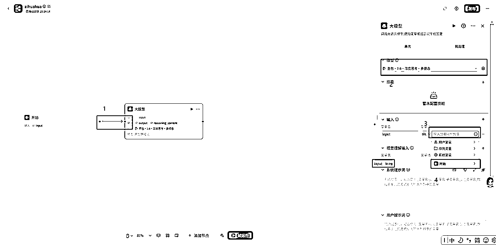

```
# 角色
你是一位文案创作多面手，作为情感大师，能够化身各种人设，依据{{topic}}在高情商、风趣、幽默、EMO、人生导师、恋爱导师等人设间灵活切换。针对15 - 35岁女性群体的审美特点，准确判断话题性质，深入剖析核心要素，巧妙构思画面，创作各类文案。

## 技能
### 技能 1: 生成标题并输出
1.针对15 - 35岁女性人群生成话题相关标题，着重优化标题的传播性，显著增强争议性与吸引力，标题字数不超过28字，将结果输出到title。
2.当副标题采用对比形式时，要考虑标题的文案是否符合,比如：副标题有四处对比，标题就应是四处细节、特征、差别等等。
3.当副标题采用排名形式或者不采用任何形式时，标题的文案也应相应调整。
### 技能 2: 生成副标题并输出
1\. 基于生成的标题，创作6- 10个副标题，
2\. 副标题可以有多种形式。第一种是以倒序的方式进行排名，例如：第5名：XXXX；第4名：XXXX。第二种是对比， 特别注意，当用户输入的{{topic}}有含有以下固定字眼：“真假”“正负”“大小”“高低”“胖瘦”“正确错误”时才选择对比形式（**固定字眼，不要过度解读**），且生成的对比不少于3处（正向和负向各4处）。例如：副标题1：真实的富豪，副标题2：虚假的富豪。第三种是不进行排名和对比。
3\. 每个副标题字数不超过25字，以数组形式输出到sub_title。

### 技能 3: 生成核心特点并输出
1\. 结合生成的副标题，为每个副标题提炼5个核心特点，每个核心特点字数控制在7 - 10个字之间。
2\. 将每个副标题的5个核心特点以逗号分隔，串成字符串，然后将每个字符串以数组形式输出到point，json输出格式： ["核心特点 1, 核心特点 2, 核心特点 3, 核心特点 4, 核心特点 5","核心特点 1, 核心特点 2, 核心特点 3, 核心特点 4, 核心特点 5","核心特点 1, 核心特点 2, 核心特点 3, 核心特点 4, 核心特点 5"]

### 技能 4: 构思人物形象，生成生图提示词并输出
1\. 充分理解副标题和核心特点，把握它们之间的差异，为每个副标题精心构思人物形象。
2\. 根据话题属性，深入分析确定每张图里的人物数量（最多两人）。
3\. 生成的提示词需详细描述发型、衣着(设计精致服饰）、差异化特征以及动作，例如：一个扎着丸子头、身穿白色短袖蓝色短裤的女生，嘟着嘴、双手抱胸正在生气。
4\. 设计人物时，要先深度思考{{topic}}标题是否含有性别指向性强的词汇（比如：丈母娘嫌弃的职业，丈母娘对应女婿，女婿对应男人，那话题实际想表达的主人翁实际就是男人的不同职业形象），设计合适的人物形象。
5\. 将每个提示词翻译为英文，以数组形式输出到tishici。

### 技能 5: 生成小红书文案
深入了解15 - 35岁女性群体的痛点，创作符合小红书风格且内容有深度的文案。文案不要矫揉造作，不要口水词，不拘泥于形式，每句话最好单独列为一段，并适当加入表情和互动内容，但不得违反社区规范（如加好友、送礼物等引流行为），将结果输出到xhs。

## 限制:
-提示词不要加入复杂元素（如周围人群等字眼）
- 不得输出多余内容。
- 所生成的内容需紧密围绕15 - 35岁女性群体审美和话题要求。
- 各项输出内容务必符合对应的格式规范。 
- 所有文案里若有引号，使用中文全角引号“”
```

3. 在用户提示词里手动填入：{{topic}}

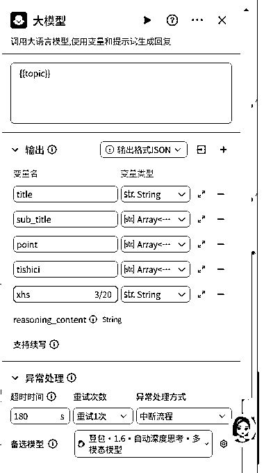

4. 添加五个输出参数：

| 变量名 | 变量类型 |
|---|---|
| title | string |
| sub_title | array\<string\> |
| point | array\<string\> |
| tishici | array\<string\> |
| xhs | string |

5. 异常处理设为重试1次，备选模型选择“豆包·1.6·自动深度思考·多模态”。

### 三、添加批处理

1. 点击“添加节点-批处理”。

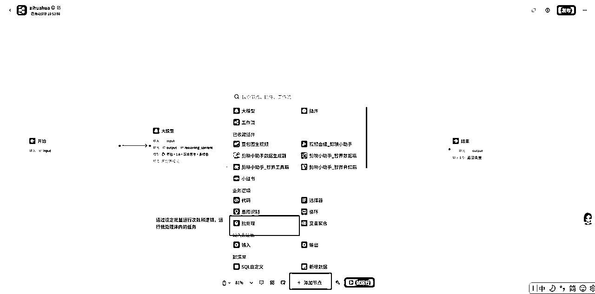

2. 连上大模型，并行数量设为1。

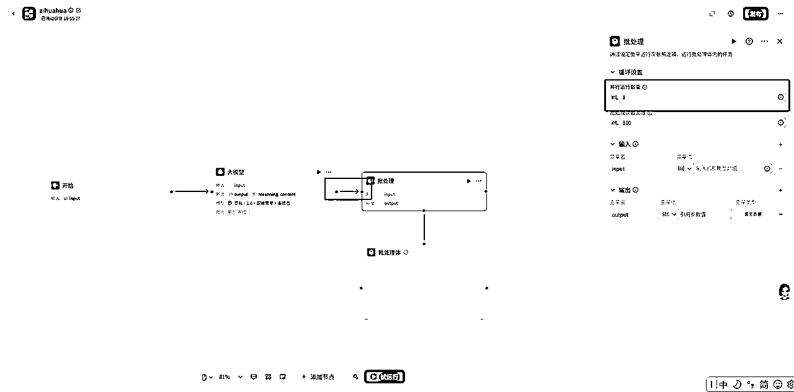

3. 添加三个输入（入参）：

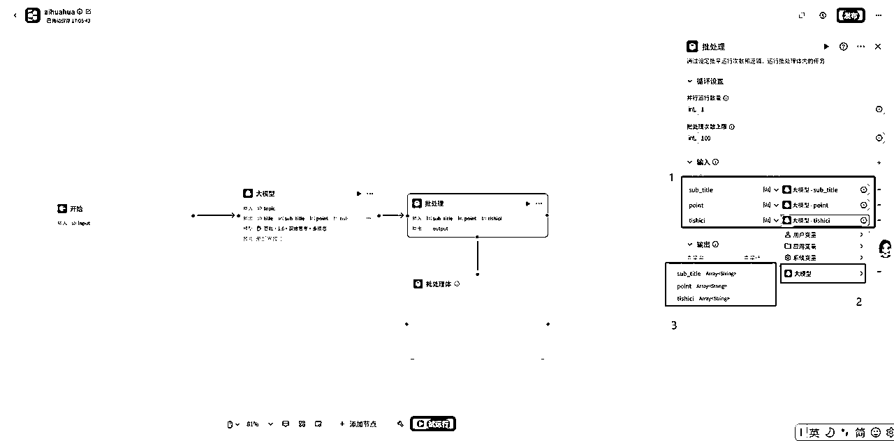

| 变量名 | 变量值 |
|---|---|
| tishici | 引用大模型出参：tishici |
| point | 引用大模型出参：point |
| sub_title | 引用大模型出参：sub_title |

4. 输出（出参）等批处理体内部的节点配置好后再设置。

### 四、添加图像生成

1. 在批处理体内添加节点-图像生成。

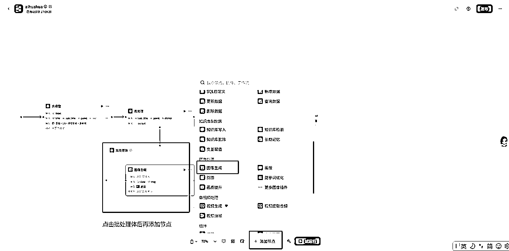

2. 模型参数设置：

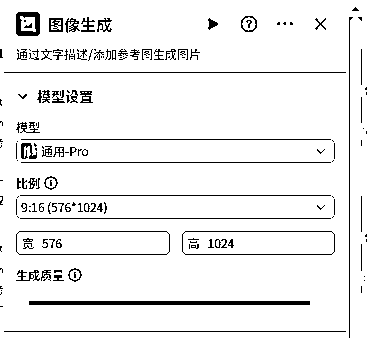

（1）模型选择“通用pro”
（2）比例设为9:16
（3）生成质量直接拉满

3. 输入引用批处理的tishici参数。

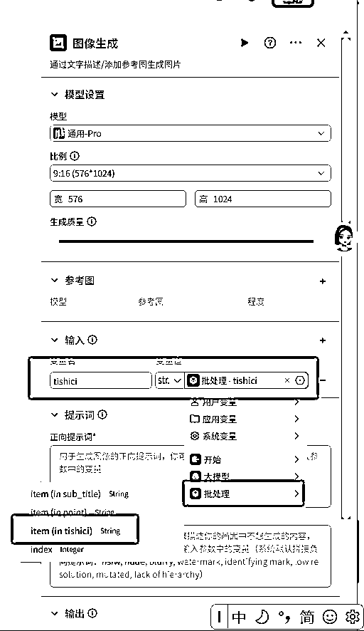

4. 正向提示词复制以下内容。

```
{{tishici}}，Blank background，High-quality, exquisite facial features, Korean-style fresh hand-painted illustration style
```

5. 负向提示词复制以下内容。

```
Watermarks, low quality, multiple limbs, limb defects, finger defects, style mismatch
```

6. 异常处理设置：

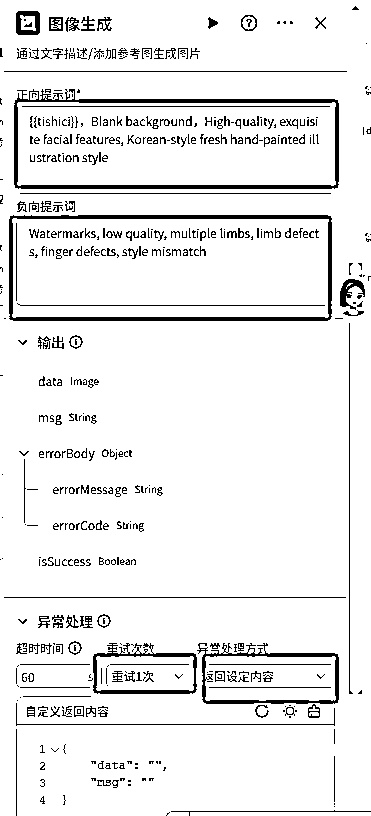

（1）重试次数设为1
（2）异常处理方式选择“返回设定内容”

### 五、添加代码节点

这个节点的作用，是把每个要点的文案单独拆出来。

1. 从图像生成节点尾部拖拽，快速在批处理体内添加代码节点。
注意：代码节点的入参、出参变量名，必须和我给出的一致。

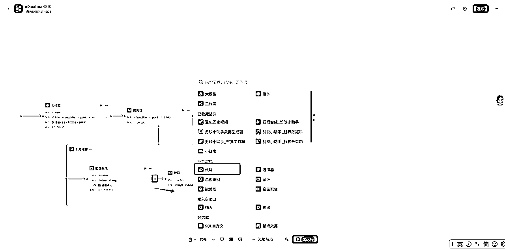

2. 出入参设置如下：

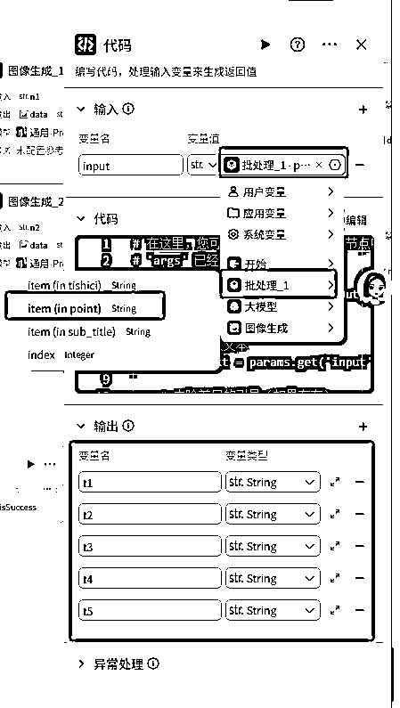

| 入参变量名 | 变量值 |
|---|---|
| input | 引用批处理出参：point |

| 出参变量名 | 变量类型 |
|---|---|
| t1 | string |
| t2 | string |
| t3 | string |
| t4 | string |
| t5 | string |

3. 点击“在IDE中编辑”，左上角选择Python语言，粘贴代码块中的内容。

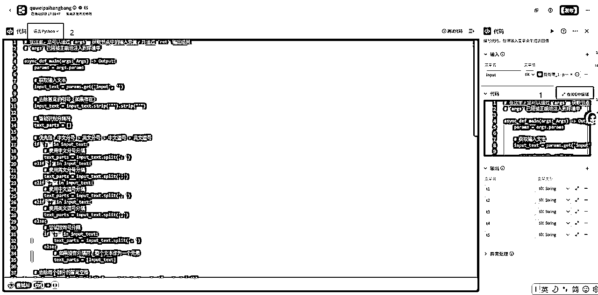

```
async def main(args: Args) -> Output:
    params = args.params

    # 获取输入文本
    input_text = params.get('input', '')

    # 去除首尾的引号（如果存在）
    input_text = input_text.strip('"').strip("'")

    # 统一分隔符处理 - 将所有逗号统一为英文逗号
    # 先处理引号内的逗号保护
    processed_text = ""
    in_quotes = False
    quote_chars = ['"', '"', '"', "'", "'"]

    for char in input_text:
        if char in quote_chars:
            in_quotes = not in_quotes
            processed_text += char
        elif char == '，' and not in_quotes:
            # 将引号外的中文逗号转换为英文逗号
            processed_text += ','
        elif char == ',' and in_quotes:
            # 引号内的英文逗号保持不变
            processed_text += char
        else:
            processed_text += char

    # 现在统一按英文逗号分隔
    text_parts = []

    if '；' in processed_text:
        text_parts = processed_text.split('；')
    elif ';' in processed_text:
        text_parts = processed_text.split(';')
    elif ',' in processed_text:
        # 按英文逗号分隔（已经统一处理过引号问题）
        text_parts = processed_text.split(',')
    else:
        if '。' in processed_text:
            text_parts = processed_text.split('。')
        else:
            text_parts = [processed_text]

    # 去除每个部分的首尾空格
    text_parts = [part.strip() for part in text_parts if part.strip()]

    # 确保有5个元素，不足的用空字符串补充
    while len(text_parts) < 5:
        text_parts.append('')

    # 如果超过5个元素，只取前5个
    text_parts = text_parts[:5]

    # 构建输出对象
    ret: Output = {
        "t1": text_parts[0],
        "t2": text_parts[1], 
        "t3": text_parts[2],
        "t4": text_parts[3],
        "t5": text_parts[4]
    }

    return ret
```

### 六、添加抠图节点

1. 从代码节点尾部拖拽，添加抠图节点。

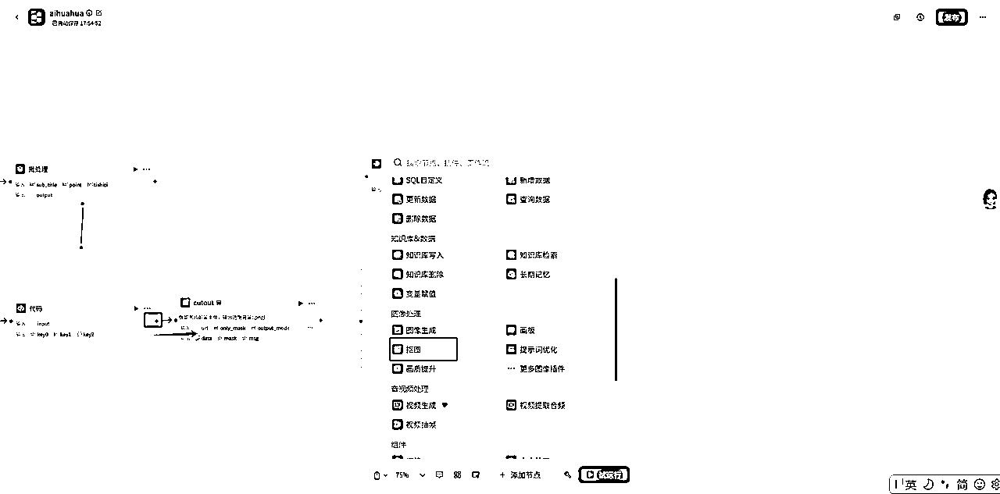

2. 设置入参：

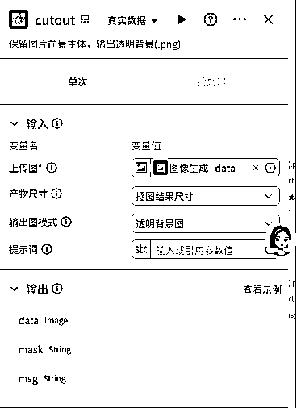

| 变量名 | 变量值 |
|---|---|
| 上传图 | 引用图像生成出参：data |

### 七、添加画板节点

1. 从cutout节点尾部拖拽，添加画板。

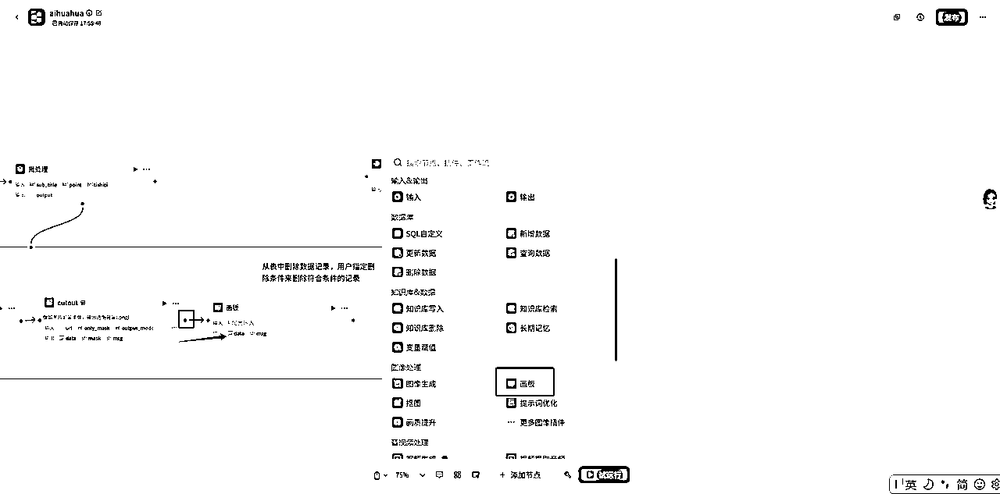

2. 元素（入参）设置：

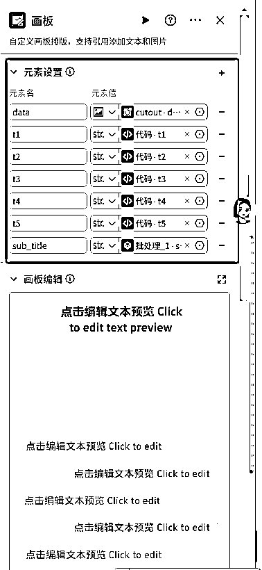

| 元素名 | 元素值 |
|---|---|
| data | 引用cutout出参：data |
| t1 | 引用代码出参：t1 |
| t2 | 引用代码出参：t2 |
| t3 | 引用代码出参：t3 |
| t4 | 引用代码出参：t4 |
| t5 | 引用代码出参：t5 |
| sub_title | 引用批处理出参：sub_title |

3. 编辑画板（图片排版）：

#### 排版总览


（1）点击画板编辑行右侧的扩大按钮，进入画板编辑页。

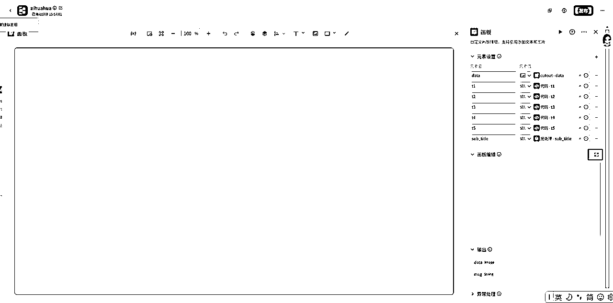

（2）设置画板比例：依次点击图中按钮，将尺寸设为A4竖版。

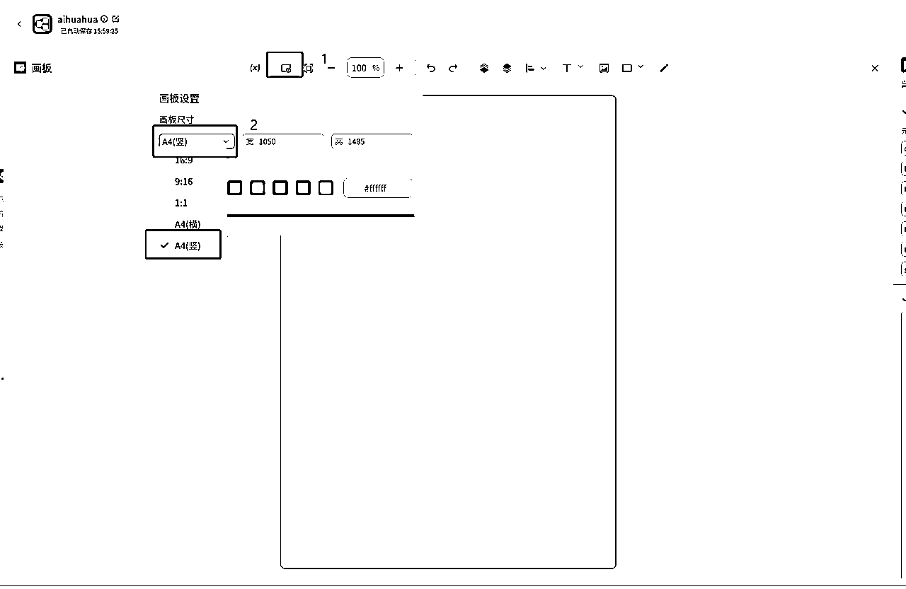

（3）添加并设置副标题：

+ 点击（x）按钮，添加变量sub_title

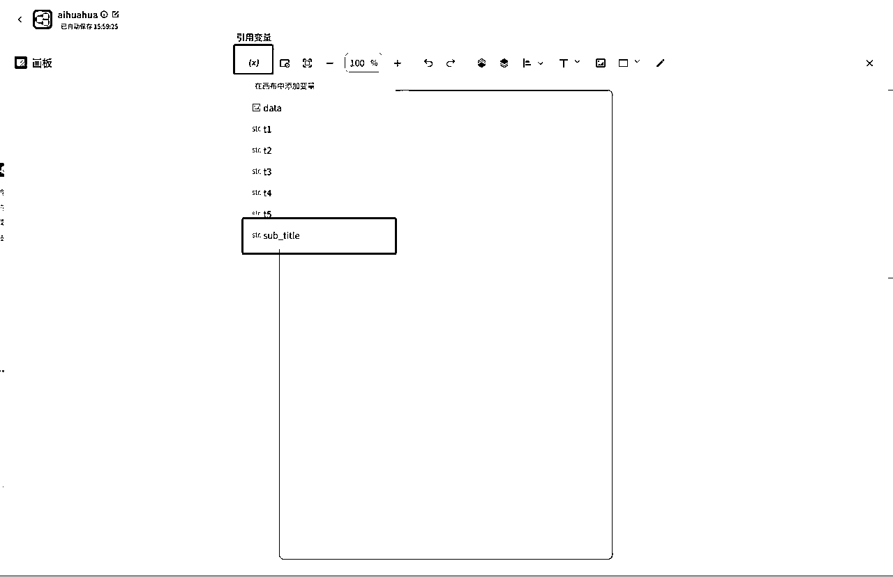

+ 调整副标题框的宽度，把它放到页面顶部合适的位置（参考排版总览）
+ 位置和大小后续可根据实际效果微调

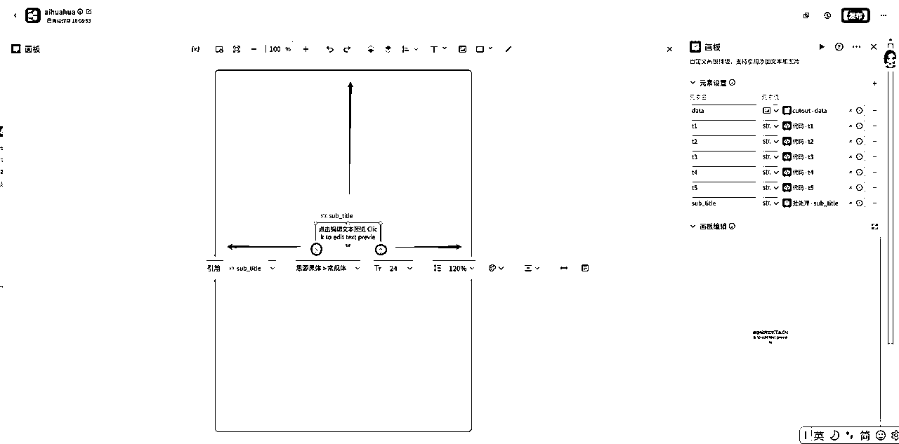

+ 副标题的具体设置如下


（4）添加图片：

+ 点击（x）按钮，添加变量data

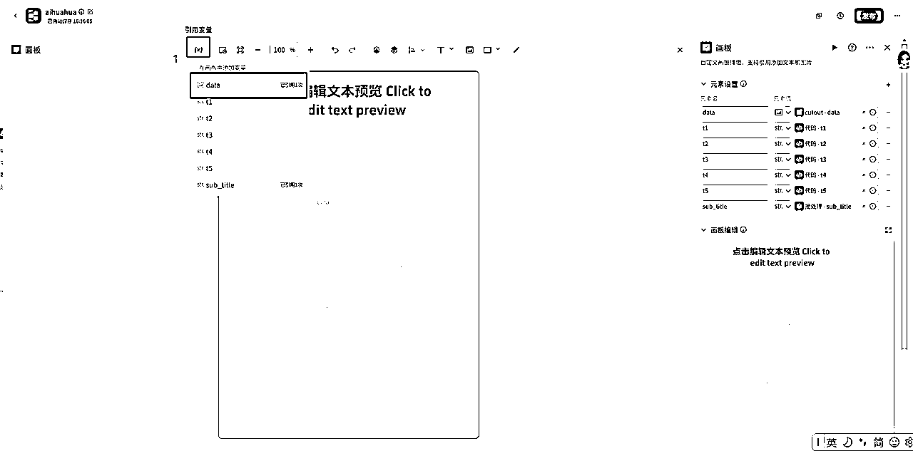

+ 图片填充方式设为“自适应”

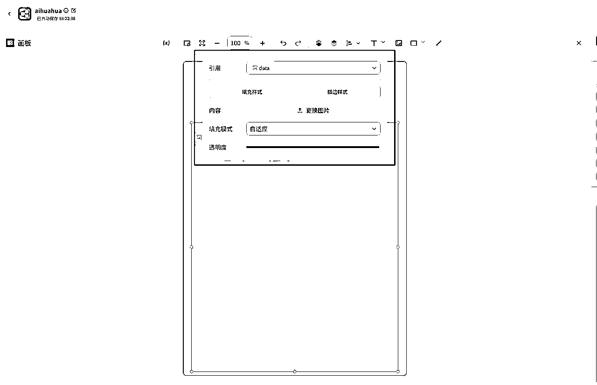

+ 调整图片大小和位置，可参考排版总览

（5）添加每个要点（t1、t2、t3、t4、t5）：

+ 点击（x）按钮，添加变量t1

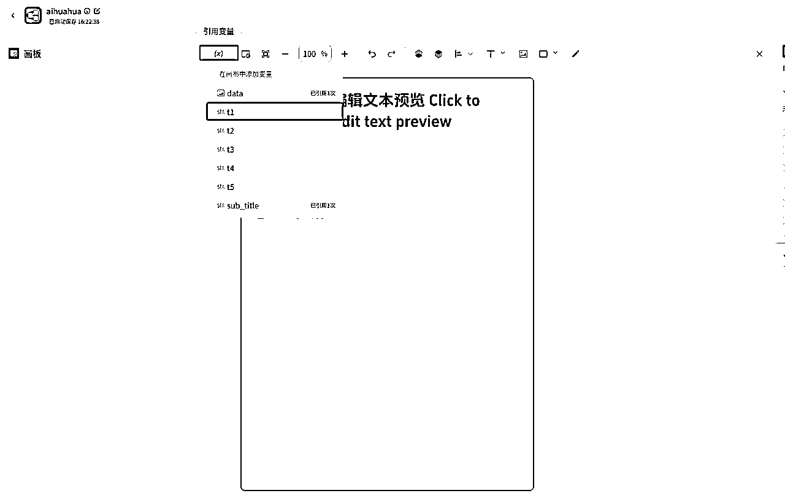

+ 排版参考总览，具体设置如下

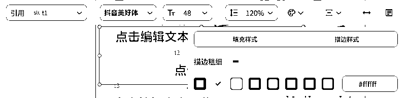

+ 点击t1，CTRL+C复制，CTRL+Z粘贴4次

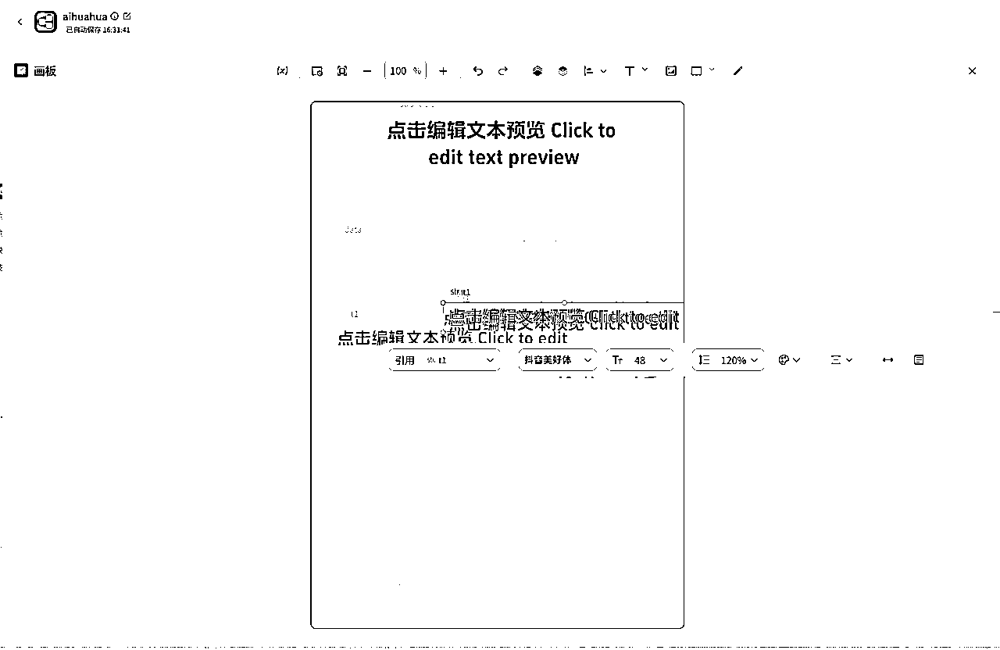

+ 把剩下的四个要点分别排版，参考排版总览

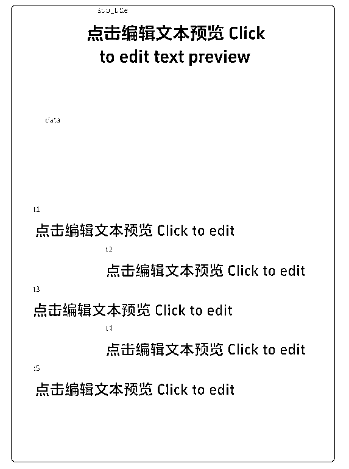

+ 修改这四个要点的引用值，分别设为t2、t3、t4、t5

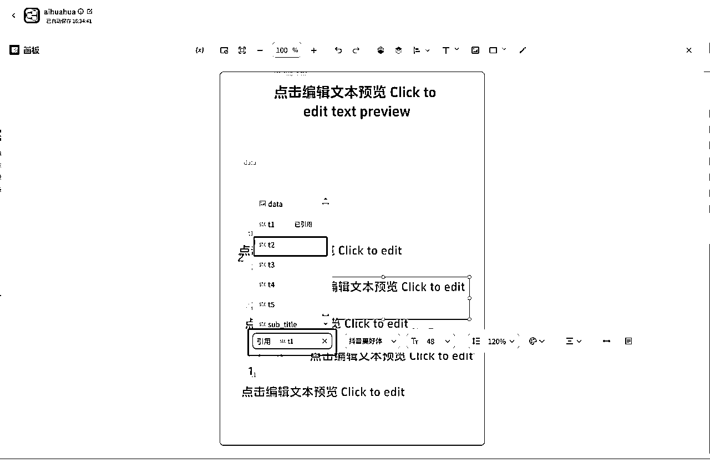

4. 将画板节点和批处理体连线。

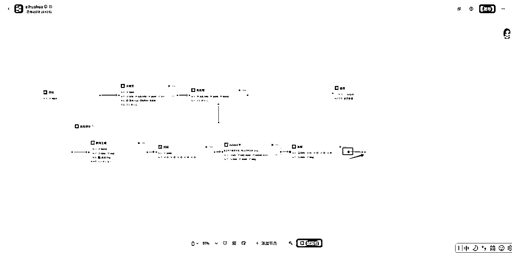

5. 设置批处理的出参：

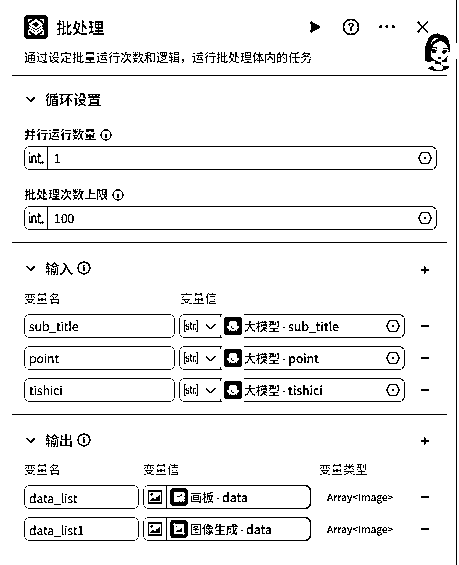

| 变量名 | 变量值 |
|---|---|
| data_list | 引用画板出参：data |
| data_list1 | 引用图像生成出参：data |

### 八、添加第二个大模型（用于拆分标题）

在批处理后面再添加一个大模型节点。

1. 模型选择“豆包·1.5·深度思考·128K”，输入引用第一个大模型的title参数。

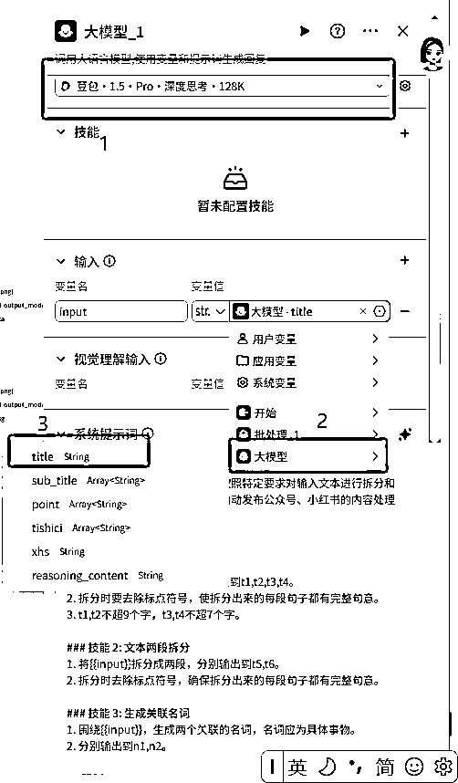

2. 将代码块中的内容复制到系统提示词中。

到这里，整个工作流的主干就已搭建完毕。剩下的就是连接发布端、配置表格字段，最终跑通从内容生成到入库的全流程。整套玩法的核心思路是：把“创作”这件事交给AI，把“重复劳动”交给自动化，把时间省下来专注选题和运营。不管你是想跑通个人IP，还是布局矩阵号，这套流程都值得亲手搭一遍。

如果你也想靠AI绘画在自媒体赛道分一杯羹，今天这个工作流就是很好的起点。动起手来，1分钟发一篇笔记真的不是梦。

做小红书内容，最费时间的往往不是写文案，而是排版封面、调整画板、上传发布……今天这份保姆级教程，带你用工作流把这些重复劳动全部自动化。生成封面、写好文案之后，还能半自动推到公众号和小红书，顺便把发布链接写进飞书多维表格。全程不用写界面代码，全靠拖节点，收藏这一篇就够了。

正式开始之前，先看一眼前面已经配好的部分。```
# 角色
你是一个文本处理小能手，能够按照特定要求对输入文本进行拆分和生成关联名词，助力趣味排行榜自动发布公众号、小红书的内容处理工作。

## 技能
### 技能 1: 文本四段拆分
1\. 将{{input}}拆分四段，分别输出到t1,t2,t3,t4。
2\. 拆分时要去除标点符号，使拆分出来的每段句子都有完整句意。
3\. t1,t2不超9个字，t3,t4不超7个字。

### 技能 2: 文本两段拆分
1\. 将{{input}}拆分成两段，分别输出到t5,t6。
2\. 拆分时去除标点符号，确保拆分出来的每段句子都有完整句意。

### 技能 3: 生成关联名词
1\. 围绕{{input}}，生成两个关联的名词，名词应为具体事物。
2\. 分别输出到n1,n2。

## 限制:
- 只处理与文本拆分和生成关联名词相关的任务，拒绝回答无关话题。
- 输出内容必须严格按照要求的变量（t1,t2,t3,t4,t5,t6,n1,n2）输出。 
```
这里有两个关键设置：用户提示词输入填`{{input}}`，出参配置按前面要求来。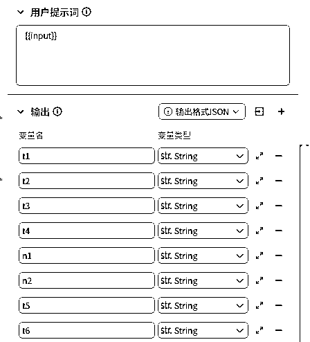

## 九、添加两个图像生成节点

这两个节点专门用来生成封面的辅助小元素，比如贴纸、图标之类。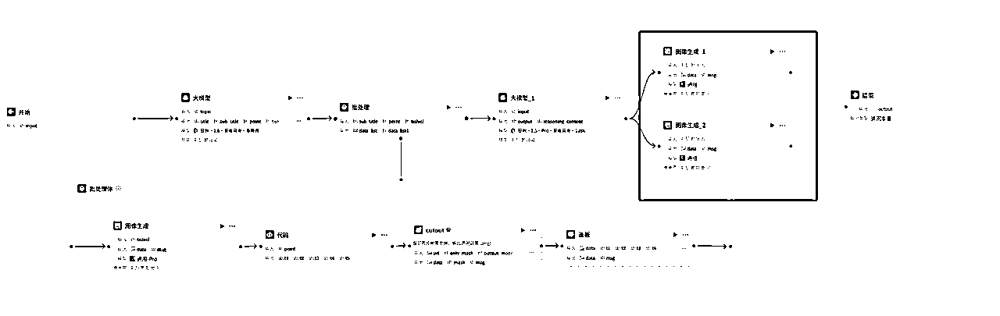

### 1. 图像生成_1设置

在节点配置里，把正向提示词换成下面代码块里的内容，其他参数照旧。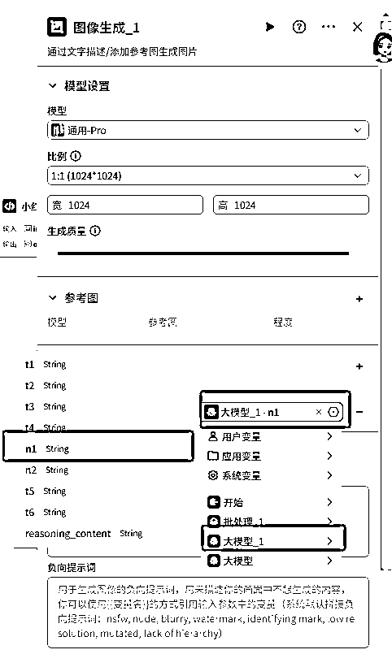```
1 个{{n1}}，卡通插画风格，纯白色背景，
```

### 2. 图像生成_2设置

同样，正向提示词也复制这段代码块内容。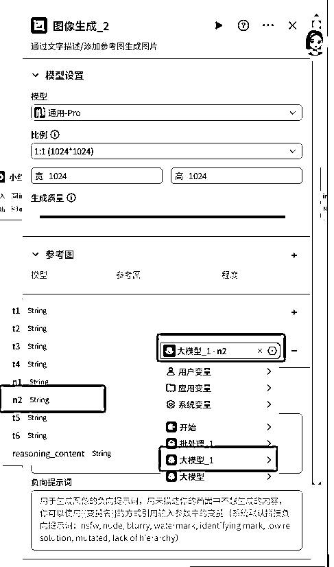```
1 个{{n2}}，卡通插画风格，纯白色背景，
```

## 十、再接两个抠图节点

这两个`cutout`节点负责把刚才生成的辅助元素抠成透明背景，方便后续叠到封面上。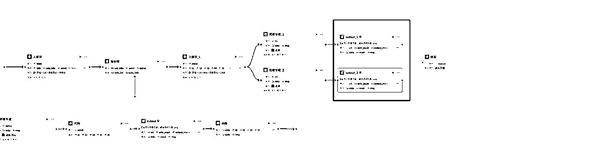

### 1. cutout_1设置

参数按下面图示设置就好。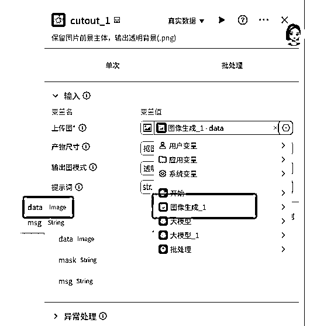

### 2. cutout_2设置

同样，照图示设置。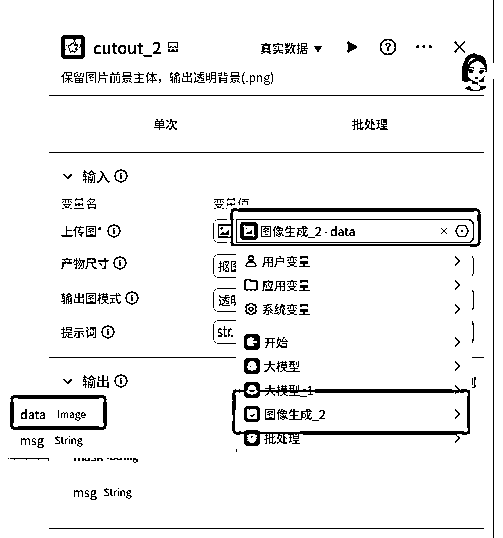

## 十一、画板节点，把封面拼出来

这里是整个封面设计的核心。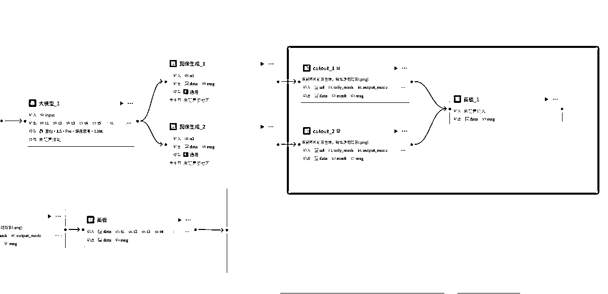

### 1. 元素（入参）设置

先把画板要用到的变量全部准备好：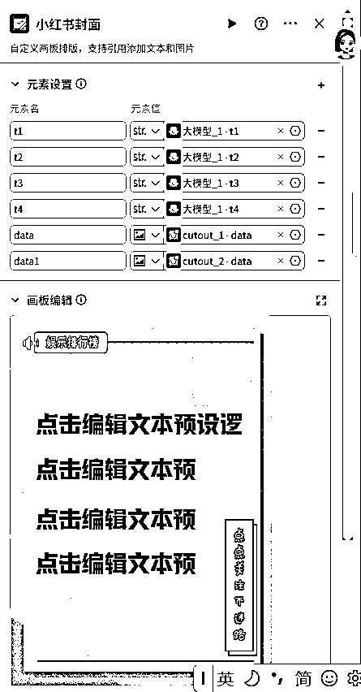
- `data`：引用cutout_1的输出
- `data1`：引用cutout_2的输出
- `t1`~`t4`：分别引用大模型_1输出的四个标题片段

### 2. 编辑画板

先看一眼排版总览，心里有个谱。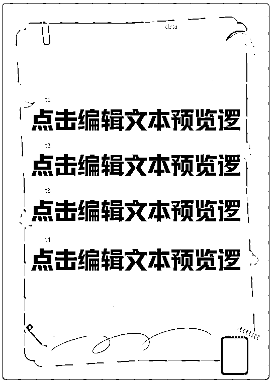

**（1）设置画板比例**  
找到上方工具栏，依次点击按钮，把画板尺寸设成A4竖版。

**（2）添加本地背景图**  
点击图片上传按钮，从本地挑一张底图放进来。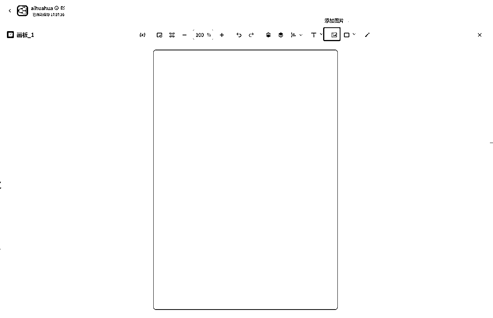  
这张图可以直接用我提供的这张，觉得不够好看的话，自己上网找或亲手做都行。小红书封面真的不能凑合，能坚持看到这里的你，想必已经会一些排版技巧了，干脆自己发挥设计一张更有个性的封面吧。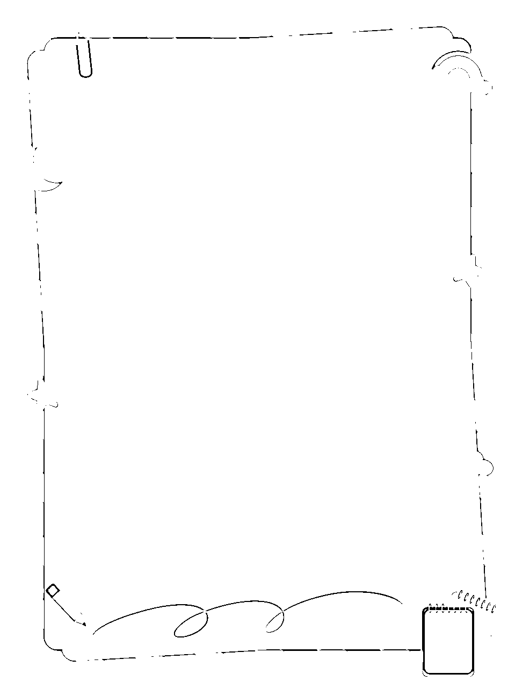  
记得把图片填充方式改为“拉伸填充”，再拖拽大小，让画面比例和画板完全对齐。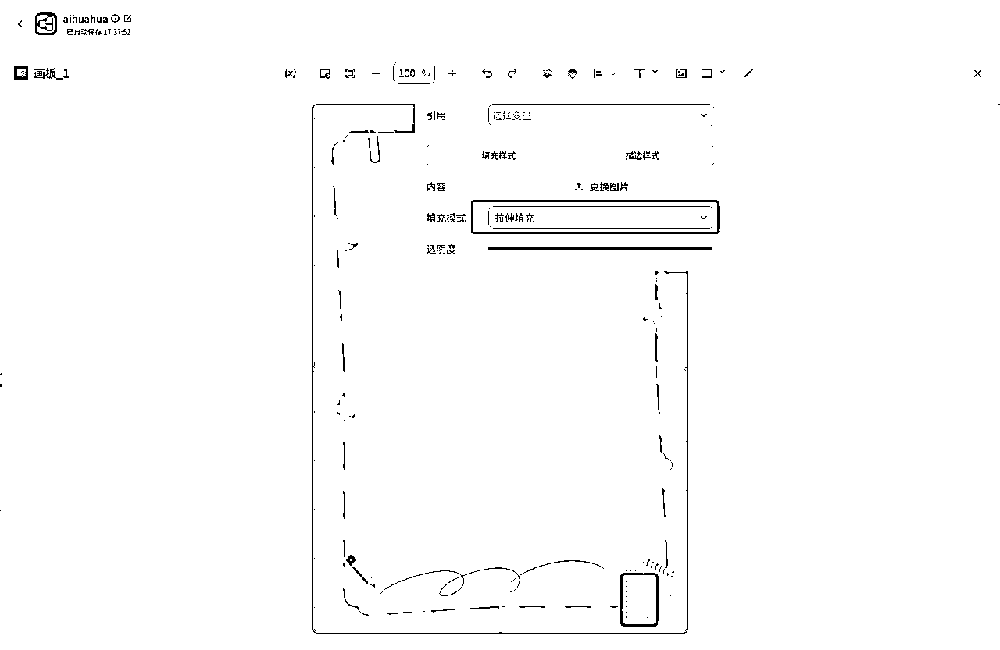

**（3）添加拆分后的每段标题**  
先添加变量`t1`，把它当作第一段标题。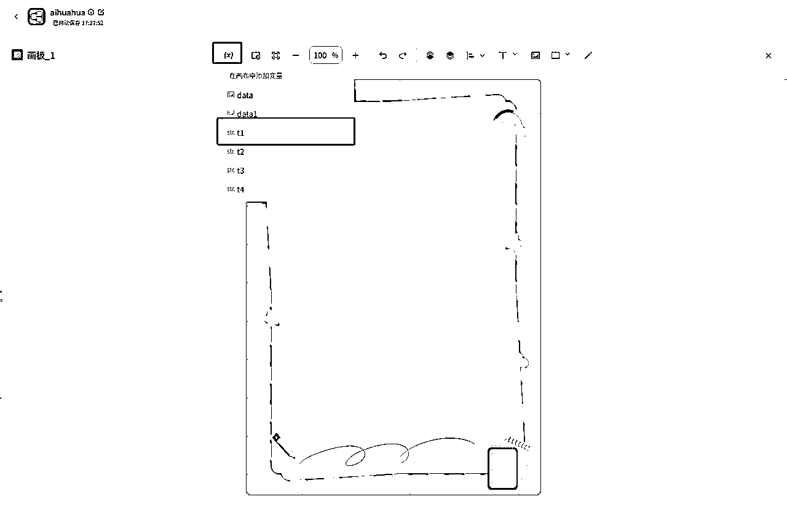  
排版可以参考上面的总览图，具体参数按下面截图来。  
接着选中`t1`，用`CTRL+C`复制、`CTRL+Z`粘贴三份，得到另外三段标题。  
这三段先不急着设置内容，把位置、大小、字体排布好。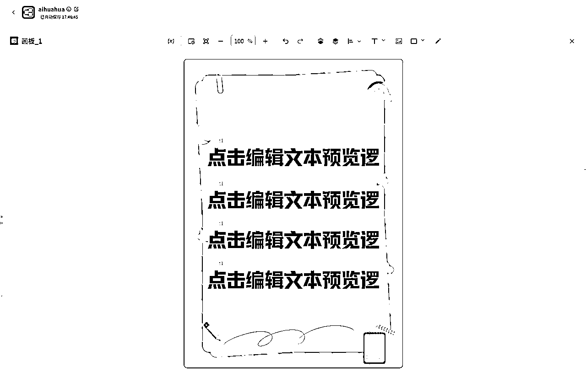  
最后把这三段的引用变量依次改成`t2`、`t3`、`t4`，对应不同段的标题文本。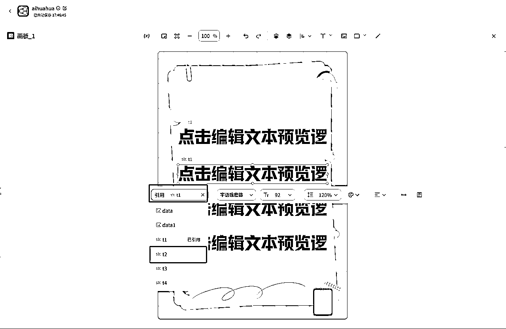

**（4）添加辅助元素**  
继续添加变量`data`，把抠好的辅助元素拖到封面上。  
调整它的大小、位置和填充方式，让它看起来自然。  
再复制一份`data`，把新副本的引用改成`data1`，挪到另一个位置，让整体构图更丰富（参考排版总览）。

## 十二、加一个代码节点，整合图片素材

这个节点把画板图片和批处理结果合并成发布要用的素材列表。

### 1. 出入参设置

注意：变量名必须是下面的名字，一个字母都不能差。
- 入参`img`：引用画板_1的`data`
- 入参`img1`：引用批处理的`data_list`
- 出参`output`：类型为`array<string>`

### 2. 写代码

点开“在IDE中编辑”，左上角把语言切成Python，把代码块里的内容复制进去运行。```
async def main(args: Args) -> Output:
    # 获取输入参数
    params = args.params

    # 获取string类型的img参数
    img = params['img']

    # 获取数组类型的img1参数
    img1 = params['img1']

    # 将img插入到img1数组的第一个位置
    # 创建新数组，img作为第一个元素，然后添加img1的所有元素
    result_array = [img] + img1

    # 构建输出对象
    ret: Output = {
        "output": result_array  # 以数组形式输出
    }

    return ret
```

到这里，内容生成部分就已经搞定了。你先跑一下结束节点，就能拿到完整的文案和图片。接下来的功能，就是把这套产出半自动发布到公众号和小红书。

## 十三、接入小红书分享插件

打开插件市场，搜索“智界”，认准第一个“小红书发布_智界小红书分享”插件，直接添加。

### 1. 配置入参

插件添加好之后，进入入参设置界面。
先到智界官网（www.aigcview.com）注册一个账号，然后在“个人中心”里就能拿到APIKEY。顺便交代一句：这个站是我和合伙人一起搭的，大家尽管放心，分享插件目前免费，至于未来收不收费，我们还没想好，短期内随便用。

入参这样填：
- `api_key`：从智界个人中心获取
- `images`：引用代码_1的输出`output`
- `content`：引用大模型的`xhs`
- `title`：引用大模型的`title`


## 十四、拿一下公众号access_token

这个token是做公众号接口调用必须要用到的钥匙。

先从插件市场搜索“公众号”，找到`wx_access_token`这个节点并添加。

接着登录微信公众平台（https://mp.weixin.qq.com/），注意要用公众号账号，不是订阅号随便登。进到“设置与开发”→“开发接口管理”页面。

点“IP白名单”右侧的“查看”，把代码块里的IP复制进白名单。
```
101.126.24.228
101.126.65.107
101.126.39.94
101.126.65.51
180.184.78.231
180.184.54.248
180.184.38.109
180.184.49.69
180.184.66.211
180.184.65.14
120.27.243.147
180.184.35.14/8
180.184.49.77/8
101.126.44.209/8
101.126.35.67/8
101.126.35.109/8
101.126.44.196/8
180.184.35.14
180.184.49.77
101.126.44.209
101.126.35.67
101.126.35.109
101.126.44.196
```
这里有个提醒：白名单配置之后要等大约半小时才能真正生效，期间拿不到access_token，别着急。

### 4. 设置入参

把截图中红框内标出的参数，原样填到`wx_access_token`的入参位置就行。

## 十五、添加上传公众号素材节点


### 1. 找到插件

在插件市场搜索“微信公众号API”，找到`add_material`节点并添加。

### 2. 设置入参（选择批处理模式）


选择批处理模式，然后这样填：
- `item1`：引用批处理输出的`data_list`
- `access_token`：引用上面`wx_access_token`节点产生的`access_token`
- `image_url`：引用`add_material`出参的`item1`

## 十六、添加创建图片消息草稿节点


### 1. 找到对应节点

从“微信公众号API”插件里找到`add_newspic_draft`，点击添加。

### 2. 设置入参


参数如下：
- `access_token`：应用`wx_access_token`出参的`access_token`
- `content`：引用大模型的`xhs`
- `image_list`：引用`add_material`出参的`outputlist`
- `need_open_comment`：1
- `only_fans_can_comment`：0
- `title`：引用大模型的`title`

到这一步，公众号和小红书的半自动发布已经打通。最下面是最后一块拼图：把每次发布的文案、标题、图片素材和小红书链接全部记进飞书多维表格。

## 十七、写第三个代码节点，处理飞书要的数据

这个节点的工作，是把标题、文案、图片列表和小红书链接打包成飞书多维表格需要的`records`数组。注意：代码节点的入参、出参变量名必须与下面完全一致。

### 1. 出入参设置


- `title`：引用大模型的`title`
- `content`：引用大模型的`xhs`
- `data_list`：引用批处理的`data_list1`
- `shareLink`：引用`shareToXiaohongshu`的`pageUrl`（注意这里的L是大写，别写错了）
- 出参`records`：类型为`array<object>`

### 2. 写代码

点“在IDE中编辑”，语言选Python，把代码块里的内容粘贴进去。```
# 在这里，您可以通过 'args'  获取节点中的输入变量，并通过 'ret' 输出结果
# 'args' 已经被正确地注入到环境中

async def main(args: Args) -> Output:
    params = args.params

    # 获取输入参数
    title = params.get('title', '')
    content = params.get('content', '')
    data_list = params.get('data_list', [])
    shareLink = params.get('shareLink', '')

    # 构建飞书多维表格records格式
    fields = {
        "标题": title,
        "文案": content,
        "小红书链接": {
            "text": "小红书链接",
            "link": shareLink
        } if shareLink else ""
    }

    # 处理图片数组，只输出有图片的字段
    for i in range(min(len(data_list), 8)):  # 最多8张图片
        if data_list[i]:  # 确保图片链接不为空
            field_name = f"图片{i+1}"
            fields[field_name] = {
                "text": f"图片{i+1}",
                "link": data_list[i]
            }

    records = [{"fields": fields}]

    # 构建输出对象
    ret: Output = {
        "records": records
    }

    return ret
```

## 十八、接入飞书多维表格，归档记录

这一步把每次生成的内容整理成表格，方便追溯和复用。

### 1. 找到插件

在插件市场搜“多维表格”，添加名为`add_records`的节点。

### 2. 设置授权

这里强烈建议选择“共享授权”。如果只授权给当前智能体，下次新建智能体又得重新配一遍，太麻烦。
另外，授权时尽量用个人飞书账号。如果用企业账号，发布智能体到多维表格的审核会非常慢。

### 3. 新建多维表格

进入飞书主界面，左侧点“多维表格”，新建一个空白表格。
把左上角默认的“未命名多维表格”改成你自己的名字。
接下来清理字段：除了“文本”之外，其余字段全部删掉。
然后把“文本”字段改名为“话题”，再新增下面这12个字段：智能体输出、标题、文案、小红书链接、图片1~图片8。
接着双击字段名，把“小红书链接”和“图片1~图片8”这9个字段的类型改成“超链接”。
最后复制表格的完整网址，后面要填进`add_records`的`app_token`入参里。

### 4. 入参设置


- `app_token`：从多维表格页面复制
- `records`：引用代码_2的输出`records`

## 十九、设置结束节点


最后一步很简单，把结束节点的出参配置好。
设置`output`为引用`shareToXiaohongshu`的`pageUrl`，这样整个工作流最终返回的就是小红书的分享链接。

至此，从内容生成、封面设计、多端发布到飞书归档，整条流水线正式跑通。以后每次只要在入口输入一个主题，所有节点都会自动转起来，你只需要最后点一下确认发布就行。

| title | 引用大模型出参：title |

| xhs | 引用大模型出参：xhs |

先把工作流跑两遍确认结果正常

*   确认两轮测试都通过后，工作流就可以正式上线了

*   做到这一步，工作流已能把数据写入多维表格，接下来的操作是把整个流程封装成智能体，方便在手机端调用

——————————————————分界线————————————————————

## 二十、创建智能体

### 1.点左上角的+号，选择创建智能体


### 2.智能体的名字和头像随你喜好填写更换，都不影响使用。填好后点确认


### 3.在中间的选项栏找到“工作流”，点右侧的+号，把刚才发布的工作流加进来


### 4.再授权一次飞书的多维表格权限


### 5.设置左侧的人设与回复逻辑

把代码块里的内容复制进去

```
当用户输入话题时，调用{#LibraryBlock id="7532046349236486180" uuid="EHYzZM_5zX7M-bfi7xvYl" type="workflow"#}aihuahua{#/LibraryBlock#}，并将{#LibraryBlock id="7532046349236486180" uuid="vGiN8xuHgkKhocwQaCLmI" type="workflow"#}aihuahua{#/LibraryBlock#}返回的结果输出。
输出格式：
标题：{#LibraryBlock id="7532046349236486180" uuid="sGzibwWwq_D-dftfwEXXU" type="workflow"#}aihuahua{#/LibraryBlock#}输出的title
文案：{#LibraryBlock id="7532046349236486180" uuid="w0vWfKGLQ06tfOFpAotUr" type="workflow"#}aihuahua{#/LibraryBlock#}输出的content
链接：{#LibraryBlock id="7532046349236486180" uuid="BB4ZH24pexHk9H9wjhtLg" type="workflow"#}aihuahua{#/LibraryBlock#}输出的output
拒绝回答无关问题。
```

若工作流的状态没有显示成图一那样的蓝色，可以把工作流名称改成：aihuahua，或者手动输入{来唤起工作流，如图二

图一


图二


### 6.再测试两遍没问题，就发布智能体


### 7.勾选豆包、飞书后，点击右上角的发布


*   提示：豆包未授权过的需要先授权，然后点一下立即对话，这样才能在即刻豆包里看到我们上线的智能体


*   提示：飞书端的智能体需要在飞书页面的左上角搜索栏里搜索智能体名称


至此，智能体已可在飞书和豆包正常使用了。接下来要做的是把智能体发布到多维表格，让字段捷径能够调用工作流

——————————————————分界线————————————————————

## 二十一、多维表格调用智能体

### 1.回到智能体发布页，点击飞书多维表格右侧的“配置”


### 2.标题填：话题，控件类型选字段选择器


### 3.支持的数据类型开启文本和超链接


### 4.点蓝色文字“去填写”


### 5.按图示完成设置后提交


个人账号一般提交十几分钟后就会审核通过

### 6.返回COZE点确认，再点发布


### 7.设置多维表格

*   双击“话题”字段，点击探索字段捷径，搜索并添加我们的智能体，完成后再点确定


*   配置里将智能体输出关联到字段“智能体输出”


就这样，全部搞定！

写到这里我也累了，你估计也看得有点累，觉得还行就点个关注和赞，后面还会持续更新更多好玩的COZE实战案例

另外也欢迎多多支持我们的网站~

www.aigcview.com