# 复制一下，内容自动落进表格：我用n8n搭的零阻力灵感收集方案


先简单交代背景：我是富百，坐标赚钱，平时也在YouTube的“深海圈”当教练，做自动化相关的事，最排斥低效重复。

前两天龙哥正好发布了n8n的超级标。而我那段时间一直被同一个需求挠心：灵感总是存不下来。场景你大概率熟——

读订阅号遇到一句说到心坎里的话，刷📕/即刻/X瞥见一段精彩的表达，想留个底。下一步要么是切到别的App，要么退回🛰️发给自己。

脑子里蹦出来的零碎念头也一样：有时存进A软件，有时写在B页面，过几天回头找，完全不记得它躺在哪个角落。

我最早规规矩矩用笔记类App。问题在于切换成本太高，苹果后台又动不动杀进程，切出去再回来光等就要好几秒；等窗口终于打开，记录的热情也凉了大半。

后来我退回最笨的办法——转发给自己的另一个🛰️号。发倒是顺手，可整理起来一团糟：消息没法统一编辑，没法打勾，也没法归档。时间一长，一堆散件躺在聊天记录里，基本等于废了。

说白了，我是靠内容吃饭的，必须把“留下来”这件事的阻力压到最低，创作欲才不会被流程磨灭。我不愿多折腾，又舍不得丢掉任何一闪而过的想法。最理想的动作只有一个：复制，然后放进某个我永远找得到的地方。剩下的，等有空再归类就好。

于是我用n8n搭了一条自动化管道，全程不需要切换界面，内容几秒内就能进入飞书。所有零散素材最终汇到唯一一张清单里。结构轻，体验顺，后续还能随手长出各种自定义玩法。

## 实际用起来是什么感觉

先用手指选中一段文字，拷贝，再激活手机里预设的快捷触发——这段内容就直接送进飞书，不会经过任何中转。

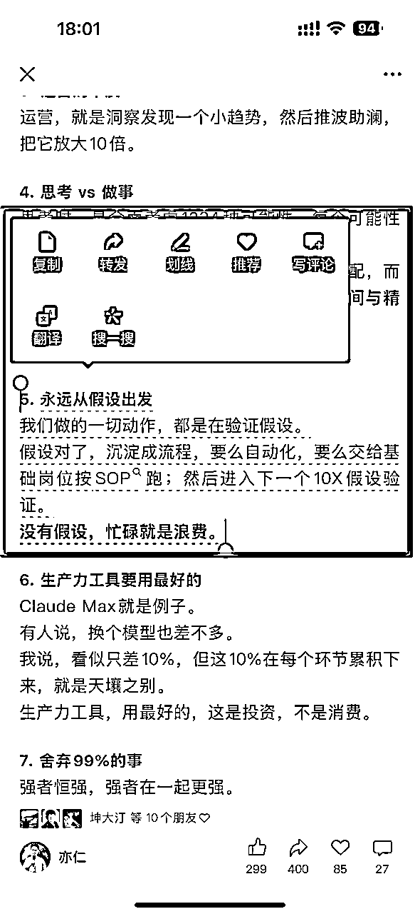

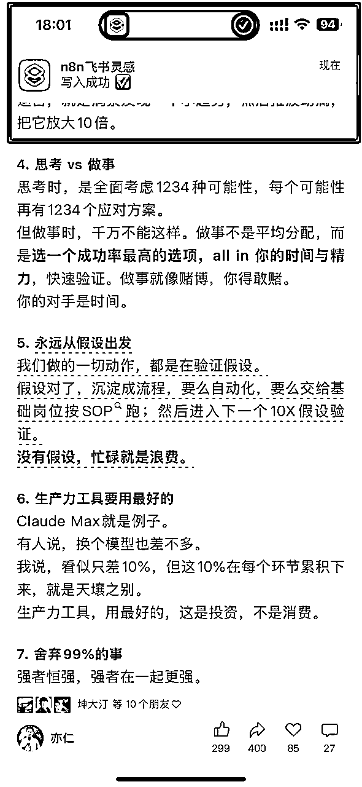

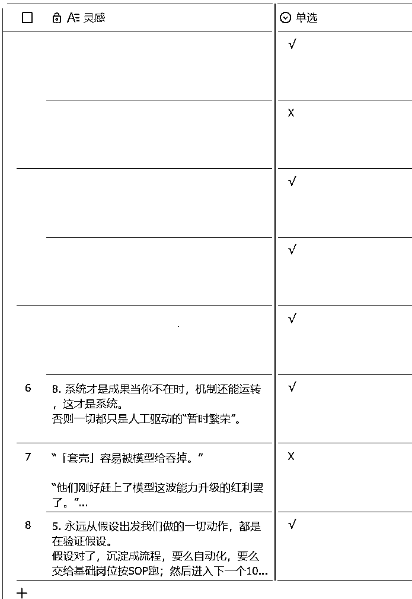

这一招不挑App。网页里看到的好句子，别人发来的消息，自己临时敲的一段话，只要选中并且复制，统统能投递进去。不用离开当前界面，这就是一个懒人为自己设下的最低门槛。

存在飞书里的好处，首先是横跨手机和电脑，随手就能打开，操作也符合日常习惯。其次，表内可以打勾、分类、贴标签，延展空间很大。

还有一层微妙优势：飞书自带工作氛围，一进来就容易切换到“干正事”的状态。回想以前发🛰️给“文件传输助手式”的自己，只要点开聊天框，才收两三样素材，就可能被来回的消息带跑好几分钟。

## 搭建步骤

### 整条链路怎么设计

手机端复制 → 唤起系统快捷操作 → 让n8n接收并处理 → 写入飞书。环节少，逻辑直球，零基础也能照着做。

### 开工前需要准备的

- 一台能连上的n8n实例，官方云托管或自己部署都可以；
- 一个飞书自建应用：能取到 app_id / app_secret，目标多维表格的 app_id / table_id 也要一并拿好；
- 给应用开通“写入”权限。

### 动手配流程

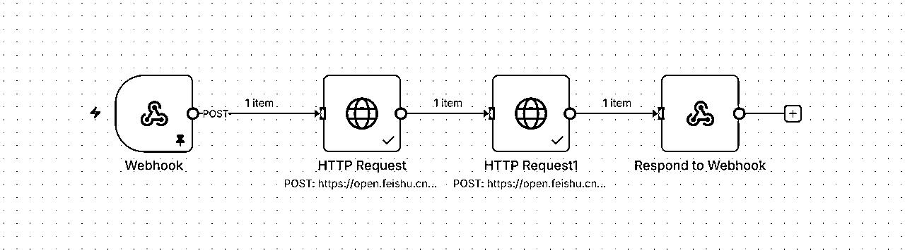

整条自动化链路只有四个环节。

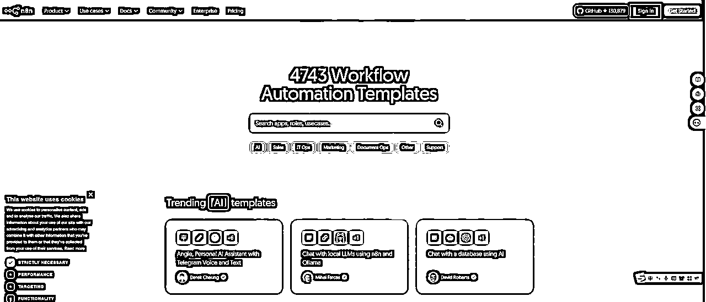

我的建议：直接用官方云版试用，头15天免费，登录即用，不需要处理环境安装。先把需求验证通，确认这套工具确实对你有用，再迁到本地或其他云上也不迟。后续想深入了解，补一下n8n的航海手册内容即可。

https://n8n.io/workflows/

打开网址并登录，先看到的是默认工作台。

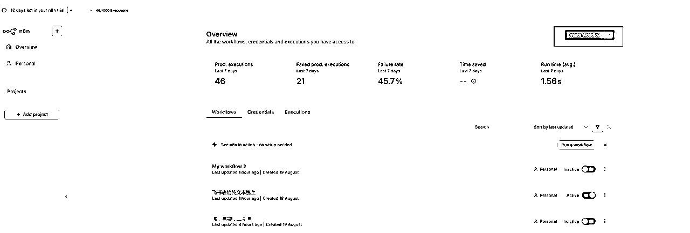

点一下Create Workflow，进入空白画布。

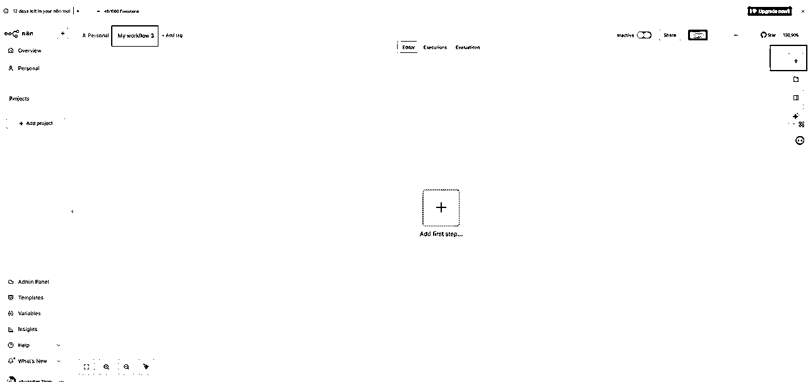

左上角给流程起个名字；右上角的+号用来搜索和添加节点。

### 第一个环节：接收信号的入口

放一个Webhook，作用等同“收件箱”，所有快捷触发发来的消息都会先敲它的大门。

Webhook换个通俗的说法：它是API的一种被动变体。某系统遇到特定事件（比如收到新订单），会主动呼叫另一个系统（例如n8n）去做下一步，像是电路里自动跳闸的开关——事件一发生，信号自动到达。

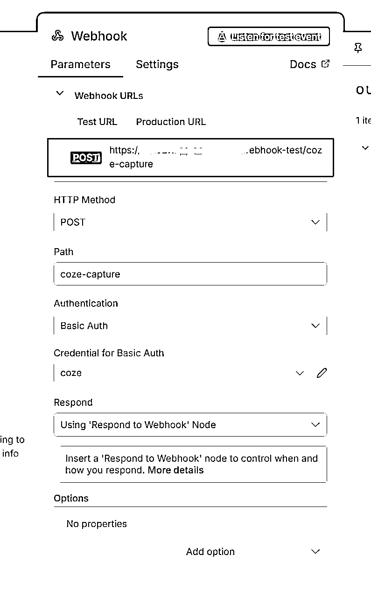

关键参数这样设：

- 先把POST地址复制出来，后面配置手机快捷触发时还要用到它；
- HTTP Method选POST；
- Path可以换成任意自定义路径，它会出现在链接里，方便日后识别用途；
- Authentication选最简单的Basic Auth，自己设一组账号和密码并存好，手机里要用；
- Respond项选Using 'Respond to Webhook' Node，配合最后一个环节，执行完会把“成功/失败”的结果回传给手机。这样内容到底进没进表格，一眼便知，不用提心吊胆。

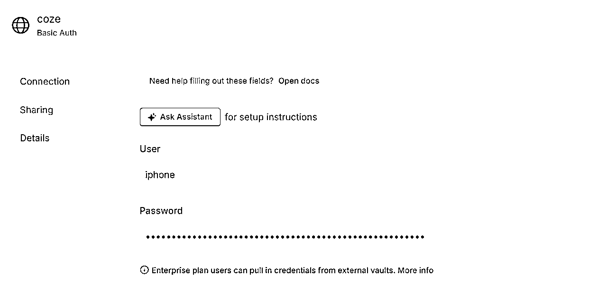

### 第二个环节：向飞书要一张临时通行证

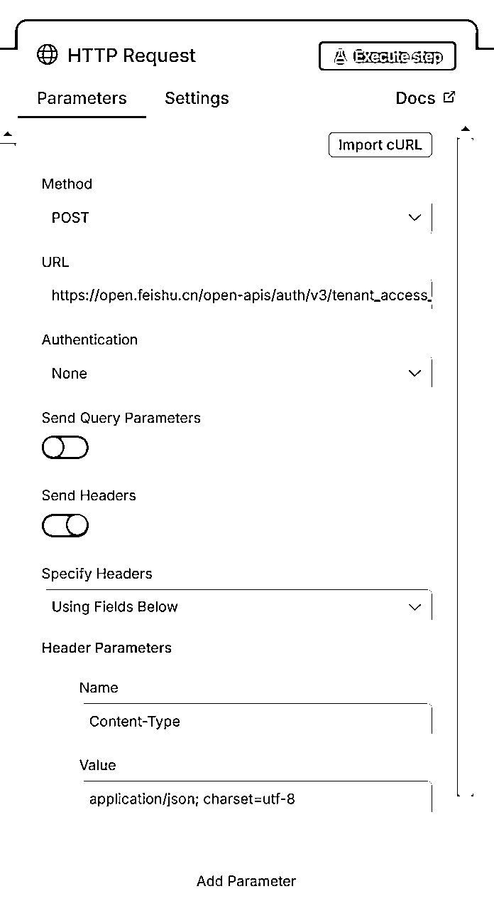

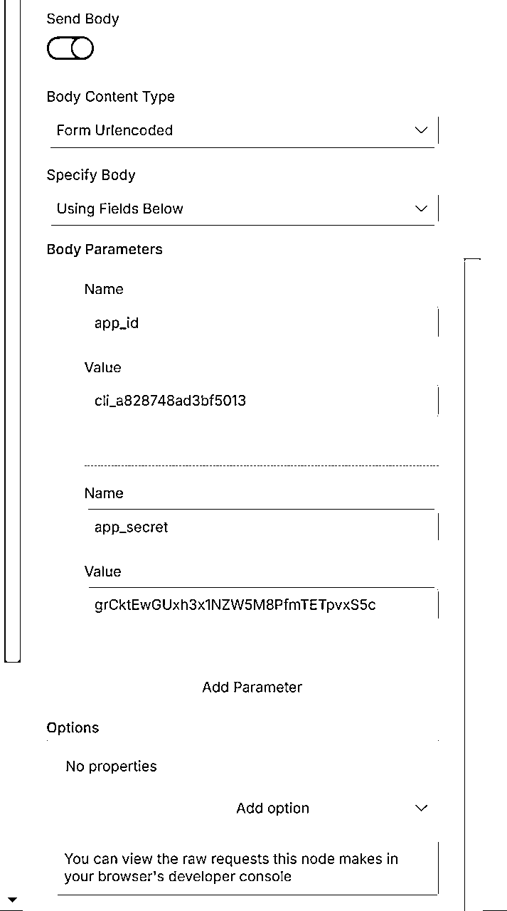

它的任务很简单：拿app_id和app_secret换一个访问令牌，后面写数据时出示它即可。

配置如下：

- Method: POST
- 请求地址：https://open.feishu.cn/open-apis/auth/v3/tenant_access_token/internal
- 打开Send Headers，Specify Headers选Using Fields Below，然后在Header Parameters里增加一项：
  - Name: Content-Type
  - Value: application/json; charset=utf-8
- 打开Send Body，Body Content Type选Form Urlencoded，Specify Body选Using Fields Below，并在Body Parameters里填两项：
  - Name: 你的飞书应用app_id
  - Value: 你的飞书应用app_secret

### 飞书应用和多维表格的准备工作

还没搞定应用？跟着来一遍。

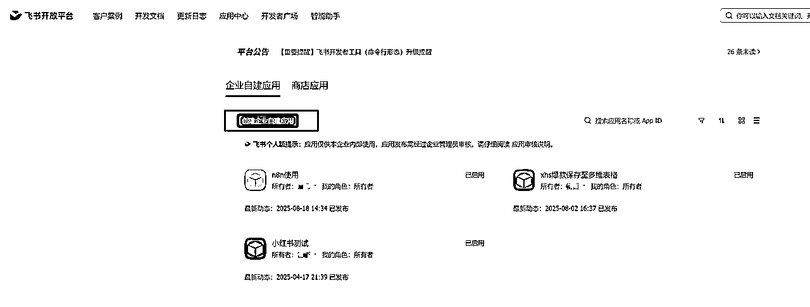

1. 访问 https://open.feishu.cn/app?lang=zh-CN ，新建一个应用。

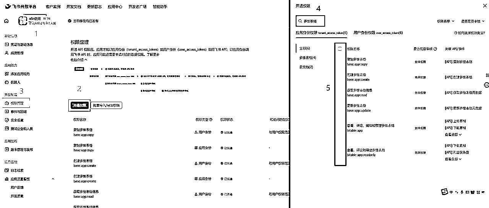

2. 修改应用名称。名字很重要，稍后把机器人拉进多维表格时，要按这个名字搜索。
3. 前往权限管理，把多维表格相关的权限全部勾选开启，一步步照着截图操作。

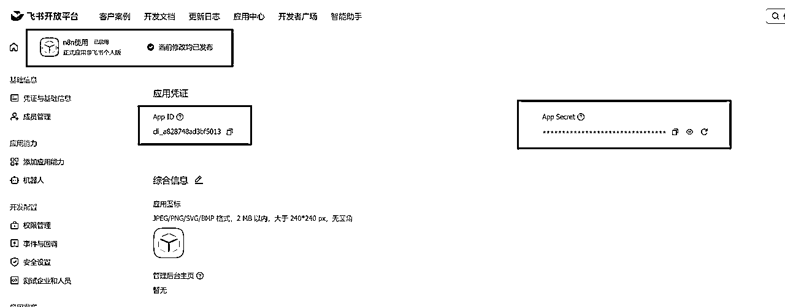

4. 保存并发布应用，此时页面会出现App ID和App Secret两串关键信息，记下来填进第二个环节。

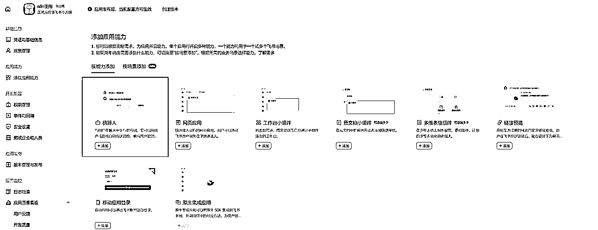

5. 顺手给应用添加“机器人”能力。

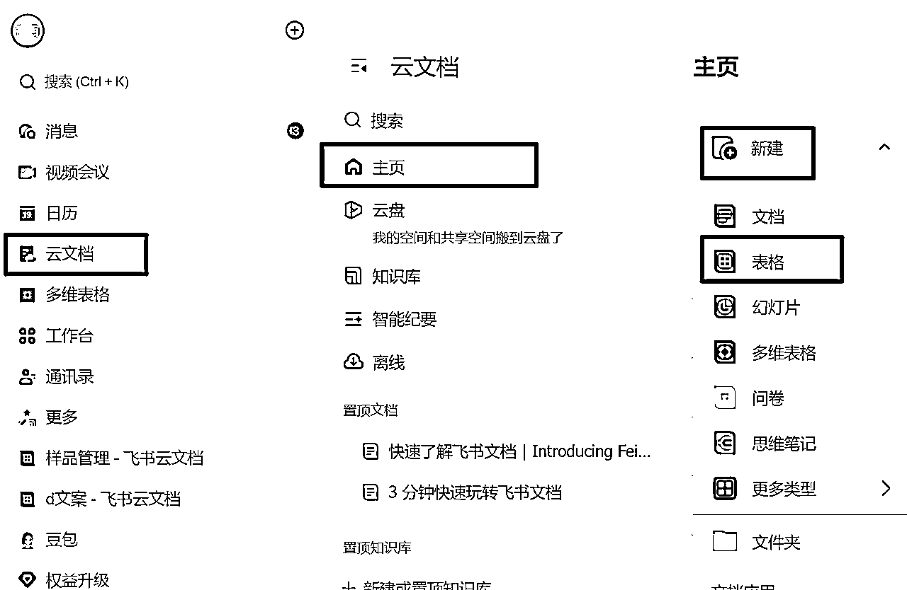

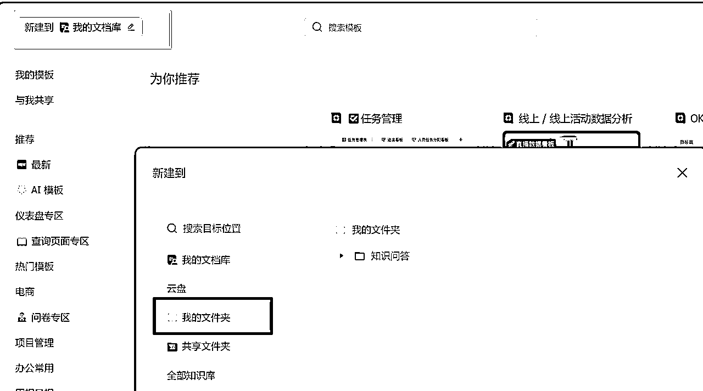


6. 创建多维表格。注意一定建在“我的文件夹”路径下；默认落在“我的文档库”里的是电子表格，链接格式和接口方式都不一样。

```
https://oet21ud8a2.feishu.cn/base/Z9Hpbss2bam09TsXmSJc75Uynk8?table=tblelis3dV08cUW8&view=veww29LK0a
```

复制地址时检查一下，链接应形如样例。其中base和table后面那两段值，后面配置时要用。

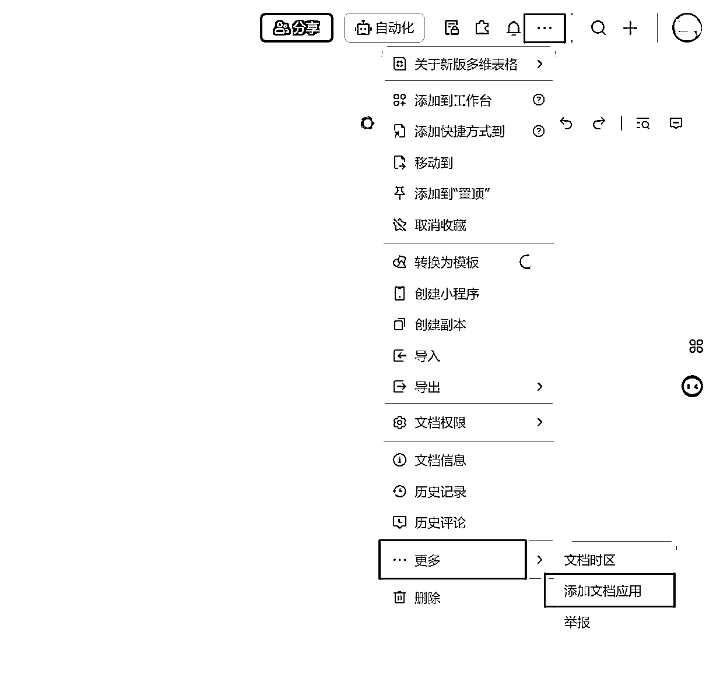

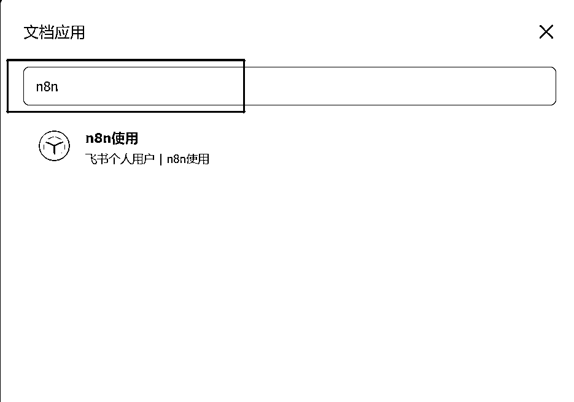

7. 打开表格右上角的“三个点”菜单，把刚创建的应用机器人加进这张表。搜索框里输入应用名才能找到。

### 第三个环节：把内容写进表里

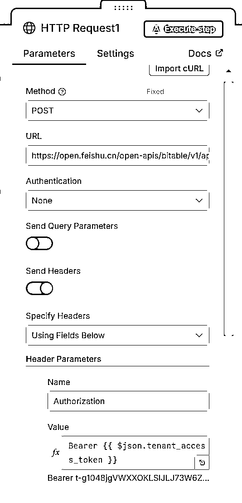

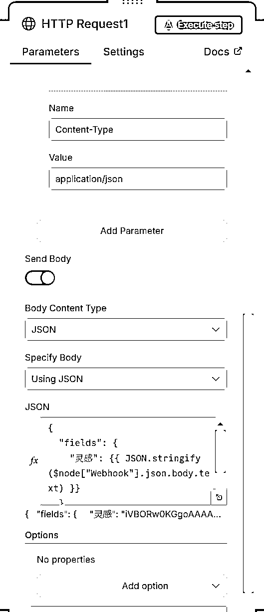

- Method: POST
- 请求地址：填你自己的多维表格地址，例如：
  https://open.feishu.cn/open-apis/bitable/v1/apps/KUJRbQmP7a5Sq0sQ1KKcLGQqnkf/tables/tbl3OYCpUshsPeZg/records
  （示例中的app和table参数，请替换成自己的）
- 打开Send Headers，按Using Fields Below方式增加两项：
  - Name: Authorization，Value: Bearer {{ $json.tenant_access_token }}
  - Name: Content-Type，Value: application/json
- 打开Send Body，Body Content Type选JSON，Specify Body选Using JSON，切换成Expression模式来写字段映射。

```
{
  "fields": {
    "灵感": {{ JSON.stringify($node["Webhook"].json.body.text) }}
  }
}

```

### 第四个环节：把结果带回给手机

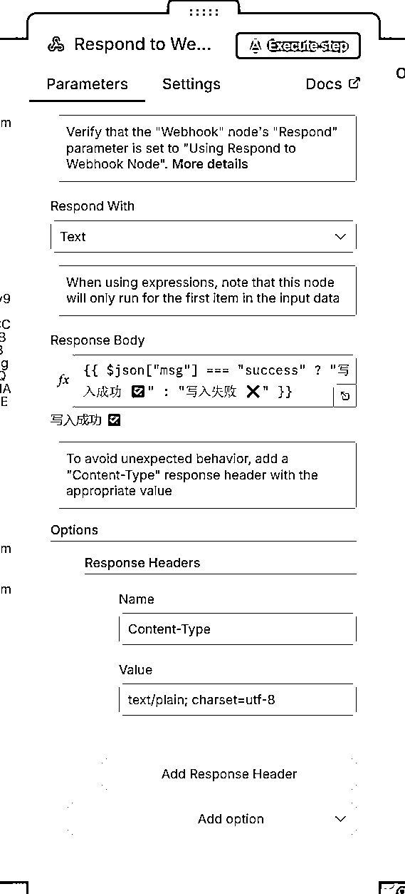

- Respond With选text格式；
- Response Body填入一段你想看到的提示文案，例如“已写入飞书”。

```
{{ $json["msg"] === "success" ? "写入成功 ✅" : "写入失败 ❌" }}
```

至此，n8n侧的四步链路全部完工。

### 手机快捷触发怎么配

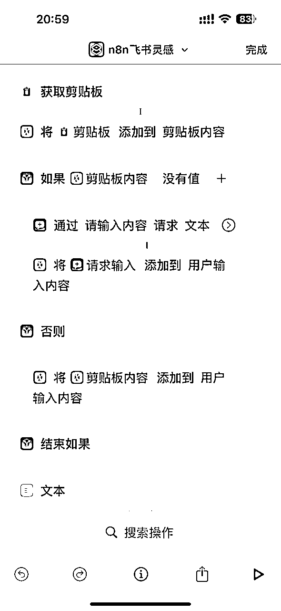

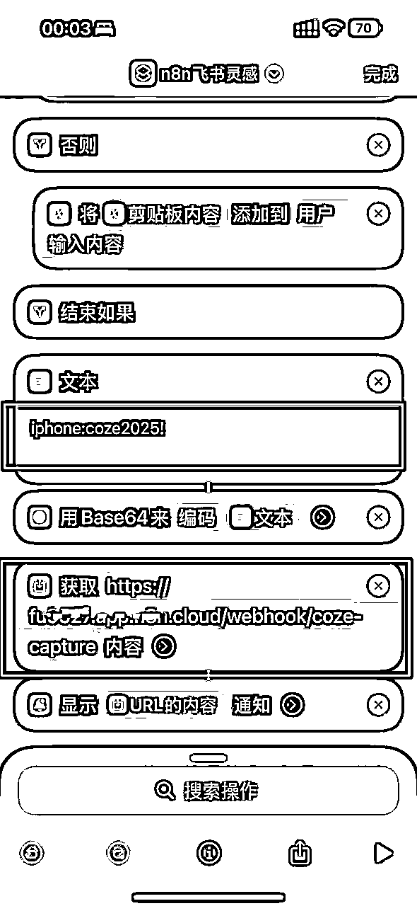

iPhone用户直接用Safari打开这个链接，即可导入现成的快捷命令：
https://www.icloud.com/shortcuts/9a4c79cc43f44a349acc6445b2b087ae

进去之后要做两处修改：

第一，把预设的账号密码改成你自己的，格式为“账号:密码”。如果沿用我设置的凭据，这步可以跳过。

第二，把回调地址替换成刚才在第一个环节里保存的那串POST链接。

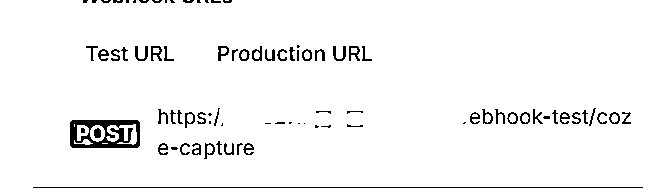

然后前往系统设置 → 辅助功能 → 触控 → 轻点背面，把双击或三击的触发动作关联到这条命令上。

到此，全部配置结束。你的专属飞书灵感集正式上线，之后复制、触发，内容就会自己落位。配合多维表格的各类能力，还能接上大模型自动归类、自动打标等操作，个性化上限很高。

## 写在最后

这条流程是从我自己的工作习惯里长出来的，谈不上宏大，但日常使用足够顺手。如果你也被同样的问题缠住，或者对延伸玩法有想法，欢迎在留言区交流。共鸣够多了，版本就可以继续迭代。

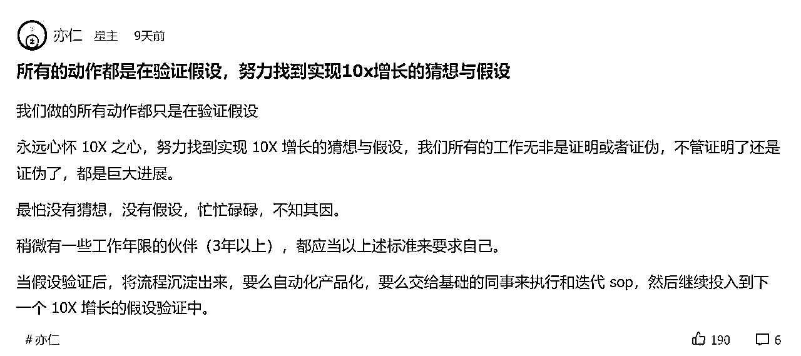

龙哥不止一次提起：所有动作本质上都是围绕假设做检验。一旦检验结果不支持，就该停下来，不必再埋头苦干。我名下项目有成的也有败的，对这句话愈发有体会。这条道理对赚钱的伙伴尤其重要——很多人只懂得把执行力拉满，却舍不得抽时间复盘“这个动作是否必要、是否仍在验证问题”。

回到这套流程本身：它现在只完成了最核心的那一段。接下来我要验证的是，自己能不能坚持高频使用。一旦习惯成立，功能自然会慢慢长出来。

最后还藏了两个小心思：论熟手程度，我更常用Cursor和Coze，之所以刻意选n8n，是想借这个机会检验近期口碑很热的它到底靠不靠谱。而写这篇分享，则是想验证另一件事——屏幕前的你，是不是也有同样的需求？