# 潜力项目问一问，素人变现4位数、涨粉2k的技巧分享

最近微信里有个隐藏入口悄悄火了起来，很多圈友靠它在碎片时间里赚到了第一笔自媒体收入，有人甚至涨粉2000+。今天就把这套实操心得完整拆给大家，尤其是零基础的小白，建议先码后看。

先介绍一下我自己：嘻嘻姐。读研那会儿靠自媒体攒下人生第一个20万，毕业第二年自己买了房。之前跑通过保研辅导和IP公众号，两个项目都做到6位数变现，目前主要精力放在公众号和问一问上。

这段时间问一问动作不少，我在赚钱分享了一些观察，意外中标，然后陆续有圈友来私聊咨询。干脆整理一篇保姆级分享，把创作技巧和避坑经验一次讲透，希望能帮想上手的圈友赚到互联网第一块铜板。

---

## 为什么我建议大家试试问一问

说实话，入局挺机缘巧合。先是在赚钱看到风向标和同行帖，又刷到朋友圈有人靠它赚钱，于是决定带私教学员们一起跑。三四月份开始内测，大家就是利用上厕所、排队这种零碎时间随手写写，现在已经赚到4位数或接近4位数了。

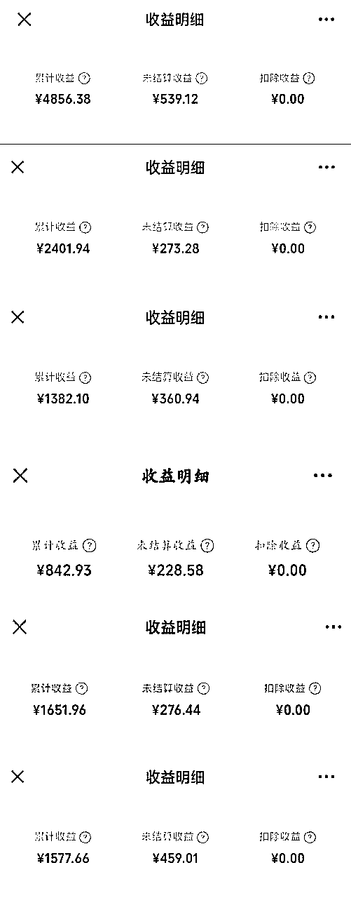

重点是，这批学员全是纯素人，而且没有一个是全职做，心态就是边玩边赚。这个项目的逻辑很简单：只要你愿意持续更新，基本都会有回报。

## 问一问到底好在哪？

### 优点一：素人极友好，输出门槛很低

这上面发内容不要求文笔多出彩，只要把话说明白就行。单篇限制500字，实际上写两三百字就足够，对长篇困难户来说简直是福音。

### 优点二：能赚钱，长尾收益很香

开通创作分成计划后，持续发布就能一直有收益。而且它不是只靠某一条爆款，也不是只有新内容才有效，历史内容随时可能被翻牌，属于典型的滚雪球式收益。

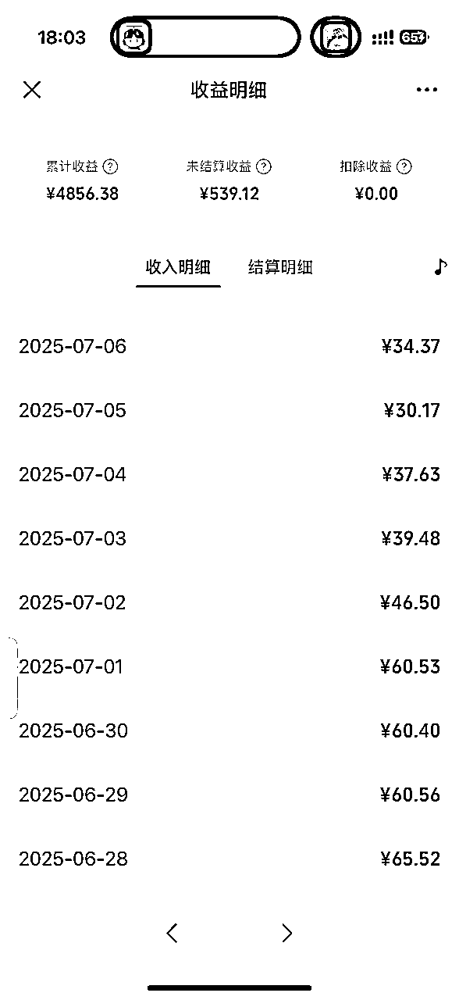

### 优点三：能涨粉，一份内容多处变现

账号直接绑定视频号或公众号，粉丝会同步沉淀到这两个号上。如果你想做冷启动，它就能帮你攒出第一波种子用户。如果分享内容贴近自己的专业或副业，还能顺势导到私域做转化。

涨粉数据给大家看一波：

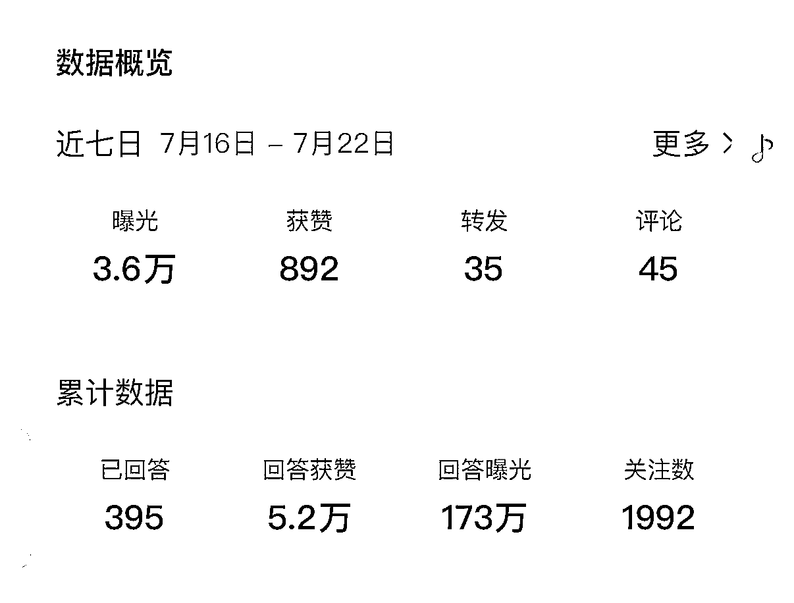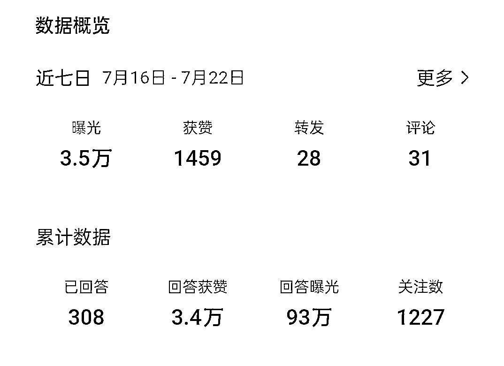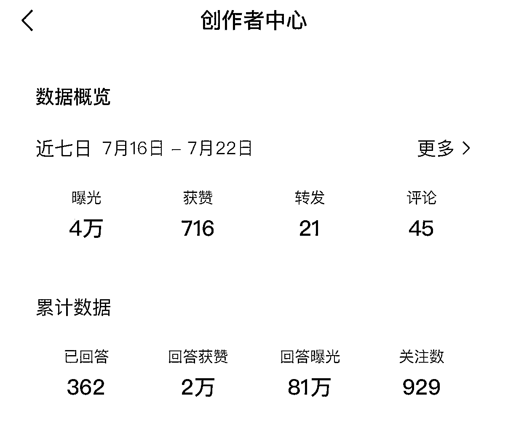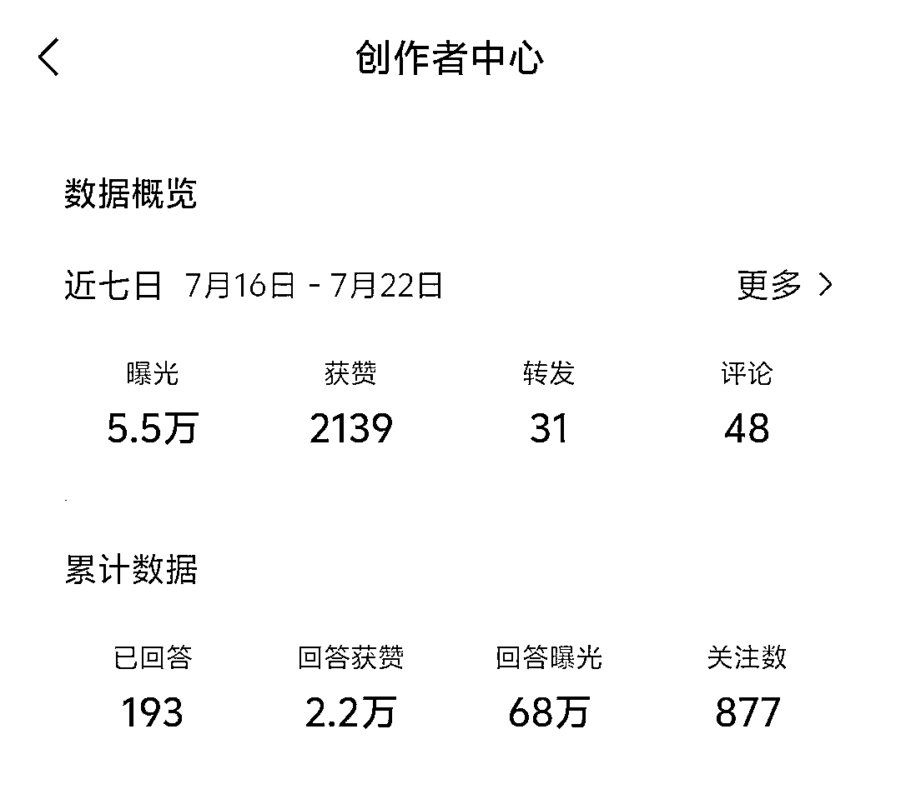

### 收入来源和开通要求

和公众号流量主一个玩法：开通分成计划后，评论区会出现广告，和公众号文末广告类似，靠曝光和点击产生收益。

开通条件有三条：
- 质量过关（最关键，很多人篇数粉丝都够了却卡在这条，具体技巧后面讲）
- 90天内发布30篇内容（基本人人都能做到）
- 100个粉丝（内容足够优质，有机会免掉）

对比一下，公众号要500粉才能开流量主，问一问100粉就能开，甚至还有不到100粉就被官方邀请的例子，我陪伴群就有学员遇上了。

具体风向标可以看这个：https://t.zsxq.com/pgC0S

### 适合什么人？

**第一种：分享欲很强的人**  
可以把它当成朋友圈或微博来玩，随手发发吃喝玩乐照片，再加点感悟和经验。

**第二种：想尽快赚钱的自媒体新手**  
我做了三四年自媒体，见到的门槛最低的项目，除了小绿书就是问一问。它不要求你垂直在一个领域，看到什么新奇内容都能发，正反馈来得特别快。

**第三种：想记录生活、边玩边赚的人**  
出去玩拍了照片，不好意思发朋友圈？那就发问一问。既能安放分享欲，又能搞点零花钱。比如我打卡一家店，觉得某道菜不错，就随手记下感受，下次再去直接翻帖子回顾就行。

---

## 问一问怎么操作？

### 入口在哪？

路径很简单：微信 >> 发现 >> 搜一搜 >> 问一问

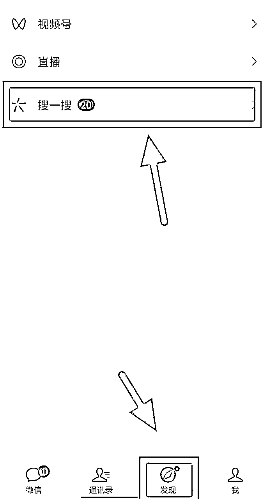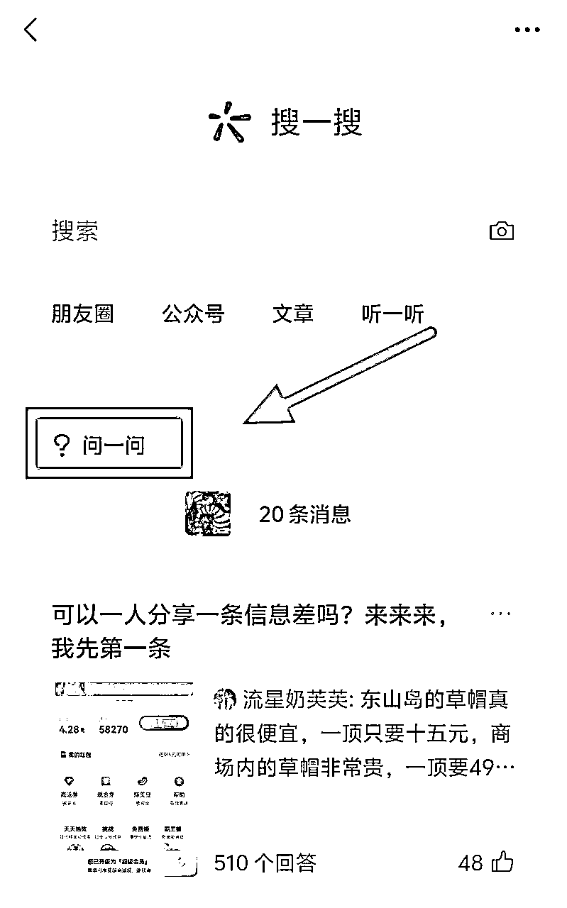

它没有独立App，估计是腾讯的一个测试项目。之前小绿书没做起来，现在问一问接棒了，整体感觉越来越像“知乎 + 小红书”。

小红书为什么能成为大家搜答案的首选？因为图文并茂、氛围活跃。小绿书当年想模仿，结果搬运党太多，垃圾内容泛滥，价值感一直上不去。问一问则有天然优势：微信用户基数大，传播方便，而且搜一搜本来就缺这种短平快的内容形态，它正好补上这个空位。

### 三种内容形式

发布、回答、讨论，入口在下面：

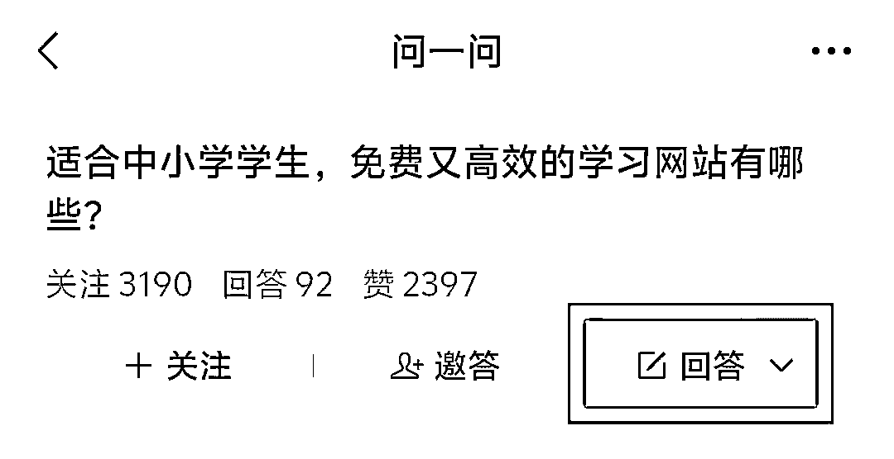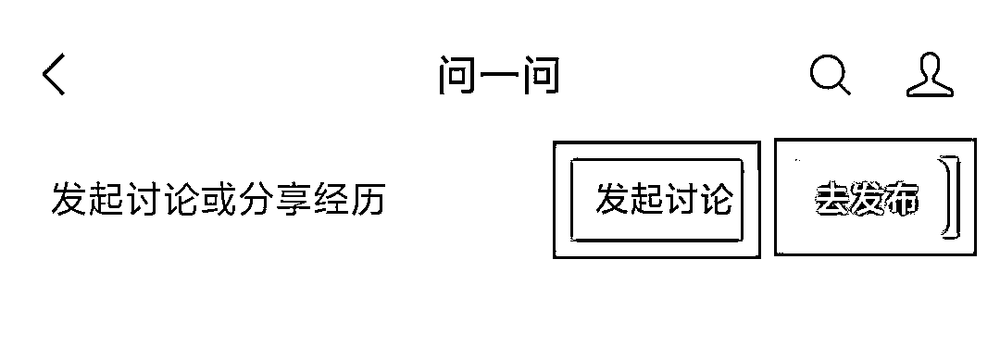

- **发布**：自己发帖，类似小红书图文笔记。优势是有利于提高账号权重，也是通过质量关的核心动作。
- **回答**：在别人帖子下面答题。问题是选得好，曝光机会就大。
- **讨论**：发起一个话题然后自己回答。主持人的答案会被置顶，相当于官方奖励，被动关注多很多。

### 排版技巧

记得做出呼吸感：每2-4行分一段，段与段之间空一行，字数控制在300字左右。示例如下：

### 素人适合哪些赛道？

它目前不限领域，而且非常强调真人感。如果你有个人定位，围绕自己的生活去分享就很合适。结合官方小助手的答疑和我自己的实战，推荐5个素人容易跑出来的方向：

**一、旅游赛道**  
暑假正是旅行高峰，我拿小号测过7月数据，曝光和转粉明显比其他内容高。我这边有学员10天就涨了100多个粉。案例见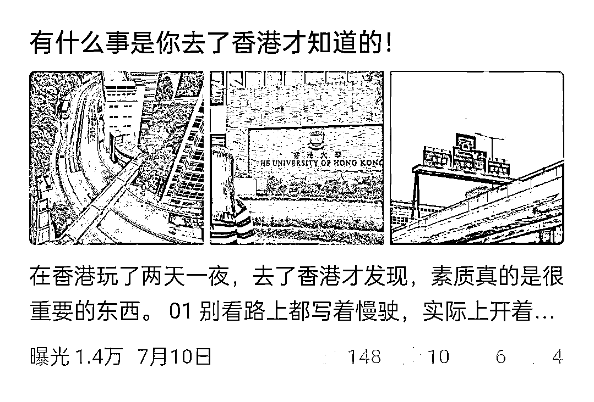

**二、育儿和宠物**  
无论是带娃的宝妈宝爸，还是养猫养狗的铲屎官，相关内容点赞数据都很能打。例如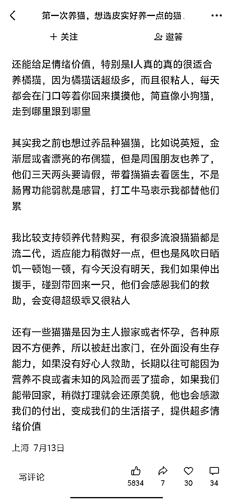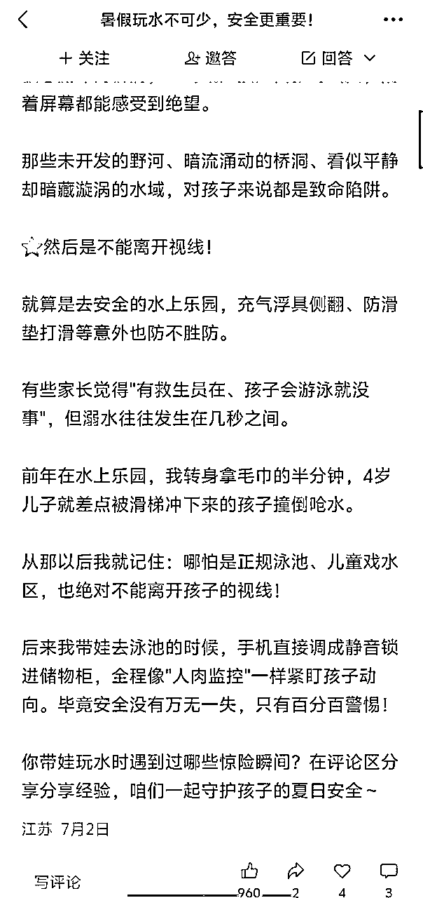

**三、车和房**  
预算充足的老板们可以多关注这些话题，热度同样很高。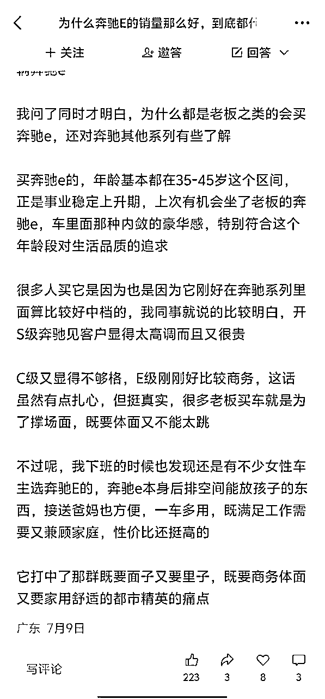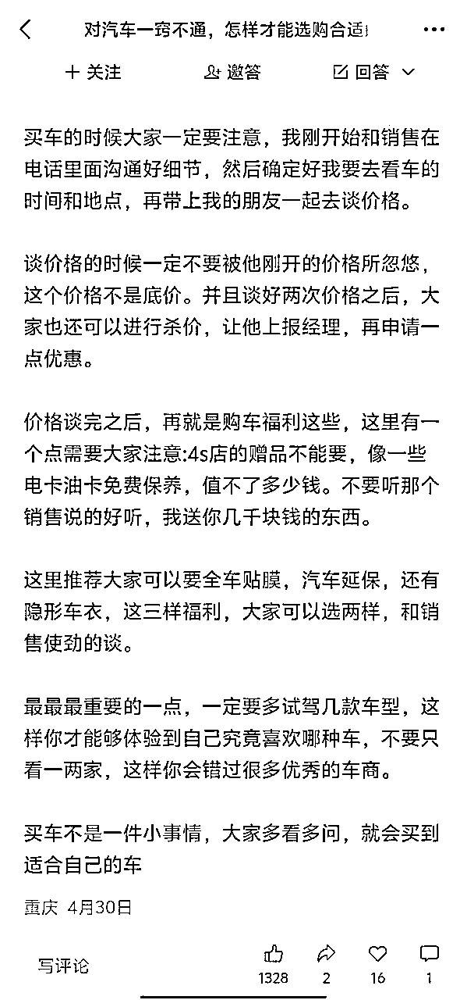

**四、AI相关**  
AI本身就是流量密码，有技术底子的圈友随便分享点技巧或逻辑就能圈粉。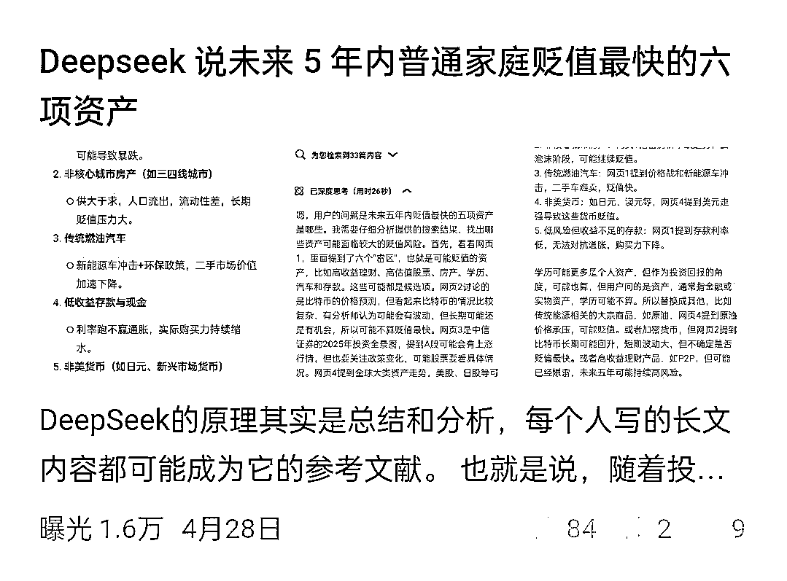

**五、美妆和穿搭**  
官方重点推流方向之一，目前还在邀请作者参与，女生可以认真考虑。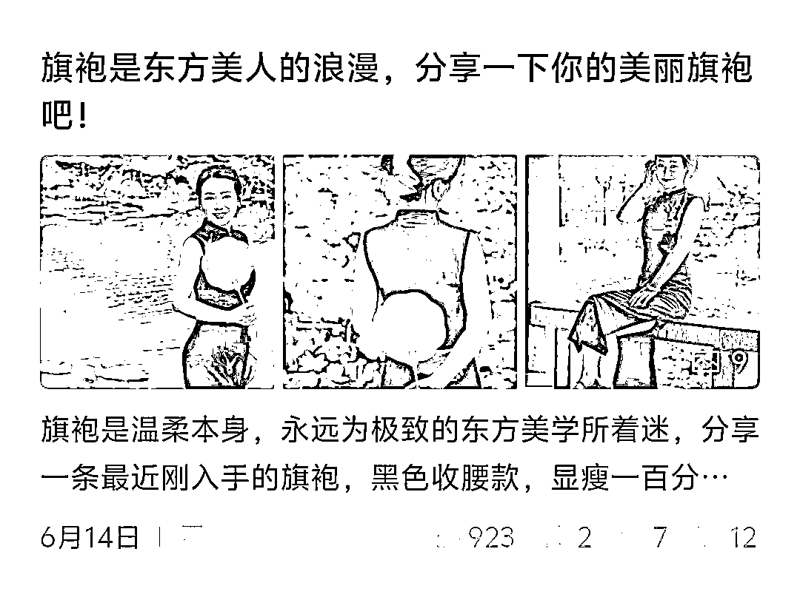

### 怎么快速开通创作分成？

不少人篇数够了、粉丝也够了，但申请总是被驳回，核心问题就是“质量关”。官方没有明文标准，我们也是测试多个账号后才摸出两个关键技巧：

1. **前期多“发布”**：发布和回答的比例至少对半开，最好发布条数更多。我当时申请是秒过的，因为误以为30条要求指必须发30条发布，所以前期几乎没怎么回答，全是用发布为主。
2. **图文并茂**：问一问在往小红书方向发展，内容一定要配图，这样丰富性和质量感都上去了。

---

## 避坑指南：这些坑千万别踩

### 1. 能不能用AI快速输出？

想做长期账号，绝对不要用AI。问一问对AI的限制比任何平台都严格。它基本以人工审核为主，一旦内容被察觉像AI，直接不给流量；就算给了曝光，也会卡你的分成计划开通。或者等开通之后秋后算账，被限流到怀疑人生。

### 2. 能不能刷到100粉？

别刷。尽量保证前80个粉丝都是自然涨起来的，而且内容至少更新10天以上，让账号度过隐形的“人工审核期”。否则后期要么开通被卡，要么被限流，账号很难救回来。

### 3. 怎么引流到公众号？

问一问的身份有两种：视频号或公众号。如果你绑的是公众号，涨的粉会直接叠加到公众号上，等于自动引流。如果内容偏专业领域，还能进一步联动公众号转化到私域。

### 4. 能不能矩阵化运营？

完全可以。一个身份证可以认证1个公众号 + 2个视频号，再借家人身份证就能多开账号。我朋友圈已经有人做了6-7个号，收益相当可观，月入5位数不是梦。

### 5. 手写内容被判AI怎么办？

这个问题很多人问，包括我自己也遇到过。明明是自己一个字一个字敲的，审核却说像AI，简直离谱。后来发现，通常是因为写得太正式，像“机构文”。而问一问要的是口水文、流水账，通俗易懂，不像说教。遇到这种误判，直接放弃这条，不要申诉，纯属浪费时间，另写一条就好。

### 6. 有没有内容模板？

说实话，不建议用固定框架或模板。越模板化越容易被判AI。直接按逻辑写出来就行，口水话多一点，别太端着。想提速的话，口述转文字是个好办法，既接地气效率又高。

### 7. 图片能不能用AI生成？

绝对不行！和文字一样，图片用AI也会被限流，平台会判定你在灌垃圾内容。无效的发布或回答不计入条数，申请开通分成时会被卡住。

---

问一问是个小而美的内容平台，反馈速度极快。赚钱本来就是踩在风口上的圈子，希望大家都能跟上这波，从小钱开始，一步步赚大钱。

这次分享特别感谢赚钱官方运营小武的约稿，也谢谢越越给了我不少框架灵感。以上就是全部内容，欢迎各位圈友继续交流讨论。